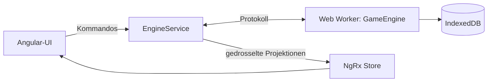

# PortfoliGo

Ein Börsenplanspiel im Browser, das aussieht und sich bedienen lässt wie eine moderne Trading-Plattform. Du führst einen Spieler durch ein simuliertes Finanzleben: Gehalt und Lebenshaltungskosten, Konten bei verschiedenen Banken, ein Depot mit Aktien und ETFs. Alles spielt in einem vollständig generierten Markt, der sich wie ein echter verhält.

- **Lernen ohne Risiko:** Sparen, Investieren und Traden mit realistischen Kosten, Spreads, Dividenden und deutscher Abgeltungsteuer, ohne echtes Geld.
- **Zeit läuft weiter:** Die Spielzeit läuft auch bei geschlossener App weiter. Die Geschwindigkeit ist frei wählbar, von Echtzeit bis zu einer Spielwoche pro Sekunde.
- **Deterministisch:** Gleicher Seed ergibt eine identische Welt. Mehrere Spieler können dieselbe Ausgangslage unterschiedlich spielen.
- **Lokal und privat:** Kein Server, kein Benutzerkonto, kein Tracking. Alle Daten bleiben im Browser (IndexedDB).

Die Oberfläche gibt es auf Deutsch und Englisch.

## Stand

Stufe 1 (M0 bis M6) ist abgeschlossen, aktuell ist Version 0.6.0. Spielbar sind:

| Bereich            | Inhalt                                                                                           |
| ------------------ | ------------------------------------------------------------------------------------------------ |
| Spieler und Zeit   | mehrere Spieler je Gerät, Spieluhr mit Pause, Geschwindigkeiten und Sprung, Nachberechnung       |
| Banking            | Girokonto, Tagesgeld, Verrechnungskonto, Kontoauszüge, Überweisungen, Bankenvergleich, Zinsen    |
| Märkte             | Marktübersicht, Screener, Watchlist, Instrumentseite mit Live-Chart und Indikatoren              |
| Handel und Depot   | Market-, Limit- und Stop-Orders, Orderbuch, Daueraufträge, Sparpläne, Positionen, Depotgebühr    |
| Steuern            | Abgeltungsteuer, Sparerpauschbetrag, Verlustvortrag, Steuerübersicht                             |
| Dashboard          | Performance mit Benchmark, „Demnächst“, „Erste Schritte“, Erträge und Kosten, Dividendenkalender |
| Benachrichtigungen | Hinweise, automatische Pause, Abwesenheitsbericht, Browser-Benachrichtigungen                    |
| Datensicherung     | Export und Import eines Spielers als Datei oder Text                                             |
| Einstellungen      | Erscheinungsbild, Farben für Gewinn und Verlust, Verhalten im Hintergrund, Sprache               |
| App                | installierbar als PWA, offline spielbar, Glossar und Kontexthilfe, Befehlspalette, Tastatur      |

Als Nächstes folgt Stufe 2 mit M7 (Prüfung des Rechenkerns und neue Oberfläche, Vorlage in `docs/design/`). Bis 1.0 zählt die Version `0.<Meilenstein>.<Patch>`; Version 1.0 kommt mit dem Public Release (M16). Den aktuellen Stand je Arbeitspaket zeigt die Statusübersicht im [Projektplan](docs/projektplan.md#4-statusübersicht).

Unter `#/lab` liegt zusätzlich ein **Simulations-Labor**, das generierte Welten, Kursverläufe und Statistiken des Marktmodells zeigt.

## Architektur in Kürze



- Eine reine, deterministische **`GameEngine`** läuft in einem Web Worker und ist maßgeblich für alle Spielregeln. Sie speichert den Spielstand selbst in IndexedDB.
- Die UI schickt Kommandos über den `EngineService`; der NgRx Store hält nur gedrosselte Projektionen dessen, was die aktuelle Ansicht braucht.
- **Kurse sind eine reine Funktion** aus Seed, Simulationsversion und Spielzeit (`priceAt`, Brückenmodell). Simulationscode nutzt ein eigenes Toolkit für Zufall und Mathematik, damit Ergebnisse in allen Browsern bitgleich sind.
- Der Code ist nach Domänen und darin nach Schichten gegliedert: `src/app/<domäne>/{feature,ui,data-access,domain,util}`. `domain` und `util` sind frameworkfrei und laufen im Worker und unter Node.

Details stehen in der [technischen Spezifikation](docs/specs/technische-spezifikation.md).

## Technik

Angular 22 (standalone, zoneless, Signal Forms) · NgRx 22 · RxJS 7 · Angular CDK und `@angular/aria` · Tailwind CSS v4 mit eigenen Design-Tokens · `lightweight-charts` · `idb` · Bootstrap Icons · Vitest, fast-check, Stryker und Playwright für Tests.

Alle Abhängigkeiten sind in `package.json` exakt gepinnt (`.npmrc`: `save-exact=true`).

## Loslegen

Voraussetzungen: [nvm](https://github.com/nvm-sh/nvm) und Node laut `.nvmrc` (22.22.3; ältere 22er-Versionen reichen für Angular CLI 22 nicht).

```sh
nvm use
npm ci
npm start            # Dev-Server auf http://localhost:4711
```

Zum Testen auf dem Smartphone im lokalen Netz: `ng serve --ssl --host 0.0.0.0`. Mehrere Browser-APIs funktionieren nur über HTTPS.

Für die Systemtests einmal je Rechner: `npx playwright install chromium`.

## Befehle

| Aufgabe                         | Befehl                                                                |
| ------------------------------- | --------------------------------------------------------------------- |
| Dev-Server                      | `npm start`                                                           |
| Produktions-Build (nach `www/`) | `npm run build`                                                       |
| Schnelle Tests                  | `npm test` (Suiten `logic` und `angular`)                             |
| Kalibrierung des Marktmodells   | `npm run test:calibration`                                            |
| Performance-Budgets             | `npm run test:perf`                                                   |
| Mutationstests                  | `npm run test:mutation` (Bericht unter `reports/mutation/index.html`) |
| Systemtests (Chromium)          | `npm run e2e` (Build und Playwright)                                  |
| Typen von Specs und E2E         | `npm run typecheck`                                                   |
| Lint mit Fixes                  | `npm run lint`                                                        |
| Formatieren                     | `npm run format`                                                      |
| i18n-Texte extrahieren          | `npm run translate` (schreibt `messages.xlf`)                         |
| **Alles, was die CI prüft**     | `npm run verify`                                                      |

Eine einzelne Spec-Datei: `npx vitest run src/app/<pfad>/<name>.spec.ts` für Logik, `ng test --watch=false --include src/app/<pfad>/<name>.spec.ts` für Angular.

## Tests

| Suite         | Inhalt                                                                          | Läuft mit                 |
| ------------- | ------------------------------------------------------------------------------- | ------------------------- |
| `logic`       | Regeln in `domain`/`util`, Engine-Szenarien, Properties, Golden Master          | Vitest unter Node         |
| `angular`     | Slices, Services, Seiten- und Komponententests mit echtem Store und Worker-Code | `ng test` (Vitest, jsdom) |
| `calibration` | statistische Ziele des Marktmodells auf festen Seeds                            | Vitest                    |
| `perf`        | Zeitbudgets                                                                     | Vitest                    |
| `mutation`    | Mutationstests des Regelcodes                                                   | Stryker                   |
| `e2e`         | Systemtests gegen den Produktions-Build                                         | Playwright                |

Erwartete Werte stammen nie aus dem getesteten Code, sondern aus Beispieltabellen der Spezifikation, Referenzimplementierungen, Invarianten oder eingefrorenen Prüfsummen. Das Testkonzept steht in TS §14.

## Dokumentation

| Dokument                                                           | Inhalt                                                                 |
| ------------------------------------------------------------------ | ---------------------------------------------------------------------- |
| [Produktspezifikation](docs/specs/produktspezifikation.md)         | Vision, Domänenmodell, User Stories, UI/UX-Konzept                     |
| [Technische Spezifikation](docs/specs/technische-spezifikation.md) | Architektur, Zeit- und Marktmodell, Engine, Persistenz, Entscheidungen |
| [Projektplan](docs/projektplan.md)                                 | Meilensteine, Arbeitspakete, Status, offene Entscheidungen             |
| [Änderungsprotokoll](docs/aenderungsprotokoll.md)                  | Änderungen je Arbeitspaket, neueste zuerst                             |
| [Design-Vorlage](docs/design/README.md)                            | Mockups für den UI-Overhaul in M7                                      |
| [CLAUDE.md](CLAUDE.md) und `.claude/rules/`                        | Code-Konventionen und Ist-Stand je Bereich                             |

## Arbeitsweise

Entwickelt wird Arbeitspaket für Arbeitspaket nach dem [Projektplan](docs/projektplan.md#2-arbeitsweise-in-sessions). Ein AP ist fertig, wenn `npm run verify` grün ist, Status und Änderungsprotokoll aktualisiert sind und Abweichungen in die Spezifikation übernommen wurden. Commits folgen [Conventional Commits](https://www.conventionalcommits.org/).

## CI und Deployment

GitHub Actions prüft jeden Push:

- `build-latest.yml` ist das Gate: Format, Lint, Typen, Suiten `logic` und `angular`, Build mit Bundle-Budget und Systemtests in Chromium.
- `verify.yml` führt den Rest aus (`verify-extended.yml`): Kalibrierung, Performance, Mutation, J10-Budgets, Firefox, WebKit und Smartphone-Profile. Er läuft vorerst nur auf Abruf, nicht bei jedem Push (die Prüfungen laufen lokal), und blockiert das Deployment nicht.
- `pull-request.yml` führt Gate und `verify-extended.yml` für Pull Requests aus.
- `publish.yml` baut `main` und veröffentlicht `www/` per SFTP, sobald das Gate grün ist. Die App läuft unter <https://algoristic.de/portfoligo/>.
