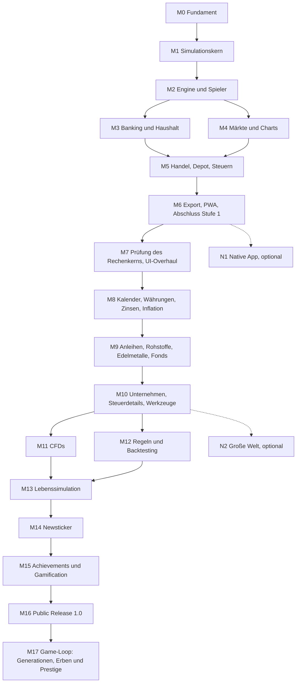
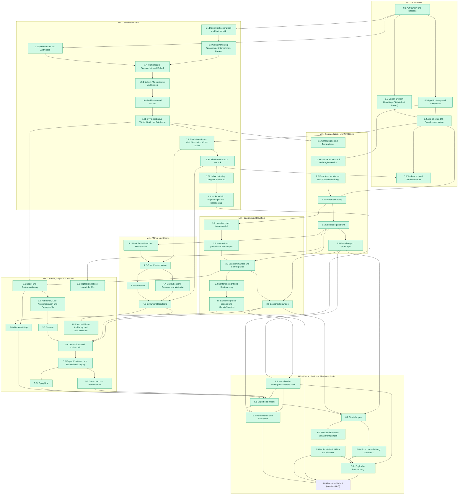
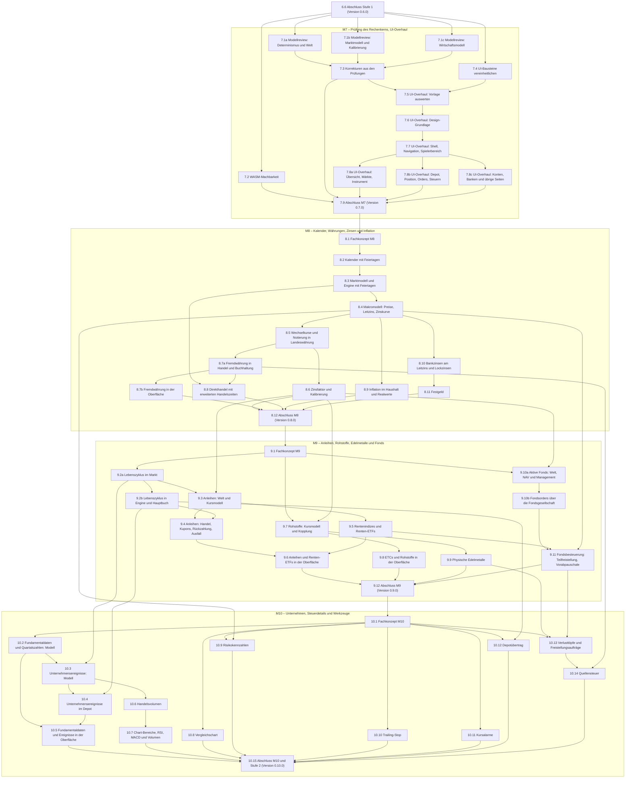

# PortfoliGo – Projektplan

> **Status:** Entwurf v0.3 · **Stand:** 15.11.2026
> **Grundlagen:** [Produktspezifikation](./specs/produktspezifikation.md) (PS) · [Technische Spezifikation](./specs/technische-spezifikation.md) (TS)

Dieser Plan zerlegt PortfoliGo in Meilensteine und Arbeitspakete (AP). Ein AP ist so geschnitten, dass es in **einer Session** umgesetzt werden kann. Verweise wie `US-SP-01` zeigen auf User Stories der Produktspezifikation, `TS §3.2` auf Abschnitte der technischen Spezifikation, `E-02` auf Entscheidungen (TS §16).

## Inhalt

1. [Überblick](#1-überblick)
2. [Arbeitsweise in Sessions](#2-arbeitsweise-in-sessions)
3. [Offene Entscheidungen](#3-offene-entscheidungen)
4. [Statusübersicht](#4-statusübersicht)
5. [Stufe 1: Meilensteine M0–M6](#5-stufe-1-meilensteine-m0m6)
6. [Stufe 2: Meilensteine M7–M10](#6-stufe-2-meilensteine-m7m10)
7. [Spätere Ausbaustufen](#7-spätere-ausbaustufen)
8. [Änderungsprotokoll](#8-änderungsprotokoll)

## 1. Überblick

Geplant wird rollierend: Die Meilensteine bis zum MVP (Stufe 1, M0–M6) und der Stufe 2 (M7–M10, geplant am 15.11.2026) sind in Arbeitspakete zerlegt. Spätere Stufen sind als Epics skizziert und werden detailliert, sobald die Stufe davor steht und die Prioritäten feststehen.



| Meilenstein | Stufe | Ziel                                               | Ergebnis, das man zeigen kann                                                               | APs |
| ----------- | ----- | -------------------------------------------------- | ------------------------------------------------------------------------------------------- | --- |
| M0          | 1     | Sauberes Fundament mit Design-System und App-Shell | Navigierbare, leere App im Trading-Look; CI prüft Lint, Tests und Build                     | 4   |
| M1          | 1     | Getesteter, deterministischer Simulationskern      | Simulations-Labor zeigt eine generierte Welt mit Kursverläufen und Statistiken              | 12  |
| M2          | 1     | Spielschleife mit Spielern, Uhr und Persistenz     | Spieler anlegen, Zeit in jeder Geschwindigkeit laufen lassen, schließen, nachberechnen      | 6   |
| M3          | 1     | Geldflüsse: Einkommen, Kosten, Gebühren, Zinsen    | Kontoauszüge füllen sich; Konten eröffnen, Geld überweisen, Warnungen                       | 6   |
| M4          | 1     | Märkte im Trading-Look                             | Marktübersicht, Screener, Watchlist, Instrumentseite mit Live-Chart und Indikatoren         | 5   |
| M5          | 1     | Kernspiel komplett                                 | Kaufen, verkaufen, Daueraufträge, Sparpläne, Steuern, Depot, Dashboard mit Benchmark        | 10  |
| M6          | 1     | Datensicherheit, Installierbarkeit, Feinschliff    | Version 0.6.0: Export und Import, PWA, Einstellungen, Hintergrundmodi, Deutsch und Englisch | 9   |
| M7          | 2     | Geprüfter Rechenkern, neue Oberfläche              | Befundlisten und Korrekturen aus den Prüfungen, WASM-Empfehlung, App im neuen Design        | 13  |
| M8          | 2     | Kalender, Währungen, Zinsen und Inflation          | Feiertage, Kurse in Landeswährung, Leitzins und Zinskurve, Inflation, Tagesgeld, Festgeld   | 13  |
| M9          | 2     | Neue Assetklassen                                  | Anleihen, Renten-ETFs, Rohstoffe, ETCs, physische Edelmetalle, aktive Fonds, Fondssteuer    | 14  |
| M10         | 2     | Unternehmen, Steuerdetails und Werkzeuge           | Quartalszahlen, Splits und Übernahmen, Volumen, Trailing-Stop, Kursalarme, Steuerdetails    | 15  |

**Empfohlene Reihenfolge:** M3, M4 und M5 sind abgeschlossen (M5 mit der einmaligen Erhöhung von `SCHEMA_VERSION` auf 6, §5, M5). In M6 sind AP 6.7 (weitere Modi für das Verhalten im Hintergrund, `SCHEMA_VERSION` 7), AP 6.1 (Export und Import, Formatversion 1 mit den neuen Spielereinstellungen), AP 6.2 (Einstellungen), AP 6.3 (PWA und Browser-Benachrichtigungen, `@angular/service-worker`), AP 6.4 (Performance und Robustheit, Verdichtung alter Tageskerzen), AP 6.5 (Barrierefreiheit, Glossar, Befehlspalette, rechtliche Hinweise), AP 6.8a (Sprachumschaltung: Mechanik) und AP 6.8b (englische Übersetzung, `i18n:check --strict` als Gate) fertig – M6 ist bis auf AP 6.6 erledigt. Als Nächstes folgt AP 6.6 (Abschluss Stufe 1 als Version 0.6.0; der PO setzt den Tag und gibt das Deployment frei). Version 1.0 kommt erst mit dem Public Release (M16, §6); bis dahin gelten die Versionsregeln vor 1.0 (TS §15), und E-25 ist erst vor M16 zu entscheiden. E-35 und die Ergänzungen zu E-10 sind entschieden (14.11.2026, §3). Die Sprachumschaltung (AP 6.8a, AP 6.8b) folgt nach AP 6.2; die Übersetzung kommt zuletzt, wenn alle Texte von M6 stehen. Ab AP 2.3 gibt es gespeicherte Spieler, die jede Modelländerung ungültig macht (TS §15); Änderungen am Marktmodell prüft seitdem die Kalibrierungs-Suite gegen die Ziele.

**Stufe 2 (E-37, 15.11.2026):** Sie beginnt nach AP 6.6 mit M7 (Prüfungen, Korrekturen, UI-Overhaul). Danach kommt das Fundament, das Kalender und Kurse aller Instrumente ändert: Feiertage, Fremdwährungen, Zinsen und Inflation (M8). Erst darauf bauen die neuen Assetklassen (M9) und Unternehmen, Steuerdetails und Werkzeuge (M10) auf. Feiertage und Fremdwährungen standen früher in M10; Anleihen und Rohstoffe (in USD notiert) hätten sonst nachgebaut werden müssen. Jeder Meilenstein beginnt nach dem Abschluss-AP des vorigen mit einem Fachkonzept-AP (8.1, 9.1, 10.1), das die Stories und die TS-Abschnitte ausarbeitet und den Schnitt bestätigt (§6).

## 2. Arbeitsweise in Sessions

### 2.1 Vorbereitung

```sh
nvm use   # Node 22.22.3 laut .nvmrc – Angular CLI 22 verlangt ≥ 22.22.3
npm ci    # nur nötig, wenn sich Abhängigkeiten geändert haben
```

Für die Systemtests einmal je Rechner: `npx playwright install chromium`. Lokal laufen nur die Chromium-Projekte; Firefox und WebKit prüft die CI. Wer sie lokal braucht: `npx playwright install firefox webkit` und unter Linux und WSL `sudo npx playwright install-deps` (TS §14.1).

Für Tests auf dem Smartphone im lokalen Netz: `ng serve --ssl --host 0.0.0.0` – mehrere Browser-APIs funktionieren nur über HTTPS (TS §1.3).

### 2.2 Session starten

Vorlage für den Start einer Session:

> Setze AP 1.2 aus `docs/projektplan.md` um.

Claude liest dann `CLAUDE.md`, die Rules der betroffenen Domänen (`.claude/rules/<domain>.md`, Ist-Stand des Codes), das AP samt Abhängigkeiten, die jüngsten Einträge im [Änderungsprotokoll](./aenderungsprotokoll.md) und die Einträge zu den Abhängigkeiten (Suche nach `AP x.y`) sowie die referenzierten Abschnitte der Spezifikationen.

### 2.3 Ablauf

1. Prüfen, ob alle Abhängigkeiten des AP den Status „fertig" haben.
2. Betroffene Entscheidungen klären: Steht eine, die das AP braucht, noch auf „Vorschlag", fragt Claude nach, bevor darauf aufgebaut wird (§3 nennt für jede Entscheidung das AP, vor dem sie fallen muss).
3. In kleinen, testbaren Schritten umsetzen.
4. Prüfen: während der Arbeit `npm test` und die betroffenen Suiten, zum Abschluss `npm run verify` (Format, Lint, Typen, alle Testsuiten, Mutationstests, Build mit Bundle-Budget, Systemtests; TS §14.4); bei geänderten Texten `ng extract-i18n`.
5. Status (§4, Tabelle und Abhängigkeitsgraph), [Änderungsprotokoll](./aenderungsprotokoll.md) (neuer Eintrag oben) und den Ist-Stand der betroffenen Domänen in `.claude/rules/` aktualisieren. Weicht die Umsetzung von der Spezifikation ab, wird die Spezifikation angepasst.
6. Commits nur auf ausdrückliche Anweisung.

### 2.4 Definition of Done (für jedes AP)

- Die Abnahmekriterien des AP sind erfüllt.
- `npm run verify` läuft fehlerfrei.
- Jedes Abnahmekriterium ist durch einen benannten automatisierten Test abgedeckt oder als manuelle Prüfung im AP dokumentiert. Die Tests stehen schon beim Planen fest: Beispieltabellen (in der Spezifikation), Invarianten, Engine-Szenarien je Abnahmekriterium, Seiten- und Komponententests, Systemtest-Journeys (`CLAUDE.md` §10, TS §14.1). Erwartungswerte stammen aus unabhängigen Orakeln. Simulationscode hält die Determinismus-Regeln ein (TS §4.5).
- Neuer Regelcode ist in den Mutationstests erfasst; überlebende Mutanten sind durch Tests getötet oder im AP als äquivalent begründet.
- Berührt das AP ein Budget aus TS §14.3, ist es lokal mit der Perf-Suite gemessen und in TS §14.3 eingetragen.
- Neue oder geänderte Texte haben i18n-IDs, `messages.xlf` ist aktualisiert.
- Statusübersicht und [Änderungsprotokoll](./aenderungsprotokoll.md) sind gepflegt.
- Der Ist-Stand der berührten Domänen in `.claude/rules/<domain>.md` ist nachgeführt: in das passende Thema eingearbeitet statt als neues Bullet pro AP, ohne Feldlisten und Messwerte, die im Code stehen (neue Domäne: neue Rule-Datei und Zeile in der Modulkarte der `CLAUDE.md`).
- Hat sich eine Golden-Master-Prüfsumme (`market/domain/golden-master.ts`) geändert, steht das im [Änderungsprotokoll](./aenderungsprotokoll.md). Ab AP 2.3 ist dann auch `SIM_VERSION` erhöht (E-25); hat sich die Struktur des gespeicherten Zustands ohne Migration geändert, `schemaVersion` (TS §15).

### 2.5 Schnitt der Arbeitspakete

Wird ein AP für eine Session zu groß, teilt Claude es (z. B. AP 3.4a und 3.4b) und trägt die Teilung in §4 ein. Erkenntnisse, die spätere APs betreffen, kommen ins [Änderungsprotokoll](./aenderungsprotokoll.md).

## 3. Offene Entscheidungen

Diese Punkte sollte der Product Owner bestätigen oder ändern, spätestens bevor das genannte AP beginnt. Details und Begründungen stehen in TS §16 und den verlinkten Abschnitten. Am einfachsten ist es, alle Vorschläge gesammelt zu bestätigen und nur Abweichungen zu nennen; Claude trägt den Status dann in TS §16 ein.

| ID   | Frage                                               | Vorschlag                                                                                                                                                                                          | Spätestens vor |
| ---- | --------------------------------------------------- | -------------------------------------------------------------------------------------------------------------------------------------------------------------------------------------------------- | -------------- |
| E-25 | Versionsregeln ab 1.0 (TS §15; vor 1.0 entschieden) | Umfang der Kompatibilitätszusage festlegen, z. B. aktuelle und vorige `simVersion` spielbar, ältere lesbar                                                                                         | M16            |
| E-38 | Versionssprünge in Stufe 2 (TS §15)                 | `SIM_VERSION` steigt bei jedem Golden-Master-Bruch; `SCHEMA_VERSION` wie in M5 nur einmal je Meilenstein, mit dem letzten AP, das den gespeicherten Zustand ändert                                 | AP 7.3         |
| E-39 | Kalibrierung in Stufe 2 (TS §6.9)                   | Modell-APs vor dem Kalibrierungsschritt ihres Meilensteins markieren betroffene Ziele als „offen bis AP x.y“, damit die Suite grün bleibt; neue Ziele und Bänder entscheidet der PO im Fachkonzept | AP 8.3         |
| E-40 | Instrumente mit Lebenszyklus (TS §6.10)             | Alle Instrumente einer Welt entstehen zur Epoche mit Notierungszeitraum, die Typed Arrays bleiben fest; das Ende einer Notierung schließt Bestände per Auszahlung oder geldloser Ausbuchung        | AP 9.2a        |

**Bereits entschieden:** E-07 (`CLAUDE.md`), E-03 – Zufallsströme per MurmurHash3 x86_128, `sfc32`, eigene `detExp`/`detLog` (10.11.2026), E-09 – Geld in Cent, Stück in Millionstel, Kurse als Gleitkomma mit Preisraster (10.11.2026), E-20 – Kursberechnung mit dem Brückenmodell (10.11.2026; Begründung und Messwerte in TS §3.2, §6.1 und §6.6), E-06 – Tailwind CSS v4 mit angehobener Browserslist und Inter Variable als selbst gehostete Schrift (10.11.2026) sowie die Ergänzungen für `CLAUDE.md` aus TS §11.2 (10.11.2026, übernommen in AP 0.2), E-15 – Hash-Routing mit englischen Routenpfaden (10.11.2026), E-16 – Angular Aria neben dem CDK für Tabs und Menüs (10.11.2026), E-12 – Stufe 1 mit Aktien, ETFs und Indizes, CFDs bleiben in Stufe 3 (10.11.2026), E-13 – reale Regionen und Länder, fiktive Unternehmen, Banken, Börsen, Indizes, Emittenten und Kennungen; Standardwelt nach TS §5.2 (10.11.2026), E-17 – Banking mit sofortiger Eröffnung und Überweisung, Dispo mit geduldeter Überziehung, Bankbelastungen dürfen Verrechnungskonten ins Minus bringen (10.11.2026), E-02 – Tick = 1 Spielminute, Start Mo 01.04.2030 00:00, im Hintergrund Echtzeit (pro Spieler auf Pause umstellbar), eine Pause bleibt Pause (11.11.2026), E-18 – Handelszeiten je Region, Orders jederzeit, Ausführung in der Handelszeit (11.11.2026), E-04 – lightweight-charts 5.3.0 mit TradingView-Logo, lazy geladen; eigene SVG-Sparklines und -Donuts (Spike in AP 1.7, 11.11.2026), E-01 – autoritative Engine im Web Worker, NgRx hält nur Projektionen (12.11.2026), E-26 – die App bleibt bis 1.0 öffentlich, Impressum, Datenschutzhinweis und Hinweis „keine Anlageberatung“ erst in AP 6.5; das Risiko trägt der Product Owner (12.11.2026), E-27 – vierfache CPU-Drosselung (Chromium) statt Referenzgerät, Budgets Engine bei 1 w/s < 50 % eines Kerns und Spielstart < 6 s, erste Messung in M2 (12.11.2026), E-08 – Persistenz mit Ergänzungen: Marktzustände zu Monatsbeginn im eigenen Store (DB-Version 4), Write-ahead nur für Spielkommandos, Kommando-Log älter als der älteste Snapshot wird gelöscht, Uhr spätestens nach einem Spieltag gesichert, Tick des letzten `clock`-Ereignisses bei `pagehide` als Untergrenze; Tageskerzen bleiben je Spieler (12.11.2026), E-25 vor 1.0 – `SIM_VERSION` und `schemaVersion` ab AP 2.3, veraltete Spieler gesperrt (nur löschen; Zusage ab 1.0 offen bis AP 6.6) (12.11.2026), E-14 – Lebenshaltungskosten als Startparameter, Hausbank ist die erste Filialbank in Weltreihenfolge, Start pausiert, Vorgaben 10.000 € / 2.500 € / 1.800 € (12.11.2026). E-30 bis E-33 – Regionsfaktoren mit eigener Aktivität und Schwellenländer-Ziel als „Info“, Korrelationsziele über Large Caps, Zero-Beta-Rendite, Dividenden-Lebenszyklus (12.11.2026, Vorbereitung der Kalibrierung, AP 1.9b). E-34 – Prüfregel und Ziele der Kalibrierung: Median von `calib-1` bis `calib-5`, Korrelation zwischen Sektoren 0,2–0,4, Tagesprofil 1,3–2,0, Risikoklassen als Quintile (12.11.2026, AP 1.9c). E-11 – Steuern in Stufe 1: 25 % pauschal, 1.000 € Sparerpauschbetrag, ein Verlusttopf, ohne Soli und Kirchensteuer (13.11.2026). E-19 – Buchungstermine: Bank-Lauf 06:00, Gehalt am letzten, Lebenshaltung am ersten Bankarbeitstag des Monats (13.11.2026). E-17 ergänzt: Dispo je Bank nach dem Gehaltseingang bei ihr, geduldete Überziehung ohne Obergrenze (13.11.2026, TS §7.4). E-21 – Daueraufträge (US-BK-10) in Stufe 1 statt eines Abbuchungskontos je Sparplan; Sparpläne buchen nur vom Verrechnungskonto ihres Depots (13.11.2026, TS §7.4, §7.8). E-28 – ETF-Durchschau als Muss, zweite Vergleichsgröße, Story „Erste Schritte“ (US-UI-10, Soll) in Stufe 1, Depotübertrag (US-BK-12) als Story in Stufe 2 (13.11.2026). E-05 ergänzt: „Demnächst“ liest die planbaren Termine aus Terminplaner und Kalender mit Basisbeträgen, keine Vorausrechnung im MVP (13.11.2026, TS §8.1). E-05 – PWA im MVP mit `@angular/service-worker`, Capacitor als optionaler Meilenstein N1, Ports jetzt vorbereiten (14.11.2026, TS §13). E-10 – Exportformat mit gzip schon in Formatversion 1, ohne `commands`, Import startet pausiert (14.11.2026, TS §10). E-35 – Hintergrundmodi `keep-speed` und `custom-speed`, Pause-Frist `backgroundPauseAfter` auch bei geschlossener App, Lücken im Takt über 5 s zählen als Echtzeit, Auto-Pause verborgen in den neuen Modi (14.11.2026, TS §3.6, §3.7). E-36 – Deutsch und Englisch, Übersetzungen zur Laufzeit, ein Build, Standard Deutsch, Englisch als `en-GB` (14.11.2026, TS §11.9). E-25 ergänzt – App-Version bis 1.0 als `0.<Meilenstein>.<Patch>` (Abschluss M6 = 0.6.0), Version 1.0.0 mit dem Public Release in M16 (15.11.2026, TS §15). E-37 – Stufe 2 „Fundament zuerst“: M8 Kalender, Währungen, Zinsen und Inflation, M9 neue Assetklassen, M10 Unternehmen, Steuerdetails und Werkzeuge als ein Meilenstein; Fachkonzept-AP am Anfang jedes Meilensteins, UI-Overhaul nach Auswertung der Vorlage (15.11.2026, §6). Das Deployment ist laut Product Owner unter `https://algoristic.de/portfoligo/` per HTTPS erreichbar.

## 4. Statusübersicht

Status: **offen**, **in Arbeit**, **fertig**.

| AP    | Titel                                              | Status | Abhängig von              |
| ----- | -------------------------------------------------- | ------ | ------------------------- |
| 0.1   | Aufräumen und Baseline                             | fertig | –                         |
| 0.2   | Design-System-Grundlage (Tailwind v4, Tokens)      | fertig | 0.1                       |
| 0.3   | App-Bootstrap und Infrastruktur                    | fertig | 0.1                       |
| 0.4   | App-Shell und UI-Grundkomponenten                  | fertig | 0.2, 0.3                  |
| 0.5   | Testkonzept und Testinfrastruktur                  | fertig | 0.4, 1.8a                 |
| 1.1   | Deterministischer Zufall und Mathematik            | fertig | 0.1                       |
| 1.2   | Spielkalender und Zeitmodell                       | fertig | 0.1                       |
| 1.3   | Weltgenerierung: Taxonomie, Unternehmen, Banken    | fertig | 1.1                       |
| 1.4   | Marktmodell: Tagesschritt und Vorlauf              | fertig | 1.2, 1.3                  |
| 1.5   | Brücken, Minutenkurse und Kerzen                   | fertig | 1.4                       |
| 1.6a  | Dividenden und Indizes                             | fertig | 1.5                       |
| 1.6b  | ETFs, indikative Werte, Geld- und Briefkurse       | fertig | 1.6a                      |
| 1.7   | Simulations-Labor: Welt, Simulation, Chart-Spike   | fertig | 1.6b, 0.4                 |
| 1.8a  | Simulations-Labor: Statistik                       | fertig | 1.7                       |
| 1.8b  | Labor: Intraday, Langzeit, Selbsttest              | fertig | 1.8a                      |
| 1.9a  | Marktmodell: Änderungen vor der Kalibrierung       | fertig | 1.8b                      |
| 1.9b  | Marktmodell: Ergänzungen aus der Kalibrierung      | fertig | 1.9a                      |
| 1.9c  | Kalibrierung des Marktmodells                      | fertig | 1.9b                      |
| 2.1   | GameEngine und Terminplaner                        | fertig | 1.6b                      |
| 2.2   | Worker-Host, Protokoll und EngineService           | fertig | 2.1, 0.3                  |
| 2.3   | Persistenz im Worker und Wiederherstellung         | fertig | 2.2                       |
| 2.4   | Spielerverwaltung                                  | fertig | 2.3, 0.4                  |
| 2.5   | Spielsitzung und Uhr                               | fertig | 2.4                       |
| 2.6   | Einstellungen: Grundlage                           | fertig | 2.5                       |
| 3.1   | Hauptbuch und Kontenmodell                         | fertig | 2.4                       |
| 3.2   | Haushalt und periodische Buchungen                 | fertig | 3.1                       |
| 3.3   | Bankkommandos und Banking-Slice                    | fertig | 3.2, 2.5                  |
| 3.4   | Kontenübersicht und Kontoauszug                    | fertig | 3.3                       |
| 3.5   | Bankenvergleich, Dialoge und Monatsübersicht       | fertig | 3.4                       |
| 3.6   | Benachrichtigungen                                 | fertig | 3.3, 2.6                  |
| 4.1   | Marktdaten-Feed und Market-Slice                   | fertig | 2.5                       |
| 4.2   | Chart-Komponenten                                  | fertig | 4.1, 1.7                  |
| 4.3   | Indikatoren                                        | fertig | 4.2                       |
| 4.4   | Marktübersicht, Screener und Watchlist             | fertig | 4.2                       |
| 4.5   | Instrument-Detailseite                             | fertig | 4.3, 4.4, 1.8a            |
| 5.1a  | Orderregeln als reine Funktionen                   | fertig | 3.3, 1.6b                 |
| 5.1b  | Orders in der Engine                               | fertig | 5.1a                      |
| 5.1c  | Orders im Protokoll, Projektion, Texte             | fertig | 5.1b                      |
| 5.2   | Positionen, Lots, Ausschüttungen und Depotgebühr   | fertig | 5.1c                      |
| 5.3   | Steuern                                            | fertig | 5.2                       |
| 5.4a  | Trading-Slice und Order-Ticket                     | fertig | 5.3, 4.5, 3.6             |
| 5.4b  | Orderbuch, Ändern und Stornieren                   | fertig | 5.4a                      |
| 5.5   | Depot, Positionen und Steuerübersicht (UI)         | fertig | 5.4                       |
| 5.6a  | Daueraufträge                                      | fertig | 3.5, 5.1c                 |
| 5.6b  | Sparpläne                                          | fertig | 5.5                       |
| 5.7a  | Tagesreihen, Rendite und Benchmark                 | fertig | 5.5                       |
| 5.7b  | Dashboard                                          | fertig | 5.7a                      |
| 5.7c  | Erträge und Kosten, Dividendenkalender             | fertig | 5.7b                      |
| 5.8   | Chart: wählbare Auflösung und Indikatorfarben      | fertig | 4.5                       |
| 5.9   | Kopfzeile: stabiles Layout der Uhr                 | fertig | 2.5                       |
| 6.1   | Export und Import                                  | fertig | 5.6a, 5.6b, 5.7, 6.7      |
| 6.2   | Einstellungen                                      | fertig | 6.1, 3.6, 2.6             |
| 6.3   | PWA und Browser-Benachrichtigungen                 | fertig | 6.2                       |
| 6.4   | Performance und Robustheit                         | fertig | 6.1, 1.9c, 6.7            |
| 6.5   | Barrierefreiheit, Hilfen und Hinweise              | fertig | 6.3                       |
| 6.6   | Abschluss Stufe 1 (Version 0.6.0)                  | offen  | 6.4, 6.5, 3.5, 6.8b       |
| 6.7   | Verhalten im Hintergrund: weitere Modi             | fertig | 2.6, 3.6                  |
| 6.8a  | Sprachumschaltung: Mechanik                        | fertig | 6.2                       |
| 6.8b  | Englische Übersetzung                              | fertig | 6.8a, 6.5, 6.7            |
| 7.1a  | Modellreview: Determinismus und Welt               | offen  | 6.6                       |
| 7.1b  | Modellreview: Marktmodell und Kalibrierung         | offen  | 6.6                       |
| 7.1c  | Modellreview: Wirtschaftsmodell                    | offen  | 6.6                       |
| 7.2   | WASM-Machbarkeit                                   | offen  | 6.6                       |
| 7.3   | Korrekturen aus den Prüfungen                      | offen  | 7.1a, 7.1b, 7.1c          |
| 7.4   | UI-Bausteine vereinheitlichen                      | offen  | 6.6                       |
| 7.5   | UI-Overhaul: Vorlage auswerten                     | offen  | 7.3, 7.4                  |
| 7.6   | UI-Overhaul: Design-Grundlage                      | offen  | 7.5                       |
| 7.7   | UI-Overhaul: Shell, Navigation, Spielerbereich     | offen  | 7.6                       |
| 7.8a  | UI-Overhaul: Übersicht, Märkte, Instrument         | offen  | 7.7                       |
| 7.8b  | UI-Overhaul: Depot, Position, Orders, Steuern      | offen  | 7.7                       |
| 7.8c  | UI-Overhaul: Konten, Banken und übrige Seiten      | offen  | 7.7                       |
| 7.9   | Abschluss M7 (Version 0.7.0)                       | offen  | 7.2, 7.3, 7.8a–c          |
| 8.1   | Fachkonzept M8                                     | offen  | 7.9                       |
| 8.2   | Kalender mit Feiertagen                            | offen  | 8.1                       |
| 8.3   | Marktmodell und Engine mit Feiertagen              | offen  | 8.2                       |
| 8.4   | Makromodell: Preise, Leitzins, Zinskurve           | offen  | 8.3                       |
| 8.5   | Wechselkurse und Notierung in Landeswährung        | offen  | 8.4                       |
| 8.6   | Zinsfaktor und Kalibrierung                        | offen  | 8.5                       |
| 8.7a  | Fremdwährung in Handel und Buchhaltung             | offen  | 8.5                       |
| 8.7b  | Fremdwährung in der Oberfläche                     | offen  | 8.7a                      |
| 8.8   | Direkthandel mit erweiterten Handelszeiten         | offen  | 8.3, 8.7a                 |
| 8.9   | Inflation im Haushalt und Realwerte                | offen  | 8.4                       |
| 8.10  | Bankzinsen am Leitzins und Lockzinsen              | offen  | 8.4                       |
| 8.11  | Festgeld                                           | offen  | 8.10                      |
| 8.12  | Abschluss M8 (Version 0.8.0)                       | offen  | 8.6, 8.7b, 8.8, 8.9, 8.11 |
| 9.1   | Fachkonzept M9                                     | offen  | 8.12                      |
| 9.2a  | Lebenszyklus im Markt                              | offen  | 9.1                       |
| 9.2b  | Lebenszyklus in Engine und Hauptbuch               | offen  | 9.2a                      |
| 9.3   | Anleihen: Welt und Kursmodell                      | offen  | 9.2a, 8.6                 |
| 9.4   | Anleihen: Handel, Kupons, Rückzahlung, Ausfall     | offen  | 9.3, 9.2b                 |
| 9.5   | Rentenindizes und Renten-ETFs                      | offen  | 9.3                       |
| 9.6   | Anleihen und Renten-ETFs in der Oberfläche         | offen  | 9.4, 9.5                  |
| 9.7   | Rohstoffe: Kursmodell und Kopplung                 | offen  | 9.1, 8.6                  |
| 9.8   | ETCs und Rohstoffe in der Oberfläche               | offen  | 9.7                       |
| 9.9   | Physische Edelmetalle                              | offen  | 9.7                       |
| 9.10a | Aktive Fonds: Welt, NAV und Management             | offen  | 9.1, 8.6                  |
| 9.10b | Fondsorders über die Fondsgesellschaft             | offen  | 9.10a                     |
| 9.11  | Fondsbesteuerung: Teilfreistellung, Vorabpauschale | offen  | 9.10b, 9.5, 8.4           |
| 9.12  | Abschluss M9 (Version 0.9.0)                       | offen  | 9.6, 9.8, 9.9, 9.11       |
| 10.1  | Fachkonzept M10                                    | offen  | 9.12                      |
| 10.2  | Fundamentaldaten und Quartalszahlen: Modell        | offen  | 10.1                      |
| 10.3  | Unternehmensereignisse: Modell                     | offen  | 10.2, 9.2a                |
| 10.4  | Unternehmensereignisse im Depot                    | offen  | 10.3, 9.2b                |
| 10.5  | Fundamentaldaten und Ereignisse in der Oberfläche  | offen  | 10.2, 10.4                |
| 10.6  | Handelsvolumen                                     | offen  | 10.3                      |
| 10.7  | Chart-Bereiche, RSI, MACD und Volumen              | offen  | 10.6                      |
| 10.8  | Vergleichschart                                    | offen  | 10.1                      |
| 10.9  | Risikokennzahlen                                   | offen  | 10.1, 8.4                 |
| 10.10 | Trailing-Stop                                      | offen  | 10.1                      |
| 10.11 | Kursalarme                                         | offen  | 10.1                      |
| 10.12 | Depotübertrag                                      | offen  | 10.1, 9.2b                |
| 10.13 | Verlusttöpfe und Freistellungsaufträge             | offen  | 10.1, 9.9, 9.11           |
| 10.14 | Quellensteuer                                      | offen  | 10.13, 8.7a               |
| 10.15 | Abschluss M10 und Stufe 2 (Version 0.10.0)         | offen  | 10.5, 10.7–10.12, 10.14   |

### Abhängigkeitsgraph

Die Pfeile zeigen von der Voraussetzung zum abhängigen AP. Fertige APs sind grün, APs in Arbeit gelb markiert. Die Graphen werden zusammen mit der Tabelle gepflegt (Status und Abhängigkeiten). Stufe 1 und Stufe 2 haben je einen eigenen Graphen; der zweite beginnt bei AP 6.6.

**Stufe 1**



**Stufe 2**



## 5. Stufe 1: Meilensteine M0–M6

### M0 – Fundament

**Ziel:** sauberer, grüner Ausgangszustand mit Design-System, Infrastruktur und App-Shell.
**Ergebnis:** navigierbare, leere App im Trading-Look; die CI prüft Lint, Tests und Build.

#### AP 0.1 – Aufräumen und Baseline

- **Umfang:**
  - Ionic-Reste entfernen: `ionic.config.json`, `capacitor.config.ts` (wird bei Bedarf in N1 neu angelegt), Ionic-Schematics und `schematicCollections` in `angular.json`, `src/theme/variables.scss`, Ionic-Hinweise in `src/test-setup.ts` (den `matchMedia`-Polyfill behalten, falls Tests ihn brauchen) und in `.vscode/settings.json`, Ionic-CLI-Schritt in `.github/workflows/build-latest.yml`, `author` und `homepage` in `package.json`.
  - `src/environments/environment.model.ts` von verwaisten Importen befreien und die Umgebung neu ordnen (u. a. Devtools-Konfiguration, Flag für Labor und Entwicklerseiten).
  - `src/index.html`: `lang="de"`, Zoom nicht mehr sperren (`maximum-scale` und `user-scalable=no` entfernen).
  - `.browserslistrc` nach TS §1.3 anheben.
  - `AppComponent` nach `CLAUDE.md` (kein leerer Konstruktor, eigene Template- und Style-Datei).
  - Einen ersten Test anlegen, damit `ng test` läuft.
  - CI: Node aus `.nvmrc`, `npm ci`, `ng lint`, `ng test --watch=false`, `ng build`; Deployment unverändert nur nach Erfolg. Prüfen, dass die Zieladresse per HTTPS erreichbar ist.
  - `uuid` entfernen (ersetzt durch `crypto.randomUUID()`).
- **Abnahme:** `ng build` ohne Browserslist-Warnung; `ng lint` und `ng test --watch=false` grün; keine Ionic-Referenzen mehr in Code und Konfiguration; HTTPS-Erreichbarkeit geklärt.
- **Referenzen:** TS §1.1, §1.3, §14.4; E-06
- **Abhängig von:** –

#### AP 0.2 – Design-System-Grundlage (Tailwind v4, Tokens)

- **Umfang:**
  - Tailwind v4 über `@tailwindcss/postcss` und `.postcssrc.json` einbinden; `src/styles.css` als globaler Einstieg in `angular.json`, `src/global.scss` entfernen.
  - Semantische Tokens `--pgo-*` nach TS §11.5 für Dunkel (Standard) und Hell, Klasse `dark` am `<html>`. Vorläufig folgt das Theme `prefers-color-scheme`; die Einstellung kommt in AP 6.2.
  - Schrift festlegen (Inter selbst gehostet oder System-Schrift) und `tabular-nums` für Zahlen.
  - Optional `prettier-plugin-tailwindcss`.
  - Token-Übersicht auf einer Entwicklerseite (gleiches Umgebungs-Flag wie das Labor).
  - `CLAUDE.md` um die Ergänzungen und Ausnahmen aus TS §11.2 erweitern – nach Freigabe (§3).
- **Abnahme:**
  - Tokens wirken in Utility-Klassen und – als `var(--pgo-*)` – in Komponenten-SCSS (geprüft an einer Beispielkomponente).
  - Dunkel und Hell funktionieren; Standardfarben wie `bg-red-500` erzeugen keine Styles.
  - Textkontraste der Tokens ≥ 4,5:1.
- **Referenzen:** TS §11.2, §11.5; US-UI-01; E-06
- **Abhängig von:** AP 0.1

#### AP 0.3 – App-Bootstrap und Infrastruktur

- **Umfang:**
  - `app.config.ts`: Router (Hash), Store, Effects, Router Store, Devtools nur in der Entwicklung, `LOCALE_ID` `de` mit `registerLocaleData`.
  - `@angular/cdk` installieren.
  - `persistence/data-access`: framework-freie Schema-Definition für IndexedDB (nutzbar in UI und Worker), `IndexedDbService`, `LocalStorageService` (typisiertes, versioniertes JSON). Als Vorlage dient der Prototyp: `git show 9bab719^:src/app/idb/data-access/service/idb.service.ts`.
  - `fake-indexeddb` als Dev-Abhängigkeit für Tests.
  - `shared/domain`: `Cents`, `MicroUnits`, Rundungsfunktionen und Preisraster (TS §6.7, §7.1); `shared/util`: Formatierungsfunktionen (TS §11.9); `shared/ui`: Pipes darüber.
- **Abnahme:** App startet mit Store und Devtools; Tests für Rundung, Preisraster, Formatierung und Services grün.
- **Referenzen:** TS §6.7, §7.1, §9.1, §9.3, §11.9; E-09
- **Abhängig von:** AP 0.1

#### AP 0.4 – App-Shell und UI-Grundkomponenten

- **Umfang:**
  - `shell/feature`: Layout mit Kopfzeile (Platzhalter für Uhr, Gesamtvermögen, Suche, Benachrichtigungen, Spielermenü), Seitennavigation auf dem Desktop, untere Navigation auf dem Smartphone (`BreakpointObserver`); Routen-Gerüst nach TS §11.4 mit lazy geladenen Platzhalterseiten.
  - `shared/ui`: Button, Icon-Button, Panel, Badge, Tabs, Leerzustand, Skeleton, Kennzahl-Kachel, Kursveränderung (Vorzeichen, Pfeil, Farbe), Toast-Container (CDK Overlay), Dialog-Rahmen (CDK Dialog), Bestätigungsdialog.
  - `data-testid` nach `CLAUDE.md`, Fokusstile, Tastaturbedienung.
- **Abnahme:** leere App im Trading-Look auf Desktop und Smartphone navigierbar, auch per Tastatur; i18n-IDs vergeben, `ng extract-i18n` ausgeführt.
- **Referenzen:** PS §10; US-UI-03, US-UI-04; TS §11.4, §11.6; E-15, E-16
- **Abhängig von:** AP 0.2, AP 0.3

#### AP 0.5 – Testkonzept und Testinfrastruktur

Querschnitts-AP auf Auftrag des Product Owners (12.11.2026): neues Testkonzept statt der bisherigen Regeln, sofort auf den Bestand angewendet.

- **Umfang:**
  - Konzept in TS §4.6 (Determinismus-Vertrag) und §14 (Teststrategie, Budgets, CI), Schreibregeln in `CLAUDE.md` §10; Entscheidung E-29.
  - Runner aufgeteilt: `logic` (Vitest unter Node für `domain` und `util`), `angular` (`ng test` unter jsdom), `calibration`, `perf`; `npm run typecheck` und `npm run verify`.
  - Werkzeuge: fast-check, Stryker (`stryker.config.mjs`, `vitest.mutation.config.ts`), Playwright mit axe (`playwright.config.ts`, `e2e/`), Bundle-Budget (`tools/check-bundle-budget.mjs`); Lint-Regeln für Specs (kein `.only`, keine Wanduhr außerhalb der Perf-Suite, keine Format- und State-Helfer als Orakel in Seitentests).
  - Golden Master als Modul `market/domain/golden-master.ts` mit sechs Prüfsummen (neu: Marktzustand zum Spielstart); Selbsttest im Labor vorgezogen aus AP 1.8b.
  - Fixtures `goldenYear()`, Mini-Welt, Helfer in `src/testing`.
  - Alle 74 Spec-Dateien umgestellt: Erwartungen aus unabhängigen Orakeln, Eigenschaften neben den Beispielen, Toleranzen in Standardfehlern, statistische Tests in die Kalibrierungs-Suite, Zeitmessungen in die Perf-Suite; Tests ohne Mehrwert gelöscht.
  - CI mit allen Prüfungen als Gate vor dem Deployment (TS §14.4).
- **Abnahme:** `npm run verify` lokal grün (Systemtests in den Chromium-Projekten), Firefox und WebKit in der CI; die Golden-Master-Konstanten sind unverändert reproduziert; der Selbsttest ergibt in Chromium und Firefox dieselben Prüfsummen wie Node.
- **Referenzen:** TS §4.6, §14; `CLAUDE.md` §10; E-29
- **Abhängig von:** AP 0.4, AP 1.8a

### M1 – Simulationskern

**Ziel:** eine reine, getestete Simulationsbibliothek, die aus einem Seed Welt, Markt und Historie erzeugt.
**Ergebnis:** Das Simulations-Labor zeigt eine generierte Welt mit plausiblen Kursverläufen und Statistiken.

#### AP 1.1 – Deterministischer Zufall und Mathematik

- **Umfang:** `simulation/util`: Seed-Normalisierung, 128-Bit-Hash (Seed-Schlüssel und Strom-Ableitung, TS §4.1, §4.2), `sfc32`, Verteilungen (TS §4.3), `detExp` und `detLog`, Prüfsummen über Float64-Werte; Seed-Generator für gut teilbare Seeds.
- **Abnahme:** Tests für Reproduzierbarkeit, Stromunabhängigkeit, Momente der Verteilungen (mit Toleranz), `detExp`/`detLog` gegen `Math.*` (≤ 1 ulp auf Stichproben), feste Testvektoren für Hash und Generator.
- **Referenzen:** TS §4; E-03; NF-05
- **Abhängig von:** AP 0.1

#### AP 1.2 – Spielkalender und Zeitmodell

- **Umfang:** `clock/domain`: Tick ↔ Datum, Wochentag, Tagesindex, Monats- und Jahresgrenzen, Bankarbeitstage, erster und letzter Bankarbeitstag; Handelszeiten (offen, nächste Öffnung und Schließung); Geschwindigkeitsstufen als `as const`-Liste; Ziel-Tick aus Anker und Wanduhr als reine Funktion; Formatierung der Spielzeit (`formatGameTime`, aus AP 0.3 verschoben, TS §11.9).
- **Abnahme:** Tests inklusive Schaltjahren, Monatsenden, Wochenenden und Handelszeitgrenzen; der Spielstart ist Tick 5.389.920 (Mo, 01.04.2030, 00:00).
- **Referenzen:** TS §3.1, §3.3–§3.5; E-02, E-18
- **Abhängig von:** AP 0.1

#### AP 1.3 – Weltgenerierung: Taxonomie, Unternehmen, Banken

- **Umfang:** `world/domain`: Weltkonfiguration (Mengen, Verteilungen); Regionen, Länder, Börsen mit Handelszeiten, Sektoren, Branchen; Namensgeneratoren für Unternehmen, Banken, Emittenten und Indizes mit Blockliste; eindeutige Ticker und Kennungen mit Prüfziffer; Unternehmensattribute inkl. Profil-Vorlagencode, Sparplanfähigkeit und Startwerten der Modellparameter; Stammdaten der Indizes (Art, Zusammensetzung, Kappung) und ETFs (Emittent, Index, TER, Ertragsverwendung, Replikation, Fondsvolumen) nach TS §5.5 und §5.6; Banken mit Konditionen (TS §5.7, Typen aus TS §7.3); Modelle als `*.model.ts`.
- **Abnahme:** gleicher Seed ergibt eine identische Welt (Prüfsummentest); Verteilungen im vorgesehenen Rahmen; keine Dubletten; Generierung unter 200 ms.
- **Referenzen:** TS §5, §7.3; PS §4.4, §6; E-12, E-13, E-17
- **Abhängig von:** AP 1.1

#### AP 1.4 – Marktmodell: Tagesschritt und Vorlauf

- **Umfang:** `market/domain`: Marktzustand in Typed Arrays; Tagesschritt nach TS §6.1–§6.4 – Marktphasen, Trends und Volatilität der Faktoren mit Stützpunkten an den Grenzen der Handelszeiten, Tagesstützpunkte der Aktien mit Overnight-Schock, Sprüngen (Anzahl, Minute, Größe) und Kursuntergrenze; Vorlauf als Tagesschritte ab der Epoche; Faktorhistorie mit Zuständen zu Monatsbeginn; Neuberechnung der Historie eines einzelnen Instruments; Snapshot und Restore des Marktzustands; Markt-Prüfsumme.
- **Abnahme:** Tests aus TS §4.6: Golden Master über die Tagesschlusskurse, Granularität, Snapshot mit Restore und Weiterlauf, Stromunabhängigkeit; die neu berechnete Historie eines einzelnen Instruments entspricht der des Gesamtlaufs. Benchmark mit `detExp`/`detLog`: zehn Jahre Vorlauf der Standardwelt in ≤ 0,5 s auf dem Entwicklungsrechner.
- **Referenzen:** TS §3.2, §4.2, §4.6, §6.1–§6.4, §6.8; E-02, E-20
- **Abhängig von:** AP 1.2, AP 1.3

#### AP 1.5 – Brücken, Minutenkurse und Kerzen

- **Umfang:**
  - Brücken für Faktoren (ein Strom je Faktor, Tag und Intervall) und Aktien (Sprünge ab ihrer Minute) nach TS §6.1–§6.4; Endpunkte als Stützpunkte gesetzt; Tagesprofil der Volatilität als Parameter (Standard: gleichmäßig).
  - `priceAt(instrumentId, tick)` mit Cache der Tagesverläufe und offiziellem Kurs bei geschlossener Börse.
  - Kerzen aller Auflösungen bei Abfrage; Tageskerzen mit Hoch und Tief; Ergänzung fehlender Hoch- und Tiefkurse als zeitteilbare Funktion für den Hintergrundauftrag (TS §6.8); Abfragegrenze (TS §4.5, Regel 7).
  - Testhelfer: Referenz-Simulation Minute für Minute nach TS §4.6; die Prototyp-Werte in TS §6.1 geben die Größenordnung der Toleranzen vor.
- **Abnahme:** Tests aus TS §4.6: Stützpunkte bitgenau getroffen; Bedarf, Vorabberechnung und Neuberechnung nach Verwerfen der Caches bitgleich; statistische Gleichwertigkeit mit der Referenz-Simulation innerhalb fester Toleranzen; Abfragegrenze; Golden Master um die Minutenkurse einer festen Stichprobe erweitert. Benchmark mit `detExp`/`detLog`: ein Spieljahr mit allen Minutenverläufen der Standardwelt in ≤ 4 s; Minutenchart eines vergangenen Tags in < 50 ms.
- **Schnitt:** Wird das AP zu groß, zuerst Brücken und `priceAt` (AP 1.5a), dann Kerzen und Abfragegrenze (AP 1.5b).
- **Referenzen:** TS §4.5, §4.6, §6.1, §6.2, §6.4, §6.8, §14.3; E-20
- **Abhängig von:** AP 1.4

#### AP 1.6a – Dividenden und Indizes

AP 1.6 wurde nach §2.5 geteilt (11.11.2026).

- **Umfang:** Dividendenkalender (Ex-Tag-Rhythmus je Unternehmen aus dem Seed, Ankündigung mit dem Schlusskurs vor der Ankündigung, Ex-Tag-Abschlag im Tagesschritt, Zahltag als Ereignisdatum); Kurs- und Performanceindizes auf Basis der Index-Stammdaten aus AP 1.3 mit Kappung, innerhalb des Tages exakt aus den Minutenkursen aller Werte; Reinvestitionsfaktor `R` im Tagesschritt; Tageskerzen sowie Hoch und Tief der Indizes. Abgeleitete Werte als reine Funktionen (TS §6.6).
- **Abnahme:** Tests:
  - Index entspricht zu jeder Minute der gewichteten Summe; Ex-Tag-Abschlag; `R` steigt nur zur Eröffnung eines Werts am Ex-Tag.
  - Die Dividendenhöhe hängt nicht von Kursen des Ankündigungstags ab.
  - Beobachtungsunabhängigkeit: Abfragen ändern die Markt-Prüfsumme nicht.
  - Index-Kurven live, nachgerechnet und nach Verwerfen der Caches bitgleich; Golden Master um die Indexstände erweitert.
- **Referenzen:** TS §6.5, §6.6, §6.8, §4.6
- **Abhängig von:** AP 1.5

#### AP 1.6b – ETFs, indikative Werte, Geld- und Briefkurse

- **Umfang:** indikative Werte aus den Faktorbrücken; ETF-NAV (thesaurierend und ausschüttend mit Ausschüttungstopf und eigenen Ex-Tagen, TER, Tracking); Tageskerzen der ETFs; Spread-Modell mit Preisraster und Quotes. Zustandsbehaftete Größen (`k`, Topf) wie `R` im Tagesschritt (TS §6.6).
- **Abnahme:** Tests:
  - TER-Abschlag ≈ TER p. a.
  - Thesaurierender und ausschüttender ETF haben vor Kosten dieselbe Gesamtrendite (Toleranz für den Kassenbestand im Topf).
  - Geld < Brief bei jedem Kurs (auch unter 10 €); Spreads im vorgesehenen Rahmen.
  - Beobachtungsunabhängigkeit: Abfragen ändern die Markt-Prüfsumme nicht.
- **Referenzen:** TS §6.6, §6.7, §4.6
- **Abhängig von:** AP 1.6a

#### AP 1.7 – Simulations-Labor: Welt, Simulation, Chart-Spike

- **Umfang:**
  - `lab/feature` (nur mit Umgebungs-Flag): Seed eingeben, Welt erzeugen und in Tabellen anzeigen, Zeitraum in einem einfachen Web Worker simulieren (Vorstufe zu AP 2.2).
  - Chart-Spike: `lightweight-charts` installieren; Linie und Kerzen, Zeitachse in Spielzeit, Farben aus den Tokens; Bundle-Größe bei lazy Laden messen.
- **Abnahme:** Das Labor zeigt Welt und Charts beliebiger Instrumente. Das Spike-Ergebnis (Größe, Theming, Zeitachse) steht im Änderungsprotokoll; E-04 ist bestätigt oder revidiert.
- **Referenzen:** TS §11.7, §14.2; E-04
- **Abhängig von:** AP 1.6b, AP 0.4

AP 1.8 wurde nach §2.5 geteilt (11.11.2026).

#### AP 1.8a – Simulations-Labor: Statistik

- **Umfang:** `analysis/domain`: Statistikfunktionen (Rendite, Volatilität, Korrelation, Schiefe, Kurtosis, Autokorrelation, Quantile, Histogramm, Drawdown). Messvorschrift je Kalibrierungsziel (TS §6.9). Statistikansicht im Labor nach TS §14.2 für einen wählbaren Zeitraum (ab Epoche oder ab Spielstart) mit Vergleich zu den Kalibrierungszielen, Phasen-Zeitleiste, Verteilung der Tagesrenditen, Korrelationsmatrix nach Sektor, Volatilität je Größenklasse und Drawdowns des Weltindex; Simulationsschritt „10 Jahre“.
- **Abnahme:** Tests der Statistikfunktionen mit Referenzwerten; die Ansicht zeigt die Größen aus TS §6.9, die sich aus den Tagesstützpunkten messen lassen; Seitentest mit der Domain als Orakel.
- **Referenzen:** TS §6.9, §14.2
- **Abhängig von:** AP 1.7

#### AP 1.8b – Labor: Intraday, Langzeit, Selbsttest

- **Umfang:** Intraday-Statistik (Minutenvolatilität, Tagesspanne, Tagesprofil) im Vergleich zur Referenz-Minutensimulation aus AP 1.5 und Durchsatz der Minutenverläufe; Langzeit-Kennzahlen über 50 und 100 Spieljahre (Konzentration des Weltindex, Anteil der Kurse unter 1 € und an der Kursuntergrenze, Höchstkurse, Indexvolatilität in rollierenden Fenstern; E-22), der Overnight-Anteil der Varianz von Indizes und Einzelaktien (E-24); die Referenz-Simulation läuft im Worker. Der Selbsttest der Golden-Master-Prüfsummen besteht seit AP 0.5 (TS §14.2).
- **Abnahme:** Die Statistikansicht zeigt auch die übrigen Größen aus TS §6.9 (Status „AP 1.8b“ entfällt). Der Systemtest des Selbsttests (J11) bleibt in Chromium, Firefox und WebKit grün; neue Intraday- und Langzeitwerte prüft der Seitentest des Labors mit `LabSimulation` als Orakel.
- **Vormerkungen** (aus AP 1.8a): Messvorschrift für Tagesprofil, Overnight-Anteil und Langzeit-Kennzahlen steht in TS §6.9. Die Golden-Master-Konstanten liegen seit AP 0.5 in `market/domain/golden-master.ts`. `ReferenceSimulation` nutzt nichts Node-spezifisches und läuft im Worker. Die Statistik rechnet die Tagesschritte aus den Monatsbeginn-Zuständen nach (rund 45 ms je Spieljahr); für den Langzeitlauf die Stichprobe besser schon beim Simulieren sammeln. Aus der Prüfung vom 12.11.2026: Rendite, Volatilität und Dividendenrendite des Weltindex zusätzlich in rollierenden Fenstern (10 und 30 Jahre) und über mehrere Seeds zeigen, weil die Messung über 110 Jahre von der festen Indexzusammensetzung verzerrt ist (TS §6.9, „Einordnung der Startwerte“).
- **Referenzen:** TS §4.6, §6.9, §14.2; E-22, E-24
- **Abhängig von:** AP 1.8a

#### AP 1.9a – Marktmodell: Änderungen vor der Kalibrierung

- **Umfang:** Modelländerungen nach den Entscheidungen E-22 bis E-24 und den offenen Fragen aus der Prüfung vom 12.11.2026, damit danach nur einmal kalibriert wird: Rückkehr von `U_i` zu seinem erwarteten Pfad mit Kompensator für Diffusion und Sprünge, abklingendes Alpha, Rückkehr des Niveaus der Unterfaktoren (E-22); Aktivitätsgewichte der Faktor-Intervalle (E-24); Spread-Faktor aus der Volatilität des Weltfaktors (E-23); Sprünge nach Größenklasse; Risikoklasse aus der vollen Volatilität; Ziele und Grenzen im Labor (Overnight-Anteil je Region, Volatilitäts-Cluster, Langzeitgrenzen).
- **Abnahme:** Golden Master bewusst neu gesetzt und im Änderungsprotokoll vermerkt; Beispieltabellen in TS §6.4; statistische Tests für Kompensator, Rückkehr und Dividendenabschlag; erste Messung auf `calib-1` bis `calib-5` in TS §6.9; `npm run verify` grün.
- **Referenzen:** TS §5.4, §6.2, §6.4, §6.7, §6.9; E-22–E-24
- **Abhängig von:** AP 1.8b

#### AP 1.9b – Marktmodell: Ergänzungen aus der Kalibrierung

AP 1.9b wurde nach §2.5 geteilt (12.11.2026, Entscheidung des Product Owners): Beim Planen der Kalibrierung zeigten sich Zielkonflikte, die Parameter allein nicht realistisch lösen (TS §6.9, „Messung AP 1.9b“). Die Modellergänzungen kommen in AP 1.9b, die Kalibrierung in AP 1.9c.

- **Umfang:** Ergänzungen nach E-30 bis E-33, jeweils als reine Funktion des Tages ohne neuen Zustand:
  - Regionsfaktoren mit eigener Aktivität (`regionClosedActivity`, Intervallanteile je Faktor; TS §6.2).
  - Zero-Beta-Rendite im erwarteten Pfad von `U_i` (`zeroBetaReturn`; TS §6.4).
  - Dividenden-Lebenszyklus: Zielrenditen gleichen sich über Jahrzehnte an, Unternehmen ohne Dividende beginnen nach exponentiell verteilter Zeit zu zahlen (`dividendLifecycle`, `dividendInitiationYears`; TS §5.4, §6.5).
  - Labor: Korrelationsziele über Large Caps, alle Paare zur Information; Overnight-Anteil der Schwellenländer als „Info“ (TS §6.9).
- **Abnahme:** Beispieltabellen in TS §6.2, §6.4 und §6.5. Statistische Tests: Varianzanteil der Regionsfaktoren in ihrer Sitzung, Steigung der Zero-Beta-Drift, gezahlte Abschläge gegen `D(d)` und kein Rückholen der Dividenden je Gruppe von Zahlern, Verteilung der Initiierung; jeder schlägt mit dem jeweils entfernten Baustein fehl. Golden Master bewusst neu gesetzt; erste Messung und Machbarkeitsproben auf `calib-1` bis `calib-5` in TS §6.9; `npm run verify` grün.
- **Referenzen:** TS §5.4, §6.2, §6.4, §6.5, §6.9; E-30–E-33
- **Abhängig von:** AP 1.9a

#### AP 1.9c – Kalibrierung des Marktmodells

- **Umfang:** Parameter mit mehreren Seeds gegen die Ziele aus TS §6.9 abstimmen, einschließlich Tagesprofil der Volatilität (TS §6.1); statistische Tests mit Toleranzen; finale Parameter in TS §6 nachtragen.
- **Abnahme:** Kalibrierungsziele auf mindestens fünf Seeds erreicht oder Abweichungen begründet; die Kalibrierungs-Suite (`npm run test:calibration`) prüft ab jetzt auch `CALIBRATION_TARGETS` und `LONG_TERM_LIMITS` auf `calib-1` bis `calib-5` und ist grün. Ändern sich dadurch die Golden-Master-Prüfsummen, steht das im Änderungsprotokoll. Die Langzeit-Kennzahlen über 50 und 100 Spieljahre liegen in den Grenzen (E-22).
- **Zu kalibrieren** (Startwerte, Messung und Machbarkeitsproben nach AP 1.9b in TS §6.9):
  - Phasen: Übergangsgewichte für stationär 40 / 35 / 17 / 8 % (gemessen 47 / 39 / 13 / 3 %; rund 30 % aller Phasenwechsel müssen in eine Krise führen); Trendziele, damit die Rendite des Weltindex bei 6–8 % liegt (gemessen über 100 Jahre 12,8 %; die Probe mit um 5 Punkte gesenkten Trendzielen ergibt 6,0 %).
  - Varianzbudget: Weltfaktor rund 12 %, Sektorfaktor stärker, unternehmensspezifischer Anteil und Sprünge der Large Caps schwächer. Gemessen über Large Caps (E-31) 0,42 / 0,33 statt 0,5–0,6 / 0,2–0,35; die Probe (Welt 12 %, Region 10 %, Sektor 12 %, Large Caps 12–20 % mit weniger Sprüngen) erreicht 0,58 / 0,33 bei 29 % Volatilität. Volatilität und Kurtosis des Weltindex (Probe 13,7 % und 3,7) über die Phasen und `volOfVol` anheben.
  - Overnight-Anteile über `regionClosedActivity`, `volTarget` der Regionsfaktoren, `closedActivity` und `exchangeActivity` (gemessen Nordamerika 55 %, Europa 48 %, Asien-Pazifik 64 %; Probe 30 / 32 / 59,5 %, Aktien 27 %).
  - Langzeit (E-22): `zeroBetaReturn` im Abgleich mit der kalibrierten Drift des Weltfaktors (Steigung `ḡ_Welt − r_z` rund 2 %), `dividendLifecycle`, `dividendInitiationYears`, Rückkehr (`idioReversion`, `levelReversion`, `alphaDecay`) und Startkonzentration (`marketCap.sigma`). Gemessen Top 5 nach 50 / 100 Jahren 41 % / 60 %; die Probe mit Rendite 6 % und σ = 1,1 liegt bei 31 % / 37 %, die Dividendenrendite der 30-Jahres-Fenster bei 1,9 %.
  - Volatilitäts-Cluster (Ziel 0,10–0,30 bei Lag 1, gemessen 0,10–0,18), Tagesprofil und seine Grenze, Größenprämie (`trendTarget` des Größenfaktors ≈ 1–2 %, Entscheidung des Product Owners), Grenzen der Risikoklassen, `riskClassFactorVols` im Abgleich mit der Marktkonfiguration, Spreads, Tracking-Fehler und Startkurse der ETFs.
  - Budget des Vorlaufs nachmessen; Laufzeit der Kalibrierungs-Suite beachten (`measureSeedRun` rund 8 s je Seed und 100 Jahre).
- **Referenzen:** TS §6.2, §6.4, §6.5, §6.7, §6.9, §14.1; E-22–E-24, E-30–E-33; Risiken R1, R12
- **Abhängig von:** AP 1.9b

### M2 – Engine, Spieler und Persistenz

**Ziel:** eine lauffähige Spielschleife mit Spielerverwaltung, Uhr und Speicherung – noch ohne Geldflüsse.
**Ergebnis:** Spieler anlegen, die Zeit in jeder Geschwindigkeit laufen lassen, die App schließen und beim Öffnen nachberechnen lassen.

#### AP 2.1 – GameEngine und Terminplaner

- **Umfang:** `engine/domain`: `GameEngine` mit der API aus TS §8.1, `World` und `GameState`, Systemreihenfolge nach TS §3.8 (vorerst Kalender und Markt), Terminplaner als Binärheap, Ereignispuffer, Kommandos mit Tick-Stempel, Snapshot und Restore inklusive (vorerst minimalem) Spielerzustand.
- **Abnahme:** Eigenschaften auf der Mini-Welt (fast-check): beliebige Stückelung der Ticks ≡ ein Lauf (Stapel gegen Live); Snapshot, Restore und Replay an beliebiger Stelle ≡ ununterbrochener Lauf. Reihenfolge des Terminplaners als Beispieltabelle nach TS §3.8. Die Engine bezieht Kurse über einen Port; ein Testmarkt mit vorgegebenen Kursen dient den Engine-Szenarien, ein Vertragstest läuft gegen den echten Adapter und den Testmarkt (TS §14.1).
- **Vormerkungen** (aus AP 1.6b): Ereignisse der ETF-Ausschüttung (`MarketDay.etfExCents`, Zahltag über `paymentDay`); Quotes der Abos über `PriceSource.quoteAt`. Die ESLint-Regel für Simulationscode gilt ab hier auch für `engine/domain` (TS §4.4).
- **Referenzen:** TS §2.2, §3.8, §8.1; E-01
- **Abhängig von:** AP 1.6b

#### AP 2.2 – Worker-Host, Protokoll und EngineService

- **Umfang:**
  - `engine/data-access`: `engine.worker.ts`, Nachrichtenprotokoll (TS §8.2, §8.3), Typ-Guards in `engine-service.utils.ts`.
  - `EngineService` (Observable-API, Korrelation, Fehler, Abo-Zählung) mit `provideEngineService()` – einmal in den Bootstrap-Providern (TS §11.2, Punkt 4); Token für eine Worker-Factory (Tests mit Fake-Worker).
  - Takt (TS §3.5), Sichtbarkeit und `backgroundMode` (TS §3.6), Drosselung (TS §8.4), Auslastungsmeldung.
- **Abnahme:** Service-Tests mit dem Worker-Code im Testprozess (Kommandos, Antworten, Fehler, Abbruch); Eigenschaften über die Protokoll-Guards (beliebige Nachrichten werden abgewiesen, nie geworfen) und die Taktlogik. Systemtest entsteht in AP 2.5: echter Worker (`clock`-Ereignisse kommen an, Pause und Weiter) in Chromium, Firefox und WebKit; erste Messung mit vierfacher CPU-Drosselung in Chromium (J10, E-27).
- **Vormerkungen:** Für Seitentests braucht es den Worker-Code im Testprozess (wie `provideInProcessLabWorker()`) und die Uhr des Hosts als Testnaht (`CLAUDE.md` §10). Kommando-Klassen nach TS §8.2 (E-08): Abfragen und Abos halten den Takt nicht an.
- **Referenzen:** TS §3.5, §3.6, §8.2–§8.5, §11.2, §14.3; E-27
- **Abhängig von:** AP 2.1, AP 0.3

#### AP 2.3 – Persistenz im Worker und Wiederherstellung

- **Umfang:** IndexedDB-Schema nach TS §9.1 mit Besitzern je Store (Version 3 besteht seit AP 0.3, Erweiterungen kommen als Version 4); Kommando-Annahme nach dem Write-ahead-Protokoll (TS §8.5); Speicherstrategie (TS §9.2); Laden als Welt + Marktzustände zu Monatsbeginn + Snapshot + Replay + Nachberechnung mit Fortschritt; Tageskerzen im Store `candles` mit dem zeitgeteilten Hintergrundauftrag für fehlende Hoch- und Tiefkurse (TS §6.8); Web Lock je Spieler (TS §9.4). `navigator.storage.persist()` kommt in AP 2.4 (nur im Fenster verfügbar, nicht im Worker).
- **Abnahme:** Tests mit `fake-indexeddb`:
  - Speichern und Laden; Replay; Verwerfen der Spielerdaten nach dem Snapshot-Tick, Tageskerzen bleiben erhalten.
  - Nach Verwerfen des Stores `candles` baut der Hintergrundauftrag identische Tageskerzen auf.
  - Absturz kurz nach einem Kommando, das nach der letzten periodischen Uhr-Speicherung kam: Das Kommando wirkt nach der Wiederherstellung an seinem ursprünglichen Tick.
  - Als Eigenschaft: Absturz an beliebiger Stelle (fehlerinjizierender Speicher-Port) und Wiederherstellung ≡ ununterbrochener Lauf.
  - Upgrade von Version 3 auf 4 mit eingefrorener Fixture `db-v3.json`.
  - Systemtest entsteht in AP 2.5 (Chromium, Firefox und WebKit): Neuladen mitten im Lauf stellt den Stand wieder her; ein zweiter Tab desselben Spielers erhält den Hinweis des Web Locks.
- **Vormerkungen:** `SIM_VERSION` und `schemaVersion` als Konstanten einführen (E-25).
- **Geklärt (12.11.2026):** E-08 mit Ergänzungen bestätigt – Marktzustände zu Monatsbeginn im eigenen Store mitspeichern (DB-Version 4; nicht beim Laden aufbauen), Write-ahead nur für Spielkommandos, Einträge im Kommando-Log älter als der älteste aufbewahrte Snapshot löschen, Uhrzustand spätestens nach einem Spieltag sichern, Tick des letzten `clock`-Ereignisses aus localStorage als Untergrenze für `loadPlayer`. Tageskerzen bleiben je Spieler (TS §6.8, §8.2, §8.5, §9.1, §9.2). E-25 vor 1.0 bestätigt (TS §15).
- **Referenzen:** TS §3.7, §8.5, §9, §15; US-ZT-04, US-SP-02; E-08, E-25
- **Abhängig von:** AP 2.2

#### AP 2.4 – Spielerverwaltung

- **Umfang:** `players` (domain, data-access, feature): Profilmodell, `PlayersService` (Read-Modify-Write auf eigene Datensätze), Players-Slice nach `CLAUDE.md` §6; Seiten „Spielerauswahl" (umbenennen; löschen mit Bestätigung und Lock-Prüfung) und „Spieler anlegen" (Signal Forms, Voreinstellungen, Seed-Generator, Validierung, Betragseingabe als `FormValueControl<Cents>`); Initialisierung beim ersten Laden im Worker (Welt, Vorlauf bis zum Spielstart, Uhr); `navigator.storage.persist()` nach dem ersten angelegten Spieler (TS §9.5).
- **Abnahme:** Tests für Slice, Service und Validierungsregeln. Spieler lassen sich anlegen, umbenennen und löschen (inklusive aller Daten); ein gesperrter Spieler lässt sich nicht löschen; die Auswahl öffnet die (noch leere) Shell. Seitentests: Spieler anlegen mit Validierung, umbenennen, löschen, veralteten Spieler erkennen.
- **Geklärt (12.11.2026):** Lebenshaltungskosten über dem Einkommen sind erlaubt; das Formular zeigt einen Hinweis am Feld, keinen Fehler (TS §7.4). Grenzen, Vorgaben und Voreinstellungen nach PS US-SP-01 (E-14). Der Name wird nur über den `PlayersService` geändert; das Engine-Kommando `renamePlayer` entfällt (TS §8.2, §9.1). Spieler mit anderer `SIM_VERSION` oder `schemaVersion` erscheinen als veraltet und lassen sich nur löschen (E-25). Hausbank wird die erste Bank vom Typ `branch` in Weltreihenfolge (TS §5.7). Nicht in M2: Buchung des Startkapitals (AP 3.1), Seed in den Einstellungen (AP 6.2).
- **Referenzen:** US-SP-01–US-SP-03; TS §4.1, §9.1, §9.4, §11.8, §15; E-14, E-25
- **Abhängig von:** AP 2.3, AP 0.4

#### AP 2.5 – Spielsitzung und Uhr

- **Umfang:** Session- und Clock-Slice, registriert über `provideGameState()` an der Shell-Route; Guards `enterGame` und `leaveGame`; Kopfzeile mit Datum, Uhrzeit, Wochentag, Börsenstatus je Region, Geschwindigkeitsregler, Pause/Weiter, abschaltbaren Tastenkürzeln und Auslastungsanzeige; Overlay für Initialisierung und Nachberechnung; Vorspulen (S).
- **Abnahme:** Tests für Slices, Effects und Guards. Seitentests mit dem Worker-Code im Testprozess und gestellter Uhr; was nur ein echter Browser zeigt (Hintergrund-Tab, Tastenkürzel mit Fokus, Neuladen), als Systemtest:
  - Ein neuer Spieler startet pausiert am 01.04.2030, 00:00; Geschwindigkeitswechsel wirken sofort.
  - Im Hintergrund läuft Echtzeit; Tab schließen und später öffnen ergibt eine Nachberechnung.
  - Eine Pause bleibt nach dem Neuladen erhalten; ein zweiter Tab mit demselben Spieler erhält einen Hinweis.
  - Systemtests aus AP 2.2 und AP 2.3, gebündelt hier, weil erst diese Oberfläche einen echten Worker bedient: `clock`-Ereignisse kommen an, Pause und Weiter (Chromium, Firefox, WebKit); erste Messung mit vierfacher CPU-Drosselung in Chromium (J10, E-27); Neuladen mitten im Lauf stellt den Stand wieder her; ein zweiter Tab desselben Spielers erhält den Hinweis des Web Locks.
- **Geklärt (12.11.2026):** Börsenstatus als vier kompakte Anzeigen (Asien-Pazifik, Europa, Nordamerika, Schwellenländer); die Schwellenländer gelten als offen, sobald eine ihrer Börsen offen ist. Ein Klick öffnet eine Liste aller Börsen mit Status und nächster Öffnung bzw. Schließung (TS §3.3, PS US-ZT-01). Den Schalter zum Abschalten der Tastenkürzel liefert AP 2.6. Nicht in M2: Abwesenheitsbericht (US-BN-03, kommt mit AP 3.6).
- **Referenzen:** US-ZT-01–US-ZT-05; TS §3, §9.4, §11.2, §11.10, §14.3; E-02, E-08, E-27
- **Abhängig von:** AP 2.4

#### AP 2.6 – Einstellungen: Grundlage

Neu nach der kritischen Prüfung vom 11.11.2026: Mehrere APs brauchen Einstellungen, lange bevor AP 6.2 an der Reihe ist.

- **Umfang:** Settings-Slice mit localStorage (`pgo.settings`) für Geräteeinstellungen; Einstellungsseite mit Erscheinungsbild (System, Dunkel, Hell; Standard Dunkel nach E-06 und US-UI-01; die Klasse früh setzen, damit nichts flackert) und Tastenkürzel an/aus; Spielereinstellung „Verhalten im Hintergrund“ über das Kommando `setBackgroundMode`. Spätere APs ergänzen ihre Abschnitte (Auto-Pause in AP 3.6), AP 6.2 vervollständigt die Seite.
- **Abnahme:** Tests für Slice und Service. Seitentest: Erscheinungsbild wechseln, Tastenkürzel abschalten, Verhalten im Hintergrund umstellen; Geräteeinstellungen bleiben nach dem Neuladen erhalten.
- **Referenzen:** US-UI-01, US-UI-09, US-ZT-02; TS §3.6, §9.3, §11.5, §11.10
- **Abhängig von:** AP 2.5

### M3 – Banking und Haushalt

**Ziel:** Geld fließt: Gehalt, Lebenshaltung, Gebühren und Zinsen; Konten lassen sich eröffnen, schließen und Geld bewegen.
**Ergebnis:** Kontoauszüge füllen sich mit der Zeit; Warnungen erscheinen bei Unterdeckung.

#### AP 3.1 – Hauptbuch und Kontenmodell

- **Umfang:** `banking/domain`: Transaktionen und Buchungen mit Invariante, Kontoarten, Salden, Gebühren- und Zinsmodelle (TS §7.3) mit Berechnungsfunktionen; Startkapital als `opening-balance` auf das Girokonto der Hausbank bei der Initialisierung; Speicherung im Store `transactions`.
- **Abnahme:** Tests: Summe 0 je Transaktion; Saldo gleich Summe der Buchungen; jedes Gebührenmodell; taggenaue Zinsen.
- **Vormerkungen:** Die ESLint-Regel für Simulationscode gilt ab hier auch für die `domain`-Ordner von `banking`, `trading`, `portfolio` und `taxes` (TS §4.4).
- **Referenzen:** TS §7.1–§7.3; E-09
- **Abhängig von:** AP 2.4

#### AP 3.2 – Haushalt und periodische Buchungen

- **Umfang:** Banking-System der Engine: Gehalt, Lebenshaltung mit Schwankung, Kontoführung mit Befreiungsbedingungen, Dispo-, Soll- und Habenzinsen, Ereignisse bei Unterdeckung und Überziehung, Monatswerte für die Monatsübersicht (TS §7.4). Dazu der Steuerkern in `taxes/domain` (Jahreszustand und Berechnung nach TS §7.7), weil Habenzinsen mit Steuereinbehalt gebucht werden; AP 5.3 baut darauf auf.
- **Abnahme:** Tests über mehrere simulierte Monate: Termine, Beträge, Determinismus, Gutschriften vor Lastschriften, Monatswerte.
- **Geklärt (13.11.2026, TS §7.4):** Als Geldeingang für die Gebührenbefreiung zählen nur Gutschriften von außen (Gehalt, Startkapital), nicht eigene Überweisungen, Zinsen oder Steuererstattungen. Die Kontoführung wird im Eröffnungs- und im Schließmonat anteilig nach Kalendertagen berechnet. Die geduldete Überziehung hat keine Obergrenze; ihr Aufschlag gilt nur auf den Teil über dem Limit. Habenzinsen auf Verrechnungskonten werden bei allen Banken monatlich gutgeschrieben. Der Dispo-Rahmen richtet sich je Bank nach den Gehaltseingängen bei ihr (TS §7.4) und wird am ersten Bankarbeitstag jedes Monats angepasst.
- **Referenzen:** US-EK-01, US-EK-02, US-BK-07, US-BK-08; TS §7.4, §7.7; E-11, E-17, E-19
- **Abhängig von:** AP 3.1

#### AP 3.3 – Bankkommandos und Banking-Slice

- **Umfang:** Kommandos `openAccount`, `closeAccount` (mit Abschluss und Zielkonto, TS §7.4), `setSalaryAccount` und `transfer` mit Validierung und Fehlercodes; Projektionen für Banken und Konten; Banking-Slice mit Facade.
- **Abnahme:** Tests für Engine-Kommandos (inkl. Kontoabschluss mit Zinsen und anteiligen Gebühren), Reducer, Selektoren, Effects und Facade.
- **Referenzen:** US-BK-02–US-BK-05; TS §7.4, §8.2, §8.3
- **Abhängig von:** AP 3.2, AP 2.5

#### AP 3.4 – Kontenübersicht und Kontoauszug

- **Umfang:** Kontenübersicht (Karten je Konto, Summen); Kontoauszug mit seitenweiser Abfrage (Guard und Effects, TS §11.3), virtuellem Scrollen, Filtern und Suche.
- **Abnahme:** Kontoauszug mit 10.000 Buchungen scrollt ohne Ruckeln (Main-Thread-Arbeit je Seite < 4 ms); per Tastatur bedienbar; Leerzustände. Seitentest: blättern, filtern, suchen, Leerzustand.
- **Geklärt (13.11.2026):** Die Suche läuft im Worker über Verwendungszweck, Namen (Banken, Gegenkonten) und Betrag, weil Buchungstexte erst in der UI aus Codes entstehen (TS §8.6) und der Store nur eine Seite hält; dazu Filter nach Zeitraum und Buchungsart.
- **Referenzen:** US-BK-06; TS §11.3, §14.3
- **Abhängig von:** AP 3.3

#### AP 3.5 – Bankenvergleich, Dialoge und Monatsübersicht

- **Umfang:** Bankenvergleich mit Sortierung; Dialoge „Konto eröffnen", „Konto schließen" (Zielkonto), „Überweisen" (Signal Forms) und „Gehaltskonto wechseln"; Monatsübersicht aus den Monatswerten.
- **Abnahme:** Alle Abläufe per Maus und Tastatur bedienbar; Fehlercodes der Engine als verständliche Texte; i18n extrahiert. Seitentests: Konto eröffnen und schließen, überweisen, Gehaltskonto wechseln, Banken sortieren.
- **Referenzen:** US-BK-01–US-BK-05, US-EK-03; PS §10.3
- **Abhängig von:** AP 3.4

#### AP 3.6 – Benachrichtigungen

- **Umfang:** `notifications`: Slice, Benachrichtigungszentrum, Toasts mit Bündelung, Abwesenheitsbericht nach der Nachberechnung, Auto-Pause je Ereignis-Code in der Engine (unterdrückt bei Nachberechnung und verborgener App), begrenzte Speicherung, Zähler in der Kopfzeile. Die Schalter für die Auto-Pause kommen auf die Einstellungsseite aus AP 2.6.
- **Abnahme:** Tests für Slice, Effects und die Auto-Pause-Regeln. Eine Überziehung erzeugt eine Warnung und, falls eingestellt, eine Pause; nach der Rückkehr erscheint der Abwesenheitsbericht. Seitentest: Warnung im Zentrum und als Toast, Auto-Pause, Abwesenheitsbericht.
- **Referenzen:** US-BN-01–US-BN-03, US-ZT-06; TS §3.6, §12
- **Abhängig von:** AP 3.3, AP 2.6

### M4 – Märkte und Charts

**Ziel:** Märkte im Trading-Look mit Live-Kursen, Charts und Indikatoren.
**Ergebnis:** Marktübersicht, Screener, Watchlist und Instrumentseite mit Live-Chart.

#### AP 4.1 – Marktdaten-Feed und Market-Slice

- **Umfang:** Abos (`subscribe`, `unsubscribe`) über Guards und Effects (TS §11.3), `quotes`-Ereignisse, Instrument-Stammdaten als Projektion, Abfragen (Details, Kerzen, Suche, Filter), Market-Slice mit Entity-Adaptern, Referenzzählung der Abos.
- **Abnahme:** Tests für Service, Effects, Reducer und Selektoren; Kursupdates kommen gedrosselt im Store an; Verlassen einer Seite beendet ihre Abos.
- **Vormerkungen** (aus AP 1.6a und AP 1.7): Lange Zeiträume von Indizes und ETFs nicht aus Minutenkurven rechnen (rund 2,5 s je Spieljahr), sondern aus den gespeicherten Tageskerzen oder den Stützpunkten (`SupportValues`). Gewinner, Verlierer und Sektorentwicklung rechnet der Worker; die UI abonniert dafür nicht alle Instrumente.
- **Referenzen:** US-MK-05; TS §8.4, §11.3
- **Abhängig von:** AP 2.5

#### AP 4.2 – Chart-Komponenten

- **Umfang:** `charts/ui`: Kurschart-Wrapper (TS §11.7), Sparkline und Donut als SVG-Komponenten.
- **Abnahme:** Chart mit Live-Daten; Theme-Wechsel wirkt; beim Verlassen der Seite wird der Chart entfernt (kein Speicherleck); die Bibliothek wird lazy geladen. Der Komponententest des Kurscharts deckt Live-Updates und Theme-Wechsel ab.
- **Vormerkungen** (aus AP 1.7): Der Wrapper `charts/ui/price-chart` braucht noch inkrementelle Updates, Overlays und Outputs (TS §11.7).
- **Referenzen:** US-CH-01; TS §11.7; E-04
- **Abhängig von:** AP 4.1, AP 1.7

#### AP 4.3 – Indikatoren

- **Umfang:** `analysis/domain`: SMA, EMA, SMMA und Bollinger-Bänder als reine, inkrementell fortschreibbare Funktionen; Auswahl und Parameter im Chart; Speicherung in `pgo.ui.chart`.
- **Abnahme:** Tests mit Referenzwerten; mehrere Indikatoren gleichzeitig.
- **Referenzen:** US-CH-02; TS §11.7
- **Abhängig von:** AP 4.2

#### AP 4.4 – Marktübersicht, Screener und Watchlist

- **Umfang:** Märkte-Seite (Indizes, Gewinner und Verlierer, Sektoren); Screener mit Filtern nach TS §5.3, Sortierung, virtuellem Scrollen und Sparklines; Watchlist im Spielerzustand (Kommando `updateWatchlist`); kurze Hervorhebung von Kursänderungen, die bei „Bewegung reduzieren“ entfällt (US-MK-05; Schalter in AP 6.2). Soll-Punkte, die laut PO-Entscheidung vom 13.11.2026 in diesem AP umgesetzt werden: Heatmap der Sektoren (US-MK-01), Reihenfolge der Watchlist per Drag & Drop (US-MK-04).
- **Abnahme:** Filter sind kombinierbar; die Watchlist bleibt nach dem Neuladen erhalten; bei Quotes für 250 Instrumente bleibt die Main-Thread-Arbeit je Update unter 4 ms. Seitentest: suchen, Filter kombinieren, sortieren, Watchlist ändern.
- **Referenzen:** US-MK-01, US-MK-02, US-MK-04, US-MK-05; TS §14.3
- **Abhängig von:** AP 4.2

#### AP 4.5 – Instrument-Detailseite

- **Umfang:** Kurskopf (Geld, Brief, Spread, Handelsstatus), Chart mit Indikatoren, Kennzahlen (Volatilität und Beta mit den Statistikfunktionen aus AP 1.8a), Profil für Aktien und ETFs (Text aus Vorlagen-Code), Dividenden (Historie, nächster Termin), Aktionen (Watchlist; Kaufen und Verkaufen werden in AP 5.4 angebunden). Der Dividendenkalender für Depot und Watchlist (US-MK-06) folgt in AP 5.7.
- **Abnahme:** Alle Angaben aus US-MK-03 sichtbar und live aktualisiert, Kursänderungen hervorgehoben (US-MK-05). Seitentest: Aktie und ETF öffnen, Angaben prüfen, zur Watchlist hinzufügen.
- **Entschieden (13.11.2026):** Der indikative Wert zeigt am Wochenende den Stand von Freitag 24:00 (Vorschlag aus TS §6.6 bestätigt). Kennzahlen: Volatilität annualisiert aus den täglichen Log-Renditen der letzten 252 Markttage, Beta gegen den Welt-Kursindex im selben Fenster, Dividendenrendite = Dividenden mit Ex-Tag in den letzten 12 Monaten ÷ Kurs, Performance 1M/1J/5J als Kursveränderung.
- **Referenzen:** US-MK-03, US-MK-05, US-MK-06; TS §5.4, §6.6, §8.6
- **Abhängig von:** AP 4.3, AP 4.4, AP 1.8a

### M5 – Handel, Depot und Steuern

**Ziel:** Das Kernspiel ist komplett.
**Ergebnis:** Kaufen, verkaufen, Daueraufträge, Sparpläne, Steuern, Depot und Dashboard mit Benchmark – der Funktionsumfang des MVP. Dazu kommen Nachbesserungen an Chart und Kopfzeile (AP 5.8, AP 5.9). Sie hängen von keinem anderen M5-AP ab und können jederzeit umgesetzt werden.

**`SCHEMA_VERSION` in M5 (PO-Entscheidung 13.11.2026):** Sie wird in M5 nur einmal erhöht, am Ende, mit dem letzten AP, das den Spielerzustand ändert. Zwischenstände von M5 erhöhen sie nicht, auch wenn sich die Struktur des gespeicherten Zustands ändert (abweichend von §2.4); Spielstände aus Zwischenständen von M5 können deshalb unbrauchbar werden. **Erledigt (14.11.2026):** Mit dem Abschluss von M5 ist `SCHEMA_VERSION` 6; Spieler vom Stand M4 (Schema 5) gelten als veraltet.

#### AP 5.1 – Depot und Orderausführung

- **Umfang:** Depot mit Verrechnungskonto eröffnen; Orderarten und Gültigkeit; Prüfung je Tick; Ausführung zu Geld- und Briefkurs; Gebühren; Reservierung, Ablehnung und Ablauf; Sonderfall Pause; Sperre neuer Käufe bei negativem Verrechnungskonto; Ereignisse.
- **Abnahme:** Tests für alle Orderarten und Zustandsübergänge (inkl. Storno und Ablauf ausgelöster Stop-Limit-Orders), Kurslücken, Reservierungen und Gebührenmodelle; die Markt-Prüfsumme ist mit und ohne Orders identisch.
- **Geklärt (13.11.2026, TS §7.5):** Betragsorders berechnen die Stücke bei der Ausführung, Stück = (Betrag − Kosten) / Brief zum Ausführungskurs, abgerundet auf ganze Stück bzw. auf Millionstel bei `fractionalShares`; reserviert wird der Betrag. „Bis Tagesende“ endet mit dem nächsten Handelsschluss der Börse des Instruments (außerhalb der Handelszeit dem des nächsten Handelstags). Verkaufsorders dürfen bei allen Banken Bruchstücke enthalten; nur Kauf-Einzelorders sind bei Banken ohne `fractionalShares` auf ganze Stück beschränkt. Reservierungen offener Kauforders mindern den verfügbaren Betrag des Verrechnungskontos (für Überweisungen, Daueraufträge und Sparpläne). Bewertet wird zum Geldkurs ohne Aufschlag des Handelsplatzes (TS §7.9). Die Kaufsperre an der Kursuntergrenze (E-22) ist entschieden.
- **Referenzen:** US-HD-01–US-HD-03; TS §7.4, §7.5
- **Abhängig von:** AP 3.3, AP 1.6b

AP 5.1 wurde nach §2.5 geteilt (13.11.2026) und ist mit allen drei Teilen fertig: **AP 5.1a** die Orderregeln als reine Funktionen in `trading/domain` mit den Beispieltabellen in TS §7.5, **AP 5.1b** die Orders in der `GameEngine` (`engine/domain/order-system.ts`: Kommandos, Prüfung je Tick, Ausführung, Ablauf, Reservierungen, Bestände), **AP 5.1c** Protokoll und Worker-Host, Projektion der Orders und Bestände an die UI, `AccountView.reserved`, `EngineService` und die Texte der Order-Benachrichtigungen samt Abwesenheitsbericht (TS §8.2–§8.4, §12).

#### AP 5.2 – Positionen, Lots, Ausschüttungen und Depotgebühr

- **Umfang:** Positionen und Lots nach FIFO mit Anschaffungskosten in Cent, Einstandskurs, realisierte Gewinne und Verluste; Dividenden und ETF-Ausschüttungen an die Bestände am Stichtag, Gutschrift am Zahltag; Depotgebühr quartalsweise auf den durchschnittlichen Depotwert.
- **Abnahme:** Tests für FIFO-Teilverkäufe (Anschaffungskosten summieren sich exakt), Stichtagsregel, ausschüttende ETFs, Depotgebühr inklusive Belastung eines leeren Verrechnungskontos.
- **Geklärt (13.11.2026):** Ein Depot darf zwischen Ex-Tag und Zahltag geschlossen werden; die Dividende bzw. Ausschüttung geht am Zahltag auf das beim Schließen gewählte Zielkonto (TS §7.4). Depotgebühr bei angebrochenen Quartalen (Festlegung ohne PO-Entscheidung, TS §7.3): anteilig nach Kalendertagen wie die Kontoführung, der Durchschnitt läuft über die Tage, an denen das Depot offen war; beim Schließen wird die anteilige Gebühr mit der Abrechnung gebucht. Die Details legt AP 5.2 fest.
- **Referenzen:** US-PF-06, US-BK-08; TS §6.5, §7.4, §7.6
- **Abhängig von:** AP 5.1c

AP 5.2 ist fertig (13.11.2026): Lots nach FIFO in `portfolio/domain` mit Beispieltabellen in TS §7.6, Ausschüttungen am Ex-Tag und Zahltag (`DistributionSystem`), Depotgebühr aus Tageswerten mit Beispieltabelle in TS §7.3, Gesamtvermögen mit Positionswerten und die erweiterte Projektion (TS §8.3, §8.4). Die Steuer auf Verkäufe und Ausschüttungen hängt AP 5.3 an den Haken `taxCapitalIncome` der Engine.

#### AP 5.3 – Steuern

- **Umfang:** Baut auf dem Steuerkern aus AP 3.2 auf. Steuersystem nach TS §7.7: Einbehalt und Erstattung, Sparerpauschbetrag, Verlustvortrag, Jahreswechsel; Steuer-Projektion und Steuer-Slice.
- **Abnahme:** Tests mit Jahresszenarien: nur Gewinne, nur Verluste, gemischt, über den Jahreswechsel, mit Zinsen und Dividenden.
- **Referenzen:** US-ST-01–US-ST-03; TS §7.7; E-11
- **Abhängig von:** AP 5.2

AP 5.3 ist fertig (13.11.2026): Verkäufe, Dividenden und Ausschüttungen gehen mit den Habenzinsen in einen Topf (`BankingSystem.taxCapitalIncome`), Einbehalt und Erstattung auf dem Konto des auslösenden Ereignisses, Jahreshistorie `closedTaxYears` mit den Kennzahlen der Steuerübersicht, Steuervorschau `saleTaxPreview` für AP 5.4, Steuer-Projektion und Slice `taxes` mit den Selektoren für AP 5.4 und AP 5.5 (TS §7.7, §8.3, §11.3). Abnahme: Jahresszenarien in `engine/domain/game-engine-taxes.spec.ts` mit den Beispieltabellen in TS §7.7.

#### AP 5.4 – Order-Ticket und Orderbuch

- **Umfang:** Trading-Slice; Order-Ticket als Dialog (Signal Forms, Live-Kostenvorschau mit derselben Gebührenfunktion wie die Engine, Deckungsprüfung, Steuervorschau beim Verkauf); Orderbuch mit offenen Orders und Historie, Stornieren und Ändern; Anbindung von Kaufen und Verkaufen auf der Instrumentseite; Depot mit Verrechnungskonto im Dialog „Konto eröffnen“ (Engine seit AP 5.1).
- **Abnahme:** Tests für Slice und Effects; Kauf und Verkauf von der Instrumentseite und Storno aus dem Orderbuch; verständliche Fehlermeldungen. Seitentests: Depot eröffnen, kaufen mit Kostenvorschau, verkaufen mit Steuervorschau, Order ändern und stornieren.
- **Referenzen:** US-HD-01–US-HD-04; TS §2.3
- **Abhängig von:** AP 5.3, AP 4.5, AP 3.6

AP 5.4 wurde nach §2.5 geteilt (13.11.2026) und ist mit beiden Teilen fertig: **AP 5.4a** der Trading-Slice, das Order-Ticket als Dialog mit Kosten-, Deckungs- und Steuervorschau und Kaufen/Verkaufen auf der Instrumentseite, **AP 5.4b** das Orderbuch (`/game/:playerId/orders`: offene Orders mit Reservierungen je Verrechnungskonto, Historie mit Ausführungsdetails), „Order ändern“ und Stornieren mit Bestätigung, der Systemtest `e2e/trading.e2e.ts` und Nacharbeiten (Dialoghöhe, „Depot“ vorbelegt im Dialog „Konto eröffnen“, `formatSignedCents` im Ticket). Abnahme: Slice- und Effect-Tests, Seitentests `market/feature/instrument/instrument-trade.page.spec.ts` und `trading/feature/orders/orders.page.spec.ts` (TS §7.5, §11.3, §11.4, §11.8).

#### AP 5.5 – Depot, Positionen und Steuerübersicht (UI)

- **Umfang:** Depotübersicht (Positionen, Summen, Allokation als Donut nach Assetklasse, Region und Sektor) mit Kaufen und Verkaufen aus der Positionsliste; Positionsdetail (Lots, realisierte Gewinne, Dividenden, Trades im Chart als S); Steuerseite. ETF-Durchschau in der Allokation (Muss, E-28).
- **Abnahme:** Werte stimmen mit der Engine-Projektion überein; Tabellen sortierbar; Kauf und Verkauf aus dem Depot; responsive. Seitentest: Positionen, Allokation, Positionsdetail, Steuerseite.
- **Referenzen:** US-PF-02, US-PF-03, US-PF-06, US-ST-04; E-28
- **Abhängig von:** AP 5.4

AP 5.5 wurde nach §2.5 geteilt (14.11.2026) und ist mit beiden Teilen fertig: **AP 5.5a** die Depotseite (`/game/:playerId/portfolio`: Positionen je Depot oder zusammengefasst, sortierbar, Summen, Kaufen und Verkaufen je Zeile, Allokation nach Assetklasse, Region und Sektor mit ETF-Durchschau), **AP 5.5b** das Positionsdetail (`/game/:playerId/portfolio/:instrumentId`: Kennzahlen, Lots, realisierte G/V, Ausschüttungen, Ausführungen, eigene Trades als Marker im Chart), die Steuerseite (`/game/:playerId/taxes`) und der Systemtest `e2e/portfolio.e2e.ts`. Abnahme: Seitentests `portfolio/feature/portfolio/portfolio.page.spec.ts`, `portfolio/feature/position/position.page.spec.ts` und `taxes/feature/taxes/taxes.page.spec.ts` (TS §7.9, §11.3, §11.4, §11.7).

#### AP 5.6a – Daueraufträge

- **Umfang:** Engine: Kommandos anlegen, ändern, pausieren und löschen; Ausführung im Bank-Lauf um 06:00 am Ausführungstag (1–28) bzw. am nächsten Bankarbeitstag, als letzter Schritt nach allen Gutschriften und Lastschriften der Bank; Ausfall ohne Teilüberweisung mit Ereignis und Benachrichtigung, wenn der verfügbare Betrag des Quellkontos nicht reicht (Reservierungen offener Kauforders mindern ihn). Slice und UI auf der Kontenseite.
- **Abnahme:** Tests für Ausführungstage, Wochenenden (nächster Bankarbeitstag), Reihenfolge im Bank-Lauf (Dauerauftrag am Gehaltstag sieht das Gehalt), fehlende Deckung; Daueraufträge werden auch während der Nachberechnung ausgeführt. Seitentest: Dauerauftrag anlegen, ändern, pausieren, löschen.
- **Geklärt (14.11.2026):** Ein Konto, das Quell- oder Zielkonto eines Dauerauftrags ist, lässt sich erst schließen, wenn der Dauerauftrag gelöscht ist (TS §7.4).
- **Hinweis:** Fachlich hängt das AP nur an AP 3.5 und AP 5.1 (Reservierungen mindern den verfügbaren Betrag); im Plan läuft es nach AP 5.5.
- **Referenzen:** US-BK-10; TS §7.4; E-21
- **Abhängig von:** AP 3.5, AP 5.1c

AP 5.6a ist fertig (14.11.2026): Regeln in `banking/domain/standing-order-logic.ts`, Kommandos `createStandingOrder`, `changeStandingOrder`, `setStandingOrderPaused`, `deleteStandingOrder`, Ausführung als letzter Schritt des Bank-Laufs (`standing-orders`), Ausfall mit `standing-order-failed`, Projektion `standingOrders` mit nächstem Termin, Tab „Daueraufträge“ auf der Kontenseite. Abnahme: Engine-Szenarien `engine/domain/game-engine-standing-orders.spec.ts` (Ausführungstage, Wochenende, Gehaltstag, mehrere am selben Tag, fehlende Deckung auch durch Reservierungen, Pause, Ändern, Löschen, Schließen), Nachberechnung im Host-Test `engine-host-standing-orders.spec.ts`, Eigenschaften in `engine-properties.spec.ts`, Seitentest `banking/feature/accounts/accounts.page.spec.ts` („standing orders“: anlegen, ändern, pausieren, fortsetzen, Ausführung nach einem Sprung im Kontoauszug, Schließen gesperrt, löschen).

#### AP 5.6b – Sparpläne

- **Umfang:** Engine (Ausführung immer in Bruchstücken, Kosten, Ausfall), Kommandos und UI (anlegen, ändern, pausieren, löschen; Übersicht im Depot und unter Orders). Sparpläne buchen nur vom Verrechnungskonto ihres Depots; den Zufluss übernimmt ein Dauerauftrag (AP 5.6a, E-21, TS §7.8).
- **Abnahme:** Tests für Ausführungstage, Wochenenden, Bruchstücke und fehlende Deckung; Sparpläne werden auch während der Nachberechnung ausgeführt. Seitentest: Sparplan anlegen, ändern, pausieren, löschen.
- **Referenzen:** US-HD-05; TS §7.8; E-21
- **Abhängig von:** AP 5.5

AP 5.6b ist fertig (14.11.2026): Regeln in `trading/domain/savings-plan-logic.ts` (Prüfung, Kosten `fee(savingsPlanFee, Betrag)`, Stück auf Millionstel, Ausfallgründe, Buchung `buy` mit `refs.savingsPlanId`, Vorschau) und `savings-plan-schedule-logic.ts` (Termin = Handelsbeginn der Börse am Tag oder nächsten Handelstag, erledigte Monate, nächste Ausführung), Mindestbetrag 1,00 € (Festlegung); `SavingsPlanSystem` mit den Kommandos `createSavingsPlan`, `changeSavingsPlan` (Betrag und Tag), `setSavingsPlanPaused`, `deleteSavingsPlan` und dem Termin `savings-plan` (Rang nach `session-open`); Ereignisse und Benachrichtigungen `savings-plan-executed`/`-failed`; Projektion `savingsPlans`; Tab „Sparpläne“ im Orderbuch, Abschnitt „Sparpläne“ auf der Depotseite, „Sparplan anlegen“ auf Instrumentseite und Positionsdetail. Abnahme: Beispieltabellen und Properties `trading/domain/savings-plan-logic.spec.ts`, `savings-plan-schedule-logic.spec.ts`; Engine-Szenarien `engine/domain/game-engine-savings-plans.spec.ts` (Ausführungstage, Wochenenden, Bruchstücke, mehrere am selben Termin, Dauerauftrag um 06:00 deckt den Sparplan, fehlende Deckung auch durch Reservierungen, Kursuntergrenze, Pause, Ändern, Löschen, Depot schließen, Snapshot); Nachberechnung im Host-Test `engine-host-savings-plans.spec.ts`; Eigenschaften in `engine-properties.spec.ts`; Seitentest „savings plan“ in `trading/feature/orders/orders.page.spec.ts` (anlegen von der Instrumentseite mit Vorschau, ändern, pausieren, fortsetzen, Ausführung nach Sprung als Position und Benachrichtigung, löschen auf der Depotseite); Perf-Fall in `engine.perf.spec.ts` (TS §14.3).

#### AP 5.7 – Dashboard und Performance

- **Umfang:** Tagesreihen (Vermögen, Zuflüsse), zeitgewichtete Rendite, Benchmark-Schattenportfolio und zweite Vergleichsgröße (US-PF-05, E-28); Dashboard mit Gesamtvermögen (Kopfzeile und Kachel), Vermögensverlauf, Cashflow des Monats, Top-Positionen, Watchlist, letzten Benachrichtigungen und „Demnächst" (nur planbare Termine, TS §8.1; S). Soll: Erträge und Kosten (US-PF-07), Dividendenkalender für Depot und Watchlist (US-MK-06), „Erste Schritte“ auf der Übersicht (US-UI-10).
- **Abnahme:** Tests für Rendite (inkl. Tagen mit Vermögen ≤ 0) und Benchmark; Dashboard vollständig. Seitentest des Dashboards mit Werten aus dem Domain-Code als Orakel.
- **Geklärt (13.11.2026):** Externe Flüsse gehen am Tagesanfang in die Rendite ein, `r_day = V_end / (V_start + CF_day) − 1`; Tage mit `V_start + CF_day ≤ 0` gehen nicht in die Verkettung ein. „Veränderung heute“ rechnet ohne externe Zuflüsse (Einkommen, Lebenshaltung), zeigt also Markt, Zinsen, Kosten und Steuern (TS §7.9). „Demnächst“ liest die planbaren Termine aus Terminplaner und Kalender mit Basisbeträgen, ohne Vorausrechnung (E-05, TS §8.1). Zweite Vergleichsgröße und „Erste Schritte“ gehören zum Umfang (E-28).
- **Referenzen:** US-PF-01, US-PF-04, US-PF-05, US-PF-07, US-MK-06, US-UI-10; TS §7.9, §8.1; E-05, E-28
- **Abhängig von:** AP 5.5

AP 5.7 wurde nach §2.5 geteilt (14.11.2026) und ist mit allen drei Teilen fertig: **AP 5.7a** Tagesreihen, zeitgewichtete Rendite, Benchmark und zweite Vergleichsgröße (TS §7.9, Abfrage `performanceHistory`), **AP 5.7b** die Übersicht (`/game/:playerId/dashboard`) mit „Erste Schritte“, Gesamtvermögen, Vermögensverlauf, Performance, „Demnächst“ (Abfrage `upcoming`, TS §8.1), Cashflow, Top-Positionen, Watchlist und letzten Benachrichtigungen, **AP 5.7c** die Soll-Teile Erträge und Kosten (US-PF-07: Kostenarten und geschätzte Spread- und TER-Kosten in den Monatswerten, Tab „Erträge und Kosten“ der Kontenseite, TS §7.4) und Dividendenkalender für Depot und Watchlist (US-MK-06: Kachel der Übersicht, TS §8.1), „Erste Schritte“ wieder einblenden, Aufräumen von `pgo.ui.firstSteps` beim Löschen eines Spielers und der Systemtest `e2e/dashboard.e2e.ts`. Abnahme: Beispieltabellen in `portfolio/domain/performance-logic.spec.ts`, `banking/domain/monthly-values-logic.spec.ts`, `income-costs-logic.spec.ts`, `portfolio/domain/cost-estimate-logic.spec.ts`, `dashboard/domain/*.spec.ts`; Engine-Szenarien `game-engine-performance.spec.ts`, `game-engine-upcoming.spec.ts`, `game-engine-savings-plans.spec.ts` (Kosten in den Monatswerten); Seitentests `dashboard/feature/dashboard/dashboard.page.spec.ts` (Werte der Engine als Orakel) und `banking/feature/accounts/accounts.page.spec.ts` (Erträge und Kosten).

#### AP 5.8 – Chart: wählbare Auflösung und Indikatorfarben

- **Umfang:** Nachbesserungen am Chart der Instrumentseite. Thematisch gehören sie zu M4, laut PO-Entscheidung vom 13.11.2026 werden sie in M5 umgesetzt.
  - **Auflösung:** Neben dem Zeitraum wählt der Anwender die Kerzen-Auflösung (`1m`, `5m`, `15m`, `1h`, `1d`, `1w`). Standard bleibt die automatische Zuordnung je Zeitraum (`CHART_RANGE_INTERVALS`, TS §11.7). Angeboten werden je Zeitraum nur Auflösungen, die die Grenzen der Kerzenabfrage einhalten (`MAX_INTRADAY_DAYS`, `MAX_CANDLE_LIMIT`; TS §8.2). Nachladen beim Scrollen und Live-Kerzen laufen in der gewählten Auflösung.
  - **Indikatorfarben:** Im Indikator-Formular wählt der Anwender eine Farbe aus der Chart-Palette (`--pgo-chart-1` … `-6`). Bei SMA, EMA und SMMA ist das die Linienfarbe. Bei Bollinger gilt sie für Mittellinie und Bänder; die Fläche zwischen den Bändern wird transparent gefüllt, in einer aus der Linienfarbe abgeleiteten Farbe. Die Farbe wird mit dem Indikator in `pgo.ui.chart` gespeichert; ein neuer Indikator bekommt weiterhin die erste freie Farbe.
  - PS US-CH-01 („die Auflösung passt sich an“) und US-CH-02 sowie TS §6.8 und §11.7 an das neue Verhalten anpassen.
- **Abnahme:**
  - Zeitraum und Auflösung sind kombinierbar; unzulässige Kombinationen lassen sich nicht wählen.
  - Die Farbauswahl ist per Tastatur bedienbar und zugänglich benannt.
  - Die Bollinger-Fläche ist im hellen und im dunklen Theme lesbar, Kerzen und Linien darunter bleiben erkennbar.
  - Seitentest: Auflösung wählen, der Chart zeigt Kerzen dieser Auflösung und lädt beim Scrollen ältere; Farbe eines Indikators ändern, sie bleibt nach dem Neuladen erhalten.
- **Geklärt (13.11.2026):**
  - Die gewählte Auflösung bleibt beim Wechsel des Zeitraums erhalten, solange sie zulässig ist, sonst fällt sie auf „Auto“ zurück. Sie wird nicht in `pgo.ui.chart` gespeichert.
  - Mehrere Indikatoren dürfen dieselbe Farbe haben; die Regel „höchstens ein Indikator je Chart-Farbe“ (TS §11.7) entfällt. Ein neuer Indikator bekommt weiterhin die erste freie Farbe, sind alle belegt, die erste. Die Obergrenze an Indikatoren bleibt.
- **Hinweis:** Der Wrapper `charts/ui/price-chart` zeichnet bisher nur Linien-Overlays, die Bollinger-Bänder gestrichelt. Für die Fläche zwischen zwei Linien braucht er eine Erweiterung, z. B. ein Series-Primitive von lightweight-charts.
- **Referenzen:** US-CH-01, US-CH-02; TS §6.8, §8.2, §11.7
- **Abhängig von:** AP 4.5

#### AP 5.9 – Kopfzeile: stabiles Layout der Uhr

- **Umfang:** Layoutfehler der Uhr in der Kopfzeile (`clock/ui/clock-controls`). Thematisch gehören sie zu AP 2.5, laut PO-Entscheidung vom 13.11.2026 werden sie in M5 umgesetzt.
  - **Spielzeit:** Im Schnelldurchlauf springt das Layout, weil die Wochentagskürzel unterschiedlich breit sind („Mi“, „Do“); die Ziffern sind schon `tabular-nums`. Die Anzeige bekommt eine feste Breite, sodass die Elemente danach stillstehen.
  - **Pause:** Beim Pausieren erscheint der Chip „Pausiert“ vor dem Pause-Knopf und schiebt ihn zur Seite; wer sofort weiterlaufen lassen will, muss die Maus nachführen. Der Knopf bleibt beim Wechsel zwischen Laufen und Pause an derselben Stelle. Das gilt auch für den Chip „ausgelastet“ und für eine Auto-Pause mit Grund („Pausiert: Dispo überschritten“), deren Text unterschiedlich lang ist.
  - Die Beschreibung der Uhrleiste in TS §11.4 nachziehen.
- **Abnahme:**
  - Position und Breite des Pause-Knopfs und der Elemente rechts der Uhrzeit ändern sich weder über alle sieben Wochentage noch beim Wechsel zwischen Laufen und Pause.
  - Das gilt in der Desktop- und in der kompakten Ansicht (360 px).
  - Pausieren und Fortsetzen gelingen mit zwei Klicks an derselben Stelle.
  - Systemtest, weil nur ein echter Browser das Layout zeigt: Er vergleicht die Bounding-Boxes.
- **Referenzen:** US-ZT-01, US-ZT-03; TS §11.4
- **Abhängig von:** AP 2.5

### M6 – Export, PWA und Abschluss Stufe 1

**Ziel:** Datensicherheit, Installierbarkeit und Feinschliff.
**Ergebnis:** Version 0.6.0 mit Export und Import, PWA und Einstellungen; Abschluss von Stufe 1. Version 1.0 folgt mit dem Public Release (M16).

#### AP 6.1 – Export und Import

- **Umfang:** Export (TS §10.2) mit dem Marktzustand vom Beginn des Export-Tags; Import (TS §10.3) mit Validierung, sofortiger Spielbarkeit, Nachrechnen der Kurshistorie im Hintergrund, Prüfsummenvergleich, Fortschritt und verständlichen Fehlermeldungen; Backup-Erinnerung.
- **Abnahme:**
  - Tests für Format, Validierung und Prüfsumme.
  - Nach Export und Import ist der Spielerzustand zum Export-Tick identisch (abgesehen von ID und Name); die Markt-Prüfsumme der nachgerechneten Historie stimmt.
  - Die Exportdatei enthält keine Stützpunkte des laufenden Tags.
  - Ein Spieler mit 50 Spieljahren ist nach unter 3 s spielbar; Datei und Zwischenablage funktionieren.
  - Rundreise Export → Import als Eigenschaft (Spielerzustand gleich bis auf ID und Name); eingefrorene Fixture je `formatVersion`.
  - Seitentest: exportieren, importieren, beschädigte Datei ablehnen.
  - Systemtest mit echtem Download und Upload in Chromium, Firefox und WebKit.
- **Geklärt (14.11.2026):** E-10 mit Ergänzungen bestätigt – gzip schon in Formatversion 1, Export ohne `commands`, Import startet pausiert (TS §10.1, §10.3).
- **Vor der Umsetzung klären:** Beim Import legt die UI das Profil an (Vorschlag, TS §9.1; in AP 6.1 so umgesetzt, Bestätigung durch den PO offen).
- **Referenzen:** US-EX-01–US-EX-03; TS §10; E-10
- **Abhängig von:** AP 5.6a, AP 5.6b, AP 5.7, AP 6.7 (die erweiterten Hintergrund-Einstellungen gehören schon in Formatversion 1)

#### AP 6.2 – Einstellungen

- **Umfang:** Baut auf AP 2.6 auf und vervollständigt die Einstellungen: übrige Geräteeinstellungen (Gewinn- und Verlustfarben, Hervorhebung von Kursänderungen, Toast und Browser je Ereignis-Code); spielerbezogene Einstellungen (Name, Seed anzeigen und kopieren, Export).
- **Abnahme:** Tests für Slice und Service; Geräteeinstellungen bleiben nach dem Neuladen erhalten; Spielereinstellungen wandern mit dem Export. Seitentest der vollständigen Einstellungsseite.
- **Umgesetzt (14.11.2026):** Farben Grün/Rot oder Blau/Orange (US-UI-02, Soll, mit umgesetzt), Kurs-Hervorhebung an/aus, Toast und Browser je Code (Browser wirkt erst mit AP 6.3), Name und Seed des Spielers; `pgo.settings` bleibt Version 1 (TS §9.3, §11.5, §12).
- **Referenzen:** US-UI-01, US-UI-02, US-UI-09, US-SP-03, US-MK-05; TS §3.6, §9.3, §11.5, §12
- **Abhängig von:** AP 6.1, AP 3.6, AP 2.6

#### AP 6.3 – PWA und Browser-Benachrichtigungen

- **Umfang:** `@angular/service-worker` (Manifest, Icons – abgeleitet aus `src/assets/favicon.svg`, das Favicon und `apple-touch-icon.png` gibt es seit dem Nachtrag zu M5 –, Offline-Betrieb, Hinweis auf neue Versionen mit Angebot zum Neuladen, Hinweis vor 1.0 zu ungültig werdenden Spielständen), Installationshinweis, `NOTIFICATION_PORT` mit Web-Implementierung über `ServiceWorkerRegistration.showNotification()`, Anzeige des Speicherstatus in den Einstellungen.
- **Abnahme:** App ist installierbar und offline nutzbar: Systemtest (Service Worker aktiv, Neuladen ohne Netz) in Chromium, Firefox und WebKit, manuell unter Chrome für Android; nach Erlaubnis erscheinen Benachrichtigungen bei verborgenem Tab (am Desktop; Smartphones halten die App im Hintergrund an, PS US-BN-04).
- **Geklärt (14.11.2026):** E-05 bestätigt – PWA im MVP mit `@angular/service-worker`, Capacitor als optionaler Meilenstein N1, Ports (`NOTIFICATION_PORT`) jetzt vorbereiten (TS §13).
- **Umgesetzt (14.11.2026):** `@angular/service-worker` 22.2.5 mit `ngsw-config.json` (ganze App vorab im Cache, offline auch neue Spieler), Manifest und Icons aus der SVG, Banner „Neue Version verfügbar“ mit „Neu laden“, Hinweis vor 1.0 in Spielerauswahl und Einstellungen, Abschnitt „App“ in den Einstellungen (Installation, Erlaubnis für Benachrichtigungen, Speicherstatus), Browser-Benachrichtigungen bei verborgener App über `NOTIFICATION_PORT` und den Service Worker (TS §12, §13). Systemtests in Chromium und Firefox lokal grün, WebKit nur in der CI; offen sind die manuellen Prüfungen unter Chrome für Android und iOS (Installation, offline).
- **Referenzen:** US-UI-07, US-BN-04, US-EX-03; TS §12, §13, §15; E-05
- **Abhängig von:** AP 6.2

#### AP 6.4 – Performance und Robustheit

- **Umfang:** Messung gegen die Performance-Budgets (TS §14.3) und Optimierungen, auch für die Hintergrundmodi aus AP 6.7 (Engine bei gewählter Geschwindigkeit im verborgenen Tab, mit und ohne CPU-Drosselung); Verdichtung alter Tageskerzen (TS §6.8); Fehlerbehandlung (Worker-Neustart mit Wiederherstellung und Abbruch nach wiederholtem Fehlschlag, TS §8.5; `QuotaExceededError`); Budgets für das Referenz-Mobilgerät (E-27).
- **Abnahme:** Alle Budgets aus TS §14.3 mit Perf-Suite und Systemtests (CPU-Drosselung) gemessen und eingehalten oder Abweichungen dokumentiert; ein künstlich ausgelöster Worker-Absturz wird ohne Verlust von Anwender-Aktionen überstanden.
- **Geklärt (14.11.2026):** Die Verdichtung alter Tageskerzen wird in AP 6.4 umgesetzt (nicht verschoben). NF-07 wird gemessen (Schätzung TS §9.6: rund 1,7 MB je Spieljahr gegen das Budget von 1,5 MB), eine Überschreitung wird dem PO gemeldet, das Budget bleibt.
- **Referenzen:** NF-01, NF-02, NF-06, NF-07; TS §3.6, §8.5, §9.5, §14.3; E-27, E-35
- **Abhängig von:** AP 6.1, AP 1.9c, AP 6.7

#### AP 6.5 – Barrierefreiheit, Hilfen und Hinweise

- **Umfang:** Barrierefreiheit (Tastatur, Kontraste, Screenreader-Stichproben); Erklärungen und Glossar (S); Befehlspalette (S); rechtliche Hinweise und Lizenzen (TradingView-Attribution).
- **Geklärt (14.11.2026):** Impressum und Datenschutzhinweis sind ausgeklammert und folgen außerhalb von AP 6.5 auf Anweisung des PO; Glossar/Erklärungen und Befehlspalette (Soll) werden umgesetzt.
- **Abnahme:** Systemtest mit axe über alle Hauptansichten in hell und dunkel ohne ernste oder kritische Befunde; alle Aktionen per Tastatur erreichbar; Hinweise vorhanden.
- **Referenzen:** NF-09; US-UI-04–US-UI-06, US-UI-08
- **Abhängig von:** AP 6.3

#### AP 6.6 – Abschluss Stufe 1 (Version 0.6.0)

- **Umfang:** Versionsschema bis 1.0 einführen (`0.<Meilenstein>.<Patch>`, TS §15): `package.json` auf 0.6.0; README (Spielidee, Entwicklung, Deployment); CI/CD prüfen; Abschlusstest nach Checkliste aller Muss-Stories der Stufe 1.
- **Abnahme:** Alle APs sind fertig und alle Muss-Stories der Stufe 1 erfüllt (Zuordnung am Ende von §5); der Selbsttest zeigt auch auf einem iOS-Gerät (Safari) die Golden-Master-Prüfsummen, in Chromium, Firefox und WebKit prüft das J11 bei jedem Push (TS §4.6); Version 0.6.0 deployt (Tag `v0.6.0` und Commit auf Anweisung).
- **Verschoben in M16 (15.11.2026):** die `simVersion` einfrieren und die Kompatibilitätszusage aktivieren (E-25), den Hinweis vor 1.0 entfernen und die Versionsanzeige in den Einstellungen; die App bleibt bis zum Public Release eine Entwicklungsversion für den PO.
- **Referenzen:** TS §4.6, §14.4, §15
- **Abhängig von:** AP 6.4, AP 6.5, AP 3.5, AP 6.8b

#### AP 6.7 – Verhalten im Hintergrund: weitere Modi

- **Umfang:** Die Spielereinstellung `backgroundMode` (TS §3.6) bekommt zu `realtime` und `pause` zwei Modi: `keep-speed` (verborgen läuft die gewählte Geschwindigkeit weiter) und `custom-speed` (verborgen mit einer eigenen `backgroundSpeed`). Dazu kommt `backgroundPauseAfter` (Echtzeit-Minuten oder aus), das für alle laufenden Modi gilt: Nach der Frist pausiert das Spiel an dem Tick, der zur Frist gehört. Betroffen sind `effectiveSpeed` (`engine/domain/clock-pacing-logic.ts`), `catchUpTarget` (`engine/domain/catch-up-logic.ts`), `autoPauseApplies`, der Engine-Host, das Kommando für die Einstellung, der `clock`-Slice und `settings/ui/player-settings`.
  - **Geschlossen oder eingefroren:** Nachberechnet wird weiter in Echtzeit (§3.7), sonst würde aus einer Stunde Einfrieren bei 1 w/s eine Nachberechnung von rund 69 Spieljahren. Der Host erkennt Lücken im Takt des Workers (Abstand zwischen zwei Durchläufen über der Schwelle; in Chromium zusätzlich `freeze`/`resume`) und zählt sie als Echtzeit.
  - **Auto-Pause:** greift in `keep-speed` und `custom-speed` auch bei verborgener App; die Ereignisse erscheinen im Abwesenheitsbericht, Browser-Benachrichtigungen folgen mit AP 6.3.
  - **Seiteneffekte prüfen und in TS §3.6 dokumentieren:** CPU und Akku im verborgenen Tab (Budget NF-02, E-27; die Messung gehört zu AP 6.4); Drosselung durch die Browser (Timer im Haupt-Thread, Intensive Throttling, Tab-Freezing und Energiesparmodus in Chromium, Firefox, Safari; Verhalten von Dedicated Workern); Drosselung der Projektionen im verborgenen Zustand (keine `quotes`, seltener `clock`); Persistenz (Takt von Snapshots und Uhr-Sicherung, `pgo.lastTick`, schnelleres Wachstum von Journal und Tageskerzen gegen NF-07); Hintergrundauftrag für Hoch und Tief und `liveHighLowMaxSpeed`; Web Lock und mehrere Tabs; Mobilgeräte, die die App anhalten.
  - `SCHEMA_VERSION` steigt auf 7, weil sich der Spielerzustand ändert (E-25 vor 1.0); spätere APs erhöhen bei Bedarf erneut.
- **Abnahme:**
  - Beispieltabelle für `effectiveSpeed`, die Pause-Frist und die Nachberechnung in TS §3.6 und §3.7, als Logiktests umgesetzt.
  - Eigenschaft: Eine Lücke im Takt bringt nie mehr Spielzeit als Echtzeit.
  - Host-Tests mit simulierter Sichtbarkeit und Uhr: Wechsel der Modi, Frist, Auto-Pause verborgen, Lücke.
  - Seitentest der Spielereinstellungen. Ein Systemtest für den verborgenen Tab ist nicht möglich (TS §14.1).
  - Die Seiteneffekte sind in TS §3.6 mit Befund und Gegenmaßnahme dokumentiert.
- **Geklärt (14.11.2026):** E-35 bestätigt – Lücken im Takt über 5 s zählen als Echtzeit, die Frist `backgroundPauseAfter` gilt auch bei geschlossener App, die Auto-Pause greift in den neuen Modi auch verborgen.
- **Referenzen:** US-ZT-01, US-UI-09; TS §3.5–§3.7, §12, §14.3; E-02, E-35
- **Abhängig von:** AP 2.6, AP 3.6

#### AP 6.8a – Sprachumschaltung: Mechanik

- **Umfang:** Deutsch und Englisch als Sprachen (TS §11.9, E-36). `main.ts` liest die Sprache aus den Geräteeinstellungen, lädt bei Englisch die Übersetzungen (`loadTranslations()` aus `@angular/localize`) und importiert erst danach den Bootstrap, weil `$localize` in Modulkonstanten schon beim Import ausgewertet wird. Es bleibt bei einem Build; die Übersetzungsdatei wird mit der PWA zwischengespeichert. Umschalten in den Geräteeinstellungen lädt die App neu. `LOCALE_ID`, Locale-Daten und `<html lang>` folgen der Sprache; `shared/util/format.ts` bekommt eine einstellbare Locale (Englisch: `en-GB`), Währung EUR und Zeit UTC bleiben. Standard ist Deutsch, unabhängig von der Browsersprache. Eine Prüfung in `npm run verify` meldet IDs aus `messages.xlf` ohne Übersetzung (Gate ab AP 6.8b).
- **Abnahme:** Formattabelle für Englisch in TS §11.9 als Logiktest; Seitentest der Einstellung; Systemtest: auf Englisch umschalten, neu laden, englischer Text und englisches Zahlenformat erscheinen, `@intl` bleibt grün.
- **Geklärt (14.11.2026):** E-36 bestätigt wie vorgeschlagen.
- **Referenzen:** US-UI-11; TS §9.3, §11.9; E-36
- **Abhängig von:** AP 6.2

#### AP 6.8b – Englische Übersetzung

- **Umfang:** alle Texte ins Englische, auch die Texte der Engine-Codes, Glossar und Erklärungen, rechtliche Hinweise und Manifest; Begriffsliste DE → EN für Fachbegriffe (Depot, Verrechnungskonto, Sparerpauschbetrag …) in TS §11.9; die Prüfung auf fehlende Übersetzungen wird Teil des Gates.
- **Abnahme:** keine fehlende Übersetzung; Stichprobe aller Hauptansichten auf Englisch im Browser (Textlängen, Umbrüche) und axe-Prüfung in beiden Sprachen.
- **Referenzen:** US-UI-11; TS §11.9; E-36
- **Abhängig von:** AP 6.8a, AP 6.5, AP 6.7

### Zuordnung der User Stories

Stories der Stufe 1 (PS §7) und die Arbeitspakete, die sie umsetzen. AP 6.6 prüft die Muss-Stories nach dieser Liste.

| Stories                                    | Arbeitspakete                                                                                              |
| ------------------------------------------ | ---------------------------------------------------------------------------------------------------------- |
| US-SP-01–03                                | AP 2.4; Seed in den Einstellungen: AP 6.2                                                                  |
| US-ZT-01–05                                | AP 2.5 (US-ZT-05 Soll); Schalter für Tastenkürzel und Hintergrund: AP 2.6; weitere Hintergrundmodi: AP 6.7 |
| US-ZT-01, US-ZT-03 (Layout der Uhr)        | AP 5.9                                                                                                     |
| US-ZT-06 (Soll)                            | AP 3.6                                                                                                     |
| US-EK-01, US-EK-02                         | AP 3.2                                                                                                     |
| US-EK-03                                   | AP 3.5                                                                                                     |
| US-BK-01–05                                | AP 3.3 (Kommandos), AP 3.5 (Oberfläche); Depot eröffnen: AP 5.1 und AP 5.4                                 |
| US-BK-06                                   | AP 3.4                                                                                                     |
| US-BK-07, US-BK-08                         | AP 3.2; Depotgebühr: AP 5.2                                                                                |
| US-BK-10                                   | AP 5.6a                                                                                                    |
| US-MK-01, US-MK-02, US-MK-04               | AP 4.4                                                                                                     |
| US-MK-03                                   | AP 4.5                                                                                                     |
| US-MK-05                                   | AP 4.1 (Feed), AP 4.4 und AP 4.5 (Hervorhebung); Schalter: AP 6.2                                          |
| US-MK-06 (Soll)                            | AP 4.5 (Termine am Instrument), AP 5.7 (Kalender für Depot und Watchlist)                                  |
| US-HD-01–04                                | AP 5.1 (Engine), AP 5.4 (Oberfläche)                                                                       |
| US-HD-05                                   | AP 5.6b                                                                                                    |
| US-PF-01, US-PF-04, US-PF-05               | AP 5.7                                                                                                     |
| US-PF-02, US-PF-03, US-PF-06               | AP 5.5; Lots und Erträge in der Engine: AP 5.2                                                             |
| US-PF-07 (Soll)                            | AP 5.7                                                                                                     |
| US-ST-01–03                                | AP 3.2 (Steuerkern, Zinsen), AP 5.3                                                                        |
| US-ST-04                                   | AP 5.5                                                                                                     |
| US-CH-01                                   | AP 4.2; wählbare Auflösung: AP 5.8                                                                         |
| US-CH-02                                   | AP 4.3; Indikatorfarben: AP 5.8                                                                            |
| US-BN-01–03                                | AP 3.6                                                                                                     |
| US-BN-04 (Soll)                            | AP 6.3                                                                                                     |
| US-EX-01, US-EX-02, US-EX-03 (Soll)        | AP 6.1; Speicherstatus: AP 6.3                                                                             |
| US-UI-01, US-UI-09                         | AP 2.6, AP 6.2; Hintergrundmodi: AP 6.7                                                                    |
| US-UI-02 (Soll)                            | AP 6.2                                                                                                     |
| US-UI-03, US-UI-04                         | AP 0.4 und jedes UI-AP; Abschlussprüfung: AP 6.5                                                           |
| US-UI-05 (Soll), US-UI-06 (Soll), US-UI-08 | AP 6.5                                                                                                     |
| US-UI-07 (Soll)                            | AP 6.3                                                                                                     |
| US-UI-10 (Soll)                            | AP 5.7                                                                                                     |
| US-UI-11 (Soll)                            | AP 6.8a, AP 6.8b                                                                                           |

Soll-Punkte innerhalb von Stories, die noch kein AP nennt: Saldoverlauf als Chart (US-BK-06) und die Aufteilung des Vermögensverlaufs in Bargeld und Wertpapiere (US-PF-04). Sie werden zugeordnet oder bewusst auf später verschoben, sobald M4 steht.

## 6. Stufe 2: Meilensteine M7–M10

Geplant am 15.11.2026 (E-37). Stufe 2 „Vollständiger Markt“ beginnt nach AP 6.6. Jeder Meilenstein beginnt nach dem Abschluss-AP des vorigen; innerhalb eines Meilensteins gelten die Abhängigkeiten aus §4.

**Fachkonzept je Meilenstein:** Die Stories der Stufe 2 sind in PS §7.12 nur skizziert, die TS beschreibt die Erweiterungen in §6.10 als Skizze. Das erste AP von M8, M9 und M10 ist deshalb ein Fachkonzept. Es arbeitet die Stories des Meilensteins in PS §7 mit Akzeptanzkriterien und Priorität aus und schreibt die TS-Abschnitte mit Formeln, Beispieltabellen (Orakel der späteren Tests, `CLAUDE.md` §10) und Kalibrierungszielen. Die Entscheidungen legt es als Vorschlag in TS §16 und §3 an, und es bestätigt oder ändert den Schnitt der folgenden APs (Umfang, Abnahme mit benannten Tests, Abhängigkeiten). Ein Fachkonzept ändert keinen Code. Übergreifende Fragen entscheidet das Fachkonzept, das sie zuerst braucht, mit Blick auf die späteren Nutzer: AP 8.1 das Währungsmodell und die Konditionen zum Zeitpunkt t, AP 9.1 den Lebenszyklus von Instrumenten und den Steuerschritt zum Jahreswechsel. Bis zum jeweiligen Fachkonzept ist die Abnahme der übrigen APs eine Skizze.

**Versionen und Kalibrierung:** Bis zum Public Release gelten die Regeln vor 1.0 (TS §15). Jede Modelländerung erhöht `SIM_VERSION` und sperrt bestehende Spieler. Wie oft `SCHEMA_VERSION` steigt und wie Modell-APs mit der Kalibrierungs-Suite umgehen, regeln die Vorschläge E-38 und E-39 (§3). Jeder Meilenstein hebt die App-Version mit seinem Abschluss-AP auf `0.<Meilenstein>.0`.

**Vorgaben aus dem Code** (Erkundung vom 15.11.2026; Details in den APs und in TS §6.10):

- Neue Prozesse (Makro, Wechselkurse, Rohstoffe) und neue Handelsplätze (Direkthandel, Annahmeschluss der Fonds) nutzen die vorhandenen Stützpunkte der Faktoren. Neue Stützpunkte würden die Zahl der Ziehungen je Faktor und Tag und damit jeden Faktorpfad ändern.
- Die Welt ist ab der Epoche statisch. Fälligkeiten, Börsengänge und Insolvenzen brauchen den Lebenszyklus aus AP 9.2a und AP 9.2b (E-40).
- Das Hauptbuch kennt nur Buchungen mit Geld. Ausbuchung, Split und Depotübertrag brauchen geldlose Buchungen (AP 9.2b).
- Zeitabhängige Konditionen (Zinsen, gegebenenfalls Gebühren) lesen Engine und UI-Vorschauen über eine gemeinsame Funktion, nie als Kopie (AP 8.10).

### M7 – Prüfung des Rechenkerns, UI-Overhaul

**Ziel:** Der Rechenkern ist unabhängig geprüft und korrigiert, und die Oberfläche ist nach der Vorlage des Product Owners erneuert, bevor Stufe 2 neue Fachlichkeit baut.
**Ergebnis:** Version 0.7.0 mit Befundlisten und Korrekturen der Prüfungen, einer Empfehlung zu WebAssembly und der App im neuen Design.

**Prüfungen (AP 7.1a–c, AP 7.2):** Das sind reine Prüfungen ohne Änderungen an Code oder Spezifikation; das Ergebnis steht im Änderungsprotokoll. Jede Prüfung läuft zweimal, unabhängig voneinander und auf demselben Stand: einmal mit Opus 5.5 (`claude-opus-5-5`, Subagent mit `model: opus`, `effort: high`) und einmal mit Fable 5.2 (`claude-fable-5-2`, `model: fable`, `effort: medium`). Keiner der beiden Läufe sieht das Ergebnis des anderen. Danach werden beide Einschätzungen gegenübergestellt und abgewogen: Übereinstimmungen, Widersprüche, Befunde nur eines Laufs; strittige Punkte werden nachgerechnet oder nachgemessen. Das Ergebnis geht als gemeinsame Befundliste mit Empfehlung an den Product Owner. Ergibt sich Handlungsbedarf, folgt daraus ein eigenes AP (AP 7.3).

**UI-Overhaul (AP 7.4–7.8c):** Er schließt M7 ab, nach den Prüfungen und ihren Folge-APs, damit M8 und alle weiteren Meilensteine auf der neuen Oberfläche aufbauen. Die Vorlage des Product Owners liegt in `docs/design/` (Variante „Terminal“). AP 7.4 bereitet ohne neue Optik vor. Der Schnitt von AP 7.6–7.8c ist ein Platzhalter, den AP 7.5 bestätigt oder ändert.

#### AP 7.1a – Modellreview: Determinismus und Welt

- **Umfang:** Prüfung nach dem Vorgehen oben für die Determinismus-Mathematik (TS §4: Seed, Ströme, Verteilungen, `detExp`/`detLog`, Regeln für Simulationscode, Determinismus-Vertrag) und die Weltgenerierung (TS §5: Mengen und Verteilungen, Unternehmen, Indizes, ETFs, Banken, Namen und Kennungen). Geprüft wird die fachliche Plausibilität mit Nachrechnen, nicht nur Doku gegen Code.
- **Abnahme:** Befundlisten beider Läufe, ihre Gegenüberstellung und die gemeinsame Befundliste mit Empfehlung (je Befund Schwere, Beleg und Vorschlag) stehen im Änderungsprotokoll. Der PO hat sie gesehen und entschieden, was in AP 7.3 kommt.
- **Referenzen:** TS §4, §5; NF-05
- **Abhängig von:** AP 6.6

#### AP 7.1b – Modellreview: Marktmodell und Kalibrierung

- **Umfang:** wie AP 7.1a für das Marktmodell und die Kalibrierung (TS §6: Faktoren, Phasen, unternehmensspezifischer Anteil, Dividenden, Indizes, ETFs, Spreads, Kerzen, Kalibrierungsziele mit ihren Messvorschriften, Langzeitverhalten). Strittige Kennzahlen werden mit dem Labor oder der Kalibrierungs-Suite nachgemessen.
- **Abnahme:** wie AP 7.1a.
- **Referenzen:** TS §6; E-20, E-22–E-24, E-30–E-34; R1, R11, R12
- **Abhängig von:** AP 6.6

#### AP 7.1c – Modellreview: Wirtschaftsmodell

- **Umfang:** wie AP 7.1a für das Wirtschaftsmodell (TS §7: Zahlen und Rundung, Hauptbuch, Konditionen, Zinsen und Dispo, Haushalt und Bank-Lauf, Orders, Lots, Steuern, Sparpläne, Rendite und Benchmark). Die Beispieltabellen werden unabhängig nachgerechnet.
- **Abnahme:** wie AP 7.1a.
- **Referenzen:** TS §7; E-09, E-11, E-17, E-19, E-21
- **Abhängig von:** AP 6.6

#### AP 7.2 – WASM-Machbarkeit

- **Umfang:** Prüfung nach dem Vorgehen oben:
  - Hotspots profilieren (Tagesschritt, Brücken und Minutenkurse, Stapelbetrieb, Hoch/Tief-Auftrag).
  - Toolchains vergleichen, z. B. Rust mit wasm-bindgen und AssemblyScript.
  - Einen Hotspot probeweise portieren und mit und ohne CPU-Drosselung messen. Der Prototyp bleibt außerhalb des Codes und wird nicht übernommen.
  - Bewerten: Determinismus (Golden-Master-Prüfsummen bitgleich, `detExp`/`detLog` portiert, Selbsttest auf allen Engines), Bundle-Größe, Einbindung in den Worker, CI, Tests und Mutationstests in zwei Sprachen.
- **Abnahme:** Messwerte und die gemeinsame Einschätzung beider Läufe stehen im Änderungsprotokoll, dazu eine Empfehlung als Vorschlag für eine Entscheidung in TS §16 (wichtig vor allem für N2). Eine Portierung wäre ein eigenes, später geplantes AP.
- **Referenzen:** TS §3.2, §4.4, §5.8, §14.3; E-27; R5, R14
- **Abhängig von:** AP 6.6

#### AP 7.3 – Korrekturen aus den Prüfungen

- **Umfang:** Platzhalter. Nach AP 7.1a–c wird es nach §2.5 in Teil-APs (7.3a, 7.3b …) mit eigener Abnahme geschnitten, je Befundgruppe, die der PO freigibt. Korrekturen am Rechenkern brauchen eine neue `SIM_VERSION` (TS §15), Änderungen an Kalibrierungsbändern eine Entscheidung des PO.
- **Abnahme:** je Teil-AP. Befunde, die nicht umgesetzt werden, stehen mit Begründung im Änderungsprotokoll.
- **Vor der Umsetzung klären:** E-38 (Versionssprünge in Stufe 2).
- **Referenzen:** Ergebnisse von AP 7.1a–c
- **Abhängig von:** AP 7.1a, AP 7.1b, AP 7.1c

#### AP 7.4 – UI-Bausteine vereinheitlichen

- **Umfang:** Vorbereitung des Overhauls ohne neue Optik. Muster, die heute als Klassenketten in vielen Templates stehen, werden Bausteine in `shared/ui` mit Beispiel auf `#/lab/components`, und die Seiten nutzen sie: Eingabefeld (rund 30 gleiche Klassenketten), Auswahl, Tabelle (26 rohe `<table>`), Karte (rund 96 Stellen neben `app-panel`). Danach ändert der Overhaul das Aussehen an wenigen Stellen statt in 146 Templates.
- **Abnahme:** Es gibt keine sichtbare Änderung (Stichprobe im Browser hell und dunkel bei 1280 und 360 px). Alle Seiten-, Komponenten- und Systemtests sind unverändert grün, die `data-testid` bleiben, axe meldet keine neuen Befunde.
- **Hinweis:** Das AP kann parallel zu den Prüfungen laufen. Die Bausteine übernehmen noch nicht die Optik der Vorlage in `docs/design/`, ihre Schnittstellen decken aber deren Muster ab (dichte Tabellen, Kennzahlenleiste, Panels mit Haarlinien).
- **Referenzen:** TS §11.5, §11.6; `CLAUDE.md` §3, §4
- **Abhängig von:** AP 6.6

#### AP 7.5 – UI-Overhaul: Vorlage auswerten

- **Umfang:** nur Dokumentation. Die Vorlage des PO wird gesichtet und in ein Designkonzept übersetzt:
  - Tokens (Farben, gegebenenfalls neue für Abstände, Radien, Typografie und Schatten), Schrift und Icons, Layout von Shell und Seiten, Bausteine.
  - Abgleich mit PS §10 und TS §11.5, beide werden aktualisiert.
  - Auswirkungen auf die Tests (ARIA-Snapshots, Layout-Tests, `@phone`-Journeys) und auf die Barrierefreiheit (Kontraste ≥ 4,5:1 in beiden Themes, Farbpaare für Gewinn und Verlust).
  - Endgültiger Umfang und Schnitt von AP 7.6–7.8c in §6 und §4; neue Abhängigkeiten (Schrift, Icons) als Entscheidung in TS §16.
- **Abnahme:** PS §10 und TS §11.5 beschreiben die neue Oberfläche. Der Schnitt ist bestätigt; offene Fragen sind entschieden oder stehen als Vorschlag in §3.
- **Vorlage:** `docs/design/` (15.11.2026). Gewählt ist Variante A „Terminal“: statische HTML-Mockups von Übersicht, Depot, Konten und Banken, Orders und Instrument, je für Desktop (1440 px) und Smartphone (390 px), Einstieg `docs/design/terminal/index.html`. Gestaltung, Farben und Regeln stehen in `docs/design/README.md`, der gemeinsame Spielstand in `docs/design/spieldaten.md`. Die Mockups sind kein übernehmbarer Code (Hex-Werte im Markup, keine i18n-IDs, keine Logik).
- **Vor der Umsetzung klären:**
  - Entworfen ist nur das dunkle Theme. Helles Theme und Farbpaare Blau/Orange leitet das AP ab oder der PO liefert sie nach.
  - Seiten ohne Mockup (Märkte, Steuern, Benachrichtigungen, Einstellungen, Hilfe, Über, Spielerbereich, Dialoge, Labor) leitet das AP aus der Gestaltung der Vorlage ab.
- **Hinweise:**
  - Die Kontraste der Vorlage sind nicht gemessen, die Desktop-Höhe von etwa 1000 px ist geschätzt; beides prüft das AP im Browser.
  - IBM Plex Sans und Mono kommen in der Vorlage von Google Fonts. Die PWA muss offline laufen, die Schrift wird deshalb mitgeliefert (Abhängigkeit in TS §16, Lizenz auf „Über PortfoliGo“).
  - Index-Ticker und Statusleiste mit Speicherstand gelten für die ganze Shell und brauchen dort Projektionen (Indexkurse, Zeitpunkt der letzten Sicherung).
  - Die Instrumentseite zeigt KGV und Handelsvolumen. Beide kommen erst mit AP 10.2 und AP 10.6; der Overhaul zeigt nur, was es gibt.
  - Tokens bleiben 6-stelliges Hex, weil die Charts Alpha-Suffixe anhängen (`readChartColors` in `charts/ui/price-chart/price-chart.utils.ts`, `src/testing/chart-platform.ts`). Hart codierte Farben stehen in `src/index.html` (`theme-color`) und in den Manifesten.
- **Referenzen:** `docs/design/`; PS §10; TS §11.5, §11.10, §13
- **Abhängig von:** AP 7.3, AP 7.4

#### AP 7.6 – UI-Overhaul: Design-Grundlage

- **Umfang (Platzhalter bis AP 7.5):** Tokens in `src/styles.css` (hell, dunkel, Blau/Orange), Schrift, Bausteine in `shared/ui` im neuen Stil; `#/lab/components` und `#/lab/tokens` (Kontrastmessung) sind nachgeführt.
- **Abnahme:** Kontraste aller Token-Paare ≥ 4,5:1 auf `#/lab/tokens`; Komponentenkatalog vollständig; axe ohne ernste oder kritische Befunde.
- **Referenzen:** TS §11.5; E-06
- **Abhängig von:** AP 7.5

#### AP 7.7 – UI-Overhaul: Shell, Navigation, Spielerbereich

- **Umfang (Platzhalter bis AP 7.5):** Kopfzeile mit Uhrleiste, Navigation, untere Leiste, Befehlspalette, Toasts; Spielerauswahl und „Spieler anlegen“.
- **Abnahme:** Systemtest `e2e/clock-layout.e2e.ts` grün (die Uhrleiste bleibt stabil, AP 5.9); ARIA-Snapshot der Uhrleiste bewusst aktualisiert; Tastatur-Journey grün.
- **Referenzen:** PS §10.2; TS §11.4
- **Abhängig von:** AP 7.6

#### AP 7.8a – UI-Overhaul: Übersicht, Märkte, Instrument

- **Umfang (Platzhalter bis AP 7.5):** Übersicht mit Kacheln, Märkte (Übersicht, Screener, Watchlist), Instrumentseite mit Chart, Order-Ticket und die übrigen Dialoge dieser Bereiche.
- **Abnahme:** Seitentests grün, `data-testid` erhalten; ARIA-Snapshot des Order-Tickets bewusst aktualisiert; Stichprobe im Browser auf Deutsch und Englisch bei 1280 und 360 px.
- **Abhängig von:** AP 7.7

#### AP 7.8b – UI-Overhaul: Depot, Position, Orders, Steuern

- **Umfang (Platzhalter bis AP 7.5):** Depot, Positionsdetail, Orderbuch mit Sparplänen, Steuerseite und ihre Dialoge.
- **Abnahme:** wie AP 7.8a.
- **Abhängig von:** AP 7.7

#### AP 7.8c – UI-Overhaul: Konten, Banken und übrige Seiten

- **Umfang (Platzhalter bis AP 7.5):** Konten mit ihren Tabs, Kontoauszug, Bankenvergleich, Benachrichtigungen, Einstellungen, Hilfe und Glossar, „Über PortfoliGo“, Rahmen des Labors und ihre Dialoge.
- **Abnahme:** wie AP 7.8a.
- **Abhängig von:** AP 7.7

#### AP 7.9 – Abschluss M7 (Version 0.7.0)

- **Umfang:** `package.json` auf 0.7.0; Abschlusstest der neuen Oberfläche über alle Ansichten; Lücken der axe-Prüfung schließen (Positionsdetail, `#/lab/tokens`); README nachziehen; die Empfehlung aus AP 7.2 als Entscheidung in TS §16 oder als Vorschlag in §3.
- **Abnahme:** `e2e/accessibility.e2e.ts` über alle Hauptansichten in hell und dunkel, in beiden Sprachen und bei 360 px ohne ernste oder kritische Befunde; alle Teil-APs von AP 7.3 fertig; Version 0.7.0 deployt (Tag `v0.7.0` und Commit auf Anweisung).
- **Referenzen:** TS §14.4, §15
- **Abhängig von:** AP 7.2, AP 7.3, AP 7.8a, AP 7.8b, AP 7.8c

### M8 – Kalender, Währungen, Zinsen und Inflation

**Ziel:** das Fundament der Stufe 2 – ein Kalender mit Feiertagen, Kurse in Landeswährung, ein Zinsumfeld mit Inflation und Bankzinsen, die ihm folgen.
**Ergebnis:** Version 0.8.0. Börsen schließen an Feiertagen, ausländische Werte notieren in ihrer Währung, Leitzins und Zinskurve bewegen sich, Gehalt und Kosten steigen mit der Inflation, Tagesgeld folgt dem Leitzins, Festgeld und Lockzinsen sind wählbar.

#### AP 8.1 – Fachkonzept M8

- **Umfang:** Fachkonzept nach §6 für M8:
  - **PS:** US-MK-18 (Feiertage, Direkthandel), US-MK-17 (Fremdwährungen), US-MK-10 (Zinsumfeld, Inflation, Realwerte), US-BK-11 (Festgeld, Lockzinsen) und die neuen Stories US-EK-04 (Einkommen und Kosten wachsen mit der Inflation) und US-BK-13 (Tagesgeld- und Dispozinsen folgen dem Leitzins), jeweils mit Akzeptanzkriterien und Priorität.
  - **TS:** Feiertagsregeln je Börse und Bankarbeitstage (§3.1, §3.3); Makromodell mit Verbraucherpreisen, Leitzinsregel und Sitzungsterminen, Zinskurve und Kreditaufschlägen (§6); Währungsmodell (Wechselkurse als Prozesse, Kopplung an Zinsdifferenzen und Phase, Notierungswährung je Börse, Umrechnung in Indizes und ETFs); Zinsempfindlichkeit der Aktien; Inflation im Haushalt (Gehalt, Lebenshaltung, gegebenenfalls Gebühren); Bankzinsen am Leitzins, Lockzinsen und Festgeld (§7.3, §7.4); Direkthandel (Zeiten, Preisbildung, Aufschlag, anbietende Banken); Devisenkosten; Formate je Währung (§11.9).
  - **Ziele und Entscheidungen:** Beispieltabellen für alle neuen Regeln, neue Kalibrierungsziele mit Bändern (Inflation, Leitzins, Zinsniveau und -steigung, Volatilität der Wechselkurse, Zinsempfindlichkeit), Entscheidungen.
- **Abnahme:** PS und TS beschreiben M8 vollständig, jede neue Regel hat eine Beispieltabelle. Ziele und Entscheidungen hat der PO bestätigt, oder sie stehen als Vorschlag in §3. Schnitt, Abnahme (mit benannten Tests) und Abhängigkeiten von AP 8.2–8.12 sind bestätigt oder angepasst.
- **Vor der Umsetzung klären:** Das Währungsmodell wirkt auch auf die Rohstoffe in USD (M9) und die Quellensteuer (M10), die Konditionen zum Zeitpunkt t auch auf die Fonds (M9). Beides wird hier mit Blick auf diese Nutzer entschieden. Außerdem E-39 (Kalibrierung in Stufe 2).
- **Referenzen:** PS §7.12, §8; TS §3, §6.10, §7.3, §7.4; E-12, E-17, E-18
- **Abhängig von:** AP 7.9

#### AP 8.2 – Kalender mit Feiertagen

- **Umfang:** `clock/domain`: Feiertagsregeln je Land bzw. Börse (feste und bewegliche Feiertage, Ostern) und für die Bankarbeitstage. Ein Kalendermodul ersetzt die drei getrennten Werktagsprüfungen und die handgeschriebenen Schleifen über Markttage:
  - die Prüfungen `isWeekend`/`isBankWorkingDay` in `calendar-logic.ts`, `isMarketDay` in `market/domain/market-calendar.ts` und die in `trading-hours-logic.ts`;
  - die Schleifen u. a. in `price-source.ts`, `series-quote.ts`, `chart-candles.ts`, `dividend-logic.ts` und `etf-step.ts`.

  Dazu kommen `TradingHours` und `isTradingTime`/`nextOpen`/`nextClose` mit Börse, `marketDaysBefore` als kumulierte Tabelle statt `weeks · 5` und die Aufrufer in Banking (Bank-Lauf, Daueraufträge, Kontoführung) und Trading (Gültigkeit, Sparpläne, Sprungdialog). Was den Markt betrifft (Markttage, Dividendentermine), stellt AP 8.3 um.

- **Abnahme:**
  - Beispieltabellen der Feiertage über mehrere Jahre (Ostern gegen eine unabhängige Referenz) und der Bankarbeitstage (Gehalt am letzten, Lebenshaltung am ersten Bankarbeitstag) als Logiktests.
  - Eigenschaften: Der nächste Markttag ist ein Markttag, die Zählung ist monoton.
  - Engine-Szenarien für Bank-Lauf, Dauerauftrag und Sparplan an Feiertagen; Perf-Fall für `marketDaysBefore`.
- **Referenzen:** US-MK-18; TS §3.1, §3.3; E-18, E-19
- **Abhängig von:** AP 8.1

#### AP 8.3 – Marktmodell und Engine mit Feiertagen

- **Umfang:** Tagesschritt mit geschlossenen Börsen:
  - Stützpunkte und Aktivitätsgewichte je Tag statt fest für das ganze Spiel (`MarketContext.intervalYears`), Index- und ETF-Sitzungen (`closedShare`) je Tag.
  - Dividenden-Ex-Tage und Zahltage; Ankündigung ohne die Abkürzung `MAX_ANNOUNCEMENT_CALENDAR_DAYS`.
  - `tradingDaysPerYear` und die erwarteten Pfade (`factorPathAt`, `idioPathAt`) über die Markttage.
  - Engine-Termine (Handelsbeginn und -schluss je Börse), Ablage der Tageskerzen (`marketDaysInYear`, `candleSlot`), Chart-Konstanten (`MARKET_DAYS_PER_MONTH`), Labor.
- **Abnahme:**
  - Determinismus-Vertrag (TS §4.6) mit Feiertagen: Stückelung, Snapshot und Nachrechnen sind bitgleich.
  - An einem Feiertag einer Börse bewegt sich kein Kurs ihrer Aktien, die Faktoren laufen weiter.
  - Golden Master bewusst neu gesetzt, `SIM_VERSION` erhöht; Kalibrierungs-Suite grün oder betroffene Ziele nach E-39 markiert; Budgets aus TS §14.3 eingehalten.
- **Hinweis:** Die Stützpunkte des Tages ändern sich an Feiertagen, und jede Börse, die schließt, ändert die Ziehungen der Faktoren an diesem Tag. Das Fachkonzept legt fest, wie die Ziehreihenfolge stabil bleibt.
- **Referenzen:** US-MK-18; TS §3.3, §4.6, §6.1, §6.2, §6.5, §6.6, §6.8; E-20, E-24
- **Abhängig von:** AP 8.2

#### AP 8.4 – Makromodell: Preise, Leitzins, Zinskurve

- **Umfang:** Makroprozesse im Marktzustand, gleich für alle Spieler:
  - Verbraucherpreise, gekoppelt an die Marktphase.
  - Leitzins mit Entscheidungen an festen Sitzungsterminen nach einer Regel auf Inflation und Konjunktur.
  - Zinskurve nach Nelson-Siegel, Niveau und Steigung als Ornstein-Uhlenbeck-Prozesse.
  - Kreditaufschläge je Rating, die in Krisen steigen.

  Technisch: ein eigener Schritt zwischen Phase und Faktoren (`stepFactorDay`) mit eigenen Strömen und Zuständen; Monatsbeginn-Zustände, Snapshot, Prüfsumme und Exportprüfung (`isMarket`); Abfragen der Werte bis zum aktuellen Tick. Das Labor bekommt eine Ansicht für Tageswerte (bisher gibt es nur Kursreihen und die Phasen-Zeitleiste) und eine Statistik gegen die neuen Ziele. Zentralbankentscheidungen sind strukturierte Ereignisse (Grundlage für M14).

- **Abnahme:**
  - Beispieltabellen für Leitzinsregel, Kurvenformel und Aufschläge.
  - Eigenschaften: Die Kurve ist stetig, die Aufschläge sind nach Rating geordnet.
  - Determinismus-Vertrag; Kalibrierungsziele für Inflation und Zinsen im Band; Golden Master um die Makrowerte erweitert, `SIM_VERSION` erhöht.
- **Referenzen:** US-MK-10; TS §6.3, §6.10; E-20
- **Abhängig von:** AP 8.3

#### AP 8.5 – Wechselkurse und Notierung in Landeswährung

- **Umfang:**
  - Währung an Land, Börse und Instrument (Weltgenerierung).
  - Wechselkurse als Prozesse nach dem Währungsmodell aus AP 8.1: im Tagesschritt mit Stützpunkten, dazwischen als Brücken über die vorhandenen Stützpunkte.
  - Kurse, Preisraster und Kursuntergrenze in der Notierungswährung.
  - Indizes mit Werten verschiedener Währungen und ETFs auf ausländische Indizes rechnen innerhalb der Minutenkurven um.
  - `PriceSource`, `SupportValues`, `DayCurves` und Kerzen kennen die Währung; das Labor zeigt die Wechselkurse.
- **Abnahme:**
  - Beispieltabellen der Umrechnung (Index aus Werten in zwei Währungen, ETF-NAV in EUR).
  - Eigenschaft: Wert in EUR = Wert in Landeswährung ÷ Wechselkurs zu jeder Minute.
  - Determinismus-Vertrag; Golden Master erweitert, `SIM_VERSION` erhöht.
- **Hinweis:** Indizes summieren heute `n_i · P_i / D` direkt. Der Index einer Region mit mehreren Währungen braucht deshalb Minutenwerte der Wechselkurse.
- **Referenzen:** US-MK-17; TS §5.3, §6.1, §6.6, §6.7
- **Abhängig von:** AP 8.4

#### AP 8.6 – Zinsfaktor und Kalibrierung

- **Umfang:** Wirkung des Zinsumfelds auf Aktien (Zinsempfindlichkeit nach Stil und Sektor: Growth negativ, Banken positiv) und, falls das Fachkonzept es vorsieht, der Wechselkurse auf die Regionen. Danach Kalibrierung aller Ziele auf `calib-1` bis `calib-5`, einschließlich der neuen Ziele aus AP 8.1 (Inflation, Zinsen, Wechselkurse, Zinsempfindlichkeit) und der Ziele, die AP 8.3–8.5 nach E-39 markiert haben; finale Parameter in TS §6.
- **Abnahme:** wie AP 1.9c: Alle Ziele liegen im Median im Band, oder die Abweichung ist begründet und vom PO entschieden. Die Langzeitgrenzen sind eingehalten, keine Markierung „offen bis AP 8.6“ bleibt übrig, Golden Master und `SIM_VERSION` stehen im Änderungsprotokoll.
- **Referenzen:** US-MK-10; TS §6.2, §6.9; E-22, E-34, E-39; R1, R12
- **Abhängig von:** AP 8.5

#### AP 8.7a – Fremdwährung in Handel und Buchhaltung

- **Umfang:**
  - Quotes, Limits und Stopps in der Handelswährung.
  - Umrechnung bei Kauf, Verkauf und Ausschüttung zum Kurs der Ausführung, mit Devisenkosten je Bank (Konditionen).
  - Buchungen in EUR mit Kurs und Fremdbetrag in den Parametern; Bewertung, Vermögen und Performance in EUR.
  - Steuer auf den Gewinn in EUR (Anschaffung und Veräußerung je zum Kurs des Tages).
  - Reservierung mit Puffer für den Wechselkurs; Devisenkosten als Kostenart der Monatswerte; Projektion und Protokoll.
- **Abnahme:** Beispieltabellen (Kauf und Verkauf mit Wechselkursänderung, Gewinn in Landeswährung bei Verlust in EUR, Ausschüttung in USD); Engine-Szenarien je Akzeptanzkriterium; Eigenschaften (Hauptbuch summiert auf 0, Lots in EUR); Mutationstests der Regeln.
- **Referenzen:** US-MK-17; TS §7.1, §7.3, §7.5–§7.7, §7.9
- **Abhängig von:** AP 8.5

#### AP 8.7b – Fremdwährung in der Oberfläche

- **Umfang:**
  - Formatierung je Währung: `shared/util/format.ts` kennt heute nur EUR; dazu Pipes und Eingaben mit Währungssymbol.
  - Kurskopf und Screener in Landeswährung mit Wert in EUR; Order-Ticket mit Umrechnung und Devisenkosten in der Kostenvorschau.
  - Devisenkurse in „Märkte“, Positionen mit Währungsanteil; Texte und Übersetzungen.
- **Abnahme:** Formattabellen für Deutsch und Englisch in TS §11.9 als Logiktests; Seitentests (Kauf einer US-Aktie mit Kostenvorschau, Depot mit Währungsanteil); Systemtest einer Journey mit Fremdwährung; axe.
- **Referenzen:** US-MK-17; TS §11.9; E-36
- **Abhängig von:** AP 8.7a

#### AP 8.8 – Direkthandel mit erweiterten Handelszeiten

- **Umfang:**
  - Handelsplatz Direkthandel (Market Maker) mit erweiterten Zeiten nach dem Fachkonzept, auch für ausländische Werte in EUR.
  - Quotes außerhalb der Börsenzeiten aus dem indikativen Wert (`indicativeAt`) mit Spread-Aufschlag, ohne neue Stützpunkte.
  - Orders am gewählten Handelsplatz; die Gültigkeit „bis Tagesende“ richtet sich nach dessen Zeiten.
  - Konditionen je Bank (welche Banken ihn anbieten, Entgelt); Handelsplatz im Order-Ticket und in der Kostenvorschau.
- **Abnahme:** Beispieltabellen (Quote außerhalb der Börsenzeit, Ausführung einer Limit-Order am Abend); Engine-Szenarien; die Markt-Prüfsumme ist mit und ohne Direkthandel identisch; Seitentest des Order-Tickets; Perf-Fall, weil Orders außerhalb der Börsenzeit Minutenwerte verlangen.
- **Hinweis:** Neobroker handeln schon über einen Market Maker mit Spread-Aufschlag (TS §5.7); der Direkthandel erweitert dieses Modell.
- **Referenzen:** US-MK-18; TS §3.3, §5.7, §6.6, §6.7, §7.5; E-18
- **Abhängig von:** AP 8.3, AP 8.7a

#### AP 8.9 – Inflation im Haushalt und Realwerte

- **Umfang:**
  - Gehalt und Lebenshaltungskosten steigen nach den Verbraucherpreisen (Rhythmus und Regel aus dem Fachkonzept, gegebenenfalls auch die Gebühren der Banken); die Karriere folgt erst in M13.
  - Preisindex als Tagesreihe neben `DailyPoint`.
  - Umschaltung Real/Nominal im Vermögensverlauf und in der Performance (Muster `NET_WORTH_CHART_VIEWS`); Kaufkraft des Bargelds; „Demnächst“ mit den angepassten Basisbeträgen.
- **Abnahme:** Beispieltabelle der Anpassung über mehrere Jahre; Engine-Szenarien (Gehalt und Lebenshaltung nach einem Jahr Inflation); Seitentest der Übersicht in realer Ansicht mit Werten der Engine als Orakel.
- **Hinweis:** Gehalt und Lebenshaltung stehen heute fest in `PlayerState.start` (`#paySalary`, `#chargeLivingCosts`, `upcoming-inputs.ts`, `startInflows`). Der Sparerpauschbetrag bleibt nominal, weil er ein gesetzlicher Betrag ist.
- **Referenzen:** US-MK-10, US-EK-04; PS §8 (bekannte Grenze von Stufe 1); TS §7.4, §7.9, §8.1
- **Abhängig von:** AP 8.4

#### AP 8.10 – Bankzinsen am Leitzins und Lockzinsen

- **Umfang:**
  - Habenzinsen (Tagesgeld, Verrechnungskonto) und Sollzinsen (Dispo, Überziehung) folgen dem Leitzins nach einer Zinspolitik je Bank (Abstand, Verzögerung, Rundung).
  - Lockzins für Neukunden: Satz, Dauer und gegebenenfalls Höchstbetrag; „Neukunde“ ergibt sich aus den eigenen Konten bei der Bank.
  - Eine gemeinsame Funktion „Konditionen zum Zeitpunkt t“ für Engine und UI-Vorschauen (Bankenvergleich, Konto eröffnen, Kontokarte, „Demnächst“).
  - Benachrichtigung bei einer Zinsänderung.
- **Abnahme:** Beispieltabellen (Zinsanpassung nach einer Leitzinsentscheidung, Lockzins mit Ablauf und Höchstbetrag); Engine-Szenarien; Seitentest des Bankenvergleichs mit aktuellem Satz.
- **Hinweis:** Gelesen wird der Satz heute nur in `BankingSystem.#dailyInterest`. `#dayChange` rechnet den Markt vor der Zinsabgrenzung des Vortags; die Abgrenzung muss deshalb den Satz des abgelaufenen Tags nehmen. Die Konditionen kopieren heute mehrere Systeme im Konstruktor.
- **Referenzen:** US-BK-11, US-BK-13; TS §5.7, §7.3, §7.4; E-17
- **Abhängig von:** AP 8.4

#### AP 8.11 – Festgeld

- **Umfang:**
  - Neue Kontoart mit Laufzeit und Festzins; der Satz kommt aus der Zinskurve und den Konditionen der Bank zum Abschluss und steht im Spielerzustand am Konto.
  - Eröffnung mit Betrag und Laufzeit; vor der Fälligkeit keine Verfügung (Überweisung, Dauerauftrag und Schließen gesperrt).
  - Zinsen und Rückzahlung bei Fälligkeit als Termin je Konto (Muster `order-expiry`) auf ein Referenzkonto, Steuer auf die Zinsen.
  - Dialog „Konto eröffnen“, Kontokarte, Kontoauszug, Bankenvergleich.
- **Abnahme:** Beispieltabelle (Zinsen über die Laufzeit, Fälligkeit am Wochenende oder Feiertag); Engine-Szenarien je Akzeptanzkriterium; Seitentest: Festgeld anlegen, die Fälligkeit erscheint nach einem Sprung im Kontoauszug.
- **Hinweis:** `#creditInterest` behandelt heute jedes Konto außer Tagesgeld als monatlich; `transferError`, `CLOSING_BLOCKERS` und die Daueraufträge brauchen die neue Art.
- **Referenzen:** US-BK-11; TS §7.3, §7.4, §8.2
- **Abhängig von:** AP 8.10

#### AP 8.12 – Abschluss M8 (Version 0.8.0)

- **Umfang:** `package.json` auf 0.8.0; Abschlusstest nach Checkliste der Muss-Stories von M8; `SCHEMA_VERSION` nach E-38; README nachziehen.
- **Abnahme:** Alle APs von M8 sind fertig und alle Muss-Stories von M8 erfüllt (Zuordnung am Ende von §6). Der Selbsttest der Golden-Master-Prüfsummen ist in Chromium, Firefox und WebKit grün (J11). Version 0.8.0 ist deployt (Tag und Commit auf Anweisung).
- **Referenzen:** TS §4.6, §14.4, §15
- **Abhängig von:** AP 8.6, AP 8.7b, AP 8.8, AP 8.9, AP 8.11

### M9 – Anleihen, Rohstoffe, Edelmetalle und Fonds

**Ziel:** die neuen Assetklassen der Stufe 2 auf dem Fundament aus M8.
**Ergebnis:** Version 0.9.0 mit Staats- und Unternehmensanleihen samt Stückzinsen, Renten-ETFs, Rohstoffen und ETCs, physischem Gold und Silber beim Händler, aktiven Fonds mit Ausgabeaufschlag und der Fondsbesteuerung.

#### AP 9.1 – Fachkonzept M9

- **Umfang:** Fachkonzept nach §6 für M9:
  - **PS:** US-MK-11 (Anleihen, mit Renten-ETFs), US-MK-12 (Rohstoffe, ETCs), US-MK-13 (Edelmetalle), US-MK-14 (aktive Fonds) und US-ST-10 (Teilfreistellung, Vorabpauschale), jeweils mit Akzeptanzkriterien und Priorität.
  - **TS:**
    - Lebenszyklus von Instrumenten (E-40).
    - Anleihen: Emittenten, Ratings und Emissionsplan, Bewertung aus Kurve und Aufschlag, Stückzinsen (Zinsmethode), Kupons, Rückzahlung, Ausfall und Erlösquote; Rentenindizes und Renten-ETFs.
    - Rohstoffe: Modell mit Rückkehr zum Mittelwert, Sprüngen und Saisonalität, Kopplung an Branchen, Gold als sicherer Hafen, Notierungswährung und Handelszeiten; ETCs.
    - Händler für Edelmetalle (Spanne, Bestand außerhalb des Depots).
    - Aktive Fonds: Strategie, Manager-Alpha, NAV, Annahmeschluss, Ausgabeaufschlag, gegebenenfalls Börsenhandel.
    - Steuern: Teilfreistellung nach Fondsart, Vorabpauschale mit Basiszins; Stückzinsen, Kupons und Metalle (Haltefrist, Steuerschritt zum Jahreswechsel).
  - **Ziele und Entscheidungen:** Beispieltabellen, Kalibrierungsziele (Anleiherenditen und -volatilität, Ausfallraten, Rohstoffvolatilität, Korrelationen, Fondsrenditen nach Kosten), Entscheidungen.
- **Abnahme:** wie AP 8.1 für M9.
- **Vor der Umsetzung klären:** Der Lebenszyklus wirkt auch auf die Unternehmensereignisse (M10), der Steuerschritt zum Jahreswechsel auch auf Freistellungsaufträge und Quellensteuer (M10). Beides wird hier mit Blick auf diese Nutzer entschieden. Außerdem E-40.
- **Referenzen:** PS §7.12; TS §6.10, §7.6, §7.7; E-12
- **Abhängig von:** AP 8.12

#### AP 9.2a – Lebenszyklus im Markt

- **Umfang:** nach E-40:
  - Instrumente mit Notierungsbeginn und -ende, zur Epoche vorab erzeugt; die Plätze in den Typed Arrays bleiben fest.
  - Der Tagesschritt rechnet nur notierte Instrumente.
  - Katalog, Screener, Quotes, Kerzen, Kennzahlen und Charts kennen inaktive Instrumente: vor dem Beginn nicht sichtbar, nach dem Ende mit Historie.
  - Indizes und ETF-Durchschau laufen über die aktiven Werte; Ereignisse „Notierung beginnt“ und „Notierung endet“.

  In M9 nutzen es die Anleihen, in M10 die Unternehmensereignisse.

- **Abnahme:** Eigenschaften (vor dem Beginn und nach dem Ende keine Kurse, die Abfragegrenze bleibt); Determinismus-Vertrag; Golden Master unverändert, solange die Standardwelt keine Instrumente mit Ende hat, sonst bewusst neu gesetzt.
- **Hinweis:** Die Reihenfolge der Serien ist positionsabhängig (`series.ts`; Code nimmt „Serie < Anzahl Aktien“ als Aktie). Neue Arten kommen hinten an.
- **Referenzen:** US-MK-11, US-MK-16; TS §5, §6.1, §6.6, §6.8; E-40
- **Abhängig von:** AP 9.1

#### AP 9.2b – Lebenszyklus in Engine und Hauptbuch

- **Umfang:**
  - Ende einer Notierung für Bestände (Auszahlung oder Ausbuchung), offene Orders (storniert) und Sparpläne (beendet), jeweils mit Benachrichtigung.
  - Geldlose Buchungen im Hauptbuch für Bewegungen von Wertpapieren ohne Geld (Ausbuchung, später Split und Depotübertrag), sichtbar im Kontoauszug bzw. in der Positionshistorie.
  - Steuer auf den Verlust einer Ausbuchung.
- **Abnahme:** Engine-Szenarien (Ende mit Auszahlung, Ende als Totalverlust, mit offener Order und Sparplan); angepasste Eigenschaften in `engine-properties.spec.ts` (Positionen = Stückbuchungen, Lots = Kaufbuchungen − Abgänge); Mutationstests der neuen Regeln.
- **Hinweis:** `bookTransaction` verlangt heute mindestens zwei Geldbuchungen mit Summe 0; der Index `byAccount` und `positionTrades` sehen nur Geldkonten.
- **Referenzen:** TS §7.2, §7.6, §7.7, §8.3
- **Abhängig von:** AP 9.2a

#### AP 9.3 – Anleihen: Welt und Kursmodell

- **Umfang:**
  - Emittenten mit Rating: Staaten je Land in Landeswährung und Unternehmen aus der Welt.
  - Emissionsplan über den Lebenszyklus (fällige Anleihen werden ersetzt); Kupon, Laufzeit, Stückelung.
  - Kurs als Barwert aus Zinskurve und Aufschlag des Ratings plus eigenem Anteil, Minutenwerte über die Brücken der Kurve.
  - Stückzinsen, Rendite und Duration als reine Funktionen; Ausfall nach Rating und Phase; Kalibrierungsziele.
- **Abnahme:**
  - Beispieltabellen für Barwert, Stückzinsen, Rendite und Duration gegen eine unabhängige Formel.
  - Eigenschaften: Der Kurs liegt zur Fälligkeit bei 100 %, ein steigender Zins senkt den Kurs.
  - Determinismus-Vertrag; Golden Master erweitert, `SIM_VERSION` erhöht; Kalibrierungsziele im Band.
- **Referenzen:** US-MK-11; TS §6.10; E-20, E-40
- **Abhängig von:** AP 9.2a, AP 8.6

#### AP 9.4 – Anleihen: Handel, Kupons, Rückzahlung, Ausfall

- **Umfang:**
  - Orders über Nominal in Einheiten zu 100 € (bzw. Landeswährung) mit Kurs in Prozent.
  - Stückzinsen als eigene Buchung bei Kauf und Verkauf, nicht in den Anschaffungskosten; Buchungsarten Kupon und Rückzahlung.
  - Bewertung mit Stückzinsen; Ausfall mit Erlösquote; Monatswerte.
  - Steuer auf Kupons, gezahlte und erhaltene Stückzinsen und Kursgewinne nach dem Fachkonzept; Kosten nach den Konditionen.
- **Abnahme:** Beispieltabellen (Kauf zwischen zwei Kuponterminen, Kupon, Rückzahlung, Ausfall); Engine-Szenarien je Akzeptanzkriterium; Eigenschaften (Hauptbuch, Steuer); Mutationstests.
- **Hinweis:** `marketValue(quantity, price)` passt bei einer Einheit von 100 € Nominal und Kurs in Prozent. Die Monatswerte zählen heute alles gegen `external:issuer:*` als Dividende.
- **Referenzen:** US-MK-11; TS §7.2, §7.5–§7.7, §7.9
- **Abhängig von:** AP 9.3, AP 9.2b

#### AP 9.5 – Rentenindizes und Renten-ETFs

- **Umfang:** Rentenindizes mit regelmäßig angepasster Zusammensetzung (Laufzeitbänder, Rating) über den Lebenszyklus; ETFs mit Rentenindex als Basiswert (ausschüttend mit Kupons oder thesaurierend), TER und Tracking.
- **Abnahme:** Beispieltabelle einer Indexanpassung; Eigenschaft: Index = gewichtete Summe zu jeder Minute; ETF-Tests wie in AP 1.6b; Golden Master erweitert.
- **Referenzen:** US-MK-11; TS §5.5, §5.6, §6.6
- **Abhängig von:** AP 9.3

#### AP 9.6 – Anleihen und Renten-ETFs in der Oberfläche

- **Umfang:**
  - Anleihen in „Märkte“: Screener mit Filtern nach Emittent, Rating, Laufzeit, Kupon und Rendite; Zinskurve als Ansicht.
  - Instrumentseite einer Anleihe: Kurs in Prozent, Rendite, Duration, Kupontermine, Rating, Stückzinsen.
  - Order-Ticket mit Nominal und Stückzinsen in der Kostenvorschau; Depot und Positionsdetail, Kontoauszug, „Demnächst“ (Kupons, Rückzahlungen), Glossar.
- **Abnahme:** Seitentests mit Werten der Engine als Orakel (Anleihe kaufen, Kupon im Kontoauszug, Rückzahlung); Systemtest einer Anleihe-Journey; axe.
- **Referenzen:** US-MK-11; TS §11.4, §11.7
- **Abhängig von:** AP 9.4, AP 9.5

#### AP 9.7 – Rohstoffe: Kursmodell und Kopplung

- **Umfang:**
  - Rohstoffe (z. B. Öl, Gas, Gold, Silber, Kupfer, Agrar) als Prozesse mit Rückkehr zum Mittelwert, Sprüngen und Saisonalität, in der Notierungswährung aus AP 8.5 und über die vorhandenen Stützpunkte.
  - Kopplung an Branchen (Öl positiv für Öl und Gas, negativ für Fluggesellschaften), Gold als sicherer Hafen mit negativer Ladung auf den Weltfaktor.
  - Rohstoffe sind wie Indizes nicht handelbare Reihen; Labor.
  - Kalibrierungsziele und Nachkalibrierung der betroffenen Aktienziele.
- **Abnahme:** Beispieltabellen der Prozesse; statistische Tests (Rückkehr, Saisonalität, Korrelation zu den Branchen); Determinismus-Vertrag; Golden Master erweitert, `SIM_VERSION` erhöht; Kalibrierungs-Suite grün.
- **Referenzen:** US-MK-12; TS §6.10; E-39
- **Abhängig von:** AP 9.1, AP 8.6

#### AP 9.8 – ETCs und Rohstoffe in der Oberfläche

- **Umfang:** ETCs als neue Instrumentart mit einem Rohstoff als Basiswert (`EtfLayout` kennt heute nur Indizes), mit Kosten, Emittenten, Handel und Sparplänen; Rohstoffe und ETCs in „Märkte“, auf Instrumentseiten, im Depot und in der Allokation (neue Assetklasse).
- **Abnahme:** Beispieltabelle des ETC-Werts; Engine-Szenario für Kauf und Verkauf; Seitentests; axe.
- **Referenzen:** US-MK-12; TS §5.6, §6.6
- **Abhängig von:** AP 9.7

#### AP 9.9 – Physische Edelmetalle

- **Umfang:**
  - Händler in der Welt mit Ankaufs- und Verkaufskurs auf den Rohstoffkurs (Spanne nach Fachkonzept, 2–8 %).
  - Kauf und Verkauf über ein Girokonto; der Bestand mit Lots liegt außerhalb der Depots im Spielerzustand.
  - Vermögen, Performance, Allokation und Übersicht zählen ihn mit.
  - Steuer: steuerfrei nach einem Jahr Haltedauer, sonst nach dem Fachkonzept über einen Steuerschritt zum Jahreswechsel (Veranlagung, die M10 erweitert).
  - Oberfläche „Edelmetalle“.
- **Abnahme:** Beispieltabellen (Kauf und Verkauf mit Spanne, Verkauf vor und nach einem Jahr, Veranlagung); Engine-Szenarien; Seitentest; axe.
- **Hinweis:** `Position.depotId` ist Pflicht, und Depotgebühr, Ausschüttungen und Depotansichten hängen am Depot. Der Bestand gehört deshalb in eine eigene Liste, die `netWorth`, `securitiesValue` und der Tagesabschluss der Performance mitzählen.
- **Referenzen:** US-MK-13; TS §7.6, §7.7, §7.9
- **Abhängig von:** AP 9.7

#### AP 9.10a – Aktive Fonds: Welt, NAV und Management

- **Umfang:** Fondsgesellschaften und aktive Fonds in der Welt (Strategie, Vergleichsindex, Ausgabeaufschlag, TER, Ertragsverwendung); Fondsmanager-Alpha mit einem Mittelwert leicht unter null nach Kosten; NAV einmal am Tag, keine Minutenkurse; Kalibrierungsziele (Anteil der Fonds, die ihren Index schlagen).
- **Abnahme:** Beispieltabelle des NAV; statistischer Test der Alpha-Verteilung; Determinismus-Vertrag; Golden Master erweitert.
- **Referenzen:** US-MK-14; TS §5.6, §6.10
- **Abhängig von:** AP 9.1, AP 8.6

#### AP 9.10b – Fondsorders über die Fondsgesellschaft

- **Umfang:** Fondsorder mit Annahmeschluss und Ausführung zum nächsten NAV, Ausgabeaufschlag (gegebenenfalls mit Rabatt je Bank), Reservierung, Rücknahme; Sparpläne auf Fonds; Order-Ticket und Orderbuch; Fonds in „Märkte“, auf der Instrumentseite und im Depot.
- **Abnahme:** Beispieltabellen (Kauf vor und nach dem Annahmeschluss, Ausgabeaufschlag); Engine-Szenarien; Seitentest; axe.
- **Hinweis:** `#hoursOf` wirft heute für Instrumente ohne Handelszeit, und Reservierungen zählen nur `orders`. Fondsorders brauchen deshalb einen eigenen Ablauf (Muster: Termin `savings-plan`).
- **Referenzen:** US-MK-14; TS §7.5, §7.8
- **Abhängig von:** AP 9.10a

#### AP 9.11 – Fondsbesteuerung: Teilfreistellung, Vorabpauschale

- **Umfang:**
  - Fondsart je ETF und Fonds (Aktien-, Misch-, Renten- und sonstige Fonds) und Teilfreistellung auf Ausschüttungen, Verkaufsgewinne und Vorabpauschale.
  - Vorabpauschale im ersten Bank-Lauf des Jahres mit dem Basiszins aus dem Makromodell, gemerkt an den Lots und beim Verkauf angerechnet.
  - Werte zu Jahresbeginn und -ende je Fondsbestand im Spielerzustand; Steuerseite.
- **Abnahme:** Beispieltabellen nach dem Fachkonzept, gegen die gesetzliche Berechnung; Engine-Szenarien über einen Jahreswechsel; angepasste Steuer-Eigenschaften; Seitentest der Steuerseite; Mutationstests.
- **Hinweis:** Die Vorabpauschale ist eine Steuer ohne Gutschrift. Die Eigenschaften „jede Steuer folgt ihrer Gutschrift“ und „kein Konto gerät durch eine Steuer ins Minus“ in `engine-properties.spec.ts` gelten dann nicht mehr unverändert.
- **Referenzen:** US-ST-10; TS §7.7; E-11
- **Abhängig von:** AP 9.10b, AP 9.5, AP 8.4

#### AP 9.12 – Abschluss M9 (Version 0.9.0)

- **Umfang und Abnahme:** wie AP 8.12, für M9 und Version 0.9.0.
- **Abhängig von:** AP 9.6, AP 9.8, AP 9.9, AP 9.11

### M10 – Unternehmen, Steuerdetails und Werkzeuge

**Ziel:** Unternehmen mit Zahlen und Ereignissen, die übrigen Steuerdetails und Werkzeuge für Anleger.
**Ergebnis:** Version 0.10.0 und Abschluss der Stufe 2: Quartalszahlen und KGV; Splits, Übernahmen, Insolvenzen und Börsengänge; Handelsvolumen, RSI und MACD; Vergleichschart, Risikokennzahlen, Trailing-Stop, Kursalarme, Depotübertrag; getrennte Verlusttöpfe, Freistellungsaufträge und Quellensteuer.

AP 10.8, AP 10.10 und AP 10.11 hängen fachlich nur an M7 (Oberfläche) und lassen sich auf Wunsch des PO vorziehen. Ihr Teil des Fachkonzepts entsteht dann im AP selbst.

#### AP 10.1 – Fachkonzept M10

- **Umfang:** Fachkonzept nach §6 für M10:
  - **PS:** US-MK-15, US-MK-16, US-CH-03, US-CH-04, US-PF-08, US-HD-10, US-HD-11, US-BK-12, US-ST-11 und US-ST-12, jeweils mit Akzeptanzkriterien und Priorität.
  - **TS:**
    - Ertragskraft, Quartalsberichte und Bewertung.
    - Splits, Übernahmen, Insolvenzen, Börsengänge und Indexanpassungen: Häufigkeit, Auslöser, Wirkung auf Kurse, Indizes und Bestände.
    - Volumenmodell, RSI und MACD, Normierung des Vergleichscharts, Risikokennzahlen.
    - Trailing-Stop, Kursalarme, Depotübertrag.
    - Verlusttöpfe, Freistellungsaufträge je Bank, Quellensteuer mit Anrechnung.
  - **Ziele und Entscheidungen:** Beispieltabellen, Kalibrierungsziele (Häufigkeit der Ereignisse, Überraschungen, Volumen), Entscheidungen.
- **Abnahme:** wie AP 8.1 für M10.
- **Referenzen:** PS §7.12; TS §6.10, §7.5, §7.7, §11.7
- **Abhängig von:** AP 9.12

#### AP 10.2 – Fundamentaldaten und Quartalszahlen: Modell

- **Umfang:**
  - Latente Ertragskraft je Unternehmen.
  - Quartalsberichte an festen Terminen mit Gewinn je Aktie, Wachstum und Überraschung (Kurssprung zur Eröffnung nach dem Bericht).
  - Rückkehr der Bewertung (KGV) zum Branchenniveau.
  - Berichtstermine als planbare Termine („Demnächst“); Kennzahlen als Abfragen bis zum aktuellen Tick; Kalibrierung.
- **Abnahme:** Beispieltabellen; statistische Tests (Überraschung und Sprung, Rückkehr des KGV); Determinismus-Vertrag; Golden Master erweitert, `SIM_VERSION` erhöht; Kalibrierungs-Suite grün.
- **Referenzen:** US-MK-15; TS §6.4, §6.10, §8.1
- **Abhängig von:** AP 10.1

#### AP 10.3 – Unternehmensereignisse: Modell

- **Umfang:**
  - Splits und Zusammenlegungen, Übernahmen mit Prämie.
  - Insolvenzen aus anhaltender Schwäche; sie lösen die Kursuntergrenze als einziges Ende eines Unternehmens ab.
  - Börsengänge auf freien Plätzen des Lebenszyklus.
  - Indexanpassungen mit dem Teiler im Zustand statt konstant; die ETFs folgen.
  - Ereignisse strukturiert für Benachrichtigungen und M14; Langzeitgrenzen (Konzentration, Kurse an der Untergrenze) neu geprüft.
- **Abnahme:**
  - Beispieltabellen (Split-Faktor, Teiler nach einer Indexanpassung, Abfindung).
  - Eigenschaft: Der Indexstand springt bei einer Anpassung nicht.
  - Determinismus-Vertrag; Golden Master erweitert, `SIM_VERSION` erhöht; Kalibrierung und Langzeitgrenzen im Band.
- **Hinweis:** Zusammensetzung, Kappung und Teiler der Indizes stehen heute fest in `index-layout.ts`, der Anteil `closedShare` der ETFs in `etf-layout.ts`. Gespeicherte Kerzen sind nicht um Splits angepasst.
- **Referenzen:** US-MK-16; TS §5.5, §6.4, §6.6, §6.9; E-22, E-40; R12
- **Abhängig von:** AP 10.2, AP 9.2a

#### AP 10.4 – Unternehmensereignisse im Depot

- **Umfang:**
  - Ein Split passt Lots (Stück; die Kosten bleiben), offene Orders (Limit, Stop, Stückzahl) und Sparpläne an; Bruchteile bei Zusammenlegungen per Barausgleich.
  - Übernahme als Barabfindung mit Steuer; Insolvenz als Ausbuchung (AP 9.2b).
  - Benachrichtigungen und Abwesenheitsbericht; Charts über Splits hinweg angepasst.
- **Abnahme:** Beispieltabellen; Engine-Szenarien je Ereignis mit offenen Orders und Sparplan; Eigenschaft: Die Anschaffungskosten bleiben beim Split gleich; Mutationstests.
- **Referenzen:** US-MK-16; TS §7.5, §7.6, §7.7, §12
- **Abhängig von:** AP 10.3, AP 9.2b

#### AP 10.5 – Fundamentaldaten und Ereignisse in der Oberfläche

- **Umfang:** Kennzahlen (KGV, Gewinn je Aktie, Wachstum, Berichtstermine) auf der Instrumentseite und als Filter im Screener; Ereignishistorie je Instrument; Berichtstermine im Kalender der Übersicht; Glossar.
- **Abnahme:** Seitentests mit Werten der Engine als Orakel; axe.
- **Referenzen:** US-MK-15, US-MK-16, US-MK-06; TS §8.1, §11.4
- **Abhängig von:** AP 10.2, AP 10.4

#### AP 10.6 – Handelsvolumen

- **Umfang:** Volumenmodell je Instrument und Tag bzw. Minute, abhängig von Größe, Volatilität, Kursbewegung, Berichten und Ereignissen; Kerzen mit Volumen (heute `CANDLE_FIELDS` 4), Ablage und DB-Version; Verdichtung alter Jahre mit Volumen; Kalibrierungsziele.
- **Abnahme:** Beispieltabellen; statistische Tests (das Volumen steigt mit der Bewegung, Spitzen an Berichtstagen); Determinismus-Vertrag; Golden Master erweitert; Speicherbedarf gegen NF-07 gemessen; DB-Migration mit Fixture.
- **Referenzen:** US-CH-04; TS §6.8, §9.1, §9.6
- **Abhängig von:** AP 10.3

#### AP 10.7 – Chart-Bereiche, RSI, MACD und Volumen

- **Umfang:** `charts/ui/price-chart` mit zusätzlichen Bereichen (Panes) und Histogramm; RSI und MACD als Tracker in `analysis/domain` (wie `SmoothingTracker`) mit Formular und Legende; Volumen als eigener Bereich; Grenzlinien (RSI 30/70); Einstellungen in `pgo.ui.chart`.
- **Abnahme:** Beispieltabellen für RSI und MACD gegen eine Referenz im Spec; Eigenschaft: Die Tracker sind bitgleich mit der Gesamtberechnung; Seitentest (Indikator hinzufügen, der Bereich erscheint und bleibt nach dem Neuladen); Mutationstests.
- **Referenzen:** US-CH-04; TS §11.7; E-04
- **Abhängig von:** AP 10.6

#### AP 10.8 – Vergleichschart

- **Umfang:** mehrere Instrumente und das eigene Depot (zeitgewichteter Index, Benchmark), normiert in Prozent ab einem Startdatum. Die Normierung liegt im Domain-Code, nicht in `IndexedTo100`, das beim Scrollen neu bezieht. Dazu kommen die Ausrichtung von Markttagen und Kalendertagen, eine Kerzenabfrage je Reihe und eine eigene Ansicht oder eine Erweiterung des Charts.
- **Abnahme:** Beispieltabelle der Normierung; Seitentest mit Werten der Engine als Orakel; axe.
- **Referenzen:** US-CH-03; TS §7.9, §11.7
- **Abhängig von:** AP 10.1

#### AP 10.9 – Risikokennzahlen

- **Umfang:** Volatilität, maximaler Drawdown, Sharpe-Ratio (risikoloser Zins aus dem Makromodell) und Beta zum Benchmark für das Depot, berechnet aus dem zeitgewichteten Index statt aus dem Vermögen, das Zuflüsse verzerren; Abfrage im Worker neben `performanceHistory`; Anzeige in der Performance.
- **Abnahme:** Beispieltabelle; Logiktests mit den vorhandenen Statistikfunktionen als unabhängiger Referenz; Seitentest.
- **Referenzen:** US-PF-08; TS §7.9
- **Abhängig von:** AP 10.1, AP 8.4

#### AP 10.10 – Trailing-Stop

- **Umfang:** Ordertyp mit Abstand (Betrag oder Prozent) und je Tick nachgeführtem Stop; Reservierung; Prüfung, Fehlercodes, Projektion und Protokoll; Order-Ticket, „Order ändern“, Orderbuch.
- **Abnahme:** Beispieltabelle der Nachführung; Engine-Szenarien (Nachführung, Auslösung, Kurslücke, Storno); Seitentest; Perf-Fall für die Nachberechnung mit Stop- und Trailing-Orders (bisher misst die Suite nur Limit-Orders).
- **Referenzen:** US-HD-10; TS §7.5, §14.3
- **Abhängig von:** AP 10.1

#### AP 10.11 – Kursalarme

- **Umfang:**
  - Alarme je Instrument (über oder unter einem Kurs) im Spielerzustand, geprüft in der Engine am Mittelkurs, auch während Nachberechnung und Sprung.
  - Benachrichtigung mit neuem Code und Kategorie „Markt“, optional Auto-Pause; Alarme auch auf Indizes.
  - Anlegen von Instrumentseite und Watchlist aus, Liste der Alarme.
- **Abnahme:** Beispieltabelle; Engine-Szenarien (Auslösung live und in der Nachberechnung, jeweils nur einmal); Seitentest; Perf-Fall, weil Alarme auf ETFs die exakten Indexkurven erzwingen.
- **Referenzen:** US-HD-11; TS §8.4, §12
- **Abhängig von:** AP 10.1

#### AP 10.12 – Depotübertrag

- **Umfang:** Übertrag einzelner oder aller Positionen zu einer anderen Bank mit Lots und Anschaffungskosten über geldlose Buchungen; offene Orders und Sparpläne des Quelldepots (sperren oder übernehmen nach Fachkonzept); ausstehende Ausschüttungen; gegebenenfalls Dauer und Kosten; Dialog.
- **Abnahme:** Beispieltabelle; Engine-Szenarien (Teil- und Gesamtübertrag, mit offener Order, mit Ausschüttung zwischen Ex-Tag und Zahltag); Eigenschaft: Die Anschaffungskosten bleiben gleich; Seitentest.
- **Referenzen:** US-BK-12; TS §7.4, §7.6; E-28
- **Abhängig von:** AP 10.1, AP 9.2b

#### AP 10.13 – Verlusttöpfe und Freistellungsaufträge

- **Umfang:** getrennte Verlusttöpfe für Aktien und Sonstiges; Freistellungsaufträge je Bank (Kommando, in Summe höchstens der Sparerpauschbetrag), Steuer und Töpfe je Bank; der Steuerschritt zum Jahreswechsel aus AP 9.9 verrechnet über die Banken; Steuerprojektion, Steuervorschau beim Verkauf, Steuerseite.
- **Abnahme:** Jahresszenarien mit Beispieltabellen (Aktienverlust gegen Zinsgewinn, zwei Banken mit Freistellung); angepasste Steuer-Eigenschaften; Seitentest; Mutationstests.
- **Referenzen:** US-ST-11; TS §7.7; E-11
- **Abhängig von:** AP 10.1, AP 9.9, AP 9.11

#### AP 10.14 – Quellensteuer

- **Umfang:** Quellensteuersatz je Land; Einbehalt bei der Gutschrift ausländischer Dividenden (in Fremdwährung, AP 8.7a); Anrechnung bis zum Höchstsatz mit Topf und Verfall zum Jahresende; Steuerseite und Kontoauszug.
- **Abnahme:** Beispieltabelle (Anrechnung, nicht anrechenbarer Rest, Verfall); Engine-Szenarien; Seitentest.
- **Referenzen:** US-ST-12; TS §7.7
- **Abhängig von:** AP 10.13, AP 8.7a

#### AP 10.15 – Abschluss M10 und Stufe 2 (Version 0.10.0)

- **Umfang und Abnahme:** wie AP 8.12, für M10 und Version 0.10.0. Dazu kommen der Abschlusstest aller Muss-Stories der Stufe 2 (Zuordnung unten) und eine Rückschau auf R5, R12 und NF-07 mit den Assetklassen der Stufe 2.
- **Abhängig von:** AP 10.5, AP 10.7–10.12, AP 10.14

### Zuordnung der User Stories (Stufe 2)

Stories der Stufe 2 (PS §7.12) und die Arbeitspakete, die sie umsetzen. Die Priorität ist ein Vorschlag; das Fachkonzept des Meilensteins legt sie mit dem PO fest. Die Abschluss-APs prüfen die Muss-Stories nach dieser Liste.

| Story          | Priorität (Vorschlag) | Arbeitspakete                                          |
| -------------- | --------------------- | ------------------------------------------------------ |
| US-MK-18       | M (Direkthandel S)    | AP 8.2, AP 8.3; Direkthandel: AP 8.8                   |
| US-MK-17       | M                     | AP 8.5, AP 8.7a, AP 8.7b                               |
| US-MK-10       | M                     | AP 8.4, AP 8.6; Realwerte: AP 8.9                      |
| US-EK-04 (neu) | M                     | AP 8.9                                                 |
| US-BK-13 (neu) | M                     | AP 8.10                                                |
| US-BK-11       | S                     | AP 8.10 (Lockzinsen), AP 8.11 (Festgeld)               |
| US-MK-11       | M                     | AP 9.3–AP 9.6; Grundlage: AP 9.2a, AP 9.2b             |
| US-MK-12       | M                     | AP 9.7, AP 9.8                                         |
| US-MK-13       | S                     | AP 9.9                                                 |
| US-MK-14       | S                     | AP 9.10a, AP 9.10b                                     |
| US-ST-10       | M                     | AP 9.11                                                |
| US-MK-15       | S                     | AP 10.2, AP 10.5                                       |
| US-MK-16       | M                     | AP 10.3, AP 10.4, AP 10.5; Grundlage: AP 9.2a, AP 9.2b |
| US-CH-04       | S                     | AP 10.6, AP 10.7                                       |
| US-CH-03       | S                     | AP 10.8                                                |
| US-PF-08       | S                     | AP 10.9                                                |
| US-HD-10       | S                     | AP 10.10                                               |
| US-HD-11       | S                     | AP 10.11                                               |
| US-BK-12       | S                     | AP 10.12                                               |
| US-ST-11       | S                     | AP 10.13                                               |
| US-ST-12       | S                     | AP 10.14                                               |

## 7. Spätere Ausbaustufen

Die Reihenfolge ab M11 ist ein Vorschlag und wird nach der Stufe 2 gemeinsam priorisiert. Jeder Meilenstein wird vor dem Start wie M0–M10 in Arbeitspakete zerlegt.

**Versionen:** Neue Marktmechaniken ändern die Welt bestehender Seeds und brauchen eine neue `simVersion`. Bis zum Public Release (M16) gelten die Regeln vor 1.0: Spieler mit älterer Version sind gesperrt, und jeder Meilenstein hebt die App-Version auf `0.<Meilenstein>.0`. Ab Version 1.0 laufen bestehende Spieler mit ihrer Version weiter (TS §15, E-25).

| Meilenstein                                       | Stufe | Inhalt                                                                                                                                                                                                                                                                                                                                                                                                                                                                                                                                                                                                                                                                                                                                                                                                                                                                                                                                                                                                                                                                              | Stories            |
| ------------------------------------------------- | ----- | ----------------------------------------------------------------------------------------------------------------------------------------------------------------------------------------------------------------------------------------------------------------------------------------------------------------------------------------------------------------------------------------------------------------------------------------------------------------------------------------------------------------------------------------------------------------------------------------------------------------------------------------------------------------------------------------------------------------------------------------------------------------------------------------------------------------------------------------------------------------------------------------------------------------------------------------------------------------------------------------------------------------------------------------------------------------------------------- | ------------------ |
| M11 – CFDs                                        | 3     | CFD-Konto, Long und Short mit Hebel, Margin, Finanzierungskosten, Margin-Call und Zwangsglattstellung                                                                                                                                                                                                                                                                                                                                                                                                                                                                                                                                                                                                                                                                                                                                                                                                                                                                                                                                                                               | US-CF-01, US-CF-02 |
| M12 – Regeln und Backtesting                      | 3     | Regel-Editor („wenn Bedingung, dann Aktion") ohne `eval`, Auswertung zum Kerzenschluss in der Engine, Ausführungsprotokoll, Backtest auf der Historie mit denselben Indikatorfunktionen                                                                                                                                                                                                                                                                                                                                                                                                                                                                                                                                                                                                                                                                                                                                                                                                                                                                                             | US-RG-01–US-RG-04  |
| M13 – Lebenssimulation                            | 4     | Seed-basierte Lebensereignisse, Upgrades, Versicherungen, Karriere und Gehaltsentwicklung                                                                                                                                                                                                                                                                                                                                                                                                                                                                                                                                                                                                                                                                                                                                                                                                                                                                                                                                                                                           | US-LE-01–US-LE-04  |
| M14 – Newsticker                                  | 4     | Nachrichten aus den strukturierten Markt-Ereignissen, Wirtschaftskalender                                                                                                                                                                                                                                                                                                                                                                                                                                                                                                                                                                                                                                                                                                                                                                                                                                                                                                                                                                                                           | US-NT-01, US-NT-02 |
| M15 – Achievements und Gamification               | 4     | Erfolge mit Kategorien und Stufen (z. B. erster Kauf, erste Dividende, Vermögensschwellen, Sparplan über Jahre, Bärenmarkt ohne Verkauf durchgehalten, Sparerpauschbetrag ausgeschöpft), Spielziele und Herausforderungen mit Frist, Freischalten per Toast und Meldung im Newsticker, Übersicht mit Fortschritt; Auswertung deterministisch in der Engine aus Zustand und Journal (nur Codes), Teil des Spielstands und des Exports; Grundlage für Prestige in M17                                                                                                                                                                                                                                                                                                                                                                                                                                                                                                                                                                                                                 | US-GA-01–US-GA-03  |
| M16 – Public Release (Version 1.0)                | –     | Öffentliche Version 1.0 nach Stufe 4: **Rechtliches** – Datenschutzerklärung als eigene Seite und Impressum (Inhalte vom Product Owner, verlinkt aus „Über PortfoliGo“ und der Spielerauswahl; löst den Ausschluss aus E-26 und AP 6.5 ab); **Versionsanzeige** – App-Version (und `simVersion`) direkt in den Einstellungen im Abschnitt „Über PortfoliGo“; **„Was ist neu?“** – Änderungsnotizen je App-Version als übersetzte Daten, ein Dialog öffnet sich nach einem Update einmal auf der Startseite (zuletzt gesehene Version geräteweit gespeichert) und ist aus „Über PortfoliGo“ wieder erreichbar; **Staging-System** – Pushes auf `main` gehen auf Staging, die Produktion nur per Freigabe bzw. Release-Tag; Staging braucht einen eigenen Origin (z. B. Subdomain), weil IndexedDB, localStorage und Service Worker sonst mit der Produktion geteilt würden (TS §14.4); **aus AP 6.6** – die gültige `simVersion` einfrieren, die Kompatibilitätszusage im beschlossenen Umfang aktivieren (E-25, TS §15), den Hinweis vor 1.0 entfernen, Abschlusstest, Tag `v1.0.0` | –                  |
| M17 – Game-Loop: Generationen, Erben und Prestige | 5     | Design und Umsetzung einer vollständigen Langzeit-Spielschleife: Ziele über ein Spielerleben hinaus, Generationenwechsel, Nachfolger mit Erbe nach Erbschaftsteuer, Prestige als dauerhafte Startvorteile, Familienchronik; Erben und Prestige sind zentrale, aber nicht die einzigen Themen – weitere Bausteine der Schleife ergeben sich im Design; baut auf M13 und M15 auf                                                                                                                                                                                                                                                                                                                                                                                                                                                                                                                                                                                                                                                                                                      | US-ER-01–US-ER-03  |
| N1 – Native App (optional)                        | N     | Capacitor, Android zuerst; vorausgeplante lokale Benachrichtigungen über die Ereignisvorschau; iOS bei Bedarf                                                                                                                                                                                                                                                                                                                                                                                                                                                                                                                                                                                                                                                                                                                                                                                                                                                                                                                                                                       | US-NA-01–US-NA-03  |
| N2 – Große Welt (optional)                        | N     | Deutlich größere Welt mit mehr Ländern, Börsen, Branchen, Aktien, ETFs und den Assetklassen aus M9 (Größenordnung: einige Tausend bis 10.000 Aktien, Zielgröße wird vor dem Start festgelegt); erweiterter Namensgenerator, genäherte breite Indizes, Tageskerzen und Hoch/Tief bei Bedarf, eigene Budgets für Spielstart, Speicher und Export, Bedienung großer Listen; Umsetzung nach der Checkliste in TS §5.8; zuletzt eingeplant, Entscheidung über den Start nach M17                                                                                                                                                                                                                                                                                                                                                                                                                                                                                                                                                                                                         | US-MK-19, US-MK-20 |

## 8. Änderungsprotokoll

Das Änderungsprotokoll steht seit dem 13.11.2026 in einem eigenen Dokument: [Änderungsprotokoll](./aenderungsprotokoll.md) (neueste Einträge oben).
