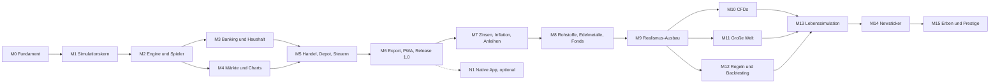
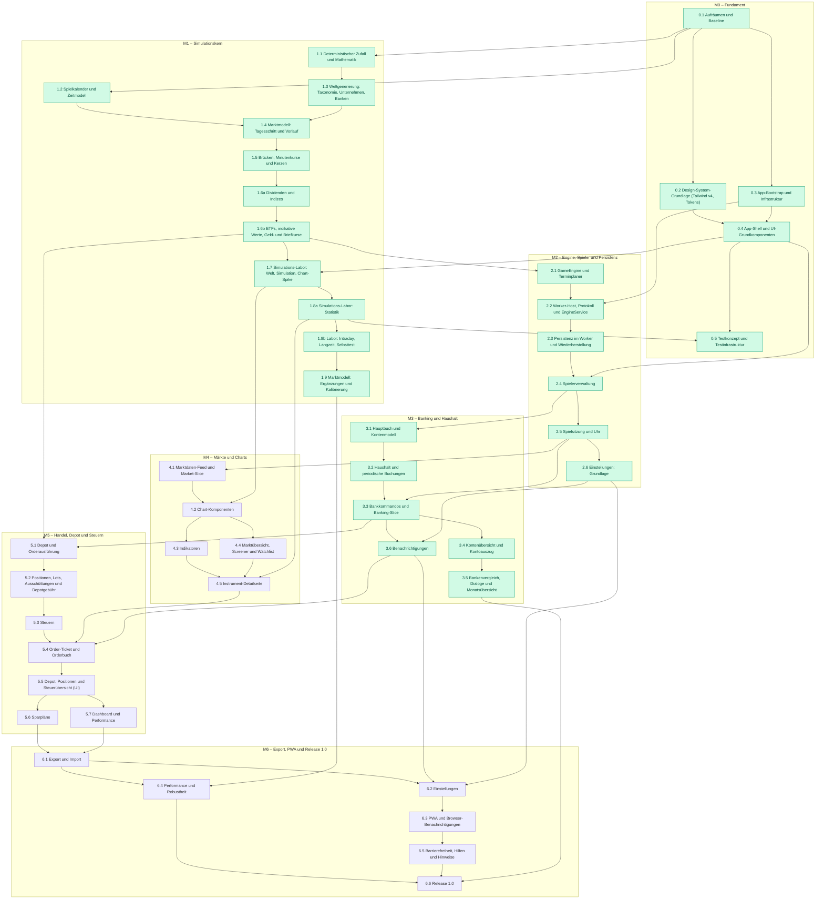

# PortfoliGo – Projektplan

> **Status:** Entwurf v0.2 · **Stand:** 13.11.2026
> **Grundlagen:** [Produktspezifikation](./specs/produktspezifikation.md) (PS) · [Technische Spezifikation](./specs/technische-spezifikation.md) (TS)

Dieser Plan zerlegt PortfoliGo in Meilensteine und Arbeitspakete (AP). Ein AP ist so geschnitten, dass es in **einer Session** umgesetzt werden kann. Verweise wie `US-SP-01` zeigen auf User Stories der Produktspezifikation, `TS §3.2` auf Abschnitte der technischen Spezifikation, `E-02` auf Entscheidungen (TS §16).

## Inhalt

1. [Überblick](#1-überblick)
2. [Arbeitsweise in Sessions](#2-arbeitsweise-in-sessions)
3. [Offene Entscheidungen](#3-offene-entscheidungen)
4. [Statusübersicht](#4-statusübersicht)
5. [Stufe 1: Meilensteine M0–M6](#5-stufe-1-meilensteine-m0m6)
6. [Spätere Ausbaustufen](#6-spätere-ausbaustufen)
7. [Änderungsprotokoll](#7-änderungsprotokoll)

## 1. Überblick

Geplant wird rollierend: Die Meilensteine bis zum MVP (Stufe 1, M0–M6) sind in Arbeitspakete zerlegt. Spätere Stufen sind als Epics skizziert und werden detailliert, sobald das MVP steht und die Prioritäten feststehen.



| Meilenstein | Stufe | Ziel                                               | Ergebnis, das man zeigen kann                                                          | APs |
| ----------- | ----- | -------------------------------------------------- | -------------------------------------------------------------------------------------- | --- |
| M0          | 1     | Sauberes Fundament mit Design-System und App-Shell | Navigierbare, leere App im Trading-Look; CI prüft Lint, Tests und Build                | 4   |
| M1          | 1     | Getesteter, deterministischer Simulationskern      | Simulations-Labor zeigt eine generierte Welt mit Kursverläufen und Statistiken         | 12  |
| M2          | 1     | Spielschleife mit Spielern, Uhr und Persistenz     | Spieler anlegen, Zeit in jeder Geschwindigkeit laufen lassen, schließen, nachberechnen | 6   |
| M3          | 1     | Geldflüsse: Einkommen, Kosten, Gebühren, Zinsen    | Kontoauszüge füllen sich; Konten eröffnen, Geld überweisen, Warnungen                  | 6   |
| M4          | 1     | Märkte im Trading-Look                             | Marktübersicht, Screener, Watchlist, Instrumentseite mit Live-Chart und Indikatoren    | 5   |
| M5          | 1     | Kernspiel komplett                                 | Kaufen, verkaufen, Sparpläne, Steuern, Depot, Dashboard mit Benchmark                  | 7   |
| M6          | 1     | Datensicherheit, Installierbarkeit, Feinschliff    | Version 1.0: Export und Import, PWA, Einstellungen                                     | 6   |

**Empfohlene Reihenfolge:** M3 ist mit AP 3.6 abgeschlossen. Als Nächstes M4 mit AP 4.1 (braucht nur AP 2.5); M5 braucht M3 und M4. Ab AP 2.3 gibt es gespeicherte Spieler, die jede Modelländerung ungültig macht (TS §15); Änderungen am Marktmodell prüft seitdem die Kalibrierungs-Suite gegen die Ziele.

## 2. Arbeitsweise in Sessions

### 2.1 Vorbereitung

```sh
nvm use   # Node 22.22.3 laut .nvmrc – Angular CLI 22 verlangt ≥ 22.22.3
npm ci    # nur nötig, wenn sich Abhängigkeiten geändert haben
```

Für die Systemtests einmal je Rechner: `npx playwright install chromium`. Lokal laufen nur die Chromium-Projekte; Firefox und WebKit prüft die CI. Wer sie lokal braucht: `npx playwright install firefox webkit` und unter Linux und WSL `sudo npx playwright install-deps` (TS §14.1).

Für Tests auf dem Smartphone im lokalen Netz: `ng serve --ssl --host 0.0.0.0` – mehrere Browser-APIs funktionieren nur über HTTPS (TS §1.3).

### 2.2 Session starten

Vorlage für den Start einer Session:

> Setze AP 1.2 aus `docs/projektplan.md` um.

Claude liest dann `CLAUDE.md`, das AP samt Abhängigkeiten und Änderungsprotokoll sowie die referenzierten Abschnitte der Spezifikationen.

### 2.3 Ablauf

1. Prüfen, ob alle Abhängigkeiten des AP den Status „fertig" haben.
2. Betroffene Entscheidungen klären: Steht eine, die das AP braucht, noch auf „Vorschlag", fragt Claude nach, bevor darauf aufgebaut wird (§3 nennt für jede Entscheidung das AP, vor dem sie fallen muss).
3. In kleinen, testbaren Schritten umsetzen.
4. Prüfen: während der Arbeit `npm test` und die betroffenen Suiten, zum Abschluss `npm run verify` (Format, Lint, Typen, alle Testsuiten, Mutationstests, Build mit Bundle-Budget, Systemtests; TS §14.4); bei geänderten Texten `ng extract-i18n`.
5. Status (§4, Tabelle und Abhängigkeitsgraph) und Änderungsprotokoll (§7) aktualisieren. Weicht die Umsetzung von der Spezifikation ab, wird die Spezifikation angepasst.
6. Commits nur auf ausdrückliche Anweisung.

### 2.4 Definition of Done (für jedes AP)

- Die Abnahmekriterien des AP sind erfüllt.
- `npm run verify` läuft fehlerfrei.
- Jedes Abnahmekriterium ist durch einen benannten automatisierten Test abgedeckt oder als manuelle Prüfung im AP dokumentiert. Die Tests stehen schon beim Planen fest: Beispieltabellen (in der Spezifikation), Invarianten, Engine-Szenarien je Abnahmekriterium, Seiten- und Komponententests, Systemtest-Journeys (`CLAUDE.md` §10, TS §14.1). Erwartungswerte stammen aus unabhängigen Orakeln. Simulationscode hält die Determinismus-Regeln ein (TS §4.5).
- Neuer Regelcode ist in den Mutationstests erfasst; überlebende Mutanten sind durch Tests getötet oder im AP als äquivalent begründet.
- Berührt das AP ein Budget aus TS §14.3, ist es lokal mit der Perf-Suite gemessen und in TS §14.3 eingetragen.
- Neue oder geänderte Texte haben i18n-IDs, `messages.xlf` ist aktualisiert.
- Statusübersicht und Änderungsprotokoll sind gepflegt.
- Hat sich eine Golden-Master-Prüfsumme (`market/domain/golden-master.ts`) geändert, steht das im Änderungsprotokoll. Ab AP 2.3 ist dann auch `SIM_VERSION` erhöht (E-25); hat sich die Struktur des gespeicherten Zustands ohne Migration geändert, `schemaVersion` (TS §15).

### 2.5 Schnitt der Arbeitspakete

Wird ein AP für eine Session zu groß, teilt Claude es (z. B. AP 3.4a und 3.4b) und trägt die Teilung in §4 ein. Erkenntnisse, die spätere APs betreffen, kommen ins Änderungsprotokoll.

## 3. Offene Entscheidungen

Diese Punkte sollte der Product Owner bestätigen oder ändern, spätestens bevor das genannte AP beginnt. Details und Begründungen stehen in TS §16 und den verlinkten Abschnitten. Am einfachsten ist es, alle Vorschläge gesammelt zu bestätigen und nur Abweichungen zu nennen; Claude trägt den Status dann in TS §16 ein.

| ID   | Frage                                                              | Vorschlag                                                                                                                                                                                                | Spätestens vor |
| ---- | ------------------------------------------------------------------ | -------------------------------------------------------------------------------------------------------------------------------------------------------------------------------------------------------- | -------------- |
| E-25 | Versionsregeln ab 1.0 (TS §15; vor 1.0 entschieden)                | Umfang der Kompatibilitätszusage festlegen, z. B. aktuelle und vorige `simVersion` spielbar, ältere lesbar                                                                                               | AP 6.6         |
| E-28 | Umfang von Stufe 1 für Einsteiger (PS §7)                          | ETF-Durchschau als Muss, zweite Vergleichsgröße, Story „Erste Schritte“ (US-UI-10), Depotübertrag als Story in Stufe 2 (US-BK-12)                                                                        | AP 5.5         |
| E-21 | Sparpläne brauchen jeden Monat eine Überweisung von Hand (TS §7.8) | Abbuchungskonto je Sparplan; Alternative: Daueraufträge in Stufe 1                                                                                                                                       | AP 5.6         |
| E-05 | Capacitor                                                          | PWA im MVP; Capacitor als optionaler Meilenstein N1. Ergänzung: „Demnächst“ liest den Terminplaner, die Ereignisvorschau entsteht erst mit N1                                                            | AP 5.7         |
| E-10 | Exportformat                                                       | base64(JSON) mit Spieler- und Marktzustand vom Beginn des Export-Tags; Kurshistorie nach dem Import im Hintergrund. Ergänzungen: gzip schon in Formatversion 1, ohne `commands`, Import startet pausiert | AP 6.1         |

E-21 bis E-28 und die Ergänzungen stammen aus der kritischen Prüfung vom 11.11.2026 (§7).

**Bereits entschieden:** E-07 (`CLAUDE.md`), E-03 – Zufallsströme per MurmurHash3 x86_128, `sfc32`, eigene `detExp`/`detLog` (10.11.2026), E-09 – Geld in Cent, Stück in Millionstel, Kurse als Gleitkomma mit Preisraster (10.11.2026), E-20 – Kursberechnung mit dem Brückenmodell (10.11.2026; Begründung und Messwerte in TS §3.2, §6.1 und §6.6), E-06 – Tailwind CSS v4 mit angehobener Browserslist und Inter Variable als selbst gehostete Schrift (10.11.2026) sowie die Ergänzungen für `CLAUDE.md` aus TS §11.2 (10.11.2026, übernommen in AP 0.2), E-15 – Hash-Routing mit englischen Routenpfaden (10.11.2026), E-16 – Angular Aria neben dem CDK für Tabs und Menüs (10.11.2026), E-12 – Stufe 1 mit Aktien, ETFs und Indizes, CFDs bleiben in Stufe 3 (10.11.2026), E-13 – reale Regionen und Länder, fiktive Unternehmen, Banken, Börsen, Indizes, Emittenten und Kennungen; Standardwelt nach TS §5.2 (10.11.2026), E-17 – Banking mit sofortiger Eröffnung und Überweisung, Dispo mit geduldeter Überziehung, Bankbelastungen dürfen Verrechnungskonten ins Minus bringen (10.11.2026), E-02 – Tick = 1 Spielminute, Start Mo 01.04.2030 00:00, im Hintergrund Echtzeit (pro Spieler auf Pause umstellbar), eine Pause bleibt Pause (11.11.2026), E-18 – Handelszeiten je Region, Orders jederzeit, Ausführung in der Handelszeit (11.11.2026), E-04 – lightweight-charts 5.3.0 mit TradingView-Logo, lazy geladen; eigene SVG-Sparklines und -Donuts (Spike in AP 1.7, 11.11.2026), E-01 – autoritative Engine im Web Worker, NgRx hält nur Projektionen (12.11.2026), E-26 – die App bleibt bis 1.0 öffentlich, Impressum, Datenschutzhinweis und Hinweis „keine Anlageberatung“ erst in AP 6.5; das Risiko trägt der Product Owner (12.11.2026), E-27 – vierfache CPU-Drosselung (Chromium) statt Referenzgerät, Budgets Engine bei 1 w/s < 50 % eines Kerns und Spielstart < 6 s, erste Messung in M2 (12.11.2026), E-08 – Persistenz mit Ergänzungen: Marktzustände zu Monatsbeginn im eigenen Store (DB-Version 4), Write-ahead nur für Spielkommandos, Kommando-Log älter als der älteste Snapshot wird gelöscht, Uhr spätestens nach einem Spieltag gesichert, Tick des letzten `clock`-Ereignisses bei `pagehide` als Untergrenze; Tageskerzen bleiben je Spieler (12.11.2026), E-25 vor 1.0 – `SIM_VERSION` und `schemaVersion` ab AP 2.3, veraltete Spieler gesperrt (nur löschen; Zusage ab 1.0 offen bis AP 6.6) (12.11.2026), E-14 – Lebenshaltungskosten als Startparameter, Hausbank ist die erste Filialbank in Weltreihenfolge, Start pausiert, Vorgaben 10.000 € / 2.500 € / 1.800 € (12.11.2026). E-30 bis E-33 – Regionsfaktoren mit eigener Aktivität und Schwellenländer-Ziel als „Info“, Korrelationsziele über Large Caps, Zero-Beta-Rendite, Dividenden-Lebenszyklus (12.11.2026, Vorbereitung der Kalibrierung, AP 1.9b). E-34 – Prüfregel und Ziele der Kalibrierung: Median von `calib-1` bis `calib-5`, Korrelation zwischen Sektoren 0,2–0,4, Tagesprofil 1,3–2,0, Risikoklassen als Quintile (12.11.2026, AP 1.9c). E-11 – Steuern in Stufe 1: 25 % pauschal, 1.000 € Sparerpauschbetrag, ein Verlusttopf, ohne Soli und Kirchensteuer (13.11.2026). E-19 – Buchungstermine: Bank-Lauf 06:00, Gehalt am letzten, Lebenshaltung am ersten Bankarbeitstag des Monats (13.11.2026). E-17 ergänzt: Dispo je Bank nach dem Gehaltseingang bei ihr, geduldete Überziehung ohne Obergrenze (13.11.2026, TS §7.4). Das Deployment ist laut Product Owner unter `https://algoristic.de/portfoligo/` per HTTPS erreichbar.

## 4. Statusübersicht

Status: **offen**, **in Arbeit**, **fertig**.

| AP   | Titel                                            | Status | Abhängig von   |
| ---- | ------------------------------------------------ | ------ | -------------- |
| 0.1  | Aufräumen und Baseline                           | fertig | –              |
| 0.2  | Design-System-Grundlage (Tailwind v4, Tokens)    | fertig | 0.1            |
| 0.3  | App-Bootstrap und Infrastruktur                  | fertig | 0.1            |
| 0.4  | App-Shell und UI-Grundkomponenten                | fertig | 0.2, 0.3       |
| 0.5  | Testkonzept und Testinfrastruktur                | fertig | 0.4, 1.8a      |
| 1.1  | Deterministischer Zufall und Mathematik          | fertig | 0.1            |
| 1.2  | Spielkalender und Zeitmodell                     | fertig | 0.1            |
| 1.3  | Weltgenerierung: Taxonomie, Unternehmen, Banken  | fertig | 1.1            |
| 1.4  | Marktmodell: Tagesschritt und Vorlauf            | fertig | 1.2, 1.3       |
| 1.5  | Brücken, Minutenkurse und Kerzen                 | fertig | 1.4            |
| 1.6a | Dividenden und Indizes                           | fertig | 1.5            |
| 1.6b | ETFs, indikative Werte, Geld- und Briefkurse     | fertig | 1.6a           |
| 1.7  | Simulations-Labor: Welt, Simulation, Chart-Spike | fertig | 1.6b, 0.4      |
| 1.8a | Simulations-Labor: Statistik                     | fertig | 1.7            |
| 1.8b | Labor: Intraday, Langzeit, Selbsttest            | fertig | 1.8a           |
| 1.9a | Marktmodell: Änderungen vor der Kalibrierung     | fertig | 1.8b           |
| 1.9b | Marktmodell: Ergänzungen aus der Kalibrierung    | fertig | 1.9a           |
| 1.9c | Kalibrierung des Marktmodells                    | fertig | 1.9b           |
| 2.1  | GameEngine und Terminplaner                      | fertig | 1.6b           |
| 2.2  | Worker-Host, Protokoll und EngineService         | fertig | 2.1, 0.3       |
| 2.3  | Persistenz im Worker und Wiederherstellung       | fertig | 2.2            |
| 2.4  | Spielerverwaltung                                | fertig | 2.3, 0.4       |
| 2.5  | Spielsitzung und Uhr                             | fertig | 2.4            |
| 2.6  | Einstellungen: Grundlage                         | fertig | 2.5            |
| 3.1  | Hauptbuch und Kontenmodell                       | fertig | 2.4            |
| 3.2  | Haushalt und periodische Buchungen               | fertig | 3.1            |
| 3.3  | Bankkommandos und Banking-Slice                  | fertig | 3.2, 2.5       |
| 3.4  | Kontenübersicht und Kontoauszug                  | fertig | 3.3            |
| 3.5  | Bankenvergleich, Dialoge und Monatsübersicht     | fertig | 3.4            |
| 3.6  | Benachrichtigungen                               | fertig | 3.3, 2.6       |
| 4.1  | Marktdaten-Feed und Market-Slice                 | offen  | 2.5            |
| 4.2  | Chart-Komponenten                                | offen  | 4.1, 1.7       |
| 4.3  | Indikatoren                                      | offen  | 4.2            |
| 4.4  | Marktübersicht, Screener und Watchlist           | offen  | 4.2            |
| 4.5  | Instrument-Detailseite                           | offen  | 4.3, 4.4, 1.8a |
| 5.1  | Depot und Orderausführung                        | offen  | 3.3, 1.6b      |
| 5.2  | Positionen, Lots, Ausschüttungen und Depotgebühr | offen  | 5.1            |
| 5.3  | Steuern                                          | offen  | 5.2            |
| 5.4  | Order-Ticket und Orderbuch                       | offen  | 5.3, 4.5, 3.6  |
| 5.5  | Depot, Positionen und Steuerübersicht (UI)       | offen  | 5.4            |
| 5.6  | Sparpläne                                        | offen  | 5.5            |
| 5.7  | Dashboard und Performance                        | offen  | 5.5            |
| 6.1  | Export und Import                                | offen  | 5.6, 5.7       |
| 6.2  | Einstellungen                                    | offen  | 6.1, 3.6, 2.6  |
| 6.3  | PWA und Browser-Benachrichtigungen               | offen  | 6.2            |
| 6.4  | Performance und Robustheit                       | offen  | 6.1, 1.9c      |
| 6.5  | Barrierefreiheit, Hilfen und Hinweise            | offen  | 6.3            |
| 6.6  | Release 1.0                                      | offen  | 6.4, 6.5, 3.5  |

### Abhängigkeitsgraph

Die Pfeile zeigen von der Voraussetzung zum abhängigen AP. Fertige APs sind grün, APs in Arbeit gelb markiert. Der Graph wird zusammen mit der Tabelle gepflegt (Status und Abhängigkeiten).



## 5. Stufe 1: Meilensteine M0–M6

### M0 – Fundament

**Ziel:** sauberer, grüner Ausgangszustand mit Design-System, Infrastruktur und App-Shell.
**Ergebnis:** navigierbare, leere App im Trading-Look; die CI prüft Lint, Tests und Build.

#### AP 0.1 – Aufräumen und Baseline

- **Umfang:**
  - Ionic-Reste entfernen: `ionic.config.json`, `capacitor.config.ts` (wird bei Bedarf in N1 neu angelegt), Ionic-Schematics und `schematicCollections` in `angular.json`, `src/theme/variables.scss`, Ionic-Hinweise in `src/test-setup.ts` (den `matchMedia`-Polyfill behalten, falls Tests ihn brauchen) und in `.vscode/settings.json`, Ionic-CLI-Schritt in `.github/workflows/build-latest.yml`, `author` und `homepage` in `package.json`.
  - `src/environments/environment.model.ts` von verwaisten Importen befreien und die Umgebung neu ordnen (u. a. Devtools-Konfiguration, Flag für Labor und Entwicklerseiten).
  - `src/index.html`: `lang="de"`, Zoom nicht mehr sperren (`maximum-scale` und `user-scalable=no` entfernen).
  - `.browserslistrc` nach TS §1.3 anheben.
  - `AppComponent` nach `CLAUDE.md` (kein leerer Konstruktor, eigene Template- und Style-Datei).
  - Einen ersten Test anlegen, damit `ng test` läuft.
  - CI: Node aus `.nvmrc`, `npm ci`, `ng lint`, `ng test --watch=false`, `ng build`; Deployment unverändert nur nach Erfolg. Prüfen, dass die Zieladresse per HTTPS erreichbar ist.
  - `uuid` entfernen (ersetzt durch `crypto.randomUUID()`).
- **Abnahme:** `ng build` ohne Browserslist-Warnung; `ng lint` und `ng test --watch=false` grün; keine Ionic-Referenzen mehr in Code und Konfiguration; HTTPS-Erreichbarkeit geklärt.
- **Referenzen:** TS §1.1, §1.3, §14.4; E-06
- **Abhängig von:** –

#### AP 0.2 – Design-System-Grundlage (Tailwind v4, Tokens)

- **Umfang:**
  - Tailwind v4 über `@tailwindcss/postcss` und `.postcssrc.json` einbinden; `src/styles.css` als globaler Einstieg in `angular.json`, `src/global.scss` entfernen.
  - Semantische Tokens `--pgo-*` nach TS §11.5 für Dunkel (Standard) und Hell, Klasse `dark` am `<html>`. Vorläufig folgt das Theme `prefers-color-scheme`; die Einstellung kommt in AP 6.2.
  - Schrift festlegen (Inter selbst gehostet oder System-Schrift) und `tabular-nums` für Zahlen.
  - Optional `prettier-plugin-tailwindcss`.
  - Token-Übersicht auf einer Entwicklerseite (gleiches Umgebungs-Flag wie das Labor).
  - `CLAUDE.md` um die Ergänzungen und Ausnahmen aus TS §11.2 erweitern – nach Freigabe (§3).
- **Abnahme:**
  - Tokens wirken in Utility-Klassen und – als `var(--pgo-*)` – in Komponenten-SCSS (geprüft an einer Beispielkomponente).
  - Dunkel und Hell funktionieren; Standardfarben wie `bg-red-500` erzeugen keine Styles.
  - Textkontraste der Tokens ≥ 4,5:1.
- **Referenzen:** TS §11.2, §11.5; US-UI-01; E-06
- **Abhängig von:** AP 0.1

#### AP 0.3 – App-Bootstrap und Infrastruktur

- **Umfang:**
  - `app.config.ts`: Router (Hash), Store, Effects, Router Store, Devtools nur in der Entwicklung, `LOCALE_ID` `de` mit `registerLocaleData`.
  - `@angular/cdk` installieren.
  - `persistence/data-access`: framework-freie Schema-Definition für IndexedDB (nutzbar in UI und Worker), `IndexedDbService`, `LocalStorageService` (typisiertes, versioniertes JSON). Als Vorlage dient der Prototyp: `git show 9bab719^:src/app/idb/data-access/service/idb.service.ts`.
  - `fake-indexeddb` als Dev-Abhängigkeit für Tests.
  - `shared/domain`: `Cents`, `MicroUnits`, Rundungsfunktionen und Preisraster (TS §6.7, §7.1); `shared/util`: Formatierungsfunktionen (TS §11.9); `shared/ui`: Pipes darüber.
- **Abnahme:** App startet mit Store und Devtools; Tests für Rundung, Preisraster, Formatierung und Services grün.
- **Referenzen:** TS §6.7, §7.1, §9.1, §9.3, §11.9; E-09
- **Abhängig von:** AP 0.1

#### AP 0.4 – App-Shell und UI-Grundkomponenten

- **Umfang:**
  - `shell/feature`: Layout mit Kopfzeile (Platzhalter für Uhr, Gesamtvermögen, Suche, Benachrichtigungen, Spielermenü), Seitennavigation auf dem Desktop, untere Navigation auf dem Smartphone (`BreakpointObserver`); Routen-Gerüst nach TS §11.4 mit lazy geladenen Platzhalterseiten.
  - `shared/ui`: Button, Icon-Button, Panel, Badge, Tabs, Leerzustand, Skeleton, Kennzahl-Kachel, Kursveränderung (Vorzeichen, Pfeil, Farbe), Toast-Container (CDK Overlay), Dialog-Rahmen (CDK Dialog), Bestätigungsdialog.
  - `data-testid` nach `CLAUDE.md`, Fokusstile, Tastaturbedienung.
- **Abnahme:** leere App im Trading-Look auf Desktop und Smartphone navigierbar, auch per Tastatur; i18n-IDs vergeben, `ng extract-i18n` ausgeführt.
- **Referenzen:** PS §10; US-UI-03, US-UI-04; TS §11.4, §11.6; E-15, E-16
- **Abhängig von:** AP 0.2, AP 0.3

#### AP 0.5 – Testkonzept und Testinfrastruktur

Querschnitts-AP auf Auftrag des Product Owners (12.11.2026): neues Testkonzept statt der bisherigen Regeln, sofort auf den Bestand angewendet.

- **Umfang:**
  - Konzept in TS §4.6 (Determinismus-Vertrag) und §14 (Teststrategie, Budgets, CI), Schreibregeln in `CLAUDE.md` §10; Entscheidung E-29.
  - Runner aufgeteilt: `logic` (Vitest unter Node für `domain` und `util`), `angular` (`ng test` unter jsdom), `calibration`, `perf`; `npm run typecheck` und `npm run verify`.
  - Werkzeuge: fast-check, Stryker (`stryker.config.mjs`, `vitest.mutation.config.ts`), Playwright mit axe (`playwright.config.ts`, `e2e/`), Bundle-Budget (`tools/check-bundle-budget.mjs`); Lint-Regeln für Specs (kein `.only`, keine Wanduhr außerhalb der Perf-Suite, keine Format- und State-Helfer als Orakel in Seitentests).
  - Golden Master als Modul `market/domain/golden-master.ts` mit sechs Prüfsummen (neu: Marktzustand zum Spielstart); Selbsttest im Labor vorgezogen aus AP 1.8b.
  - Fixtures `goldenYear()`, Mini-Welt, Helfer in `src/testing`.
  - Alle 74 Spec-Dateien umgestellt: Erwartungen aus unabhängigen Orakeln, Eigenschaften neben den Beispielen, Toleranzen in Standardfehlern, statistische Tests in die Kalibrierungs-Suite, Zeitmessungen in die Perf-Suite; Tests ohne Mehrwert gelöscht.
  - CI mit allen Prüfungen als Gate vor dem Deployment (TS §14.4).
- **Abnahme:** `npm run verify` lokal grün (Systemtests in den Chromium-Projekten), Firefox und WebKit in der CI; die Golden-Master-Konstanten sind unverändert reproduziert; der Selbsttest ergibt in Chromium und Firefox dieselben Prüfsummen wie Node.
- **Referenzen:** TS §4.6, §14; `CLAUDE.md` §10; E-29
- **Abhängig von:** AP 0.4, AP 1.8a

### M1 – Simulationskern

**Ziel:** eine reine, getestete Simulationsbibliothek, die aus einem Seed Welt, Markt und Historie erzeugt.
**Ergebnis:** Das Simulations-Labor zeigt eine generierte Welt mit plausiblen Kursverläufen und Statistiken.

#### AP 1.1 – Deterministischer Zufall und Mathematik

- **Umfang:** `simulation/util`: Seed-Normalisierung, 128-Bit-Hash (Seed-Schlüssel und Strom-Ableitung, TS §4.1, §4.2), `sfc32`, Verteilungen (TS §4.3), `detExp` und `detLog`, Prüfsummen über Float64-Werte; Seed-Generator für gut teilbare Seeds.
- **Abnahme:** Tests für Reproduzierbarkeit, Stromunabhängigkeit, Momente der Verteilungen (mit Toleranz), `detExp`/`detLog` gegen `Math.*` (≤ 1 ulp auf Stichproben), feste Testvektoren für Hash und Generator.
- **Referenzen:** TS §4; E-03; NF-05
- **Abhängig von:** AP 0.1

#### AP 1.2 – Spielkalender und Zeitmodell

- **Umfang:** `clock/domain`: Tick ↔ Datum, Wochentag, Tagesindex, Monats- und Jahresgrenzen, Bankarbeitstage, erster und letzter Bankarbeitstag; Handelszeiten (offen, nächste Öffnung und Schließung); Geschwindigkeitsstufen als `as const`-Liste; Ziel-Tick aus Anker und Wanduhr als reine Funktion; Formatierung der Spielzeit (`formatGameTime`, aus AP 0.3 verschoben, TS §11.9).
- **Abnahme:** Tests inklusive Schaltjahren, Monatsenden, Wochenenden und Handelszeitgrenzen; der Spielstart ist Tick 5.389.920 (Mo, 01.04.2030, 00:00).
- **Referenzen:** TS §3.1, §3.3–§3.5; E-02, E-18
- **Abhängig von:** AP 0.1

#### AP 1.3 – Weltgenerierung: Taxonomie, Unternehmen, Banken

- **Umfang:** `world/domain`: Weltkonfiguration (Mengen, Verteilungen); Regionen, Länder, Börsen mit Handelszeiten, Sektoren, Branchen; Namensgeneratoren für Unternehmen, Banken, Emittenten und Indizes mit Blockliste; eindeutige Ticker und Kennungen mit Prüfziffer; Unternehmensattribute inkl. Profil-Vorlagencode, Sparplanfähigkeit und Startwerten der Modellparameter; Stammdaten der Indizes (Art, Zusammensetzung, Kappung) und ETFs (Emittent, Index, TER, Ertragsverwendung, Replikation, Fondsvolumen) nach TS §5.5 und §5.6; Banken mit Konditionen (TS §5.7, Typen aus TS §7.3); Modelle als `*.model.ts`.
- **Abnahme:** gleicher Seed ergibt eine identische Welt (Prüfsummentest); Verteilungen im vorgesehenen Rahmen; keine Dubletten; Generierung unter 200 ms.
- **Referenzen:** TS §5, §7.3; PS §4.4, §6; E-12, E-13, E-17
- **Abhängig von:** AP 1.1

#### AP 1.4 – Marktmodell: Tagesschritt und Vorlauf

- **Umfang:** `market/domain`: Marktzustand in Typed Arrays; Tagesschritt nach TS §6.1–§6.4 – Marktphasen, Trends und Volatilität der Faktoren mit Stützpunkten an den Grenzen der Handelszeiten, Tagesstützpunkte der Aktien mit Overnight-Schock, Sprüngen (Anzahl, Minute, Größe) und Kursuntergrenze; Vorlauf als Tagesschritte ab der Epoche; Faktorhistorie mit Zuständen zu Monatsbeginn; Neuberechnung der Historie eines einzelnen Instruments; Snapshot und Restore des Marktzustands; Markt-Prüfsumme.
- **Abnahme:** Tests aus TS §4.6: Golden Master über die Tagesschlusskurse, Granularität, Snapshot mit Restore und Weiterlauf, Stromunabhängigkeit; die neu berechnete Historie eines einzelnen Instruments entspricht der des Gesamtlaufs. Benchmark mit `detExp`/`detLog`: zehn Jahre Vorlauf der Standardwelt in ≤ 0,5 s auf dem Entwicklungsrechner.
- **Referenzen:** TS §3.2, §4.2, §4.6, §6.1–§6.4, §6.8; E-02, E-20
- **Abhängig von:** AP 1.2, AP 1.3

#### AP 1.5 – Brücken, Minutenkurse und Kerzen

- **Umfang:**
  - Brücken für Faktoren (ein Strom je Faktor, Tag und Intervall) und Aktien (Sprünge ab ihrer Minute) nach TS §6.1–§6.4; Endpunkte als Stützpunkte gesetzt; Tagesprofil der Volatilität als Parameter (Standard: gleichmäßig).
  - `priceAt(instrumentId, tick)` mit Cache der Tagesverläufe und offiziellem Kurs bei geschlossener Börse.
  - Kerzen aller Auflösungen bei Abfrage; Tageskerzen mit Hoch und Tief; Ergänzung fehlender Hoch- und Tiefkurse als zeitteilbare Funktion für den Hintergrundauftrag (TS §6.8); Abfragegrenze (TS §4.5, Regel 7).
  - Testhelfer: Referenz-Simulation Minute für Minute nach TS §4.6; die Prototyp-Werte in TS §6.1 geben die Größenordnung der Toleranzen vor.
- **Abnahme:** Tests aus TS §4.6: Stützpunkte bitgenau getroffen; Bedarf, Vorabberechnung und Neuberechnung nach Verwerfen der Caches bitgleich; statistische Gleichwertigkeit mit der Referenz-Simulation innerhalb fester Toleranzen; Abfragegrenze; Golden Master um die Minutenkurse einer festen Stichprobe erweitert. Benchmark mit `detExp`/`detLog`: ein Spieljahr mit allen Minutenverläufen der Standardwelt in ≤ 4 s; Minutenchart eines vergangenen Tags in < 50 ms.
- **Schnitt:** Wird das AP zu groß, zuerst Brücken und `priceAt` (AP 1.5a), dann Kerzen und Abfragegrenze (AP 1.5b).
- **Referenzen:** TS §4.5, §4.6, §6.1, §6.2, §6.4, §6.8, §14.3; E-20
- **Abhängig von:** AP 1.4

#### AP 1.6a – Dividenden und Indizes

AP 1.6 wurde nach §2.5 geteilt (11.11.2026).

- **Umfang:** Dividendenkalender (Ex-Tag-Rhythmus je Unternehmen aus dem Seed, Ankündigung mit dem Schlusskurs vor der Ankündigung, Ex-Tag-Abschlag im Tagesschritt, Zahltag als Ereignisdatum); Kurs- und Performanceindizes auf Basis der Index-Stammdaten aus AP 1.3 mit Kappung, innerhalb des Tages exakt aus den Minutenkursen aller Werte; Reinvestitionsfaktor `R` im Tagesschritt; Tageskerzen sowie Hoch und Tief der Indizes. Abgeleitete Werte als reine Funktionen (TS §6.6).
- **Abnahme:** Tests:
  - Index entspricht zu jeder Minute der gewichteten Summe; Ex-Tag-Abschlag; `R` steigt nur zur Eröffnung eines Werts am Ex-Tag.
  - Die Dividendenhöhe hängt nicht von Kursen des Ankündigungstags ab.
  - Beobachtungsunabhängigkeit: Abfragen ändern die Markt-Prüfsumme nicht.
  - Index-Kurven live, nachgerechnet und nach Verwerfen der Caches bitgleich; Golden Master um die Indexstände erweitert.
- **Referenzen:** TS §6.5, §6.6, §6.8, §4.6
- **Abhängig von:** AP 1.5

#### AP 1.6b – ETFs, indikative Werte, Geld- und Briefkurse

- **Umfang:** indikative Werte aus den Faktorbrücken; ETF-NAV (thesaurierend und ausschüttend mit Ausschüttungstopf und eigenen Ex-Tagen, TER, Tracking); Tageskerzen der ETFs; Spread-Modell mit Preisraster und Quotes. Zustandsbehaftete Größen (`k`, Topf) wie `R` im Tagesschritt (TS §6.6).
- **Abnahme:** Tests:
  - TER-Abschlag ≈ TER p. a.
  - Thesaurierender und ausschüttender ETF haben vor Kosten dieselbe Gesamtrendite (Toleranz für den Kassenbestand im Topf).
  - Geld < Brief bei jedem Kurs (auch unter 10 €); Spreads im vorgesehenen Rahmen.
  - Beobachtungsunabhängigkeit: Abfragen ändern die Markt-Prüfsumme nicht.
- **Referenzen:** TS §6.6, §6.7, §4.6
- **Abhängig von:** AP 1.6a

#### AP 1.7 – Simulations-Labor: Welt, Simulation, Chart-Spike

- **Umfang:**
  - `lab/feature` (nur mit Umgebungs-Flag): Seed eingeben, Welt erzeugen und in Tabellen anzeigen, Zeitraum in einem einfachen Web Worker simulieren (Vorstufe zu AP 2.2).
  - Chart-Spike: `lightweight-charts` installieren; Linie und Kerzen, Zeitachse in Spielzeit, Farben aus den Tokens; Bundle-Größe bei lazy Laden messen.
- **Abnahme:** Das Labor zeigt Welt und Charts beliebiger Instrumente. Das Spike-Ergebnis (Größe, Theming, Zeitachse) steht im Änderungsprotokoll; E-04 ist bestätigt oder revidiert.
- **Referenzen:** TS §11.7, §14.2; E-04
- **Abhängig von:** AP 1.6b, AP 0.4

AP 1.8 wurde nach §2.5 geteilt (11.11.2026).

#### AP 1.8a – Simulations-Labor: Statistik

- **Umfang:** `analysis/domain`: Statistikfunktionen (Rendite, Volatilität, Korrelation, Schiefe, Kurtosis, Autokorrelation, Quantile, Histogramm, Drawdown). Messvorschrift je Kalibrierungsziel (TS §6.9). Statistikansicht im Labor nach TS §14.2 für einen wählbaren Zeitraum (ab Epoche oder ab Spielstart) mit Vergleich zu den Kalibrierungszielen, Phasen-Zeitleiste, Verteilung der Tagesrenditen, Korrelationsmatrix nach Sektor, Volatilität je Größenklasse und Drawdowns des Weltindex; Simulationsschritt „10 Jahre“.
- **Abnahme:** Tests der Statistikfunktionen mit Referenzwerten; die Ansicht zeigt die Größen aus TS §6.9, die sich aus den Tagesstützpunkten messen lassen; Seitentest mit der Domain als Orakel.
- **Referenzen:** TS §6.9, §14.2
- **Abhängig von:** AP 1.7

#### AP 1.8b – Labor: Intraday, Langzeit, Selbsttest

- **Umfang:** Intraday-Statistik (Minutenvolatilität, Tagesspanne, Tagesprofil) im Vergleich zur Referenz-Minutensimulation aus AP 1.5 und Durchsatz der Minutenverläufe; Langzeit-Kennzahlen über 50 und 100 Spieljahre (Konzentration des Weltindex, Anteil der Kurse unter 1 € und an der Kursuntergrenze, Höchstkurse, Indexvolatilität in rollierenden Fenstern; E-22), der Overnight-Anteil der Varianz von Indizes und Einzelaktien (E-24); die Referenz-Simulation läuft im Worker. Der Selbsttest der Golden-Master-Prüfsummen besteht seit AP 0.5 (TS §14.2).
- **Abnahme:** Die Statistikansicht zeigt auch die übrigen Größen aus TS §6.9 (Status „AP 1.8b“ entfällt). Der Systemtest des Selbsttests (J11) bleibt in Chromium, Firefox und WebKit grün; neue Intraday- und Langzeitwerte prüft der Seitentest des Labors mit `LabSimulation` als Orakel.
- **Vormerkungen** (aus AP 1.8a): Messvorschrift für Tagesprofil, Overnight-Anteil und Langzeit-Kennzahlen steht in TS §6.9. Die Golden-Master-Konstanten liegen seit AP 0.5 in `market/domain/golden-master.ts`. `ReferenceSimulation` nutzt nichts Node-spezifisches und läuft im Worker. Die Statistik rechnet die Tagesschritte aus den Monatsbeginn-Zuständen nach (rund 45 ms je Spieljahr); für den Langzeitlauf die Stichprobe besser schon beim Simulieren sammeln. Aus der Prüfung vom 12.11.2026: Rendite, Volatilität und Dividendenrendite des Weltindex zusätzlich in rollierenden Fenstern (10 und 30 Jahre) und über mehrere Seeds zeigen, weil die Messung über 110 Jahre von der festen Indexzusammensetzung verzerrt ist (TS §6.9, „Einordnung der Startwerte“).
- **Referenzen:** TS §4.6, §6.9, §14.2; E-22, E-24
- **Abhängig von:** AP 1.8a

#### AP 1.9a – Marktmodell: Änderungen vor der Kalibrierung

- **Umfang:** Modelländerungen nach den Entscheidungen E-22 bis E-24 und den offenen Fragen aus der Prüfung vom 12.11.2026, damit danach nur einmal kalibriert wird: Rückkehr von `U_i` zu seinem erwarteten Pfad mit Kompensator für Diffusion und Sprünge, abklingendes Alpha, Rückkehr des Niveaus der Unterfaktoren (E-22); Aktivitätsgewichte der Faktor-Intervalle (E-24); Spread-Faktor aus der Volatilität des Weltfaktors (E-23); Sprünge nach Größenklasse; Risikoklasse aus der vollen Volatilität; Ziele und Grenzen im Labor (Overnight-Anteil je Region, Volatilitäts-Cluster, Langzeitgrenzen).
- **Abnahme:** Golden Master bewusst neu gesetzt und im Änderungsprotokoll vermerkt; Beispieltabellen in TS §6.4; statistische Tests für Kompensator, Rückkehr und Dividendenabschlag; erste Messung auf `calib-1` bis `calib-5` in TS §6.9; `npm run verify` grün.
- **Referenzen:** TS §5.4, §6.2, §6.4, §6.7, §6.9; E-22–E-24
- **Abhängig von:** AP 1.8b

#### AP 1.9b – Marktmodell: Ergänzungen aus der Kalibrierung

AP 1.9b wurde nach §2.5 geteilt (12.11.2026, Entscheidung des Product Owners): Beim Planen der Kalibrierung zeigten sich Zielkonflikte, die Parameter allein nicht realistisch lösen (TS §6.9, „Messung AP 1.9b“). Die Modellergänzungen kommen in AP 1.9b, die Kalibrierung in AP 1.9c.

- **Umfang:** Ergänzungen nach E-30 bis E-33, jeweils als reine Funktion des Tages ohne neuen Zustand:
  - Regionsfaktoren mit eigener Aktivität (`regionClosedActivity`, Intervallanteile je Faktor; TS §6.2).
  - Zero-Beta-Rendite im erwarteten Pfad von `U_i` (`zeroBetaReturn`; TS §6.4).
  - Dividenden-Lebenszyklus: Zielrenditen gleichen sich über Jahrzehnte an, Unternehmen ohne Dividende beginnen nach exponentiell verteilter Zeit zu zahlen (`dividendLifecycle`, `dividendInitiationYears`; TS §5.4, §6.5).
  - Labor: Korrelationsziele über Large Caps, alle Paare zur Information; Overnight-Anteil der Schwellenländer als „Info“ (TS §6.9).
- **Abnahme:** Beispieltabellen in TS §6.2, §6.4 und §6.5. Statistische Tests: Varianzanteil der Regionsfaktoren in ihrer Sitzung, Steigung der Zero-Beta-Drift, gezahlte Abschläge gegen `D(d)` und kein Rückholen der Dividenden je Gruppe von Zahlern, Verteilung der Initiierung; jeder schlägt mit dem jeweils entfernten Baustein fehl. Golden Master bewusst neu gesetzt; erste Messung und Machbarkeitsproben auf `calib-1` bis `calib-5` in TS §6.9; `npm run verify` grün.
- **Referenzen:** TS §5.4, §6.2, §6.4, §6.5, §6.9; E-30–E-33
- **Abhängig von:** AP 1.9a

#### AP 1.9c – Kalibrierung des Marktmodells

- **Umfang:** Parameter mit mehreren Seeds gegen die Ziele aus TS §6.9 abstimmen, einschließlich Tagesprofil der Volatilität (TS §6.1); statistische Tests mit Toleranzen; finale Parameter in TS §6 nachtragen.
- **Abnahme:** Kalibrierungsziele auf mindestens fünf Seeds erreicht oder Abweichungen begründet; die Kalibrierungs-Suite (`npm run test:calibration`) prüft ab jetzt auch `CALIBRATION_TARGETS` und `LONG_TERM_LIMITS` auf `calib-1` bis `calib-5` und ist grün. Ändern sich dadurch die Golden-Master-Prüfsummen, steht das im Änderungsprotokoll. Die Langzeit-Kennzahlen über 50 und 100 Spieljahre liegen in den Grenzen (E-22).
- **Zu kalibrieren** (Startwerte, Messung und Machbarkeitsproben nach AP 1.9b in TS §6.9):
  - Phasen: Übergangsgewichte für stationär 40 / 35 / 17 / 8 % (gemessen 47 / 39 / 13 / 3 %; rund 30 % aller Phasenwechsel müssen in eine Krise führen); Trendziele, damit die Rendite des Weltindex bei 6–8 % liegt (gemessen über 100 Jahre 12,8 %; die Probe mit um 5 Punkte gesenkten Trendzielen ergibt 6,0 %).
  - Varianzbudget: Weltfaktor rund 12 %, Sektorfaktor stärker, unternehmensspezifischer Anteil und Sprünge der Large Caps schwächer. Gemessen über Large Caps (E-31) 0,42 / 0,33 statt 0,5–0,6 / 0,2–0,35; die Probe (Welt 12 %, Region 10 %, Sektor 12 %, Large Caps 12–20 % mit weniger Sprüngen) erreicht 0,58 / 0,33 bei 29 % Volatilität. Volatilität und Kurtosis des Weltindex (Probe 13,7 % und 3,7) über die Phasen und `volOfVol` anheben.
  - Overnight-Anteile über `regionClosedActivity`, `volTarget` der Regionsfaktoren, `closedActivity` und `exchangeActivity` (gemessen Nordamerika 55 %, Europa 48 %, Asien-Pazifik 64 %; Probe 30 / 32 / 59,5 %, Aktien 27 %).
  - Langzeit (E-22): `zeroBetaReturn` im Abgleich mit der kalibrierten Drift des Weltfaktors (Steigung `ḡ_Welt − r_z` rund 2 %), `dividendLifecycle`, `dividendInitiationYears`, Rückkehr (`idioReversion`, `levelReversion`, `alphaDecay`) und Startkonzentration (`marketCap.sigma`). Gemessen Top 5 nach 50 / 100 Jahren 41 % / 60 %; die Probe mit Rendite 6 % und σ = 1,1 liegt bei 31 % / 37 %, die Dividendenrendite der 30-Jahres-Fenster bei 1,9 %.
  - Volatilitäts-Cluster (Ziel 0,10–0,30 bei Lag 1, gemessen 0,10–0,18), Tagesprofil und seine Grenze, Größenprämie (`trendTarget` des Größenfaktors ≈ 1–2 %, Entscheidung des Product Owners), Grenzen der Risikoklassen, `riskClassFactorVols` im Abgleich mit der Marktkonfiguration, Spreads, Tracking-Fehler und Startkurse der ETFs.
  - Budget des Vorlaufs nachmessen; Laufzeit der Kalibrierungs-Suite beachten (`measureSeedRun` rund 8 s je Seed und 100 Jahre).
- **Referenzen:** TS §6.2, §6.4, §6.5, §6.7, §6.9, §14.1; E-22–E-24, E-30–E-33; Risiken R1, R12
- **Abhängig von:** AP 1.9b

### M2 – Engine, Spieler und Persistenz

**Ziel:** eine lauffähige Spielschleife mit Spielerverwaltung, Uhr und Speicherung – noch ohne Geldflüsse.
**Ergebnis:** Spieler anlegen, die Zeit in jeder Geschwindigkeit laufen lassen, die App schließen und beim Öffnen nachberechnen lassen.

#### AP 2.1 – GameEngine und Terminplaner

- **Umfang:** `engine/domain`: `GameEngine` mit der API aus TS §8.1, `World` und `GameState`, Systemreihenfolge nach TS §3.8 (vorerst Kalender und Markt), Terminplaner als Binärheap, Ereignispuffer, Kommandos mit Tick-Stempel, Snapshot und Restore inklusive (vorerst minimalem) Spielerzustand.
- **Abnahme:** Eigenschaften auf der Mini-Welt (fast-check): beliebige Stückelung der Ticks ≡ ein Lauf (Stapel gegen Live); Snapshot, Restore und Replay an beliebiger Stelle ≡ ununterbrochener Lauf. Reihenfolge des Terminplaners als Beispieltabelle nach TS §3.8. Die Engine bezieht Kurse über einen Port; ein Testmarkt mit vorgegebenen Kursen dient den Engine-Szenarien, ein Vertragstest läuft gegen den echten Adapter und den Testmarkt (TS §14.1).
- **Vormerkungen** (aus AP 1.6b): Ereignisse der ETF-Ausschüttung (`MarketDay.etfExCents`, Zahltag über `paymentDay`); Quotes der Abos über `PriceSource.quoteAt`. Die ESLint-Regel für Simulationscode gilt ab hier auch für `engine/domain` (TS §4.4).
- **Referenzen:** TS §2.2, §3.8, §8.1; E-01
- **Abhängig von:** AP 1.6b

#### AP 2.2 – Worker-Host, Protokoll und EngineService

- **Umfang:**
  - `engine/data-access`: `engine.worker.ts`, Nachrichtenprotokoll (TS §8.2, §8.3), Typ-Guards in `engine-service.utils.ts`.
  - `EngineService` (Observable-API, Korrelation, Fehler, Abo-Zählung) mit `provideEngineService()` – einmal in den Bootstrap-Providern (TS §11.2, Punkt 4); Token für eine Worker-Factory (Tests mit Fake-Worker).
  - Takt (TS §3.5), Sichtbarkeit und `backgroundMode` (TS §3.6), Drosselung (TS §8.4), Auslastungsmeldung.
- **Abnahme:** Service-Tests mit dem Worker-Code im Testprozess (Kommandos, Antworten, Fehler, Abbruch); Eigenschaften über die Protokoll-Guards (beliebige Nachrichten werden abgewiesen, nie geworfen) und die Taktlogik. Systemtest entsteht in AP 2.5: echter Worker (`clock`-Ereignisse kommen an, Pause und Weiter) in Chromium, Firefox und WebKit; erste Messung mit vierfacher CPU-Drosselung in Chromium (J10, E-27).
- **Vormerkungen:** Für Seitentests braucht es den Worker-Code im Testprozess (wie `provideInProcessLabWorker()`) und die Uhr des Hosts als Testnaht (`CLAUDE.md` §10). Kommando-Klassen nach TS §8.2 (E-08): Abfragen und Abos halten den Takt nicht an.
- **Referenzen:** TS §3.5, §3.6, §8.2–§8.5, §11.2, §14.3; E-27
- **Abhängig von:** AP 2.1, AP 0.3

#### AP 2.3 – Persistenz im Worker und Wiederherstellung

- **Umfang:** IndexedDB-Schema nach TS §9.1 mit Besitzern je Store (Version 3 besteht seit AP 0.3, Erweiterungen kommen als Version 4); Kommando-Annahme nach dem Write-ahead-Protokoll (TS §8.5); Speicherstrategie (TS §9.2); Laden als Welt + Marktzustände zu Monatsbeginn + Snapshot + Replay + Nachberechnung mit Fortschritt; Tageskerzen im Store `candles` mit dem zeitgeteilten Hintergrundauftrag für fehlende Hoch- und Tiefkurse (TS §6.8); Web Lock je Spieler (TS §9.4). `navigator.storage.persist()` kommt in AP 2.4 (nur im Fenster verfügbar, nicht im Worker).
- **Abnahme:** Tests mit `fake-indexeddb`:
  - Speichern und Laden; Replay; Verwerfen der Spielerdaten nach dem Snapshot-Tick, Tageskerzen bleiben erhalten.
  - Nach Verwerfen des Stores `candles` baut der Hintergrundauftrag identische Tageskerzen auf.
  - Absturz kurz nach einem Kommando, das nach der letzten periodischen Uhr-Speicherung kam: Das Kommando wirkt nach der Wiederherstellung an seinem ursprünglichen Tick.
  - Als Eigenschaft: Absturz an beliebiger Stelle (fehlerinjizierender Speicher-Port) und Wiederherstellung ≡ ununterbrochener Lauf.
  - Upgrade von Version 3 auf 4 mit eingefrorener Fixture `db-v3.json`.
  - Systemtest entsteht in AP 2.5 (Chromium, Firefox und WebKit): Neuladen mitten im Lauf stellt den Stand wieder her; ein zweiter Tab desselben Spielers erhält den Hinweis des Web Locks.
- **Vormerkungen:** `SIM_VERSION` und `schemaVersion` als Konstanten einführen (E-25).
- **Geklärt (12.11.2026):** E-08 mit Ergänzungen bestätigt – Marktzustände zu Monatsbeginn im eigenen Store mitspeichern (DB-Version 4; nicht beim Laden aufbauen), Write-ahead nur für Spielkommandos, Einträge im Kommando-Log älter als der älteste aufbewahrte Snapshot löschen, Uhrzustand spätestens nach einem Spieltag sichern, Tick des letzten `clock`-Ereignisses aus localStorage als Untergrenze für `loadPlayer`. Tageskerzen bleiben je Spieler (TS §6.8, §8.2, §8.5, §9.1, §9.2). E-25 vor 1.0 bestätigt (TS §15).
- **Referenzen:** TS §3.7, §8.5, §9, §15; US-ZT-04, US-SP-02; E-08, E-25
- **Abhängig von:** AP 2.2

#### AP 2.4 – Spielerverwaltung

- **Umfang:** `players` (domain, data-access, feature): Profilmodell, `PlayersService` (Read-Modify-Write auf eigene Datensätze), Players-Slice nach `CLAUDE.md` §6; Seiten „Spielerauswahl" (umbenennen; löschen mit Bestätigung und Lock-Prüfung) und „Spieler anlegen" (Signal Forms, Voreinstellungen, Seed-Generator, Validierung, Betragseingabe als `FormValueControl<Cents>`); Initialisierung beim ersten Laden im Worker (Welt, Vorlauf bis zum Spielstart, Uhr); `navigator.storage.persist()` nach dem ersten angelegten Spieler (TS §9.5).
- **Abnahme:** Tests für Slice, Service und Validierungsregeln. Spieler lassen sich anlegen, umbenennen und löschen (inklusive aller Daten); ein gesperrter Spieler lässt sich nicht löschen; die Auswahl öffnet die (noch leere) Shell. Seitentests: Spieler anlegen mit Validierung, umbenennen, löschen, veralteten Spieler erkennen.
- **Geklärt (12.11.2026):** Lebenshaltungskosten über dem Einkommen sind erlaubt; das Formular zeigt einen Hinweis am Feld, keinen Fehler (TS §7.4). Grenzen, Vorgaben und Voreinstellungen nach PS US-SP-01 (E-14). Der Name wird nur über den `PlayersService` geändert; das Engine-Kommando `renamePlayer` entfällt (TS §8.2, §9.1). Spieler mit anderer `SIM_VERSION` oder `schemaVersion` erscheinen als veraltet und lassen sich nur löschen (E-25). Hausbank wird die erste Bank vom Typ `branch` in Weltreihenfolge (TS §5.7). Nicht in M2: Buchung des Startkapitals (AP 3.1), Seed in den Einstellungen (AP 6.2).
- **Referenzen:** US-SP-01–US-SP-03; TS §4.1, §9.1, §9.4, §11.8, §15; E-14, E-25
- **Abhängig von:** AP 2.3, AP 0.4

#### AP 2.5 – Spielsitzung und Uhr

- **Umfang:** Session- und Clock-Slice, registriert über `provideGameState()` an der Shell-Route; Guards `enterGame` und `leaveGame`; Kopfzeile mit Datum, Uhrzeit, Wochentag, Börsenstatus je Region, Geschwindigkeitsregler, Pause/Weiter, abschaltbaren Tastenkürzeln und Auslastungsanzeige; Overlay für Initialisierung und Nachberechnung; Vorspulen (S).
- **Abnahme:** Tests für Slices, Effects und Guards. Seitentests mit dem Worker-Code im Testprozess und gestellter Uhr; was nur ein echter Browser zeigt (Hintergrund-Tab, Tastenkürzel mit Fokus, Neuladen), als Systemtest:
  - Ein neuer Spieler startet pausiert am 01.04.2030, 00:00; Geschwindigkeitswechsel wirken sofort.
  - Im Hintergrund läuft Echtzeit; Tab schließen und später öffnen ergibt eine Nachberechnung.
  - Eine Pause bleibt nach dem Neuladen erhalten; ein zweiter Tab mit demselben Spieler erhält einen Hinweis.
  - Systemtests aus AP 2.2 und AP 2.3, gebündelt hier, weil erst diese Oberfläche einen echten Worker bedient: `clock`-Ereignisse kommen an, Pause und Weiter (Chromium, Firefox, WebKit); erste Messung mit vierfacher CPU-Drosselung in Chromium (J10, E-27); Neuladen mitten im Lauf stellt den Stand wieder her; ein zweiter Tab desselben Spielers erhält den Hinweis des Web Locks.
- **Geklärt (12.11.2026):** Börsenstatus als vier kompakte Anzeigen (Asien-Pazifik, Europa, Nordamerika, Schwellenländer); die Schwellenländer gelten als offen, sobald eine ihrer Börsen offen ist. Ein Klick öffnet eine Liste aller Börsen mit Status und nächster Öffnung bzw. Schließung (TS §3.3, PS US-ZT-01). Den Schalter zum Abschalten der Tastenkürzel liefert AP 2.6. Nicht in M2: Abwesenheitsbericht (US-BN-03, kommt mit AP 3.6).
- **Referenzen:** US-ZT-01–US-ZT-05; TS §3, §9.4, §11.2, §11.10, §14.3; E-02, E-08, E-27
- **Abhängig von:** AP 2.4

#### AP 2.6 – Einstellungen: Grundlage

Neu nach der kritischen Prüfung vom 11.11.2026: Mehrere APs brauchen Einstellungen, lange bevor AP 6.2 an der Reihe ist.

- **Umfang:** Settings-Slice mit localStorage (`pgo.settings`) für Geräteeinstellungen; Einstellungsseite mit Erscheinungsbild (System, Dunkel, Hell; Standard Dunkel nach E-06 und US-UI-01; die Klasse früh setzen, damit nichts flackert) und Tastenkürzel an/aus; Spielereinstellung „Verhalten im Hintergrund“ über das Kommando `setBackgroundMode`. Spätere APs ergänzen ihre Abschnitte (Auto-Pause in AP 3.6), AP 6.2 vervollständigt die Seite.
- **Abnahme:** Tests für Slice und Service. Seitentest: Erscheinungsbild wechseln, Tastenkürzel abschalten, Verhalten im Hintergrund umstellen; Geräteeinstellungen bleiben nach dem Neuladen erhalten.
- **Referenzen:** US-UI-01, US-UI-09, US-ZT-02; TS §3.6, §9.3, §11.5, §11.10
- **Abhängig von:** AP 2.5

### M3 – Banking und Haushalt

**Ziel:** Geld fließt: Gehalt, Lebenshaltung, Gebühren und Zinsen; Konten lassen sich eröffnen, schließen und Geld bewegen.
**Ergebnis:** Kontoauszüge füllen sich mit der Zeit; Warnungen erscheinen bei Unterdeckung.

#### AP 3.1 – Hauptbuch und Kontenmodell

- **Umfang:** `banking/domain`: Transaktionen und Buchungen mit Invariante, Kontoarten, Salden, Gebühren- und Zinsmodelle (TS §7.3) mit Berechnungsfunktionen; Startkapital als `opening-balance` auf das Girokonto der Hausbank bei der Initialisierung; Speicherung im Store `transactions`.
- **Abnahme:** Tests: Summe 0 je Transaktion; Saldo gleich Summe der Buchungen; jedes Gebührenmodell; taggenaue Zinsen.
- **Vormerkungen:** Die ESLint-Regel für Simulationscode gilt ab hier auch für die `domain`-Ordner von `banking`, `trading`, `portfolio` und `taxes` (TS §4.4).
- **Referenzen:** TS §7.1–§7.3; E-09
- **Abhängig von:** AP 2.4

#### AP 3.2 – Haushalt und periodische Buchungen

- **Umfang:** Banking-System der Engine: Gehalt, Lebenshaltung mit Schwankung, Kontoführung mit Befreiungsbedingungen, Dispo-, Soll- und Habenzinsen, Ereignisse bei Unterdeckung und Überziehung, Monatswerte für die Monatsübersicht (TS §7.4). Dazu der Steuerkern in `taxes/domain` (Jahreszustand und Berechnung nach TS §7.7), weil Habenzinsen mit Steuereinbehalt gebucht werden; AP 5.3 baut darauf auf.
- **Abnahme:** Tests über mehrere simulierte Monate: Termine, Beträge, Determinismus, Gutschriften vor Lastschriften, Monatswerte.
- **Geklärt (13.11.2026, TS §7.4):** Als Geldeingang für die Gebührenbefreiung zählen nur Gutschriften von außen (Gehalt, Startkapital), nicht eigene Überweisungen, Zinsen oder Steuererstattungen. Die Kontoführung wird im Eröffnungs- und im Schließmonat anteilig nach Kalendertagen berechnet. Die geduldete Überziehung hat keine Obergrenze; ihr Aufschlag gilt nur auf den Teil über dem Limit. Habenzinsen auf Verrechnungskonten werden bei allen Banken monatlich gutgeschrieben. Der Dispo-Rahmen richtet sich je Bank nach den Gehaltseingängen bei ihr (TS §7.4) und wird am ersten Bankarbeitstag jedes Monats angepasst.
- **Referenzen:** US-EK-01, US-EK-02, US-BK-07, US-BK-08; TS §7.4, §7.7; E-11, E-17, E-19
- **Abhängig von:** AP 3.1

#### AP 3.3 – Bankkommandos und Banking-Slice

- **Umfang:** Kommandos `openAccount`, `closeAccount` (mit Abschluss und Zielkonto, TS §7.4), `setSalaryAccount` und `transfer` mit Validierung und Fehlercodes; Projektionen für Banken und Konten; Banking-Slice mit Facade.
- **Abnahme:** Tests für Engine-Kommandos (inkl. Kontoabschluss mit Zinsen und anteiligen Gebühren), Reducer, Selektoren, Effects und Facade.
- **Referenzen:** US-BK-02–US-BK-05; TS §7.4, §8.2, §8.3
- **Abhängig von:** AP 3.2, AP 2.5

#### AP 3.4 – Kontenübersicht und Kontoauszug

- **Umfang:** Kontenübersicht (Karten je Konto, Summen); Kontoauszug mit seitenweiser Abfrage (Guard und Effects, TS §11.3), virtuellem Scrollen, Filtern und Suche.
- **Abnahme:** Kontoauszug mit 10.000 Buchungen scrollt ohne Ruckeln (Main-Thread-Arbeit je Seite < 4 ms); per Tastatur bedienbar; Leerzustände. Seitentest: blättern, filtern, suchen, Leerzustand.
- **Geklärt (13.11.2026):** Die Suche läuft im Worker über Verwendungszweck, Namen (Banken, Gegenkonten) und Betrag, weil Buchungstexte erst in der UI aus Codes entstehen (TS §8.6) und der Store nur eine Seite hält; dazu Filter nach Zeitraum und Buchungsart.
- **Referenzen:** US-BK-06; TS §11.3, §14.3
- **Abhängig von:** AP 3.3

#### AP 3.5 – Bankenvergleich, Dialoge und Monatsübersicht

- **Umfang:** Bankenvergleich mit Sortierung; Dialoge „Konto eröffnen", „Konto schließen" (Zielkonto), „Überweisen" (Signal Forms) und „Gehaltskonto wechseln"; Monatsübersicht aus den Monatswerten.
- **Abnahme:** Alle Abläufe per Maus und Tastatur bedienbar; Fehlercodes der Engine als verständliche Texte; i18n extrahiert. Seitentests: Konto eröffnen und schließen, überweisen, Gehaltskonto wechseln, Banken sortieren.
- **Referenzen:** US-BK-01–US-BK-05, US-EK-03; PS §10.3
- **Abhängig von:** AP 3.4

#### AP 3.6 – Benachrichtigungen

- **Umfang:** `notifications`: Slice, Benachrichtigungszentrum, Toasts mit Bündelung, Abwesenheitsbericht nach der Nachberechnung, Auto-Pause je Ereignis-Code in der Engine (unterdrückt bei Nachberechnung und verborgener App), begrenzte Speicherung, Zähler in der Kopfzeile. Die Schalter für die Auto-Pause kommen auf die Einstellungsseite aus AP 2.6.
- **Abnahme:** Tests für Slice, Effects und die Auto-Pause-Regeln. Eine Überziehung erzeugt eine Warnung und, falls eingestellt, eine Pause; nach der Rückkehr erscheint der Abwesenheitsbericht. Seitentest: Warnung im Zentrum und als Toast, Auto-Pause, Abwesenheitsbericht.
- **Referenzen:** US-BN-01–US-BN-03, US-ZT-06; TS §3.6, §12
- **Abhängig von:** AP 3.3, AP 2.6

### M4 – Märkte und Charts

**Ziel:** Märkte im Trading-Look mit Live-Kursen, Charts und Indikatoren.
**Ergebnis:** Marktübersicht, Screener, Watchlist und Instrumentseite mit Live-Chart.

#### AP 4.1 – Marktdaten-Feed und Market-Slice

- **Umfang:** Abos (`subscribe`, `unsubscribe`) über Guards und Effects (TS §11.3), `quotes`-Ereignisse, Instrument-Stammdaten als Projektion, Abfragen (Details, Kerzen, Suche, Filter), Market-Slice mit Entity-Adaptern, Referenzzählung der Abos.
- **Abnahme:** Tests für Service, Effects, Reducer und Selektoren; Kursupdates kommen gedrosselt im Store an; Verlassen einer Seite beendet ihre Abos.
- **Vormerkungen** (aus AP 1.6a und AP 1.7): Lange Zeiträume von Indizes und ETFs nicht aus Minutenkurven rechnen (rund 2,5 s je Spieljahr), sondern aus den gespeicherten Tageskerzen oder den Stützpunkten (`SupportValues`). Gewinner, Verlierer und Sektorentwicklung rechnet der Worker; die UI abonniert dafür nicht alle Instrumente.
- **Referenzen:** US-MK-05; TS §8.4, §11.3
- **Abhängig von:** AP 2.5

#### AP 4.2 – Chart-Komponenten

- **Umfang:** `charts/ui`: Kurschart-Wrapper (TS §11.7), Sparkline und Donut als SVG-Komponenten.
- **Abnahme:** Chart mit Live-Daten; Theme-Wechsel wirkt; beim Verlassen der Seite wird der Chart entfernt (kein Speicherleck); die Bibliothek wird lazy geladen. Der Komponententest des Kurscharts deckt Live-Updates und Theme-Wechsel ab.
- **Vormerkungen** (aus AP 1.7): Der Wrapper `charts/ui/price-chart` braucht noch inkrementelle Updates, Overlays und Outputs (TS §11.7).
- **Referenzen:** US-CH-01; TS §11.7; E-04
- **Abhängig von:** AP 4.1, AP 1.7

#### AP 4.3 – Indikatoren

- **Umfang:** `analysis/domain`: SMA, EMA, SMMA und Bollinger-Bänder als reine, inkrementell fortschreibbare Funktionen; Auswahl und Parameter im Chart; Speicherung in `pgo.ui.chart`.
- **Abnahme:** Tests mit Referenzwerten; mehrere Indikatoren gleichzeitig.
- **Referenzen:** US-CH-02; TS §11.7
- **Abhängig von:** AP 4.2

#### AP 4.4 – Marktübersicht, Screener und Watchlist

- **Umfang:** Märkte-Seite (Indizes, Gewinner und Verlierer, Sektoren); Screener mit Filtern nach TS §5.3, Sortierung, virtuellem Scrollen und Sparklines; Watchlist im Spielerzustand (Kommando `updateWatchlist`); kurze Hervorhebung von Kursänderungen, die bei „Bewegung reduzieren“ entfällt (US-MK-05; Schalter in AP 6.2). Soll: Heatmap der Sektoren (US-MK-01), Reihenfolge der Watchlist per Drag & Drop (US-MK-04).
- **Abnahme:** Filter sind kombinierbar; die Watchlist bleibt nach dem Neuladen erhalten; bei Quotes für 250 Instrumente bleibt die Main-Thread-Arbeit je Update unter 4 ms. Seitentest: suchen, Filter kombinieren, sortieren, Watchlist ändern.
- **Referenzen:** US-MK-01, US-MK-02, US-MK-04, US-MK-05; TS §14.3
- **Abhängig von:** AP 4.2

#### AP 4.5 – Instrument-Detailseite

- **Umfang:** Kurskopf (Geld, Brief, Spread, Handelsstatus), Chart mit Indikatoren, Kennzahlen (Volatilität und Beta mit den Statistikfunktionen aus AP 1.8a), Profil für Aktien und ETFs (Text aus Vorlagen-Code), Dividenden (Historie, nächster Termin), Aktionen (Watchlist; Kaufen und Verkaufen werden in AP 5.4 angebunden). Der Dividendenkalender für Depot und Watchlist (US-MK-06) folgt in AP 5.7.
- **Abnahme:** Alle Angaben aus US-MK-03 sichtbar und live aktualisiert, Kursänderungen hervorgehoben (US-MK-05). Seitentest: Aktie und ETF öffnen, Angaben prüfen, zur Watchlist hinzufügen.
- **Vor der Umsetzung klären:** Indikativer Wert am Wochenende: Heute gilt der letzte Schluss. Nach dem Schluss am Freitag folgt der Wert den Faktoren bis 24:00, springt am Samstag auf den Schluss zurück und am Montag um 00:00 wieder auf den Faktorstand. Vorschlag: am Wochenende den Stand von Freitag 24:00 zeigen (TS §6.6).
- **Referenzen:** US-MK-03, US-MK-05, US-MK-06; TS §5.4, §6.6, §8.6
- **Abhängig von:** AP 4.3, AP 4.4, AP 1.8a

### M5 – Handel, Depot und Steuern

**Ziel:** Das Kernspiel ist komplett.
**Ergebnis:** Kaufen, verkaufen, Sparpläne, Steuern, Depot und Dashboard mit Benchmark – der Funktionsumfang des MVP.

#### AP 5.1 – Depot und Orderausführung

- **Umfang:** Depot mit Verrechnungskonto eröffnen; Orderarten und Gültigkeit; Prüfung je Tick; Ausführung zu Geld- und Briefkurs; Gebühren; Reservierung, Ablehnung und Ablauf; Sonderfall Pause; Sperre neuer Käufe bei negativem Verrechnungskonto; Ereignisse.
- **Abnahme:** Tests für alle Orderarten und Zustandsübergänge (inkl. Storno und Ablauf ausgelöster Stop-Limit-Orders), Kurslücken, Reservierungen und Gebührenmodelle; die Markt-Prüfsumme ist mit und ohne Orders identisch.
- **Vor der Umsetzung klären** (TS §7.5): Stückberechnung bei Betragsorders (bei Erteilung oder Ausführung); „bis Tagesende“ als Kalender- oder Handelstag; Verkauf von Bruchstücken bei Banken ohne Bruchstückhandel; ob Reservierungen den verfügbaren Betrag für Überweisungen und Sparpläne mindern; Bewertung mit oder ohne Aufschlag des Handelsplatzes; Kaufsperre an der Kursuntergrenze (E-22).
- **Referenzen:** US-HD-01–US-HD-03; TS §7.4, §7.5
- **Abhängig von:** AP 3.3, AP 1.6b

#### AP 5.2 – Positionen, Lots, Ausschüttungen und Depotgebühr

- **Umfang:** Positionen und Lots nach FIFO mit Anschaffungskosten in Cent, Einstandskurs, realisierte Gewinne und Verluste; Dividenden und ETF-Ausschüttungen an die Bestände am Stichtag, Gutschrift am Zahltag; Depotgebühr quartalsweise auf den durchschnittlichen Depotwert.
- **Abnahme:** Tests für FIFO-Teilverkäufe (Anschaffungskosten summieren sich exakt), Stichtagsregel, ausschüttende ETFs, Depotgebühr inklusive Belastung eines leeren Verrechnungskontos.
- **Vor der Umsetzung klären:** Depot schließen zwischen Ex-Tag und Zahltag – sperren oder die Dividende aufs Zielkonto zahlen (TS §7.4)?
- **Referenzen:** US-PF-06, US-BK-08; TS §6.5, §7.4, §7.6
- **Abhängig von:** AP 5.1

#### AP 5.3 – Steuern

- **Umfang:** Baut auf dem Steuerkern aus AP 3.2 auf. Steuersystem nach TS §7.7: Einbehalt und Erstattung, Sparerpauschbetrag, Verlustvortrag, Jahreswechsel; Steuer-Projektion und Steuer-Slice.
- **Abnahme:** Tests mit Jahresszenarien: nur Gewinne, nur Verluste, gemischt, über den Jahreswechsel, mit Zinsen und Dividenden.
- **Referenzen:** US-ST-01–US-ST-03; TS §7.7; E-11
- **Abhängig von:** AP 5.2

#### AP 5.4 – Order-Ticket und Orderbuch

- **Umfang:** Trading-Slice; Order-Ticket als Dialog (Signal Forms, Live-Kostenvorschau mit derselben Gebührenfunktion wie die Engine, Deckungsprüfung, Steuervorschau beim Verkauf); Orderbuch mit offenen Orders und Historie, Stornieren und Ändern; Anbindung von Kaufen und Verkaufen auf der Instrumentseite; Depot mit Verrechnungskonto im Dialog „Konto eröffnen“ (Engine seit AP 5.1).
- **Abnahme:** Tests für Slice und Effects; Kauf und Verkauf von der Instrumentseite und Storno aus dem Orderbuch; verständliche Fehlermeldungen. Seitentests: Depot eröffnen, kaufen mit Kostenvorschau, verkaufen mit Steuervorschau, Order ändern und stornieren.
- **Referenzen:** US-HD-01–US-HD-04; TS §2.3
- **Abhängig von:** AP 5.3, AP 4.5, AP 3.6

#### AP 5.5 – Depot, Positionen und Steuerübersicht (UI)

- **Umfang:** Depotübersicht (Positionen, Summen, Allokation als Donut nach Assetklasse, Region und Sektor) mit Kaufen und Verkaufen aus der Positionsliste; Positionsdetail (Lots, realisierte Gewinne, Dividenden, Trades im Chart als S); Steuerseite. ETF-Durchschau in der Allokation (Soll; E-28 schlägt Muss vor).
- **Abnahme:** Werte stimmen mit der Engine-Projektion überein; Tabellen sortierbar; Kauf und Verkauf aus dem Depot; responsive. Seitentest: Positionen, Allokation, Positionsdetail, Steuerseite.
- **Referenzen:** US-PF-02, US-PF-03, US-PF-06, US-ST-04; E-28
- **Abhängig von:** AP 5.4

#### AP 5.6 – Sparpläne

- **Umfang:** Engine (Ausführung immer in Bruchstücken, Kosten, Ausfall), Kommandos und UI (anlegen, ändern, pausieren, löschen; Übersicht im Depot und unter Orders). Abbuchungskonto nach E-21 (TS §7.8).
- **Abnahme:** Tests für Ausführungstage, Wochenenden, Bruchstücke und fehlende Deckung; Sparpläne werden auch während der Nachberechnung ausgeführt. Seitentest: Sparplan anlegen, ändern, pausieren, löschen.
- **Referenzen:** US-HD-05; TS §7.8; E-21
- **Abhängig von:** AP 5.5

#### AP 5.7 – Dashboard und Performance

- **Umfang:** Tagesreihen (Vermögen, Zuflüsse), zeitgewichtete Rendite, Benchmark-Schattenportfolio; Dashboard mit Gesamtvermögen (Kopfzeile und Kachel), Vermögensverlauf, Cashflow des Monats, Top-Positionen, Watchlist, letzten Benachrichtigungen und „Demnächst" (nur planbare Termine, TS §8.1; S). Soll: Erträge und Kosten (US-PF-07), Dividendenkalender für Depot und Watchlist (US-MK-06).
- **Abnahme:** Tests für Rendite (inkl. Tagen mit Vermögen ≤ 0) und Benchmark; Dashboard vollständig. Seitentest des Dashboards mit Werten aus dem Domain-Code als Orakel.
- **Vor der Umsetzung klären:** externe Flüsse in der Rendite am Tagesanfang statt am Tagesende ansetzen und „Veränderung heute“ ohne Zuflüsse rechnen (TS §7.9); „Demnächst“ aus Terminplaner und Kalender statt aus einer Vorausrechnung (E-05, TS §8.1); zweite Vergleichsgröße (E-28).
- **Referenzen:** US-PF-01, US-PF-04, US-PF-05, US-PF-07, US-MK-06; TS §7.9, §8.1; E-05, E-28
- **Abhängig von:** AP 5.5

### M6 – Export, PWA und Release 1.0

**Ziel:** Datensicherheit, Installierbarkeit und Feinschliff.
**Ergebnis:** Version 1.0 mit Export und Import, PWA und Einstellungen.

#### AP 6.1 – Export und Import

- **Umfang:** Export (TS §10.2) mit dem Marktzustand vom Beginn des Export-Tags; Import (TS §10.3) mit Validierung, sofortiger Spielbarkeit, Nachrechnen der Kurshistorie im Hintergrund, Prüfsummenvergleich, Fortschritt und verständlichen Fehlermeldungen; Backup-Erinnerung.
- **Abnahme:**
  - Tests für Format, Validierung und Prüfsumme.
  - Nach Export und Import ist der Spielerzustand zum Export-Tick identisch (abgesehen von ID und Name); die Markt-Prüfsumme der nachgerechneten Historie stimmt.
  - Die Exportdatei enthält keine Stützpunkte des laufenden Tags.
  - Ein Spieler mit 50 Spieljahren ist nach unter 3 s spielbar; Datei und Zwischenablage funktionieren.
  - Rundreise Export → Import als Eigenschaft (Spielerzustand gleich bis auf ID und Name); eingefrorene Fixture je `formatVersion`.
  - Seitentest: exportieren, importieren, beschädigte Datei ablehnen.
  - Systemtest mit echtem Download und Upload in Chromium, Firefox und WebKit.
- **Vor der Umsetzung klären:** die Ergänzungen zu E-10 – gzip schon in Formatversion 1, Export ohne `commands`, Import startet pausiert (TS §10.1, §10.3). Beim Import legt die UI das Profil an (TS §9.1).
- **Referenzen:** US-EX-01–US-EX-03; TS §10; E-10
- **Abhängig von:** AP 5.6, AP 5.7

#### AP 6.2 – Einstellungen

- **Umfang:** Baut auf AP 2.6 auf und vervollständigt die Einstellungen: übrige Geräteeinstellungen (Gewinn- und Verlustfarben, Hervorhebung von Kursänderungen, Toast und Browser je Ereignis-Code); spielerbezogene Einstellungen (Name, Seed anzeigen und kopieren, Export).
- **Abnahme:** Tests für Slice und Service; Geräteeinstellungen bleiben nach dem Neuladen erhalten; Spielereinstellungen wandern mit dem Export. Seitentest der vollständigen Einstellungsseite.
- **Referenzen:** US-UI-01, US-UI-02, US-UI-09, US-SP-03; TS §3.6, §9.3, §12
- **Abhängig von:** AP 6.1, AP 3.6, AP 2.6

#### AP 6.3 – PWA und Browser-Benachrichtigungen

- **Umfang:** `@angular/service-worker` (Manifest, Icons, Offline-Betrieb, Hinweis auf neue Versionen mit Angebot zum Neuladen, Hinweis vor 1.0 zu ungültig werdenden Spielständen), Installationshinweis, `NOTIFICATION_PORT` mit Web-Implementierung über `ServiceWorkerRegistration.showNotification()`, Anzeige des Speicherstatus in den Einstellungen.
- **Abnahme:** App ist installierbar und offline nutzbar: Systemtest (Service Worker aktiv, Neuladen ohne Netz) in Chromium, Firefox und WebKit, manuell unter Chrome für Android; nach Erlaubnis erscheinen Benachrichtigungen bei verborgenem Tab (am Desktop; Smartphones halten die App im Hintergrund an, PS US-BN-04).
- **Referenzen:** US-UI-07, US-BN-04, US-EX-03; TS §12, §13, §15; E-05
- **Abhängig von:** AP 6.2

#### AP 6.4 – Performance und Robustheit

- **Umfang:** Messung gegen die Performance-Budgets (TS §14.3) und Optimierungen; Verdichtung alter Tageskerzen (TS §6.8); Fehlerbehandlung (Worker-Neustart mit Wiederherstellung und Abbruch nach wiederholtem Fehlschlag, TS §8.5; `QuotaExceededError`); Budgets für das Referenz-Mobilgerät (E-27).
- **Abnahme:** Alle Budgets aus TS §14.3 mit Perf-Suite und Systemtests (CPU-Drosselung) gemessen und eingehalten oder Abweichungen dokumentiert; ein künstlich ausgelöster Worker-Absturz wird ohne Verlust von Anwender-Aktionen überstanden.
- **Vor der Umsetzung klären:** Die Verdichtung alter Tageskerzen lässt sich auf nach 1.0 verschieben, weil der Store `candles` ohnehin verworfen werden darf (E-08). Die Schätzung in TS §9.6 ergibt rund 1,7 MB je Spieljahr (1,1 MB Kerzen, 0,5 MB Journal, 0,08 MB Marktzustände) und liegt damit über dem Budget von 1,5 MB (NF-07): messen, dann Budget anpassen oder Kerzen sparsamer speichern (z. B. je Seed, E-08).
- **Referenzen:** NF-01, NF-02, NF-06, NF-07; TS §8.5, §9.5, §14.3; E-27
- **Abhängig von:** AP 6.1, AP 1.9c

#### AP 6.5 – Barrierefreiheit, Hilfen und Hinweise

- **Umfang:** Barrierefreiheit (Tastatur, Kontraste, Screenreader-Stichproben); Erklärungen und Glossar (S); Befehlspalette (S); rechtliche Hinweise und Lizenzen (TradingView-Attribution); Impressum und Datenschutzhinweis (nach E-26 nicht vorgezogen).
- **Abnahme:** Systemtest mit axe über alle Hauptansichten in hell und dunkel ohne ernste oder kritische Befunde; alle Aktionen per Tastatur erreichbar; Hinweise vorhanden.
- **Referenzen:** NF-09; US-UI-04–US-UI-06, US-UI-08
- **Abhängig von:** AP 6.3

#### AP 6.6 – Release 1.0

- **Umfang:** die dann gültige `simVersion` einfrieren und die Kompatibilitätszusage im beschlossenen Umfang aktivieren (TS §15, E-25); Versionsanzeige; README (Spielidee, Entwicklung, Deployment); CI/CD prüfen; Abschlusstest nach Checkliste aller Muss-Stories der Stufe 1.
- **Abnahme:** Alle APs sind fertig und alle Muss-Stories der Stufe 1 erfüllt (Zuordnung am Ende von §5); der Selbsttest zeigt auch auf einem iOS-Gerät (Safari) die Golden-Master-Prüfsummen, in Chromium, Firefox und WebKit prüft das J11 bei jedem Push (TS §4.6); Release deployt (Tag und Commit auf Anweisung).
- **Referenzen:** TS §4.6, §14.4, §15; E-25
- **Abhängig von:** AP 6.4, AP 6.5, AP 3.5

### Zuordnung der User Stories

Stories der Stufe 1 (PS §7) und die Arbeitspakete, die sie umsetzen. AP 6.6 prüft die Muss-Stories nach dieser Liste.

| Stories                                    | Arbeitspakete                                                              |
| ------------------------------------------ | -------------------------------------------------------------------------- |
| US-SP-01–03                                | AP 2.4; Seed in den Einstellungen: AP 6.2                                  |
| US-ZT-01–05                                | AP 2.5 (US-ZT-05 Soll); Schalter für Tastenkürzel und Hintergrund: AP 2.6  |
| US-ZT-06 (Soll)                            | AP 3.6                                                                     |
| US-EK-01, US-EK-02                         | AP 3.2                                                                     |
| US-EK-03                                   | AP 3.5                                                                     |
| US-BK-01–05                                | AP 3.3 (Kommandos), AP 3.5 (Oberfläche); Depot eröffnen: AP 5.1 und AP 5.4 |
| US-BK-06                                   | AP 3.4                                                                     |
| US-BK-07, US-BK-08                         | AP 3.2; Depotgebühr: AP 5.2                                                |
| US-MK-01, US-MK-02, US-MK-04               | AP 4.4                                                                     |
| US-MK-03                                   | AP 4.5                                                                     |
| US-MK-05                                   | AP 4.1 (Feed), AP 4.4 und AP 4.5 (Hervorhebung); Schalter: AP 6.2          |
| US-MK-06 (Soll)                            | AP 4.5 (Termine am Instrument), AP 5.7 (Kalender für Depot und Watchlist)  |
| US-HD-01–04                                | AP 5.1 (Engine), AP 5.4 (Oberfläche)                                       |
| US-HD-05                                   | AP 5.6                                                                     |
| US-PF-01, US-PF-04, US-PF-05               | AP 5.7                                                                     |
| US-PF-02, US-PF-03, US-PF-06               | AP 5.5; Lots und Erträge in der Engine: AP 5.2                             |
| US-PF-07 (Soll)                            | AP 5.7                                                                     |
| US-ST-01–03                                | AP 3.2 (Steuerkern, Zinsen), AP 5.3                                        |
| US-ST-04                                   | AP 5.5                                                                     |
| US-CH-01                                   | AP 4.2                                                                     |
| US-CH-02                                   | AP 4.3                                                                     |
| US-BN-01–03                                | AP 3.6                                                                     |
| US-BN-04 (Soll)                            | AP 6.3                                                                     |
| US-EX-01, US-EX-02, US-EX-03 (Soll)        | AP 6.1; Speicherstatus: AP 6.3                                             |
| US-UI-01, US-UI-09                         | AP 2.6, AP 6.2                                                             |
| US-UI-02 (Soll)                            | AP 6.2                                                                     |
| US-UI-03, US-UI-04                         | AP 0.4 und jedes UI-AP; Abschlussprüfung: AP 6.5                           |
| US-UI-05 (Soll), US-UI-06 (Soll), US-UI-08 | AP 6.5                                                                     |
| US-UI-07 (Soll)                            | AP 6.3                                                                     |
| US-UI-10 (Soll, Vorschlag E-28)            | noch nicht zugeordnet                                                      |

Soll-Punkte innerhalb von Stories, die noch kein AP nennt: Saldoverlauf als Chart (US-BK-06) und die Aufteilung des Vermögensverlaufs in Bargeld und Wertpapiere (US-PF-04). Sie werden zugeordnet oder bewusst auf nach 1.0 verschoben, sobald M4 steht.

## 6. Spätere Ausbaustufen

Die Reihenfolge ab M7 ist ein Vorschlag und wird nach dem MVP gemeinsam priorisiert. Jeder Meilenstein wird vor dem Start wie M0–M6 in Arbeitspakete zerlegt.

**Wichtig ab Version 1.0:** Neue Marktmechaniken ändern die Welt bestehender Seeds. Sie brauchen eine neue `simVersion`; bestehende Spieler laufen mit ihrer Version weiter (TS §15).

| Meilenstein                        | Stufe | Inhalt                                                                                                                                                                                                                                                                                                                                                                                                               | Stories                                                                |
| ---------------------------------- | ----- | -------------------------------------------------------------------------------------------------------------------------------------------------------------------------------------------------------------------------------------------------------------------------------------------------------------------------------------------------------------------------------------------------------------------- | ---------------------------------------------------------------------- |
| M7 – Zinsen, Inflation, Anleihen   | 2     | Makromodell (Verbraucherpreise, Leitzins, Zinskurve), Inflation bei Kosten und Gehalt, Realwertanzeige, Staats- und Unternehmensanleihen mit Stückzinsen, Renten-ETFs, Tagesgeld am Leitzins, Festgeld und Lockzinsen                                                                                                                                                                                                | US-MK-10, US-MK-11, US-BK-11                                           |
| M8 – Rohstoffe, Edelmetalle, Fonds | 2     | Rohstoffe mit Branchenkopplung, ETCs, physische Edelmetalle über das Barvermögen (Händler, Spanne, Spekulationsfrist), aktive Fonds                                                                                                                                                                                                                                                                                  | US-MK-12, US-MK-13, US-MK-14                                           |
| M9 – Realismus-Ausbau              | 2     | Steuerdetails, Daueraufträge, Trailing-Stop, Kursalarme, Fundamentaldaten und Quartalszahlen, Unternehmensereignisse, Fremdwährungen, Feiertage und Direkthandel, Vergleichschart, weitere Indikatoren, Risikokennzahlen; voraussichtlich in zwei Teile zu schneiden                                                                                                                                                 | US-ST-10–12, US-BK-10, US-HD-10–11, US-MK-15–18, US-CH-03–04, US-PF-08 |
| M10 – CFDs                         | 3     | CFD-Konto, Long und Short mit Hebel, Margin, Finanzierungskosten, Margin-Call und Zwangsglattstellung                                                                                                                                                                                                                                                                                                                | US-CF-01, US-CF-02                                                     |
| M11 – Große Welt                   | 3     | Deutlich größere Welt mit mehr Ländern, Börsen, Branchen, Aktien, ETFs und den Assetklassen aus M7/M8 (Größenordnung: einige Tausend bis 10.000 Aktien, Zielgröße wird vor dem Start festgelegt); erweiterter Namensgenerator, genäherte breite Indizes, Tageskerzen und Hoch/Tief bei Bedarf, eigene Budgets für Spielstart, Speicher und Export, Bedienung großer Listen; Umsetzung nach der Checkliste in TS §5.8 | US-MK-19, US-MK-20                                                     |
| M12 – Regeln und Backtesting       | 3     | Regel-Editor („wenn Bedingung, dann Aktion") ohne `eval`, Auswertung zum Kerzenschluss in der Engine, Ausführungsprotokoll, Backtest auf der Historie mit denselben Indikatorfunktionen                                                                                                                                                                                                                              | US-RG-01–US-RG-04                                                      |
| M13 – Lebenssimulation             | 4     | Seed-basierte Lebensereignisse, Upgrades, Versicherungen, Karriere und Gehaltsentwicklung                                                                                                                                                                                                                                                                                                                            | US-LE-01–US-LE-04                                                      |
| M14 – Newsticker                   | 4     | Nachrichten aus den strukturierten Markt-Ereignissen, Wirtschaftskalender                                                                                                                                                                                                                                                                                                                                            | US-NT-01, US-NT-02                                                     |
| M15 – Erben und Prestige           | 4     | Nachfolger mit Erbe nach Erbschaftsteuer, Startvorteile, Familienchronik                                                                                                                                                                                                                                                                                                                                             | US-ER-01–US-ER-03                                                      |
| N1 – Native App (optional)         | N     | Capacitor, Android zuerst; vorausgeplante lokale Benachrichtigungen über die Ereignisvorschau; iOS bei Bedarf                                                                                                                                                                                                                                                                                                        | US-NA-01–US-NA-03                                                      |

## 7. Änderungsprotokoll

| Datum      | Änderung                                                                                                                                                                                                                                                                                                                                                                                                                                                                                                                                                                                                                                                                                                                                                                                                                                                                                                                                                                                                                                                                                                                                                                                                                                                                                                                                                                                                                                                                                                                                                                                                                                                                                                                                                                                                                                                                                                                                                                                                                                                                                                                                                                                                                                                                                                                                                                                                                                                                                                                                                                                                                                                                                                                                                                                                                                                                                                                                                                                                                                                                                                                                                                                                                                                                                                                                                                                                                                                                                                                                                                                                                                                                                                                                                                                                                                                                                                                                                                                                                                                                                                                                                                                                                                                                                                                                                                                                                                                                                                                                                                                                                                                                                                                                                                                                                                                                                                                                                                                                                                                                                                                                                                                                                                                     |
| ---------- | ------------------------------------------------------------------------------------------------------------------------------------------------------------------------------------------------------------------------------------------------------------------------------------------------------------------------------------------------------------------------------------------------------------------------------------------------------------------------------------------------------------------------------------------------------------------------------------------------------------------------------------------------------------------------------------------------------------------------------------------------------------------------------------------------------------------------------------------------------------------------------------------------------------------------------------------------------------------------------------------------------------------------------------------------------------------------------------------------------------------------------------------------------------------------------------------------------------------------------------------------------------------------------------------------------------------------------------------------------------------------------------------------------------------------------------------------------------------------------------------------------------------------------------------------------------------------------------------------------------------------------------------------------------------------------------------------------------------------------------------------------------------------------------------------------------------------------------------------------------------------------------------------------------------------------------------------------------------------------------------------------------------------------------------------------------------------------------------------------------------------------------------------------------------------------------------------------------------------------------------------------------------------------------------------------------------------------------------------------------------------------------------------------------------------------------------------------------------------------------------------------------------------------------------------------------------------------------------------------------------------------------------------------------------------------------------------------------------------------------------------------------------------------------------------------------------------------------------------------------------------------------------------------------------------------------------------------------------------------------------------------------------------------------------------------------------------------------------------------------------------------------------------------------------------------------------------------------------------------------------------------------------------------------------------------------------------------------------------------------------------------------------------------------------------------------------------------------------------------------------------------------------------------------------------------------------------------------------------------------------------------------------------------------------------------------------------------------------------------------------------------------------------------------------------------------------------------------------------------------------------------------------------------------------------------------------------------------------------------------------------------------------------------------------------------------------------------------------------------------------------------------------------------------------------------------------------------------------------------------------------------------------------------------------------------------------------------------------------------------------------------------------------------------------------------------------------------------------------------------------------------------------------------------------------------------------------------------------------------------------------------------------------------------------------------------------------------------------------------------------------------------------------------------------------------------------------------------------------------------------------------------------------------------------------------------------------------------------------------------------------------------------------------------------------------------------------------------------------------------------------------------------------------------------------------------------------------------------------------------------------------------ |
| 09.11.2026 | Erstfassung von Produktspezifikation, technischer Spezifikation und Projektplan auf Basis der Ideensammlung. Baseline geprüft (Build ok mit Browserslist-Warnung, 1 Lint-Fehler, keine Tests). Benchmark zum Tick-Modell: 1 Spieljahr ≈ 2,0 s Rohsimulation (TS §3.2).                                                                                                                                                                                                                                                                                                                                                                                                                                                                                                                                                                                                                                                                                                                                                                                                                                                                                                                                                                                                                                                                                                                                                                                                                                                                                                                                                                                                                                                                                                                                                                                                                                                                                                                                                                                                                                                                                                                                                                                                                                                                                                                                                                                                                                                                                                                                                                                                                                                                                                                                                                                                                                                                                                                                                                                                                                                                                                                                                                                                                                                                                                                                                                                                                                                                                                                                                                                                                                                                                                                                                                                                                                                                                                                                                                                                                                                                                                                                                                                                                                                                                                                                                                                                                                                                                                                                                                                                                                                                                                                                                                                                                                                                                                                                                                                                                                                                                                                                                                                       |
| 09.11.2026 | Überarbeitung nach unabhängigem Review: Write-ahead-Kommandos mit Uhrzustand, beobachtungsunabhängige abgeleitete Marktwerte, Export mit Marktzustand für lange Spiele, Preisraster gegen verschwindende Spreads, korrigierte ETF-Ausschüttung, HTTPS-Pflicht, Besitzer je IndexedDB-Store, Provider-Regel für den `EngineService`, Spielstart am 01.04.2030, neue Entscheidungen E-18/E-19; APs 1.7, 3.4 und 6.4 geteilt und Abhängigkeiten korrigiert (jetzt 42 APs).                                                                                                                                                                                                                                                                                                                                                                                                                                                                                                                                                                                                                                                                                                                                                                                                                                                                                                                                                                                                                                                                                                                                                                                                                                                                                                                                                                                                                                                                                                                                                                                                                                                                                                                                                                                                                                                                                                                                                                                                                                                                                                                                                                                                                                                                                                                                                                                                                                                                                                                                                                                                                                                                                                                                                                                                                                                                                                                                                                                                                                                                                                                                                                                                                                                                                                                                                                                                                                                                                                                                                                                                                                                                                                                                                                                                                                                                                                                                                                                                                                                                                                                                                                                                                                                                                                                                                                                                                                                                                                                                                                                                                                                                                                                                                                                      |
| 10.11.2026 | Brückenmodell übernommen (E-20; Begründung, Prototyp-Messungen und Vergleich mit dem Minutenmodell in TS §3.2, §6.1 und §6.6): Kurse aus Tagesschritt und Brownschen Brücken bei Bedarf statt Minutensimulation; Vorlauf mit demselben Modell und minutengenau, kein März-Sonderlauf; Intraday-Kerzen werden nicht mehr gespeichert, Tageskerzen sind reproduzierbar und werden nach Stapelbetrieb im Hintergrund ergänzt; Export mit Marktzustand vom Tagesbeginn; Dividendenhöhe aus dem Schlusskurs vor der Ankündigung; Abfragegrenze; neue Budgets (NF-02, NF-07, TS §14.3). AP 1.4–1.6 neu geschnitten (Tagesschritt und Vorlauf; Brücken, Minutenkurse und Kerzen; Indizes, ETFs, Dividenden, Geld- und Briefkurse), AP 5.1 hängt jetzt von AP 1.6 ab; weiterhin 42 APs.                                                                                                                                                                                                                                                                                                                                                                                                                                                                                                                                                                                                                                                                                                                                                                                                                                                                                                                                                                                                                                                                                                                                                                                                                                                                                                                                                                                                                                                                                                                                                                                                                                                                                                                                                                                                                                                                                                                                                                                                                                                                                                                                                                                                                                                                                                                                                                                                                                                                                                                                                                                                                                                                                                                                                                                                                                                                                                                                                                                                                                                                                                                                                                                                                                                                                                                                                                                                                                                                                                                                                                                                                                                                                                                                                                                                                                                                                                                                                                                                                                                                                                                                                                                                                                                                                                                                                                                                                                                                              |
| 10.11.2026 | AP 0.1 umgesetzt: Ionic-Reste, `uuid` und `environment.common.ts` entfernt; Umgebung neu geordnet (`production`, `storeDevtools`, `devPages` als Flag für Labor und Entwicklerseiten; `idbConfig` entfällt, das IndexedDB-Schema kommt in AP 0.3 aus `persistence/data-access`); `index.html` mit `lang="de"` und ohne Zoomsperre; Browserslist nach E-06 (entschieden); `AppComponent` mit `RouterOutlet` und eigener Template- und Style-Datei; erster Test (`environment.spec.ts`); der `matchMedia`-Polyfill in `src/test-setup.ts` bleibt für den CDK-`BreakpointObserver` (AP 0.4); `messages.xlf` von Prototyp-IDs geleert. CI: Lint, Test und Build vor dem Deployment, neue Prüfung für Pull Requests (`pull-request.yml`). HTTPS-Zieladresse laut Product Owner `https://algoristic.de/portfoligo/`. Offen: `.vscode/settings.json` löschen und `.vscode/extensions.json` auf `Angular.ng-template` umstellen (in der Session schreibgeschützt), HTTPS-Abruf selbst prüfen (in der Session vom Netzwerkfilter blockiert).                                                                                                                                                                                                                                                                                                                                                                                                                                                                                                                                                                                                                                                                                                                                                                                                                                                                                                                                                                                                                                                                                                                                                                                                                                                                                                                                                                                                                                                                                                                                                                                                                                                                                                                                                                                                                                                                                                                                                                                                                                                                                                                                                                                                                                                                                                                                                                                                                                                                                                                                                                                                                                                                                                                                                                                                                                                                                                                                                                                                                                                                                                                                                                                                                                                                                                                                                                                                                                                                                                                                                                                                                                                                                                                                                                                                                                                                                                                                                                                                                                                                                                                                                                                                                          |
| 10.11.2026 | AP 0.1 abgeschlossen (`.vscode/settings.json` entfernt, `.vscode/extensions.json` empfiehlt `Angular.ng-template`, HTTPS-Adresse vom Product Owner bestätigt). AP 0.2 umgesetzt: Tailwind CSS v4 über `@tailwindcss/postcss` und `.postcssrc.json`, `src/styles.css` ersetzt `src/global.scss` (Klassensuche per `source('.')` auf `src/` begrenzt, Standardpalette abgeschaltet – `bg-red-500` erzeugt keine Regel, `transparent` und `current` bleiben); Tokens `--pgo-*` für Hell (`:root`, `.light`) und Dunkel (`.dark`), alle Text-Tokens ≥ 4,5:1 auf den drei Hintergründen; Inter Variable selbst gehostet (`@fontsource-variable/inter`, neu in TS §1.2 und E-06); `prettier-plugin-tailwindcss`; `ColorSchemeService` in `shared/data-access/color-scheme` setzt die Klasse `dark` nach `prefers-color-scheme` (Einstellung folgt in AP 6.2, dann ggf. frühes Setzen gegen Flackern); `contrastRatio` in `shared/util`; Entwicklerseite `#/lab/tokens` (`lab/feature`) mit Farben, Texten, `tabular-nums` und gemessenen Kontrasten, Beispiel für `var(--pgo-*)` in Komponenten-SCSS. Die Lab-Route wird nur bei `devPages` registriert; der Lazy-Chunk liegt trotzdem im Produktions-Build, ist dort aber nicht erreichbar (esbuild faltet `environment.devPages` nicht). Ergänzungen aus TS §11.2 in `CLAUDE.md` übernommen.                                                                                                                                                                                                                                                                                                                                                                                                                                                                                                                                                                                                                                                                                                                                                                                                                                                                                                                                                                                                                                                                                                                                                                                                                                                                                                                                                                                                                                                                                                                                                                                                                                                                                                                                                                                                                                                                                                                                                                                                                                                                                                                                                                                                                                                                                                                                                                                                                                                                                                                                                                                                                                                                                                                                                                                                                                                                                                                                                                                                                                                                                                                                                                                                                                                                                                                                                                                                                                                                                                                                                                                                                                                                                                                                                                                                                                                                                                                     |
| 10.11.2026 | Grundsatz: alle Versionen in `package.json` exakt fixiert (keine `^`/`~`), `.npmrc` mit `save-exact=true`; Regel in `CLAUDE.md`.                                                                                                                                                                                                                                                                                                                                                                                                                                                                                                                                                                                                                                                                                                                                                                                                                                                                                                                                                                                                                                                                                                                                                                                                                                                                                                                                                                                                                                                                                                                                                                                                                                                                                                                                                                                                                                                                                                                                                                                                                                                                                                                                                                                                                                                                                                                                                                                                                                                                                                                                                                                                                                                                                                                                                                                                                                                                                                                                                                                                                                                                                                                                                                                                                                                                                                                                                                                                                                                                                                                                                                                                                                                                                                                                                                                                                                                                                                                                                                                                                                                                                                                                                                                                                                                                                                                                                                                                                                                                                                                                                                                                                                                                                                                                                                                                                                                                                                                                                                                                                                                                                                                             |
| 10.11.2026 | E-09 entschieden. AP 0.3 umgesetzt: `src/app/app.config.ts` mit Hash-Router, Store, Effects, Router Store, Devtools nur bei gesetztem `storeDevtools`, `LOCALE_ID` `de` und `registerLocaleData`; `main.ts` bootet mit `appConfig`. `@angular/cdk` 22.0.1 und `fake-indexeddb` (dev) installiert. `persistence/data-access`: framework-freies IndexedDB-Schema (`portfoligo`, Version 3, Stores nach TS §9.1 mit In-line-Schlüsseln, multiEntry-Index `byAccount` für Transaktionen), nummerierte Migrationen (Schritt 3 verwirft die Stores des Prototyps), `openPortfoligoDb()` für UI und Worker, `IndexedDbService` (ohne Config-Token, weil das Schema feststeht) und `LocalStorageService` mit typisierten Schlüsseln und dem Format `{ v, data }` (auch für einfache Werte wie `pgo.lastPlayerId`; TS §9.3 angepasst). `shared/domain`: `Cents`, `MicroUnits`, kaufmännische Rundung mit Korrektur von Gleitkomma-Artefakten, Kurswert, Satzanwendung, Preisraster und Geld-/Briefkurs mit mindestens einem Rasterschritt. `shared/util`: `formatCents`, `formatPrice`, `formatPercent`, `formatSignedPercent`, `formatCompact`; weil `util` nicht von `domain` abhängen darf, bekommt `formatPrice` die Nachkommastellen als Parameter, die Pipe `formatPrice` ermittelt sie über `priceDecimals`. `shared/ui`: Pipes über den Formatierungsfunktionen. `formatGameTime` ist nach AP 1.2 verschoben (braucht das Zeitmodell).                                                                                                                                                                                                                                                                                                                                                                                                                                                                                                                                                                                                                                                                                                                                                                                                                                                                                                                                                                                                                                                                                                                                                                                                                                                                                                                                                                                                                                                                                                                                                                                                                                                                                                                                                                                                                                                                                                                                                                                                                                                                                                                                                                                                                                                                                                                                                                                                                                                                                                                                                                                                                                                                                                                                                                                                                                                                                                                                                                                                                                                                                                                                                                                                                                                                                                                                                                                                                                                                                                                                                                                                                                                                                                                                                                                                                        |
| 10.11.2026 | E-15 und E-16 entschieden. AP 0.4 umgesetzt: Angular 22.2 (Framework 22.2.5, CLI/Build/CDK 22.2.6) und `@angular/aria` 22.2.6 (verlangt exakt die CDK-Version); dadurch Browserslist auf Chrome/Edge ≥ 119, Safari/iOS ≥ 17.0 angehoben (Angular-Baseline, TS §1.3). Routen-Gerüst nach TS §11.4: `''` und `**` → `/players`, Spielerauswahl und „Spieler anlegen“ als Platzhalter (mit Vorschau-Link nach `/game/preview` bis AP 2.4), Shell unter `/game/:playerId` mit lazy geladenen Platzhalterseiten direkt in den Ziel-Domänen (`dashboard`, `market`, `portfolio`, `banking`, `trading`, `taxes`, `notifications`, `settings`); Seitentitel über `PageTitleStrategy`. Shell: Kopfzeile mit Platzhaltern für Uhr, Gesamtvermögen und Suche, Glocke und Spielermenü (Aria-Menu), Seitennavigation ab 48rem, sonst untere Leiste mit vier Bereichen und „Mehr“-Menü, Skip-Link. `shared/ui`: `appButton`/`appIconButton` als Attribut-Direktiven, Panel, Badge, Tabs (Aria), Leerzustand, Skeleton, Kennzahl-Kachel, Kursveränderung, `ToastService` mit Container im CDK-Overlay, Dialog-Rahmen und Bestätigungsdialog mit `openConfirmDialog` für Effects; `shared/ui` gilt als eigene UI-Bibliothek und darf diese Services enthalten (TS §11.2, Punkt 8). `shared/util`: `changeDirection`, `formatSignedCents`; `formatSignedPercent` nutzt jetzt das typografische Minus (PS §10.4). Globale Styles: Bootstrap-Icons-Font, CDK-Overlay-CSS, Fokusring per `:focus-visible`. Entwicklerseite `#/lab/components`. Tests laufen jetzt mit den `$localize`-Typen. Browser-Prüfung in der Session nicht möglich (Chrome startet in der Sandbox nicht); Menüs, Tabs, Navigation und Skip-Link per jsdom geprüft – die manuelle Sichtprüfung auf Desktop und Smartphone steht noch aus, deshalb ist AP 0.4 noch „in Arbeit“.                                                                                                                                                                                                                                                                                                                                                                                                                                                                                                                                                                                                                                                                                                                                                                                                                                                                                                                                                                                                                                                                                                                                                                                                                                                                                                                                                                                                                                                                                                                                                                                                                                                                                                                                                                                                                                                                                                                                                                                                                                                                                                                                                                                                                                                                                                                                                                                                                                                                                                                                                                                                                                                                                                                                                                                                                                                                                                                                                                                                                                                                                                                                                                                                                                                                                                                                                                                                                             |
| 10.11.2026 | AP 0.4 abgeschlossen: Sichtprüfung auf Desktop und Smartphone durch den Product Owner. Korrektur: zweizeilige Beschriftungen in der unteren Leiste („Konten & Banken“) waren linksbündig und sind jetzt zentriert (`text-center`, `leading-tight`, `px-1`).                                                                                                                                                                                                                                                                                                                                                                                                                                                                                                                                                                                                                                                                                                                                                                                                                                                                                                                                                                                                                                                                                                                                                                                                                                                                                                                                                                                                                                                                                                                                                                                                                                                                                                                                                                                                                                                                                                                                                                                                                                                                                                                                                                                                                                                                                                                                                                                                                                                                                                                                                                                                                                                                                                                                                                                                                                                                                                                                                                                                                                                                                                                                                                                                                                                                                                                                                                                                                                                                                                                                                                                                                                                                                                                                                                                                                                                                                                                                                                                                                                                                                                                                                                                                                                                                                                                                                                                                                                                                                                                                                                                                                                                                                                                                                                                                                                                                                                                                                                                                  |
| 10.11.2026 | Nachbesserung Shell-Menüs (AP 0.4): Der erste Menüpunkt wirkte nach dem Öffnen per Maus oder Touch wie ausgewählt (Aria fokussiert ihn beim Öffnen); die Fokus-Hervorhebung in Spieler- und „Mehr“-Menü nutzt jetzt `focus-visible:`. Das „Mehr“-Menü zeigt die aktive Seite: „Mehr“-Button akzentuiert, Menüpunkt mit Häkchen und `aria-current="page"`; Quelle ist `ShellFacade.activeNavPath$` (Selektor auf die URL im Router Store, `shell/feature/state`, mit Tests), registriert an der Shell-Route über `provideShellState()`. „Einstellungen“ im Spielermenü wird auf der Einstellungsseite genauso markiert. TS §11.4 und §11.6 ergänzt.                                                                                                                                                                                                                                                                                                                                                                                                                                                                                                                                                                                                                                                                                                                                                                                                                                                                                                                                                                                                                                                                                                                                                                                                                                                                                                                                                                                                                                                                                                                                                                                                                                                                                                                                                                                                                                                                                                                                                                                                                                                                                                                                                                                                                                                                                                                                                                                                                                                                                                                                                                                                                                                                                                                                                                                                                                                                                                                                                                                                                                                                                                                                                                                                                                                                                                                                                                                                                                                                                                                                                                                                                                                                                                                                                                                                                                                                                                                                                                                                                                                                                                                                                                                                                                                                                                                                                                                                                                                                                                                                                                                                           |
| 10.11.2026 | E-03 entschieden. AP 1.1 umgesetzt: framework-freies Modul `simulation/util`. `hash128.ts`: MurmurHash3 x86_128, inkrementell (`Hash128`) und einmalig, geprüft mit festen Vektoren und dem SMHasher-Verifikationswert `0xB3ECE62A`. `seed.ts`: `normalizeSeed` (Trim, Kleinschreibung, NFC) und `deriveSeedKey`. `random-stream.ts`: `RandomStream` (sfc32) mit `nextUint32`, `nextFloat32`, `nextFloat53`; `createStream(seedKey, key)` hasht `seedKey` (16 Byte LE) und den UTF-8-Schlüssel und verwirft 12 Ausgaben. `distributions.ts`: `uniform`, `uniformInt` (ohne Modulo-Verzerrung), `normal` (Polarmethode, Ersatzwert im Strom), `lognormal`, `poisson` (Inversion, 0 ≤ λ ≤ 30), `weightedIndex`, `shuffle`, `pick`. `det-math.ts`: `detExp`/`detLog` als Portierung von fdlibm 5.3, auf je über 100.000 Stichproben ≤ 1 ulp von `Math.exp`/`Math.log`. `checksum.ts`: `Checksum`/`checksumFloat64` über Float64-Bytes (LE, NaN kanonisch) für den Golden Master. `seed-generator.ts`: `generateSeed` mit deutschen ASCII-Wortlisten (je 100 Wörter, Entscheidung des Product Owners) und übergebener Zufallsquelle, damit Simulationscode kein `crypto` braucht. Neu: ESLint-Regel für `simulation`, `world` und `market` (`domain`, `util`, ohne Specs) gegen nicht exakte `Math`-Funktionen, `**`, `Math.random`, `Date.now`, `new Date`, `performance.now` und `crypto`. TS §4.1–§4.4 und §4.6 präzisiert (Hash, Strom-Ableitung, verworfene Ausgaben, Poisson-Grenze, Prüfsummenformat, Seed-Vorschläge).                                                                                                                                                                                                                                                                                                                                                                                                                                                                                                                                                                                                                                                                                                                                                                                                                                                                                                                                                                                                                                                                                                                                                                                                                                                                                                                                                                                                                                                                                                                                                                                                                                                                                                                                                                                                                                                                                                                                                                                                                                                                                                                                                                                                                                                                                                                                                                                                                                                                                                                                                                                                                                                                                                                                                                                                                                                                                                                                                                                                                                                                                                                                                                                                                                                                                                                                                                                                                                                                                                                                                                                                                                                                                                                                   |
| 10.11.2026 | E-12, E-13 und E-17 entschieden. E-12 bleibt wie vorgeschlagen: CFDs im MVP wurden geprüft und verworfen – für Simulationskern und Weltgenerierung kosten sie kaum etwas (kein eigener Kursprozess, TS §6.10), im Wirtschaftsteil aber etwa einen eigenen Meilenstein (CFD-Konto, Margin-Überwachung je Minute, Finanzierungskosten ohne Zinsumfeld, Zwangsglattstellung, Steuern, UI); sie bleiben in Stufe 3 (M10). AP 1.3 umgesetzt: framework-freies Modul `world/domain`. `taxonomy.ts`: 4 Regionen, 12 Länder mit Rechtsformen, 12 fiktive Börsen mit Handelszeiten nach TS §3.3, 11 Sektoren, 31 Branchen mit Neigungen (Stil, Zyklik, Dividende, Volatilität, Namensbausteine, Schwerpunkt-Codes). `DEFAULT_WORLD_CONFIG` hält alle Mengen, Verteilungen und Spannen. `generateWorld(seedKey, config)` erzeugt mit je einem Strom pro Stufe (`world/companies`, `world/indices`, `world/etfs`, `world/banks`) 200 Aktien (Länder per größtem Rest, Branche, Kapitalisierung, Startkurs 5–500 €, Streubesitz, Stil, Zyklik, Dividendenprofil, Faktorladungen, Volatilität, Sprünge, Risikoklasse, Profil-Code), 22 Indizes, 5 Emittenten mit 30 ETFs und 6–8 Banken mit Konditionen nach TS §5.7; die Standardwelt entsteht in rund 10 ms. Namen aus fiktiven Kernen, die je Welt nur einmal vorkommen, mit Blockliste realer Namen; Ticker mit 2–5 Buchstaben; Kennungen im ISIN-Format mit Präfix `QP` und Prüfziffer; `worldChecksum` für den Golden-Master-Test (Seed `golden-1`). Die Konditionstypen aus TS §7.3 liegen in `banking/domain/models/bank-conditions.model.ts`. Abweichungen und Präzisierungen in den Spezifikationen: TS §5.2 22 statt ca. 12 Indizes (die Liste in §5.5 ergab schon 22), Leitindex-Größe je Region konfigurierbar (40/30/20/12), weil Asien-Pazifik und Schwellenländer für Top 30–50 zu wenige Aktien haben; Index- und ETF-Stammdaten entstehen in AP 1.3 statt AP 1.6; Dividendenfrequenz der Schwellenländer jährlich (TS §6.5); Rundungsraster der Bankkonditionen (TS §5.7); Stromschlüssel (TS §4.2).                                                                                                                                                                                                                                                                                                                                                                                                                                                                                                                                                                                                                                                                                                                                                                                                                                                                                                                                                                                                                                                                                                                                                                                                                                                                                                                                                                                                                                                                                                                                                                                                                                                                                                                                                                                                                                                                                                                                                                                                                                                                                                                                                                                                                                                                                                                                                                                                                                                                                                                                                                                                                                                                                                                                                                                                                                                                                                                                                                                                                                                                                                                                                                                                    |
| 10.11.2026 | Neuer Meilenstein M11 – Große Welt (Stufe 3, nach M9, parallel zu CFDs und Regeln): deutlich mehr Länder, Börsen, Branchen und Instrumente; Stories US-MK-19 und US-MK-20 (PS §7.12). Die bisherigen M11–M14 heißen jetzt M12–M15 (PS §8, TS §6.8). Neue Checkliste TS §5.8 mit allem, was die große Welt technisch braucht: Namensgenerator (rund 840 Namenskerne reichen nur für die Standardwelt), Ticker, Taxonomie, genäherte breite Indizes, Minutenverläufe nur bei Bedarf, Hoch und Tief sowie Speicherung der Tageskerzen selektiv, Budgets für Spielstart, Vorlauf, Speicher und Import, Worker-Speicher, Bedienung großer Listen, Kalibrierung, neue `simVersion` und die offene Frage einer wählbaren Weltgröße. Verweise darauf in TS §5.2, §5.4, §6.6, §9.6, §14.3 und Risiko R5.                                                                                                                                                                                                                                                                                                                                                                                                                                                                                                                                                                                                                                                                                                                                                                                                                                                                                                                                                                                                                                                                                                                                                                                                                                                                                                                                                                                                                                                                                                                                                                                                                                                                                                                                                                                                                                                                                                                                                                                                                                                                                                                                                                                                                                                                                                                                                                                                                                                                                                                                                                                                                                                                                                                                                                                                                                                                                                                                                                                                                                                                                                                                                                                                                                                                                                                                                                                                                                                                                                                                                                                                                                                                                                                                                                                                                                                                                                                                                                                                                                                                                                                                                                                                                                                                                                                                                                                                                                                              |
| 11.11.2026 | E-02 und E-18 entschieden (vorher besprochen: Nur die Tick-Länge wäre später teuer zu ändern, deshalb wird sie hinter Konstanten gekapselt). AP 1.2 umgesetzt: framework-freies Modul `clock/domain`. `models/time.model.ts`: `Tick`, `TICKS_PER_MINUTE`/`_HOUR`/`_DAY`/`_WEEK`, `GAME_SECONDS_PER_TICK`, Wochentage (Mo = 0), `TradingHours` in Minuten des Spieltags (passt strukturell zu `Exchange`). `calendar-logic.ts`: ganzzahlige Kalenderrechnung nach Hinnant ohne `Date` – `tickToDateTime`/`dateTimeToTick` (ungültige Daten werfen `RangeError`), `dayIndex`, `startOfDay`, `minuteOfDay`, `weekday`, `isWeekend`, `isLeapYear`, `daysInMonth`, Monats- und Jahresgrenzen, `isBankWorkingDay`, `firstBankWorkingDay`, `lastBankWorkingDay`; `GAME_START_TICK` = 5.389.920 (Mo, 01.04.2030). `trading-hours-logic.ts`: `isTradingTime` (Öffnung inklusive, Schluss exklusive, Wochenende geschlossen), `nextOpen`/`nextClose` (jeweils erste Grenze ab dem Tick). `models/speed.model.ts` und `clock-logic.ts`: `SPEEDS` mit IDs wie im Export (`realtime` … `1w`) und `gameSecondsPerSecond`, `speedById`, `fasterSpeed`/`slowerSpeed` (für `+`/`−`), `ClockAnchor` und ganzzahliges `targetTick`. `game-time-format.ts`: `formatGameTime` (`Mo., 01.04.2030, 09:30`) und `formatGameDate` über `Intl.DateTimeFormat` mit `timeZone: 'UTC'`; die Pipe folgt mit der Uhr in AP 2.5. Tests gegen den UTC-Kalender von `Date` für jeden Tag 2020–2100, Schaltjahre, Monatsenden, Wochenenden und Handelszeitgrenzen. Die Determinismus-Regel in ESLint gilt jetzt auch für `clock`. TS §3.1, §3.4, §3.5 und §4.4 präzisiert (Konstanten, Speed-IDs, ganzzahlige `targetTick`-Formel); die optionale Stufe 1 M/s ist noch nicht enthalten.                                                                                                                                                                                                                                                                                                                                                                                                                                                                                                                                                                                                                                                                                                                                                                                                                                                                                                                                                                                                                                                                                                                                                                                                                                                                                                                                                                                                                                                                                                                                                                                                                                                                                                                                                                                                                                                                                                                                                                                                                                                                                                                                                                                                                                                                                                                                                                                                                                                                                                                                                                                                                                                                                                                                                                                                                                                                                                                                                                                                                                                                                                                                                                                                                                                                                                                                                                                                                                                                                                         |
| 11.11.2026 | AP 1.4 umgesetzt: framework-freies Modul `market/domain`. `MarketConfig` mit `DEFAULT_MARKET_CONFIG` (Marktphasen mit mittlerer Dauer, Übergangsgewichten und Zielwerten, Faktorparameter je Faktorklasse, Overnight-Anteil, Kursuntergrenze; Startwerte für AP 1.9). `createMarketLayout(world)`: 49 Faktoren in fester Reihenfolge (`world`, `region:<id>`, `sector:<id>`, `industry:<id>`, `style`, `size`), Ladungen und Parameter der Aktien in Typed Arrays, 12 Faktor-Stützpunkte je Tag (00:00, alle Öffnungen und Schlüsse, 24:00). `createMarketContext` leitet einmal je Welt alle Konstanten ab. Tagesschritt `stepMarketDay`: Marktphase (`market/regime/<tag>`), Faktoren nach TS §6.2 (`market/factor/<id>/<tag>`), Aktien nach TS §6.4 (`market/instrument/<id>/<tag>`); er schreibt die Stützpunkte in einen wiederverwendbaren `MarketDay` (Faktorstände an den Stützpunkten, Faktorvolatilität des Tages, Eröffnung und Schluss als Log-Kurs und idiosynkratischer Anteil, Sprünge mit Minute und Größe). `advanceMarket` überspringt Wochenenden und hält auf Wunsch die Faktorzustände zu Monatsbeginn fest; `recomputeFactorDays` und `recomputeInstrumentHistory` rechnen daraus einzelne Tage bzw. die Historie einer Aktie bitgleich nach. `runPrehistory` rechnet den Vorlauf von der Epoche bis zum Spielstart. `snapshotMarket`/`restoreMarket`, `marketChecksum`, `priceFromLog` (Kursuntergrenze 0,01 €). Ex-Tag-Abschläge folgen in AP 1.6. Tests: Golden Master über Eröffnungs- und Schlusskurse 2020 (Seed `golden-1`), Granularität, Snapshot mit Restore und Weiterlauf, Stromunabhängigkeit, Wochenende, Sprünge, Neuberechnung der Historie, grobe Plausibilität. **Benchmark:** Mit `createStream` je Strom dauerte der Vorlauf 1,37 s, davon 1,17 s für das Erzeugen von rund 670.000 Strömen. Neu in `simulation/util`: `StreamFamily` hasht Seed-Schlüssel und Schlüsselpräfix nur einmal und hängt je Tag die Ziffern an (bitgleich zu `createStream`, getestet; dafür `Hash128.copyFrom`/`updateByte`), außerdem nimmt `poisson` optional ein vorab berechnetes `e^-λ`. Damit dauern zehn Jahre Vorlauf der Standardwelt 395–480 ms (Vitest, isoliert; Budget ≤ 0,5 s); im Test gilt wegen paralleler Worker in CI eine Grenze von 2 s. **Für AP 1.9 vorgemerkt:** Mit den Startwerten hat der Weltfaktor über drei Seeds 13–16 % Volatilität und 10–16 % arithmetische Rendite p. a.; Einzelaktien liegen im Median bei rund 40 % Volatilität, wovon die Sprünge aus AP 1.3 (2–6 je Jahr, Streuung 6–12 %) allein rund 18 Prozentpunkte beitragen; Krisen machen in der Markov-Kette nur 2–4 % statt 8 % der Zeit aus. TS präzisiert: §3.2 (Messung), §4.2 (Stromschlüssel und `StreamFamily`), §6.2 (Faktor-IDs, Startzustand, Phasenkopplung), §6.3 (Übergänge), §6.4 (Ziehreihenfolge, Sprungminuten).                                                                                                                                                                                                                                                                                                                                                                                                                                                                                                                                                                                                                                                                                                                                                                                                                                                                                                                                                                                                                                                                                                                                                                                                                                                                                                                                                                                                                                                                                                                                                                                                                                                                                                                                                                                                                                                                                                                                                                                                                                                                                                                                                                                                                                                                                                                                                                                                       |
| 11.11.2026 | AP 1.5 umgesetzt (in einer Session, ohne Teilung): `market/domain` um Brücken, Minutenkurse und Kerzen erweitert. Die Monatsbeginn-Einträge der Historie enthalten jetzt auch `U_i` aller Instrumente (Entscheidung des Product Owners; rund 33 kB je Spieljahr); `recomputeSupportDays` rechnet damit jeden vergangenen Tag mit höchstens einem Monat Tagesschritten bitgleich nach. `bridge-logic.ts`: Brownsche Brücke mit vorab berechneten Koeffizienten, Endpunkt als Stützpunkt gesetzt. `DayCurves`: Faktorbrücken je Intervall (Strom `market/factor/<id>/<tag>/bridge/<j>`) nur bei Bedarf, Instrumentverläufe aus Faktorbrücken, idiosynkratischer Brücke (`…/<tag>/bridge`) und Sprüngen ab ihrer Minute; neuer Parameter `intradayVolProfile` (Standard `[1]`). `StreamFamily.create(n, suffix)` für die Brückenströme. `PriceSource` (Kursquelle der Engine): `priceAt`, `minuteCurve`, `candles` (1m, 5m, 15m, 1h, 1d, 1w), `rememberDay` für den Live-Betrieb, LRU-Cache über 8 Tage; jede Abfrage erhält `now` und liefert nichts danach (Abfragegrenze). Kerzenkonvention `open = P(t)`, `close = P(t + r)`, Teilkerzen bis `now`. `dailyCandlesFromSupport` (Tageskerzen im Stapelbetrieb ohne Hoch/Tief) und `createHighLowFill` (zeitgeteilter Hintergrundauftrag, neueste Tage zuerst, Ergebnis unabhängig von der Stückelung). Testhelfer `testing/reference-simulation.ts` (Minute für Minute). Tests: Stützpunkte bitgenau, Sprünge ab ihrer Minute, live/nachgerechnet/nach Verwerfen der Caches bitgleich, Beobachtungsunabhängigkeit, Abfragegrenze, Kerzen, Hoch/Tief-Auftrag, statistische Gleichwertigkeit über 3.000 Handelstage (Werte in TS §6.1), neuer Golden Master `GOLDEN_1_MINUTES_2020`; `GOLDEN_1_PRICES_2020` unverändert. **Benchmark** (isoliert): ein Spieljahr mit allen Minutenverläufen 2,1–2,2 s (Budget ≤ 4 s; unter Testlast rund 6 s, CI-Grenze 15 s), Minutenchart eines vergangenen Tags 1,5–2,5 ms (Budget < 50 ms). TS angepasst: §3.2 (Nachmessung), §4.2 (`StreamFamily` mit Suffix), §5.1, §6.1 (Minutenverlauf, `priceAt`, Abfragegrenze, Profil, Messung), §6.8 (Kerzenkonvention, Hintergrundauftrag, Marktzustände zu Monatsbeginn statt reiner Faktorhistorie), §9.1, §9.2, §10.3. **Für AP 1.6 vorgemerkt:** Ex-Tag-Abschlag in `stepInstrument` nach dem Overnight-Schock abziehen (TS §6.5); die Monatsbeginn-Einträge bleiben damit gültig. Indizes lesen die Minutenkurse über `PriceSource`/`DayCurves` (Faktorbrücken je Tag geteilt). **Für AP 2.3 vorgemerkt:** Monatsbeginn-Einträge speichern oder beim Laden durch volle Tagesschritte aufbauen (rund 45 ms je Spieljahr); der Text von E-08 („Faktorhistorie wird neu erzeugt“) ist bei der Entscheidung entsprechend anzupassen.                                                                                                                                                                                                                                                                                                                                                                                                                                                                                                                                                                                                                                                                                                                                                                                                                                                                                                                                                                                                                                                                                                                                                                                                                                                                                                                                                                                                                                                                                                                                                                                                                                                                                                                                                                                                                                                                                                                                                                                                                                                                                                                                                                                                                                                                                                                                                                                                                                                                                              |
| 11.11.2026 | AP 1.6 geteilt (Entscheidung des Product Owners): AP 1.6a Dividenden und Indizes, AP 1.6b ETFs, indikative Werte, Geld- und Briefkurse; AP 1.7, 2.1 und 5.1 hängen jetzt von AP 1.6b ab; jetzt 43 APs. Ebenfalls entschieden: Der Reinvestitionsfaktor `R` steigt am Ex-Tag mit dem Indexstand der Vortagesschlüsse als Basis (wie bei echten Indexanbietern), sodass der Tagesschritt ihn ohne Brücken berechnet. AP 1.6a umgesetzt: `Company.dividend.schedule` (Monat des ersten Ex-Tags und Tag 1–28, Wiederholung alle 12/Frequenz Monate) aus dem neuen Strom `world/dividends`, damit sich die übrigen Attribute nicht verschieben. `market/domain`: `dividend-logic.ts` (Ex-Tag = erster Markttag ab dem Termin, Ankündigung 20 Markttage vorher, Zahltag + 2 Bankarbeitstage, Betrag in Cent, Abschlag mit Untergrenze); `MarketState` und die Monatsbeginn-Einträge enthalten jetzt den vollständigen Zustand (`logClose`, `nextExDay`, `dividendCents`, `indexReinvest`); `stepInstrument` schreibt in den Zustand, kündigt an und zieht den Abschlag nach dem Overnight-Schock ab (Ziehreihenfolge unverändert); `MarketDay` mit `prevLogClose`, Ex- und Ankündigungsereignissen und `R` je Stützpunkt. `index-layout.ts`: Konstituenten, Kappung zur Epoche (fest in Stufe 1, konstanter Divisor), Index-Sitzung von der frühesten Eröffnung bis zum spätesten Schluss. `index-step.ts` schreibt `R` fort. Einheitliche Serien (`series.ts`: Aktien, Kurs-, Performanceindizes); `DayCurves.seriesCurve`, `seriesSupportValue`, `PriceSource`, `dailyCandlesFromSupport` und `createHighLowFill` arbeiten mit Serien. Tests: Dividendenlogik, Ex-Tag-Abschlag, Ankündigungsbetrag, Ex-Tage je Jahr, Kappung, Index = gewichtete Summe zu jeder Minute (bitgleich), `R` nur zur Eröffnung eines Ex-Werts, Performanceindex wächst um rund die Dividendenrendite schneller, live/nachgerechnet bitgleich, Abfragegrenze, Beobachtungsunabhängigkeit, neuer Golden Master `GOLDEN_1_INDICES_2020`. `GOLDEN_1_PRICES_2020`, `GOLDEN_1_MINUTES_2020` und der Welt-Golden-Master neu gesetzt; ohne Dividendentermine bzw. ohne Dividenden ergeben sich exakt die alten Prüfsummen. **Benchmark** (isoliert): Vorlauf 417–442 ms (vorher 418–449 ms, Budget ≤ 0,5 s; `I_ref` nur an Tagen mit Ex-Terminen), Index-Kurven aller 22 Kurs- und Performanceindizes 1,6 ms je Handelstag zusätzlich zu rund 9 ms für alle Minutenverläufe. Tageskerzen eines Index über längere Zeiträume rechnen alle Aktien neu (rund 2 s je Spieljahr); dafür sind die gespeicherten Tageskerzen da (E-08). **Für AP 1.6b vorgemerkt:** ETF-Ex-Tage aus einem eigenen Strom; indikative Werte vor der Eröffnung aus `prevLogClose` und dem Faktoranteil des Vortagesschlusses; `k` und Topf wie `R` im Tagesschritt. TS angepasst: §3.8, §4.2, §5.4, §6.4, §6.5, §6.6, §6.8.                                                                                                                                                                                                                                                                                                                                                                                                                                                                                                                                                                                                                                                                                                                                                                                                                                                                                                                                                                                                                                                                                                                                                                                                                                                                                                                                                                                                                                                                                                                                                                                                                                                                                                                                                                                                                                                                                                                                                                                                                                                                                                                                                                                                                                                                                                                                                                                             |
| 11.11.2026 | AP 1.6b umgesetzt. Entscheidungen des Product Owners: Startkurs der ETFs und Ex-Tag-Rhythmus der ausschüttenden aus einem eigenen Strom; Spread-Basis deterministisch nach Größe; ausgeschüttet wird der Topf des Vortagesschlusses auf Cent abgerundet zur Eröffnung am Ex-Tag, der Rest bleibt im Topf. `world/domain`: `Etf.startPrice` und `schedule` bei ausschüttenden ETFs aus dem neuen Strom `world/etf-terms` (`assignEtfTerms`, Termin über `drawDividendSchedule`); Welt-Golden-Master neu gesetzt, Aktien- und Indexkurse unverändert. `market/domain`: `MarketConfig` mit `etfTrackingError` je Replikation und `spreads` (Basis je Größenklasse und für ETFs, Faktor je Marktphase, Faktor geschlossener Basiswert); `etf-layout.ts` (Index, Ertragsverwendung, TER, Tracking, `k₀`, Sitzung, geschlossener Anteil des Basiswerts je Intervall); `etf-step.ts` schreibt `k` (TER je Kalendertag, Tracking-Rauschen) und den Topf je Stützpunkt fort und meldet Ausschüttungen; `MarketState` und Monatsbeginn-Einträge mit `etfScale`, `etfPot`, `etfNextExDay`; `MarketDay` mit `prevIdioClose`, `indexDividendPoints`, `etfScale`, `etfPot`, `etfExCents`. Indikative Werte (`DayCurves.indicativeCurve`, `PriceSource.indicativeAt`) mit eingefrorenem `U_i`; ETFs als Serien hinter den Performanceindizes (`etfSeries`), NAV aus den indikativen Werten; `SupportValues` ersetzt `seriesSupportValue` und berechnet Eröffnung und Schluss der ETFs ohne Faktorbrücken bitgleich zur Kurve; `dailyCandlesFromSupport` nimmt optional die `CurveTables`. `quote-logic.ts` (Spread-Basis, `marketSpread`, `quote`) und `PriceSource.quoteAt`; `Quote` in `shared/domain`. Abweichung vom Plan: Das Tracking-Rauschen aller ETFs kommt aus einem Strom je Tag (`market/etfs/<tag>`) statt einem je ETF, weil 30 zusätzliche Ströme je Tag rund 25 ms Vorlauf kosteten; neue ETFs werden angehängt und verschieben die übrigen nicht. Tests: TER-Abschlag ≈ TER p. a., Topf steigt nur zur Eröffnung eines Ex-Werts, Ausschüttung des Vortagestopfs mit Rest < 1 Cent, gleiche Gesamtrendite vor Kosten (über zehn Jahre 0,01–1,4 % Abweichung durch den Kassenbestand), NAV zu jeder Minute = `k` × indikativer Indexstand × `R` bzw. + Topf (bitgleich), Eröffnung und Schluss aus Stützpunkten bitgleich, live/nachgerechnet bitgleich, Kerzen, Abfragegrenze, Beobachtungsunabhängigkeit, indikative Werte, Geld < Brief bei jedem Kurs, Spreads im Rahmen; neuer Golden Master `GOLDEN_1_ETFS_2020`; `GOLDEN_1_PRICES_2020`, `GOLDEN_1_MINUTES_2020` und `GOLDEN_1_INDICES_2020` unverändert. **Benchmark** (isoliert): ETF-Tagesschritt rund 8 ms für zehn Jahre, Vorlauf im direkten Vergleich 15–40 ms langsamer als vorher (3–7 %); der Rechner war bei der Messung insgesamt langsamer (AP-1.6a-Stand 435–584 ms statt 417–442 ms), deshalb unter Testlast CI-Grenze des Vorlaufs von 2 s auf 3 s angehoben (der Stand von AP 1.6a riss sie dort ebenfalls); alle ETF-Kurven 3,3 ms je Handelstag, Eröffnung und Schluss aller ETFs aus Stützpunkten 1,6 ms. **Für AP 1.9 vorgemerkt:** Spreads, Tracking-Fehler und Startkurse der ETFs kalibrieren; Budget des Vorlaufs auf Referenzhardware nachmessen. **Für AP 2.1 vorgemerkt:** Ereignisse der ETF-Ausschüttung (`etfExCents`, Zahltag über `paymentDay`) und Quotes der Abos über `quoteAt`. TS angepasst: §3.8, §4.2, §5.6, §6.6, §6.7, §6.8.                                                                                                                                                                                                                                                                                                                                                                                                                                                                                                                                                                                                                                                                                                                                                                                                                                                                                                                                                                                                                                                                                                                                                                                                                                                                                                                                                                                                                                                                                                                                                                                                                                                                                                                                                                                                                               |
| 11.11.2026 | AP 1.7 umgesetzt. Der Product Owner hat den Chart-Spike mit `lightweight-charts` 5.3.0 freigegeben; nach dem Spike ist E-04 entschieden. Labor unter `#/lab/simulation` (nur mit `devPages`): `lab/domain` (`LabSimulation`: Welt, Vorlauf, Tagesschritte, Kerzen; `worldOverview` als Tabellenzeilen und Serienliste), `lab/data-access` (Web Worker `lab-simulation.worker.ts` mit framework-freier `LabWorkerSession`, Protokoll mit Request-IDs, `LabSimulationService` mit `LAB_WORKER_FACTORY` für Tests; Vorstufe zu AP 2.2), Slice `lab/feature/state` (Guards starten und beenden die Seite, der Worker endet beim Verlassen), Seite mit Seed-Formular (Signal Forms), Simulation um 1/7/30/365 Tage, Laufzeiten, Tabellen für Unternehmen, Indizes, ETFs und Banken sowie Chart beliebiger Serien in `1m`–`1w` als Linie oder Kerzen. `now` des Labors ist die letzte Minute des zuletzt geschrittenen Tags, damit jeder Tag vollständig ist. Neu: `charts/ui/price-chart` (Keim für AP 4.2), `formatNumber` in `shared/util`, `tsconfig.worker.json`, Abhängigkeit `@ngrx/operators` 22.0.0 (`concatLatestFrom`). **Spike-Ergebnis E-04:** Größe 197 kB roh, 63 kB gzip (Schätzung im Build 55 kB) in einem eigenen lazy Chunk über dynamischen Import; das initiale Bundle bleibt bei 124 kB (Budget 300 kB). Theming: Farben aus den `--pgo-*`-Tokens per `getComputedStyle`, neu gesetzt über einen `MutationObserver` auf die Klasse von `<html>`; Hex-Werte funktionieren direkt. Zeitachse: Der Spielkalender ist gregorianisch, deshalb bildet Tick 0 = 01.01.2020 00:00 UTC jeden Tick exakt auf einen Zeitstempel ab; Monats- und Jahresgrenzen der Bibliothek stimmen, Nächte und Wochenenden fallen auf der indexbasierten Zeitachse von selbst weg; Fadenkreuz mit `formatGameTime`, Achsenmarken deutsch. **Messwerte** (Vitest/jsdom, Seed `demo-seed`): Welt 16 ms, Vorlauf 0,62 s, 365 Tage (261 Markttage) 60 ms ≈ 4.300 Markttage/s; Tageskerzen eines Jahres: Aktie 72 ms, ETF 0,7 s; 5-Minuten-Kerzen von drei Tagen 11 ms. Wochenkerzen eines Index seit der Epoche brauchen über die Minutenkurven 28 s (alle Aktien je Tag neu); für den Zeitraum „Seit Epoche“ nimmt das Labor deshalb Eröffnung und Schluss aus den Tagesstützpunkten (`SupportValues`, bitgleich mit den Minutenkurven): Aktie 0,17 s, Index 0,66 s, ETF 1,35 s; Hoch und Tief sind dort nur die Spanne aus Eröffnung und Schluss. **Für AP 4.1/4.2 vorgemerkt:** Lange Index- und ETF-Charts brauchen die gespeicherten Tageskerzen (E-08) oder Stützpunkte; der Wrapper braucht noch inkrementelle Updates, Overlays und Outputs (TS §11.7). Nicht automatisiert geprüft: Darstellung im Browser (Headless-Chrome läuft in der Sandbox nicht). TS angepasst: §1.2, §11.7, §16.                                                                                                                                                                                                                                                                                                                                                                                                                                                                                                                                                                                                                                                                                                                                                                                                                                                                                                                                                                                                                                                                                                                                                                                                                                                                                                                                                                                                                                                                                                                                                                                                                                                                                                                                                                                                                                                                                                                                                                                                                                                                                                                                                                                                                                                                                                                                                                                                                                                                        |
| 11.11.2026 | Lab-Chart lädt die Historie beim Scrollen nach (Entscheidung des Product Owners). Der Zeitraum legt nur noch den Startausschnitt fest; nähert sich der sichtbare Bereich der ältesten Kerze, meldet `price-chart` das über `scrolledToStart`, und der Slice `lab` lädt den nächsten älteren Block im Worker (1 Tag/1 Woche: 7 Tage, 3 Monate: 91 Tage, 1 Jahr: 365 Tage) bis zur Epoche. Vorangestellte Kerzen behalten den Ausschnitt; Blöcke für eine inzwischen gewechselte Serie oder einen gewechselten Zeitraum werden verworfen. TS angepasst: §11.7.                                                                                                                                                                                                                                                                                                                                                                                                                                                                                                                                                                                                                                                                                                                                                                                                                                                                                                                                                                                                                                                                                                                                                                                                                                                                                                                                                                                                                                                                                                                                                                                                                                                                                                                                                                                                                                                                                                                                                                                                                                                                                                                                                                                                                                                                                                                                                                                                                                                                                                                                                                                                                                                                                                                                                                                                                                                                                                                                                                                                                                                                                                                                                                                                                                                                                                                                                                                                                                                                                                                                                                                                                                                                                                                                                                                                                                                                                                                                                                                                                                                                                                                                                                                                                                                                                                                                                                                                                                                                                                                                                                                                                                                                                                 |
| 11.11.2026 | Fix im Lab-Chart: Jeder neue Datensatz (Zeitraum, Auflösung, Serie, Simulation) lud sofort einen oder mehrere ältere Blöcke nach, weil der eingepasste Ausschnitt an der ältesten Kerze beginnt und der Wrapper zusätzlich einen veralteten Ausschnitt prüfte. `price-chart` fragt jetzt nur nach Scrollen oder Zoomen des Nutzers nach älteren Kerzen und prüft nur den gemeldeten Ausschnitt. TS angepasst: §11.7.                                                                                                                                                                                                                                                                                                                                                                                                                                                                                                                                                                                                                                                                                                                                                                                                                                                                                                                                                                                                                                                                                                                                                                                                                                                                                                                                                                                                                                                                                                                                                                                                                                                                                                                                                                                                                                                                                                                                                                                                                                                                                                                                                                                                                                                                                                                                                                                                                                                                                                                                                                                                                                                                                                                                                                                                                                                                                                                                                                                                                                                                                                                                                                                                                                                                                                                                                                                                                                                                                                                                                                                                                                                                                                                                                                                                                                                                                                                                                                                                                                                                                                                                                                                                                                                                                                                                                                                                                                                                                                                                                                                                                                                                                                                                                                                                                                         |
| 11.11.2026 | Seiten- und Komponententests eingeführt (Entscheidung des Product Owners: Integrationstests mit echten Abhängigkeiten unter jsdom, Einstieg über die echten Routen, eigene Helfer auf `data-testid`). Ersetzt werden nur Prozess- und Plattformgrenzen: Worker (`provideInProcessLabWorker()`, dafür hat `LAB_WORKER_FACTORY` jetzt einen Root-Default), IndexedDB, Canvas-Zeichnen, Layout und `ResizeObserver`; `lightweight-charts` läuft echt. `provideAppCore()` teilt die App-Provider zwischen App und Tests. Pilot: Lab-Seite und `price-chart`; der Regressionstest schlägt mit dem Stand vor dem Fix fehl (260 statt 130 Kerzen). Dabei zwei Fehler im Chart gefunden und behoben: Ein einzelner Mausrad-Schritt an der ältesten Kerze lud nichts nach, weil die Bibliothek die neue Range meldet, bevor der Host-Listener die Geste vermerkt (Gesten zählen jetzt in der Capture-Phase); nach einem kleinen Block lud der Chart nicht weiter, obwohl der Ausschnitt noch an der ältesten Kerze stand (das Range-Event kommt schon in `setData`). TS angepasst: §11.7, §14.1; Regeln in `CLAUDE.md` §10.                                                                                                                                                                                                                                                                                                                                                                                                                                                                                                                                                                                                                                                                                                                                                                                                                                                                                                                                                                                                                                                                                                                                                                                                                                                                                                                                                                                                                                                                                                                                                                                                                                                                                                                                                                                                                                                                                                                                                                                                                                                                                                                                                                                                                                                                                                                                                                                                                                                                                                                                                                                                                                                                                                                                                                                                                                                                                                                                                                                                                                                                                                                                                                                                                                                                                                                                                                                                                                                                                                                                                                                                                                                                                                                                                                                                                                                                                                                                                                                                                                                                                                                                           |
| 11.11.2026 | Oberflächentests im Bestand nachgezogen und für neue APs festgelegt (Auftrag des Product Owners). Die Definition of Done (§2.4) verlangt Seiten- bzw. Komponententests für neue Seiten und ui-Komponenten mit eigenem Verhalten; sie werden mit der Komponente geplant (`CLAUDE.md` §10). Neu: Seitentest der Shell (Navigation, Menüs, Seitentitel, Skip-Link, Telefon- und Desktop-Layout über `installViewport`), Komponententests für `app-tabs` und den Bestätigungsdialog mit echtem CDK-Dialog (ersetzt den Test mit gemocktem `Dialog.open`), im Labor-Seitentest Serienauswahl und Welt-Tabellen. Ohne eigenen Test bleiben die Platzhalterseiten (Tests kommen mit ihren APs), die Labor-Seiten „UI-Bausteine“ und „Tokens“ sowie reine Anzeige-Komponenten. `provideEngineService()` gehört in `provideAppCore()`, damit Seitentests die Engine-Verdrahtung mitnutzen (TS §11.2, Punkt 4; Vorgabe für AP 2.2).                                                                                                                                                                                                                                                                                                                                                                                                                                                                                                                                                                                                                                                                                                                                                                                                                                                                                                                                                                                                                                                                                                                                                                                                                                                                                                                                                                                                                                                                                                                                                                                                                                                                                                                                                                                                                                                                                                                                                                                                                                                                                                                                                                                                                                                                                                                                                                                                                                                                                                                                                                                                                                                                                                                                                                                                                                                                                                                                                                                                                                                                                                                                                                                                                                                                                                                                                                                                                                                                                                                                                                                                                                                                                                                                                                                                                                                                                                                                                                                                                                                                                                                                                                                                                                                                                                                                    |
| 11.11.2026 | Kritische Prüfung von Projektplan, PS und TS (Auftrag des Product Owners). Neue Vorschläge E-21 bis E-28 (§3, TS §16): Abbuchungskonto für Sparpläne, Langzeitverhalten des Marktmodells, Spread-Faktor aus der Volatilität, Aktivitätsgewichte der Faktoren, Versionsregeln vor und ab 1.0, öffentliche Bereitstellung, Budgets für Mobilgeräte, Umfang von Stufe 1 für Einsteiger; Ergänzungen zu E-05, E-08, E-10 und E-11. Neue Risiken R12–R15 (TS §17). Neu im Plan: AP 2.6 (Einstellungen: Grundlage; jetzt 44 APs), Steuerkern in AP 3.2, Browser-Selbsttest und Langzeit-Kennzahlen in AP 1.8, zusätzliche Abhängigkeiten (AP 4.5 von 1.8, AP 5.4 von 3.6, AP 3.6 und 6.2 von 2.6, AP 6.4 von 1.9, AP 6.6 von 3.5), Vormerkungen aus dem Protokoll und offene Regelfragen in den AP-Texten, Seitentests in den Abnahmen, Zuordnung der User Stories (§5), empfohlene Reihenfolge M1 vor M2 (§1). Korrigiert: Browserversionen in NF-08, überholte Schätzwerte (Messwerttabelle in TS §14.3), Text von E-08, AP 2.3 (Schema-Version, Begriff). Nicht umgesetzt, nur nach Rückfrage: weitere APs teilen (2.3, 2.5, 3.6, 5.1, 5.7, 6.1, 6.5); Ist-Stand und Änderungsprotokoll zusammenführen.                                                                                                                                                                                                                                                                                                                                                                                                                                                                                                                                                                                                                                                                                                                                                                                                                                                                                                                                                                                                                                                                                                                                                                                                                                                                                                                                                                                                                                                                                                                                                                                                                                                                                                                                                                                                                                                                                                                                                                                                                                                                                                                                                                                                                                                                                                                                                                                                                                                                                                                                                                                                                                                                                                                                                                                                                                                                                                                                                                                                                                                                                                                                                                                                                                                                                                                                                                                                                                                                                                                                                                                                                                                                                                                                                                                                                                                                                                                                                                                                                                                         |
| 11.11.2026 | AP 1.8 geteilt (Entscheidung des Product Owners): AP 1.8a Statistik, AP 1.8b Intraday, Langzeit und Selbsttest; AP 1.9 hängt jetzt von AP 1.8b ab, AP 4.5 von AP 1.8a (braucht nur die Statistikfunktionen); jetzt 45 APs. Messvorschrift festgelegt (Product Owner, TS §6.9): Zeitraum im Labor wählbar ab Epoche oder ab Spielstart; Korrelationen aus Tagesrenditen über Aktienpaare derselben Region, Wochenrenditen aller Paare zur Information; übrige Zeilen wie vorgeschlagen, Toleranzen und Grenzen in AP 1.9. AP 1.8a umgesetzt: neues Modul `analysis/domain` (`statistics-logic.ts`: Mittelwert, Stichprobenvarianz, Log-Renditen, annualisierte Volatilität, geometrische Rendite, Pearson-Korrelation, Schiefe, Kurtosis, Autokorrelation, Quantile, Histogramm; `drawdown-logic.ts`: Drawdowns, maximaler Drawdown, Episoden bis zum neuen Hoch); nicht unter der Determinismus-Regel, weil es nie in die Simulation zurückwirkt. `lab/domain`: `collectMarketSample` (ein Durchlauf `recomputeSupportDays` mit `SupportValues`: Phasen, Schlüsse des Weltindex als Kurs- und Performanceindex, Log-Tagesrenditen je Aktie als `Float32Array`, Dividenden), `computeLabStatistics` mit der Zieltabelle `CALIBRATION_TARGETS` (Status im Ziel, abweichend, zu kurz, Info, AP 1.8b), `LabSimulation.statistics(start)` und `simulateYears(years)`; Worker-Requests `statistics` und `simulate-years`. Labor: Panel „Statistik“ mit Zeitraum, Zieltabelle, Phasen-Zeitleiste, Verteilung der Tagesrenditen gegen die Normalverteilung, Volatilität je Größenklasse, Korrelationsmatrix nach Sektor und Drawdowns; Schritt „+10 Jahre“; neue ui-Komponenten in `lab/ui`. Die Statistik wird nach jeder Simulation verworfen und auf Knopfdruck neu berechnet. Tests: Statistik- und Drawdown-Funktionen mit Referenzwerten, Stichprobe gegen die Tageskerzen aus `supportCandles`, Kennzahlen an einer synthetischen Stichprobe, Worker, Service, Slice, Seitentest mit `LabSimulation` als Orakel. **Messwerte** (Vitest isoliert, `demo-seed`): Statistik ab Epoche nach dem Vorlauf rund 0,6 s; über 110 Spieljahre rund 6 s, davon rund 5 s für das Nachrechnen der Tagesschritte; 100 Jahre simulieren rund 4,2 s. Erste Kennzahlen und Abweichungen von den Zielen stehen in TS §6.9 (Vormerkung für AP 1.9). Nicht automatisiert geprüft: Darstellung im Browser. TS angepasst: §4.6, §6.4, §6.9, §14.2, §14.3, §17.                                                                                                                                                                                                                                                                                                                                                                                                                                                                                                                                                                                                                                                                                                                                                                                                                                                                                                                                                                                                                                                                                                                                                                                                                                                                                                                                                                                                                                                                                                                                                                                                                                                                                                                                                                                                                                                                                                                                                                                                                                                                                                                                                                                                                                                                                                                                                                                                                                                                                                                                                                                                                                                                                                                                                                                                                      |
| 11.11.2026 | Navigation für das Labor und vorläufige Freigabe (Auftrag des Product Owners): `LabPage` (`lab/feature/lab`) ist Elternroute von `#/lab` mit Kopfzeile (Tab-Leiste `lab/ui/section-lab-nav` mit Simulation, UI-Bausteine, Design-Tokens sowie Link „Zur App“ zur Spielerauswahl); `#/lab` führt jetzt zur Simulation, UI-Bausteine und Design-Tokens haben Seitentitel. Die Spielerauswahl verlinkt das Labor. `devPages` ist vorerst auch in `environment.prod.ts` an, das Labor ist damit für alle Besucher erreichbar (Rücknahme: Flag zurück auf `false`, Link auf der Spielerauswahl entfernen). Seitentest `lab.page.spec.ts`. TS §11.1, §11.4 und §14.2 angepasst.                                                                                                                                                                                                                                                                                                                                                                                                                                                                                                                                                                                                                                                                                                                                                                                                                                                                                                                                                                                                                                                                                                                                                                                                                                                                                                                                                                                                                                                                                                                                                                                                                                                                                                                                                                                                                                                                                                                                                                                                                                                                                                                                                                                                                                                                                                                                                                                                                                                                                                                                                                                                                                                                                                                                                                                                                                                                                                                                                                                                                                                                                                                                                                                                                                                                                                                                                                                                                                                                                                                                                                                                                                                                                                                                                                                                                                                                                                                                                                                                                                                                                                                                                                                                                                                                                                                                                                                                                                                                                                                                                                                    |
| 12.11.2026 | Prüfung von Projektplan, PS, TS und Code auf inhaltliche Fehler (Auftrag des Product Owners), einschließlich Plausibilität des Marktmodells. **Code:** Labor-Requests hängen nach dem Verlassen der Seite nicht mehr – `LabSimulationService.terminate()` schließt offene Requests ab, Worker-Fehler (`error`, `messageerror`) beenden sie mit einem Fehler und verwerfen den Worker; vorher nahmen `simulate$` und `loadHistory$` (`exhaustMap`) nach der Rückkehr nichts mehr an (Seitentest und Service-Tests). `roundHalfAwayFromZero` kappte ganze Zahlen ab 10¹⁵ Cent; die Artefaktkorrektur greift jetzt nur darunter. Die ETF-Ausschüttung rundet über die neue zentrale Funktion `eurosToCentsDown` (TS §4.5, Regel 4). Das Preisraster rechnet ohne `**`, die Determinismus-Regel in ESLint gilt jetzt auch für `shared/domain`. Platzhalter der Steuer- und Einstellungsseite nennen AP 5.5 und AP 2.6. Golden Master unverändert. **Doku:** Spielzeitformat in PS §10 wie `formatGameTime`; Gesamtvermögen ohne Doppelzählung der Überziehungen; untere Leiste mit vier Bereichen und „Mehr“; Stop-Limit in Stufe 1; „70 Spieljahre pro Stunde Echtzeit“; TS §11.1 mit `app.providers.ts`, CDK-Tabelle ohne Menüs (E-16), Formatierungsfunktionen, `PriceSource` statt `priceAt(instrumentId, tick)`, Messwerte vereinheitlicht (§14.3), Speicherschätzung mit Marktzuständen (rund 1,7 MB je Spieljahr, über NF-07; Vormerkung AP 6.4), Bankentabelle um Börsenentgelt und Sollzins ergänzt, ETFs je Index präzisiert, Standard-Erscheinungsbild Dunkel in AP 2.6 und TS §11.5. **Plausibilität (TS §6.3, §6.9):** Die Startwerte ergeben stationär 47 / 37 / 13 / 3 % Phasenanteile statt 40 / 35 / 17 / 8 %, das Varianzbudget passt nicht zu den Korrelationszielen, die Volaziele der Phasen sind auf den Index statt den Weltfaktor ausgelegt, Messungen über 110 Jahre sind von E-22 verzerrt, Sprünge haben keinen Kompensator, der Größenfaktor keine Prämie, die Risikoklasse ignoriert Sprünge. Vormerkungen und offene Fragen in AP 1.8b, 1.9, 2.4, 3.2, 4.4, 4.5 und 6.4; US-MK-05 auch AP 4.4 und 4.5 zugeordnet. Nur notiert: Die Abschnitte `lab/feature/section-*` sind reine Anzeige-Komponenten und gehörten nach `lab/ui`; der Link „Labor“ auf der Spielerauswahl hängt nicht an `devPages`.                                                                                                                                                                                                                                                                                                                                                                                                                                                                                                                                                                                                                                                                                                                                                                                                                                                                                                                                                                                                                                                                                                                                                                                                                                                                                                                                                                                                                                                                                                                                                                                                                                                                                                                                                                                                                                                                                                                                                                                                                                                                                                                                                                                                                                                                                                                                                                                                                                                                                                                                                                                                                                                                                                                                                                                                                                                                                                                                |
| 12.11.2026 | Struktur der Oberflächenkomponenten geprüft und vereinfacht (Auftrag des Product Owners, kein AP; Regeln in `CLAUDE.md` §1–§4, §9, §12, TS §11.5, §11.9, §11.10). **Benennung:** Rollen-Präfixe entfallen bis auf `dialog-` und `form-`, Namen beschreiben den Inhalt (`shell/ui/header`, `side-nav`, `bottom-nav`, `lab/ui/lab-nav`, `correlation-matrix`, `phase-timeline`, `return-histogram`); Seiten-Selektoren enden auf `-page`. **Schichten:** Präsentationale Teile der Laborseite liegen in `lab/ui` (`series-chart` mit `LabChartOptions`, `market-statistics`, `world-tables`); `feature` enthält nur Seiten, State und Komponenten mit Facade. ESLint erzwingt die Schichtregeln (`no-restricted-imports` je Layer, framework-freie `domain`/`util`) und prüft Templates mit `templateAccessibility`. **Importe:** Alias `@app/*` für Importe über Domänengrenzen, innerhalb einer Domäne relativ. **Styles:** Das `display` des Hosts setzt die Host-Klasse statt `:host { display }` (Komponentenstyles liegen außerhalb der Tailwind-Layer und schlugen Utilities am Host); 38 leere oder triviale SCSS-Dateien entfallen, SCSS nur noch für Sonderfälle (Safe-Area der unteren Leiste, Token-Beispiel). **Bausteine:** `appIcon` (Bootstrap-Icons, einzige Stelle mit zusammengesetzter Klasse), `appMenu`/`appMenuItem` für die Aria-Menüs, `appNavLink` mit gemeinsamem `NavItem`; aktive Zustände über die Variante `current:` (`aria-current="page"`) und `aria-selected:`; alle auf `#/lab/components`. **Formatierung:** Templates rufen keine Format-Methoden mehr auf, sondern nutzen die Pipes (neu `formatNumber`, `clock/ui/pipes` mit `formatGameDate`/`formatGameTime`); fehlende Werte zeigen zentral `–` (`MISSING_VALUE`, `formatOptional`); `app-stat-tile` hat einen `unit`-Input. Sichtbare Folgen: Startpreise im Labor und der letzte Schluss folgen dem Preisraster, die Abfragedauer des Charts hat ein deutsches Dezimalkomma. **Bewusst beibehalten** (Abweichung vom Angular-Styleguide 2025): Typ-Suffixe `.component`/`.page`, kein `protected`/`readonly` an Template-Membern und Signal-APIs, Handler `onX`.                                                                                                                                                                                                                                                                                                                                                                                                                                                                                                                                                                                                                                                                                                                                                                                                                                                                                                                                                                                                                                                                                                                                                                                                                                                                                                                                                                                                                                                                                                                                                                                                                                                                                                                                                                                                                                                                                                                                                                                                                                                                                                                                                                                                                                                                                                                                                                                                                                                                                                                                                                                                                                                                                                                                                                                                                                                                                                                                                                                                                                                                                                  |
| 12.11.2026 | AP 0.5 (neu, Auftrag des Product Owners): Testkonzept neu erarbeitet und sofort umgesetzt; jetzt 46 APs. E-29 entschieden (Werkzeuge fast-check, Stryker, Playwright mit axe; CI mit allen Prüfungen vor dem Deployment). **Konzept** (TS §4.6, §14, `CLAUDE.md` §10): Orakel-Regel, Testarten nach der Frage, die sie beantworten; Suiten `logic` (Vitest unter Node, UTC+14), `angular` (`ng test`), `calibration`, `perf`, `mutation`, `e2e`; `npm run verify` als Prüfbefehl der Definition of Done (§2.4 neu). **Umstellung:** 74 Spec-Dateien mit 567 Tests → `logic` 45 Dateien/456 Tests (5,5 s), `angular` 24/172 (10,6 s), `calibration` 3/35, `perf` 2/4, `e2e` 5 Dateien mit 16 Abläufen in Chromium, Firefox, WebKit und auf Smartphones. Gelöscht ohne Ersatz: Facade-, Guard- und Selektor-Tests ohne Logik, Wall-Clock-Asserts (jetzt Perf-Suite), Dubletten der neuen Markt-Eigenschaften. Golden Master als Modul `market/domain/golden-master.ts` (fünf Konstanten bitgleich reproduziert, neu: Marktzustand zum Spielstart); Selbsttest im Labor vorgezogen aus AP 1.8b, Firefox liefert bitgleich dieselben Prüfsummen wie Node. Mutation Score des Regelcodes 89,4 % → 94,6 % (Schwelle 91 %). **Befunde:** axe fand einen echten Verstoß – das Chart hatte `role="img"` und enthielt den Attributionslink von lightweight-charts, der damit für Screenreader verschwand; jetzt `role="figure"`. Zwei Abweichungen zwischen Code und Doku, aufgelöst durch Präzisieren der Doku (der Code bleibt, der Golden Master ist unberührt): `eurosToCents(centsToEuros(c))` ist nur unter 10¹⁵ Cent exakt – TS §7.1 nennt jetzt neben ±9·10¹⁵ für `Cents` auch diese Grenze für den Weg über Euro; `uniform(rng, min, max)` kann durch Rundung `max` liefern – der Kommentar sagt jetzt [min, max], der einzige Aufrufer zieht aus Konfigurationsbereichen mit gültigem Maximum. Messung: Ein Spieljahr mit allen Minutenverläufen aller Reihen braucht 6,4–7,4 s und liegt damit knapp unter dem Budget (15 % eines Kerns ≈ 7,8 s); dieselbe Messung am Stand von AP 1.5 ergibt heute ebenfalls 5,7 s statt der früher notierten 2,1 s, der Rechner misst also langsamer, der Code ist nicht langsamer geworden (TS §14.3). Phasenanteile auf `calib-1` liegen rund 2 Standardfehler neben der stationären Verteilung (Vormerkung AP 1.9). Lokal laufen die Systemtests nur in den Chromium-Projekten (`npm run test:e2e`); Firefox und WebKit prüft die CI im Playwright-Container, WebKit dort zum ersten Mal. TS angepasst: §1.1, §1.2, §2.2, §4.6, §11.2, §14, §16, §17; PS NF-05, NF-11; Plan §2.1, §2.3, §2.4, AP 1.8b, 1.9, 2.1, 2.2, 2.3, 2.5, 6.1, 6.3–6.6.                                                                                                                                                                                                                                                                                                                                                                                                                                                                                                                                                                                                                                                                                                                                                                                                                                                                                                                                                                                                                                                                                                                                                                                                                                                                                                                                                                                                                                                                                                                                                                                                                                                                                                                                                                                                                                                                                                                                                                                                                                                                                                                                                                                                                                                                                                                                                                                                                                                                                                                                                                          |
| 12.11.2026 | Offene Entscheidungen durchgesehen (Auftrag des Product Owners, kein AP). E-01 bestätigt. E-26 entschieden: Die App bleibt bis 1.0 öffentlich, Impressum, Datenschutzhinweis und der Hinweis „keine Anlageberatung“ kommen erst in AP 6.5; das Risiko trägt der Product Owner (R15). E-08 und E-25 bleiben bis AP 2.3, E-27 bis AP 2.2 Vorschlag; E-22 bis E-24 warten auf die Messungen aus AP 1.8b.                                                                                                                                                                                                                                                                                                                                                                                                                                                                                                                                                                                                                                                                                                                                                                                                                                                                                                                                                                                                                                                                                                                                                                                                                                                                                                                                                                                                                                                                                                                                                                                                                                                                                                                                                                                                                                                                                                                                                                                                                                                                                                                                                                                                                                                                                                                                                                                                                                                                                                                                                                                                                                                                                                                                                                                                                                                                                                                                                                                                                                                                                                                                                                                                                                                                                                                                                                                                                                                                                                                                                                                                                                                                                                                                                                                                                                                                                                                                                                                                                                                                                                                                                                                                                                                                                                                                                                                                                                                                                                                                                                                                                                                                                                                                                                                                                                                        |
| 12.11.2026 | AP 1.8b umgesetzt. Entscheidung des Product Owners: Seed-Vergleich als eigener Labor-Abschnitt (`calib-1` bis `calib-5`, je 100 Jahre, Stichprobe beim Simulieren gesammelt). **Code:** `ReferenceSimulation` von `market/domain/testing/` nach `market/domain/reference-simulation.ts` (Produktivcode, Ströme `lab/reference/…`, berücksichtigt jetzt `intradayVolProfile`); `recomputeSupportDays` übergibt dem Callback auch den Zustand (Trends für die Referenz). `lab/domain`: `MarketSampleCollector` (für nachgerechnete und live simulierte Tage; Overnight-Summen, Stichtage), `intraday-statistics.ts` (letzte 63 Markttage, Minutenvolatilität, Tagesspanne, Eröffnung → Schluss, Tagesprofil in 13 Abschnitten, Referenz für die Börse mit den meisten Aktien, Durchsatz über eine injizierte Uhr), `long-term-statistics.ts` (Stichtage, rollierende Fenster), `LabSimulation.measureSeedRun`, `COMPARISON_SEEDS` (auch `TEST_SEEDS.calibration`). Zieltabelle ohne Status „AP 1.8b“: neue Info-Zeilen Tagesprofil und Overnight-Anteil (Weltindex, Regionalindizes, Aktien). Worker-Request `seed-run`, Token `LAB_SEED_COMPARISON`, Slice mit `clickedCompareSeeds`/`seedRunSuccess`/`compareSeedsSuccess`/`compareSeedsFailure` (nacheinander, Abbruch beim Fehler oder beim Verlassen der Seite). Labor: Abschnitte Intraday und Langzeit in der Statistik, Panel „Seed-Vergleich“, Schritt „+50 Jahre“; neue ui-Komponenten `intraday-statistics`, `long-term-statistics`, `seed-comparison`. Golden Master unverändert. **Tests:** Intraday gegen Brute Force aus `PriceSource.minuteCurve`, Tagesprofil mit und ohne Profil, Overnight-Anteile gegen die Stützpunkt-Tageskerzen, Stichtag gegen `priceAt`, Stichtage aus dem Kalender, rollierende Fenster an einer synthetischen Reihe, Seed-Lauf bitgleich zur nachgerechneten Statistik; Kalibrierung: Brücke und Referenz je Abschnitt mit Tagesprofil (±5 %); Reducer, Effekt, Worker-Session; Seitentest (Intraday, Overnight, Stichtage 0 und 10, Seed-Vergleich mit zwei Seeds über ein Jahr); Systemtest prüft Intraday-Abschnitt und Stichtage. **Messung** (TS §6.9, §14.3): Top 5 des Weltindex nach 50 / 100 Jahren im Median der Seeds 74 / 89 %, nach 100 Jahren 29 % der Aktien unter 1 € und 9 % an der Untergrenze; Overnight-Anteil der Regionalindizes 49–57 %, der Aktien rund 31 %; Statistik nach dem Vorlauf 2,3 s statt 0,6 s, über 110 Jahre rund 10 s; Seed-Vergleich rund 40 s. Abweichung vom Plan: keine. TS angepasst: §4.6, §6.1, §6.2, §6.4, §6.9, §14.2, §14.3, §16.                                                                                                                                                                                                                                                                                                                                                                                                                                                                                                                                                                                                                                                                                                                                                                                                                                                                                                                                                                                                                                                                                                                                                                                                                                                                                                                                                                                                                                                                                                                                                                                                                                                                                                                                                                                                                                                                                                                                                                                                                                                                                                                                                                                                                                                                                                                                                                                                                                                                                                                                                                                                                                                                                  |
| 12.11.2026 | Labor (Auftrag des Product Owners, kein AP): Ein Klick auf eine Zeile der Welt-Übersicht (Aktie, Index, ETF) öffnet die Serie im Chart, bei Indizes den Kursindex, und scrollt zum Chart (`world-tables` mit Output `selectedSeries`, Ticker als Button für die Tastatur; sanftes Scrollen außer bei `prefers-reduced-motion`). Seitentest (Aktie und ETF, Kerzen gegen `LabSimulation`), Systemtest (Chart nach dem Klick im Viewport). TS §14.2 angepasst.                                                                                                                                                                                                                                                                                                                                                                                                                                                                                                                                                                                                                                                                                                                                                                                                                                                                                                                                                                                                                                                                                                                                                                                                                                                                                                                                                                                                                                                                                                                                                                                                                                                                                                                                                                                                                                                                                                                                                                                                                                                                                                                                                                                                                                                                                                                                                                                                                                                                                                                                                                                                                                                                                                                                                                                                                                                                                                                                                                                                                                                                                                                                                                                                                                                                                                                                                                                                                                                                                                                                                                                                                                                                                                                                                                                                                                                                                                                                                                                                                                                                                                                                                                                                                                                                                                                                                                                                                                                                                                                                                                                                                                                                                                                                                                                                 |
| 12.11.2026 | AP 1.9 geteilt (Entscheidung des Product Owners): AP 1.9a Modelländerungen, AP 1.9b Kalibrierung; jetzt 47 APs. **Entscheidungen** (Product Owner): E-22 schwache Rückkehr von `U_i` zum Mittel, dazu (nach der ersten Messung) abklingendes Alpha und Rückkehr des Niveaus der Unterfaktoren; Kaufsperre an der Kursuntergrenze. E-23 Spread-Faktor `s_Welt / s̄_Welt`, begrenzt auf 1–3. E-24 Aktivitätsgewicht je Intervall, Ziel des Overnight-Anteils je Region (Nordamerika und Europa 15–35 %, Asien-Pazifik und Schwellenländer 30–60 %) und für Aktien 15–35 %. Sprünge mit Kompensator, Häufigkeit und Streuung nach Größe, keine Sprünge zur Eröffnung; Größenfaktor mit kleiner Prämie (1.9b); Risikoklasse aus der vollen Volatilität; Volatilitäts-Cluster 0,10–0,30 bei Lag 1; Langzeitgrenzen Top 5 ≤ 40 %, unter 1 € ≤ 10 %, an der Untergrenze ≤ 2 %, 10-Jahres-Volatilität 13–20 %, 30-Jahres-Dividendenrendite ≥ 1,5 %. **AP 1.9a umgesetzt.** `market/domain`: `idio-path-logic.ts` (`decayWeight`, `expectedLogPath`, `idioVariance`, `dividendDrag`); `MarketConfig` mit `idioReversion` (Halbwertszeit 15 Jahre), `alphaDecay` (10 Jahre), `closedActivity` (0,3), `exchangeActivity` je Börse, `FactorParams.levelReversion` (Unterfaktoren 10 Jahre, Welt 0) und `spreads.maxVolFactor` statt `phaseFactor`; `createMarketContext` mit Aktivitätsgewichten (`activityIntervalYears`; Gewichte aus der Konfiguration statt aus den Unternehmen, sonst verschiebt ein neues Unternehmen die Faktoren – die Eigenschaft „Kurse anderer Aktien bleiben“ fing das), `idioPathAt` und `factorPathAt` (vom Tag abhängig, kein neuer Zustand; `marketDaysBefore` in `market-calendar.ts`); `stepInstrument` mit erwartetem Pfad, Rückkehr und Kompensator; `stepFactors` mit Rückkehr des Niveaus; `ReferenceSimulation` folgt beidem und den Aktivitätsgewichten; `spreadVolFactor` und `PriceSource.quoteAt` aus der Volatilität des Weltfaktors (`WORLD_FACTOR`). `world/domain`: `jumpIntensity` und `jumpSd` je Größenklasse, `modelVolatility` und Risikoklasse aus voller Volatilität mit `riskClassFactorVols`, Grenzen vorläufig 25 / 32 / 40 / 50 %. `lab`: Ziele für Volatilitäts-Cluster und Overnight-Anteil je Region (Stichprobe misst jeden breiten Regionalindex), `LONG_TERM_LIMITS` mit Spalte „Grenze“ in der Langzeit-Tabelle. **Golden Master neu gesetzt** (alle sechs: Welt wegen Sprüngen und Risikoklasse, Kurse, Minuten, Indizes, ETFs und Spielstart wegen des Modells). **Tests:** Beispieltabellen (TS §6.4, Werte unabhängig nachgerechnet), Spread-Faktor, Risikoklasse gegen Brute-Force-Formel, `marketDaysBefore` erschöpfend bis 2100, Aktivitätsgewichte (Summe, `c = 1`, Monotonie, unabhängig von den Unternehmen, weniger Varianz außerhalb der Sitzungen im Mittel der Börsen), `factorPathAt`; Kalibrierung: Kompensator mit und ohne Rückkehr (`E[e^(U − α·h)]` = 1 über 20 Welten), Log-Drift, stationäre Varianz, kein Rückholen der Dividenden, Abklingen des Alpha, Streuung der Branchenfaktoren mit und ohne Rückkehr; jeder dieser Tests schlug mit dem jeweils entfernten Baustein fehl. Neuer Seed-Satz `TEST_SEEDS.crossSection`. Der Test `measureSeedRun` lief schon vorher knapp an der 5-s-Grenze und riss sie unter Last; er hat jetzt eine eigene Grenze von 20 s. **Messung** (TS §6.9): unter 1 € nach 100 Jahren 0 % statt 28,5 %, an der Untergrenze 0 % statt 8,5 %; Top 5 nach 50 / 100 Jahren 46 % / 74 % statt 74 % / 89 % (Grenze 40 %); Rendite, Overnight-Anteile und Dividendenrendite noch weit vom Ziel (Vormerkungen in AP 1.9b). Vorlauf 414 ms (Budget 2 s). TS angepasst: §5.3, §5.4, §6.2, §6.3, §6.4, §6.6, §6.7, §6.9, §7.5, §14.1, §16 (E-22–E-24 entschieden), R12.                                                                                                                                                                                                                                                                                                                                                                                                                                                                                                                                                                                                                                                                                                                                                                                                                                                                                                                                                                                                                                                                                                                                                                                                                                                                                                                                                                                                                                                                                      |
| 12.11.2026 | AP 1.9b geteilt (Entscheidung des Product Owners): AP 1.9b Modellergänzungen aus der Kalibrierung, AP 1.9c Kalibrierung; jetzt 48 APs. **Anlass:** Beim Planen der Kalibrierung zeigte das Nachrechnen der Startwerte drei Zielkonflikte, die Parameter allein nicht realistisch lösen (TS §6.9, „Zielkonflikte“): Mit einem gemeinsamen Aktivitätsprofil kommen Nordamerika und Europa bestenfalls auf rund 36 % Overnight-Anteil und Asien-Pazifik dann auf rund 100 %; die Korrelationsziele 0,5–0,6 / 0,2–0,35 sind über alle Paare (überwiegend Mid und Small Caps) nur mit unrealistisch kleiner unternehmensspezifischer Volatilität erreichbar; über 100 Jahre treiben Beta × Weltdrift und die Abschläge fester Dividendenrenditen die Konzentration und senken die Dividendenrendite des Weltindex unter 1 %, Rückkehr, Alpha und Startkonzentration wirken darauf nicht. Ansätze des verworfenen Vorversuchs (Dividenden ohne Abschlag im Zielpfad, was Hochzahlern eine ausnutzbare Mehrrendite gibt; unternehmensspezifische Volatilität der Large Caps 5–8 %) wurden nicht übernommen. **Entscheidungen** (Product Owner): E-30 Regionsfaktoren mit eigener Aktivität, Overnight-Anteil der Schwellenländer als „Info“; E-31 Korrelationsziele über Large Caps derselben Region, alle Paare zur Information; E-32 Zero-Beta-Rendite (Black-CAPM); E-33 Dividenden-Lebenszyklus. **AP 1.9b umgesetzt.** `market/domain`: `MarketConfig` mit `regionClosedActivity` (Start 0,1), `zeroBetaReturn` (5 %) und `dividendLifecycle` (`longRunYield` 2,5 %, `yieldReversion` Halbwertszeit 25 Jahre, `initialYield` 1 %); `activityIntervalYears(…, regionId)` und Intervallanteile je Faktor in `MarketContext.intervalYears` (genutzt von `stepFactors`, den Faktorbrücken in `DayCurves` und `ReferenceSimulation`); `expectedLogPath` mit der Drift `z·t`, `zeroBetaDrift` je Instrument; `idio-path-logic.ts` mit `dividendDragAt`, `cumulativeDividendDrag` und `yieldFromDrag`; `idioTargetAt` und `dividendYieldAt` in `market-context.ts`; `stepInstrument` kündigt mit der Zielrendite des Tages an und kehrt zu `m_i(t) − D_i(t − t_0)` zurück; `nextExDay` startet bei `startDay`. `world/domain`: jedes Unternehmen hat Frequenz und Rhythmus, Nichtzahler einen exponentialverteilten Beginn (`dividendInitiationYears` 30 Jahre, `DividendProfile.startDay`; Strom `world/dividends`). `lab`: Korrelationsziele über Large Caps, Info-Zeilen `correlation-within-all`/`-between-all` (die bisherigen i18n-IDs mit unverändertem Text, neue IDs für die Zielzeilen), Schwellenländer als „Info“. **Golden Master neu gesetzt** (alle sechs: Welt wegen Rhythmus und Beginn für alle Unternehmen, Kurse, Minuten, Indizes, ETFs und Spielstart wegen des Modells). **Tests:** Beispieltabellen TS §6.2 (Anteil der Regionsfaktoren in ihrer Sitzung), §6.4 (Pfad mit Zero-Beta) und §6.5 (Lebenszyklus), unabhängig nachgerechnet; fast-check: `yieldFromDrag` kehrt `dividendDrag` um; späterer Zahler kündigt erst zu seinem Beginn an, Betrag nach Brute-Force-Formel. Kalibrierung: Varianzanteil der Regionsfaktoren in ihrer Sitzung (10.000 Tage), Steigung der Zero-Beta-Drift über den Querschnitt, gezahlte Abschläge gegen `D(d)` und kein Rückholen der Dividenden je Gruppe (Start über und unter der Langfristrendite, spätere Zahler), Verteilung der Initiierung über 20 Welten. Jeder dieser Tests schlug mit dem jeweils entfernten oder verfälschten Baustein fehl (gemeinsames Profil, Drift ohne Zero-Beta, feste Startrendite, Zielpfad mit festem Abschlag). Der Mittelwert-Test über alle Zahler allein hätte eine feste Startrendite nicht bemerkt (hohe und niedrige Renditen gleichen sich aus), deshalb die Gruppen. Mutation Score 94,4 % (Schwelle 91 %); die sechs überlebenden Mutanten in `idio-path-logic.ts` sind äquivalent: Am Grenzwert (Rendite, Abschlag, Frequenz oder Dauer 0, Rate `MIN_RATE`) liefern beide Zweige dasselbe, zwei davon bestehen seit AP 1.9a. **Messung** (TS §6.9, `calib-1` bis `calib-5`): Dividendenrendite der 30-Jahres-Fenster 1,9 % statt 0,8 %, Top 5 nach 50 / 100 Jahren 41 % / 60 % statt 46 % / 74 %, Overnight-Anteile 55 / 48 / 64 % statt 60 / 53 / 68 %. Eine Probe (keine Kalibrierung) zeigt, dass die Ziele mit den Ergänzungen gemeinsam erreichbar sind: Rendite 6,0 %, Top 5 nach 50 / 100 Jahren 31 % / 37 %, Korrelation der Large Caps 0,58 / 0,33 bei 29 % Volatilität, Overnight 30 / 32 / 60 %; offen bleiben Volatilität und Kurtosis des Weltindex (13 %, 3,8). Spielstart 0,44 s, ein Spieljahr mit allen Minutenverläufen 6,9 s (Budget 7,8 s). **Nebenbei:** Die fast-check-Eigenschaft des Medians (`statistics-logic.spec.ts`) skalierte die Toleranz mit dem Ergebnis statt mit den mittleren Werten und schlug bei großen Werten verschiedener Vorzeichen zufällig fehl; korrigiert. Ein ETF-Test setzte voraus, dass am Ex-Tag des ETFs vor dessen Eröffnung kein Wert ex geht; er lässt das jetzt zu. Im Abhängigkeitsgraphen ist 1.8b als fertig markiert, 1.9 als in Arbeit. TS angepasst: §4.2, §5.4, §6.2, §6.4, §6.5, §6.9, §14.1, §14.3, §16 (E-30–E-33), R12; PS §6 (Dividendenprofil); Plan §1, §3, §4, AP 1.9b, 1.9c, 6.4. |
| 12.11.2026 | **AP 1.9c umgesetzt** (Kalibrierung des Marktmodells; M1 damit abgeschlossen). **Entscheidungen** (Product Owner, E-34): Kalibrierungsziele gelten im Median von `calib-1` bis `calib-5`; Ziele mit Mindestdauer bis zehn Jahre über den Vorlauf, Rendite und Bärenmärkte über Epoche bis Spielstart + 100 Jahre; Tagesprofil 1,3–2,0; Risikoklassen als Quintile; Korrelation zwischen Sektoren 0,2–0,4 statt 0,2–0,35. **Anlass für das Korrelationsband:** Rund 400 durchgerechnete Parametersätze zeigten, dass Indexvolatilität ≥ 14 %, Large Caps ≤ 30 %, Korrelation innerhalb ≤ 0,6 und zwischen ≤ 0,35 nicht gemeinsam erreichbar sind: Asien-Pazifik und Schwellenländer (rund 30 % des Weltindex) schließen zu anderen Uhrzeiten, dem Index fehlen auf Tagesbasis rund 25 % seiner Varianz, und die Regionsfaktoren müssen die Overnight-Ziele tragen. **Kalibrierung** (Mess-Harness außerhalb des Repos mit den Funktionen des Labors, Konfiguration als Parameter, fünf Seeds parallel; Zufallssuche und lokale Verfeinerung): Phasen als Konjunkturzyklus (Normal → Abschwung → Krise → Erholung) mit stationär 40,2 / 34,9 / 17,1 / 7,9 %; Trendziele 10 / 8 / 3 / −5 % statt 16 / 10 / 1 / −25 % (weit auseinanderliegende Trendziele erzeugten über Ketten schlechter Phasen eine eigene langfristige Varianz: 5-Jahres-Volatilität 29 %, Einbrüche von 85–90 % und zu wenige, lange Bärenmärkte); Volaziele des Weltfaktors 7,4 / 9,3 / 12,7 / 29 %, `volOfVol` 1,45 (Kurtosis, Cluster, Bärenmärkte); Region 9 % (Kopplung 0,4), Sektor 10 %, Branche 6 %, Rückkehr der Unterfaktoren 7 Jahre, Größenprämie 1,5 %; `closedActivity` 0, `regionClosedActivity` 0,015, Börsengewichte mit mehr Asien-Pazifik; `idioReversion` 10 Jahre, `alphaDecay` 7 Jahre, `zeroBetaReturn` 5 % (Steigung gemessen 1,9 %), `yieldReversion` 12 Jahre; Tagesprofil `[4, 2, 1,4, 1,1, 1 …, 1,1, 1,3, 1,6, 2,5]`. Welt: Marktkapitalisierung σ = 1,0, Large Caps idiosynkratisch 14,5–19 % mit 0,5–1 Sprüngen je Jahr von 3–5,5 %, Alpha 1,4 %, höchste Dividendenrendite 6,5 % (Öl & Gas bis 6,5 % statt 7 %), Dividendenbeginn im Mittel nach 25 Jahren, `riskClassFactorVols` = Volaziele der Referenzphase, Risikoklassen 29 / 34 / 39 / 46 % (Quintile über 20 Welten). Spreads, Tracking-Fehler und Startkurse der ETFs geprüft und unverändert. **Messung** (TS §6.9, Median der Seeds): Rendite 7,3 %, Bärenmärkte 0,145 je Jahr, Indexvolatilität 14,2 %, Kurtosis 6,5, Cluster 0,25, Large / Small Caps 29 / 53 %, Korrelation 0,57 / 0,39, Overnight 33 / 34 / 57 %, Aktien 28 %, Tagesprofil 1,59, Top 5 nach 50 / 100 Jahren 25 / 29 %, 10-Jahres-Fenster 14,2 %, 30-Jahres-Dividendenrendite 2,2 %; alle Ziele und Grenzen im Median erreicht, Abweichungen einzelner Seeds in TS §6.9 begründet. Am knappsten: Indexvolatilität, Overnight Europa, Korrelationen. **Golden Master neu gesetzt** (alle sechs: Welt wegen der Weltparameter, Kurse, Minuten wegen Tagesprofil, Indizes, ETFs und Spielstart wegen des Modells). **Tests:** neue Ziel-Suite `lab/domain/calibration-targets.calibration.spec.ts` (24 Tests: jedes Ziel mit Band und die Langzeitgrenzen im Median der Seeds, über `LabSimulation`, rund 90 s); stationäre Phasenanteile gegen TS §6.3; Größenfaktor folgt seinem Pfad mit Prämie; Risikoklassen je rund ein Fünftel; `riskClassFactorVols` = Volaziele der Referenzphase (`default-market-config.spec.ts`); Tagesprofil-Tests unabhängig vom Standardprofil; der Test der Intervallanteile lässt Intervalle ohne offene Börse jetzt mit Anteil 0 zu (`closedActivity` 0). Mutation Score 94,4 % (Schwelle 91 %), kein neuer Regelcode. **Leistung:** Spielstart 0,41 s, ein Spieljahr mit allen Minutenverläufen 6,2 s (Budget 7,8 s). Label des Tagesprofils im Labor ohne „Ziel > 1“ (neue i18n-ID). TS angepasst: §5.3, §5.4, §6.1–§6.7, §6.9, §14.1, §14.3, §16 (E-34), R1, R12; Plan §1, §3, §4.                                                                                                                                                                                                                                                                                                                                                                                                                                                                                                                                                                                                                                                                                                                                                                                                                                                                                                                                                                                                                                                                                                                                                                                                                                                                                                          |
| 12.11.2026 | Fix CI: Der Seitentest „shows the checkpoint ten years after the game start“ (`lab/feature/simulation`) lief auf GitHub ins Vitest-Zeitlimit von 5 s, weil er zehn Spieljahre im Testprozess rechnet; weitere Seitentests lagen knapp darunter. Die Suite `angular` lädt jetzt `vitest-base.config.ts` (`runnerConfig` in `angular.json`) mit 30 s je Test und 60 s je Hook (TS §14.1).                                                                                                                                                                                                                                                                                                                                                                                                                                                                                                                                                                                                                                                                                                                                                                                                                                                                                                                                                                                                                                                                                                                                                                                                                                                                                                                                                                                                                                                                                                                                                                                                                                                                                                                                                                                                                                                                                                                                                                                                                                                                                                                                                                                                                                                                                                                                                                                                                                                                                                                                                                                                                                                                                                                                                                                                                                                                                                                                                                                                                                                                                                                                                                                                                                                                                                                                                                                                                                                                                                                                                                                                                                                                                                                                                                                                                                                                                                                                                                                                                                                                                                                                                                                                                                                                                                                                                                                                                                                                                                                                                                                                                                                                                                                                                                                                                                                                      |
| 12.11.2026 | Fix CI: Der Logiktest „steps calendar days and gives the same candles in one run as in two partial runs“ (`lab/domain/lab-simulation.spec.ts`) lief auf GitHub mit 6,4 s ins Vitest-Zeitlimit von 5 s; weitere Logiktests lagen knapp darunter. Weil die Tests synchron rechnen, hing es vom Zufall ab, ob ein Test über 5 s scheiterte. Die Suite `logic` hat jetzt dasselbe Zeitbudget wie `angular`, 30 s je Test und 60 s je Hook (`vitest.config.ts`, TS §14.1); die eigene Grenze von 20 s für `measureSeedRun` entfällt.                                                                                                                                                                                                                                                                                                                                                                                                                                                                                                                                                                                                                                                                                                                                                                                                                                                                                                                                                                                                                                                                                                                                                                                                                                                                                                                                                                                                                                                                                                                                                                                                                                                                                                                                                                                                                                                                                                                                                                                                                                                                                                                                                                                                                                                                                                                                                                                                                                                                                                                                                                                                                                                                                                                                                                                                                                                                                                                                                                                                                                                                                                                                                                                                                                                                                                                                                                                                                                                                                                                                                                                                                                                                                                                                                                                                                                                                                                                                                                                                                                                                                                                                                                                                                                                                                                                                                                                                                                                                                                                                                                                                                                                                                                                              |
| 12.11.2026 | Entscheidungen des Product Owners für M2 (kein AP). **E-27** bestätigt: vierfache CPU-Drosselung in Chromium statt Referenzgerät, Budgets Engine bei 1 w/s < 50 % eines Kerns und Spielstart < 6 s, erste Messung in M2. **E-08** bestätigt samt Ergänzungen: Marktzustände zu Monatsbeginn im eigenen Store (DB-Version 4), Write-ahead nur für Spielkommandos, Einträge im Kommando-Log älter als der älteste Snapshot werden gelöscht, Uhrzustand spätestens nach einem Spieltag gesichert, die UI sichert den Tick des letzten `clock`-Ereignisses bei `pagehide` als Untergrenze für `loadPlayer`. Tageskerzen bleiben je Spieler (Löschen eines Spielers löscht seine Kerzen, keine Konflikte zwischen Tabs; die Doppelung bei zwei Spielern desselben Seeds, je rund 12 MB, wird in Kauf genommen); die Vormerkung aus AP 1.5 zum Text von E-08 ist damit erledigt. **E-25** vor 1.0 bestätigt (`SIM_VERSION` und `schemaVersion` ab AP 2.3, veraltete Spieler gesperrt, nur löschen); die Zusage ab 1.0 bleibt bis AP 6.6 offen. **E-14** bestätigt. **Weitere Entscheidungen:** Hausbank ist die erste Bank vom Typ `branch` in Weltreihenfolge; Lebenshaltung über dem Einkommen ist erlaubt (Hinweis am Feld; die Obergrenze der geduldeten Überziehung bleibt für AP 3.2/3.3 offen); Grenzen und Voreinstellungen für „Spieler anlegen“ (PS US-SP-01); Börsenstatus als vier Regionsanzeigen mit Börsenliste (PS US-ZT-01, TS §3.3); Umbenennen nur über den `PlayersService`, das Kommando `renamePlayer` entfällt (der Import bleibt für AP 6.1 offen). **Plananpassungen:** Die Systemtests aus AP 2.2 und AP 2.3 entstehen gebündelt in AP 2.5, weil es vorher keine Oberfläche gibt, die einen echten Worker bedient; `navigator.storage.persist()` wandert von AP 2.3 nach AP 2.4 (nur im Fenster verfügbar). Nicht in M2: Abwesenheitsbericht (AP 3.6), Buchung des Startkapitals (AP 3.1), Seed in den Einstellungen (AP 6.2). TS angepasst: §3.3, §5.1, §5.7, §6.8, §7.2, §7.4, §8.2, §8.5, §9.1, §9.2, §9.6, §14.3, §15, §16, §17; PS: §4.2, US-SP-01, US-ZT-01, NF-02.                                                                                                                                                                                                                                                                                                                                                                                                                                                                                                                                                                                                                                                                                                                                                                                                                                                                                                                                                                                                                                                                                                                                                                                                                                                                                                                                                                                                                                                                                                                                                                                                                                                                                                                                                                                                                                                                                                                                                                                                                                                                                                                                                                                                                                                                                                                                                                                                                                                                                                                                                                                                                                                                                                                                                                                                                                                                                                                                                                                                                                                                                                                                                                |
| 12.11.2026 | AP 2.1 umgesetzt: framework-freies Modul `engine/domain`. `GameWorld` (`createGameWorld`: Seed-Schlüssel, Welt, `MarketContext`, Sitzungen je Börse mit Aktien, ETFs und den Serien, deren Handelstag mit der Sitzung endet) und `GameState` (Tick, Marktzustand, Spielerzustand mit Startbedingungen in Cent und `backgroundMode`, Terminplaner, IDs der am laufenden Tick angewendeten Kommandos). `GameEngine.start` (Vorlauf, dann erster Tick `GAME_START_TICK`), `restore(world, snapshot, { monthStarts })`, `applyCommand`, `step`, `runUntil(ziel, shouldYield)`, `drainEvents`, `snapshot`, `monthStartsAfter(tag)`; `replayCommands` für die Wiederherstellung. Terminplaner als Binärheap in reinen Arrays (`scheduler.ts`), Ordnung nach Tick, Rang (`TASK_ORDER`) und Sequenz; Tageswechsel mit Markt-Tagesschritt, Handelsbeginn je Börse mit den Ex-Tagen (Aktien und ausschüttende ETFs, Zahltag über `paymentDay`) als Termindaten, Handelsschluss je Börse, Monats- und Jahresabschluss. Ereignisse als Codes (`dividend-announced`, `session-opened`, `ex-dividend`, `session-closed`, `month-ended`, `year-ended`, `background-mode-changed`); einziges Spielkommando in M2 ist `setBackgroundMode`, Fehlercodes `tick-mismatch` und `invalid-command`. Kurs-Port `PricePort` (`PriceSource` erfüllt ihn, Fabrik vom Host) und Testmarkt `TestMarket` (`engine/domain/testing`). ESLint-Regel für Simulationscode gilt jetzt auch für `engine/domain`; neuer Regelcode und seine Specs in Stryker eingetragen. **Entscheidungen:** Die Engine berechnet keine Tageskerzen, sondern meldet mit `session-closed` Tag und schließende Serien; der Host fragt die Kerzen bei derselben `PriceSource` ab (live mit Hoch und Tief, im Stapelbetrieb aus den Stützpunkten), so bleiben Zustand und Ereignisse klein und AP 2.3 braucht keinen Umbau. Idempotenz über die `id` in der Engine nur am laufenden Tick (IDs im Snapshot), über Ticks hinweg im Host über das Kommando-Log. Ticks ohne fällige Termine werden übersprungen, solange es keine Systeme je Tick gibt. `restore` rechnet fehlende Monatsbeginn-Einträge ab dem letzten übergebenen nach und prüft gegen den Snapshot, sonst Neuaufbau ab der Epoche. Tests: Beispieltabelle des Terminplaners (TS §3.8) und Heap gegen Brute-Force-Referenz; Ereignisse an Kalender-Literalen (erster Handelsbeginn Mo 01.04.2030 01:00 `exc-jp`, `exc-au`, `exc-hk`; Tagesablauf 01.05.2030; Wochenende; Monats- vor Jahresabschluss); jede Serie schließt je Handelstag genau einmal; Ex-Tage zur Eröffnung, wie angekündigt, Zahltag zwei Bankarbeitstage später; Kommandos; Eigenschaften auf der Mini-Welt (Stückelung ≡ ein Lauf mit Ereignisfolge; Snapshot, Restore und Replay an beliebiger Stelle mit und ohne Monatsbeginn-Einträge ≡ ununterbrochener Lauf); Vertragstest des Kurs-Ports gegen `PriceSource` und Testmarkt. Mutationstest der Engine-Dateien 92 % (überlebende Mutanten äquivalent oder unerreichbare Schutzabfragen). **Benchmark** (Perf-Suite, isoliert): ein Spieljahr live mit Tageskerzen aller Serien 6,8–7,3 s (13–14 % eines Kerns bei 1 w/s, Budget 15 %), im Stapelbetrieb 43–49 ms. **Für AP 2.2 vorgemerkt:** Der Host stempelt Kommandos mit `engine.tick`, ruft `runUntil` je Takt mit `shouldYield` aus seinem Zeitbudget und leitet `drainEvents()` gedrosselt weiter; die `PriceSource` für Abos und Kerzen erzeugt er über die Fabrik `prices`. **Für AP 2.3 vorgemerkt:** Monatsbeginn-Einträge mit `monthStartsAfter(letzter gespeicherter Tag)` abholen und speichern, beim Laden an `restore` übergeben; Tageskerzen auf `session-closed` schreiben; Replay mit `replayCommands`; das Budget von 1 w/s ist mit Kerzen knapp – bei Bedarf Kerzen bei hohen Geschwindigkeiten aus den Stützpunkten und Hoch/Tief über den Hintergrundauftrag (TS §14.3, E-27). TS angepasst: §3.8, §4.4, §6.8, §8.1, §8.5, §14.3.                                                                                                                                                                                                                                                                                                                                                                                                                                                                                                                                                                                                                                                                                                                                                                                                                                                                                                                                                                                                                                                                                                                                                                                                                                                                                                                       |
| 12.11.2026 | AP 2.2 umgesetzt: Worker-Host, Protokoll und `EngineService`. `engine/domain` (Regelcode, in Stryker eingetragen): `ClockPacer` und `effectiveSpeed` (Takt nach TS §3.5, wirksame Geschwindigkeit aus Pause, Sichtbarkeit und `backgroundMode` nach §3.6, Anker beim Tick der Engine, „ausgelastet“ ab Rückstand > 2 s), `jumpTargetTick`/`maxJumpTick` (Ziele des Vorspulens: nächste Börsenöffnung, nächster Monatsanfang, Datum ≤ ein Kalenderjahr), `Throttle` (Drosselung), `seriesQuote`/`referenceCloseTick` (Quote mit Vortagesschluss; Indizes ohne Geld und Brief). `engine/data-access`: Protokoll `EngineMessage` mit `protocol: 1` (`engine-service.model.ts`), Kommandos für M2 `loadPlayer` (in M2 mit Spielerdaten im Payload), `unloadPlayer`, `setSpeed`, `pause`, `resume`, `setVisibility`, `jumpTo`, `cancelJump`, `subscribe`, `unsubscribe`, `query` (nur `exchanges` für den Börsenstatus), `setBackgroundMode`; Ereignisse `clock`, `quotes`, `progress`, `reply`, `fatal`; Fehlercodes `ENGINE_ERRORS`; Typ-Guards in `engine-service.utils.ts`. Framework-freier `EngineHost` mit Ports (Wanduhr, Schleifen-Timer, `post`, Speicher `EngineStorage`, in M2 `InMemoryEngineStorage`), dünner `engine.worker.ts`; Spielkommandos halten den Takt, werden mit `engine.tick` gestempelt, vorab geschrieben, angewendet und beantwortet, danach neuer Anker; Ausnahmen in der Schleife enden mit `fatal`. `EngineService` (Observable je Kommando mit Korrelation über `replyTo`, `EngineCommandError` mit Code, `clock$`, `progress$`, `fatal$`, `quotes(serien)` mit Abo-Zählung je Serie, Neustart mit erneutem Laden und Abos, Aufgabe nach dem dritten Fehlschlag ohne Spielzeit-Fortschritt), `ENGINE_WORKER_FACTORY` mit Root-Default, `provideEngineService()` einmal in `provideAppCore()`. Testnaht `engine/data-access/testing`: `InProcessEngine`, `provideInProcessEngineWorker()`, `ManualTimeline`, `generateMiniWorld`. **Annahmen:** gewählte Startgeschwindigkeit eines neuen Spielers 1 min/s (er startet pausiert, E-02); ein Rückstand verfällt beim Wechsel von Geschwindigkeit, Pause oder Sichtbarkeit und nach einem Spielkommando (Anker beim Tick der Engine); `clock` nur bei Änderung; während des Vorspulens nur `cancelJump`, `unloadPlayer`, `setVisibility`, Abfragen und Abos; „an derselben Stelle“ fehlgeschlagen heißt ohne `clock`-Tick nach dem letzten Fehlschlag. Tests: Beispieltabellen (Geschwindigkeiten nach TS §3.4, wirksame Geschwindigkeit, Rückstand, Ziele des Vorspulens, Vortagesschluss; neu in TS §3.6, §3.7, §8.4), Eigenschaften (Stückelung der Echtzeit in Durchläufe ≡ ein Durchlauf, kein Tick übersprungen über Durchläufe und Wechsel; Drosselung höchstens n je Sekunde; nächste Öffnung gegen Brute Force; Guards: beliebige Werte → `false`, nie Exception, gültige Nachrichten → `true`), Host-Tests mit gestellter Uhr (Start pausiert am 01.04.2030 00:00, Ticks je Geschwindigkeit, Pause bleibt, Sichtbarkeit × `backgroundMode`, `clock` ≤ 10/s, `quotes` ≤ 4/s, Abfragegrenze der Quotes, Write-ahead mit gehaltenem Takt und Fehlschlag, Vorspulen mit `busy` und Abbruch, Auslastung), Service-Tests mit dem Host im Testprozess (Korrelation, Fehler-Antworten, Abmelden vor der Antwort, Abbruch des Vorspulens, Abo-Zählung, Neustart nach `error` und nach `fatal`, Aufgabe nach drei Fehlschlägen, Zurücksetzen nach Fortschritt). Mutationstest der neuen Dateien 96–99 % (überlebend nur äquivalente Mutanten). Build: eigener Chunk `engine-worker` (28 kB gzip), Initial-Bundle 140 kB gzip. **Für AP 2.3 vorgemerkt:** `EngineStorage` auf IndexedDB umsetzen (`appendCommand` als Write-ahead mit Uhrzustand in einer Transaktion, `saveClock`) und um Snapshots, Monatsbeginn-Einträge und Kerzen erweitern; Tageskerzen im Haken `#onSessionClosed` schreiben; `loadPlayer` um das Laden des gespeicherten Stands, Replay, Nachberechnung mit `progress` `catch-up` und die Untergrenze aus localStorage erweitern; periodische Uhr-Speicherung (5 s, spätestens nach einem Spieltag); Web Lock. **Für AP 2.5 vorgemerkt:** Seitentests mit `provideInProcessEngineWorker(engine)` an der Wurzel, Spielzeit über `await engine.advance(ms)` (Schleife ist keine `PendingTask`, `settle()` terminiert); Kopfzeile aus `clock$` (`effectiveSpeed`, `overloaded`, `jumping`) und Börsen per `query({ kind: 'exchanges' })`; Vorspulen über `jumpTo` mit den Zielen aus `jumpTargetTick` und `progress$`; Systemtest J10 mit echtem Worker. TS angepasst: §3.5, §3.6, §3.7, §8.1–§8.5, §11.1, §14.1.                                                                                                                                                                                                                                                                                                                                                                                                                                                                                                                                                                                                                                              |
| 12.11.2026 | AP 2.3 umgesetzt: Persistenz im Worker und Wiederherstellung. **Teil 1:** DB-Version 4 mit dem Store `marketStates` (Marktzustände zu Monatsbeginn, E-08), Migration 4 lässt alle Daten von Version 3 stehen, eingefrorene Fixture `db-v3.json` mit Upgrade-Test; `WORKER_STORES`/`JOURNAL_STORES` und `deletePlayerRecords` (`persistence/data-access`); `SIM_VERSION` und `SCHEMA_VERSION` (je 1) in `engine/domain/version.ts` (E-25); `IndexedDbEngineStorage` (Write-ahead mit `durability: 'strict'`, die drei neuesten Snapshots mit Kürzen des Kommando-Logs, Monatsbeginn-Einträge, Tageskerzen je Serie und Kalenderjahr als `Float32Array` mit feldweisem Schreiben über `NaN`, `discardAfter`, `deletePlayer`), `InMemoryEngineStorage` mit derselben Contract-Suite, `FaultyEngineStorage` für Absturztests. **Teil 2:** Worker auf IndexedDB umgestellt (Verbindung schließt bei `versionchange`); Speicherstrategie im `EngineHost` (Uhr alle 5 s und nach jedem Spieltag, solange sich der Tick bewegt; Snapshot mit neuen Monatsbeginn-Einträgen und Uhr alle 30 s, bei `hidden`, beim Entladen, nach Vorspulen und Nachberechnung, vorher Ereignispuffer geleert; fehlgeschlagene periodische Schreibvorgänge melden einmal `warning` `storage-failed` und werden mit dem nächsten fälligen wiederholt); `loadPlayer` mit Web Lock (Port `PlayerLocks`, `WebPlayerLocks`, `FakePlayerLocks`; `player-locked`), Versionsprüfung (`player-outdated`), Restore, `discardAfter`, Replay bis max(Uhr, letztes Kommando, `minTick` aus localStorage), Snapshot und Nachberechnung im Stapelbetrieb (`catchUpTarget`/`catchUpSeenAt` in `engine/domain/catch-up-logic.ts`, Regelcode in Stryker; `progress` `catch-up`); Tageskerzen bei `session-closed` live mit Hoch und Tief über die `PriceSource`, im Stapelbetrieb Eröffnung und Schluss aus `SupportValues`; zeitgeteilter Hintergrundauftrag `CandleBackfill` für fehlende Werte (neueste Tage zuerst, `progress` `candles`); Protokoll um `minTick`, `player-locked`, `player-outdated`, `progress` `candles` und das Ereignis `warning` (`EngineService.warning$`) ergänzt. Testnaht: `HostHarness`, `InProcessEngine({ storage: 'indexed-db', locks })`, `fake-indexeddb` global mit frischer Datenbank je Test in `src/test-setup.ts`. Abnahmetests mit `fake-indexeddb` einschließlich der Absturz-Eigenschaft; Perf-Suite: Nachberechnung 30 Tage 65 ms, ein Spieljahr 0,56 s (TS §14.3). Spezifikation präzisiert: TS §3.7, §6.8, §8.1–§8.5, §9.2, §9.4, §14.3. Systemtests folgen in AP 2.5                                                                                                                                                                                                                                                                                                                                                                                                                                                                                                                                                                                                                                                                                                                                                                                                                                                                                                                                                                                                                                                                                                                                                                                                                                                                                                                                                                                                                                                                                                                                                                                                                                                                                                                                                                                                                                                                                                                                                                                                                                                                                                                                                                                                                                                                                                                                                                                                                                                                                                                                                                                                                                                                                      |
| 12.11.2026 | AP 2.4 umgesetzt: Spielerverwaltung. **Teil 1:** Hausbank nach TS §5.7 (`findHomeBank` in `banking/domain`, erste Bank vom Typ `branch` in Weltreihenfolge) und `PlayerState.homeBankId`; der Spielerzustand ändert sich nur um ein Feld, das beim Erzeugen gesetzt wird, deshalb ohne Erhöhung von `SCHEMA_VERSION`. Betragseingabe: `parseAmountInput`/`formatAmountInput` (`shared/util`, deutsches Zahlenformat) und `app-amount-input` als `FormValueControl<Cents \| null>` (`shared/ui`, Beispiel auf `#/lab/components`). `players/domain`: Profil, Listeneintrag, Grenzen, Vorgabe und Voreinstellungen nach PS US-SP-01 (E-14), Regeln für Name, Seed und Beträge, `livingCostsExceedIncome`, `matchingPreset`, `isOutdated` (E-25), Sortierung der Liste. `players/ui/schemas`: Schemas für Signal Forms. `PlayersService` (`players/data-access`): Liste mit Uhr und Versionen aus den Worker-Stores, Anlegen, Umbenennen (Read-Modify-Write), Löschen aller Daten unter dem Web Lock (`player-locked`), Änderungen anderer Tabs über `BroadcastChannel`, `pgo.lastPlayerId`, `navigator.storage.persist()`, Seed-Vorschlag; Plattform-Ports mit Root-Default und Test-Fakes (`providePlayersTestPorts`). Mutationstests für `player-logic`, `home-bank-logic` und `amount-input`. **Teil 2:** Players-Slice (`players/feature/state`, app-weit in `provideAppCore()`, TS §11.3): Enter-Guard der Spielerauswahl lädt die Liste und hört bis zum Verlassen auf Änderungen anderer Tabs; Umbenennen-Dialog (`dialog-rename-player`, Signal Forms) und Lösch-Bestätigung werden aus Effects geöffnet; Fehlercodes des Service werden zu Toasts (gesperrter Spieler: Hinweis „in einem anderen Tab geöffnet“). Seite „Spielerauswahl“ mit `players/ui/player-list` (Name, Spielzeit, letzte Nutzung, zuletzt genutzter Spieler hervorgehoben, veraltete Spieler mit Badge und nur löschbar), Leerzustand mit „Neuer Spieler“ und Labor-Link; der Vorschau-Link nach `/game/preview` ist entfernt. Seite „Spieler anlegen“ mit `players/ui/form-new-player` (Seed-Vorschlag, Voreinstellungen, Fehler an berührten Feldern, Hinweis bei Lebenshaltung über dem Einkommen); Anlegen fragt beim ersten Spieler nach dauerhaftem Speicher, merkt den Spieler und öffnet die (noch leere) Shell. Die Namensregel ist als `playerNameSchema` ausgelagert. `formatDateTime` (`shared/util`) und Pipe `formatDateTime` für die letzte Nutzung in Ortszeit. Der `PlayersService` meldet seine Speicherzugriffe als `PendingTasks`. Seiten- und Slice-Tests; das Gesamtvermögen in der Liste folgt mit M3 (TS §9.1).                                                                                                                                                                                                                                                                                                                                                                                                                                                                                                                                                                                                                                                                                                                                                                                                                                                                                                                                                                                                                                                                                                                                                                                                                                                                                                                                                                                                                                                                                                                                                                                                                                                                                                                                                                                                                                                                                                                                                                                                                                                                                                                                                                                                                                                                                                                                                                                                                                                                                                                                                                                                                                          |
| 12.11.2026 | AP 2.5 Teil 1 und 2 umgesetzt (Systemtests folgen in Teil 3): Spielsitzung und Uhr. **Teil 1:** `session`-Slice (`engine/feature/state`) mit `SessionStatus` (`engine/domain`: `loading`, `catching-up`, `ready`, `restarting`, `locked`, `outdated`, `failed`) und laufenden Fortschritten je Art; `clock`-Slice (`clock/feature/state`) mit dem letzten `clock`-Ereignis des geladenen Spielers; beide registriert `provideGameState()` an der Shell-Route. Guards `enterGame` (Profil lesen, fehlender oder veralteter Spieler → Umleitung nach `/players` mit Hinweis, sonst `loadPlayer` mit `minTick` aus `pgo.lastTick`) und `leaveGame`; `player-outdated` der Engine leitet ebenfalls um. Overlay `shell/ui/session-overlay` für Laden, Nachberechnung, Neustart, gesperrten Spieler und Fehler (Spielbereich `inert`). Sichtbarkeit (`visibilitychange`, `pageshow`, `pagehide` als verborgen) an die Engine; bei `pagehide` schreibt die UI `pgo.lastTick` synchron. Tastenkürzel Leertaste, `+`, `−` (`clock/domain/clock-control-logic.ts`; nicht bei fokussiertem Bedienelement, nicht beim Laden, Nachberechnen oder Vorspulen), abschaltbar über das Token `CLOCK_SHORTCUTS_ENABLED` als Haken für AP 2.6. **Teil 2:** Kopfzeile in zwei Zeilen; die zweite trägt `clock/ui/clock-controls` (Uhr „Mo., 01.04.2030, 09:41“, Hinweis „Pausiert“, Pause/Weiter, langsamer/schneller, Geschwindigkeitsmenü mit allen Stufen aus `SPEEDS` als `menuitemradio` und dem Eintrag „Vorspulen …“, Knopf „Vorspulen“, Anzeige „ausgelastet“; `aria-keyshortcuts` und Tooltips mit den Kürzeln) und ab `md` `clock/ui/market-status`; auf dem Handy steht der Börsenstatus als vier Symbole neben dem Markennamen, langsamer/schneller und der Vorspulen-Knopf entfallen (Vorspulen über das Menü). Börsenstatus: Effect `loadExchanges$` fragt nach `loadPlayerSuccess` `query({ kind: 'exchanges' })` ab (Clock-Slice `exchanges`); `exchangeStatus`/`regionStatus` (`clock/domain/exchange-status-logic.ts`, Beispieltabelle in TS §3.3, in Stryker) liefern offen bis bzw. öffnet um; Selektoren `selectRegionStatuses`/`selectExchangeStatuses` in Anzeigereihenfolge Asien-Pazifik, Europa, Nordamerika, Schwellenländer; ein Klick öffnet die Börsenliste (CDK Connected Overlay, Escape und Klick daneben schließen). Vorspulen: Dialog `clock/feature/dialog-jump` (aus dem Effect `openJumpDialog$`, Signal Forms) mit nächster Börsenöffnung, nächstem Monatsanfang und Datum/Uhrzeit (`clock/domain/game-time-input.ts`; Prüfung gegen `maxJumpTick`), danach Fortschritt mit „Abbrechen“ in der Kopfzeile, Steuerelemente bis zum Ende ausgeblendet. Neue Pipe `formatGameWeekdayTime` („Mo., 09:00“). Sekunden werden nicht interpoliert, weil die Uhr nur Minuten zeigt (TS §3.5). Nacharbeiten: `pgo.lastTick`-Logik nach `engine/domain/last-tick-logic.ts` verschoben; `PlayersService.deletePlayer` entfernt auch den Eintrag in `pgo.lastTick`; der Seitentest „Spieler anlegen“ läuft mit `InProcessEngine` und prüft, dass das Spiel pausiert am 01.04.2030, 00:00 öffnet (US-SP-01).                                                                                                                                                                                                                                                                                                                                                                                                                                                                                                                                                                                                                                                                                                                                                                                                                                                                                                                                                                                                                                                                                                                                                                                                                                                                                                                                                                                                                                                                                                                                                                                                                                                                                                                                                                                                                                                                                                                                                                                                                                                                                                                                              |
| 12.11.2026 | AP 2.5 Teil 3 umgesetzt: Systemtests für M2 und Messung mit CPU-Drosselung (TS §14.1). Neue Abläufe mit echtem Worker und IndexedDB: `e2e/game-clock.e2e.ts` (neuer Spieler pausiert am 01.04.2030, 00:00; Weiter/Pause; 1 w/s wirkt sofort; Vorspulen zum 01.05.2030; Tastenkürzel mit Fokus auf Inhalt bzw. Link; axe auf Börsenliste und Vorspulen-Dialog) und `e2e/game-session.e2e.ts` (Neuladen stellt Zeit und Pause wieder her; zweiter Tab erhält den Hinweis des Web Locks, der erste läuft weiter; Nachberechnung nach dem Schließen in Echtzeit mit Overlay, pausiert keine), Page-Object `e2e/game.po.ts`. **Ausnahme** von „Zeit nur über Produktfunktionen“: Für die Nachberechnung verschiebt der Test `lastSeenAt` im Store `runtime` zurück, weil `clock.install` die Uhr des Workers nicht erreicht (TS §14.1). Der Hintergrund-Tab bleibt bei den Seitentests, weil Playwright jede Seite als sichtbar meldet. `shell.e2e.ts`: Der Skip-Link-Test wartet auf das geladene Spiel (das Overlay hielt den Fokus; in `mobile-chromium` schlug er seit Teil 1 immer fehl). **J10** (`e2e/engine-performance.e2e.ts`, Chromium): Chromium drosselt nur Seiten, nicht den Worker; seine Rechenzeit kommt aus dem CDP-Profiler und wird hochgerechnet. Spielstart geschätzt 2,3 s einzeln, 3,9–4,7 s bei parallelen Tests (Budget 6 s, hält); Engine bei 1 w/s 16,9–17,1 % eines Kerns ungedrosselt, geschätzt 68 % gedrosselt (Budget 50 %, **hält nicht**; Test auf `test.fixme`, PO-Thema, TS §14.3). Browser: Chromium und `mobile-chromium` grün (jede neue Journey mit `--repeat-each=5`); in **Firefox** öffnet „Spieler anlegen“ den ersten Spieler nicht, weil `navigator.storage.persist()` dort auf die Antwort zur Berechtigungsabfrage wartet und `createPlayer$` darauf wartet (alle Abläufe mit neuem Spieler scheitern, auch bestehende); WebKit lokal nicht lauffähig (fehlende Systembibliotheken). Firefox-Fehler und Engine-Budget sind mit den Korrekturen vom 12.11.2026 (Eintrag unten) behoben; AP 2.5 ist damit fertig.                                                                                                                                                                                                                                                                                                                                                                                                                                                                                                                                                                                                                                                                                                                                                                                                                                                                                                                                                                                                                                                                                                                                                                                                                                                                                                                                                                                                                                                                                                                                                                                                                                                                                                                                                                                                                                                                                                                                                                                                                                                                                                                                                                                                                                                                                                                                                                                                                                                                                                                                                                                                                                                                                                                                                                                                                                                                                                                                                                                                                                                                                                                                                                                                 |
| 12.11.2026 | AP 2.5 Korrekturen aus den Systemtests, AP 2.5 fertig. **Firefox:** `createPlayer$` wartete auf `navigator.storage.persist()`, das in Firefox bis zur Antwort auf die Berechtigungsabfrage offen bleibt, sodass der erste Spieler nie öffnete. Die Anfrage läuft jetzt im eigenen Effect `requestPersistence$` nach `createPlayerSuccess` (neues Feld `firstPlayer`) und ist kein `PendingTask` mehr; Seitentest mit einer Fake-Persistenz, die nie antwortet (`FakeStoragePersistence('never')`). Alle Systemtests in Firefox grün (18, 7 übersprungen wie vorgesehen). **Hintergrundauftrag** (TS §6.8): `CandleBackfill.runSlice` schneidet die Arbeit in Monatsstützpunkte und einzelne Serien je Tag, schätzt die Kosten je Schritt und beginnt keinen, der das Restbudget sprengt; Obergrenze 10 % der Wanduhr (`backfillShare`, `WorkShare` in `engine/domain/background-share-logic.ts`, Beispieltabelle in TS §6.8, in Stryker); nie während Vorspulen und Nachberechnung. Bei pausiertem Spiel 8,8–9,3 % statt 83–84 % eines Kerns. **Kerzen gepuffert** (TS §6.8, §9.2): alle 5 s, mit jedem Snapshot, beim Entladen und vor einem dritten Kalenderjahr; nach einem Absturz findet der Auftrag die verlorenen Tage samt Eröffnung und Schluss (Test). Behoben dabei: Die Planung des Auftrags wartete auf die Schreibvorgänge und war selbst einer, das konnte sich gegenseitig blockieren. **Rückfallebene bei 1 w/s** (TS §14.3, bereits vorgesehen): über `liveHighLowMaxSpeed` = 1 d/s schreibt der Handelsschluss nur Eröffnung und Schluss, der Auftrag ergänzt Hoch und Tief bitgleich (Test gegen die Live-Kerzen); Spielzustand und Golden Master unverändert. **J10** misst die Engine ohne den Auftrag (Samples unter `runSlice`) und ist wieder aktiv: Engine bei 1 w/s 4,0–4,2 % ungedrosselt, geschätzt 15,9–17,0 % gedrosselt (Budgets 15 % und 50 % halten, vorher rund 17 % bzw. 68 %); mit laufendem Auftrag 10,9–14,4 % ungedrosselt; Spielstart einzeln 2,35–2,39 s geschätzt. CI: Job `e2e` mit `PERF_FACTOR` 2. **Uhr:** Schnelle `+`/`−` gehen von der zuletzt angeforderten Stufe aus (`requestedSpeed` im Clock-Slice, verworfen bei Bestätigung oder Fehler); das `clock`-Ereignis eines Geschwindigkeits- oder Pausenwechsels geht erst nach dem Schreiben des Uhrzustands hinaus, weiterhin vor der Antwort. Systemtests: Chromium, `mobile-chromium`, `chromium-intl` und Firefox grün; WebKit nur in der CI.                                                                                                                                                                                                                                                                                                                                                                                                                                                                                                                                                                                                                                                                                                                                                                                                                                                                                                                                                                                                                                                                                                                                                                                                                                                                                                                                                                                                                                                                                                                                                                                                                                                                                                                                                                                                                                                                                                                                                                                                                                                                                                                                                                                                                                                                                                                                                                                                                                                                                                                                                                                                                                                                                                                                                                                                        |
| 13.11.2026 | AP 2.6 umgesetzt: Einstellungen, Grundlage. App-weiter `settings`-Slice (`settings/feature/state`, `provideSettingsState()` in `provideAppCore()`, geladen per `provideAppInitializer` vor der ersten Route) mit `SettingsService` (`settings/data-access/service`) über `LocalStorageService` und `pgo.settings` Version 1 (TS §9.3). Modell `Settings` in `settings/domain` mit Abschnitten `appearance.colorScheme` (`system`, `dark`, `light`; Standard `dark`, E-06) und `shortcuts.enabled` (Standard an); `parseSettings` ersetzt fehlende oder ungültige Werte einzeln durch Vorgaben, sodass spätere Abschnitte keine neue Version brauchen. Der `ColorSchemeService` setzt kein Schema mehr beim Start, sondern `apply(preference)` aus einem Effect der Einstellungen (bei `system` mit Live-Wechsel); ein Inline-Skript in `src/index.html` setzt die Klasse `dark` vorher synchron aus `pgo.settings` (TS §11.5). `CLOCK_SHORTCUTS_ENABLED` folgt `SettingsFacade.shortcutsEnabled$`. „Verhalten im Hintergrund“ liegt im `clock`-Slice, weil `backgroundMode` zum Uhrzustand der Engine gehört und mit jedem `clock`-Ereignis kommt: `ClockFacade.backgroundMode$`/`setBackgroundMode`, Effect `setBackgroundMode$` sendet das Kommando, `requestedBackgroundMode` hält die Auswahl bis zum bestätigenden `clock`-Ereignis und fällt bei Fehlern zurück (Toast). Einstellungsseite mit „Dieses Gerät“ (`settings/ui/device-settings`: Radiogruppe Erscheinungsbild, Schalter Tastenkürzel mit `role="switch"` und Liste der Kürzel) und „Spieler“ (`settings/ui/player-settings`). Tests: `parseSettings` (Beispiele, Eigenschaften), `SettingsService`, Reducer und Effects des Slices, `ColorSchemeService`, Clock-Effects für das Hintergrundverhalten, Seitentest `settings.page.spec.ts` (Erscheinungsbild samt System-Wechsel, Kürzel aus, Hintergrund „Pausieren“ lässt die Zeit verborgen ruhen, Neuladen); Systemtest `e2e/settings.e2e.ts` (Chromium: Klasse von `<html>` vor dem Start von Angular, kein Dunkel-Zwischenzustand nach Neuladen mit „Hell“); die Barrierefreiheitsprüfungen in `platform.e2e.ts` und `game-clock.e2e.ts` setzen das Erscheinungsbild jetzt über `pgo.settings`, die Einstellungsseite ist in die Prüfung aufgenommen.                                                                                                                                                                                                                                                                                                                                                                                                                                                                                                                                                                                                                                                                                                                                                                                                                                                                                                                                                                                                                                                                                                                                                                                                                                                                                                                                                                                                                                                                                                                                                                                                                                                                                                                                                                                                                                                                                                                                                                                                                                                                                                                                                                                                                                                                                                                                                                                                                                                                                                                                                                                                                                                                                                                                                                                                                                                                                                                                                                                 |
| 13.11.2026 | **M2 abgeschlossen:** Spieler lassen sich anlegen, laden und löschen; die Zeit läuft in jeder Geschwindigkeit im Worker, wird gespeichert, nach dem Schließen nachberechnet und lässt sich über Uhrleiste, Kürzel und Einstellungen steuern.                                                                                                                                                                                                                                                                                                                                                                                                                                                                                                                                                                                                                                                                                                                                                                                                                                                                                                                                                                                                                                                                                                                                                                                                                                                                                                                                                                                                                                                                                                                                                                                                                                                                                                                                                                                                                                                                                                                                                                                                                                                                                                                                                                                                                                                                                                                                                                                                                                                                                                                                                                                                                                                                                                                                                                                                                                                                                                                                                                                                                                                                                                                                                                                                                                                                                                                                                                                                                                                                                                                                                                                                                                                                                                                                                                                                                                                                                                                                                                                                                                                                                                                                                                                                                                                                                                                                                                                                                                                                                                                                                                                                                                                                                                                                                                                                                                                                                                                                                                                                                 |
| 13.11.2026 | Nacharbeiten M2: Browser-Durchgang über alle M2-Abläufe (1280 px und 390 px, hell und dunkel). **Tastenkürzel-Hinweis:** Die Uhrleiste nennt die Kürzel in Beschriftung und `aria-keyshortcuts` nur noch, solange sie eingeschaltet sind (Input `shortcutsEnabled` aus `ClockFacade.shortcutsEnabled$`, TS §11.10); Seitentest in `settings.page.spec.ts`. **Toast:** Der Toast stand bei breiten Fenstern oben links statt mittig, und der leere Toast-Bereich (volle Breite, 32 px) fing danach dauerhaft Klicks auf den oberen Rand der Kopfzeile ab, weil die ungeschichteten CDK-Stile der Overlay-Pane (`max-width: 100%`) die Tailwind-Klassen `max-w-md`/`p-4` schlugen. Breite jetzt über die Overlay-Konfiguration (28rem, höchstens 100 %), Abstand an den Toasts selbst; ohne Toasts hat die Pane keine Höhe. Systemtest in `lab-frame.e2e.ts` prüft Mitte und freie Kopfzeile. **Fokusführung (TS §11.10):** Verschwindet das fokussierte Element, landete der Fokus bisher auf `<body>`: nach dem Overlay der Sitzung, beim Start und Ende eines Sprungs und nach dem Löschen eines Spielers. Neu ist `focusIfLost` (`shared/ui/focus`), das den Fokus nur dann auf den Inhalt, auf „Abbrechen“ bzw. Pause/Weiter oder auf „Neuer Spieler“ setzt; „Öffnen“ in der Spielerliste heißt für Screenreader „<Name> öffnen“. Seitentests in `shell.page.spec.ts` und `players.page.spec.ts`.                                                                                                                                                                                                                                                                                                                                                                                                                                                                                                                                                                                                                                                                                                                                                                                                                                                                                                                                                                                                                                                                                                                                                                                                                                                                                                                                                                                                                                                                                                                                                                                                                                                                                                                                                                                                                                                                                                                                                                                                                                                                                                                                                                                                                                                                                                                                                                                                                                                                                                                                                                                                                                                                                                                                                                                                                                                                                                                                                                                                                                                                                                                                                                                                                                                                                                                                                                                                                                                                                                                                                                                                                                                                                                                                                                                                                                                         |
| 13.11.2026 | CI aufgeteilt (E-29 geändert, TS §14.4): Die letzten Fehler auf GitHub waren meist Zeitlimits auf dem langsameren Runner, kein Fehler im Code, und hielten trotzdem das Deployment auf. Das Gate `build-latest.yml` vor `publish.yml` enthält nur noch Format, Lint, Typen, `logic`, `angular`, Build mit Bundle-Budget und die Systemtests in `chromium` und `chromium-intl` ohne J10. Der neue Workflow `verify.yml` (bei jedem Push auf `main` und auf Abruf, ruft `verify-extended.yml` auf) prüft `calibration`, `perf`, `mutation`, die Budgets von J10 (Tag `@budget` in `e2e/engine-performance.e2e.ts`) sowie Firefox, WebKit und Mobil, ohne zu blockieren; ein roter Lauf wird behoben wie ein Fehler im Gate. Pull Requests laufen durch beide Workflows. `npm run verify` bleibt lokal unverändert.                                                                                                                                                                                                                                                                                                                                                                                                                                                                                                                                                                                                                                                                                                                                                                                                                                                                                                                                                                                                                                                                                                                                                                                                                                                                                                                                                                                                                                                                                                                                                                                                                                                                                                                                                                                                                                                                                                                                                                                                                                                                                                                                                                                                                                                                                                                                                                                                                                                                                                                                                                                                                                                                                                                                                                                                                                                                                                                                                                                                                                                                                                                                                                                                                                                                                                                                                                                                                                                                                                                                                                                                                                                                                                                                                                                                                                                                                                                                                                                                                                                                                                                                                                                                                                                                                                                                                                                                                                             |
| 13.11.2026 | Entscheidungen des Product Owners für M3 (kein AP). **E-19** bestätigt: Bank-Lauf 06:00, Gehalt am letzten, Lebenshaltung am ersten Bankarbeitstag des Monats. **E-11** bestätigt: 25 % pauschal, 1.000 € Sparerpauschbetrag, ein Verlusttopf, ohne Soli und Kirchensteuer. **Offene Regeln aus TS §7.4 geklärt:** Als Geldeingang für die Gebührenbefreiung zählen nur Gutschriften von außen (Gehalt, Startkapital), nicht eigene Überweisungen, Zinsen oder Steuererstattungen; die Kontoführung wird im Eröffnungs- und im Schließmonat anteilig nach Kalendertagen berechnet; die geduldete Überziehung hat keine Obergrenze, ihr Aufschlag `toleratedSurcharge` gilt nur auf den Teil des negativen Saldos über dem Limit, `overdraft-limit-exceeded` bleibt kritisch (Auto-Pause standardmäßig an); eigene Überweisungen gehen höchstens bis zum verfügbaren Betrag (Guthaben plus freier Dispo); Habenzinsen auf Verrechnungskonten werden bei allen Banken monatlich gutgeschrieben (kein neues Feld in `DepotConditions`, die Welt bleibt unverändert). **Dispo je Bank nach Gehaltseingang (E-17 ergänzt)** statt „Limit = 2 × Nettoeinkommen je Girokonto“: Jede Bank gibt je Kunde einen Gesamtrahmen von `limitIncomeFactor` × durchschnittlichem Gehaltseingang bei ihr in den letzten drei vollen Kalendermonaten, angepasst am ersten Bankarbeitstag jedes Monats; er liegt auf dem Girokonto dieser Bank mit den meisten Gehaltseingängen im Fenster, weitere Girokonten derselben Bank haben keinen Rahmen; die Hausbank startet mit vollem Rahmen; nach einem Wechsel des Gehaltskontos wächst der neue Rahmen über drei Monate, der alte schrumpft, ein gekürzter Rahmen kann zu geduldeter Überziehung mit Warnung führen (bei derselben Bank lässt sich ein Dispo real nicht verdoppeln, verschiedene Banken vergeben ihn unabhängig). **Konten:** beliebig viele je Bank und Kontoart (Girokonto, Tagesgeld, Depot mit Verrechnungskonto), jedes mit einer Kontonummer zur Unterscheidung in der UI. **Kontoauszug-Suche (AP 3.4):** im Worker über Verwendungszweck, Namen (Banken, Gegenkonten) und Betrag, dazu Filter nach Zeitraum und Buchungsart. **`SCHEMA_VERSION`** steigt weiter in jedem AP, das die Struktur des gespeicherten Zustands ändert; M2-Spieler werden damit veraltet. Angepasst: §3, AP 3.2, AP 3.4; TS §3.1, §7.4, §16; PS §4.2, §4.3, US-EK-01, US-EK-02, US-BK-02, US-BK-04, US-BK-05, US-BK-07, US-BK-08, US-ST-01–US-ST-03.                                                                                                                                                                                                                                                                                                                                                                                                                                                                                                                                                                                                                                                                                                                                                                                                                                                                                                                                                                                                                                                                                                                                                                                                                                                                                                                                                                                                                                                                                                                                                                                                                                                                                                                                                                                                                                                                                                                                                                                                                                                                                                                                                                                                                                                                                                                                                                                                                                                                                                                                                                                                                                                                                                                                                                            |
| 13.11.2026 | AP 3.1 umgesetzt: Hauptbuch und Kontenmodell. **Teil 1** (Commit `ebd9ef8`): framework-freie Modelle und Regeln in `banking/domain`: Kontenmodell (`ACCOUNT_KINDS` Girokonto, Tagesgeld, Verrechnungskonto; Konten und Depots mit Bank, Nummer, Eröffnungs- und Schließ-Tick; `accountId`, `depotId`, `accountNumber` aus einem gemeinsamen Zähler je Spieler), Hauptbuch (`TRANSACTION_TYPES`, externe Gegenkonten, `bookTransaction` mit Prüfung von Summe 0, ganzen Cent und geführten Konten sowie `balanceAfter` je Buchung, `journalBalances`), Gebühren- und Zinsfunktionen (`fee-logic.ts`, `interest-logic.ts`: jedes Gebührenmodell, taggenaue Zinsen act/365) mit Beispieltabellen in TS §7.2/§7.3; die Determinismus-Lint-Regel gilt jetzt auch für die `domain`-Ordner von `banking`, `trading`, `portfolio` und `taxes`; Mutation 98,6 %. **Teil 2:** Hauptbuch in Engine und Persistenz. `PlayerState` führt Konten, Depots, Salden (`Map`, im Snapshot zwischengespeichert), Gehaltskonto, den gemeinsamen Zähler und die laufende Transaktionsnummer; `GameEngine.start` eröffnet das Girokonto `acc-1` bei der Hausbank, setzt es als Gehaltskonto und bucht das Startkapital als `opening-balance` gegen `external:opening-balance` am 01.04.2030 00:00 (Startkapital 0: keine Buchung); gebuchte Transaktionen holt der Host mit `drainTransactions()` ab. Port `EngineStorage` um `saveTransactions`, `loadTransactions(spieler, konto?)` und die Option `transactions` von `saveSnapshot` erweitert (`IndexedDbEngineStorage` über den Index `byAccount` mit Schlüsseln `[playerId, accountId]`, `InMemoryEngineStorage` jetzt mit Journal und `discardAfter`, `FaultyEngineStorage`, Contract-Suite). Der Host schreibt Transaktionen gebündelt spätestens nach 1 s (`transactionWriteIntervalMs`) und jeder Snapshot die noch nicht bestätigten in derselben IndexedDB-Transaktion: Ein gespeicherter Snapshot am Tick T hat alle Transaktionen bis T im Store (TS §9.2). `SCHEMA_VERSION` 2 (Entscheidung vom 13.11.2026), Spieler aus M2 sind veraltet; `SIM_VERSION` und Golden Master unverändert. Tests: Engine-Szenario Startbuchung, Eigenschaften (Stückelung, Snapshot, Restore, Replay) um Journal und Salden gegen `journalBalances` erweitert, Persistenz mit `fake-indexeddb` (Startbuchung mit dem ersten Snapshot, Saldo = Summe der gespeicherten Buchungen nach Neuladen, Absturz-Eigenschaft prüft das gespeicherte Journal). TS angepasst: §7.2, §8.1, §8.5, §9.1, §9.2, §15.                                                                                                                                                                                                                                                                                                                                                                                                                                                                                                                                                                                                                                                                                                                                                                                                                                                                                                                                                                                                                                                                                                                                                                                                                                                                                                                                                                                                                                                                                                                                                                                                                                                                                                                                                                                                                                                                                                                                                                                                                                                                                                                                                                                                                                                                                                                                                                                                                                                                                                                                                                                                                                                                                                                                     |
| 13.11.2026 | AP 3.2 umgesetzt: Haushalt und periodische Buchungen. **Teil 1** (Commit `809bfd0`): reine Regeln in `banking/domain`: Termine und Reihenfolge des Bank-Laufs (`bankRunPlan`, `nextBankRunTick`, `isInterestPayoutDue`), Lebenshaltung aus dem Strom `life/living-costs/<JJJJ-MM>`, Geldeingänge von außen und Gehaltsfenster (`inflow-logic.ts`), anteilige Kontoführung mit Befreiung (`account-fee-logic.ts`), Dispo-Rahmen je Bank nach Gehaltseingang, verfügbarer Betrag und Kontoereignisse (`overdraft-logic.ts`), Monatswerte mit Sparquote (`monthly-values-logic.ts`) und der Steuerkern `taxes/domain/tax-logic.ts` (E-11); Beispieltabellen in TS §7.4 und §7.7; Mutation 99,1 %. **Teil 2:** Banking-System der Engine (`engine/domain/banking-system.ts`). `PlayerState` führt Dispo-Rahmen, Geldeingänge, aufgelaufene Zinsen je Konto (Haben und Soll getrennt, laufender Monat und abzurechnende Periode), Steuerjahr, Monatswerte des laufenden Monats und die abgeschlossenen Monate (im Zustand statt im Store `series`, TS §9.1); die Hausbank startet mit `startInflows` und vollem Rahmen. Der Tageswechsel grenzt an jedem Kalendertag die Zinsen des Vortags auf dem Saldo zum Tagesende ab; der Bank-Lauf um 06:00 (Termin `bank-run`, eingeplant mit `nextBankRunTick`) setzt die Rahmen und bucht Gehalt, Habenzinsen mit direkt folgender Steuer, Lebenshaltung, Kontoführung, Dispo- und Sollzinsen, nur für die abgerechnete Periode (quartalsweises Tagesgeld sammelt drei Monate); Monats- und Jahresabschluss schieben Monatswerte, Gehaltsfenster und Zinsperiode weiter bzw. schließen das Steuerjahr. Jede Buchung läuft über `BankingSystem.book` (Geldeingänge, Monatswerte, Ereignisse). Neue Ereignisse `account-uncovered` und `overdraft-limit-exceeded` (Konto, Saldo, Rahmen; nach jeder Buchung und Rahmenänderung) sowie `interest-credited` (Konto, Betrag, Steuer). Für AP 3.3 vorbereitet: `openAccount`/`registerAccount` und `settleAccount` (Zinsen bis zum Vortag, Gebühren bis zum Schließtag). `SCHEMA_VERSION` 3 (Entscheidung vom 13.11.2026); `SIM_VERSION` und Golden Master unverändert. Tests: Engine-Szenarien mit Testbanken (`engine/domain/testing/banking-game.ts`) über mehrere Monate: Termine (01.04., 30.04., Mi 01.05. als Bankarbeitstag, 31.05., Mo 03.06., Fr 28.06.), Beträge, Gutschriften vor Lastschriften, quartalsweises Tagesgeld, Steuer erst über 1.000 € Zinsen und Dezemberzinsen im neuen Steuerjahr, geduldete Überziehung mit Ereignissen, Rahmen nach Wechsel des Gehaltskontos über drei Monate, Monatswerte, letzter Tag eines Monats, Kontoabschluss; die Eigenschaften (Stückelung, Snapshot, Restore, Replay) laufen jetzt über vier Monate mit allen Haushaltsbuchungen; Host-Test: Transaktionen des Bank-Laufs spätestens nach 1 s im Store, nach einem gescheiterten Schreiben mit dem nächsten. Mutation `banking-system.ts` 97,8 % (übrig: gleichwertige Mutanten und Schutzprüfungen). Leistung (`engine.perf.spec.ts`, isoliert, je zweimal): ein Spieljahr live mit Tageskerzen vorher 7,47 s und 7,57 s, nachher 7,55 s und 7,57 s, mit dem endgültigen Stand 7,31 s und 7,33 s (Budget 7,83 s, unverändert knapp; die Zinsabgrenzung kostet messbar nichts); Stapelbetrieb vorher 53 ms und 49 ms, nachher 54 ms und 54 ms bzw. 51 ms und 52 ms. TS angepasst: §3.8, §7.4, §8.1, §9.1, §15.                                                                                                                                                                                                                                                                                                                                                                                                                                                                                                                                                                                                                                                                                                                                                                                                                                                                                                                                                                                                                                                                                                                                                                                                                                                                                                                                                                                                                                                                                                                                                                                                                                                                                                                                                                                                                                                       |
| 13.11.2026 | AP 3.3 umgesetzt: Bankkommandos und Banking-Slice, AP 3.3 fertig. **Teil 1** (Commit `a4def61`): Spielkommandos `openAccount` (Girokonto, Tagesgeld oder Depot mit Verrechnungskonto), `closeAccount` (Abschluss mit Zinsen und anteiligen Gebühren in einem Schritt, Rest als Überweisung auf ein Zielkonto, abgelehnt bei negativem Saldo), `setSalaryAccount` und `transfer` (bis zum verfügbaren Betrag) mit eigenen Fehlercodes `BANK_COMMAND_ERRORS`, die der Host unverändert an den `EngineService` durchreicht; Abfragen `banks`, `closingPreview` und `monthlyValues`; Ereignis `projection` mit den geänderten Konten (`AccountView`) und dem Gesamtvermögen, vor jeder Antwort und im Lauf gedrosselt; der Host schreibt `netWorth` mit der Uhr in `runtime`, die Spielerliste liest es über den `PlayersService`. Replay-Fix: Abgelehnte Spielkommandos gelten als angewendet, damit ein Replay sie nicht später doch anwendet. Mutation 96,8 %. **Teil 2:** `banking`-Slice (`banking/feature/state`, `provideBankingState()` in `provideGameState()`): Konten als Entities aus `projection` (`full` → `setAll`, sonst `upsertMany`; geschlossene bleiben), Banken nach `loadPlayerSuccess`, Gesamtvermögen und laufende Kommandos je Art; `enterGame`/`leaveGame` verwerfen den Zustand. Selektoren für Konten mit Bank, offene Konten, Summen je Kontoart, Gehaltskonto, Zielkonten und Konten einer Bank; Facade mit `openAccount`, `closeAccount`, `setSalaryAccount`, `transfer` (Aktionen `submittedX`, Antworten `xSuccess` mit neuer Konto- und Depot-ID bzw. `xFailure`), Toasts für Erfolg und Fehler; jeder Code aus `BANK_COMMAND_ERRORS` hat einen eigenen deutschen Text (`banking-errors.utils.ts`), dazu `busy`, `storage-failed` und ein Rückfall je Kommando. Gesamtvermögen in der Kopfzeile (ab `md`, `shell.header.net-worth`) und in der Spielerliste (`players.list.<id>.net-worth`). Tests: Reducer (voll gegenüber Delta, Zurücksetzen, laufende Kommandos), Selektoren (Summen, Zielkonten, Konten einer Bank), Effects (Projektion vor und nach `loadPlayer`, Banken, Kommandos, Fehlertexte); Seitentests mit `InProcessEngine`: Startkapital in der Kopfzeile, nach dem Bank-Lauf um 06:00 um die Lebenshaltung (±15 %) kleiner, Vermögen in der Spielerliste. Browser-Durchgang bei 1280 px und 390 px. TS angepasst: §11.3, §11.4.                                                                                                                                                                                                                                                                                                                                                                                                                                                                                                                                                                                                                                                                                                                                                                                                                                                                                                                                                                                                                                                                                                                                                                                                                                                                                                                                                                                                                                                                                                                                                                                                                                                                                                                                                                                                                                                                                                                                                                                                                                                                                                                                                                                                                                                                                                                                                                                                                                                                                                                                                                                                                                                                                                                                                                                                                                                                              |
| 13.11.2026 | AP 3.4 umgesetzt: Kontenübersicht und Kontoauszug, AP 3.4 fertig. **Teil 1** (Commit `f340735`): Abfrage `statement` im Worker (`banking/domain/statement-logic.ts`, Host liest über den Index `byAccount` und ergänzt ungeschriebene Transaktionen; neueste zuerst, `offset`/`limit` ≤ 200, `total`), Filter nach Zeitraum und Buchungsart, Suchregeln über Verwendungszweck, Banknamen, Nummern eigener Gegenkonten und Betrag (TS §7.2); Perf-Suite 0,8–1,5 ms je Seite über 10.000 Buchungen (Budget 50 ms), Mutation 97,8 %. **Teil 2:** Banking-Slice um die Kontoauszugsseite erweitert (TS §11.3): Filter, `total` und nur das geladene Fenster (`offset`, Einträge), `generation` gegen verspätete Antworten; Guards `enterAccountStatementPage`/`leaveAccountStatementPage`, Konto aus dem Router-Store; Effects laden die erste Seite nach dem Laden des Spielers, neu bei Filter- und (entprellt) Suchänderung, das Fenster um die gerenderten Zeilen (ganze Seiten zu 50, höchstens 200 Zeilen), frisch bei einer Projektion des Kontos; Scrollen wartet auf eine laufende Abfrage (der Worker beantwortet Abfragen nacheinander), Fehler als Toast, unbekanntes Konto als Leerzustand. Zeiträume aus der Spielzeit (`statement-period-logic.ts`, Tabelle in TS §7.2). UI in `banking/ui`: Kontokarte, Summen, Kopf des Auszugs, Filterleiste, Liste mit virtuellem Scrollen (CDK, Skeleton für ungeladene Zeilen), Buchungstexte aus Typ, Parametern und Gegenseite (TS §8.6). Seiten „Konten“ (Gehaltskonto zuerst, dann Bank, Art und Nummer; geschlossene Konten eingeklappt) und „Kontoauszug“. Seiten-, Slice- und Systemtests (`e2e/banking.e2e.ts`, auch 360 px und axe); Helfer `src/testing/scroll-viewport.ts`. Main-Thread-Arbeit je eintreffender Seite bei 10.000 Buchungen 1,0–1,1 ms (Budget 4 ms, `statement-page.perf.spec.ts`); im Browser kein Long Task beim Scrollen durch 10.000 Buchungen, auch vierfach gedrosselt. Lesen aus IndexedDB rund 105 ms je Abfrage bei 10.000 Buchungen (im Worker, TS §14.3). Angepasst: TS §7.2, §8.6, §11.3, §11.4, §14.3.                                                                                                                                                                                                                                                                                                                                                                                                                                                                                                                                                                                                                                                                                                                                                                                                                                                                                                                                                                                                                                                                                                                                                                                                                                                                                                                                                                                                                                                                                                                                                                                                                                                                                                                                                                                                                                                                                                                                                                                                                                                                                                                                                                                                                                                                                                                                                                                                                                                                                                                                                                                                                                                                                                                                                                                                                                                                                                                                                                                                                                                                                                                                                              |
| 13.11.2026 | AP 3.5 umgesetzt: Bankenvergleich, Dialoge und Monatsübersicht, AP 3.5 fertig. Bankenvergleich (`banks`) als Tabelle im eigenen Scroll-Container mit Typ und allen Konditionen in Worten (`banking/ui/labels/bank-conditions-text.ts`), Beispielorders 1.000 € und 5.000 € samt Börsenentgelt und Sortierung nach Kontoführung, Dispozins, Tagesgeld, Depotgebühr und den Beispielorders (`bank-comparison-logic.ts`, Regeln und Beispieltabelle in TS §7.3; `aria-sort`, Knöpfe in den Spaltenköpfen); je Bank „Konto eröffnen“. Dialoge „Konto eröffnen“ (nur angebotene Arten, Konditionen vor der Aktion), „Überweisen“ (`transferSchema` in `banking/ui/schemas`, verfügbarer Betrag, Zweck ≤ 140 Zeichen), „Konto schließen“ (Abrechnung aus `closingPreview`, Hinderungsgründe, Zielkonto) und „Gehaltskonto wechseln“ (Hinweis zum Dispo-Rahmen) aus `BankingDialogEffects`; Einstiege auf der Kontenseite, den Karten und im Kopf des Kontoauszugs (`banking/ui/account-actions`). Monatsübersicht als Tab der Kontenseite (`banking/ui/monthly-overview`), geladen über die neuen Guards `enterAccountsPage`/`leaveAccountsPage` und gedrosselt aufgefrischt. Seitentests für Konten, Bankenvergleich und Kontoauszug, Effects-, Reducer-, Selektor- und Schema-Specs, Systemtest `banking.e2e.ts` um Tastaturbedienung, axe auf Bankenvergleich und Dialogen und 360 px erweitert. `select` in `src/testing/dom.ts` meldet wie Browser zuerst `input` (Signal Forms), dann `change`. Initiales Bundle 188,5 kB gzip (TS §14.3). Offen: `bank-comparison-logic.ts` gehört nach `CLAUDE.md` §10 in `stryker.config.mjs` und `vitest.mutation.config.ts` (nicht Teil dieses Auftrags).                                                                                                                                                                                                                                                                                                                                                                                                                                                                                                                                                                                                                                                                                                                                                                                                                                                                                                                                                                                                                                                                                                                                                                                                                                                                                                                                                                                                                                                                                                                                                                                                                                                                                                                                                                                                                                                                                                                                                                                                                                                                                                                                                                                                                                                                                                                                                                                                                                                                                                                                                                                                                                                                                                                                                                                                                                                                                                                                                                                                                                                                                                                                                                                                                                                                                                                                                                                                                                                                                                                                                               |
| 13.11.2026 | AP 3.6 umgesetzt: Benachrichtigungen, AP 3.6 fertig. **Teil 1** (Commit `77a0eec`): Katalog der Codes mit Kategorie, Schwere, Quelle und den Vorgaben für Toast, Browser und Auto-Pause (`notifications/domain`, TS §12); die Engine erzeugt die Benachrichtigungen aus ihren Ereignissen (`notification-system.ts`: Konto nicht gedeckt, Dispo überschritten, Zinsen, Steuererstattung, Monats- und Jahresabschluss) mit laufender Nummer; Lesestatus (Marke und einzelne Nummern) im Spielerzustand statt im Datensatz; Speicherung der neuesten 1.000 im Store `notifications`, gelöscht nur in der Transaktion eines Snapshots; Kommandos `setAutoPause` und `markNotificationsRead`, Abfragen `notifications` und `absenceReport`; Auto-Pause am Tick der Benachrichtigung nur bei sichtbarer App im Live-Betrieb und beim Vorspulen, nie bei Nachberechnung (US-ZT-06); Abwesenheitsbericht nach Nachberechnung oder verborgener Zeit, nur wenn etwas gebucht oder gemeldet wurde; `SCHEMA_VERSION` 4; Mutation Score der neuen Regeln 99,6 %. **Teil 2** (UI): Slice `notifications` (`notifications/feature/state`, in `provideGameState()`) mit Zähler, `lastSeq` und Auto-Pause-Einstellungen aus der Projektion (über `receivedProjection` des Banking-Slice), der offenen Seite des Benachrichtigungszentrums (Filter Kategorie, Blättern zu je 50) und dem wartenden Abwesenheitsbericht; `enterGame`/`leaveGame` verwerfen alles. Toasts nur für Codes mit Toast-Vorgabe, gebündelt je Code in einem Fenster von 1 s Echtzeit („3 Warnungen: Konto nicht gedeckt“; Gruppierung `bundleToastNotifications`, das Fenster ist eine `PendingTask`). Texte aus Code und Parametern (`notifications/ui/labels`: Titel, Text, Kategorie, Schwere; Konto als „Girokonto 0000000001 · Bank“). Seite „Benachrichtigungen“ mit Liste (Spielzeit, Kategorie, Schwere als Icon und Badge, ungelesene markiert), Filter, „Alle als gelesen markieren“, einzeln gelesen, Leerzuständen; Glocke mit Zähler (Badge, `aria-label` mit Zahl); Uhrleiste „Pausiert: Dispo überschritten“ (`ClockFacade.autoPause$`, auf dem Handy als Icon mit Tooltip); Dialog „Während deiner Abwesenheit“ (`notifications/feature/dialog-absence-report`) aus dem `report`-Ereignis oder, falls verpasst, aus `absenceReport()` sobald das Spiel bereit ist, nie über dem Overlay der Sitzung, jeder Zeitraum nur einmal; Abschnitt „Automatisch pausieren“ mit Schaltern je Code nach Kategorien auf der Einstellungsseite. Fehler als Toast (`unknown-notification-code`, `unknown-notification`, `busy`, `storage-failed`, Rückfall je Aktion). Tests: Reducer, Selektoren, Effects (Bündelung, Toast nur bei Vorgabe, verpasster Bericht, Fehlertexte), Bericht-Dialog, Texte; Seitentest `notifications.page.spec.ts` (Warnung als Toast und im Zentrum, Auto-Pause am 01.04.2030 06:00 mit Grund und Zähler, Auto-Pause aus, Bericht nach verborgener Zeit und nach Nachberechnung, als gelesen markieren); Systemtest `e2e/notifications.e2e.ts` (Auto-Pause bei 1 h/s, Toast, Zentrum, Glocke, Bericht nach Neuladen mit Nachberechnung, axe auf Zentrum, Bericht und Einstellungen; `--repeat-each=5` grün). TS angepasst: §11.3, §11.4, §12.                                                                                                                                                                                                                                                                                                                                                                                                                                                                                                                                                                                                                                                                                                                                                                                                                                                                                                                                                                                                                                                                                                                                                                                                                                                                                                                                                                                                                                                                                                                                                                                                                                                                                                                                                                                                                                                                                                                                                                                                                          |
| 13.11.2026 | **M3 abgeschlossen:** Gehalt, Lebenshaltung, Gebühren und Zinsen fließen über die Konten, Konten lassen sich eröffnen, schließen und Geld überweisen, und Warnungen erscheinen als Toast, im Benachrichtigungszentrum, im Abwesenheitsbericht und halten auf Wunsch das Spiel an.                                                                                                                                                                                                                                                                                                                                                                                                                                                                                                                                                                                                                                                                                                                                                                                                                                                                                                                                                                                                                                                                                                                                                                                                                                                                                                                                                                                                                                                                                                                                                                                                                                                                                                                                                                                                                                                                                                                                                                                                                                                                                                                                                                                                                                                                                                                                                                                                                                                                                                                                                                                                                                                                                                                                                                                                                                                                                                                                                                                                                                                                                                                                                                                                                                                                                                                                                                                                                                                                                                                                                                                                                                                                                                                                                                                                                                                                                                                                                                                                                                                                                                                                                                                                                                                                                                                                                                                                                                                                                                                                                                                                                                                                                                                                                                                                                                                                                                                                                                            |
