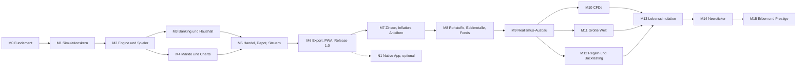
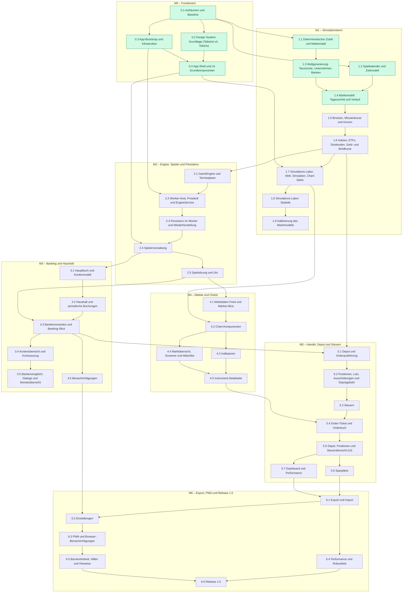

# PortfoliGo – Projektplan

> **Status:** Entwurf v0.2 · **Stand:** 10.11.2026
> **Grundlagen:** [Produktspezifikation](./specs/produktspezifikation.md) (PS) · [Technische Spezifikation](./specs/technische-spezifikation.md) (TS)

Dieser Plan zerlegt PortfoliGo in Meilensteine und Arbeitspakete (AP). Ein AP ist so geschnitten, dass es in **einer Session** umgesetzt werden kann. Verweise wie `US-SP-01` zeigen auf User Stories der Produktspezifikation, `TS §3.2` auf Abschnitte der technischen Spezifikation, `E-02` auf Entscheidungen (TS §16).

## Inhalt

1. [Überblick](#1-überblick)
2. [Arbeitsweise in Sessions](#2-arbeitsweise-in-sessions)
3. [Offene Entscheidungen](#3-offene-entscheidungen)
4. [Statusübersicht](#4-statusübersicht)
5. [Stufe 1: Meilensteine M0–M6](#5-stufe-1-meilensteine-m0m6)
6. [Spätere Ausbaustufen](#6-spätere-ausbaustufen)
7. [Änderungsprotokoll](#7-änderungsprotokoll)

## 1. Überblick

Geplant wird rollierend: Die Meilensteine bis zum MVP (Stufe 1, M0–M6) sind in Arbeitspakete zerlegt. Spätere Stufen sind als Epics skizziert und werden detailliert, sobald das MVP steht und die Prioritäten feststehen.



| Meilenstein | Stufe | Ziel                                               | Ergebnis, das man zeigen kann                                                          | APs |
| ----------- | ----- | -------------------------------------------------- | -------------------------------------------------------------------------------------- | --- |
| M0          | 1     | Sauberes Fundament mit Design-System und App-Shell | Navigierbare, leere App im Trading-Look; CI prüft Lint, Tests und Build                | 4   |
| M1          | 1     | Getesteter, deterministischer Simulationskern      | Simulations-Labor zeigt eine generierte Welt mit Kursverläufen und Statistiken         | 9   |
| M2          | 1     | Spielschleife mit Spielern, Uhr und Persistenz     | Spieler anlegen, Zeit in jeder Geschwindigkeit laufen lassen, schließen, nachberechnen | 5   |
| M3          | 1     | Geldflüsse: Einkommen, Kosten, Gebühren, Zinsen    | Kontoauszüge füllen sich; Konten eröffnen, Geld überweisen, Warnungen                  | 6   |
| M4          | 1     | Märkte im Trading-Look                             | Marktübersicht, Screener, Watchlist, Instrumentseite mit Live-Chart und Indikatoren    | 5   |
| M5          | 1     | Kernspiel komplett                                 | Kaufen, verkaufen, Sparpläne, Steuern, Depot, Dashboard mit Benchmark                  | 7   |
| M6          | 1     | Datensicherheit, Installierbarkeit, Feinschliff    | Version 1.0: Export und Import, PWA, Einstellungen                                     | 6   |

## 2. Arbeitsweise in Sessions

### 2.1 Vorbereitung

```sh
nvm use   # Node 22.22.3 laut .nvmrc – Angular CLI 22 verlangt ≥ 22.22.3
npm ci    # nur nötig, wenn sich Abhängigkeiten geändert haben
```

Für Tests auf dem Smartphone im lokalen Netz: `ng serve --ssl --host 0.0.0.0` – mehrere Browser-APIs funktionieren nur über HTTPS (TS §1.3).

### 2.2 Session starten

Vorlage für den Start einer Session:

> Setze AP 1.2 aus `docs/projektplan.md` um.

Claude liest dann `CLAUDE.md`, das AP samt Abhängigkeiten und Änderungsprotokoll sowie die referenzierten Abschnitte der Spezifikationen.

### 2.3 Ablauf

1. Prüfen, ob alle Abhängigkeiten des AP den Status „fertig" haben.
2. Betroffene Entscheidungen klären: Steht eine, die das AP braucht, noch auf „Vorschlag", fragt Claude nach, bevor darauf aufgebaut wird (§3 nennt für jede Entscheidung das AP, vor dem sie fallen muss).
3. In kleinen, testbaren Schritten umsetzen.
4. Prüfen: `ng lint --fix`, `ng test --watch=false`, `ng build`; bei geänderten Texten `ng extract-i18n`; Formatierung mit Prettier.
5. Status (§4, Tabelle und Abhängigkeitsgraph) und Änderungsprotokoll (§7) aktualisieren. Weicht die Umsetzung von der Spezifikation ab, wird die Spezifikation angepasst.
6. Commits nur auf ausdrückliche Anweisung.

### 2.4 Definition of Done (für jedes AP)

- Die Abnahmekriterien des AP sind erfüllt.
- `ng build`, `ng lint` und `ng test --watch=false` laufen fehlerfrei.
- Neue Logik ist getestet (`CLAUDE.md` §10); Simulationscode hält die Determinismus-Regeln ein (TS §4.5).
- Neue oder geänderte Texte haben i18n-IDs, `messages.xlf` ist aktualisiert.
- Statusübersicht und Änderungsprotokoll sind gepflegt.

### 2.5 Schnitt der Arbeitspakete

Wird ein AP für eine Session zu groß, teilt Claude es (z. B. AP 3.4a und 3.4b) und trägt die Teilung in §4 ein. Erkenntnisse, die spätere APs betreffen, kommen ins Änderungsprotokoll.

## 3. Offene Entscheidungen

Diese Punkte sollte der Product Owner bestätigen oder ändern, spätestens bevor das genannte AP beginnt. Details und Begründungen stehen in TS §16 und den verlinkten Abschnitten. Am einfachsten ist es, alle Vorschläge gesammelt zu bestätigen und nur Abweichungen zu nennen; Claude trägt den Status dann in TS §16 ein.

| ID   | Frage                                                                                                     | Vorschlag                                                                                                          | Spätestens vor |
| ---- | --------------------------------------------------------------------------------------------------------- | ------------------------------------------------------------------------------------------------------------------ | -------------- |
| E-04 | Chart-Bibliothek                                                                                          | lightweight-charts mit TradingView-Attribution; eigene SVG-Sparklines                                              | AP 1.7         |
| E-01 | Engine im Web Worker, NgRx hält nur Projektionen                                                          | Ja                                                                                                                 | AP 2.1         |
| E-08 | Persistenz: Snapshots, Kommando-Log mit Uhrzustand, Journal; Tageskerzen gespeichert, aber reproduzierbar | Ja                                                                                                                 | AP 2.3         |
| E-14 | Lebenshaltungskosten als Startparameter, Hausbank als Filialbank, Start pausiert                          | Ja; Vorgaben 10.000 € / 2.500 € / 1.800 €                                                                          | AP 2.4         |
| E-19 | Buchungstermine                                                                                           | Bank-Lauf 06:00; Gehalt am letzten, Lebenshaltung am ersten Bankarbeitstag                                         | AP 3.2         |
| E-11 | Steuervereinfachungen in Stufe 1                                                                          | 25 % pauschal, 1.000 € Pauschbetrag, ein Verlusttopf, ohne Soli/KiSt                                               | AP 5.3         |
| E-10 | Exportformat                                                                                              | base64(JSON) mit Spieler- und Marktzustand vom Beginn des Export-Tags; Kurshistorie nach dem Import im Hintergrund | AP 6.1         |
| E-05 | Capacitor                                                                                                 | PWA im MVP; Capacitor als optionaler Meilenstein N1                                                                | AP 6.3         |
| –    | Wird die App öffentlich bereitgestellt? Dann Impressum und Datenschutzhinweis nötig                       | klären                                                                                                             | AP 6.5         |

**Bereits entschieden:** E-07 (`CLAUDE.md`), E-03 – Zufallsströme per MurmurHash3 x86_128, `sfc32`, eigene `detExp`/`detLog` (10.11.2026), E-09 – Geld in Cent, Stück in Millionstel, Kurse als Gleitkomma mit Preisraster (10.11.2026), E-20 – Kursberechnung mit dem Brückenmodell (10.11.2026; Begründung und Messwerte in TS §3.2, §6.1 und §6.6), E-06 – Tailwind CSS v4 mit angehobener Browserslist und Inter Variable als selbst gehostete Schrift (10.11.2026) sowie die Ergänzungen für `CLAUDE.md` aus TS §11.2 (10.11.2026, übernommen in AP 0.2), E-15 – Hash-Routing mit englischen Routenpfaden (10.11.2026), E-16 – Angular Aria neben dem CDK für Tabs und Menüs (10.11.2026), E-12 – Stufe 1 mit Aktien, ETFs und Indizes, CFDs bleiben in Stufe 3 (10.11.2026), E-13 – reale Regionen und Länder, fiktive Unternehmen, Banken, Börsen, Indizes, Emittenten und Kennungen; Standardwelt nach TS §5.2 (10.11.2026), E-17 – Banking mit sofortiger Eröffnung und Überweisung, Dispo mit geduldeter Überziehung, Bankbelastungen dürfen Verrechnungskonten ins Minus bringen (10.11.2026), E-02 – Tick = 1 Spielminute, Start Mo 01.04.2030 00:00, im Hintergrund Echtzeit (pro Spieler auf Pause umstellbar), eine Pause bleibt Pause (11.11.2026), E-18 – Handelszeiten je Region, Orders jederzeit, Ausführung in der Handelszeit (11.11.2026). Das Deployment ist laut Product Owner unter `https://algoristic.de/portfoligo/` per HTTPS erreichbar.

## 4. Statusübersicht

Status: **offen**, **in Arbeit**, **fertig**.

| AP  | Titel                                            | Status | Abhängig von |
| --- | ------------------------------------------------ | ------ | ------------ |
| 0.1 | Aufräumen und Baseline                           | fertig | –            |
| 0.2 | Design-System-Grundlage (Tailwind v4, Tokens)    | fertig | 0.1          |
| 0.3 | App-Bootstrap und Infrastruktur                  | fertig | 0.1          |
| 0.4 | App-Shell und UI-Grundkomponenten                | fertig | 0.2, 0.3     |
| 1.1 | Deterministischer Zufall und Mathematik          | fertig | 0.1          |
| 1.2 | Spielkalender und Zeitmodell                     | fertig | 0.1          |
| 1.3 | Weltgenerierung: Taxonomie, Unternehmen, Banken  | fertig | 1.1          |
| 1.4 | Marktmodell: Tagesschritt und Vorlauf            | fertig | 1.2, 1.3     |
| 1.5 | Brücken, Minutenkurse und Kerzen                 | offen  | 1.4          |
| 1.6 | Indizes, ETFs, Dividenden, Geld- und Briefkurse  | offen  | 1.5          |
| 1.7 | Simulations-Labor: Welt, Simulation, Chart-Spike | offen  | 1.6, 0.4     |
| 1.8 | Simulations-Labor: Statistik                     | offen  | 1.7          |
| 1.9 | Kalibrierung des Marktmodells                    | offen  | 1.8          |
| 2.1 | GameEngine und Terminplaner                      | offen  | 1.6          |
| 2.2 | Worker-Host, Protokoll und EngineService         | offen  | 2.1, 0.3     |
| 2.3 | Persistenz im Worker und Wiederherstellung       | offen  | 2.2          |
| 2.4 | Spielerverwaltung                                | offen  | 2.3, 0.4     |
| 2.5 | Spielsitzung und Uhr                             | offen  | 2.4          |
| 3.1 | Hauptbuch und Kontenmodell                       | offen  | 2.4          |
| 3.2 | Haushalt und periodische Buchungen               | offen  | 3.1          |
| 3.3 | Bankkommandos und Banking-Slice                  | offen  | 3.2, 2.5     |
| 3.4 | Kontenübersicht und Kontoauszug                  | offen  | 3.3          |
| 3.5 | Bankenvergleich, Dialoge und Monatsübersicht     | offen  | 3.4          |
| 3.6 | Benachrichtigungen                               | offen  | 3.3          |
| 4.1 | Marktdaten-Feed und Market-Slice                 | offen  | 2.5          |
| 4.2 | Chart-Komponenten                                | offen  | 4.1, 1.7     |
| 4.3 | Indikatoren                                      | offen  | 4.2          |
| 4.4 | Marktübersicht, Screener und Watchlist           | offen  | 4.2          |
| 4.5 | Instrument-Detailseite                           | offen  | 4.3, 4.4     |
| 5.1 | Depot und Orderausführung                        | offen  | 3.3, 1.6     |
| 5.2 | Positionen, Lots, Ausschüttungen und Depotgebühr | offen  | 5.1          |
| 5.3 | Steuern                                          | offen  | 5.2          |
| 5.4 | Order-Ticket und Orderbuch                       | offen  | 5.3, 4.5     |
| 5.5 | Depot, Positionen und Steuerübersicht (UI)       | offen  | 5.4          |
| 5.6 | Sparpläne                                        | offen  | 5.5          |
| 5.7 | Dashboard und Performance                        | offen  | 5.5          |
| 6.1 | Export und Import                                | offen  | 5.6, 5.7     |
| 6.2 | Einstellungen                                    | offen  | 6.1, 3.6     |
| 6.3 | PWA und Browser-Benachrichtigungen               | offen  | 6.2          |
| 6.4 | Performance und Robustheit                       | offen  | 6.1          |
| 6.5 | Barrierefreiheit, Hilfen und Hinweise            | offen  | 6.3          |
| 6.6 | Release 1.0                                      | offen  | 6.4, 6.5     |

### Abhängigkeitsgraph

Die Pfeile zeigen von der Voraussetzung zum abhängigen AP. Fertige APs sind grün, APs in Arbeit gelb markiert. Der Graph wird zusammen mit der Tabelle gepflegt (Status und Abhängigkeiten).



## 5. Stufe 1: Meilensteine M0–M6

### M0 – Fundament

**Ziel:** sauberer, grüner Ausgangszustand mit Design-System, Infrastruktur und App-Shell.
**Ergebnis:** navigierbare, leere App im Trading-Look; die CI prüft Lint, Tests und Build.

#### AP 0.1 – Aufräumen und Baseline

- **Umfang:**
  - Ionic-Reste entfernen: `ionic.config.json`, `capacitor.config.ts` (wird bei Bedarf in N1 neu angelegt), Ionic-Schematics und `schematicCollections` in `angular.json`, `src/theme/variables.scss`, Ionic-Hinweise in `src/test-setup.ts` (den `matchMedia`-Polyfill behalten, falls Tests ihn brauchen) und in `.vscode/settings.json`, Ionic-CLI-Schritt in `.github/workflows/build-latest.yml`, `author` und `homepage` in `package.json`.
  - `src/environments/environment.model.ts` von verwaisten Importen befreien und die Umgebung neu ordnen (u. a. Devtools-Konfiguration, Flag für Labor und Entwicklerseiten).
  - `src/index.html`: `lang="de"`, Zoom nicht mehr sperren (`maximum-scale` und `user-scalable=no` entfernen).
  - `.browserslistrc` nach TS §1.3 anheben.
  - `AppComponent` nach `CLAUDE.md` (kein leerer Konstruktor, eigene Template- und Style-Datei).
  - Einen ersten Test anlegen, damit `ng test` läuft.
  - CI: Node aus `.nvmrc`, `npm ci`, `ng lint`, `ng test --watch=false`, `ng build`; Deployment unverändert nur nach Erfolg. Prüfen, dass die Zieladresse per HTTPS erreichbar ist.
  - `uuid` entfernen (ersetzt durch `crypto.randomUUID()`).
- **Abnahme:** `ng build` ohne Browserslist-Warnung; `ng lint` und `ng test --watch=false` grün; keine Ionic-Referenzen mehr in Code und Konfiguration; HTTPS-Erreichbarkeit geklärt.
- **Referenzen:** TS §1.1, §1.3, §14.4; E-06
- **Abhängig von:** –

#### AP 0.2 – Design-System-Grundlage (Tailwind v4, Tokens)

- **Umfang:**
  - Tailwind v4 über `@tailwindcss/postcss` und `.postcssrc.json` einbinden; `src/styles.css` als globaler Einstieg in `angular.json`, `src/global.scss` entfernen.
  - Semantische Tokens `--pgo-*` nach TS §11.5 für Dunkel (Standard) und Hell, Klasse `dark` am `<html>`. Vorläufig folgt das Theme `prefers-color-scheme`; die Einstellung kommt in AP 6.2.
  - Schrift festlegen (Inter selbst gehostet oder System-Schrift) und `tabular-nums` für Zahlen.
  - Optional `prettier-plugin-tailwindcss`.
  - Token-Übersicht auf einer Entwicklerseite (gleiches Umgebungs-Flag wie das Labor).
  - `CLAUDE.md` um die Ergänzungen und Ausnahmen aus TS §11.2 erweitern – nach Freigabe (§3).
- **Abnahme:**
  - Tokens wirken in Utility-Klassen und – als `var(--pgo-*)` – in Komponenten-SCSS (geprüft an einer Beispielkomponente).
  - Dunkel und Hell funktionieren; Standardfarben wie `bg-red-500` erzeugen keine Styles.
  - Textkontraste der Tokens ≥ 4,5:1.
- **Referenzen:** TS §11.2, §11.5; US-UI-01; E-06
- **Abhängig von:** AP 0.1

#### AP 0.3 – App-Bootstrap und Infrastruktur

- **Umfang:**
  - `app.config.ts`: Router (Hash), Store, Effects, Router Store, Devtools nur in der Entwicklung, `LOCALE_ID` `de` mit `registerLocaleData`.
  - `@angular/cdk` installieren.
  - `persistence/data-access`: framework-freie Schema-Definition für IndexedDB (nutzbar in UI und Worker), `IndexedDbService`, `LocalStorageService` (typisiertes, versioniertes JSON). Als Vorlage dient der Prototyp: `git show 9bab719^:src/app/idb/data-access/service/idb.service.ts`.
  - `fake-indexeddb` als Dev-Abhängigkeit für Tests.
  - `shared/domain`: `Cents`, `MicroUnits`, Rundungsfunktionen und Preisraster (TS §6.7, §7.1); `shared/util`: Formatierungsfunktionen (TS §11.9); `shared/ui`: Pipes darüber.
- **Abnahme:** App startet mit Store und Devtools; Tests für Rundung, Preisraster, Formatierung und Services grün.
- **Referenzen:** TS §6.7, §7.1, §9.1, §9.3, §11.9; E-09
- **Abhängig von:** AP 0.1

#### AP 0.4 – App-Shell und UI-Grundkomponenten

- **Umfang:**
  - `shell/feature`: Layout mit Kopfzeile (Platzhalter für Uhr, Gesamtvermögen, Suche, Benachrichtigungen, Spielermenü), Seitennavigation auf dem Desktop, untere Navigation auf dem Smartphone (`BreakpointObserver`); Routen-Gerüst nach TS §11.4 mit lazy geladenen Platzhalterseiten.
  - `shared/ui`: Button, Icon-Button, Panel, Badge, Tabs, Leerzustand, Skeleton, Kennzahl-Kachel, Kursveränderung (Vorzeichen, Pfeil, Farbe), Toast-Container (CDK Overlay), Dialog-Rahmen (CDK Dialog), Bestätigungsdialog.
  - `data-testid` nach `CLAUDE.md`, Fokusstile, Tastaturbedienung.
- **Abnahme:** leere App im Trading-Look auf Desktop und Smartphone navigierbar, auch per Tastatur; i18n-IDs vergeben, `ng extract-i18n` ausgeführt.
- **Referenzen:** PS §10; US-UI-03, US-UI-04; TS §11.4, §11.6; E-15, E-16
- **Abhängig von:** AP 0.2, AP 0.3

### M1 – Simulationskern

**Ziel:** eine reine, getestete Simulationsbibliothek, die aus einem Seed Welt, Markt und Historie erzeugt.
**Ergebnis:** Das Simulations-Labor zeigt eine generierte Welt mit plausiblen Kursverläufen und Statistiken.

#### AP 1.1 – Deterministischer Zufall und Mathematik

- **Umfang:** `simulation/util`: Seed-Normalisierung, 128-Bit-Hash (Seed-Schlüssel und Strom-Ableitung, TS §4.1, §4.2), `sfc32`, Verteilungen (TS §4.3), `detExp` und `detLog`, Prüfsummen über Float64-Werte; Seed-Generator für gut teilbare Seeds.
- **Abnahme:** Tests für Reproduzierbarkeit, Stromunabhängigkeit, Momente der Verteilungen (mit Toleranz), `detExp`/`detLog` gegen `Math.*` (≤ 1 ulp auf Stichproben), feste Testvektoren für Hash und Generator.
- **Referenzen:** TS §4; E-03; NF-05
- **Abhängig von:** AP 0.1

#### AP 1.2 – Spielkalender und Zeitmodell

- **Umfang:** `clock/domain`: Tick ↔ Datum, Wochentag, Tagesindex, Monats- und Jahresgrenzen, Bankarbeitstage, erster und letzter Bankarbeitstag; Handelszeiten (offen, nächste Öffnung und Schließung); Geschwindigkeitsstufen als `as const`-Liste; Ziel-Tick aus Anker und Wanduhr als reine Funktion; Formatierung der Spielzeit (`formatGameTime`, aus AP 0.3 verschoben, TS §11.9).
- **Abnahme:** Tests inklusive Schaltjahren, Monatsenden, Wochenenden und Handelszeitgrenzen; der Spielstart ist Tick 5.389.920 (Mo, 01.04.2030, 00:00).
- **Referenzen:** TS §3.1, §3.3–§3.5; E-02, E-18
- **Abhängig von:** AP 0.1

#### AP 1.3 – Weltgenerierung: Taxonomie, Unternehmen, Banken

- **Umfang:** `world/domain`: Weltkonfiguration (Mengen, Verteilungen); Regionen, Länder, Börsen mit Handelszeiten, Sektoren, Branchen; Namensgeneratoren für Unternehmen, Banken, Emittenten und Indizes mit Blockliste; eindeutige Ticker und Kennungen mit Prüfziffer; Unternehmensattribute inkl. Profil-Vorlagencode, Sparplanfähigkeit und Startwerten der Modellparameter; Stammdaten der Indizes (Art, Zusammensetzung, Kappung) und ETFs (Emittent, Index, TER, Ertragsverwendung, Replikation, Fondsvolumen) nach TS §5.5 und §5.6; Banken mit Konditionen (TS §5.7, Typen aus TS §7.3); Modelle als `*.model.ts`.
- **Abnahme:** gleicher Seed ergibt eine identische Welt (Prüfsummentest); Verteilungen im vorgesehenen Rahmen; keine Dubletten; Generierung unter 200 ms.
- **Referenzen:** TS §5, §7.3; PS §4.4, §6; E-12, E-13, E-17
- **Abhängig von:** AP 1.1

#### AP 1.4 – Marktmodell: Tagesschritt und Vorlauf

- **Umfang:** `market/domain`: Marktzustand in Typed Arrays; Tagesschritt nach TS §6.1–§6.4 – Marktphasen, Trends und Volatilität der Faktoren mit Stützpunkten an den Grenzen der Handelszeiten, Tagesstützpunkte der Aktien mit Overnight-Schock, Sprüngen (Anzahl, Minute, Größe) und Kursuntergrenze; Vorlauf als Tagesschritte ab der Epoche; Faktorhistorie mit Zuständen zu Monatsbeginn; Neuberechnung der Historie eines einzelnen Instruments; Snapshot und Restore des Marktzustands; Markt-Prüfsumme.
- **Abnahme:** Tests aus TS §4.6: Golden Master über die Tagesschlusskurse, Granularität, Snapshot mit Restore und Weiterlauf, Stromunabhängigkeit; die neu berechnete Historie eines einzelnen Instruments entspricht der des Gesamtlaufs. Benchmark mit `detExp`/`detLog`: zehn Jahre Vorlauf der Standardwelt in ≤ 0,5 s auf dem Entwicklungsrechner.
- **Referenzen:** TS §3.2, §4.2, §4.6, §6.1–§6.4, §6.8; E-02, E-20
- **Abhängig von:** AP 1.2, AP 1.3

#### AP 1.5 – Brücken, Minutenkurse und Kerzen

- **Umfang:**
  - Brücken für Faktoren (ein Strom je Faktor, Tag und Intervall) und Aktien (Sprünge ab ihrer Minute) nach TS §6.1–§6.4; Endpunkte als Stützpunkte gesetzt; Tagesprofil der Volatilität als Parameter (Standard: gleichmäßig).
  - `priceAt(instrumentId, tick)` mit Cache der Tagesverläufe und offiziellem Kurs bei geschlossener Börse.
  - Kerzen aller Auflösungen bei Abfrage; Tageskerzen mit Hoch und Tief; Ergänzung fehlender Hoch- und Tiefkurse als zeitteilbare Funktion für den Hintergrundauftrag (TS §6.8); Abfragegrenze (TS §4.5, Regel 7).
  - Testhelfer: Referenz-Simulation Minute für Minute nach TS §4.6; die Prototyp-Werte in TS §6.1 geben die Größenordnung der Toleranzen vor.
- **Abnahme:** Tests aus TS §4.6: Stützpunkte bitgenau getroffen; Bedarf, Vorabberechnung und Neuberechnung nach Verwerfen der Caches bitgleich; statistische Gleichwertigkeit mit der Referenz-Simulation innerhalb fester Toleranzen; Abfragegrenze; Golden Master um die Minutenkurse einer festen Stichprobe erweitert. Benchmark mit `detExp`/`detLog`: ein Spieljahr mit allen Minutenverläufen der Standardwelt in ≤ 4 s; Minutenchart eines vergangenen Tags in < 50 ms.
- **Schnitt:** Wird das AP zu groß, zuerst Brücken und `priceAt` (AP 1.5a), dann Kerzen und Abfragegrenze (AP 1.5b).
- **Referenzen:** TS §4.5, §4.6, §6.1, §6.2, §6.4, §6.8, §14.3; E-20
- **Abhängig von:** AP 1.4

#### AP 1.6 – Indizes, ETFs, Dividenden, Geld- und Briefkurse

- **Umfang:** Kurs- und Performanceindizes auf Basis der Index-Stammdaten aus AP 1.3, innerhalb des Tages exakt aus den Minutenkursen aller Werte; indikative Werte aus den Faktorbrücken; ETF-NAV (thesaurierend und ausschüttend mit Ausschüttungstopf, TER, Tracking); Dividendenkalender (Ankündigung mit dem Schlusskurs vor der Ankündigung, Ex-Tag-Abschlag im Tagesschritt, Zahltag als Ereignis); Tageskerzen der Indizes und ETFs; Spread-Modell mit Preisraster und Quotes. Abgeleitete Werte als reine Funktionen, zustandsbehaftete Größen nur über den Terminplaner (TS §6.6).
- **Abnahme:** Tests:
  - Index entspricht zu jeder Minute der gewichteten Summe; TER-Abschlag ≈ TER p. a.; Ex-Tag-Abschlag.
  - Thesaurierender und ausschüttender ETF haben vor Kosten dieselbe Gesamtrendite.
  - Geld < Brief bei jedem Kurs (auch unter 10 €); Spreads im vorgesehenen Rahmen.
  - Beobachtungsunabhängigkeit: Abfragen ändern die Markt-Prüfsumme nicht.
  - Die Dividendenhöhe hängt nicht von Kursen des Ankündigungstags ab.
- **Referenzen:** TS §6.5–§6.8, §4.6
- **Abhängig von:** AP 1.5

#### AP 1.7 – Simulations-Labor: Welt, Simulation, Chart-Spike

- **Umfang:**
  - `lab/feature` (nur mit Umgebungs-Flag): Seed eingeben, Welt erzeugen und in Tabellen anzeigen, Zeitraum in einem einfachen Web Worker simulieren (Vorstufe zu AP 2.2).
  - Chart-Spike: `lightweight-charts` installieren; Linie und Kerzen, Zeitachse in Spielzeit, Farben aus den Tokens; Bundle-Größe bei lazy Laden messen.
- **Abnahme:** Das Labor zeigt Welt und Charts beliebiger Instrumente. Das Spike-Ergebnis (Größe, Theming, Zeitachse) steht im Änderungsprotokoll; E-04 ist bestätigt oder revidiert.
- **Referenzen:** TS §11.7, §14.2; E-04
- **Abhängig von:** AP 1.6, AP 0.4

#### AP 1.8 – Simulations-Labor: Statistik

- **Umfang:** `analysis/domain`: Statistikfunktionen (Rendite, Volatilität, Korrelation, Drawdown, Verteilung der Tagesrenditen); Statistikansicht im Labor nach TS §14.2 mit Vergleich zu den Kalibrierungszielen, Phasen-Zeitleiste, Intraday-Statistik im Vergleich zur Referenz-Minutensimulation aus AP 1.5 und Durchsatz in Spieltagen pro Sekunde.
- **Abnahme:** Tests der Statistikfunktionen mit Referenzwerten; die Ansicht zeigt alle Größen aus TS §6.9 für einen gewählten Seed und Zeitraum.
- **Referenzen:** TS §6.9, §14.2
- **Abhängig von:** AP 1.7

#### AP 1.9 – Kalibrierung des Marktmodells

- **Umfang:** Parameter mit mehreren Seeds gegen die Ziele aus TS §6.9 abstimmen, einschließlich Tagesprofil der Volatilität (TS §6.1); statistische Tests mit Toleranzen; finale Parameter in TS §6 nachtragen.
- **Abnahme:** Kalibrierungsziele auf mindestens fünf Seeds erreicht oder Abweichungen begründet; statistische Testsuite grün.
- **Referenzen:** TS §6.9, §14.1; Risiko R1
- **Abhängig von:** AP 1.8

### M2 – Engine, Spieler und Persistenz

**Ziel:** eine lauffähige Spielschleife mit Spielerverwaltung, Uhr und Speicherung – noch ohne Geldflüsse.
**Ergebnis:** Spieler anlegen, die Zeit in jeder Geschwindigkeit laufen lassen, die App schließen und beim Öffnen nachberechnen lassen.

#### AP 2.1 – GameEngine und Terminplaner

- **Umfang:** `engine/domain`: `GameEngine` mit der API aus TS §8.1, `World` und `GameState`, Systemreihenfolge nach TS §3.8 (vorerst Kalender und Markt), Terminplaner als Binärheap, Ereignispuffer, Kommandos mit Tick-Stempel, Snapshot und Restore inklusive (vorerst minimalem) Spielerzustand.
- **Abnahme:** Tests: Stapel- und Live-Betrieb identisch; Snapshot, Restore und Replay identisch; Reihenfolge des Terminplaners.
- **Referenzen:** TS §2.2, §3.8, §8.1; E-01
- **Abhängig von:** AP 1.6

#### AP 2.2 – Worker-Host, Protokoll und EngineService

- **Umfang:**
  - `engine/data-access`: `engine.worker.ts`, Nachrichtenprotokoll (TS §8.2, §8.3), Typ-Guards in `engine-service.utils.ts`.
  - `EngineService` (Observable-API, Korrelation, Fehler, Abo-Zählung) mit `provideEngineService()` – einmal in den Bootstrap-Providern (TS §11.2, Punkt 4); Token für eine Worker-Factory (Tests mit Fake-Worker).
  - Takt (TS §3.5), Sichtbarkeit und `backgroundMode` (TS §3.6), Drosselung (TS §8.4), Auslastungsmeldung.
- **Abnahme:** Tests: Service mit Fake-Worker (Kommandos, Antworten, Fehler); Taktlogik als reine Funktion. Ein manueller Smoke-Test im Labor zeigt eintreffende `clock`-Ereignisse.
- **Referenzen:** TS §3.5, §3.6, §8.2–§8.5, §11.2
- **Abhängig von:** AP 2.1, AP 0.3

#### AP 2.3 – Persistenz im Worker und Wiederherstellung

- **Umfang:** IndexedDB-Schema Version 3 (TS §9.1) mit Migration und Besitzern je Store; Kommando-Annahme nach dem Write-ahead-Protokoll (TS §8.5); Speicherstrategie (TS §9.2); Laden als Welt + Faktorhistorie + Snapshot + Replay + Nachberechnung mit Fortschritt; Tageskerzen im Store `candles` mit dem zeitgeteilten Hintergrundauftrag für fehlende Hoch- und Tiefkurse (TS §6.8); Web Lock je Spieler (TS §9.4); `navigator.storage.persist()`.
- **Abnahme:** Tests mit `fake-indexeddb`:
  - Speichern und Laden; Replay; Verwerfen der Spielerdaten nach dem Snapshot-Tick, Tageskerzen bleiben erhalten.
  - Nach Verwerfen des Stores `candles` baut der Hintergrundauftrag identische Tageskerzen auf.
  - Absturz kurz nach einem Kommando, das nach der letzten periodischen Uhr-Speicherung kam: Das Kommando wirkt nach der Wiederherstellung an seinem ursprünglichen Tick.
- **Referenzen:** TS §3.7, §8.5, §9; US-ZT-04, US-SP-02; E-08
- **Abhängig von:** AP 2.2

#### AP 2.4 – Spielerverwaltung

- **Umfang:** `players` (domain, data-access, feature): Profilmodell, `PlayersService` (Read-Modify-Write auf eigene Datensätze), Players-Slice nach `CLAUDE.md` §6; Seiten „Spielerauswahl" (umbenennen; löschen mit Bestätigung und Lock-Prüfung) und „Spieler anlegen" (Signal Forms, Voreinstellungen, Seed-Generator, Validierung, Betragseingabe als `FormValueControl<Cents>`); Initialisierung beim ersten Laden im Worker (Welt, Vorlauf bis zum Spielstart, Uhr).
- **Abnahme:** Tests für Slice, Service und Validierungsregeln. Spieler lassen sich anlegen, umbenennen und löschen (inklusive aller Daten); ein gesperrter Spieler lässt sich nicht löschen; die Auswahl öffnet die (noch leere) Shell.
- **Referenzen:** US-SP-01–US-SP-03; TS §4.1, §9.1, §9.4, §11.8; E-14
- **Abhängig von:** AP 2.3, AP 0.4

#### AP 2.5 – Spielsitzung und Uhr

- **Umfang:** Session- und Clock-Slice, registriert über `provideGameState()` an der Shell-Route; Guards `enterGame` und `leaveGame`; Kopfzeile mit Datum, Uhrzeit, Wochentag, Börsenstatus je Region, Geschwindigkeitsregler, Pause/Weiter, abschaltbaren Tastenkürzeln und Auslastungsanzeige; Overlay für Initialisierung und Nachberechnung; Vorspulen (S).
- **Abnahme:** Tests für Slices, Effects und Guards. Manuell:
  - Ein neuer Spieler startet pausiert am 01.04.2030, 00:00; Geschwindigkeitswechsel wirken sofort.
  - Im Hintergrund läuft Echtzeit; Tab schließen und später öffnen ergibt eine Nachberechnung.
  - Eine Pause bleibt nach dem Neuladen erhalten; ein zweiter Tab mit demselben Spieler erhält einen Hinweis.
- **Referenzen:** US-ZT-01–US-ZT-05; TS §3, §11.2, §11.10; E-02
- **Abhängig von:** AP 2.4

### M3 – Banking und Haushalt

**Ziel:** Geld fließt: Gehalt, Lebenshaltung, Gebühren und Zinsen; Konten lassen sich eröffnen, schließen und Geld bewegen.
**Ergebnis:** Kontoauszüge füllen sich mit der Zeit; Warnungen erscheinen bei Unterdeckung.

#### AP 3.1 – Hauptbuch und Kontenmodell

- **Umfang:** `banking/domain`: Transaktionen und Buchungen mit Invariante, Kontoarten, Salden, Gebühren- und Zinsmodelle (TS §7.3) mit Berechnungsfunktionen; Startkapital als `opening-balance` auf das Girokonto der Hausbank bei der Initialisierung; Speicherung im Store `transactions`.
- **Abnahme:** Tests: Summe 0 je Transaktion; Saldo gleich Summe der Buchungen; jedes Gebührenmodell; taggenaue Zinsen.
- **Referenzen:** TS §7.1–§7.3; E-09
- **Abhängig von:** AP 2.4

#### AP 3.2 – Haushalt und periodische Buchungen

- **Umfang:** Banking-System der Engine: Gehalt, Lebenshaltung mit Schwankung, Kontoführung mit Befreiungsbedingungen, Dispo-, Soll- und Habenzinsen, Ereignisse bei Unterdeckung und Überziehung, Monatswerte für die Monatsübersicht (TS §7.4).
- **Abnahme:** Tests über mehrere simulierte Monate: Termine, Beträge, Determinismus, Gutschriften vor Lastschriften, Monatswerte.
- **Referenzen:** US-EK-01, US-EK-02, US-BK-07, US-BK-08; TS §7.4; E-17, E-19
- **Abhängig von:** AP 3.1

#### AP 3.3 – Bankkommandos und Banking-Slice

- **Umfang:** Kommandos `openAccount`, `closeAccount` (mit Abschluss und Zielkonto, TS §7.4), `setSalaryAccount` und `transfer` mit Validierung und Fehlercodes; Projektionen für Banken und Konten; Banking-Slice mit Facade.
- **Abnahme:** Tests für Engine-Kommandos (inkl. Kontoabschluss mit Zinsen und anteiligen Gebühren), Reducer, Selektoren, Effects und Facade.
- **Referenzen:** US-BK-02–US-BK-05; TS §7.4, §8.2, §8.3
- **Abhängig von:** AP 3.2, AP 2.5

#### AP 3.4 – Kontenübersicht und Kontoauszug

- **Umfang:** Kontenübersicht (Karten je Konto, Summen); Kontoauszug mit seitenweiser Abfrage (Guard und Effects, TS §11.3), virtuellem Scrollen, Filtern und Suche.
- **Abnahme:** Kontoauszug mit 10.000 Buchungen scrollt ohne Ruckeln (Main-Thread-Arbeit je Seite < 4 ms); per Tastatur bedienbar; Leerzustände.
- **Referenzen:** US-BK-06; TS §11.3, §14.3
- **Abhängig von:** AP 3.3

#### AP 3.5 – Bankenvergleich, Dialoge und Monatsübersicht

- **Umfang:** Bankenvergleich mit Sortierung; Dialoge „Konto eröffnen", „Konto schließen" (Zielkonto), „Überweisen" (Signal Forms) und „Gehaltskonto wechseln"; Monatsübersicht aus den Monatswerten.
- **Abnahme:** Alle Abläufe per Maus und Tastatur bedienbar; Fehlercodes der Engine als verständliche Texte; i18n extrahiert.
- **Referenzen:** US-BK-01–US-BK-05, US-EK-03; PS §10.3
- **Abhängig von:** AP 3.4

#### AP 3.6 – Benachrichtigungen

- **Umfang:** `notifications`: Slice, Benachrichtigungszentrum, Toasts mit Bündelung, Abwesenheitsbericht nach der Nachberechnung, Auto-Pause je Ereignis-Code in der Engine (unterdrückt bei Nachberechnung und verborgener App), begrenzte Speicherung, Zähler in der Kopfzeile.
- **Abnahme:** Tests für Slice, Effects und die Auto-Pause-Regeln. Eine Überziehung erzeugt eine Warnung und, falls eingestellt, eine Pause; nach der Rückkehr erscheint der Abwesenheitsbericht.
- **Referenzen:** US-BN-01–US-BN-03, US-ZT-06; TS §3.6, §12
- **Abhängig von:** AP 3.3

### M4 – Märkte und Charts

**Ziel:** Märkte im Trading-Look mit Live-Kursen, Charts und Indikatoren.
**Ergebnis:** Marktübersicht, Screener, Watchlist und Instrumentseite mit Live-Chart.

#### AP 4.1 – Marktdaten-Feed und Market-Slice

- **Umfang:** Abos (`subscribe`, `unsubscribe`) über Guards und Effects (TS §11.3), `quotes`-Ereignisse, Instrument-Stammdaten als Projektion, Abfragen (Details, Kerzen, Suche, Filter), Market-Slice mit Entity-Adaptern, Referenzzählung der Abos.
- **Abnahme:** Tests für Service, Effects, Reducer und Selektoren; Kursupdates kommen gedrosselt im Store an; Verlassen einer Seite beendet ihre Abos.
- **Referenzen:** US-MK-05; TS §8.4, §11.3
- **Abhängig von:** AP 2.5

#### AP 4.2 – Chart-Komponenten

- **Umfang:** `charts/ui`: Kurschart-Wrapper (TS §11.7), Sparkline und Donut als SVG-Komponenten.
- **Abnahme:** Chart mit Live-Daten; Theme-Wechsel wirkt; beim Verlassen der Seite wird der Chart entfernt (kein Speicherleck); die Bibliothek wird lazy geladen.
- **Referenzen:** US-CH-01; TS §11.7; E-04
- **Abhängig von:** AP 4.1, AP 1.7

#### AP 4.3 – Indikatoren

- **Umfang:** `analysis/domain`: SMA, EMA, SMMA und Bollinger-Bänder als reine, inkrementell fortschreibbare Funktionen; Auswahl und Parameter im Chart; Speicherung in `pgo.ui.chart`.
- **Abnahme:** Tests mit Referenzwerten; mehrere Indikatoren gleichzeitig.
- **Referenzen:** US-CH-02; TS §11.7
- **Abhängig von:** AP 4.2

#### AP 4.4 – Marktübersicht, Screener und Watchlist

- **Umfang:** Märkte-Seite (Indizes, Gewinner und Verlierer, Sektoren); Screener mit Filtern nach TS §5.3, Sortierung, virtuellem Scrollen und Sparklines; Watchlist im Spielerzustand (Kommando `updateWatchlist`).
- **Abnahme:** Filter sind kombinierbar; die Watchlist bleibt nach dem Neuladen erhalten; bei Quotes für 250 Instrumente bleibt die Main-Thread-Arbeit je Update unter 4 ms.
- **Referenzen:** US-MK-01, US-MK-02, US-MK-04; TS §14.3
- **Abhängig von:** AP 4.2

#### AP 4.5 – Instrument-Detailseite

- **Umfang:** Kurskopf (Geld, Brief, Spread, Handelsstatus), Chart mit Indikatoren, Kennzahlen, Profil für Aktien und ETFs (Text aus Vorlagen-Code), Dividenden (Historie, nächster Termin), Aktionen (Watchlist; Kaufen und Verkaufen werden in AP 5.4 angebunden).
- **Abnahme:** Alle Angaben aus US-MK-03 sichtbar und live aktualisiert.
- **Referenzen:** US-MK-03, US-MK-06; TS §5.4, §8.6
- **Abhängig von:** AP 4.3, AP 4.4

### M5 – Handel, Depot und Steuern

**Ziel:** Das Kernspiel ist komplett.
**Ergebnis:** Kaufen, verkaufen, Sparpläne, Steuern, Depot und Dashboard mit Benchmark – der Funktionsumfang des MVP.

#### AP 5.1 – Depot und Orderausführung

- **Umfang:** Depot mit Verrechnungskonto eröffnen; Orderarten und Gültigkeit; Prüfung je Tick; Ausführung zu Geld- und Briefkurs; Gebühren; Reservierung, Ablehnung und Ablauf; Sonderfall Pause; Sperre neuer Käufe bei negativem Verrechnungskonto; Ereignisse.
- **Abnahme:** Tests für alle Orderarten und Zustandsübergänge (inkl. Storno und Ablauf ausgelöster Stop-Limit-Orders), Kurslücken, Reservierungen und Gebührenmodelle; die Markt-Prüfsumme ist mit und ohne Orders identisch.
- **Referenzen:** US-HD-01–US-HD-03; TS §7.4, §7.5
- **Abhängig von:** AP 3.3, AP 1.6

#### AP 5.2 – Positionen, Lots, Ausschüttungen und Depotgebühr

- **Umfang:** Positionen und Lots nach FIFO mit Anschaffungskosten in Cent, Einstandskurs, realisierte Gewinne und Verluste; Dividenden und ETF-Ausschüttungen an die Bestände am Stichtag, Gutschrift am Zahltag; Depotgebühr quartalsweise auf den durchschnittlichen Depotwert.
- **Abnahme:** Tests für FIFO-Teilverkäufe (Anschaffungskosten summieren sich exakt), Stichtagsregel, ausschüttende ETFs, Depotgebühr inklusive Belastung eines leeren Verrechnungskontos.
- **Referenzen:** US-PF-06, US-BK-08; TS §6.5, §7.4, §7.6
- **Abhängig von:** AP 5.1

#### AP 5.3 – Steuern

- **Umfang:** Steuersystem nach TS §7.7: Einbehalt und Erstattung, Sparerpauschbetrag, Verlustvortrag, Jahreswechsel; Steuer-Projektion und Steuer-Slice.
- **Abnahme:** Tests mit Jahresszenarien: nur Gewinne, nur Verluste, gemischt, über den Jahreswechsel, mit Zinsen und Dividenden.
- **Referenzen:** US-ST-01–US-ST-03; TS §7.7; E-11
- **Abhängig von:** AP 5.2

#### AP 5.4 – Order-Ticket und Orderbuch

- **Umfang:** Trading-Slice; Order-Ticket als Dialog (Signal Forms, Live-Kostenvorschau mit derselben Gebührenfunktion wie die Engine, Deckungsprüfung, Steuervorschau beim Verkauf); Orderbuch mit offenen Orders und Historie, Stornieren und Ändern; Anbindung von Kaufen und Verkaufen auf der Instrumentseite.
- **Abnahme:** Tests für Slice und Effects; Kauf und Verkauf von der Instrumentseite und Storno aus dem Orderbuch; verständliche Fehlermeldungen.
- **Referenzen:** US-HD-01–US-HD-04; TS §2.3
- **Abhängig von:** AP 5.3, AP 4.5

#### AP 5.5 – Depot, Positionen und Steuerübersicht (UI)

- **Umfang:** Depotübersicht (Positionen, Summen, Allokation als Donut nach Assetklasse, Region und Sektor) mit Kaufen und Verkaufen aus der Positionsliste; Positionsdetail (Lots, realisierte Gewinne, Dividenden, Trades im Chart als S); Steuerseite.
- **Abnahme:** Werte stimmen mit der Engine-Projektion überein; Tabellen sortierbar; Kauf und Verkauf aus dem Depot; responsive.
- **Referenzen:** US-PF-02, US-PF-03, US-PF-06, US-ST-04
- **Abhängig von:** AP 5.4

#### AP 5.6 – Sparpläne

- **Umfang:** Engine (Ausführung immer in Bruchstücken, Kosten, Ausfall), Kommandos und UI (anlegen, ändern, pausieren, löschen; Übersicht im Depot und unter Orders).
- **Abnahme:** Tests für Ausführungstage, Wochenenden, Bruchstücke und fehlende Deckung; Sparpläne werden auch während der Nachberechnung ausgeführt.
- **Referenzen:** US-HD-05; TS §7.8
- **Abhängig von:** AP 5.5

#### AP 5.7 – Dashboard und Performance

- **Umfang:** Tagesreihen (Vermögen, Zuflüsse), zeitgewichtete Rendite, Benchmark-Schattenportfolio; Dashboard mit Gesamtvermögen (Kopfzeile und Kachel), Vermögensverlauf, Cashflow des Monats, Top-Positionen, Watchlist, letzten Benachrichtigungen und „Demnächst" (nur planbare Termine, TS §8.1; S).
- **Abnahme:** Tests für Rendite (inkl. Tagen mit Vermögen ≤ 0) und Benchmark; Dashboard vollständig.
- **Referenzen:** US-PF-01, US-PF-04, US-PF-05, US-PF-07; TS §7.9, §8.1
- **Abhängig von:** AP 5.5

### M6 – Export, PWA und Release 1.0

**Ziel:** Datensicherheit, Installierbarkeit und Feinschliff.
**Ergebnis:** Version 1.0 mit Export und Import, PWA und Einstellungen.

#### AP 6.1 – Export und Import

- **Umfang:** Export (TS §10.2) mit dem Marktzustand vom Beginn des Export-Tags; Import (TS §10.3) mit Validierung, sofortiger Spielbarkeit, Nachrechnen der Kurshistorie im Hintergrund, Prüfsummenvergleich, Fortschritt und verständlichen Fehlermeldungen; Backup-Erinnerung.
- **Abnahme:**
  - Tests für Format, Validierung und Prüfsumme.
  - Nach Export und Import ist der Spielerzustand zum Export-Tick identisch (abgesehen von ID und Name); die Markt-Prüfsumme der nachgerechneten Historie stimmt.
  - Die Exportdatei enthält keine Stützpunkte des laufenden Tags.
  - Ein Spieler mit 50 Spieljahren ist nach unter 3 s spielbar; Datei und Zwischenablage funktionieren.
- **Referenzen:** US-EX-01–US-EX-03; TS §10; E-10
- **Abhängig von:** AP 5.6, AP 5.7

#### AP 6.2 – Einstellungen

- **Umfang:** Settings-Slice mit localStorage für Geräteeinstellungen (Erscheinungsbild, Gewinn- und Verlustfarben, Hervorhebung von Kursänderungen, Tastenkürzel, Toast und Browser je Ereignis-Code); spielerbezogene Einstellungen als Engine-Kommandos (Name, Seed anzeigen und kopieren, Auto-Pause je Code, Verhalten im Hintergrund, Export).
- **Abnahme:** Tests für Slice und Service; Geräteeinstellungen bleiben nach dem Neuladen erhalten; Spielereinstellungen wandern mit dem Export.
- **Referenzen:** US-UI-01, US-UI-02, US-UI-09, US-SP-03; TS §3.6, §9.3, §12
- **Abhängig von:** AP 6.1, AP 3.6

#### AP 6.3 – PWA und Browser-Benachrichtigungen

- **Umfang:** `@angular/service-worker` (Manifest, Icons, Offline-Betrieb, Hinweis auf neue Versionen mit Angebot zum Neuladen, Hinweis vor 1.0 zu ungültig werdenden Spielständen), Installationshinweis, `NOTIFICATION_PORT` mit Web-Implementierung über `ServiceWorkerRegistration.showNotification()`, Anzeige des Speicherstatus in den Einstellungen.
- **Abnahme:** App ist installierbar und offline nutzbar (auch unter Chrome für Android geprüft); nach Erlaubnis erscheinen Benachrichtigungen bei verborgenem Tab.
- **Referenzen:** US-UI-07, US-BN-04, US-EX-03; TS §12, §13, §15; E-05
- **Abhängig von:** AP 6.2

#### AP 6.4 – Performance und Robustheit

- **Umfang:** Messung gegen die Performance-Budgets (TS §14.3) und Optimierungen; Verdichtung alter Tageskerzen (TS §6.8); Fehlerbehandlung (Worker-Neustart mit Wiederherstellung, `QuotaExceededError`).
- **Abnahme:** Alle Budgets aus TS §14.3 gemessen und eingehalten oder Abweichungen dokumentiert; ein künstlich ausgelöster Worker-Absturz wird ohne Verlust von Anwender-Aktionen überstanden.
- **Referenzen:** NF-01, NF-02, NF-06, NF-07; TS §8.5, §9.5, §14.3
- **Abhängig von:** AP 6.1

#### AP 6.5 – Barrierefreiheit, Hilfen und Hinweise

- **Umfang:** Barrierefreiheit (Tastatur, Kontraste, Screenreader-Stichproben); Erklärungen und Glossar (S); Befehlspalette (S); rechtliche Hinweise und Lizenzen (TradingView-Attribution); ggf. Impressum und Datenschutzhinweis (§3).
- **Abnahme:** axe-Prüfung aller Hauptansichten ohne schwere oder kritische Verstöße; alle Aktionen per Tastatur erreichbar; Hinweise vorhanden.
- **Referenzen:** NF-09; US-UI-04–US-UI-06, US-UI-08
- **Abhängig von:** AP 6.3

#### AP 6.6 – Release 1.0

- **Umfang:** `simVersion` 1 einfrieren und die Kompatibilitätszusage aktivieren (TS §15); Versionsanzeige; README (Spielidee, Entwicklung, Deployment); CI/CD prüfen; Abschlusstest nach Checkliste aller Muss-Stories der Stufe 1.
- **Abnahme:** Alle Muss-Stories der Stufe 1 erfüllt; Release deployt (Tag und Commit auf Anweisung).
- **Referenzen:** TS §14.4, §15
- **Abhängig von:** AP 6.4, AP 6.5

## 6. Spätere Ausbaustufen

Die Reihenfolge ab M7 ist ein Vorschlag und wird nach dem MVP gemeinsam priorisiert. Jeder Meilenstein wird vor dem Start wie M0–M6 in Arbeitspakete zerlegt.

**Wichtig ab Version 1.0:** Neue Marktmechaniken ändern die Welt bestehender Seeds. Sie brauchen eine neue `simVersion`; bestehende Spieler laufen mit ihrer Version weiter (TS §15).

| Meilenstein                        | Stufe | Inhalt                                                                                                                                                                                                                                                                                                                                                                                                               | Stories                                                                |
| ---------------------------------- | ----- | -------------------------------------------------------------------------------------------------------------------------------------------------------------------------------------------------------------------------------------------------------------------------------------------------------------------------------------------------------------------------------------------------------------------- | ---------------------------------------------------------------------- |
| M7 – Zinsen, Inflation, Anleihen   | 2     | Makromodell (Verbraucherpreise, Leitzins, Zinskurve), Inflation bei Kosten und Gehalt, Realwertanzeige, Staats- und Unternehmensanleihen mit Stückzinsen, Renten-ETFs, Tagesgeld am Leitzins, Festgeld und Lockzinsen                                                                                                                                                                                                | US-MK-10, US-MK-11, US-BK-11                                           |
| M8 – Rohstoffe, Edelmetalle, Fonds | 2     | Rohstoffe mit Branchenkopplung, ETCs, physische Edelmetalle über das Barvermögen (Händler, Spanne, Spekulationsfrist), aktive Fonds                                                                                                                                                                                                                                                                                  | US-MK-12, US-MK-13, US-MK-14                                           |
| M9 – Realismus-Ausbau              | 2     | Steuerdetails, Daueraufträge, Trailing-Stop, Kursalarme, Fundamentaldaten und Quartalszahlen, Unternehmensereignisse, Fremdwährungen, Feiertage und Direkthandel, Vergleichschart, weitere Indikatoren, Risikokennzahlen; voraussichtlich in zwei Teile zu schneiden                                                                                                                                                 | US-ST-10–12, US-BK-10, US-HD-10–11, US-MK-15–18, US-CH-03–04, US-PF-08 |
| M10 – CFDs                         | 3     | CFD-Konto, Long und Short mit Hebel, Margin, Finanzierungskosten, Margin-Call und Zwangsglattstellung                                                                                                                                                                                                                                                                                                                | US-CF-01, US-CF-02                                                     |
| M11 – Große Welt                   | 3     | Deutlich größere Welt mit mehr Ländern, Börsen, Branchen, Aktien, ETFs und den Assetklassen aus M7/M8 (Größenordnung: einige Tausend bis 10.000 Aktien, Zielgröße wird vor dem Start festgelegt); erweiterter Namensgenerator, genäherte breite Indizes, Tageskerzen und Hoch/Tief bei Bedarf, eigene Budgets für Spielstart, Speicher und Export, Bedienung großer Listen; Umsetzung nach der Checkliste in TS §5.8 | US-MK-19, US-MK-20                                                     |
| M12 – Regeln und Backtesting       | 3     | Regel-Editor („wenn Bedingung, dann Aktion") ohne `eval`, Auswertung zum Kerzenschluss in der Engine, Ausführungsprotokoll, Backtest auf der Historie mit denselben Indikatorfunktionen                                                                                                                                                                                                                              | US-RG-01–US-RG-04                                                      |
| M13 – Lebenssimulation             | 4     | Seed-basierte Lebensereignisse, Upgrades, Versicherungen, Karriere und Gehaltsentwicklung                                                                                                                                                                                                                                                                                                                            | US-LE-01–US-LE-04                                                      |
| M14 – Newsticker                   | 4     | Nachrichten aus den strukturierten Markt-Ereignissen, Wirtschaftskalender                                                                                                                                                                                                                                                                                                                                            | US-NT-01, US-NT-02                                                     |
| M15 – Erben und Prestige           | 4     | Nachfolger mit Erbe nach Erbschaftsteuer, Startvorteile, Familienchronik                                                                                                                                                                                                                                                                                                                                             | US-ER-01–US-ER-03                                                      |
| N1 – Native App (optional)         | N     | Capacitor, Android zuerst; vorausgeplante lokale Benachrichtigungen über die Ereignisvorschau; iOS bei Bedarf                                                                                                                                                                                                                                                                                                        | US-NA-01–US-NA-03                                                      |

## 7. Änderungsprotokoll

| Datum      | Änderung                                                                                                                                                                                                                                                                                                                                                                                                                                                                                                                                                                                                                                                                                                                                                                                                                                                                                                                                                                                                                                                                                                                                                                                                                                                                                                                                                                                                                                                                                                                                                                                                                                                                                                                                                                                                                                                                                                                                                                                                                                                                                                                                                                                                                                                                                                                                                                                                                                                                                                                                                                                                                                                                                                                                                                                                                                               |
| ---------- | ------------------------------------------------------------------------------------------------------------------------------------------------------------------------------------------------------------------------------------------------------------------------------------------------------------------------------------------------------------------------------------------------------------------------------------------------------------------------------------------------------------------------------------------------------------------------------------------------------------------------------------------------------------------------------------------------------------------------------------------------------------------------------------------------------------------------------------------------------------------------------------------------------------------------------------------------------------------------------------------------------------------------------------------------------------------------------------------------------------------------------------------------------------------------------------------------------------------------------------------------------------------------------------------------------------------------------------------------------------------------------------------------------------------------------------------------------------------------------------------------------------------------------------------------------------------------------------------------------------------------------------------------------------------------------------------------------------------------------------------------------------------------------------------------------------------------------------------------------------------------------------------------------------------------------------------------------------------------------------------------------------------------------------------------------------------------------------------------------------------------------------------------------------------------------------------------------------------------------------------------------------------------------------------------------------------------------------------------------------------------------------------------------------------------------------------------------------------------------------------------------------------------------------------------------------------------------------------------------------------------------------------------------------------------------------------------------------------------------------------------------------------------------------------------------------------------------------------------------ |
| 09.11.2026 | Erstfassung von Produktspezifikation, technischer Spezifikation und Projektplan auf Basis der Ideensammlung. Baseline geprüft (Build ok mit Browserslist-Warnung, 1 Lint-Fehler, keine Tests). Benchmark zum Tick-Modell: 1 Spieljahr ≈ 2,0 s Rohsimulation (TS §3.2).                                                                                                                                                                                                                                                                                                                                                                                                                                                                                                                                                                                                                                                                                                                                                                                                                                                                                                                                                                                                                                                                                                                                                                                                                                                                                                                                                                                                                                                                                                                                                                                                                                                                                                                                                                                                                                                                                                                                                                                                                                                                                                                                                                                                                                                                                                                                                                                                                                                                                                                                                                                 |
| 09.11.2026 | Überarbeitung nach unabhängigem Review: Write-ahead-Kommandos mit Uhrzustand, beobachtungsunabhängige abgeleitete Marktwerte, Export mit Marktzustand für lange Spiele, Preisraster gegen verschwindende Spreads, korrigierte ETF-Ausschüttung, HTTPS-Pflicht, Besitzer je IndexedDB-Store, Provider-Regel für den `EngineService`, Spielstart am 01.04.2030, neue Entscheidungen E-18/E-19; APs 1.7, 3.4 und 6.4 geteilt und Abhängigkeiten korrigiert (jetzt 42 APs).                                                                                                                                                                                                                                                                                                                                                                                                                                                                                                                                                                                                                                                                                                                                                                                                                                                                                                                                                                                                                                                                                                                                                                                                                                                                                                                                                                                                                                                                                                                                                                                                                                                                                                                                                                                                                                                                                                                                                                                                                                                                                                                                                                                                                                                                                                                                                                                |
| 10.11.2026 | Brückenmodell übernommen (E-20; Begründung, Prototyp-Messungen und Vergleich mit dem Minutenmodell in TS §3.2, §6.1 und §6.6): Kurse aus Tagesschritt und Brownschen Brücken bei Bedarf statt Minutensimulation; Vorlauf mit demselben Modell und minutengenau, kein März-Sonderlauf; Intraday-Kerzen werden nicht mehr gespeichert, Tageskerzen sind reproduzierbar und werden nach Stapelbetrieb im Hintergrund ergänzt; Export mit Marktzustand vom Tagesbeginn; Dividendenhöhe aus dem Schlusskurs vor der Ankündigung; Abfragegrenze; neue Budgets (NF-02, NF-07, TS §14.3). AP 1.4–1.6 neu geschnitten (Tagesschritt und Vorlauf; Brücken, Minutenkurse und Kerzen; Indizes, ETFs, Dividenden, Geld- und Briefkurse), AP 5.1 hängt jetzt von AP 1.6 ab; weiterhin 42 APs.                                                                                                                                                                                                                                                                                                                                                                                                                                                                                                                                                                                                                                                                                                                                                                                                                                                                                                                                                                                                                                                                                                                                                                                                                                                                                                                                                                                                                                                                                                                                                                                                                                                                                                                                                                                                                                                                                                                                                                                                                                                                        |
| 10.11.2026 | AP 0.1 umgesetzt: Ionic-Reste, `uuid` und `environment.common.ts` entfernt; Umgebung neu geordnet (`production`, `storeDevtools`, `devPages` als Flag für Labor und Entwicklerseiten; `idbConfig` entfällt, das IndexedDB-Schema kommt in AP 0.3 aus `persistence/data-access`); `index.html` mit `lang="de"` und ohne Zoomsperre; Browserslist nach E-06 (entschieden); `AppComponent` mit `RouterOutlet` und eigener Template- und Style-Datei; erster Test (`environment.spec.ts`); der `matchMedia`-Polyfill in `src/test-setup.ts` bleibt für den CDK-`BreakpointObserver` (AP 0.4); `messages.xlf` von Prototyp-IDs geleert. CI: Lint, Test und Build vor dem Deployment, neue Prüfung für Pull Requests (`pull-request.yml`). HTTPS-Zieladresse laut Product Owner `https://algoristic.de/portfoligo/`. Offen: `.vscode/settings.json` löschen und `.vscode/extensions.json` auf `Angular.ng-template` umstellen (in der Session schreibgeschützt), HTTPS-Abruf selbst prüfen (in der Session vom Netzwerkfilter blockiert).                                                                                                                                                                                                                                                                                                                                                                                                                                                                                                                                                                                                                                                                                                                                                                                                                                                                                                                                                                                                                                                                                                                                                                                                                                                                                                                                                                                                                                                                                                                                                                                                                                                                                                                                                                                                                    |
| 10.11.2026 | AP 0.1 abgeschlossen (`.vscode/settings.json` entfernt, `.vscode/extensions.json` empfiehlt `Angular.ng-template`, HTTPS-Adresse vom Product Owner bestätigt). AP 0.2 umgesetzt: Tailwind CSS v4 über `@tailwindcss/postcss` und `.postcssrc.json`, `src/styles.css` ersetzt `src/global.scss` (Klassensuche per `source('.')` auf `src/` begrenzt, Standardpalette abgeschaltet – `bg-red-500` erzeugt keine Regel, `transparent` und `current` bleiben); Tokens `--pgo-*` für Hell (`:root`, `.light`) und Dunkel (`.dark`), alle Text-Tokens ≥ 4,5:1 auf den drei Hintergründen; Inter Variable selbst gehostet (`@fontsource-variable/inter`, neu in TS §1.2 und E-06); `prettier-plugin-tailwindcss`; `ColorSchemeService` in `shared/data-access/color-scheme` setzt die Klasse `dark` nach `prefers-color-scheme` (Einstellung folgt in AP 6.2, dann ggf. frühes Setzen gegen Flackern); `contrastRatio` in `shared/util`; Entwicklerseite `#/lab/tokens` (`lab/feature`) mit Farben, Texten, `tabular-nums` und gemessenen Kontrasten, Beispiel für `var(--pgo-*)` in Komponenten-SCSS. Die Lab-Route wird nur bei `devPages` registriert; der Lazy-Chunk liegt trotzdem im Produktions-Build, ist dort aber nicht erreichbar (esbuild faltet `environment.devPages` nicht). Ergänzungen aus TS §11.2 in `CLAUDE.md` übernommen.                                                                                                                                                                                                                                                                                                                                                                                                                                                                                                                                                                                                                                                                                                                                                                                                                                                                                                                                                                                                                                                                                                                                                                                                                                                                                                                                                                                                                                                                                                               |
| 10.11.2026 | Grundsatz: alle Versionen in `package.json` exakt fixiert (keine `^`/`~`), `.npmrc` mit `save-exact=true`; Regel in `CLAUDE.md`.                                                                                                                                                                                                                                                                                                                                                                                                                                                                                                                                                                                                                                                                                                                                                                                                                                                                                                                                                                                                                                                                                                                                                                                                                                                                                                                                                                                                                                                                                                                                                                                                                                                                                                                                                                                                                                                                                                                                                                                                                                                                                                                                                                                                                                                                                                                                                                                                                                                                                                                                                                                                                                                                                                                       |
| 10.11.2026 | E-09 entschieden. AP 0.3 umgesetzt: `src/app/app.config.ts` mit Hash-Router, Store, Effects, Router Store, Devtools nur bei gesetztem `storeDevtools`, `LOCALE_ID` `de` und `registerLocaleData`; `main.ts` bootet mit `appConfig`. `@angular/cdk` 22.0.1 und `fake-indexeddb` (dev) installiert. `persistence/data-access`: framework-freies IndexedDB-Schema (`portfoligo`, Version 3, Stores nach TS §9.1 mit In-line-Schlüsseln, multiEntry-Index `byAccount` für Transaktionen), nummerierte Migrationen (Schritt 3 verwirft die Stores des Prototyps), `openPortfoligoDb()` für UI und Worker, `IndexedDbService` (ohne Config-Token, weil das Schema feststeht) und `LocalStorageService` mit typisierten Schlüsseln und dem Format `{ v, data }` (auch für einfache Werte wie `pgo.lastPlayerId`; TS §9.3 angepasst). `shared/domain`: `Cents`, `MicroUnits`, kaufmännische Rundung mit Korrektur von Gleitkomma-Artefakten, Kurswert, Satzanwendung, Preisraster und Geld-/Briefkurs mit mindestens einem Rasterschritt. `shared/util`: `formatCents`, `formatPrice`, `formatPercent`, `formatSignedPercent`, `formatCompact`; weil `util` nicht von `domain` abhängen darf, bekommt `formatPrice` die Nachkommastellen als Parameter, die Pipe `formatPrice` ermittelt sie über `priceDecimals`. `shared/ui`: Pipes über den Formatierungsfunktionen. `formatGameTime` ist nach AP 1.2 verschoben (braucht das Zeitmodell).                                                                                                                                                                                                                                                                                                                                                                                                                                                                                                                                                                                                                                                                                                                                                                                                                                                                                                                                                                                                                                                                                                                                                                                                                                                                                                                                                                                                                  |
| 10.11.2026 | E-15 und E-16 entschieden. AP 0.4 umgesetzt: Angular 22.2 (Framework 22.2.5, CLI/Build/CDK 22.2.6) und `@angular/aria` 22.2.6 (verlangt exakt die CDK-Version); dadurch Browserslist auf Chrome/Edge ≥ 119, Safari/iOS ≥ 17.0 angehoben (Angular-Baseline, TS §1.3). Routen-Gerüst nach TS §11.4: `''` und `**` → `/players`, Spielerauswahl und „Spieler anlegen“ als Platzhalter (mit Vorschau-Link nach `/game/preview` bis AP 2.4), Shell unter `/game/:playerId` mit lazy geladenen Platzhalterseiten direkt in den Ziel-Domänen (`dashboard`, `market`, `portfolio`, `banking`, `trading`, `taxes`, `notifications`, `settings`); Seitentitel über `PageTitleStrategy`. Shell: Kopfzeile mit Platzhaltern für Uhr, Gesamtvermögen und Suche, Glocke und Spielermenü (Aria-Menu), Seitennavigation ab 48rem, sonst untere Leiste mit vier Bereichen und „Mehr“-Menü, Skip-Link. `shared/ui`: `appButton`/`appIconButton` als Attribut-Direktiven, Panel, Badge, Tabs (Aria), Leerzustand, Skeleton, Kennzahl-Kachel, Kursveränderung, `ToastService` mit Container im CDK-Overlay, Dialog-Rahmen und Bestätigungsdialog mit `openConfirmDialog` für Effects; `shared/ui` gilt als eigene UI-Bibliothek und darf diese Services enthalten (TS §11.2, Punkt 8). `shared/util`: `changeDirection`, `formatSignedCents`; `formatSignedPercent` nutzt jetzt das typografische Minus (PS §10.4). Globale Styles: Bootstrap-Icons-Font, CDK-Overlay-CSS, Fokusring per `:focus-visible`. Entwicklerseite `#/lab/components`. Tests laufen jetzt mit den `$localize`-Typen. Browser-Prüfung in der Session nicht möglich (Chrome startet in der Sandbox nicht); Menüs, Tabs, Navigation und Skip-Link per jsdom geprüft – die manuelle Sichtprüfung auf Desktop und Smartphone steht noch aus, deshalb ist AP 0.4 noch „in Arbeit“.                                                                                                                                                                                                                                                                                                                                                                                                                                                                                                                                                                                                                                                                                                                                                                                                                                                                                                                                                                                                                       |
| 10.11.2026 | AP 0.4 abgeschlossen: Sichtprüfung auf Desktop und Smartphone durch den Product Owner. Korrektur: zweizeilige Beschriftungen in der unteren Leiste („Konten & Banken“) waren linksbündig und sind jetzt zentriert (`text-center`, `leading-tight`, `px-1`).                                                                                                                                                                                                                                                                                                                                                                                                                                                                                                                                                                                                                                                                                                                                                                                                                                                                                                                                                                                                                                                                                                                                                                                                                                                                                                                                                                                                                                                                                                                                                                                                                                                                                                                                                                                                                                                                                                                                                                                                                                                                                                                                                                                                                                                                                                                                                                                                                                                                                                                                                                                            |
| 10.11.2026 | Nachbesserung Shell-Menüs (AP 0.4): Der erste Menüpunkt wirkte nach dem Öffnen per Maus oder Touch wie ausgewählt (Aria fokussiert ihn beim Öffnen); die Fokus-Hervorhebung in Spieler- und „Mehr“-Menü nutzt jetzt `focus-visible:`. Das „Mehr“-Menü zeigt die aktive Seite: „Mehr“-Button akzentuiert, Menüpunkt mit Häkchen und `aria-current="page"`; Quelle ist `ShellFacade.activeNavPath$` (Selektor auf die URL im Router Store, `shell/feature/state`, mit Tests), registriert an der Shell-Route über `provideShellState()`. „Einstellungen“ im Spielermenü wird auf der Einstellungsseite genauso markiert. TS §11.4 und §11.6 ergänzt.                                                                                                                                                                                                                                                                                                                                                                                                                                                                                                                                                                                                                                                                                                                                                                                                                                                                                                                                                                                                                                                                                                                                                                                                                                                                                                                                                                                                                                                                                                                                                                                                                                                                                                                                                                                                                                                                                                                                                                                                                                                                                                                                                                                                     |
| 10.11.2026 | E-03 entschieden. AP 1.1 umgesetzt: framework-freies Modul `simulation/util`. `hash128.ts`: MurmurHash3 x86_128, inkrementell (`Hash128`) und einmalig, geprüft mit festen Vektoren und dem SMHasher-Verifikationswert `0xB3ECE62A`. `seed.ts`: `normalizeSeed` (Trim, Kleinschreibung, NFC) und `deriveSeedKey`. `random-stream.ts`: `RandomStream` (sfc32) mit `nextUint32`, `nextFloat32`, `nextFloat53`; `createStream(seedKey, key)` hasht `seedKey` (16 Byte LE) und den UTF-8-Schlüssel und verwirft 12 Ausgaben. `distributions.ts`: `uniform`, `uniformInt` (ohne Modulo-Verzerrung), `normal` (Polarmethode, Ersatzwert im Strom), `lognormal`, `poisson` (Inversion, 0 ≤ λ ≤ 30), `weightedIndex`, `shuffle`, `pick`. `det-math.ts`: `detExp`/`detLog` als Portierung von fdlibm 5.3, auf je über 100.000 Stichproben ≤ 1 ulp von `Math.exp`/`Math.log`. `checksum.ts`: `Checksum`/`checksumFloat64` über Float64-Bytes (LE, NaN kanonisch) für den Golden Master. `seed-generator.ts`: `generateSeed` mit deutschen ASCII-Wortlisten (je 100 Wörter, Entscheidung des Product Owners) und übergebener Zufallsquelle, damit Simulationscode kein `crypto` braucht. Neu: ESLint-Regel für `simulation`, `world` und `market` (`domain`, `util`, ohne Specs) gegen nicht exakte `Math`-Funktionen, `**`, `Math.random`, `Date.now`, `new Date`, `performance.now` und `crypto`. TS §4.1–§4.4 und §4.6 präzisiert (Hash, Strom-Ableitung, verworfene Ausgaben, Poisson-Grenze, Prüfsummenformat, Seed-Vorschläge).                                                                                                                                                                                                                                                                                                                                                                                                                                                                                                                                                                                                                                                                                                                                                                                                                                                                                                                                                                                                                                                                                                                                                                                                                                                                                                                             |
| 10.11.2026 | E-12, E-13 und E-17 entschieden. E-12 bleibt wie vorgeschlagen: CFDs im MVP wurden geprüft und verworfen – für Simulationskern und Weltgenerierung kosten sie kaum etwas (kein eigener Kursprozess, TS §6.10), im Wirtschaftsteil aber etwa einen eigenen Meilenstein (CFD-Konto, Margin-Überwachung je Minute, Finanzierungskosten ohne Zinsumfeld, Zwangsglattstellung, Steuern, UI); sie bleiben in Stufe 3 (M10). AP 1.3 umgesetzt: framework-freies Modul `world/domain`. `taxonomy.ts`: 4 Regionen, 12 Länder mit Rechtsformen, 12 fiktive Börsen mit Handelszeiten nach TS §3.3, 11 Sektoren, 31 Branchen mit Neigungen (Stil, Zyklik, Dividende, Volatilität, Namensbausteine, Schwerpunkt-Codes). `DEFAULT_WORLD_CONFIG` hält alle Mengen, Verteilungen und Spannen. `generateWorld(seedKey, config)` erzeugt mit je einem Strom pro Stufe (`world/companies`, `world/indices`, `world/etfs`, `world/banks`) 200 Aktien (Länder per größtem Rest, Branche, Kapitalisierung, Startkurs 5–500 €, Streubesitz, Stil, Zyklik, Dividendenprofil, Faktorladungen, Volatilität, Sprünge, Risikoklasse, Profil-Code), 22 Indizes, 5 Emittenten mit 30 ETFs und 6–8 Banken mit Konditionen nach TS §5.7; die Standardwelt entsteht in rund 10 ms. Namen aus fiktiven Kernen, die je Welt nur einmal vorkommen, mit Blockliste realer Namen; Ticker mit 2–5 Buchstaben; Kennungen im ISIN-Format mit Präfix `QP` und Prüfziffer; `worldChecksum` für den Golden-Master-Test (Seed `golden-1`). Die Konditionstypen aus TS §7.3 liegen in `banking/domain/models/bank-conditions.model.ts`. Abweichungen und Präzisierungen in den Spezifikationen: TS §5.2 22 statt ca. 12 Indizes (die Liste in §5.5 ergab schon 22), Leitindex-Größe je Region konfigurierbar (40/30/20/12), weil Asien-Pazifik und Schwellenländer für Top 30–50 zu wenige Aktien haben; Index- und ETF-Stammdaten entstehen in AP 1.3 statt AP 1.6; Dividendenfrequenz der Schwellenländer jährlich (TS §6.5); Rundungsraster der Bankkonditionen (TS §5.7); Stromschlüssel (TS §4.2).                                                                                                                                                                                                                                                                                                                                                                                                                                                                                                                                                                                                                                                                                                                                                                                              |
| 10.11.2026 | Neuer Meilenstein M11 – Große Welt (Stufe 3, nach M9, parallel zu CFDs und Regeln): deutlich mehr Länder, Börsen, Branchen und Instrumente; Stories US-MK-19 und US-MK-20 (PS §7.12). Die bisherigen M11–M14 heißen jetzt M12–M15 (PS §8, TS §6.8). Neue Checkliste TS §5.8 mit allem, was die große Welt technisch braucht: Namensgenerator (rund 840 Namenskerne reichen nur für die Standardwelt), Ticker, Taxonomie, genäherte breite Indizes, Minutenverläufe nur bei Bedarf, Hoch und Tief sowie Speicherung der Tageskerzen selektiv, Budgets für Spielstart, Vorlauf, Speicher und Import, Worker-Speicher, Bedienung großer Listen, Kalibrierung, neue `simVersion` und die offene Frage einer wählbaren Weltgröße. Verweise darauf in TS §5.2, §5.4, §6.6, §9.6, §14.3 und Risiko R5.                                                                                                                                                                                                                                                                                                                                                                                                                                                                                                                                                                                                                                                                                                                                                                                                                                                                                                                                                                                                                                                                                                                                                                                                                                                                                                                                                                                                                                                                                                                                                                                                                                                                                                                                                                                                                                                                                                                                                                                                                                                        |
| 11.11.2026 | E-02 und E-18 entschieden (vorher besprochen: Nur die Tick-Länge wäre später teuer zu ändern, deshalb wird sie hinter Konstanten gekapselt). AP 1.2 umgesetzt: framework-freies Modul `clock/domain`. `models/time.model.ts`: `Tick`, `TICKS_PER_MINUTE`/`_HOUR`/`_DAY`/`_WEEK`, `GAME_SECONDS_PER_TICK`, Wochentage (Mo = 0), `TradingHours` in Minuten des Spieltags (passt strukturell zu `Exchange`). `calendar-logic.ts`: ganzzahlige Kalenderrechnung nach Hinnant ohne `Date` – `tickToDateTime`/`dateTimeToTick` (ungültige Daten werfen `RangeError`), `dayIndex`, `startOfDay`, `minuteOfDay`, `weekday`, `isWeekend`, `isLeapYear`, `daysInMonth`, Monats- und Jahresgrenzen, `isBankWorkingDay`, `firstBankWorkingDay`, `lastBankWorkingDay`; `GAME_START_TICK` = 5.389.920 (Mo, 01.04.2030). `trading-hours-logic.ts`: `isTradingTime` (Öffnung inklusive, Schluss exklusive, Wochenende geschlossen), `nextOpen`/`nextClose` (jeweils erste Grenze ab dem Tick). `models/speed.model.ts` und `clock-logic.ts`: `SPEEDS` mit IDs wie im Export (`realtime` … `1w`) und `gameSecondsPerSecond`, `speedById`, `fasterSpeed`/`slowerSpeed` (für `+`/`−`), `ClockAnchor` und ganzzahliges `targetTick`. `game-time-format.ts`: `formatGameTime` (`Mo., 01.04.2030, 09:30`) und `formatGameDate` über `Intl.DateTimeFormat` mit `timeZone: 'UTC'`; die Pipe folgt mit der Uhr in AP 2.5. Tests gegen den UTC-Kalender von `Date` für jeden Tag 2020–2100, Schaltjahre, Monatsenden, Wochenenden und Handelszeitgrenzen. Die Determinismus-Regel in ESLint gilt jetzt auch für `clock`. TS §3.1, §3.4, §3.5 und §4.4 präzisiert (Konstanten, Speed-IDs, ganzzahlige `targetTick`-Formel); die optionale Stufe 1 M/s ist noch nicht enthalten.                                                                                                                                                                                                                                                                                                                                                                                                                                                                                                                                                                                                                                                                                                                                                                                                                                                                                                                                                                                                                                                                                                   |
| 11.11.2026 | AP 1.4 umgesetzt: framework-freies Modul `market/domain`. `MarketConfig` mit `DEFAULT_MARKET_CONFIG` (Marktphasen mit mittlerer Dauer, Übergangsgewichten und Zielwerten, Faktorparameter je Faktorklasse, Overnight-Anteil, Kursuntergrenze; Startwerte für AP 1.9). `createMarketLayout(world)`: 49 Faktoren in fester Reihenfolge (`world`, `region:<id>`, `sector:<id>`, `industry:<id>`, `style`, `size`), Ladungen und Parameter der Aktien in Typed Arrays, 12 Faktor-Stützpunkte je Tag (00:00, alle Öffnungen und Schlüsse, 24:00). `createMarketContext` leitet einmal je Welt alle Konstanten ab. Tagesschritt `stepMarketDay`: Marktphase (`market/regime/<tag>`), Faktoren nach TS §6.2 (`market/factor/<id>/<tag>`), Aktien nach TS §6.4 (`market/instrument/<id>/<tag>`); er schreibt die Stützpunkte in einen wiederverwendbaren `MarketDay` (Faktorstände an den Stützpunkten, Faktorvolatilität des Tages, Eröffnung und Schluss als Log-Kurs und idiosynkratischer Anteil, Sprünge mit Minute und Größe). `advanceMarket` überspringt Wochenenden und hält auf Wunsch die Faktorzustände zu Monatsbeginn fest; `recomputeFactorDays` und `recomputeInstrumentHistory` rechnen daraus einzelne Tage bzw. die Historie einer Aktie bitgleich nach. `runPrehistory` rechnet den Vorlauf von der Epoche bis zum Spielstart. `snapshotMarket`/`restoreMarket`, `marketChecksum`, `priceFromLog` (Kursuntergrenze 0,01 €). Ex-Tag-Abschläge folgen in AP 1.6. Tests: Golden Master über Eröffnungs- und Schlusskurse 2020 (Seed `golden-1`), Granularität, Snapshot mit Restore und Weiterlauf, Stromunabhängigkeit, Wochenende, Sprünge, Neuberechnung der Historie, grobe Plausibilität. **Benchmark:** Mit `createStream` je Strom dauerte der Vorlauf 1,37 s, davon 1,17 s für das Erzeugen von rund 670.000 Strömen. Neu in `simulation/util`: `StreamFamily` hasht Seed-Schlüssel und Schlüsselpräfix nur einmal und hängt je Tag die Ziffern an (bitgleich zu `createStream`, getestet; dafür `Hash128.copyFrom`/`updateByte`), außerdem nimmt `poisson` optional ein vorab berechnetes `e^-λ`. Damit dauern zehn Jahre Vorlauf der Standardwelt 395–480 ms (Vitest, isoliert; Budget ≤ 0,5 s); im Test gilt wegen paralleler Worker in CI eine Grenze von 2 s. **Für AP 1.9 vorgemerkt:** Mit den Startwerten hat der Weltfaktor über drei Seeds 13–16 % Volatilität und 10–16 % arithmetische Rendite p. a.; Einzelaktien liegen im Median bei rund 40 % Volatilität, wovon die Sprünge aus AP 1.3 (2–6 je Jahr, Streuung 6–12 %) allein rund 18 Prozentpunkte beitragen; Krisen machen in der Markov-Kette nur 2–4 % statt 8 % der Zeit aus. TS präzisiert: §3.2 (Messung), §4.2 (Stromschlüssel und `StreamFamily`), §6.2 (Faktor-IDs, Startzustand, Phasenkopplung), §6.3 (Übergänge), §6.4 (Ziehreihenfolge, Sprungminuten). |
