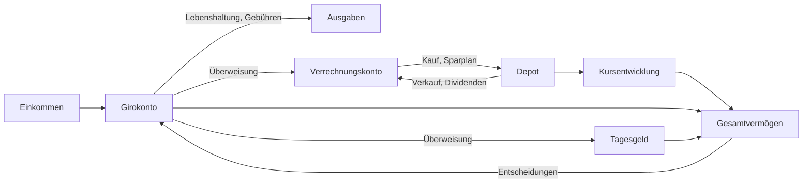
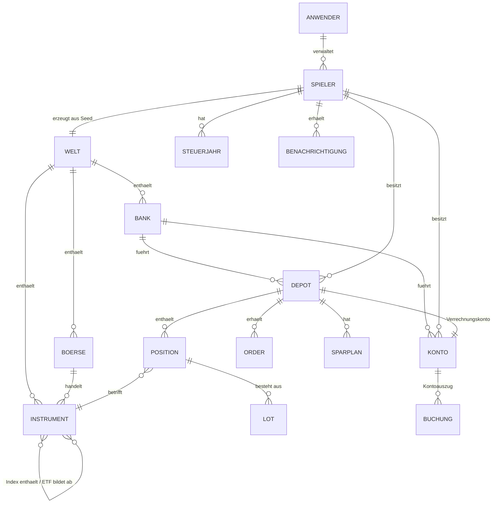

# PortfoliGo – Produktspezifikation

> **Status:** Entwurf v0.2 · **Stand:** 19.11.2026
> **Siehe auch:** [Technische Spezifikation](./technische-spezifikation.md) · [Projektplan](../projektplan.md)

Dieses Dokument beschreibt, _was_ PortfoliGo leisten soll und _warum_. Wie es umgesetzt wird, steht in der technischen Spezifikation. Punkte mit **(Vorschlag)** konkretisieren die Ideensammlung und müssen noch bestätigt werden. Sie sind zusätzlich als Entscheidung `E-xx` in der technischen Spezifikation (§16) geführt.

## Inhalt

1. [Vision und Ziele](#1-vision-und-ziele)
2. [Zielgruppen](#2-zielgruppen)
3. [Produktprinzipien](#3-produktprinzipien)
4. [Spielprinzip](#4-spielprinzip)
5. [Glossar](#5-glossar)
6. [Fachliches Domänenmodell](#6-fachliches-domänenmodell)
7. [User Stories](#7-user-stories)
8. [Ausbaustufen](#8-ausbaustufen)
9. [Nicht-funktionale Anforderungen](#9-nicht-funktionale-anforderungen)
10. [UI/UX-Konzept](#10-uiux-konzept)
11. [Abgrenzung](#11-abgrenzung)

## 1. Vision und Ziele

PortfoliGo ist ein Börsenplanspiel im Browser, das aussieht und sich bedienen lässt wie eine moderne Trading-Plattform. Der Anwender führt einen Spieler durch ein simuliertes Finanzleben: Gehalt und Lebenshaltungskosten, Konten bei verschiedenen Banken, Depots mit Aktien und ETFs – in einem vollständig generierten Markt, der sich wie ein echter verhält.

- **Lernen ohne Risiko:** Sparen, Investieren und Traden mit realistischen Kosten, Spreads, Dividenden und Steuern – ohne echtes Geld.
- **Strategien verproben:** Anlageideen in einem glaubwürdigen Markt testen, später auch automatisiert über Regeln und Backtests.
- **Langzeitmotivation:** Die Spielzeit läuft weiter, auch wenn die App geschlossen ist. Die Geschwindigkeit ist frei wählbar, von Echtzeit bis zu einer Spielwoche pro Sekunde.
- **Vergleichbarkeit:** Gleicher Seed ergibt eine identische Welt. Mehrere Spieler können dieselbe Ausgangslage unterschiedlich spielen.

## 2. Zielgruppen

| Zielgruppe          | Interesse                                                          | Wichtig für PortfoliGo                                                                                 |
| ------------------- | ------------------------------------------------------------------ | ------------------------------------------------------------------------------------------------------ |
| Einsteiger          | Verstehen, wie Sparen, ETFs, Kosten und Steuern langfristig wirken | Erklärungen, Sparpläne, Kostenvorschau vor jeder Order, Benchmark-Vergleich                            |
| Aktive Anleger      | Einzelwerte, Charttechnik und Orderarten ausprobieren              | Charts mit Indikatoren, Limit- und Stop-Orders, hohe Spielgeschwindigkeit, später Regeln und Backtests |
| Gelegenheitsspieler | Kurze Sessions, Fortschritt „nebenbei"                             | Offline-Fortschritt, Abwesenheitsbericht, Benachrichtigungen, Sparpläne                                |

## 3. Produktprinzipien

1. **Plattform statt Spiel.** Ruhige, seriöse Optik einer Trading-Plattform, Fachbegriffe statt Spielbegriffe, keine Spielgrafiken.
2. **Realismus in Stufen.** Mechaniken orientieren sich an der Situation eines Privatanlegers in Deutschland (Abgeltungsteuer, Sparerpauschbetrag, typische Gebührenmodelle). Vereinfachungen sind bewusst gewählt, dokumentiert und im Spiel erklärt.
3. **Determinismus und Fairness.** Die Welt ist eine Funktion des Seeds. Der Spieler ist Preisnehmer: Seine Entscheidungen beeinflussen den Markt nicht. Die App verrät keine künftigen Kurse. Wer allerdings mit einem zweiten Spieler desselben Seeds vorausspielt, kennt die Zukunft – Vergleiche zwischen Spielern beruhen auf Fairplay.
4. **Transparenz.** Jede Buchung ist im Kontoauszug nachvollziehbar. Jede Gebühr wird vor einer Order angezeigt.
5. **Lokal und privat.** Kein Server, kein Benutzerkonto, kein Tracking. Alle Daten bleiben auf dem Gerät. Gesichert wird über den Export.
6. **Erweiterbar.** Die Architektur ist von Beginn an auf spätere Stufen ausgelegt (Anleihen, CFDs, Regeln, Ereignisse, Erben).

## 4. Spielprinzip

### 4.1 Kernschleife



Der Spieler erhält monatlich ein Einkommen, bezahlt davon Lebenshaltungskosten und Gebühren und entscheidet, was mit dem Rest passiert: auf dem Girokonto liegen lassen, auf ein Tagesgeldkonto schieben oder über ein Depot investieren. Kurse, Dividenden, Zinsen, Kosten und Steuern verändern das Gesamtvermögen.

Es gibt kein „Game Over" und kein festes Spielziel. Motivation entsteht aus der Vermögensentwicklung, dem Vergleich mit einer Benchmark und später aus Ereignissen, Upgrades und Erben.

### 4.2 Spielstart

1. Der Anwender legt einen Spieler an: Name, Seed, Startkapital, monatliches Nettoeinkommen und die monatlichen Lebenshaltungskosten (E-14).
2. Aus dem Seed entsteht die Welt: Börsen, Unternehmen, Indizes, ETFs und Banken, dazu eine Kurshistorie von gut zehn Jahren, damit Charts vom ersten Spieltag an aussagekräftig sind. Jeder vergangene Tag lässt sich minutengenau abrufen, sodass auch Intraday-Charts Daten zeigen.
3. Das Startkapital liegt auf einem Girokonto bei einer Hausbank. Die Hausbank ist eine Filialbank mit eher teuren Konditionen – ein Anreiz, Banken zu vergleichen.
4. Das Spiel beginnt pausiert am Spielstartdatum Montag, 01.04.2030, 00:00 Uhr (E-02), damit sich der Anwender orientieren kann. Weil es ein Monatserster ist, beginnt das Spiel mit einem vollständigen Monat (E-19): Am Morgen werden die Lebenshaltungskosten fällig, am Monatsende kommt das erste Gehalt.

### 4.3 Zeit

- Die Spielzeit läuft in Ticks. Ein Tick entspricht einer Spielminute (E-02).
- Der Anwender wählt die Geschwindigkeit – Echtzeit (1 s/s), 1 min/s, 10 min/s, 1 h/s, 2 h/s, 4 h/s, 1 d/s oder 1 w/s – und kann sie jederzeit ändern oder die Zeit anhalten.
- Ist die App geschlossen, läuft die Zeit in Echtzeit weiter. Beim nächsten Öffnen wird die verstrichene Zeit nachberechnet. Dasselbe gilt, solange die App nicht sichtbar ist (z. B. Hintergrund-Tab); pro Spieler lässt sich stattdessen „im Hintergrund pausieren" einstellen. Außerdem lässt sich eine verborgene App mit der gewählten oder einer eigenen Geschwindigkeit weiterlaufen und nach einer Zeitspanne pausieren (E-35, AP 6.7). War das Spiel pausiert, bleibt es pausiert (E-02).
- Börsen haben Handelszeiten. Orders lassen sich jederzeit erteilen und werden während der Handelszeit ausgeführt (E-18). Nachts, am Wochenende und ab Stufe 2 an den Feiertagen ihrer Börse stehen Aktienkurse still. Banken buchen nur an Bankarbeitstagen (E-19).

### 4.4 Die simulierte Welt

Alles wird aus dem Seed erzeugt: Namen und Konditionen der Banken, Unternehmen mit Ticker und Kennung, Indizes, ETFs, Kurse, Dividenden und die monatlichen Schwankungen der Lebenshaltungskosten. Die Kurse sind nicht zufällig, sondern Ergebnis eines Marktmodells mit mehreren Einflussfaktoren:

- **Weltwirtschaft und Marktphasen:** Aufschwung, Normalphase, Abschwung, Krise – mit jeweils anderer Rendite, Schwankung und anderem Gleichlauf der Kurse.
- **Regionen:** Nordamerika, Europa, Asien-Pazifik, Schwellenländer – mit eigener Entwicklung und eigenen Handelszeiten. Was nachts in Asien passiert, zeigt sich morgens in einer Kurslücke in Europa.
- **Sektoren und Branchen:** Der Energiesektor kann insgesamt wachsen, während die Branche „Öl & Gas" schrumpft und „Erneuerbare Energien" boomt. Branchentrends halten Monate bis Jahre.
- **Zinsen, Inflation und Währungen (ab Stufe 2):** Eine Zentralbank entscheidet über den Leitzins, Preise steigen mit der Inflation, ausländische Aktien notieren in ihrer Währung, und Wechselkurse schwanken – in Krisen suchen Anleger sichere Häfen.
- **Unternehmensmerkmale:** Größe (Large, Mid, Small Cap), Stil (Value, Growth), Konjunkturabhängigkeit, Dividendenpolitik und unternehmensspezifische Nachrichten, die Kurssprünge auslösen.

Diese Merkmale sind zugleich die Dimensionen, nach denen der Anwender den Markt filtert und sein Portfolio auswertet (Allokation nach Assetklasse, Region und Sektor).

## 5. Glossar

| Begriff                     | Bedeutung                                                                                                             |
| --------------------------- | --------------------------------------------------------------------------------------------------------------------- |
| Anwender                    | Der Mensch, der PortfoliGo bedient.                                                                                   |
| Spieler                     | Ein Spielstand mit eigener Welt, eigenem Vermögen und eigener Spielzeit. Ein Anwender kann mehrere Spieler haben.     |
| Seed                        | Zeichenkette, aus der die gesamte Welt deterministisch erzeugt wird.                                                  |
| Welt                        | Alles Generierte: Börsen, Instrumente, Banken, Kursverläufe.                                                          |
| Spielzeit, Tick             | Zeit im Spiel. Ein Tick ist die kleinste Zeiteinheit (eine Spielminute).                                              |
| Geschwindigkeit             | Spielzeit pro Sekunde Echtzeit, z. B. „1 h/s".                                                                        |
| Nachberechnung              | Simulation der Zeit, die bei geschlossener oder verborgener App vergangen ist.                                        |
| Abwesenheitsbericht         | Zusammenfassung dessen, was während der Abwesenheit passiert ist.                                                     |
| Instrument                  | Handelbares oder beobachtbares Wertpapier bzw. Gut: Aktie, ETF, Index, später Anleihe, Rohstoff, ETC, Fonds, CFD.     |
| Geldkurs, Briefkurs, Spread | Verkaufskurs, Kaufkurs und deren Differenz.                                                                           |
| Depot                       | Wertpapierkonto bei einer Bank. Käufe und Verkäufe laufen über das zugehörige Verrechnungskonto.                      |
| Gehaltskonto                | Girokonto, auf dem das Einkommen eingeht und von dem die Lebenshaltungskosten abgebucht werden.                       |
| Order                       | Kauf- oder Verkaufsauftrag (Market, Limit, Stop, Stop-Limit).                                                         |
| Position, Lot               | Bestand eines Instruments in einem Depot; ein Lot ist ein einzelner Kauf innerhalb der Position (Grundlage für FIFO). |
| Einstandskurs               | Durchschnittlicher Kaufpreis inklusive Kaufnebenkosten.                                                               |
| TER                         | Laufende Kosten eines ETFs oder Fonds pro Jahr, im Kurs verrechnet.                                                   |
| Ausschüttend, thesaurierend | Der ETF zahlt Erträge aus bzw. legt sie wieder an.                                                                    |
| Abgeltungsteuer             | Pauschale Steuer auf Kapitalerträge (im Spiel 25 %).                                                                  |
| Sparerpauschbetrag          | Steuerfreier Betrag für Kapitalerträge (1.000 € pro Jahr).                                                            |
| Verlusttopf                 | Sammelt realisierte Verluste zur Verrechnung mit späteren Gewinnen.                                                   |
| Sparplan                    | Regelmäßiger, automatischer Kauf eines Instruments für einen festen Betrag.                                           |
| Gesamtvermögen              | Summe aller Kontosalden (Überziehungen mindern sie) und Depotwerte zum Geldkurs.                                      |
| Benchmark                   | Vergleichsmaßstab: Wie stünde der Spieler da, wenn alle Zuflüsse ohne Kosten in den Weltindex geflossen wären?        |
| Leitzins                    | Zinssatz der Zentralbank; Tagesgeld- und Dispozinsen der Banken folgen ihm (ab Stufe 2).                              |
| Festgeld                    | Konto mit festem Zins und fester Laufzeit; vor der Fälligkeit nicht verfügbar (ab Stufe 2).                           |
| Lockzins                    | Erhöhter Zins für Neukunden auf Tagesgeld, befristet und bis zu einem Höchstbetrag (ab Stufe 2).                      |
| Wechselkurs                 | Einheiten einer Fremdwährung je Euro, z. B. EUR/USD 1,12 (ab Stufe 2).                                                |
| Devisenkosten               | Entgelt der Bank für die Umrechnung beim Handel in Fremdwährung (ab Stufe 2).                                         |
| Direkthandel                | Handel mit einem Market Maker der Bank in Euro, mit längeren Handelszeiten als die Börse (ab Stufe 2).                |
| Real, nominal               | Real heißt in Preisen des Spielstarts, also um die Inflation bereinigt; nominal ist der Betrag in Euro.               |

## 6. Fachliches Domänenmodell



**Instrumenttypen:** Aktie, Index (nicht handelbar) und ETF. Ab Stufe 2 kommen Anleihe, Rohstoff, ETC, aktiver Fonds und physisches Edelmetall hinzu, ab Stufe 3 der CFD.

**Klassifikation** – Grundlage für Marktmodell, Filter und Auswertungen:

| Merkmal                | Ausprägungen (Beispiele)                                                                                                                                                       |
| ---------------------- | ------------------------------------------------------------------------------------------------------------------------------------------------------------------------------ |
| Assetklasse            | Aktie, ETF, Index; später Anleihe, Rohstoff, ETC, Fonds, Edelmetall, CFD                                                                                                       |
| Region                 | Nordamerika, Europa, Asien-Pazifik, Schwellenländer                                                                                                                            |
| Land und Börse         | z. B. USA, Deutschland, Japan, Brasilien – jeweils mit Handelszeiten                                                                                                           |
| Sektor                 | 11 Sektoren, z. B. Technologie, Gesundheit, Finanzen, Energie, Versorger                                                                                                       |
| Branche                | rund 30, z. B. Halbleiter, Software, Öl & Gas, Erneuerbare Energien                                                                                                            |
| Größe                  | Large, Mid, Small Cap (nach Marktkapitalisierung)                                                                                                                              |
| Stil                   | Value, Growth, Blend                                                                                                                                                           |
| Dividendenprofil       | keine bis hohe Rendite; jährlich, halbjährlich oder quartalsweise; ändert sich über Jahrzehnte: hohe Renditen sinken, Unternehmen ohne Dividende beginnen irgendwann zu zahlen |
| Konjunkturabhängigkeit | defensiv, neutral, zyklisch                                                                                                                                                    |
| Risiko                 | Volatilitätsklasse 1–5                                                                                                                                                         |

## 7. User Stories

Aufbau: **ID – Titel** · Stufe · Priorität (**M** = Muss, **S** = Soll, **K** = Kann). Darauf folgen die Story und die Akzeptanzkriterien. Stories der Stufe 1 sind ausgearbeitet; spätere Stufen sind in [7.12](#712-spätere-ausbaustufen-skizze) skizziert. Die Stories der Stufe 2 arbeitet das Fachkonzept-AP ihres Meilensteins aus (AP 8.1, AP 9.1, AP 10.1; Projektplan §6), die späteren Stufen werden bei Erreichen der Stufe ausgearbeitet.

### 7.1 Spieler und Spielstände (SP)

**US-SP-01 – Spieler anlegen** · Stufe 1 · M
Als Anwender möchte ich einen Spieler mit Namen und Startbedingungen anlegen, damit ich ein neues Spiel beginnen kann.

- Eingaben: Name (Pflicht, 1–40 Zeichen), Seed, Startkapital, monatliches Nettoeinkommen, monatliche Lebenshaltungskosten. Jedes Feld hat Grenzen und eine sinnvolle Vorgabe (E-14): Startkapital 0–1.000.000 €, Vorgabe 10.000 €; Nettoeinkommen 0–50.000 € je Monat, Vorgabe 2.500 €; Lebenshaltungskosten 0–50.000 € je Monat, Vorgabe 1.800 €.
- Lebenshaltungskosten über dem Einkommen sind erlaubt; das Formular zeigt dann einen Hinweis am Feld, keinen Fehler.
- Der Seed ist mit einem zufälligen, gut teilbaren Wert vorbelegt (z. B. `kupfer-falke-731`) und kann geändert werden; erlaubt sind Buchstaben `a–z`, Ziffern, Bindestrich, Unterstrich, Leerzeichen und `ä ö ü ß` (NF-05).
- Voreinstellungen füllen die Beträge aus (Startkapital / Einkommen / Lebenshaltung): „Studium“ 2.000 / 1.000 / 900 €, „Berufseinstieg“ 10.000 / 2.500 / 1.800 € (= Vorgabe), „Erfahren“ 50.000 / 4.500 / 3.000 € (S).
- Fehler werden direkt am Feld angezeigt. Anlegen ist nur mit gültigen Eingaben möglich.
- Nach dem Anlegen wird die Welt samt Kurshistorie erzeugt (mit Fortschrittsanzeige). Danach öffnet sich das Spiel pausiert am Spielstart; das Startkapital liegt auf dem Girokonto der Hausbank.

**US-SP-02 – Spieler auswählen und verwalten** · Stufe 1 · M
Als Anwender möchte ich alle Spieler auf diesem Gerät sehen und zwischen ihnen wechseln, damit ich mehrere Spiele parallel führen kann.

- Die Liste zeigt Name, Spielzeit, Gesamtvermögen (Stand der letzten Speicherung) und den Zeitpunkt der letzten Nutzung.
- Auswählen öffnet den Spieler; die Abwesenheit wird nachberechnet (US-ZT-04).
- Spieler können umbenannt und – nach Bestätigung – endgültig gelöscht werden.
- Ein Spieler kann nur in einem Browser-Tab gleichzeitig geöffnet sein. Ein zweiter Tab zeigt einen Hinweis.
- Beim App-Start ist der zuletzt genutzte Spieler vorausgewählt (S).

**US-SP-03 – Seed einsehen und teilen** · Stufe 1 · M
Als Anwender möchte ich den Seed meines Spielers sehen und kopieren, damit andere in derselben Welt spielen können.

- Der Seed ist in den Einstellungen des Spielers sichtbar und kopierbar.
- Ein neuer Spieler mit demselben Seed erhält identische Banken, Instrumente und Kursverläufe – unabhängig von den Entscheidungen anderer Spieler.

### 7.2 Zeit (ZT)

**US-ZT-01 – Spielzeit und Börsenstatus sehen** · Stufe 1 · M
Als Anwender möchte ich jederzeit sehen, welcher Tag und welche Uhrzeit im Spiel ist und welche Börsen geöffnet sind, damit ich meine Entscheidungen zeitlich einordnen kann.

- Die Kopfzeile zeigt Wochentag, Datum, Uhrzeit, Geschwindigkeit und Pausenstatus.
- Vier kompakte Anzeigen zeigen, ob in Asien-Pazifik, Europa, Nordamerika und den Schwellenländern gehandelt wird. Die Schwellenländer gelten als offen, sobald eine ihrer Börsen offen ist.
- Ein Klick öffnet eine Liste aller Börsen mit Status und nächster Öffnung bzw. Schließung.

**US-ZT-02 – Geschwindigkeit wählen** · Stufe 1 · M
Als Anwender möchte ich die Spielgeschwindigkeit jederzeit ändern, damit ich Phasen überspringen oder genau beobachten kann.

- Stufen (E-02): Echtzeit (1 s/s), 1 min/s, 10 min/s, 1 h/s, 2 h/s, 4 h/s, 1 d/s, 1 w/s.
- Eine Änderung wirkt sofort. Tastenkürzel: Leertaste für Pause/Weiter, `+`/`−` für schneller/langsamer. Sie greifen nicht, solange ein Eingabefeld oder Bedienelement fokussiert ist, und lassen sich in den Einstellungen abschalten (WCAG 2.1.4).
- Die gewählte Geschwindigkeit wird pro Spieler gespeichert.
- Kann das Gerät die Geschwindigkeit nicht halten, wird das angezeigt. Es wird keine Spielzeit übersprungen.

**US-ZT-03 – Zeit anhalten** · Stufe 1 · M
Als Anwender möchte ich die Zeit komplett anhalten, damit ich in Ruhe analysieren und Orders vorbereiten kann.

- In der Pause ruhen Kurse, Buchungen und Orderprüfungen.
- Alle Ansichten und Eingaben bleiben nutzbar. Eine Market-Order an einer geöffneten Börse wird auch in der Pause sofort zum angezeigten Kurs ausgeführt; alle anderen Orders werden geprüft, sobald die Zeit weiterläuft.

**US-ZT-04 – Offline-Fortschritt** · Stufe 1 · M
Als Anwender möchte ich, dass die Zeit weiterläuft, wenn ich die App schließe, damit sich das Spiel wie ein echtes Finanzleben anfühlt.

- Ist die App geschlossen, läuft die Spielzeit in Echtzeit (1 s/s) weiter. Dasselbe gilt, solange die App nicht sichtbar ist (E-02); wer das nicht möchte, stellt für den Spieler „im Hintergrund pausieren" ein (US-UI-09). Seit E-35 (AP 6.7) kann sie verborgen auch mit der gewählten oder einer eigenen Geschwindigkeit weiterlaufen und nach einer wählbaren Frist pausieren; geschlossen oder vom Browser eingefroren läuft die Zeit aber immer höchstens in Echtzeit.
- Beim nächsten Öffnen wird die verstrichene Zeit mit Fortschrittsanzeige nachberechnet. Alle fälligen Vorgänge (Gehalt, Kosten, Orders, Dividenden, Sparpläne) werden in der richtigen Reihenfolge verarbeitet.
- War das Spiel pausiert, bleibt es pausiert und es wird nichts nachberechnet (E-02).
- Anschließend erscheint der Abwesenheitsbericht (US-BN-03).

**US-ZT-05 – Vorspulen** · Stufe 1 · S
Als Anwender möchte ich direkt zu einem Zeitpunkt springen, damit ich ruhige Phasen schnell überbrücke.

- Ziele: nächste Börsenöffnung, nächster Monatsanfang oder ein Datum (höchstens ein Jahr voraus).
- Der Sprung zeigt einen Fortschritt, lässt sich abbrechen und verarbeitet alle Vorgänge wie der normale Spielverlauf.

**US-ZT-06 – Automatisch pausieren** · Stufe 1 · S
Als Anwender möchte ich, dass das Spiel bei wichtigen Ereignissen anhält, damit ich bei hoher Geschwindigkeit nichts verpasse.

- Pro Ereignistyp einstellbar, z. B. „Konto überzogen" oder „Order ausgeführt".
- Tritt das Ereignis ein, pausiert das Spiel und zeigt das Ereignis an.
- Während der Nachberechnung und solange die App nicht sichtbar ist, pausiert das Spiel nicht automatisch; die Ereignisse erscheinen im Abwesenheitsbericht.

### 7.3 Einkommen und Kosten (EK)

**US-EK-01 – Monatliches Einkommen** · Stufe 1 · M
Als Anwender möchte ich jeden Monat mein Gehalt erhalten, damit ich sparen und investieren kann.

- Das Nettoeinkommen wird am letzten Bankarbeitstag des Monats auf dem Gehaltskonto gutgeschrieben (E-19). Ab Stufe 2 sind Feiertage keine Bankarbeitstage (US-MK-18); das Dezembergehalt kommt deshalb vor Silvester.
- Die Buchung erscheint im Kontoauszug, z. B. „Gehalt April 2030".

**US-EK-02 – Lebenshaltungskosten** · Stufe 1 · M
Als Anwender möchte ich, dass monatlich realistisch schwankende Lebenshaltungskosten anfallen, damit mein Budget nicht trivial planbar ist.

- Am ersten Bankarbeitstag des Monats (E-19; ab Stufe 2 ohne Feiertage, z. B. am 02.01. statt an Neujahr, US-MK-18) wird der Basisbetrag abgebucht, verändert um eine Schwankung von typischerweise ±5 % (maximal ±15 %).
- Die Schwankung ist durch den Seed festgelegt: gleicher Seed, gleiche Beträge.

**US-EK-03 – Monatsübersicht** · Stufe 1 · M
Als Anwender möchte ich sehen, wohin mein Geld im Monat geflossen ist, damit ich meine Sparquote kenne.

- Pro Monat: Einkommen, Lebenshaltung, Gebühren, Zinsen, Steuern, Erträge (Dividenden, Zinsen) und Sparquote.
- Zum Monatsende gibt es eine Benachrichtigung mit dem Monatsabschluss (S).

**US-EK-04 – Einkommen und Kosten wachsen mit der Inflation** · Stufe 2 · M
Als Anwender möchte ich, dass mein Gehalt und meine Lebenshaltungskosten mit den Verbraucherpreisen steigen, damit lange Spiele realistisch bleiben und ich den Unterschied zwischen nominalem und realem Vermögen erlebe.

- Zum 01.01. jedes Jahres werden Nettoeinkommen und Basisbetrag der Lebenshaltung an den Preisindex angepasst: Startbetrag × Preisindex des Januars ÷ Preisindex des Startmonats, auf Cent gerundet (TS §7.14, E-56). Die erste Anpassung ist am 01.01.2031 und enthält die Teuerung seit dem Spielstart.
- Das Gehalt sinkt nominal nie; bei sinkenden Preisen bleibt es, die Lebenshaltung sinkt mit.
- Die monatliche Schwankung der Lebenshaltung (US-EK-02) wirkt auf den angepassten Basisbetrag; der Dispo-Rahmen folgt dem höheren Gehalt über die Gehaltseingänge (US-BK-07).
- Gebühren der Banken, der Sparerpauschbetrag und die Mindestbeträge (Sparplan, Festgeld, Order) bleiben nominal; die Startbedingungen im Profil ändern sich nicht.
- „Demnächst“ zeigt die angepassten Beträge; Termine nach dem nächsten 01.01. stehen ohne Betrag mit dem Hinweis auf die Anpassung (S).
- Der Jahresabschluss nennt das neue Gehalt und die neue Lebenshaltung (S).

### 7.4 Banken und Konten (BK)

**US-BK-01 – Banken vergleichen** · Stufe 1 · M
Als Anwender möchte ich die Banken der Welt mit ihren Konditionen vergleichen, damit ich die für mich günstigste wähle.

- Liste aller Banken mit Typ (Filialbank, Direktbank, Onlinebroker, Neobroker) und Konditionen: Kontoführung und ihre Bedingungen, Dispozins, Habenzins, Depotgebühr, Orderentgelt, Sparplankosten, Handelsplatz und Spread-Aufschlag, Bruchstückhandel.
- Die Konditionen sind aus dem Seed erzeugt und unterscheiden sich spürbar.
- Sortieren nach einzelnen Kostenmerkmalen (S).

**US-BK-02 – Konto oder Depot eröffnen** · Stufe 1 · M
Als Anwender möchte ich bei jeder Bank Konten und Depots eröffnen, damit ich mein Geld dort anlegen kann, wo es sich lohnt.

- Kontotypen je nach Angebot der Bank: Girokonto, Tagesgeldkonto, Depot (immer mit Verrechnungskonto). Je Bank und Kontoart lassen sich beliebig viele Konten eröffnen; jedes Konto hat eine Kontonummer, an der es sich in der Übersicht unterscheiden lässt.
- Die Eröffnung erfolgt sofort (E-17); das neue Konto erscheint in der Kontenübersicht.

**US-BK-03 – Konto schließen** · Stufe 1 · M
Als Anwender möchte ich nicht mehr benötigte Konten schließen, damit keine Gebühren mehr anfallen.

- Beim Schließen rechnet die Bank ab: Aufgelaufene Zinsen und anteilige Gebühren bis zum Schließtag werden gebucht, ein Restguthaben wird auf ein gewähltes eigenes Konto überwiesen.
- Ein negativer Saldo muss vorher ausgeglichen werden. Depots müssen leer sein und dürfen keine offenen Orders oder Sparpläne haben; andernfalls erklärt ein Hinweis, was fehlt.
- Ein Depot lässt sich auch zwischen Ex-Tag und Zahltag einer Dividende schließen; die Dividende bzw. Ausschüttung geht am Zahltag auf das beim Schließen gewählte Zielkonto.
- Das Gehaltskonto lässt sich erst schließen, wenn ein anderes Gehaltskonto bestimmt ist.

**US-BK-04 – Geld überweisen** · Stufe 1 · M
Als Anwender möchte ich Geld zwischen meinen Konten bewegen, damit ich es dorthin bringe, wo ich es brauche.

- Überweisungen zwischen eigenen Konten (Girokonto, Tagesgeld, Verrechnungskonto) mit Betrag und Verwendungszweck.
- Ausführung sofort und kostenlos (Echtzeitüberweisung, E-17).
- Überwiesen werden kann höchstens der verfügbare Betrag (Guthaben plus freier Dispo, falls vorhanden; bei Verrechnungskonten abzüglich des für offene Kauforders reservierten Betrags); eine eigene Überweisung führt nie in die geduldete Überziehung.

**US-BK-05 – Gehaltskonto festlegen** · Stufe 1 · M
Als Anwender möchte ich bestimmen, welches Girokonto mein Gehaltskonto ist, damit ich von günstigeren Konditionen profitiere.

- Genau ein Girokonto ist Gehaltskonto; Einkommen und Lebenshaltungskosten laufen darüber.
- Bedingungen wie „kostenlos ab 700 € Geldeingang pro Monat" werden anhand der tatsächlichen Eingänge geprüft. Als Geldeingang zählen nur Gutschriften von außen (Gehalt, Startkapital), nicht eigene Überweisungen, Zinsen oder Steuererstattungen.
- Der Dispo-Rahmen einer Bank richtet sich nach dem Gehaltseingang bei ihr (US-BK-07); nach einem Wechsel des Gehaltskontos wächst er bei der neuen Bank über drei Monate und schrumpft bei der alten.

**US-BK-06 – Kontoauszug** · Stufe 1 · M
Als Anwender möchte ich alle Buchungen eines Kontos sehen, damit ich jede Bewegung nachvollziehen kann.

- Buchungsliste mit Datum, Text, Betrag und Saldo; Filter nach Zeitraum und Buchungsart; Suche.
- Auch mehrere tausend Buchungen lassen sich flüssig durchblättern.
- Saldoverlauf als Chart (S).

**US-BK-07 – Überziehung und Dispo** · Stufe 1 · M
Als Anwender möchte ich gewarnt werden, wenn ein Konto nicht gedeckt ist, damit ich rechtzeitig reagieren kann.

- Jede Bank gewährt einen Dispositionskredit nach dem regelmäßigen Geldeingang bei ihr: Der Rahmen beträgt ein Vielfaches (je Bank) des durchschnittlichen monatlichen Gehaltseingangs der letzten drei vollen Kalendermonate und wird am ersten Bankarbeitstag jedes Monats angepasst. Er liegt auf dem Girokonto dieser Bank mit den meisten Gehaltseingängen; weitere Girokonten derselben Bank haben keinen Rahmen. Die Hausbank gewährt vom Spielstart an den vollen Rahmen (E-17).
- Lastschriften werden auch bei fehlender Deckung ausgeführt; das Konto ist dann überzogen. Oberhalb des Limits gilt für den Teil darüber ein erhöhter Zins (geduldete Überziehung ohne Obergrenze, E-17). Sinkt der Rahmen (z. B. nach einem Wechsel des Gehaltskontos), kann ein Konto dadurch in die geduldete Überziehung geraten.
- Bei fehlender Deckung und bei Überziehung erhält der Anwender eine Warnung (US-BN-02); eine Überschreitung des Limits ist kritisch und pausiert das Spiel standardmäßig.
- Dispozinsen werden monatlich berechnet und belastet.
- Verrechnungskonten erlauben keine Überziehung durch Käufe: Kauforders ohne Deckung werden abgelehnt. Gebühren und Zinsen der Bank werden trotzdem belastet. Rutscht ein Verrechnungskonto dadurch ins Minus, fallen Sollzinsen an, der Anwender wird gewarnt und neue Käufe sind gesperrt, bis das Konto ausgeglichen ist.

**US-BK-08 – Zinsen und Gebühren** · Stufe 1 · M
Als Anwender möchte ich, dass Zinsen und Gebühren gemäß den Konditionen gebucht werden, damit sich die Wahl der Bank spürbar auswirkt.

- Habenzinsen werden taggenau berechnet und auf Tagesgeldkonten je nach Bank monatlich oder quartalsweise, auf Verrechnungskonten monatlich gutgeschrieben; die Abgeltungsteuer wird einbehalten (US-ST-01).
- Kontoführungs- und Depotgebühren werden periodisch belastet und im Kontoauszug ausgewiesen. Im Eröffnungs- und im Schließmonat fällt die Kontoführung anteilig nach Kalendertagen an, im Eröffnungs- und im Schließquartal ebenso die Depotgebühr.

**US-BK-10 – Daueraufträge** · Stufe 1 · M
Als Anwender möchte ich regelmäßig einen festen Betrag automatisch zwischen meinen Konten überweisen, damit z. B. meine Sparpläne gedeckt sind, ohne dass ich jeden Monat von Hand überweise.

- Angaben: Quellkonto, Zielkonto (zwei verschiedene offene eigene Konten), Betrag, Ausführungstag (1–28); Intervall monatlich.
- Ausführung im Bank-Lauf um 06:00 am Ausführungstag bzw. am nächsten Bankarbeitstag, nach Gehalt, Zinsen, Lebenshaltung und Gebühren: Ein Dauerauftrag am Gehaltstag sieht das Gehalt schon. Ab Stufe 2 verschieben auch Feiertage des Bankkalenders die Ausführung (US-MK-18).
- Reicht der verfügbare Betrag des Quellkontos nicht, fällt die Ausführung aus und der Anwender wird benachrichtigt; es gibt keine Teilüberweisung.
- Daueraufträge lassen sich auf der Kontenseite anlegen, ändern, pausieren und löschen (E-21).
- Ein Konto, das Quell- oder Zielkonto eines Dauerauftrags ist, lässt sich erst schließen, wenn der Dauerauftrag gelöscht ist. Mehrere Daueraufträge am selben Tag laufen in der Reihenfolge, in der sie angelegt wurden; ein Verwendungszweck ist optional.

**US-BK-13 – Tagesgeld- und Dispozinsen folgen dem Leitzins** · Stufe 2 · M
Als Anwender möchte ich, dass die Zinsen meiner Konten dem Leitzins folgen, damit sich eine Zinswende auf mein Erspartes und meine Schulden auswirkt und sich der Bankvergleich immer wieder lohnt.

- Habenzinsen auf Tagesgeld und (bei Neobrokern) Verrechnungskonten sowie Dispo-, Überziehungs- und Sollzinsen folgen dem Leitzins nach der Zinspolitik der Bank: Weitergabe (Direktbanken geben viel weiter, Filialbanken wenig), Verzögerung (Erhöhungen beim Haben spät, beim Soll früh; Senkungen umgekehrt) und Raster von 0,05 Prozentpunkten (TS §7.10, E-53).
- Die Zinspolitik ist aus dem Seed erzeugt und unterscheidet sich je Bank. Die heutigen Sätze der Welt gelten bei einem Leitzins von 2,50 %.
- Habenzinsen werden nie negativ; Girokonten haben weiter keinen Habenzins; Gebühren ändern sich nicht.
- Ein neuer Satz gilt ab 00:00 eines Tages; die Zinsen eines Tages rechnen taggenau mit dessen Satz, auch beim Kontoabschluss.
- Bankenvergleich, „Konto eröffnen“ und Kontokarte zeigen den Satz von heute (M) und die Zinspolitik in Worten, z. B. „folgt dem Leitzins zu 80 %, Erhöhungen nach 4 Wochen“ (S).
- Ändert sich ein Satz eines Produkts, von dem der Anwender ein Konto hat, erhält er eine Benachrichtigung (S).
- „Demnächst“ zeigt Zinsänderungen, die schon feststehen (K).
- Alle Banken lesen dieselbe Regel; Vorschau und Buchung rechnen gleich.

**US-BK-11 – Festgeld und Neukunden-Lockzinsen** · Stufe 2 · M
Als Anwender möchte ich Geld zu einem festen Zins anlegen und Lockangebote für Neukunden nutzen, damit ich zwischen Verfügbarkeit und Zins abwägen und Angebote vergleichen kann.

_Festgeld (M):_

- Filial- und Direktbanken bieten Festgeld mit 3, 6, 12, 24, 36 und 60 Monaten Laufzeit an. Der Satz ergibt sich aus der Zinskurve am Tag des Abschlusses und dem Auf- oder Abschlag der Bank, liegt nie unter 0 und gilt fest für die ganze Laufzeit (TS §7.11, E-55).
- Eröffnung mit Bank, Laufzeit, Betrag (mindestens 1.000 €), Quellkonto und Auszahlungskonto; der Betrag wird sofort vom Quellkonto übertragen, höchstens der verfügbare Betrag.
- Vor der Fälligkeit gibt es keine Verfügung: keine Überweisung, kein Dauerauftrag, kein Schließen. Das Auszahlungskonto lässt sich bis zur Fälligkeit nicht schließen; ein Hinweis erklärt den Grund.
- Zinsen werden taggenau berechnet; bei Laufzeiten über ein Jahr werden sie am Jahrestag gutgeschrieben und mitverzinst, sonst bei Fälligkeit. Die Abgeltungsteuer wird wie bei anderen Zinsen einbehalten (US-ST-01).
- Fällt das Laufzeitende auf ein Wochenende oder einen Feiertag des Bankkalenders, wird am nächsten Bankarbeitstag um 06:00 ausgezahlt; die zusätzlichen Tage werden verzinst.
- Bei Fälligkeit gehen Betrag und Zinsen auf das Auszahlungskonto, das Festgeldkonto schließt, und der Anwender erhält eine Benachrichtigung (S).
- Kontokarte (Satz, Laufzeitende, erwartete Zinsen) und Kontoauszug zeigen das Festgeld; „Demnächst“ zeigt Jahrestag und Fälligkeit; der Bankenvergleich zeigt die Festgeldsätze (S).

_Lockzins (S):_

- Direktbanken bieten Neukunden auf Tagesgeld einen Lockzins: einen Aufschlag auf den Satz von heute, fest für drei bis sechs Monate und bis zu einem Höchstbetrag; darüber und danach gilt der normale Satz (TS §7.10, E-54).
- Neukunde ist, wer bei der Bank kein Tagesgeldkonto hat und in den zwölf Monaten vor der Eröffnung keines geschlossen hat.
- „Konto eröffnen“ zeigt, ob der Lockzins gilt; die Kontokarte zeigt Satz, Ende und Höchstbetrag; zum Ende gibt es einen Hinweis (K).

### 7.5 Märkte und Instrumente (MK)

**US-MK-01 – Marktübersicht** · Stufe 1 · M
Als Anwender möchte ich auf einen Blick sehen, wie sich die Märkte entwickeln, damit ich Chancen und Risiken erkenne.

- Wichtige Indizes mit Tagesveränderung und Sparkline, Börsenstatus je Region.
- Tagesgewinner und -verlierer, Entwicklung der Sektoren (S: als Heatmap).

**US-MK-02 – Instrumente suchen und filtern** · Stufe 1 · M
Als Anwender möchte ich Instrumente nach verschiedenen Merkmalen finden, damit ich gezielt investieren kann.

- Suche nach Name, Ticker und Kennung.
- Filter: Assetklasse, Region, Land, Sektor, Branche, Größe, Stil, Dividendenrendite. Sortierung u. a. nach Performance über verschiedene Zeiträume.
- Die Trefferliste zeigt Kurs, Veränderung und Sparkline.

**US-MK-03 – Instrument-Detailseite** · Stufe 1 · M
Als Anwender möchte ich alle wichtigen Informationen zu einem Instrument sehen, damit ich fundiert entscheiden kann.

- Kopf: Name, Ticker, Kennung, Börse, Geld- und Briefkurs, Spread, Veränderung (absolut und in %), Handelsstatus.
- Chart (US-CH-01) und Kennzahlen: Marktkapitalisierung, Dividendenrendite, Volatilität, Beta, Performance über 1 Monat, 1 Jahr und 5 Jahre.
- Aktie: Profil (Sektor, Branche, Land, Größe, Stil, Kurzbeschreibung), Dividendenhistorie und nächster Termin, Indexzugehörigkeit.
- ETF: abgebildeter Index, TER, Ertragsverwendung, Emittent, Fondsvolumen, größte Positionen, Aufteilung nach Region und Sektor.
- Aktionen: Kaufen, Verkaufen, zur Watchlist hinzufügen, Sparplan anlegen.

**US-MK-04 – Watchlist** · Stufe 1 · M
Als Anwender möchte ich interessante Instrumente beobachten, damit ich sie im Blick behalte.

- Instrumente hinzufügen und entfernen; Reihenfolge per Drag & Drop ändern (S).
- Die Watchlist zeigt Live-Kurse und gehört zum Spieler (sie wird mit exportiert).

**US-MK-05 – Live-Kurse** · Stufe 1 · M
Als Anwender möchte ich, dass sich Kurse sichtbar bewegen, während die Zeit läuft, damit sich der Markt lebendig anfühlt.

- Kurse aktualisieren sich entsprechend der Spielgeschwindigkeit; Änderungen werden kurz farblich hervorgehoben. Die Hervorhebung ist abschaltbar und entfällt bei der Systemeinstellung „Bewegung reduzieren".
- Außerhalb der Handelszeit stehen die Kurse still; ein Hinweis zeigt „Börse geschlossen".

**US-MK-06 – Dividendentermine** · Stufe 1 · S
Als Anwender möchte ich anstehende Dividenden meiner Werte sehen, damit ich Ausschüttungen einplanen kann.

- Kalender mit Ex-Tagen und Zahltagen für Depot und Watchlist.
- Nur angekündigte Termine (Aktien rund vier Wochen vor dem Ex-Tag); bei gehaltenen Werten mit dem erwarteten Betrag.

**US-MK-10 – Zinsumfeld und Inflation** · Stufe 2 · M
Als Anwender möchte ich, dass sich Preise und Zinsen wie in einer echten Volkswirtschaft entwickeln, damit ich Zinsentscheidungen und Inflation erlebe und ihre Wirkung auf Anlagen, Ersparnisse und Kaufkraft einplanen kann.

- Die Verbraucherpreise steigen im Mittel um rund 2 % im Jahr, schwanken über die Jahre und hängen an der Konjunktur: im Aufschwung etwas mehr, in Abschwung und Krise weniger, selten kurz unter null (TS §6.11).
- Ein monatlicher Preisindex (01.01.2020 = 100) und die Jahresrate der Inflation sind für jeden vergangenen Monat abrufbar; der Index eines Monats steht ab dem Monatsersten fest.
- Die Zentralbank des Euroraums entscheidet an acht festen Sitzungsterminen im Jahr (Donnerstag, etwa alle sechs Wochen) über den Leitzins, nach einer festen Regel aus Inflation und Konjunktur: in Schritten von 0,25 Prozentpunkten, höchstens 0,75 je Sitzung, nicht unter −0,50 %. Die Entscheidung wird am Sitzungstag um 14:15 Uhr bekannt und gilt ab dem nächsten Bankarbeitstag. Die Termine sind vorab bekannt, die Entscheidung nicht.
- Eine Zinskurve für Laufzeiten von 3 Monaten bis 30 Jahren: Das kurze Ende folgt dem Leitzins, das lange Ende bewegt sich langsam mit eigener Schwankung. Meist steigt die Kurve mit der Laufzeit; hebt die Zentralbank gegen hohe Inflation stark an, wird sie invers.
- Kreditaufschläge je Rating (AAA bis CCC) liegen über der Kurve, sind nach Rating geordnet und steigen in unruhigen Märkten, bei schlechten Ratings stärker (Grundlage für Anleihen, US-MK-11).
- Leitzins, Zinskurve und Inflation verraten die Marktphase nicht am Tag ihres Wechsels; sie reagieren geglättet auf die Konjunktur.
- Aktien reagieren auf das Zinsniveau: Steigende lange Zinsen belasten Wachstumswerte und zinsempfindliche Sektoren (Immobilien, Versorger), Banken profitieren (TS §6.13).
- Leitzins, Jahresinflation und Zinskurve (heute und vor einem Jahr) sind in „Märkte“ zu sehen, mit dem Verlauf von Leitzins und Inflation und den nächsten Sitzungsterminen (S).
- Eine Leitzinsentscheidung erzeugt eine Benachrichtigung (S); Zentralbankentscheidungen sind strukturierte Ereignisse für Newsticker und Wirtschaftskalender (US-NT-01, US-NT-02).
- Preisindex, Leitzins und Zinskurve sind für alle Spieler mit demselben Seed gleich und hängen nicht von Spielerentscheidungen ab.
- Gehalt und Lebenshaltung folgen den Verbraucherpreisen (US-EK-04), Tagesgeld- und Dispozinsen dem Leitzins (US-BK-13), Festgeld der Zinskurve (US-BK-11).
- Vermögensverlauf und Performance lassen sich zwischen „Nominal“ und „Real“ umschalten; real heißt in Preisen des Spielstarts (TS §7.14). Rendite seit Spielbeginn, im laufenden Jahr und annualisiert, Benchmark und Vergleichsgröße gibt es in beiden Ansichten.
- Die Übersicht zeigt die Kaufkraft von 1 € seit Spielbeginn und den realen Wert des Bargelds (S).

**US-MK-17 – Fremdwährungen** · Stufe 2 · M
Als Anwender möchte ich, dass ausländische Aktien in ihrer Landeswährung notieren und sich die Wechselkurse bewegen, damit ich das Währungsrisiko einer Anlage im Ausland verstehe und es in meiner Rendite in Euro sehe.

- Jede Börse notiert in der Währung ihres Landes: US-Dollar, kanadischer Dollar, britisches Pfund, Schweizer Franken, Yen, australischer Dollar, Hongkong-Dollar, indische Rupie und brasilianischer Real; Deutschland, Frankreich und die Niederlande in Euro (TS §6.12). ETFs werden weiter an der deutschen Börse in Euro gehandelt.
- Wechselkurse werden als Fremdwährung je Euro angegeben (EUR/USD 1,12 = 1,12 US-Dollar je Euro); ein Wert in Euro ist der Wert in Landeswährung geteilt durch den Kurs.
- Wechselkurse bewegen sich wochentags rund um die Uhr, auch an Börsenfeiertagen; am Wochenende ruhen sie. Sie schwanken je Währung verschieden stark (Franken wenig, Real stark), folgen langfristig der Zins- und Inflationsdifferenz zum Euro und kehren über Jahre zu einem Gleichgewicht zurück. Franken und Yen werten in Krisen eher auf, Rohstoff- und Schwellenländerwährungen eher ab. Der Hongkong-Dollar ist fest an den US-Dollar gebunden.
- Kurse, Geld- und Briefkurs, Preisraster, Kursuntergrenze und Dividenden je Aktie gelten in der Notierungswährung. Der Kurs einer Aktie in Landeswährung bewegt sich nicht mit dem Wechselkurs, ihr Wert in Euro schon.
- Indizes notieren in einer festen Währung: die Regionalindizes in der Leitwährung ihrer Region (Nordamerika und Schwellenländer US-Dollar, Europa Euro, Asien-Pazifik Yen), alle übrigen in Euro. Werte anderer Währungen rechnet der Index zu jeder Minute um.
- ETFs auf Indizes in Fremdwährung haben einen Wert in Euro aus dem Index und dem Wechselkurs derselben Minute; die Wechselkursbewegung steckt im ETF-Kurs.
- Wechselkurse sind für alle Spieler mit demselben Seed gleich und hängen nicht von Spielerentscheidungen ab; vergangene Kurse sind wie Aktienkurse minutengenau abrufbar.
- Konten bleiben in Euro; ein Währungskonto gibt es nicht (TS §7.12, E-57).
- An der Heimatbörse handelt der Anwender in der Notierungswährung: Kurs, Limit und Stop gelten in Landeswährung. Bei Ausführung wird zum Wechselkurs dieser Minute in Euro umgerechnet; die Bank berechnet dafür Devisenkosten nach ihren Konditionen (Prozent des Kurswerts; Neobroker handeln nur in Euro).
- Buchung, Lots, Gewinn und Steuer sind in Euro: Anschaffungskosten zum Kurs des Kaufs, Erlös zum Kurs des Verkaufs. Ein Gewinn in Landeswährung kann so ein Verlust in Euro sein; der Kontoauszug zeigt Kurs, Betrag in Fremdwährung und Wechselkurs.
- Kauforders in Fremdwährung reservieren mit einem Puffer für den Wechselkurs; reicht das Guthaben bei Ausführung nicht, wird die Order abgelehnt.
- Dividenden ausländischer Aktien werden in Landeswährung angekündigt und am Zahltag zum Wechselkurs von 06:00 ohne Devisenkosten in Euro gutgeschrieben; die Steuer rechnet in Euro.
- Positionen, Vermögen und Performance sind in Euro; der Wert einer ausländischen Position bewegt sich auch, wenn ihre Börse geschlossen ist, weil sich der Wechselkurs bewegt.
- Devisenkosten zählen in „Erträge und Kosten“ als eigene Kostenart (US-PF-07).
- Kurskopf, Watchlist und Screener zeigen Kurse in Landeswährung mit dem Wert in Euro (S); das Order-Ticket zeigt in der Kostenvorschau Kurswert in Landeswährung, Wechselkurs, Kurswert in Euro, Entgelte, Devisenkosten und Gesamtbetrag in Euro.
- Beträge und Kurse erscheinen mit dem Symbol ihrer Währung in Deutsch und Englisch (TS §11.9, E-59).
- „Märkte“ zeigt die Devisenkurse mit Tagesveränderung und Chart; das Depot zeigt die Aufteilung nach Währung (S).

**US-MK-18 – Börsenfeiertage und Direkthandel** · Stufe 2 · M
Als Anwender möchte ich, dass Börsen an ihren Feiertagen geschlossen sind und Banken an Feiertagen nicht buchen, damit sich der Kalender wie ein echtes Börsen- und Finanzjahr anfühlt und ich Käufe, Sparpläne und Überweisungen danach planen kann.

- Jede Börse schließt an den Feiertagen ihres Landes bzw. der realen Hauptbörse (Paris und Amsterdam wie Euronext): feste Feiertage, Feiertage um Ostern und Feiertage wie „3. Montag im Januar“, mit Ersatztagen für Feiertage am Wochenende, wo die reale Börse sie kennt. Mond- und Sonnenkalender (z. B. Chinesisches Neujahr, Diwali), einmalige Schließungen und verkürzte Handelstage gibt es nicht; ein Feiertag gilt ganztägig (TS §3.3, E-44).
- Der Kalender ist für alle Spieler gleich und hängt nicht vom Seed ab.
- An einem Feiertag ihrer Börse stehen die Kurse ihrer Aktien und ETFs still, wie am Wochenende. Der Markt läuft weiter: Börsen anderer Länder handeln, Indizes und indikative Werte bewegen sich, und am nächsten Handelstag eröffnet die Börse mit der aufgelaufenen Bewegung (Kurslücke).
- Börsenstatus und Börsenliste (US-ZT-01) zeigen an einem Feiertag „geschlossen“ und die nächste Öffnung nach dem Feiertag; der Status nennt „Feiertag“ als Grund (S), mit dem Namen des Feiertags (K).
- Orders werden an Feiertagen nicht ausgeführt; „bis Tagesende“ gilt bis zum Schluss des nächsten Handelstags der Börse. Sparpläne kaufen zur Eröffnung am nächsten Handelstag. „Nächste Börsenöffnung“ im Sprungdialog (US-ZT-05) überspringt Feiertage.
- Dividenden haben ihren Ex-Tag nur an Handelstagen der Börse und werden 20 Handelstage vorher angekündigt (US-MK-06); der Zahltag ist der zweite Bankarbeitstag nach dem Ex-Tag.
- Bankarbeitstage sind Montag bis Freitag ohne die bundeseinheitlichen Feiertage in Deutschland und ohne Heiligabend und Silvester (E-45). Gehalt (letzter), Lebenshaltung, Kontoführung, Zinsen und Gebühren (erster Bankarbeitstag des Monats) sowie Daueraufträge (nächster Bankarbeitstag) richten sich danach, nicht nach den Börsen. Ein Dauerauftrag, der einen Sparplan decken soll, kann deshalb nach dessen Termin laufen, wenn nur die Bank Feiertag hat.
- „Demnächst“ auf der Übersicht (§10.3) und der Dividendenkalender zeigen die verschobenen Termine.
- Eine Übersicht der kommenden Feiertage je Börse für die nächsten zwölf Monate gibt es in der Börsenliste (K).
- **Direkthandel** (TS §7.13, E-58): Direktbanken, Onlinebroker und Neobroker bieten den Direkthandel mit einem Market Maker an, Montag bis Freitag 08:00–23:00 außer an Feiertagen der deutschen Börse. Neobroker handeln nur dort, Filialbanken nur an der Börse; bei Direktbanken und Onlinebrokern wählt der Anwender den Handelsplatz im Order-Ticket.
- Im Direkthandel werden alle Aktien und ETFs in Euro gehandelt, auch ausländische, ohne Börsenentgelt und ohne Devisenkosten. Außerhalb der Handelszeit der Heimatbörse stellt der Market Maker indikative Kurse mit breiterem Spread.
- Orders gelten an ihrem Handelsplatz: „bis Tagesende“ endet um 23:00; eine Limit-Order auf eine US-Aktie kann so am Abend während der US-Sitzung oder morgens vor deren Öffnung ausgeführt werden.
- Die Kostenvorschau zeigt Handelsplatz, Spread und Entgelt; die Kurse der Börse und ihre Historie ändern sich durch den Direkthandel nicht.

### 7.6 Handel (HD)

**US-HD-01 – Kaufen** · Stufe 1 · M
Als Anwender möchte ich Wertpapiere über ein Depot kaufen und vorher alle Kosten sehen, damit ich keine Überraschungen erlebe.

- Order-Ticket: Depot, Instrument, Stückzahl oder Betrag, Orderart, Gültigkeit. Bei Betragsorders werden die Stücke bei der Ausführung zum Briefkurs berechnet und abgerundet; Bruchstücke nur, wenn die Bank sie anbietet. Reserviert wird der Betrag.
- Vor dem Absenden zeigt eine Kostenvorschau: Briefkurs, Kurswert, Orderentgelt, Fremdkosten, Gesamtbetrag und verfügbares Guthaben.
- Fehlt die Deckung auf dem Verrechnungskonto, wird die Order nicht angenommen und der Fehlbetrag angezeigt.
- Die Ausführung erzeugt eine Buchung, eine Position bzw. ein Lot und eine Benachrichtigung.

**US-HD-02 – Verkaufen** · Stufe 1 · M
Als Anwender möchte ich Positionen ganz oder teilweise verkaufen, damit ich Gewinne sichern oder Verluste begrenzen kann.

- Ausführung zum Geldkurs.
- Bruchstücke (z. B. aus Sparplänen) lassen sich bei jeder Bank verkaufen, auch wenn sie beim Kauf nur ganze Stück anbietet.
- Die Vorschau zeigt den voraussichtlichen Gewinn oder Verlust und die Steuer.
- Der Erlös wird nach Kosten und Steuern dem Verrechnungskonto gutgeschrieben.

**US-HD-03 – Orderarten und Gültigkeit** · Stufe 1 · M
Als Anwender möchte ich verschiedene Orderarten nutzen, damit ich zu meinen Bedingungen handle.

- Orderarten: Market (bestens/billigst), Limit, Stop (Stop-Loss, Stop-Buy), Stop-Limit.
- Gültigkeit: bis Tagesende (bis zum nächsten Handelsschluss der Börse; außerhalb der Handelszeit bis zum Schluss des nächsten Handelstags), bis Datum, bis auf Widerruf (höchstens ein Jahr).
- Orders außerhalb der Handelszeit werden zur Börseneröffnung geprüft und ausgeführt. Kurslücken über Nacht wirken sich realistisch aus (ein Stop-Loss kann unter dem Stopkurs ausgeführt werden).

**US-HD-04 – Orderbuch** · Stufe 1 · M
Als Anwender möchte ich offene und vergangene Orders sehen und verwalten, damit ich den Überblick behalte.

- Offene Orders mit Status; Stornieren und Ändern (Limit, Stop, Gültigkeit).
- Orderhistorie mit Ausführungsdetails (Kurs, Zeitpunkt, Kosten).
- Für offene Kauforders reserviertes Guthaben ist sichtbar; es mindert den verfügbaren Betrag des Verrechnungskontos für Überweisungen, Daueraufträge und Sparpläne.

**US-HD-05 – Sparplan** · Stufe 1 · M
Als Anwender möchte ich regelmäßig automatisch investieren, damit mein Vermögen auch ohne mein Zutun wächst.

- Angaben: Depot, sparplanfähiges Instrument (ETF oder Aktie), Betrag, Ausführungstag (z. B. 1. oder 15.), Intervall (monatlich).
- Ausführung zur Börseneröffnung am Ausführungstag bzw. am nächsten Handelstag, mit Bruchstücken und den Sparplankosten der Bank.
- Sparpläne lassen sich pausieren, ändern (Betrag und Ausführungstag) und löschen. Fehlt die Deckung, fällt die Ausführung aus und der Anwender wird benachrichtigt. Der Mindestbetrag ist 1,00 € und muss über den Sparplankosten liegen (Festlegung AP 5.6b).
- Die Sparpläne stehen im Orderbuch (Tab „Sparpläne“) und auf der Depotseite; „Sparplan anlegen“ gibt es dort und auf der Seite eines sparplanfähigen Wertpapiers (AP 5.6b).
- Der Sparplan bucht vom Verrechnungskonto seines Depots. Den monatlichen Zufluss vom Gehaltskonto übernimmt ein Dauerauftrag (US-BK-10, E-21).

### 7.7 Portfolio und Auswertung (PF)

**US-PF-01 – Gesamtvermögen** · Stufe 1 · M
Als Anwender möchte ich mein Gesamtvermögen jederzeit sehen, damit ich weiß, wo ich stehe.

- Live-Wert: Summe aller Kontosalden (Überziehungen mindern sie) und Depotwerte zum Geldkurs (ohne Aufschlag des Handelsplatzes, bei allen Banken gleich).
- Veränderung heute und seit Spielbeginn (absolut und in %). Die Veränderung heute rechnet ohne Einkommen und Lebenshaltung; sie zeigt Markt, Zinsen, Kosten und Steuern.

**US-PF-02 – Depotübersicht** · Stufe 1 · M
Als Anwender möchte ich alle Positionen eines Depots mit ihrer Entwicklung sehen, damit ich mein Portfolio steuern kann.

- Je Position: Stück, Einstandskurs, aktueller Kurs, Wert, Gewinn/Verlust (absolut und in %), Anteil am Depot; sortierbar, mit Summenzeile.
- Depots einzeln und zusammengefasst.

**US-PF-03 – Allokation** · Stufe 1 · M
Als Anwender möchte ich sehen, wie mein Vermögen verteilt ist, damit ich Klumpenrisiken erkenne.

- Aufteilung nach Assetklasse, Region und Sektor als Donut mit Tabelle.
- ETFs werden anhand ihrer Indexzusammensetzung aufgeschlüsselt („Durchschau", E-28). Ohne Durchschau sagt die Aufteilung nach Region und Sektor bei einem ETF-Depot nichts aus.

**US-PF-04 – Vermögensverlauf** · Stufe 1 · M
Als Anwender möchte ich die Entwicklung meines Vermögens über die Zeit sehen, damit ich meinen Fortschritt erkenne.

- Chart des Gesamtvermögens (täglicher Wert) mit wählbarem Zeitraum.
- Aufteilung in Bargeld und Wertpapiere (S).

**US-PF-05 – Performance und Benchmark** · Stufe 1 · M
Als Anwender möchte ich meine Rendite mit einer einfachen Alternative vergleichen, damit ich meine Strategie bewerten kann.

- Zeitgewichtete Rendite seit Spielbeginn, im laufenden Jahr und annualisiert. Einkommen und Lebenshaltungskosten verfälschen sie nicht. Feste Kosten wie die Kontoführung zählen als Rendite auf das Vermögen vor der Lebenshaltung; Tage mit negativem Vermögen zählen nicht, und fehlt so mindestens die Hälfte der Tage eines Zeitraums, zeigt die Anzeige „–“ mit Hinweis (E-43).
- Benchmark: Schattenportfolio, in das Startkapital und alle Netto-Zuflüsse ohne Kosten in den Weltindex geflossen wären – Vergleich als Chart und Kennzahl. Solange es investiert ist, ist seine Rendite die Indexrendite; Portfolio und Benchmark lassen dieselben Tage aus.
- Zweite Vergleichsgröße (E-28): das Vermögen, wenn alle Zuflüsse auf dem Gehaltskonto geblieben wären. Die Benchmark ist kostenlos, steuerfrei und voll investiert und deshalb kaum zu schlagen; die zweite Größe zeigt, was das Investieren gebracht hat.

**US-PF-06 – Positionsdetail** · Stufe 1 · M
Als Anwender möchte ich die Historie einer Position sehen, damit ich meine Entscheidungen nachvollziehe.

- Lots (Kaufdatum, Stück, Einstand), realisierte Gewinne und Verluste, erhaltene Dividenden.
- Eigene Käufe und Verkäufe sind im Chart markiert (S).

**US-PF-07 – Erträge und Kosten** · Stufe 1 · S
Als Anwender möchte ich sehen, was mir meine Anlagen einbringen und was sie kosten, damit ich Kosten bewusst senken kann.

- Dividenden und Zinsen pro Monat und Jahr.
- Kosten pro Jahr: Orderentgelte, Konto- und Depotgebühren, Dispozinsen, geschätzte Spread- und TER-Kosten.
- Spread und TER sind als „geschätzt“ gekennzeichnet: Sie werden nicht gebucht, sondern stecken in den Kursen.

### 7.8 Steuern (ST)

**US-ST-01 – Abgeltungsteuer** · Stufe 1 · M
Als Anwender möchte ich, dass Kapitalerträge wie in Deutschland besteuert werden, damit ich die Wirkung von Steuern auf meine Rendite lerne.

- 25 % auf realisierte Kursgewinne, Dividenden und Zinsen; die Bank behält die Steuer direkt ein.
- Kursgewinne werden nach FIFO ermittelt; Kauf- und Verkaufskosten mindern den Gewinn.
- Solidaritätszuschlag und Kirchensteuer werden nicht abgebildet (E-11).

**US-ST-02 – Sparerpauschbetrag** · Stufe 1 · M
Als Anwender möchte ich, dass mein Sparerpauschbetrag automatisch angerechnet wird, damit kleine Erträge steuerfrei bleiben.

- 1.000 € pro Kalenderjahr bleiben steuerfrei.
- Der Betrag gilt bankübergreifend (E-11); Freistellungsaufträge je Bank folgen in Stufe 2.

**US-ST-03 – Verlustverrechnung** · Stufe 1 · M
Als Anwender möchte ich, dass Verluste mit Gewinnen verrechnet werden, damit ich nur auf meinen Nettogewinn Steuern zahle.

- Realisierte Verluste werden mit Gewinnen desselben Jahres verrechnet; bereits gezahlte Steuer wird erstattet.
- Nicht verrechnete Verluste werden ins Folgejahr vorgetragen.
- Ein gemeinsamer Verlusttopf für alle Erträge (E-11); getrennte Töpfe für Aktien folgen in Stufe 2.

**US-ST-04 – Steuerübersicht** · Stufe 1 · M
Als Anwender möchte ich eine jährliche Steuerübersicht sehen, damit ich meine Steuerlast verstehe.

- Pro Jahr: Kapitalerträge, genutzter Sparerpauschbetrag, gezahlte und erstattete Steuer, Verlustvortrag.

### 7.9 Charts und Analyse (CH)

**US-CH-01 – Kurschart** · Stufe 1 · M
Als Anwender möchte ich den Kursverlauf eines Instruments in verschiedenen Zeiträumen sehen, damit ich Entwicklungen einschätzen kann.

- Darstellung als Linie, Fläche oder Kerzen; Zeiträume 1T, 5T, 1M, 6M, 1J, 5J und Max.
- Die Kerzen-Auflösung (1 Minute bis 1 Woche) passt sich standardmäßig dem Zeitraum an („Auto“); der Anwender kann eine andere wählen, soweit der Zeitraum sie zulässt. Beim Wechsel des Zeitraums bleibt sie erhalten, solange sie zulässig ist, sonst gilt wieder „Auto“; sie wird nicht gespeichert.
- Jeder vergangene Tag lässt sich minutengenau ansehen – auch vor dem Spielstart.
- Fadenkreuz mit Datum und Werten; Zoomen und Verschieben mit Maus und Touch.
- Der Chart aktualisiert sich live, während die Zeit läuft.

**US-CH-02 – Indikatoren** · Stufe 1 · M
Als Anwender möchte ich einfache Indikatoren über den Kursverlauf legen, damit ich technische Analysen durchführen kann.

- Indikatoren: SMA, EMA, SMMA (geglätteter gleitender Durchschnitt) und Bollinger-Bänder, mit einstellbaren Parametern; mehrere gleichzeitig.
- Jeder Indikator hat eine wählbare Farbe aus der Chart-Palette (mehrere dürfen dieselbe haben); ein neuer startet mit der ersten freien. Bei Bollinger-Bändern ist die Fläche zwischen den Bändern leicht eingefärbt.
- Die Auswahl wird samt Farben gespeichert.

### 7.10 Benachrichtigungen (BN)

**US-BN-01 – Benachrichtigungszentrum** · Stufe 1 · M
Als Anwender möchte ich alle Benachrichtigungen an einem Ort sehen, damit mir nichts entgeht.

- Liste mit Zeitpunkt (Spielzeit), Kategorie (Konto, Order, Erträge, Steuern, Sparplan, System) und Schweregrad.
- Zähler für ungelesene Benachrichtigungen; Filter nach Kategorie; als gelesen markieren.

**US-BN-02 – Hinweise während des Spiels** · Stufe 1 · M
Als Anwender möchte ich bei wichtigen Ereignissen sofort einen Hinweis sehen, damit ich reagieren kann.

- Kurze Einblendungen (Toasts) z. B. bei ausgeführten Orders, Unterdeckung, Überziehung und Sparplan-Ausfall.
- Bei sehr hoher Geschwindigkeit werden gleichartige Hinweise gebündelt.

**US-BN-03 – Abwesenheitsbericht** · Stufe 1 · M
Als Anwender möchte ich nach der Nachberechnung erfahren, was passiert ist, damit ich schnell wieder im Spiel bin.

- Zeitraum, Veränderung des Gesamtvermögens, Einnahmen und Ausgaben, ausgeführte Orders und Sparpläne, Dividenden und Zinsen, Warnungen und die Entwicklung wichtiger Indizes.

**US-BN-04 – Browser-Benachrichtigungen** · Stufe 1 · S
Als Anwender möchte ich auch dann informiert werden, wenn PortfoliGo in einem Hintergrund-Tab läuft.

- Nach ausdrücklicher Erlaubnis werden ausgewählte Kategorien als System-Benachrichtigung angezeigt, solange die App geöffnet ist.
- Benachrichtigungen bei geschlossener App sind nur mit einer nativen App möglich (Option N, US-NA-02).
- Praktisch wirkt das nur am Desktop: Smartphones halten die App im Hintergrund an, und unter iOS gibt es die Erlaubnis nur für installierte Web-Apps.
- Die Erlaubnis wird in den Einstellungen unter „App“ angefragt und dort angezeigt (erlaubt, noch nicht erlaubt, verweigert, nicht unterstützt); welche Ereignisse kommen, regelt die Spalte „Browser“ unter „Dieses Gerät“. Ein Klick auf die Benachrichtigung holt die App nach vorn (AP 6.3).

### 7.11 Datensicherung und Oberfläche (EX, UI)

**US-EX-01 – Spieler exportieren** · Stufe 1 · M
Als Anwender möchte ich einen Spieler jederzeit exportieren, damit ich ihn sichern oder auf ein anderes Gerät übertragen kann.

- Export als base64-kodiertes JSON: als Datei-Download und zum Kopieren in die Zwischenablage.
- Der Export enthält alles, was den Spieler ausmacht; die Welt wird beim Import aus dem Seed neu erzeugt.
- Der Export liegt in den Einstellungen unter „Spieler“ („Spielstand sichern“); dort steht auch, wann zuletzt auf diesem Gerät exportiert wurde (AP 6.1).

**US-EX-02 – Spieler importieren** · Stufe 1 · M
Als Anwender möchte ich einen exportierten Spieler importieren, damit ich weiterspielen kann.

- Import aus einer Datei oder aus eingefügtem Text; der Import legt immer einen neuen Spieler an.
- Der importierte Spieler startet pausiert; die Zeit seit dem Export wird nicht nachberechnet (E-10).
- Ungültige oder beschädigte Daten und inkompatible Versionen werden mit verständlicher Meldung abgelehnt.
- „Spielstand importieren“ steht in der Spielerauswahl; der neue Spieler heißt wie der exportierte mit dem Zusatz „(Import)“ und öffnet sich danach wie ein neu angelegter (AP 6.1).

**US-EX-03 – Datensicherung und Speicherschutz** · Stufe 1 · S
Als Anwender möchte ich vor Datenverlust geschützt werden, damit mein Fortschritt nicht verloren geht.

- Erinnerung an einen Export in einstellbarem Abstand (Echtzeit).
- Die Erinnerung erscheint beim Spielstart als Hinweis, wenn seit dem letzten Export (oder dem Anlegen) der gewählte Abstand vergangen ist – täglich, alle 3 Tage, wöchentlich (Vorgabe), alle 14 oder 30 Tage oder nie –, und danach frühestens einen Tag später wieder (AP 6.1, TS §9.3).
- Die App fordert dauerhaften Speicher an und erklärt, warum die Installation als App die Daten zusätzlich schützt.
- Die Einstellungen zeigen unter „App“ den belegten und verfügbaren Speicher und ob er dauerhaft ist; ist er es nicht, lässt er sich erneut anfragen (AP 6.3).

**US-UI-01 – Erscheinungsbild** · Stufe 1 · M
Als Anwender möchte ich zwischen dunklem und hellem Erscheinungsbild wählen, damit die App zu meiner Umgebung passt.

- Dunkel (Standard), Hell oder nach Systemeinstellung.

**US-UI-02 – Farben für Gewinn und Verlust** · Stufe 1 · S
Als Anwender mit Farbsehschwäche möchte ich Gewinne und Verluste unterscheiden können.

- Wahl zwischen Grün/Rot (Standard) und Blau/Orange für Rot-Grün-Sehschwäche, als Einstellung dieses Geräts (AP 6.2); zusätzlich immer Vorzeichen und Pfeil.

**US-UI-03 – Responsives Layout** · Stufe 1 · M
Als Anwender möchte ich PortfoliGo auf Desktop, Tablet und Smartphone nutzen.

- Desktop: Seitennavigation und mehrspaltige Ansichten. Smartphone: untere Navigationsleiste und einspaltige Ansichten.
- Alle Kernfunktionen sind auf jedem Gerät bedienbar.

**US-UI-04 – Tastatur und Barrierefreiheit** · Stufe 1 · M
Als Anwender möchte ich die App vollständig per Tastatur und mit Hilfstechnologien bedienen.

- Sichtbarer Fokus, logische Tab-Reihenfolge, Tastenkürzel für häufige Aktionen (abschaltbar, siehe US-ZT-02).
- Kontraste nach WCAG 2.2 AA; Bedienelemente haben zugängliche Namen.
- Stand AP 6.5: Ein Systemtest prüft alle Hauptansichten, Dialoge und Menüs in hell und dunkel (dazu Blau/Orange und 360 px) mit axe ohne ernste oder kritische Befunde; ein zweiter legt einen Spieler an, eröffnet ein Depot, überweist und erteilt eine Order nur mit der Tastatur. Stichproben mit dem Accessibility-Tree stehen in TS §11.10.

**US-UI-05 – Befehlspalette** · Stufe 1 · S
Als Anwender möchte ich mit `Strg`/`⌘` + `K` schnell Instrumente finden und Aktionen ausführen.

- Suche über Instrumente, Seiten und Aktionen (z. B. „Kaufen", „Pause").
- Stand AP 6.5: Die Palette öffnet sich im Spiel mit `Strg`/`⌘` + `K` (abschaltbar mit den Tastenkürzeln) und über „Suchen“ in der Kopfzeile. Sie findet Seiten (auch Glossar und „Über PortfoliGo“), Aktionen (Pause/Weiter, Geschwindigkeit, Vorspulen, Überweisen, Konto eröffnen, Spielstand exportieren, Spieler wechseln) und Wertpapiere nach Name, Kürzel oder ISIN, jeweils zum Öffnen und zum Kaufen. Pfeiltasten wählen, Enter führt aus, Esc schließt.

**US-UI-06 – Erklärungen und Glossar** · Stufe 1 · S
Als Einsteiger möchte ich Fachbegriffe direkt in der App erklärt bekommen.

- Kurze Erklärungen per Tooltip (z. B. Spread, TER, FIFO) und ein Glossar.
- Stand AP 6.5: Das Glossar erklärt rund 40 Begriffe so, wie sie im Spiel gelten (Konten, Orders, Kosten, Erträge, Steuern, Kennzahlen, Spielzeit), mit Suche, Anker je Begriff und „Siehe auch“. Es ist im Spiel über das Spielermenü und die Befehlspalette erreichbar, ohne Spiel aus der Spielerauswahl und „Spieler anlegen“. Ein „?“ neben Orderart, Gültigkeit, Spread, TER, Dispo-Rahmen, Lots, zeitgewichteter Rendite, Benchmark, Sparerpauschbetrag und Verlustvortrag öffnet eine Kurzerklärung mit dem Link „Mehr im Glossar“.

**US-UI-07 – Installation und Offline-Betrieb** · Stufe 1 · S
Als Anwender möchte ich PortfoliGo wie eine App installieren und ohne Internet nutzen.

- Installierbar als Progressive Web App; nach dem ersten Laden vollständig offline nutzbar.
- Neue Versionen werden im Hintergrund geladen und beim nächsten Start aktiv; ein Hinweis bietet an, sofort neu zu laden. Vor Version 1.0 weist die App darauf hin, dass ein Update Spielstände ungültig machen kann.
- Die Einstellungen bieten unter „App“ die Installation an: über den Dialog des Browsers, auf iPhone und iPad mit dem Hinweis „Teilen“ → „Zum Home-Bildschirm“ (AP 6.3).

**US-UI-08 – Rechtliche Hinweise** · Stufe 1 · M
Als Anwender möchte ich wissen, dass PortfoliGo ein Spiel mit vereinfachten Regeln ist.

- Gut auffindbarer Hinweis: keine Anlageberatung, fiktive Unternehmen und Kurse, vereinfachte Steuerregeln.
- Lizenzhinweise der verwendeten Bibliotheken (z. B. TradingView bei lightweight-charts).
- Stand AP 6.5: Die Seite „Über PortfoliGo“ (Hinweis „Ein Spiel, keine Anlageberatung“, App- und Simulationsversion, Lizenzen aller ausgelieferten Bibliotheken und Schriften mit der Namensnennung von TradingView) ist aus der Spielerauswahl, „Spieler anlegen“, den Einstellungen und dem Spielermenü erreichbar; Spielerauswahl, „Spieler anlegen“ und Einstellungen zeigen den Hinweis zusätzlich in einem Satz. Impressum und Datenschutzhinweis folgen außerhalb von AP 6.5 auf Anweisung des Product Owners (E-26).

**US-UI-09 – Einstellungen** · Stufe 1 · M
Als Anwender möchte ich das Verhalten der App an einer Stelle anpassen.

- Für dieses Gerät: Erscheinungsbild und Farben, Hervorhebung von Kursänderungen, Tastenkürzel an/aus, Toasts und Browser-Benachrichtigungen je Ereignistyp.
- Für den Spieler (Teil des Spielstands, wird mit exportiert): Name, Seed (anzeigen, kopieren), automatische Pause je Ereignistyp und das Verhalten im Hintergrund (E-02) – in Echtzeit weiterlaufen (Standard) oder pausieren; mit E-35 (AP 6.7) zusätzlich mit der gewählten Geschwindigkeit oder einer eigenen Hintergrund-Geschwindigkeit weiterlaufen, jeweils wahlweise mit Pause nach einer Zeitspanne (15 min, 30 min, 1 h, 2 h, 4 h oder 8 h; gilt für alle Modi außer „pausieren“).
- Export des Spielers (US-EX-01).

**US-UI-10 – Erste Schritte** · Stufe 1 · S
Als Einsteiger möchte ich nach dem Anlegen eines Spielers durch die ersten Schritte geführt werden, damit ich weiß, wie ich vom Girokonto zum ersten Wertpapier komme.

- Eine Liste auf der Übersicht führt durch: Banken vergleichen, Depot eröffnen, Geld überweisen, erstes Wertpapier kaufen, Sparplan anlegen.
- Erledigte Schritte werden abgehakt; die Liste lässt sich ausblenden.

**US-UI-11 – Sprache wählen** · Stufe 1 · S
Als Anwender möchte ich die App auf Deutsch oder Englisch nutzen.

- Die Sprache ist eine Einstellung dieses Geräts; Standard ist Deutsch, unabhängig von der Browsersprache.
- Der Wechsel lädt die App neu. Alle Texte, Zahlen und Datumsangaben erscheinen in der gewählten Sprache; Beträge bleiben in Euro (E-36).
- Namen der simulierten Welt (Unternehmen, Banken, Börsen, Indizes) werden nicht übersetzt.
- Auch das Web-App-Manifest (Beschreibung der installierten App) folgt der Sprache; es bleibt dieselbe installierte App.
- Umgesetzt mit AP 6.8a (Mechanik) und AP 6.8b (vollständige englische Übersetzung, verbindliche Begriffsliste TS §11.9).

### 7.12 Spätere Ausbaustufen (Skizze)

| ID       | Story (Kurzform)                                                                                                            | Stufe |
| -------- | --------------------------------------------------------------------------------------------------------------------------- | ----- |
| US-MK-10 | Zinsumfeld und Inflation: ausgearbeitet in [7.5](#75-märkte-und-instrumente-mk)                                             | 2     |
| US-MK-11 | Anleihen: Staats- und Unternehmensanleihen mit Kupon, Laufzeit, Rating, Stückzinsen und Rückzahlung                         | 2     |
| US-MK-12 | Rohstoffe und ETCs                                                                                                          | 2     |
| US-MK-13 | Physische Edelmetalle: Kauf beim Händler über das Barvermögen, hohe Spanne, steuerfrei nach einem Jahr Haltedauer           | 2     |
| US-MK-14 | Aktive Fonds: Ausgabeaufschlag, höhere TER, Erfolg des Fondsmanagements                                                     | 2     |
| US-MK-15 | Fundamentaldaten und Quartalszahlen (KGV, Gewinnwachstum, Berichtstermine)                                                  | 2     |
| US-MK-16 | Unternehmensereignisse: Aktiensplits, Übernahmen, Insolvenzen, Börsengänge, Indexanpassungen                                | 2     |
| US-MK-17 | Fremdwährungen: ausgearbeitet in [7.5](#75-märkte-und-instrumente-mk)                                                       | 2     |
| US-MK-18 | Börsenfeiertage und Direkthandel: ausgearbeitet in [7.5](#75-märkte-und-instrumente-mk)                                     | 2     |
| US-EK-04 | Einkommen und Kosten wachsen mit der Inflation: ausgearbeitet in [7.3](#73-einkommen-und-kosten-ek)                         | 2     |
| US-BK-11 | Festgeld und Neukunden-Lockzinsen: ausgearbeitet in [7.4](#74-banken-und-konten-bk)                                         | 2     |
| US-BK-13 | Tagesgeld- und Dispozinsen folgen dem Leitzins: ausgearbeitet in [7.4](#74-banken-und-konten-bk)                            | 2     |
| US-BK-12 | Depotübertrag: Wertpapiere ohne Verkauf zu einer anderen Bank übertragen (E-28)                                             | 2     |
| US-HD-10 | Trailing-Stop                                                                                                               | 2     |
| US-HD-11 | Kursalarme („benachrichtige mich, wenn X > 50")                                                                             | 2     |
| US-ST-10 | Teilfreistellung und Vorabpauschale bei Fonds und ETFs                                                                      | 2     |
| US-ST-11 | Getrennte Verlusttöpfe (Aktien, Sonstiges) und Freistellungsaufträge je Bank                                                | 2     |
| US-ST-12 | Quellensteuer auf ausländische Dividenden mit Anrechnung                                                                    | 2     |
| US-CH-03 | Vergleichschart: mehrere Instrumente und das eigene Depot normiert in %                                                     | 2     |
| US-CH-04 | Weitere Indikatoren (RSI, MACD) und Handelsvolumen                                                                          | 2     |
| US-PF-08 | Risikokennzahlen: Volatilität, maximaler Drawdown, Sharpe-Ratio                                                             | 2     |
| US-CF-01 | CFD-Handel: CFD-Konto, Long- und Short-Positionen mit Hebel                                                                 | 3     |
| US-CF-02 | CFD-Margin: Sicherheitsleistung, Finanzierungskosten, Margin-Call und Zwangsglattstellung                                   | 3     |
| US-MK-19 | Große Welt: deutlich mehr Länder, Börsen, Branchen und Instrumente aller Assetklassen, bei gleichem Spieltempo              | N     |
| US-MK-20 | Große Listen bedienen: Screener, Suche und Marktübersicht bleiben auch mit Tausenden Instrumenten schnell und übersichtlich | N     |
| US-RG-01 | Regel anlegen: „wenn Bedingung, dann Aktion", z. B. „wenn SMA20(X) > SMA50(X), dann kaufen"                                 | 3     |
| US-RG-02 | Regeln aktivieren, deaktivieren und ihre Ausführungen protokollieren                                                        | 3     |
| US-RG-03 | Backtest einer Regel auf der Kurshistorie                                                                                   | 3     |
| US-RG-04 | Strategievorlagen (z. B. Trendfolge, Rebalancing)                                                                           | 3     |
| US-LE-01 | Zufällige Lebensereignisse (z. B. Autoreparatur, Bonuszahlung), seed-basiert                                                | 4     |
| US-LE-02 | Upgrades (Auto, Wohnung, Weiterbildung) mit Auswirkung auf Kosten, Ereignisse und Einkommen                                 | 4     |
| US-LE-03 | Versicherungen gegen Ereigniskosten                                                                                         | 4     |
| US-LE-04 | Karriere und Gehaltsentwicklung                                                                                             | 4     |
| US-NT-01 | Newsticker zu Markt-, Branchen- und Unternehmensereignissen                                                                 | 4     |
| US-NT-02 | Wirtschaftskalender (Zentralbanktermine, Quartalszahlen)                                                                    | 4     |
| US-GA-01 | Achievements: Erfolge mit Kategorien und Stufen (z. B. erste Dividende, Vermögensschwellen, Bärenmarkt durchgehalten)       | 4     |
| US-GA-02 | Spielziele und Herausforderungen mit Frist (z. B. „100.000 € Depotwert bis 2040")                                           | 4     |
| US-GA-03 | Übersicht der Erfolge mit Fortschritt; Freischalten per Toast und Meldung im Newsticker                                     | 4     |
| US-ER-01 | Erben: Ein Nachfolger startet mit dem Vermögen nach Erbschaftsteuer                                                         | 5     |
| US-ER-02 | Prestige: dauerhafte Startvorteile für Nachfolger                                                                           | 5     |
| US-ER-03 | Familienchronik über mehrere Generationen                                                                                   | 5     |
| US-NA-01 | Native Android-App                                                                                                          | N     |
| US-NA-02 | Vorausgeplante Benachrichtigungen bei geschlossener App                                                                     | N     |
| US-NA-03 | Native iOS-App                                                                                                              | N     |

## 8. Ausbaustufen

| Stufe | Name                        | Inhalt                                                                                                                                                                                                                                                                                                                                                                                                                                             | Meilensteine |
| ----- | --------------------------- | -------------------------------------------------------------------------------------------------------------------------------------------------------------------------------------------------------------------------------------------------------------------------------------------------------------------------------------------------------------------------------------------------------------------------------------------------- | ------------ |
| 1     | MVP „Spielbar"              | Spieler, Zeit, Einkommen und Kosten, Banken und Konten mit Daueraufträgen, Aktien und ETFs, Handel mit Market-, Limit-, Stop- und Stop-Limit-Orders, Sparpläne, Steuern (vereinfacht), Portfolio und Performance, Charts mit Basisindikatoren, Benachrichtigungen, Export und Import, PWA, Deutsch und Englisch                                                                                                                                    | M0–M6        |
| 2     | „Vollständiger Markt"       | Vorab eine Prüfung des Rechenkerns (Modellreview, WebAssembly, M7); Börsenfeiertage und Direkthandel, Fremdwährungen, Zinsen und Inflation, Tagesgeld und Festgeld am Leitzins (M8); Anleihen, Rohstoffe und ETCs, Edelmetalle, aktive Fonds, Fondssteuer (M9); Fundamentaldaten, Unternehmensereignisse, Handelsvolumen und weitere Indikatoren, Vergleichschart, Risikokennzahlen, Trailing-Stop, Kursalarme, Depotübertrag, Steuerdetails (M10) | M7–M10       |
| 3     | „Trading & Automatisierung" | CFDs, Regelwerk, Backtesting                                                                                                                                                                                                                                                                                                                                                                                                                       | M11–M12      |
| 4     | „Leben & Welt"              | Lebensereignisse, Upgrades, Versicherungen, Karriere, Newsticker, Achievements und Spielziele                                                                                                                                                                                                                                                                                                                                                      | M13–M15      |
| –     | „Public Release"            | Öffentliche Version 1.0: Datenschutzerklärung und Impressum, Versionsanzeige in den Einstellungen, „Was ist neu?“ nach Updates, Staging-System, Kompatibilitätszusage für Spielstände                                                                                                                                                                                                                                                              | M16          |
| 5     | „Langzeitspiel"             | Game-Loop über Generationen: Erben, Prestige, Familienchronik und weitere Langzeitziele                                                                                                                                                                                                                                                                                                                                                            | M17          |
| N     | „Optional"                  | App für Android und iOS mit Capacitor, vorausgeplante Benachrichtigungen; große Welt mit deutlich mehr Instrumenten                                                                                                                                                                                                                                                                                                                                | N1, N2       |

**Bekannte Grenze von Stufe 1:** Gehalt, Lebenshaltungskosten, Gebühren und Sparerpauschbetrag bleiben nominal fest; Inflation und Gehaltsentwicklung folgen in Stufe 2 und 4. Ab M8 folgen Gehalt und Lebenshaltung den Verbraucherpreisen (US-EK-04); Gebühren und Sparerpauschbetrag bleiben nominal (TS §7.10, §7.14). In sehr langen Spielen verlieren Einkommen und Gebühren deshalb gegenüber dem Vermögen an Gewicht. Wie sich der Markt über Jahrzehnte verhält, klärt E-22 (TS §6.4).

**(E-12, entschieden)** Die Ideensammlung nennt Aktien, ETFs/ETCs, CFDs, Anleihen, Rohstoffe und Edelmetalle als Kern des Spiels. Damit das MVP überschaubar bleibt, enthält Stufe 1 nur Aktien und ETFs (plus Indizes als Referenz); die übrigen Klassen folgen in Stufe 2 und 3. Inflation ist in der Ideensammlung für später vorgemerkt und wird in Stufe 2 zusammen mit dem Zinsumfeld umgesetzt, weil beide fachlich zusammenhängen (Leitzins reagiert auf Inflation).

## 9. Nicht-funktionale Anforderungen

| ID    | Anforderung                                                                                                                                                                                                                                                                                                                                                                                                                                                                                                                                                                                                                       |
| ----- | --------------------------------------------------------------------------------------------------------------------------------------------------------------------------------------------------------------------------------------------------------------------------------------------------------------------------------------------------------------------------------------------------------------------------------------------------------------------------------------------------------------------------------------------------------------------------------------------------------------------------------- |
| NF-01 | **Bedienung flüssig:** Darstellung mit 60 Bildern pro Sekunde, Reaktion auf Eingaben unter 100 ms – auch bei hoher Spielgeschwindigkeit.                                                                                                                                                                                                                                                                                                                                                                                                                                                                                          |
| NF-02 | **Simulation schnell:** Die Standardwelt hält 1 w/s mit höchstens 15 % eines Prozessorkerns. Nachberechnung von 30 Tagen unter 1 s, von einem Jahr unter 5 s. Spielstart (Welt und Vorlauf) unter 2 s. Ein Import ist nach unter 3 s spielbar; die Kurshistorie wird danach im Hintergrund ergänzt. Ein Minutenchart eines beliebigen vergangenen Tags erscheint in unter 50 ms. Gemessen wird auf dem Entwicklungsrechner (TS §14.3). Für Smartphones gelten eigene Budgets, gemessen mit vierfacher CPU-Drosselung in Chromium (E-27).                                                                                          |
| NF-03 | **Offline:** Nach dem ersten Laden vollständig offline nutzbar.                                                                                                                                                                                                                                                                                                                                                                                                                                                                                                                                                                   |
| NF-04 | **Privatsphäre:** Keine Netzwerkzugriffe außer dem Laden der App; keine Cookies, kein Tracking, keine externen Schriften oder CDNs.                                                                                                                                                                                                                                                                                                                                                                                                                                                                                               |
| NF-05 | **Determinismus:** Gleicher Seed und gleiche Simulationsversion ergeben dieselbe Welt – über Browser und Geräte hinweg. Geprüft wird das mit eingefrorenen Prüfsummen, die die Systemtests bei jedem Push in Chromium, Firefox und WebKit nachrechnen, und mit einem Selbsttest im Labor (TS §4.6, §14.1). Ein neuer Spieler wählt seinen Seed aus Buchstaben `a–z` (auch groß), Ziffern, Bindestrich, Unterstrich, Leerzeichen und `ä ö ü ß`; ein Spielstand behält seine Welt auch nach einem Browser-Update, weil der beim Anlegen gespeicherte Seed-Schlüssel zählt (TS §4.1). Importierte Spielstände sind nicht beschränkt. |
| NF-06 | **Robustheit:** Aktionen des Anwenders gehen nie verloren. Nach einem Absturz geht höchstens der Spielfortschritt der letzten Sekunden Echtzeit verloren.                                                                                                                                                                                                                                                                                                                                                                                                                                                                         |
| NF-07 | **Speicher:** Ein Spieler belegt höchstens rund 15 MB plus 1,5 MB je Spieljahr; ältere Kursdaten werden verdichtet. Lange Spiele sind normal – bei 1 w/s vergehen rund 70 Spieljahre pro Stunde Echtzeit.                                                                                                                                                                                                                                                                                                                                                                                                                         |
| NF-08 | **Plattformen:** Aktuelle Versionen von Chrome und Edge (ab 119), Firefox (ab 128), Safari und iOS (ab 17.0); Desktop, Tablet und Smartphone.                                                                                                                                                                                                                                                                                                                                                                                                                                                                                     |
| NF-09 | **Barrierefreiheit:** WCAG 2.2 AA; Bewegungen werden bei „Bewegung reduzieren" vermieden. Nachweis: Systemtest `e2e/accessibility.e2e.ts` (axe in hell und dunkel, Tastatur samt Befehlspalette und Kontext-Hilfe; AP 6.5, erfüllt).                                                                                                                                                                                                                                                                                                                                                                                              |
| NF-10 | **Sprache:** Deutsch (Standard) und Englisch (US-UI-11, E-36); alle Texte laufen über i18n, jeder Text hat eine englische Übersetzung (Gate `i18n:check --strict`, TS §11.9).                                                                                                                                                                                                                                                                                                                                                                                                                                                     |
| NF-11 | **Wartbarkeit:** Code folgt den Konventionen in `CLAUDE.md`; Geschäftslogik ist durch Tests mit unabhängigen Erwartungswerten abgedeckt, deren Wirksamkeit Mutationstests messen; die wichtigsten Abläufe prüfen Systemtests in echten Browsern (TS §14.1).                                                                                                                                                                                                                                                                                                                                                                       |

## 10. UI/UX-Konzept

### 10.1 Gestaltungsprinzipien

- **Trading-Plattform-Look:** dunkles Standard-Theme, neutrale Grautöne, eine Akzentfarbe, Grün und Rot nur für Gewinn und Verlust. Keine Verläufe, Maskottchen oder Spielgrafiken.
- **Informationsdichte:** kompakte Tabellen und Kennzahl-Kacheln auf dem Desktop; auf dem Smartphone das Wichtigste zuerst.
- **Zahlen im Mittelpunkt:** tabellarische Ziffern, rechtsbündige Beträge, konsistente Vorzeichen und Farben.
- **Ruhige Bewegung:** dezente Hervorhebung von Kursänderungen, keine blinkenden Elemente.
- **Kosten vor Aktion:** Jede kostenpflichtige Aktion zeigt ihre Kosten, bevor sie ausgeführt wird.

### 10.2 Navigation und Layout

```text
┌──────────────────────────────────────────────────────────────────────────────────┐
│ PortfoliGo │ Mo., 01.04.2030, 09:41 │ ▶ 1 h/s ‖ │ EU offen · NA ab 15:30 │ Suche │ Glocke 3 │ Spieler │
├────────────┬─────────────────────────────────────────────────────────────────────┤
│ Übersicht  │  Gesamtvermögen 24.512,30 €   +312,40 € (+1,29 %) heute               │
│ Märkte     │  ┌───────────────────────────────┐  ┌──────────────────────────────┐   │
│ Depot      │  │ Vermögensverlauf              │  │ Cashflow April               │   │
│ Konten     │  └───────────────────────────────┘  └──────────────────────────────┘   │
│ Orders     │  ┌───────────────────────────────┐  ┌──────────────────────────────┐   │
│ Steuern    │  │ Top-Positionen                │  │ Watchlist                    │   │
│ …          │  └───────────────────────────────┘  └──────────────────────────────┘   │
└────────────┴─────────────────────────────────────────────────────────────────────┘
```

- **Kopfzeile:** Spielzeit mit Geschwindigkeitsregler und Pause, Börsenstatus, Suche bzw. Befehlspalette, Benachrichtigungen, Spielermenü (Wechseln, Einstellungen, Export).
- **Navigation:** Übersicht, Märkte, Depot, Konten & Banken, Orders, Steuern, Benachrichtigungen, Einstellungen. Auf dem Smartphone eine untere Leiste mit den vier wichtigsten Bereichen und „Mehr“ für die übrigen.

### 10.3 Hauptansichten

| Ansicht            | Inhalt                                                                                                                                                                                                                                                                                                                                    |
| ------------------ | ----------------------------------------------------------------------------------------------------------------------------------------------------------------------------------------------------------------------------------------------------------------------------------------------------------------------------------------- |
| Spielerauswahl     | Spieler als Liste, „Neuer Spieler", Import                                                                                                                                                                                                                                                                                                |
| Spieler anlegen    | Formular mit Voreinstellungen, Seed und Vorschau der Startbedingungen                                                                                                                                                                                                                                                                     |
| Übersicht          | Erste Schritte (ausblendbar, wieder einblendbar), Gesamtvermögen mit Verlauf, Cashflow des Monats, Top-Positionen, Dividendenkalender für Depot und Watchlist, Watchlist, letzte Benachrichtigungen, „Demnächst" (nur planbare Termine wie Gehalt, Lastschriften, angekündigte Dividenden, Sparpläne – nichts, was künftige Kurse verrät) |
| Märkte             | Indizes, Gewinner und Verlierer, Sektoren, Screener mit Filtern                                                                                                                                                                                                                                                                           |
| Instrument         | Kurskopf, Chart mit Indikatoren, Kennzahlen, Profil, Dividenden, Kauf und Verkauf                                                                                                                                                                                                                                                         |
| Depot              | Positionen, Allokation, Performance und Benchmark, Sparpläne                                                                                                                                                                                                                                                                              |
| Konten & Banken    | Kontenübersicht, Kontoauszug, Bankenvergleich, Überweisen, Daueraufträge, Konto eröffnen, Monatsübersicht, Erträge und Kosten                                                                                                                                                                                                             |
| Orders             | Offene Orders, Orderhistorie, Sparpläne                                                                                                                                                                                                                                                                                                   |
| Steuern            | Jahresübersicht, Verlusttopf, Sparerpauschbetrag                                                                                                                                                                                                                                                                                          |
| Benachrichtigungen | Liste mit Filtern                                                                                                                                                                                                                                                                                                                         |
| Einstellungen      | Dieses Gerät: Erscheinungsbild, Farben für Gewinn und Verlust, Hervorhebung von Kursänderungen, Tastenkürzel, Benachrichtigungen je Ereignis (Einblendung, Browser); Spieler: Name, Seed, Verhalten im Hintergrund, automatische Pause, Spielstand sichern                                                                                |

### 10.4 Zahlen und Zeit

- Geldbeträge: `1.234,56 €`; in Übersichten kompakt (`1,2 Mio. €`).
- Veränderungen immer mit Vorzeichen und Farbe: `+1,23 %`, `−45,10 €` (typografisches Minuszeichen). Auch negative Prozentwerte ohne Vorzeichenpflicht (z. B. die Sparquote) tragen das typografische Minus: `−4,2 %`.
- Kurse ab 10 € mit zwei, von 1 bis 10 € mit drei, unter 1 € mit vier Nachkommastellen. So bleibt der Spread auch bei günstigen Aktien sichtbar.
- Spielzeit: `Mo., 01.04.2030, 09:41`.
- Zahlen in Tabellen rechtsbündig mit tabellarischen Ziffern.
- Speichergrößen dezimal mit höchstens einer Nachkommastelle und der größten Einheit unter 1.000: `512 Byte`, `12,3 kB`, `1,5 MB`, `2 GB` (AP 6.3).
- Auf Englisch (US-UI-11, E-36) gelten britische Formate in Euro und UTC: `€1,234.56`, `+1.23%`, `Mon, 01/04/2030, 09:41`; Eingaben mit Punkt als Dezimaltrennzeichen. Die Formattabelle beider Sprachen steht in TS §11.9 (AP 6.8a).

## 11. Abgrenzung

Nicht geplant sind:

- Echtgeld, echte Kursdaten und die Anbindung echter Broker.
- Online-Funktionen: Mehrspieler, serverseitige Ranglisten, Benutzerkonten, Cloud-Synchronisation (kein Backend). Ein Vergleich mit anderen ist über geteilte Seeds möglich.
- Kryptowährungen, Optionen, Futures, Optionsscheine und Zertifikate – vorerst; sie können später als eigene Erweiterung geprüft werden.
- Depotübertrag zwischen Banken – in Stufe 1: Wer die Depotbank wechselt, verkauft und kauft neu, mit Kosten und Steuern. Der Übertrag folgt als US-BK-12 in Stufe 2 (E-28).
- Steuerliche Vollständigkeit: Kirchensteuer, Günstigerprüfung, persönlicher Einkommensteuersatz und Steuererklärung werden nicht oder nur stark vereinfacht abgebildet.
