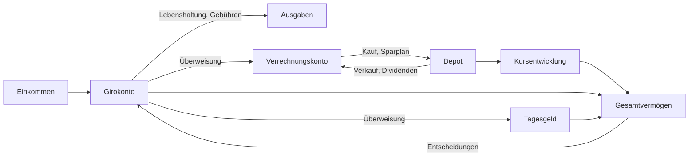
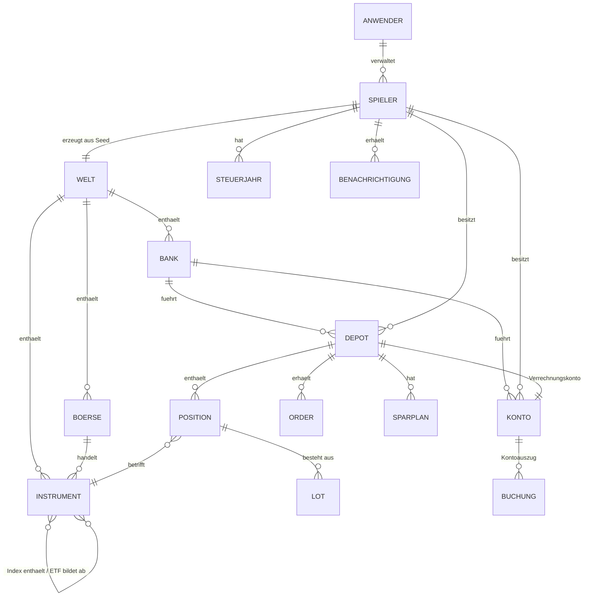

# PortfoliGo – Produktspezifikation

> **Status:** Entwurf v0.2 · **Stand:** 10.11.2026
> **Siehe auch:** [Technische Spezifikation](./technische-spezifikation.md) · [Projektplan](../projektplan.md)

Dieses Dokument beschreibt, _was_ PortfoliGo leisten soll und _warum_. Wie es umgesetzt wird, steht in der technischen Spezifikation. Punkte mit **(Vorschlag)** konkretisieren die Ideensammlung und müssen noch bestätigt werden. Sie sind zusätzlich als Entscheidung `E-xx` in der technischen Spezifikation (§16) geführt.

## Inhalt

1. [Vision und Ziele](#1-vision-und-ziele)
2. [Zielgruppen](#2-zielgruppen)
3. [Produktprinzipien](#3-produktprinzipien)
4. [Spielprinzip](#4-spielprinzip)
5. [Glossar](#5-glossar)
6. [Fachliches Domänenmodell](#6-fachliches-domänenmodell)
7. [User Stories](#7-user-stories)
8. [Ausbaustufen](#8-ausbaustufen)
9. [Nicht-funktionale Anforderungen](#9-nicht-funktionale-anforderungen)
10. [UI/UX-Konzept](#10-uiux-konzept)
11. [Abgrenzung](#11-abgrenzung)

## 1. Vision und Ziele

PortfoliGo ist ein Börsenplanspiel im Browser, das aussieht und sich bedienen lässt wie eine moderne Trading-Plattform. Der Anwender führt einen Spieler durch ein simuliertes Finanzleben: Gehalt und Lebenshaltungskosten, Konten bei verschiedenen Banken, Depots mit Aktien und ETFs – in einem vollständig generierten Markt, der sich wie ein echter verhält.

- **Lernen ohne Risiko:** Sparen, Investieren und Traden mit realistischen Kosten, Spreads, Dividenden und Steuern – ohne echtes Geld.
- **Strategien verproben:** Anlageideen in einem glaubwürdigen Markt testen, später auch automatisiert über Regeln und Backtests.
- **Langzeitmotivation:** Die Spielzeit läuft weiter, auch wenn die App geschlossen ist. Die Geschwindigkeit ist frei wählbar, von Echtzeit bis zu einer Spielwoche pro Sekunde.
- **Vergleichbarkeit:** Gleicher Seed ergibt eine identische Welt. Mehrere Spieler können dieselbe Ausgangslage unterschiedlich spielen.

## 2. Zielgruppen

| Zielgruppe          | Interesse                                                          | Wichtig für PortfoliGo                                                                                 |
| ------------------- | ------------------------------------------------------------------ | ------------------------------------------------------------------------------------------------------ |
| Einsteiger          | Verstehen, wie Sparen, ETFs, Kosten und Steuern langfristig wirken | Erklärungen, Sparpläne, Kostenvorschau vor jeder Order, Benchmark-Vergleich                            |
| Aktive Anleger      | Einzelwerte, Charttechnik und Orderarten ausprobieren              | Charts mit Indikatoren, Limit- und Stop-Orders, hohe Spielgeschwindigkeit, später Regeln und Backtests |
| Gelegenheitsspieler | Kurze Sessions, Fortschritt „nebenbei"                             | Offline-Fortschritt, Abwesenheitsbericht, Benachrichtigungen, Sparpläne                                |

## 3. Produktprinzipien

1. **Plattform statt Spiel.** Ruhige, seriöse Optik einer Trading-Plattform, Fachbegriffe statt Spielbegriffe, keine Spielgrafiken.
2. **Realismus in Stufen.** Mechaniken orientieren sich an der Situation eines Privatanlegers in Deutschland (Abgeltungsteuer, Sparerpauschbetrag, typische Gebührenmodelle). Vereinfachungen sind bewusst gewählt, dokumentiert und im Spiel erklärt.
3. **Determinismus und Fairness.** Die Welt ist eine Funktion des Seeds. Der Spieler ist Preisnehmer: Seine Entscheidungen beeinflussen den Markt nicht. Die App verrät keine künftigen Kurse. Wer allerdings mit einem zweiten Spieler desselben Seeds vorausspielt, kennt die Zukunft – Vergleiche zwischen Spielern beruhen auf Fairplay.
4. **Transparenz.** Jede Buchung ist im Kontoauszug nachvollziehbar. Jede Gebühr wird vor einer Order angezeigt.
5. **Lokal und privat.** Kein Server, kein Benutzerkonto, kein Tracking. Alle Daten bleiben auf dem Gerät. Gesichert wird über den Export.
6. **Erweiterbar.** Die Architektur ist von Beginn an auf spätere Stufen ausgelegt (Anleihen, CFDs, Regeln, Ereignisse, Erben).

## 4. Spielprinzip

### 4.1 Kernschleife



Der Spieler erhält monatlich ein Einkommen, bezahlt davon Lebenshaltungskosten und Gebühren und entscheidet, was mit dem Rest passiert: auf dem Girokonto liegen lassen, auf ein Tagesgeldkonto schieben oder über ein Depot investieren. Kurse, Dividenden, Zinsen, Kosten und Steuern verändern das Gesamtvermögen.

Es gibt kein „Game Over" und kein festes Spielziel. Motivation entsteht aus der Vermögensentwicklung, dem Vergleich mit einer Benchmark und später aus Ereignissen, Upgrades und Erben.

### 4.2 Spielstart

1. Der Anwender legt einen Spieler an: Name, Seed, Startkapital, monatliches Nettoeinkommen und – **(Vorschlag, E-14)** – die monatlichen Lebenshaltungskosten.
2. Aus dem Seed entsteht die Welt: Börsen, Unternehmen, Indizes, ETFs und Banken, dazu eine Kurshistorie von gut zehn Jahren, damit Charts vom ersten Spieltag an aussagekräftig sind. Jeder vergangene Tag lässt sich minutengenau abrufen, sodass auch Intraday-Charts Daten zeigen.
3. Das Startkapital liegt auf einem Girokonto bei einer Hausbank. Die Hausbank ist eine Filialbank mit eher teuren Konditionen – ein Anreiz, Banken zu vergleichen.
4. Das Spiel beginnt pausiert am Spielstartdatum **(Vorschlag: Montag, 01.04.2030, 00:00 Uhr, E-02)**, damit sich der Anwender orientieren kann. Weil es ein Monatserster ist, beginnt das Spiel mit einem vollständigen Monat: Am Morgen werden die Lebenshaltungskosten fällig, am Monatsende kommt das erste Gehalt.

### 4.3 Zeit

- Die Spielzeit läuft in Ticks. **(Vorschlag, E-02)** Ein Tick entspricht einer Spielminute.
- Der Anwender wählt die Geschwindigkeit – Echtzeit (1 s/s), 1 min/s, 10 min/s, 1 h/s, 2 h/s, 4 h/s, 1 d/s oder 1 w/s – und kann sie jederzeit ändern oder die Zeit anhalten.
- Ist die App geschlossen, läuft die Zeit in Echtzeit weiter. Beim nächsten Öffnen wird die verstrichene Zeit nachberechnet. **(Vorschlag, E-02)** Dasselbe gilt, solange die App nicht sichtbar ist (z. B. Hintergrund-Tab); pro Spieler lässt sich stattdessen „im Hintergrund pausieren" einstellen. War das Spiel pausiert, bleibt es pausiert.
- **(Vorschlag, E-18)** Börsen haben Handelszeiten. Orders lassen sich jederzeit erteilen und werden während der Handelszeit ausgeführt. Nachts und am Wochenende stehen Aktienkurse still. **(Vorschlag, E-19)** Banken buchen nur an Bankarbeitstagen.

### 4.4 Die simulierte Welt

Alles wird aus dem Seed erzeugt: Namen und Konditionen der Banken, Unternehmen mit Ticker und Kennung, Indizes, ETFs, Kurse, Dividenden und die monatlichen Schwankungen der Lebenshaltungskosten. Die Kurse sind nicht zufällig, sondern Ergebnis eines Marktmodells mit mehreren Einflussfaktoren:

- **Weltwirtschaft und Marktphasen:** Aufschwung, Normalphase, Abschwung, Krise – mit jeweils anderer Rendite, Schwankung und anderem Gleichlauf der Kurse.
- **Regionen:** Nordamerika, Europa, Asien-Pazifik, Schwellenländer – mit eigener Entwicklung und eigenen Handelszeiten. Was nachts in Asien passiert, zeigt sich morgens in einer Kurslücke in Europa.
- **Sektoren und Branchen:** Der Energiesektor kann insgesamt wachsen, während die Branche „Öl & Gas" schrumpft und „Erneuerbare Energien" boomt. Branchentrends halten Monate bis Jahre.
- **Unternehmensmerkmale:** Größe (Large, Mid, Small Cap), Stil (Value, Growth), Konjunkturabhängigkeit, Dividendenpolitik und unternehmensspezifische Nachrichten, die Kurssprünge auslösen.

Diese Merkmale sind zugleich die Dimensionen, nach denen der Anwender den Markt filtert und sein Portfolio auswertet (Allokation nach Assetklasse, Region und Sektor).

## 5. Glossar

| Begriff                     | Bedeutung                                                                                                             |
| --------------------------- | --------------------------------------------------------------------------------------------------------------------- |
| Anwender                    | Der Mensch, der PortfoliGo bedient.                                                                                   |
| Spieler                     | Ein Spielstand mit eigener Welt, eigenem Vermögen und eigener Spielzeit. Ein Anwender kann mehrere Spieler haben.     |
| Seed                        | Zeichenkette, aus der die gesamte Welt deterministisch erzeugt wird.                                                  |
| Welt                        | Alles Generierte: Börsen, Instrumente, Banken, Kursverläufe.                                                          |
| Spielzeit, Tick             | Zeit im Spiel. Ein Tick ist die kleinste Zeiteinheit (eine Spielminute).                                              |
| Geschwindigkeit             | Spielzeit pro Sekunde Echtzeit, z. B. „1 h/s".                                                                        |
| Nachberechnung              | Simulation der Zeit, die bei geschlossener oder verborgener App vergangen ist.                                        |
| Abwesenheitsbericht         | Zusammenfassung dessen, was während der Abwesenheit passiert ist.                                                     |
| Instrument                  | Handelbares oder beobachtbares Wertpapier bzw. Gut: Aktie, ETF, Index, später Anleihe, Rohstoff, ETC, Fonds, CFD.     |
| Geldkurs, Briefkurs, Spread | Verkaufskurs, Kaufkurs und deren Differenz.                                                                           |
| Depot                       | Wertpapierkonto bei einer Bank. Käufe und Verkäufe laufen über das zugehörige Verrechnungskonto.                      |
| Gehaltskonto                | Girokonto, auf dem das Einkommen eingeht und von dem die Lebenshaltungskosten abgebucht werden.                       |
| Order                       | Kauf- oder Verkaufsauftrag (Market, Limit, Stop, Stop-Limit).                                                         |
| Position, Lot               | Bestand eines Instruments in einem Depot; ein Lot ist ein einzelner Kauf innerhalb der Position (Grundlage für FIFO). |
| Einstandskurs               | Durchschnittlicher Kaufpreis inklusive Kaufnebenkosten.                                                               |
| TER                         | Laufende Kosten eines ETFs oder Fonds pro Jahr, im Kurs verrechnet.                                                   |
| Ausschüttend, thesaurierend | Der ETF zahlt Erträge aus bzw. legt sie wieder an.                                                                    |
| Abgeltungsteuer             | Pauschale Steuer auf Kapitalerträge (im Spiel 25 %).                                                                  |
| Sparerpauschbetrag          | Steuerfreier Betrag für Kapitalerträge (1.000 € pro Jahr).                                                            |
| Verlusttopf                 | Sammelt realisierte Verluste zur Verrechnung mit späteren Gewinnen.                                                   |
| Sparplan                    | Regelmäßiger, automatischer Kauf eines Instruments für einen festen Betrag.                                           |
| Gesamtvermögen              | Summe aller Kontosalden und Depotwerte (zum Geldkurs) abzüglich Schulden.                                             |
| Benchmark                   | Vergleichsmaßstab: Wie stünde der Spieler da, wenn alle Zuflüsse ohne Kosten in den Weltindex geflossen wären?        |

## 6. Fachliches Domänenmodell



**Instrumenttypen:** Aktie, Index (nicht handelbar) und ETF. Ab Stufe 2 kommen Anleihe, Rohstoff, ETC, aktiver Fonds und physisches Edelmetall hinzu, ab Stufe 3 der CFD.

**Klassifikation** – Grundlage für Marktmodell, Filter und Auswertungen:

| Merkmal                | Ausprägungen (Beispiele)                                                 |
| ---------------------- | ------------------------------------------------------------------------ |
| Assetklasse            | Aktie, ETF, Index; später Anleihe, Rohstoff, ETC, Fonds, Edelmetall, CFD |
| Region                 | Nordamerika, Europa, Asien-Pazifik, Schwellenländer                      |
| Land und Börse         | z. B. USA, Deutschland, Japan, Brasilien – jeweils mit Handelszeiten     |
| Sektor                 | 11 Sektoren, z. B. Technologie, Gesundheit, Finanzen, Energie, Versorger |
| Branche                | rund 30, z. B. Halbleiter, Software, Öl & Gas, Erneuerbare Energien      |
| Größe                  | Large, Mid, Small Cap (nach Marktkapitalisierung)                        |
| Stil                   | Value, Growth, Blend                                                     |
| Dividendenprofil       | keine bis hohe Rendite; jährlich, halbjährlich oder quartalsweise        |
| Konjunkturabhängigkeit | defensiv, neutral, zyklisch                                              |
| Risiko                 | Volatilitätsklasse 1–5                                                   |

## 7. User Stories

Aufbau: **ID – Titel** · Stufe · Priorität (**M** = Muss, **S** = Soll, **K** = Kann). Darauf folgen die Story und die Akzeptanzkriterien. Stories der Stufe 1 sind ausgearbeitet; spätere Stufen sind in [7.12](#712-spätere-ausbaustufen-skizze) skizziert und werden bei Erreichen der Stufe ausgearbeitet.

### 7.1 Spieler und Spielstände (SP)

**US-SP-01 – Spieler anlegen** · Stufe 1 · M
Als Anwender möchte ich einen Spieler mit Namen und Startbedingungen anlegen, damit ich ein neues Spiel beginnen kann.

- Eingaben: Name (Pflicht, 1–40 Zeichen), Seed, Startkapital, monatliches Nettoeinkommen, monatliche Lebenshaltungskosten. Jedes Feld hat Grenzen und eine sinnvolle Vorgabe – **(Vorschlag, E-14)** 10.000 €, 2.500 € und 1.800 €.
- Der Seed ist mit einem zufälligen, gut teilbaren Wert vorbelegt (z. B. `kupfer-falke-731`) und kann geändert werden.
- Voreinstellungen wie „Studium", „Berufseinstieg" und „Erfahren" füllen die Beträge aus (S).
- Fehler werden direkt am Feld angezeigt. Anlegen ist nur mit gültigen Eingaben möglich.
- Nach dem Anlegen wird die Welt samt Kurshistorie erzeugt (mit Fortschrittsanzeige). Danach öffnet sich das Spiel pausiert am Spielstart; das Startkapital liegt auf dem Girokonto der Hausbank.

**US-SP-02 – Spieler auswählen und verwalten** · Stufe 1 · M
Als Anwender möchte ich alle Spieler auf diesem Gerät sehen und zwischen ihnen wechseln, damit ich mehrere Spiele parallel führen kann.

- Die Liste zeigt Name, Spielzeit, Gesamtvermögen (Stand der letzten Speicherung) und den Zeitpunkt der letzten Nutzung.
- Auswählen öffnet den Spieler; die Abwesenheit wird nachberechnet (US-ZT-04).
- Spieler können umbenannt und – nach Bestätigung – endgültig gelöscht werden.
- Ein Spieler kann nur in einem Browser-Tab gleichzeitig geöffnet sein. Ein zweiter Tab zeigt einen Hinweis.
- Beim App-Start ist der zuletzt genutzte Spieler vorausgewählt (S).

**US-SP-03 – Seed einsehen und teilen** · Stufe 1 · M
Als Anwender möchte ich den Seed meines Spielers sehen und kopieren, damit andere in derselben Welt spielen können.

- Der Seed ist in den Einstellungen des Spielers sichtbar und kopierbar.
- Ein neuer Spieler mit demselben Seed erhält identische Banken, Instrumente und Kursverläufe – unabhängig von den Entscheidungen anderer Spieler.

### 7.2 Zeit (ZT)

**US-ZT-01 – Spielzeit und Börsenstatus sehen** · Stufe 1 · M
Als Anwender möchte ich jederzeit sehen, welcher Tag und welche Uhrzeit im Spiel ist und welche Börsen geöffnet sind, damit ich meine Entscheidungen zeitlich einordnen kann.

- Die Kopfzeile zeigt Wochentag, Datum, Uhrzeit, Geschwindigkeit und Pausenstatus.
- Für jede Region ist erkennbar, ob die Börse offen ist bzw. wann sie öffnet.

**US-ZT-02 – Geschwindigkeit wählen** · Stufe 1 · M
Als Anwender möchte ich die Spielgeschwindigkeit jederzeit ändern, damit ich Phasen überspringen oder genau beobachten kann.

- Stufen **(Vorschlag, E-02)**: Echtzeit (1 s/s), 1 min/s, 10 min/s, 1 h/s, 2 h/s, 4 h/s, 1 d/s, 1 w/s.
- Eine Änderung wirkt sofort. Tastenkürzel: Leertaste für Pause/Weiter, `+`/`−` für schneller/langsamer. Sie greifen nicht, solange ein Eingabefeld oder Bedienelement fokussiert ist, und lassen sich in den Einstellungen abschalten (WCAG 2.1.4).
- Die gewählte Geschwindigkeit wird pro Spieler gespeichert.
- Kann das Gerät die Geschwindigkeit nicht halten, wird das angezeigt. Es wird keine Spielzeit übersprungen.

**US-ZT-03 – Zeit anhalten** · Stufe 1 · M
Als Anwender möchte ich die Zeit komplett anhalten, damit ich in Ruhe analysieren und Orders vorbereiten kann.

- In der Pause ruhen Kurse, Buchungen und Orderprüfungen.
- Alle Ansichten und Eingaben bleiben nutzbar. Eine Market-Order an einer geöffneten Börse wird auch in der Pause sofort zum angezeigten Kurs ausgeführt; alle anderen Orders werden geprüft, sobald die Zeit weiterläuft.

**US-ZT-04 – Offline-Fortschritt** · Stufe 1 · M
Als Anwender möchte ich, dass die Zeit weiterläuft, wenn ich die App schließe, damit sich das Spiel wie ein echtes Finanzleben anfühlt.

- Ist die App geschlossen, läuft die Spielzeit in Echtzeit (1 s/s) weiter. **(Vorschlag, E-02)** Dasselbe gilt, solange die App nicht sichtbar ist; wer das nicht möchte, stellt für den Spieler „im Hintergrund pausieren" ein (US-UI-09).
- Beim nächsten Öffnen wird die verstrichene Zeit mit Fortschrittsanzeige nachberechnet. Alle fälligen Vorgänge (Gehalt, Kosten, Orders, Dividenden, Sparpläne) werden in der richtigen Reihenfolge verarbeitet.
- **(Vorschlag, E-02)** War das Spiel pausiert, bleibt es pausiert und es wird nichts nachberechnet.
- Anschließend erscheint der Abwesenheitsbericht (US-BN-03).

**US-ZT-05 – Vorspulen** · Stufe 1 · S
Als Anwender möchte ich direkt zu einem Zeitpunkt springen, damit ich ruhige Phasen schnell überbrücke.

- Ziele: nächste Börsenöffnung, nächster Monatsanfang oder ein Datum (höchstens ein Jahr voraus).
- Der Sprung zeigt einen Fortschritt, lässt sich abbrechen und verarbeitet alle Vorgänge wie der normale Spielverlauf.

**US-ZT-06 – Automatisch pausieren** · Stufe 1 · S
Als Anwender möchte ich, dass das Spiel bei wichtigen Ereignissen anhält, damit ich bei hoher Geschwindigkeit nichts verpasse.

- Pro Ereignistyp einstellbar, z. B. „Konto überzogen" oder „Order ausgeführt".
- Tritt das Ereignis ein, pausiert das Spiel und zeigt das Ereignis an.
- Während der Nachberechnung und solange die App nicht sichtbar ist, pausiert das Spiel nicht automatisch; die Ereignisse erscheinen im Abwesenheitsbericht.

### 7.3 Einkommen und Kosten (EK)

**US-EK-01 – Monatliches Einkommen** · Stufe 1 · M
Als Anwender möchte ich jeden Monat mein Gehalt erhalten, damit ich sparen und investieren kann.

- Das Nettoeinkommen wird **(Vorschlag, E-19)** am letzten Bankarbeitstag des Monats auf dem Gehaltskonto gutgeschrieben.
- Die Buchung erscheint im Kontoauszug, z. B. „Gehalt April 2030".

**US-EK-02 – Lebenshaltungskosten** · Stufe 1 · M
Als Anwender möchte ich, dass monatlich realistisch schwankende Lebenshaltungskosten anfallen, damit mein Budget nicht trivial planbar ist.

- **(Vorschlag, E-19)** Am ersten Bankarbeitstag des Monats wird der Basisbetrag abgebucht, verändert um eine Schwankung von typischerweise ±5 % (maximal ±15 %).
- Die Schwankung ist durch den Seed festgelegt: gleicher Seed, gleiche Beträge.

**US-EK-03 – Monatsübersicht** · Stufe 1 · M
Als Anwender möchte ich sehen, wohin mein Geld im Monat geflossen ist, damit ich meine Sparquote kenne.

- Pro Monat: Einkommen, Lebenshaltung, Gebühren, Zinsen, Steuern, Erträge (Dividenden, Zinsen) und Sparquote.
- Zum Monatsende gibt es eine Benachrichtigung mit dem Monatsabschluss (S).

### 7.4 Banken und Konten (BK)

**US-BK-01 – Banken vergleichen** · Stufe 1 · M
Als Anwender möchte ich die Banken der Welt mit ihren Konditionen vergleichen, damit ich die für mich günstigste wähle.

- Liste aller Banken mit Typ (Filialbank, Direktbank, Onlinebroker, Neobroker) und Konditionen: Kontoführung und ihre Bedingungen, Dispozins, Habenzins, Depotgebühr, Orderentgelt, Sparplankosten, Handelsplatz und Spread-Aufschlag, Bruchstückhandel.
- Die Konditionen sind aus dem Seed erzeugt und unterscheiden sich spürbar.
- Sortieren nach einzelnen Kostenmerkmalen (S).

**US-BK-02 – Konto oder Depot eröffnen** · Stufe 1 · M
Als Anwender möchte ich bei jeder Bank Konten und Depots eröffnen, damit ich mein Geld dort anlegen kann, wo es sich lohnt.

- Kontotypen je nach Angebot der Bank: Girokonto, Tagesgeldkonto, Depot (immer mit Verrechnungskonto).
- Die Eröffnung erfolgt sofort (E-17); das neue Konto erscheint in der Kontenübersicht.

**US-BK-03 – Konto schließen** · Stufe 1 · M
Als Anwender möchte ich nicht mehr benötigte Konten schließen, damit keine Gebühren mehr anfallen.

- Beim Schließen rechnet die Bank ab: Aufgelaufene Zinsen und anteilige Gebühren bis zum Schließtag werden gebucht, ein Restguthaben wird auf ein gewähltes eigenes Konto überwiesen.
- Ein negativer Saldo muss vorher ausgeglichen werden. Depots müssen leer sein und dürfen keine offenen Orders oder Sparpläne haben; andernfalls erklärt ein Hinweis, was fehlt.
- Das Gehaltskonto lässt sich erst schließen, wenn ein anderes Gehaltskonto bestimmt ist.

**US-BK-04 – Geld überweisen** · Stufe 1 · M
Als Anwender möchte ich Geld zwischen meinen Konten bewegen, damit ich es dorthin bringe, wo ich es brauche.

- Überweisungen zwischen eigenen Konten (Girokonto, Tagesgeld, Verrechnungskonto) mit Betrag und Verwendungszweck.
- Ausführung sofort und kostenlos (Echtzeitüberweisung, E-17).
- Überwiesen werden kann höchstens der verfügbare Betrag (Guthaben plus Dispo, falls vorhanden).

**US-BK-05 – Gehaltskonto festlegen** · Stufe 1 · M
Als Anwender möchte ich bestimmen, welches Girokonto mein Gehaltskonto ist, damit ich von günstigeren Konditionen profitiere.

- Genau ein Girokonto ist Gehaltskonto; Einkommen und Lebenshaltungskosten laufen darüber.
- Bedingungen wie „kostenlos ab 700 € Geldeingang pro Monat" werden anhand der tatsächlichen Eingänge geprüft.

**US-BK-06 – Kontoauszug** · Stufe 1 · M
Als Anwender möchte ich alle Buchungen eines Kontos sehen, damit ich jede Bewegung nachvollziehen kann.

- Buchungsliste mit Datum, Text, Betrag und Saldo; Filter nach Zeitraum und Buchungsart; Suche.
- Auch mehrere tausend Buchungen lassen sich flüssig durchblättern.
- Saldoverlauf als Chart (S).

**US-BK-07 – Überziehung und Dispo** · Stufe 1 · M
Als Anwender möchte ich gewarnt werden, wenn ein Konto nicht gedeckt ist, damit ich rechtzeitig reagieren kann.

- Girokonten haben einen Dispositionskredit (Limit, Zinssatz). Lastschriften werden auch bei fehlender Deckung ausgeführt; das Konto ist dann überzogen. Oberhalb des Limits gilt ein erhöhter Zins (geduldete Überziehung, E-17).
- Bei fehlender Deckung und bei Überziehung erhält der Anwender eine Warnung (US-BN-02).
- Dispozinsen werden monatlich berechnet und belastet.
- Verrechnungskonten erlauben keine Überziehung durch Käufe: Kauforders ohne Deckung werden abgelehnt. Gebühren und Zinsen der Bank werden trotzdem belastet. Rutscht ein Verrechnungskonto dadurch ins Minus, fallen Sollzinsen an, der Anwender wird gewarnt und neue Käufe sind gesperrt, bis das Konto ausgeglichen ist.

**US-BK-08 – Zinsen und Gebühren** · Stufe 1 · M
Als Anwender möchte ich, dass Zinsen und Gebühren gemäß den Konditionen gebucht werden, damit sich die Wahl der Bank spürbar auswirkt.

- Habenzinsen werden taggenau berechnet und je nach Bank monatlich oder quartalsweise gutgeschrieben; die Abgeltungsteuer wird einbehalten (US-ST-01).
- Kontoführungs- und Depotgebühren werden periodisch belastet und im Kontoauszug ausgewiesen.

### 7.5 Märkte und Instrumente (MK)

**US-MK-01 – Marktübersicht** · Stufe 1 · M
Als Anwender möchte ich auf einen Blick sehen, wie sich die Märkte entwickeln, damit ich Chancen und Risiken erkenne.

- Wichtige Indizes mit Tagesveränderung und Sparkline, Börsenstatus je Region.
- Tagesgewinner und -verlierer, Entwicklung der Sektoren (S: als Heatmap).

**US-MK-02 – Instrumente suchen und filtern** · Stufe 1 · M
Als Anwender möchte ich Instrumente nach verschiedenen Merkmalen finden, damit ich gezielt investieren kann.

- Suche nach Name, Ticker und Kennung.
- Filter: Assetklasse, Region, Land, Sektor, Branche, Größe, Stil, Dividendenrendite. Sortierung u. a. nach Performance über verschiedene Zeiträume.
- Die Trefferliste zeigt Kurs, Veränderung und Sparkline.

**US-MK-03 – Instrument-Detailseite** · Stufe 1 · M
Als Anwender möchte ich alle wichtigen Informationen zu einem Instrument sehen, damit ich fundiert entscheiden kann.

- Kopf: Name, Ticker, Kennung, Börse, Geld- und Briefkurs, Spread, Veränderung (absolut und in %), Handelsstatus.
- Chart (US-CH-01) und Kennzahlen: Marktkapitalisierung, Dividendenrendite, Volatilität, Beta, Performance über 1 Monat, 1 Jahr und 5 Jahre.
- Aktie: Profil (Sektor, Branche, Land, Größe, Stil, Kurzbeschreibung), Dividendenhistorie und nächster Termin, Indexzugehörigkeit.
- ETF: abgebildeter Index, TER, Ertragsverwendung, Emittent, Fondsvolumen, größte Positionen, Aufteilung nach Region und Sektor.
- Aktionen: Kaufen, Verkaufen, zur Watchlist hinzufügen, Sparplan anlegen.

**US-MK-04 – Watchlist** · Stufe 1 · M
Als Anwender möchte ich interessante Instrumente beobachten, damit ich sie im Blick behalte.

- Instrumente hinzufügen und entfernen; Reihenfolge per Drag & Drop ändern (S).
- Die Watchlist zeigt Live-Kurse und gehört zum Spieler (sie wird mit exportiert).

**US-MK-05 – Live-Kurse** · Stufe 1 · M
Als Anwender möchte ich, dass sich Kurse sichtbar bewegen, während die Zeit läuft, damit sich der Markt lebendig anfühlt.

- Kurse aktualisieren sich entsprechend der Spielgeschwindigkeit; Änderungen werden kurz farblich hervorgehoben. Die Hervorhebung ist abschaltbar und entfällt bei der Systemeinstellung „Bewegung reduzieren".
- Außerhalb der Handelszeit stehen die Kurse still; ein Hinweis zeigt „Börse geschlossen".

**US-MK-06 – Dividendentermine** · Stufe 1 · S
Als Anwender möchte ich anstehende Dividenden meiner Werte sehen, damit ich Ausschüttungen einplanen kann.

- Kalender mit Ex-Tagen und Zahltagen für Depot und Watchlist.

### 7.6 Handel (HD)

**US-HD-01 – Kaufen** · Stufe 1 · M
Als Anwender möchte ich Wertpapiere über ein Depot kaufen und vorher alle Kosten sehen, damit ich keine Überraschungen erlebe.

- Order-Ticket: Depot, Instrument, Stückzahl oder Betrag, Orderart, Gültigkeit. Bei Betragsorders werden Stücke berechnet; Bruchstücke nur, wenn die Bank sie anbietet.
- Vor dem Absenden zeigt eine Kostenvorschau: Briefkurs, Kurswert, Orderentgelt, Fremdkosten, Gesamtbetrag und verfügbares Guthaben.
- Fehlt die Deckung auf dem Verrechnungskonto, wird die Order nicht angenommen und der Fehlbetrag angezeigt.
- Die Ausführung erzeugt eine Buchung, eine Position bzw. ein Lot und eine Benachrichtigung.

**US-HD-02 – Verkaufen** · Stufe 1 · M
Als Anwender möchte ich Positionen ganz oder teilweise verkaufen, damit ich Gewinne sichern oder Verluste begrenzen kann.

- Ausführung zum Geldkurs.
- Die Vorschau zeigt den voraussichtlichen Gewinn oder Verlust und die Steuer.
- Der Erlös wird nach Kosten und Steuern dem Verrechnungskonto gutgeschrieben.

**US-HD-03 – Orderarten und Gültigkeit** · Stufe 1 · M
Als Anwender möchte ich verschiedene Orderarten nutzen, damit ich zu meinen Bedingungen handle.

- Orderarten: Market (bestens/billigst), Limit, Stop (Stop-Loss, Stop-Buy), Stop-Limit.
- Gültigkeit: bis Tagesende, bis Datum, bis auf Widerruf (höchstens ein Jahr).
- Orders außerhalb der Handelszeit werden zur Börseneröffnung geprüft und ausgeführt. Kurslücken über Nacht wirken sich realistisch aus (ein Stop-Loss kann unter dem Stopkurs ausgeführt werden).

**US-HD-04 – Orderbuch** · Stufe 1 · M
Als Anwender möchte ich offene und vergangene Orders sehen und verwalten, damit ich den Überblick behalte.

- Offene Orders mit Status; Stornieren und Ändern (Limit, Stop, Gültigkeit).
- Orderhistorie mit Ausführungsdetails (Kurs, Zeitpunkt, Kosten).
- Für offene Kauforders reserviertes Guthaben ist sichtbar.

**US-HD-05 – Sparplan** · Stufe 1 · M
Als Anwender möchte ich regelmäßig automatisch investieren, damit mein Vermögen auch ohne mein Zutun wächst.

- Angaben: Depot, sparplanfähiges Instrument (ETF oder Aktie), Betrag, Ausführungstag (z. B. 1. oder 15.), Intervall (monatlich).
- Ausführung zur Börseneröffnung am Ausführungstag bzw. am nächsten Handelstag, mit Bruchstücken und den Sparplankosten der Bank.
- Sparpläne lassen sich pausieren, ändern und löschen. Fehlt die Deckung, fällt die Ausführung aus und der Anwender wird benachrichtigt.

### 7.7 Portfolio und Auswertung (PF)

**US-PF-01 – Gesamtvermögen** · Stufe 1 · M
Als Anwender möchte ich mein Gesamtvermögen jederzeit sehen, damit ich weiß, wo ich stehe.

- Live-Wert: Summe aller Konten und Depotwerte (zum Geldkurs) abzüglich Überziehungen.
- Veränderung heute und seit Spielbeginn (absolut und in %).

**US-PF-02 – Depotübersicht** · Stufe 1 · M
Als Anwender möchte ich alle Positionen eines Depots mit ihrer Entwicklung sehen, damit ich mein Portfolio steuern kann.

- Je Position: Stück, Einstandskurs, aktueller Kurs, Wert, Gewinn/Verlust (absolut und in %), Anteil am Depot; sortierbar, mit Summenzeile.
- Depots einzeln und zusammengefasst.

**US-PF-03 – Allokation** · Stufe 1 · M
Als Anwender möchte ich sehen, wie mein Vermögen verteilt ist, damit ich Klumpenrisiken erkenne.

- Aufteilung nach Assetklasse, Region und Sektor als Donut mit Tabelle.
- ETFs werden anhand ihrer Indexzusammensetzung aufgeschlüsselt („Durchschau") (S).

**US-PF-04 – Vermögensverlauf** · Stufe 1 · M
Als Anwender möchte ich die Entwicklung meines Vermögens über die Zeit sehen, damit ich meinen Fortschritt erkenne.

- Chart des Gesamtvermögens (täglicher Wert) mit wählbarem Zeitraum.
- Aufteilung in Bargeld und Wertpapiere (S).

**US-PF-05 – Performance und Benchmark** · Stufe 1 · M
Als Anwender möchte ich meine Rendite mit einer einfachen Alternative vergleichen, damit ich meine Strategie bewerten kann.

- Zeitgewichtete Rendite seit Spielbeginn, im laufenden Jahr und annualisiert. Einkommen und Lebenshaltungskosten verfälschen sie nicht.
- Benchmark: Schattenportfolio, in das Startkapital und alle Netto-Zuflüsse ohne Kosten in den Weltindex geflossen wären – Vergleich als Chart und Kennzahl.

**US-PF-06 – Positionsdetail** · Stufe 1 · M
Als Anwender möchte ich die Historie einer Position sehen, damit ich meine Entscheidungen nachvollziehe.

- Lots (Kaufdatum, Stück, Einstand), realisierte Gewinne und Verluste, erhaltene Dividenden.
- Eigene Käufe und Verkäufe sind im Chart markiert (S).

**US-PF-07 – Erträge und Kosten** · Stufe 1 · S
Als Anwender möchte ich sehen, was mir meine Anlagen einbringen und was sie kosten, damit ich Kosten bewusst senken kann.

- Dividenden und Zinsen pro Monat und Jahr.
- Kosten pro Jahr: Orderentgelte, Konto- und Depotgebühren, Dispozinsen, geschätzte Spread- und TER-Kosten.

### 7.8 Steuern (ST)

**US-ST-01 – Abgeltungsteuer** · Stufe 1 · M
Als Anwender möchte ich, dass Kapitalerträge wie in Deutschland besteuert werden, damit ich die Wirkung von Steuern auf meine Rendite lerne.

- 25 % auf realisierte Kursgewinne, Dividenden und Zinsen; die Bank behält die Steuer direkt ein.
- Kursgewinne werden nach FIFO ermittelt; Kauf- und Verkaufskosten mindern den Gewinn.
- **(Vorschlag, E-11)** Solidaritätszuschlag und Kirchensteuer werden nicht abgebildet.

**US-ST-02 – Sparerpauschbetrag** · Stufe 1 · M
Als Anwender möchte ich, dass mein Sparerpauschbetrag automatisch angerechnet wird, damit kleine Erträge steuerfrei bleiben.

- 1.000 € pro Kalenderjahr bleiben steuerfrei.
- **(Vorschlag, E-11)** Der Betrag gilt bankübergreifend; Freistellungsaufträge je Bank folgen in Stufe 2.

**US-ST-03 – Verlustverrechnung** · Stufe 1 · M
Als Anwender möchte ich, dass Verluste mit Gewinnen verrechnet werden, damit ich nur auf meinen Nettogewinn Steuern zahle.

- Realisierte Verluste werden mit Gewinnen desselben Jahres verrechnet; bereits gezahlte Steuer wird erstattet.
- Nicht verrechnete Verluste werden ins Folgejahr vorgetragen.
- **(Vorschlag, E-11)** Ein gemeinsamer Verlusttopf für alle Erträge; getrennte Töpfe für Aktien folgen in Stufe 2.

**US-ST-04 – Steuerübersicht** · Stufe 1 · M
Als Anwender möchte ich eine jährliche Steuerübersicht sehen, damit ich meine Steuerlast verstehe.

- Pro Jahr: Kapitalerträge, genutzter Sparerpauschbetrag, gezahlte und erstattete Steuer, Verlustvortrag.

### 7.9 Charts und Analyse (CH)

**US-CH-01 – Kurschart** · Stufe 1 · M
Als Anwender möchte ich den Kursverlauf eines Instruments in verschiedenen Zeiträumen sehen, damit ich Entwicklungen einschätzen kann.

- Darstellung als Linie, Fläche oder Kerzen; Zeiträume 1T, 5T, 1M, 6M, 1J, 5J und Max; die Auflösung passt sich an.
- Jeder vergangene Tag lässt sich minutengenau ansehen – auch vor dem Spielstart.
- Fadenkreuz mit Datum und Werten; Zoomen und Verschieben mit Maus und Touch.
- Der Chart aktualisiert sich live, während die Zeit läuft.

**US-CH-02 – Indikatoren** · Stufe 1 · M
Als Anwender möchte ich einfache Indikatoren über den Kursverlauf legen, damit ich technische Analysen durchführen kann.

- Indikatoren: SMA, EMA, SMMA (geglätteter gleitender Durchschnitt) und Bollinger-Bänder, mit einstellbaren Parametern; mehrere gleichzeitig.
- Die Auswahl wird gespeichert.

### 7.10 Benachrichtigungen (BN)

**US-BN-01 – Benachrichtigungszentrum** · Stufe 1 · M
Als Anwender möchte ich alle Benachrichtigungen an einem Ort sehen, damit mir nichts entgeht.

- Liste mit Zeitpunkt (Spielzeit), Kategorie (Konto, Order, Erträge, Steuern, Sparplan, System) und Schweregrad.
- Zähler für ungelesene Benachrichtigungen; Filter nach Kategorie; als gelesen markieren.

**US-BN-02 – Hinweise während des Spiels** · Stufe 1 · M
Als Anwender möchte ich bei wichtigen Ereignissen sofort einen Hinweis sehen, damit ich reagieren kann.

- Kurze Einblendungen (Toasts) z. B. bei ausgeführten Orders, Unterdeckung, Überziehung und Sparplan-Ausfall.
- Bei sehr hoher Geschwindigkeit werden gleichartige Hinweise gebündelt.

**US-BN-03 – Abwesenheitsbericht** · Stufe 1 · M
Als Anwender möchte ich nach der Nachberechnung erfahren, was passiert ist, damit ich schnell wieder im Spiel bin.

- Zeitraum, Veränderung des Gesamtvermögens, Einnahmen und Ausgaben, ausgeführte Orders und Sparpläne, Dividenden und Zinsen, Warnungen und die Entwicklung wichtiger Indizes.

**US-BN-04 – Browser-Benachrichtigungen** · Stufe 1 · S
Als Anwender möchte ich auch dann informiert werden, wenn PortfoliGo in einem Hintergrund-Tab läuft.

- Nach ausdrücklicher Erlaubnis werden ausgewählte Kategorien als System-Benachrichtigung angezeigt, solange die App geöffnet ist.
- Benachrichtigungen bei geschlossener App sind nur mit einer nativen App möglich (Option N, US-NA-02).

### 7.11 Datensicherung und Oberfläche (EX, UI)

**US-EX-01 – Spieler exportieren** · Stufe 1 · M
Als Anwender möchte ich einen Spieler jederzeit exportieren, damit ich ihn sichern oder auf ein anderes Gerät übertragen kann.

- Export als base64-kodiertes JSON: als Datei-Download und zum Kopieren in die Zwischenablage.
- Der Export enthält alles, was den Spieler ausmacht; die Welt wird beim Import aus dem Seed neu erzeugt.

**US-EX-02 – Spieler importieren** · Stufe 1 · M
Als Anwender möchte ich einen exportierten Spieler importieren, damit ich weiterspielen kann.

- Import aus einer Datei oder aus eingefügtem Text; der Import legt immer einen neuen Spieler an.
- Ungültige oder beschädigte Daten und inkompatible Versionen werden mit verständlicher Meldung abgelehnt.

**US-EX-03 – Datensicherung und Speicherschutz** · Stufe 1 · S
Als Anwender möchte ich vor Datenverlust geschützt werden, damit mein Fortschritt nicht verloren geht.

- Erinnerung an einen Export in einstellbarem Abstand (Echtzeit).
- Die App fordert dauerhaften Speicher an und erklärt, warum die Installation als App die Daten zusätzlich schützt.

**US-UI-01 – Erscheinungsbild** · Stufe 1 · M
Als Anwender möchte ich zwischen dunklem und hellem Erscheinungsbild wählen, damit die App zu meiner Umgebung passt.

- Dunkel (Standard), Hell oder nach Systemeinstellung.

**US-UI-02 – Farben für Gewinn und Verlust** · Stufe 1 · S
Als Anwender mit Farbsehschwäche möchte ich Gewinne und Verluste unterscheiden können.

- Wahl zwischen Grün/Rot und einer farbsehschwächefreundlichen Kombination (z. B. Blau/Orange); zusätzlich immer Vorzeichen und Pfeil.

**US-UI-03 – Responsives Layout** · Stufe 1 · M
Als Anwender möchte ich PortfoliGo auf Desktop, Tablet und Smartphone nutzen.

- Desktop: Seitennavigation und mehrspaltige Ansichten. Smartphone: untere Navigationsleiste und einspaltige Ansichten.
- Alle Kernfunktionen sind auf jedem Gerät bedienbar.

**US-UI-04 – Tastatur und Barrierefreiheit** · Stufe 1 · M
Als Anwender möchte ich die App vollständig per Tastatur und mit Hilfstechnologien bedienen.

- Sichtbarer Fokus, logische Tab-Reihenfolge, Tastenkürzel für häufige Aktionen (abschaltbar, siehe US-ZT-02).
- Kontraste nach WCAG 2.2 AA; Bedienelemente haben zugängliche Namen.

**US-UI-05 – Befehlspalette** · Stufe 1 · S
Als Anwender möchte ich mit `Strg`/`⌘` + `K` schnell Instrumente finden und Aktionen ausführen.

- Suche über Instrumente, Seiten und Aktionen (z. B. „Kaufen", „Pause").

**US-UI-06 – Erklärungen und Glossar** · Stufe 1 · S
Als Einsteiger möchte ich Fachbegriffe direkt in der App erklärt bekommen.

- Kurze Erklärungen per Tooltip (z. B. Spread, TER, FIFO) und ein Glossar.

**US-UI-07 – Installation und Offline-Betrieb** · Stufe 1 · S
Als Anwender möchte ich PortfoliGo wie eine App installieren und ohne Internet nutzen.

- Installierbar als Progressive Web App; nach dem ersten Laden vollständig offline nutzbar.
- Neue Versionen werden im Hintergrund geladen und beim nächsten Start aktiv; ein Hinweis bietet an, sofort neu zu laden. Vor Version 1.0 weist die App darauf hin, dass ein Update Spielstände ungültig machen kann.

**US-UI-08 – Rechtliche Hinweise** · Stufe 1 · M
Als Anwender möchte ich wissen, dass PortfoliGo ein Spiel mit vereinfachten Regeln ist.

- Gut auffindbarer Hinweis: keine Anlageberatung, fiktive Unternehmen und Kurse, vereinfachte Steuerregeln.
- Lizenzhinweise der verwendeten Bibliotheken (z. B. TradingView bei lightweight-charts).

**US-UI-09 – Einstellungen** · Stufe 1 · M
Als Anwender möchte ich das Verhalten der App an einer Stelle anpassen.

- Für dieses Gerät: Erscheinungsbild und Farben, Hervorhebung von Kursänderungen, Tastenkürzel an/aus, Toasts und Browser-Benachrichtigungen je Ereignistyp.
- Für den Spieler (Teil des Spielstands, wird mit exportiert): Name, Seed (anzeigen, kopieren), automatische Pause je Ereignistyp und das Verhalten im Hintergrund **(Vorschlag, E-02)** – in Echtzeit weiterlaufen (Standard) oder pausieren.
- Export des Spielers (US-EX-01).

### 7.12 Spätere Ausbaustufen (Skizze)

| ID       | Story (Kurzform)                                                                                                             | Stufe |
| -------- | ---------------------------------------------------------------------------------------------------------------------------- | ----- |
| US-MK-10 | Zinsumfeld und Inflation: Leitzins, Zinskurve und Verbraucherpreise; Kaufkraftverlust des Bargelds, Real- und Nominalansicht | 2     |
| US-MK-11 | Anleihen: Staats- und Unternehmensanleihen mit Kupon, Laufzeit, Rating, Stückzinsen und Rückzahlung                          | 2     |
| US-MK-12 | Rohstoffe und ETCs                                                                                                           | 2     |
| US-MK-13 | Physische Edelmetalle: Kauf beim Händler über das Barvermögen, hohe Spanne, steuerfrei nach einem Jahr Haltedauer            | 2     |
| US-MK-14 | Aktive Fonds: Ausgabeaufschlag, höhere TER, Erfolg des Fondsmanagements                                                      | 2     |
| US-MK-15 | Fundamentaldaten und Quartalszahlen (KGV, Gewinnwachstum, Berichtstermine)                                                   | 2     |
| US-MK-16 | Unternehmensereignisse: Aktiensplits, Übernahmen, Insolvenzen, Börsengänge, Indexanpassungen                                 | 2     |
| US-MK-17 | Fremdwährungen: Instrumente in USD, JPY usw., Wechselkurse und Devisenkosten                                                 | 2     |
| US-MK-18 | Börsenfeiertage und Direkthandel mit erweiterten Handelszeiten                                                               | 2     |
| US-BK-10 | Daueraufträge                                                                                                                | 2     |
| US-BK-11 | Festgeld und Neukunden-Lockzinsen                                                                                            | 2     |
| US-HD-10 | Trailing-Stop                                                                                                                | 2     |
| US-HD-11 | Kursalarme („benachrichtige mich, wenn X > 50")                                                                              | 2     |
| US-ST-10 | Teilfreistellung und Vorabpauschale bei Fonds und ETFs                                                                       | 2     |
| US-ST-11 | Getrennte Verlusttöpfe (Aktien, Sonstiges) und Freistellungsaufträge je Bank                                                 | 2     |
| US-ST-12 | Quellensteuer auf ausländische Dividenden mit Anrechnung                                                                     | 2     |
| US-CH-03 | Vergleichschart: mehrere Instrumente und das eigene Depot normiert in %                                                      | 2     |
| US-CH-04 | Weitere Indikatoren (RSI, MACD) und Handelsvolumen                                                                           | 2     |
| US-PF-08 | Risikokennzahlen: Volatilität, maximaler Drawdown, Sharpe-Ratio                                                              | 2     |
| US-CF-01 | CFD-Handel: CFD-Konto, Long- und Short-Positionen mit Hebel                                                                  | 3     |
| US-CF-02 | CFD-Margin: Sicherheitsleistung, Finanzierungskosten, Margin-Call und Zwangsglattstellung                                    | 3     |
| US-MK-19 | Große Welt: deutlich mehr Länder, Börsen, Branchen und Instrumente aller Assetklassen, bei gleichem Spieltempo               | 3     |
| US-MK-20 | Große Listen bedienen: Screener, Suche und Marktübersicht bleiben auch mit Tausenden Instrumenten schnell und übersichtlich  | 3     |
| US-RG-01 | Regel anlegen: „wenn Bedingung, dann Aktion", z. B. „wenn SMA20(X) > SMA50(X), dann kaufen"                                  | 3     |
| US-RG-02 | Regeln aktivieren, deaktivieren und ihre Ausführungen protokollieren                                                         | 3     |
| US-RG-03 | Backtest einer Regel auf der Kurshistorie                                                                                    | 3     |
| US-RG-04 | Strategievorlagen (z. B. Trendfolge, Rebalancing)                                                                            | 3     |
| US-LE-01 | Zufällige Lebensereignisse (z. B. Autoreparatur, Bonuszahlung), seed-basiert                                                 | 4     |
| US-LE-02 | Upgrades (Auto, Wohnung, Weiterbildung) mit Auswirkung auf Kosten, Ereignisse und Einkommen                                  | 4     |
| US-LE-03 | Versicherungen gegen Ereigniskosten                                                                                          | 4     |
| US-LE-04 | Karriere und Gehaltsentwicklung                                                                                              | 4     |
| US-NT-01 | Newsticker zu Markt-, Branchen- und Unternehmensereignissen                                                                  | 4     |
| US-NT-02 | Wirtschaftskalender (Zentralbanktermine, Quartalszahlen)                                                                     | 4     |
| US-ER-01 | Erben: Ein Nachfolger startet mit dem Vermögen nach Erbschaftsteuer                                                          | 4     |
| US-ER-02 | Prestige: dauerhafte Startvorteile für Nachfolger                                                                            | 4     |
| US-ER-03 | Familienchronik über mehrere Generationen                                                                                    | 4     |
| US-NA-01 | Native Android-App                                                                                                           | N     |
| US-NA-02 | Vorausgeplante Benachrichtigungen bei geschlossener App                                                                      | N     |
| US-NA-03 | Native iOS-App                                                                                                               | N     |

## 8. Ausbaustufen

| Stufe | Name                        | Inhalt                                                                                                                                                                                                                                                    | Meilensteine |
| ----- | --------------------------- | --------------------------------------------------------------------------------------------------------------------------------------------------------------------------------------------------------------------------------------------------------- | ------------ |
| 1     | MVP „Spielbar"              | Spieler, Zeit, Einkommen und Kosten, Banken und Konten, Aktien und ETFs, Handel mit Market-, Limit- und Stop-Orders, Sparpläne, Steuern (vereinfacht), Portfolio und Performance, Charts mit Basisindikatoren, Benachrichtigungen, Export und Import, PWA | M0–M6        |
| 2     | „Vollständiger Markt"       | Zinsen und Inflation, Anleihen, Tagesgeld und Festgeld am Leitzins, Rohstoffe und ETCs, Edelmetalle, aktive Fonds, Steuerdetails, Fundamentaldaten, Unternehmensereignisse, Kursalarme, Daueraufträge, weitere Indikatoren                                | M7–M9        |
| 3     | „Trading & Automatisierung" | CFDs, große Welt mit deutlich mehr Instrumenten, Regelwerk, Backtesting                                                                                                                                                                                   | M10–M12      |
| 4     | „Leben & Welt"              | Lebensereignisse, Upgrades, Versicherungen, Karriere, Newsticker, Erben und Prestige                                                                                                                                                                      | M13–M15      |
| N     | „Native" (optional)         | App für Android und iOS mit Capacitor, vorausgeplante Benachrichtigungen                                                                                                                                                                                  | N1           |

**(E-12, entschieden)** Die Ideensammlung nennt Aktien, ETFs/ETCs, CFDs, Anleihen, Rohstoffe und Edelmetalle als Kern des Spiels. Damit das MVP überschaubar bleibt, enthält Stufe 1 nur Aktien und ETFs (plus Indizes als Referenz); die übrigen Klassen folgen in Stufe 2 und 3. Inflation ist in der Ideensammlung für später vorgemerkt und wird in Stufe 2 zusammen mit dem Zinsumfeld umgesetzt, weil beide fachlich zusammenhängen (Leitzins reagiert auf Inflation).

## 9. Nicht-funktionale Anforderungen

| ID    | Anforderung                                                                                                                                                                                                                                                                                                                                                                                                                            |
| ----- | -------------------------------------------------------------------------------------------------------------------------------------------------------------------------------------------------------------------------------------------------------------------------------------------------------------------------------------------------------------------------------------------------------------------------------------- |
| NF-01 | **Bedienung flüssig:** Darstellung mit 60 Bildern pro Sekunde, Reaktion auf Eingaben unter 100 ms – auch bei hoher Spielgeschwindigkeit.                                                                                                                                                                                                                                                                                               |
| NF-02 | **Simulation schnell:** Die Standardwelt hält 1 w/s mit höchstens 15 % eines Prozessorkerns. Nachberechnung von 30 Tagen unter 1 s, von einem Jahr unter 5 s. Spielstart (Welt und Vorlauf) unter 2 s. Ein Import ist nach unter 3 s spielbar; die Kurshistorie wird danach im Hintergrund ergänzt. Ein Minutenchart eines beliebigen vergangenen Tags erscheint in unter 50 ms. Gemessen wird auf dem Entwicklungsrechner (TS §14.3). |
| NF-03 | **Offline:** Nach dem ersten Laden vollständig offline nutzbar.                                                                                                                                                                                                                                                                                                                                                                        |
| NF-04 | **Privatsphäre:** Keine Netzwerkzugriffe außer dem Laden der App; keine Cookies, kein Tracking, keine externen Schriften oder CDNs.                                                                                                                                                                                                                                                                                                    |
| NF-05 | **Determinismus:** Gleicher Seed und gleiche Simulationsversion ergeben dieselbe Welt – über Browser und Geräte hinweg.                                                                                                                                                                                                                                                                                                                |
| NF-06 | **Robustheit:** Aktionen des Anwenders gehen nie verloren. Nach einem Absturz geht höchstens der Spielfortschritt der letzten Sekunden Echtzeit verloren.                                                                                                                                                                                                                                                                              |
| NF-07 | **Speicher:** Ein Spieler belegt höchstens rund 15 MB plus 1,5 MB je Spieljahr; ältere Kursdaten werden verdichtet. Lange Spiele sind normal – bei 1 w/s vergehen rund 70 Spieljahre pro Spielstunde.                                                                                                                                                                                                                                  |
| NF-08 | **Plattformen:** Aktuelle Versionen von Chrome und Edge (ab 111), Firefox (ab 128), Safari und iOS (ab 16.4); Desktop, Tablet und Smartphone.                                                                                                                                                                                                                                                                                          |
| NF-09 | **Barrierefreiheit:** WCAG 2.2 AA; Bewegungen werden bei „Bewegung reduzieren" vermieden.                                                                                                                                                                                                                                                                                                                                              |
| NF-10 | **Sprache:** Deutsch; alle Texte sind für Übersetzungen vorbereitet (i18n).                                                                                                                                                                                                                                                                                                                                                            |
| NF-11 | **Wartbarkeit:** Code folgt den Konventionen in `CLAUDE.md`; Geschäftslogik ist durch Unit-Tests abgedeckt.                                                                                                                                                                                                                                                                                                                            |

## 10. UI/UX-Konzept

### 10.1 Gestaltungsprinzipien

- **Trading-Plattform-Look:** dunkles Standard-Theme, neutrale Grautöne, eine Akzentfarbe, Grün und Rot nur für Gewinn und Verlust. Keine Verläufe, Maskottchen oder Spielgrafiken.
- **Informationsdichte:** kompakte Tabellen und Kennzahl-Kacheln auf dem Desktop; auf dem Smartphone das Wichtigste zuerst.
- **Zahlen im Mittelpunkt:** tabellarische Ziffern, rechtsbündige Beträge, konsistente Vorzeichen und Farben.
- **Ruhige Bewegung:** dezente Hervorhebung von Kursänderungen, keine blinkenden Elemente.
- **Kosten vor Aktion:** Jede kostenpflichtige Aktion zeigt ihre Kosten, bevor sie ausgeführt wird.

### 10.2 Navigation und Layout

```text
┌──────────────────────────────────────────────────────────────────────────────────┐
│ PortfoliGo │ Mo, 01.04.2030 · 09:41 │ ▶ 1 h/s ‖ │ EU offen · NA ab 15:30 │ Suche │ Glocke 3 │ Spieler │
├────────────┬─────────────────────────────────────────────────────────────────────┤
│ Übersicht  │  Gesamtvermögen 24.512,30 €   +312,40 € (+1,29 %) heute               │
│ Märkte     │  ┌───────────────────────────────┐  ┌──────────────────────────────┐   │
│ Depot      │  │ Vermögensverlauf              │  │ Cashflow April               │   │
│ Konten     │  └───────────────────────────────┘  └──────────────────────────────┘   │
│ Orders     │  ┌───────────────────────────────┐  ┌──────────────────────────────┐   │
│ Steuern    │  │ Top-Positionen                │  │ Watchlist                    │   │
│ …          │  └───────────────────────────────┘  └──────────────────────────────┘   │
└────────────┴─────────────────────────────────────────────────────────────────────┘
```

- **Kopfzeile:** Spielzeit mit Geschwindigkeitsregler und Pause, Börsenstatus, Suche bzw. Befehlspalette, Benachrichtigungen, Spielermenü (Wechseln, Einstellungen, Export).
- **Navigation:** Übersicht, Märkte, Depot, Konten & Banken, Orders, Steuern, Benachrichtigungen, Einstellungen. Auf dem Smartphone eine untere Leiste mit den fünf wichtigsten Bereichen.

### 10.3 Hauptansichten

| Ansicht            | Inhalt                                                                                                                                                                                                                                      |
| ------------------ | ------------------------------------------------------------------------------------------------------------------------------------------------------------------------------------------------------------------------------------------- |
| Spielerauswahl     | Spieler als Liste, „Neuer Spieler", Import                                                                                                                                                                                                  |
| Spieler anlegen    | Formular mit Voreinstellungen, Seed und Vorschau der Startbedingungen                                                                                                                                                                       |
| Übersicht          | Gesamtvermögen mit Verlauf, Cashflow des Monats, Top-Positionen, Watchlist, letzte Benachrichtigungen, „Demnächst" (nur planbare Termine wie Gehalt, Lastschriften, angekündigte Dividenden, Sparpläne – nichts, was künftige Kurse verrät) |
| Märkte             | Indizes, Gewinner und Verlierer, Sektoren, Screener mit Filtern                                                                                                                                                                             |
| Instrument         | Kurskopf, Chart mit Indikatoren, Kennzahlen, Profil, Dividenden, Kauf und Verkauf                                                                                                                                                           |
| Depot              | Positionen, Allokation, Performance und Benchmark, Sparpläne                                                                                                                                                                                |
| Konten & Banken    | Kontenübersicht, Kontoauszug, Bankenvergleich, Überweisen, Konto eröffnen                                                                                                                                                                   |
| Orders             | Offene Orders, Orderhistorie, Sparpläne                                                                                                                                                                                                     |
| Steuern            | Jahresübersicht, Verlusttopf, Sparerpauschbetrag                                                                                                                                                                                            |
| Benachrichtigungen | Liste mit Filtern                                                                                                                                                                                                                           |
| Einstellungen      | Erscheinungsbild, Zeitverhalten, Benachrichtigungen, Spieler (Seed, Export)                                                                                                                                                                 |

### 10.4 Zahlen und Zeit

- Geldbeträge: `1.234,56 €`; in Übersichten kompakt (`1,2 Mio. €`).
- Veränderungen immer mit Vorzeichen und Farbe: `+1,23 %`, `−45,10 €` (typografisches Minuszeichen).
- Kurse ab 10 € mit zwei, von 1 bis 10 € mit drei, unter 1 € mit vier Nachkommastellen. So bleibt der Spread auch bei günstigen Aktien sichtbar.
- Spielzeit: `Mo, 01.04.2030 · 09:41`.
- Zahlen in Tabellen rechtsbündig mit tabellarischen Ziffern.

## 11. Abgrenzung

Nicht geplant sind:

- Echtgeld, echte Kursdaten und die Anbindung echter Broker.
- Online-Funktionen: Mehrspieler, serverseitige Ranglisten, Benutzerkonten, Cloud-Synchronisation (kein Backend). Ein Vergleich mit anderen ist über geteilte Seeds möglich.
- Kryptowährungen, Optionen, Futures, Optionsscheine und Zertifikate – vorerst; sie können später als eigene Erweiterung geprüft werden.
- Steuerliche Vollständigkeit: Kirchensteuer, Günstigerprüfung, persönlicher Einkommensteuersatz und Steuererklärung werden nicht oder nur stark vereinfacht abgebildet.
