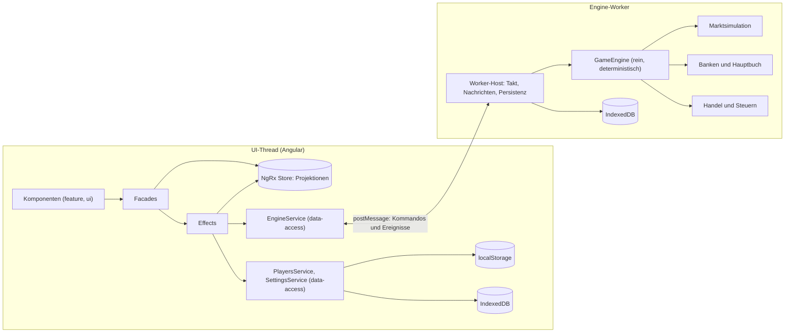
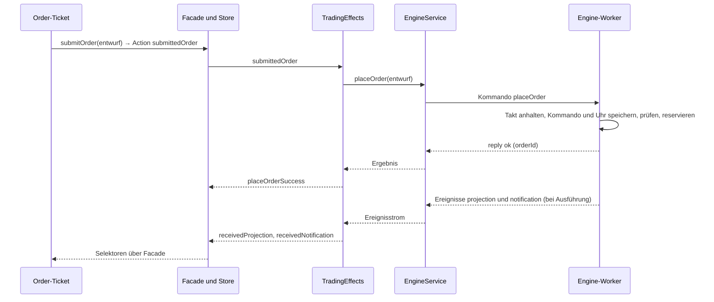
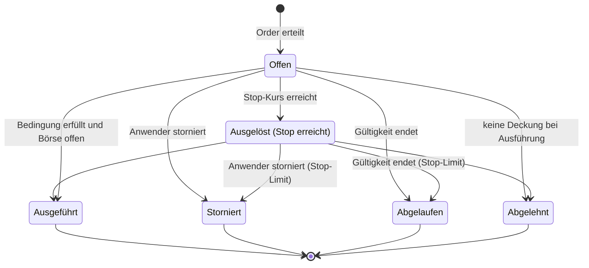

# PortfoliGo – Technische Spezifikation

> **Status:** Entwurf v0.2 · **Stand:** 13.11.2026
> **Siehe auch:** [Produktspezifikation](./produktspezifikation.md) · [Projektplan](../projektplan.md)

Dieses Dokument beschreibt, _wie_ PortfoliGo gebaut wird. Die allgemeinen Code-Konventionen stehen in [`CLAUDE.md`](../../CLAUDE.md) und gelten unverändert; hier stehen die projektspezifischen Entscheidungen. Wo dieses Dokument Ergänzungen oder Ausnahmen zu `CLAUDE.md` vorschlägt, sind sie in [§11.2](#112-ergänzungen-für-claudemd) gesammelt. Entscheidungen und ihr Status stehen in [§16](#16-entscheidungen), Risiken in [§17](#17-risiken).

## Inhalt

1. [Rahmen und Abhängigkeiten](#1-rahmen-und-abhängigkeiten)
2. [Architektur](#2-architektur)
3. [Zeitmodell](#3-zeitmodell)
4. [Determinismus und Zufall](#4-determinismus-und-zufall)
5. [Weltgenerierung](#5-weltgenerierung)
6. [Marktmodell](#6-marktmodell)
7. [Wirtschaftsmodell](#7-wirtschaftsmodell)
8. [Engine](#8-engine)
9. [Persistenz](#9-persistenz)
10. [Export und Import](#10-export-und-import)
11. [Frontend-Architektur](#11-frontend-architektur)
12. [Benachrichtigungen](#12-benachrichtigungen)
13. [Plattform: PWA und Capacitor](#13-plattform-pwa-und-capacitor)
14. [Qualitätssicherung](#14-qualitätssicherung)
15. [Versionierung und Kompatibilität](#15-versionierung-und-kompatibilität)
16. [Entscheidungen](#16-entscheidungen)
17. [Risiken](#17-risiken)

## 1. Rahmen und Abhängigkeiten

### 1.1 Ist-Stand (09.11.2026)

- Angular 22.0.1 (standalone, zoneless), NgRx 22 (Store, Effects, Entity, Router Store, Devtools), RxJS 7.8, `idb` 8, Vitest 4 über `ng test`, ESLint 9 mit angular-eslint, Prettier 3, TypeScript 6.
- Hash-Routing, `@angular/localize` mit Quellsprache `de`, Build nach `www/`, Deployment über GitHub Actions per SFTP.
- **Baseline:** `ng build` läuft, warnt aber, weil `.browserslistrc` Browser außerhalb der Angular-22-Unterstützung enthält. `ng lint` meldet einen Fehler: `src/environments/environment.model.ts` importiert Dateien des gelöschten Prototyps. `ng test` bricht ab, weil es noch keine Tests gibt.
- **Node:** Angular CLI 22 verlangt Node ≥ 22.22.3 (steht in `.nvmrc`). Die Standard-Shell nutzt derzeit 22.12.0, daher vor jeder Session `nvm use`.
- **Reste des Ionic-Prototyps:** `ionic.config.json`, `capacitor.config.ts`, Ionic-Schematics in `angular.json`, `--ion-*`-Variablen in `src/theme/variables.scss`, Ionic-Hinweise in `src/test-setup.ts` und `.vscode/settings.json`, Ionic CLI in der CI, `author`/`homepage` in `package.json`.
- **Seit AP 0.1 (10.11.2026):** Ionic-Reste und `uuid` entfernt, Browserslist nach §1.3 angehoben; `ng build` ohne Warnung, `ng lint` und `ng test` grün. Die Umgebung (`src/environments/`) enthält nur noch `production`, `storeDevtools` (`StoreDevtoolsOptions | null`) und `devPages` (Flag für Labor und Entwicklerseiten); die IndexedDB-Konfiguration kommt nicht mehr aus der Umgebung, sondern aus dem Schema in `persistence/data-access` (AP 0.3).
- **Seit AP 0.2 (10.11.2026):** Tailwind CSS v4 über `@tailwindcss/postcss` (`.postcssrc.json`), globaler Einstieg `src/styles.css` mit den Tokens `--pgo-*` (§11.5), Inter Variable selbst gehostet, `prettier-plugin-tailwindcss`. Das Theme folgt vorläufig `prefers-color-scheme` (`ColorSchemeService` in `shared/data-access`). Token-Übersicht mit Kontrastprüfung unter `#/lab/tokens`. Die Ergänzungen aus §11.2 stehen in `CLAUDE.md`.
- **Seit AP 0.3 (10.11.2026):** `app.config.ts` mit Router, Store, Effects, Router Store, Devtools (nur Entwicklung) und `LOCALE_ID` `de`; `@angular/cdk` und `fake-indexeddb` installiert. `persistence/data-access` enthält das framework-freie IndexedDB-Schema mit Migrationen (§9.1, §9.7), `IndexedDbService` und `LocalStorageService` (§9.3); `shared/domain` Geldtypen, Rundung und Preisraster (§6.7, §7.1); `shared/util` und `shared/ui` die Formatierungsfunktionen und Pipes (§11.9).
- **Seit AP 0.4 (10.11.2026):** Angular auf 22.2 angehoben (CLI und Build 22.2.6, Framework 22.2.5, CDK 22.2.6), `@angular/aria` 22.2.6 zugelassen (E-16), Browserslist entsprechend angehoben (§1.3). App-Shell unter `/game/:playerId` mit Kopfzeile, Seitennavigation (Desktop) und unterer Leiste (Smartphone); Routen-Gerüst nach §11.4 mit Platzhalterseiten in den Ziel-Domänen; Grundkomponenten in `shared/ui` (Übersicht unter `#/lab/components`).
- **Seit AP 0.5 (12.11.2026):** neues Testkonzept (§14.1, E-29): Logik-Tests unter Node, Kalibrierungs- und Perf-Suite, fast-check, Stryker, Playwright-Systemtests in Chromium, Firefox und WebKit; Golden-Master-Modul und Selbsttest im Labor (§4.6, §14.2).
- **Seit AP 1.1–1.8a (10.–11.11.2026):** Simulationskern (`simulation/util`, `clock/domain`, `world/domain`, `market/domain`), Statistikfunktionen (`analysis/domain`), Simulations-Labor mit Web Worker, Chart-Wrapper und Statistik. Den aktuellen Stand im Einzelnen führen die Rules unter `.claude/rules/` (je Bereich, Übersicht in `CLAUDE.md`, Abschnitt „Current state“); er wird hier nicht fortgeschrieben.

### 1.2 Abhängigkeiten

| Paket                                                                | Zweck                                         | Status                          |
| -------------------------------------------------------------------- | --------------------------------------------- | ------------------------------- |
| `@angular/*`                                                         | Framework                                     | vorhanden                       |
| `@angular/cdk`                                                       | Overlay, Dialog, A11y, Scrolling, Table u. a. | vorhanden (AP 0.3)              |
| `@angular/aria`                                                      | ARIA-Muster: Tabs, Menüs (E-16)               | vorhanden (AP 0.4)              |
| `@angular/service-worker`                                            | PWA                                           | neu (M6)                        |
| `@ngrx/store`, `effects`, `entity`, `router-store`, `store-devtools` | State Management                              | vorhanden                       |
| `@ngrx/operators`                                                    | `concatLatestFrom` in Effects                 | vorhanden (AP 1.7)              |
| `rxjs`                                                               | Streams                                       | vorhanden                       |
| `idb`                                                                | Promise-Wrapper für IndexedDB                 | vorhanden                       |
| `lightweight-charts`                                                 | interaktive Kurscharts (E-04)                 | vorhanden (AP 1.7, 5.3.0)       |
| `bootstrap-icons`                                                    | Icons                                         | vorhanden                       |
| `tailwindcss`, `@tailwindcss/postcss`, `postcss` (dev)               | Styling (E-06)                                | vorhanden (AP 0.2)              |
| `fake-indexeddb` (dev)                                               | IndexedDB in Unit-Tests                       | vorhanden (AP 0.3)              |
| `fast-check` (dev)                                                   | Property-based Tests (E-29)                   | vorhanden (AP 0.5)              |
| `@stryker-mutator/core`, `@stryker-mutator/vitest-runner` (dev)      | Mutationstests (E-29)                         | vorhanden (AP 0.5)              |
| `@playwright/test`, `@axe-core/playwright` (dev)                     | Systemtests, Barrierefreiheit (E-29)          | vorhanden (AP 0.5)              |
| `@types/node` (dev)                                                  | Typen für Testhelfer und Konfigurationen      | vorhanden (AP 0.5)              |
| `prettier-plugin-tailwindcss` (dev)                                  | Sortierung der Utility-Klassen                | vorhanden (AP 0.2)              |
| `@fontsource-variable/inter`                                         | Schrift Inter (SIL OFL), selbst gehostet      | vorhanden (AP 0.2)              |
| `uuid`                                                               | –                                             | entfernt, `crypto.randomUUID()` |

**Regel:** Außer dem Angular CDK kommen keine UI-Frameworks oder Komponentenbibliotheken hinzu. NgRx ist eine State-Bibliothek und durch `CLAUDE.md` gesetzt. Jede neue Laufzeitabhängigkeit braucht einen Eintrag in §16.

### 1.3 Browser, Plattform-APIs und HTTPS

`.browserslistrc` folgt den Mindestanforderungen von Angular und Tailwind CSS v4, damit der Build ohne Warnung läuft: Chrome und Edge ≥ 119, Firefox ≥ 128, Safari und iOS ≥ 17.0. Tailwind v4 allein bräuchte Chrome/Edge ≥ 111 und Safari/iOS ≥ 16.4; Angular 22.2 setzt die Grenze höher (Baseline „widely available“ zum 07.05.2026, angehoben in AP 0.4).

Genutzte Plattform-APIs: Web Worker (Modul-Worker), IndexedDB, Web Locks, Page Visibility, Web Crypto (`subtle.digest`, `randomUUID`), Storage Manager (`persist`), Notification API, Service Worker, Clipboard.

**HTTPS ist Pflicht.** Web Crypto (`subtle`, `randomUUID`), Web Locks, Service Worker, `storage.persist()` und Benachrichtigungen gibt es nur in einem sicheren Kontext (HTTPS oder `localhost`). Die Produktion läuft daher ausschließlich über HTTPS (`https://algoristic.de/portfoligo/`). Für Tests auf Mobilgeräten im lokalen Netz wird `ng serve --ssl` verwendet. Spielkritische Berechnungen wie der Seed-Schlüssel kommen ohne diese APIs aus (§4.1).

## 2. Architektur

### 2.1 Überblick



### 2.2 Grundsätze

1. **Die Engine ist autoritativ.** Alle Spielregeln laufen im Worker. Die UI sendet Kommandos und zeigt Projektionen; sie rechnet keine Spielregeln nach (Ausnahme: Vorschauen, die dieselben Domain-Funktionen nutzen).
2. **Die Engine ist rein.** `GameEngine` hat keine Abhängigkeit zu DOM, Angular, Uhr oder Speicher. Dadurch ist sie in den Logik-Tests unter Node ohne Angular testbar und vollständig reproduzierbar (§14.1). I/O findet nur im Worker-Host statt.
3. **Der Markt hängt nicht vom Spieler ab:** Markt = f(Seed, Simulationsversion, Spielzeit). Jeder Kurs ist eine reine Funktion der Spielzeit (`priceAt`, §6.1); vergangene Kurse werden bei Bedarf neu berechnet statt gespeichert. Auch Beobachten (Abfragen, Abos) und Handeln verändern den Marktzustand nicht (§6.6).
4. **Der Spielerzustand ist reproduzierbar:** Spielerzustand = f(Startbedingungen, Markt, Kommandos). Kommandos sind die einzige nicht-deterministische Eingabe; darauf beruht die Persistenz (§9).
5. **Market-Data-Feed-Prinzip:** Die UI abonniert Kurse nur für die Instrumente, die die aktuelle Ansicht braucht, und erhält Projektionen gedrosselt (§8.4) – wie ein Client einer echten Handelsplattform.

### 2.3 Datenfluss am Beispiel einer Kauforder



## 3. Zeitmodell

### 3.1 Spielzeit und Kalender

```ts
type Tick = number; // ganze Spielminuten seit der Epoche 01.01.2020, 00:00 Uhr Spielzeit
```

- **Epoche** 01.01.2020, 00:00 Uhr. **Spielstart (E-02):** Montag, 01.04.2030, 00:00 Uhr = Tick 5.389.920 (`GAME_START_TICK`).
- Der Start an einem Monatsersten sorgt für einen vollständigen ersten Monat: Der Bank-Lauf um 06:00 Uhr bucht die Lebenshaltung, das erste Gehalt folgt am Monatsende (Buchungstermine nach E-19).
- Die gut zehn Jahre vor dem Start sind Vorlauf. Er entsteht mit demselben Modell wie das Spiel und ist ebenso minutengenau abrufbar (§6.8).
- Der Kalender ist für alle Spieler gleich. Nur so ergibt derselbe Seed dieselbe Welt, und fiktive Zukunftsdaten werden nicht mit echten Kursverläufen verwechselt.
- Eine Spielzeitzone ohne Sommerzeit (angelehnt an MEZ). Umrechnungen nutzen ausschließlich UTC-Arithmetik (`Date.UTC`, `getUTC*`), nie die lokale Zeitzone.
- Reine Kalenderfunktionen in `clock/domain`: Tick ↔ Datum, Wochentag, Tagesindex, Monats- und Jahresgrenzen, Bankarbeitstage (Mo–Fr; Feiertage ab Stufe 2), erster und letzter Bankarbeitstag eines Monats. Sie rechnen ganzzahlig (Tage ↔ Datum nach Hinnant, proleptischer Gregorianischer Kalender) und ohne `Date`; nur `formatGameTime`/`formatGameDate` nutzen `Intl.DateTimeFormat` mit `timeZone: 'UTC'`.
- Die Tick-Länge steckt in Konstanten (`TICKS_PER_MINUTE`, `TICKS_PER_HOUR`, `TICKS_PER_DAY`, `TICKS_PER_WEEK`, `GAME_SECONDS_PER_TICK` in `clock/domain/models/time.model.ts`). Code außerhalb von `clock/domain` rechnet mit ihnen statt mit Literalen wie `60` oder `1440`, damit ein späterer Wechsel der Tick-Länge billig bleibt. Handelszeiten werden weiter in Minuten des Spieltags angegeben.

### 3.2 Tick: eine Spielminute (E-02)

Ein Tick ist die kleinste Zeiteinheit für Kurse, Orders und Buchungen. Kurse werden dabei nicht Minute für Minute fortgeschrieben, sondern mit dem **Brückenmodell** berechnet (E-20, §6.1): Ein Tagesschritt legt um 00:00 Uhr die Stützpunkte eines Handelstags fest, Minutenkurse entstehen bei Bedarf als Brownsche Brücke dazwischen. Der Aufwand hängt so an den Instrumenten, die minutengenau gebraucht werden, nicht an der Größe der Welt. Das ist ausschlaggebend, weil die Welt mit den Assetklassen späterer Stufen deutlich größer wird (PS §8).

**Messung** (Prototyp vom 09.11.2026, Node 22.22/V8, Entwicklungsrechner; Rohwerte ohne Orders, Persistenz und Ereignisse). Der Prototyp bildet das Modell aus §6 vereinfacht nach: vier Börsenregionen mit den Handelszeiten aus §3.3 und 10 Faktor-Stützpunkten je Tag; Aktien mit sechs Faktorladungen (Welt, Region, vier weitere), Volatilität 20–45 % p. a., Overnight-Anteil 25 %, vier Sprünge pro Jahr (Mittel −1 %, Streuung 9 %); `sfc32` je Faktor bzw. Instrument und Tag mit vereinfachtem Seeding; `Math.exp`/`Math.log` statt `detExp`/`detLog`.

| Vorgang                                                               | Standardwelt (200 Aktien, 48 Faktoren) | große Welt (10.000 Aktien, 120 Faktoren)                     |
| --------------------------------------------------------------------- | -------------------------------------- | ------------------------------------------------------------ |
| Tagesschritte aller Faktoren und Aktien je Spieljahr                  | 10 ms                                  | 295 ms                                                       |
| Minutenverläufe aller Faktoren je Spieljahr                           | 350 ms                                 | 763 ms                                                       |
| Minutenverlauf einer Aktie für einen Handelstag                       | 17 µs                                  | 17 µs                                                        |
| 1 Spieljahr live                                                      | 1,3 s (alle Aktien minutengenau)       | 1,3 s (50 Instrumente minutengenau, breite Indizes genähert) |
| Last bei 1 w/s                                                        | 2,4 % eines Kerns                      | 2,5 % eines Kerns                                            |
| 1 Spieljahr nachberechnen ohne offene Orders                          | 0,01 s                                 | 0,3 s                                                        |
| Minutenchart einer Aktie für einen beliebigen vergangenen Tag         | 0,2 ms                                 | 0,2 ms                                                       |
| Tageskerzen einer Aktie mit Hoch und Tief über 10 Jahre neu berechnen | 0,42 s                                 | 0,42 s                                                       |

Für `detExp`/`detLog` (§4.4) sowie Orders, Persistenz und Ereignisse wird ein Faktor 4 eingeplant; nachgemessen wird in AP 1.4 und AP 1.5. **Nachmessung AP 1.4** (Vitest, Entwicklungsrechner, mit `detExp`/`detLog` und Seeding nach §4.2): zehn Jahre Tagesschritte der Standardwelt (2.673 Handelstage, 49 Faktoren, 200 Aktien) in 0,40–0,48 s, also rund 45 ms je Spieljahr. Den größten Teil kostet das Erzeugen der rund 250 Ströme je Tag; `StreamFamily` (§4.2) hält das bei rund 0,34 µs je Strom. Nicht gemessen sind Smartphones, ein eigener Strom je Faktor-Intervall (spart bei Neuberechnungen geschätzt rund zwei Drittel der Faktorbrücken, weil nur die Intervalle der Handelszeit nötig sind) und zweistufige Brücken für breite Indizes (§6.6). **Nachmessung AP 1.5** (Vitest, isoliert, Standardwelt): ein Spieljahr mit Tagesschritten und allen Minutenverläufen (49 Faktoren rund um die Uhr, 200 Aktien) in 2,1–2,2 s (Budget ≤ 4 s), unter Last mit parallelen Test-Workern rund 6 s; Minutenchart einer Aktie für einen vergangenen Tag mit kalten Caches in 1,5–2,5 ms (Budget < 50 ms), weil höchstens ein Monat Tagesschritte ab dem letzten Monatsbeginn nachgerechnet wird (§6.8).

Folgerungen:

- 1 w/s belegt mit der Standardwelt nach der Nachmessung rund 6,5 % eines Kerns (§14.3; die Schätzung mit Faktor 4 lag bei rund 10 %). Eine Stufe 1 M/s ist möglich.
- Nachberechnung und Vorspulen rechnen Tagesschritte und nur die Minutenverläufe, die offene Orders brauchen (§3.7): ein Spieljahr ohne offene Orders in deutlich unter einer Sekunde, mit Orders auf ETFs (exakte Indizes, §6.6) in wenigen Sekunden.
- Bei 1 w/s vergehen rund 70 Spieljahre pro Stunde Echtzeit. Lange Spiele sind also der Normalfall; Speicher (§9.6) sowie Export und Import (§10) sind darauf ausgelegt.
- Eine größere Welt und weitere Assetklassen kosten live kaum zusätzliche Rechenzeit (§6.10).
- Bei Echtzeit (1 s/s) ändern sich Kurse einmal pro Minute. Für später vorgemerkt: Sekundenwerte zwischen zwei Minuten, ebenfalls per Brücke.

**Verworfen: Minutenmodell** – jede Aktie in jeder Handelsminute fortschreiben. Es ist einfacher, aber der Aufwand wächst mit der Größe der Welt (Messung wie oben, inklusive Kursberechnung und Kerzen-Aggregation je Minute):

| Aktien (Faktoren) | 1 Spieljahr rechnen (Rohwert) | Last bei 1 w/s (Rohwert) |
| ----------------- | ----------------------------- | ------------------------ |
| 200 (48)          | 2,4 s                         | 4,7 % eines Kerns        |
| 1.000 (60)        | 7,9 s                         | 15 %                     |
| 2.000 (80)        | 15 s                          | 29 %                     |
| 10.000 (120)      | 77 s                          | 149 %                    |

- Selbst mit großzügigen Budgets (1 w/s unter 25 % eines Kerns, ein Jahr Nachberechnung unter 10 s, jeweils mit Faktor 2 für Orders und Persistenz) wäre bei rund 600–800 Aktien Schluss.
- Bei 10.000 Aktien wäre 1 w/s nicht erreichbar – mit Orders und Persistenz bräuchte es rund drei Kerne –, und das Nachrechnen der Kurshistorie eines Spielers mit 70 Spieljahren dauerte beim Import rund 3 Stunden.
- Der Vorlauf bräuchte ein zweites Verfahren in Tagesschritten mit genäherten Hoch- und Tiefkursen, das zum Minutenmodell passend kalibriert werden müsste.
- Intraday-Kerzen müssten gespeichert werden: rund 30 MB je Spieler in der Standardwelt, rund 1,2 GB bei 10.000 Aktien.

Weitere verworfene Alternativen:

| Alternative        | Bewertung                                                                            |
| ------------------ | ------------------------------------------------------------------------------------ |
| 1 Tick = 1 Stunde  | Zu grob für Intraday-Handel und Echtzeit; Kurse stünden bei 1 s/s eine Stunde still. |
| 1 Tick = 1 Sekunde | 60-mal mehr Ticks für Uhr, Orders und Ereignisse ohne spielerischen Mehrwert.        |

### 3.3 Handelszeiten (E-18)

| Region          | Beispiele (Börsen fiktiv benannt)                | Handelszeit (Spielzeit)                         |
| --------------- | ------------------------------------------------ | ----------------------------------------------- |
| Asien-Pazifik   | Japan, Australien, Hongkong                      | 01:00–07:00                                     |
| Europa          | Deutschland, Frankreich, Großbritannien, Schweiz | 09:00–17:30                                     |
| Nordamerika     | USA, Kanada                                      | 15:30–22:00                                     |
| Schwellenländer | je Börse, z. B. Indien, Brasilien                | z. B. Indien 04:45–11:00, Brasilien 14:00–21:00 |

- Handelszeiten sind Teil der Börsenkonfiguration in der Welt. Am Wochenende ist geschlossen; Feiertage folgen in Stufe 2.
- **Börsenstatus in der Kopfzeile** (US-ZT-01, entschieden 12.11.2026): vier kompakte Anzeigen für Asien-Pazifik, Europa, Nordamerika und Schwellenländer. Die Schwellenländer gelten als offen, sobald eine ihrer Börsen offen ist. Ein Klick öffnet eine Liste aller Börsen mit Status und nächster Öffnung bzw. Schließung (`nextOpen`, `nextClose`).
- **Statusberechnung (AP 2.5):** `exchangeStatus(handelszeit, tick)` und `regionStatus(handelszeiten, tick)` in `clock/domain/exchange-status-logic.ts` liefern `{ open, changesAt }`: Eine Börse ist offen von der Eröffnungsminute bis vor die Schlussminute (`isTradingTime`), `changesAt` ist dann `nextClose`, sonst `nextOpen`. Eine Region ist offen, solange mindestens eine ihrer Börsen offen ist; überlappende Sitzungen verlängern einander, `changesAt` ist dann der erste Zeitpunkt, an dem keine mehr offen ist. Geschlossen öffnet sie mit der frühesten Eröffnung ihrer Börsen. Die Börsen mit Region und Handelszeit liefert die Abfrage `exchanges` der Engine nach dem Laden des Spielers; die Kopfzeile zeigt die Regionen in der Reihenfolge Asien-Pazifik, Europa, Nordamerika, Schwellenländer, offen mit gefülltem, geschlossen mit leerem Kreis (Form statt nur Farbe), den Status im Tooltip und für Screenreader („Europa: offen bis Mo., 17:30“, „Asien-Pazifik: öffnet Di., 01:00“). Die Börsenliste zeigt je Börse Name, Region, „offen“/„geschlossen“ und „schließt …“/„öffnet …“ (Wochentag und Uhrzeit). Beispiele (Indien 04:45–11:00, Brasilien 14:00–21:00):

  | jetzt                | Asien-Pazifik   | Europa          | Nordamerika     | Schwellenländer |
  | -------------------- | --------------- | --------------- | --------------- | --------------- |
  | Mo 01.04.2030, 00:00 | öffnet Mo 01:00 | öffnet Mo 09:00 | öffnet Mo 15:30 | öffnet Mo 04:45 |
  | Mo 09:00             | öffnet Di 01:00 | offen bis 17:30 | öffnet Mo 15:30 | offen bis 11:00 |
  | Mo 11:00             | öffnet Di 01:00 | offen bis 17:30 | öffnet Mo 15:30 | öffnet Mo 14:00 |
  | Mo 16:00             | öffnet Di 01:00 | offen bis 17:30 | offen bis 22:00 | offen bis 21:00 |
  | Fr 05.04.2030, 22:00 | öffnet Mo 01:00 | öffnet Mo 09:00 | öffnet Mo 15:30 | öffnet Mo 04:45 |
  | Sa 06.04.2030, 10:00 | öffnet Mo 01:00 | öffnet Mo 09:00 | öffnet Mo 15:30 | öffnet Mo 04:45 |

  Überlappung: Sitzungen 09:00–12:00 und 11:00–14:00 einer Region ergeben um 10:00 „offen bis 14:00“.

- Orders können jederzeit erteilt werden; ausgeführt werden sie während der Handelszeit (§7.5). So bleibt „jederzeit verkaufen" aus der Ideensammlung erhalten – unter realen Marktbedingungen.
- Banken buchen an Bankarbeitstagen in einem **Bank-Lauf um 06:00 Uhr** Spielzeit (E-19).

### 3.4 Geschwindigkeiten

| Stufe            | Spielzeit pro Sekunde | Ticks pro Sekunde |
| ---------------- | --------------------- | ----------------- |
| Pause            | –                     | 0                 |
| Echtzeit         | 1 s                   | 1/60              |
| 1 min/s          | 1 Minute              | 1                 |
| 10 min/s         | 10 Minuten            | 10                |
| 1 h/s            | 1 Stunde              | 60                |
| 2 h/s            | 2 Stunden             | 120               |
| 4 h/s            | 4 Stunden             | 240               |
| 1 d/s            | 1 Tag                 | 1.440             |
| 1 w/s            | 1 Woche               | 10.080            |
| (optional) 1 M/s | ca. 30 Tage           | ca. 43.200        |

Die Stufen sind die `as const`-Liste `SPEEDS` in `clock/domain` mit den IDs `realtime`, `1min`, `10min`, `1h`, `2h`, `4h`, `1d`, `1w` (so auch im Export, §10.1) und dem Feld `gameSecondsPerSecond`. Pause ist keine Stufe, sondern ein eigenes Flag. Die optionale Stufe 1 M/s ist noch nicht enthalten.

### 3.5 Taktung

```text
targetTick(now) = anchorTick + floor(max(0, now − anchorRealTime) × gameSecondsPerSecond / (1000 × GAME_SECONDS_PER_TICK))
```

- Die Formel rechnet ganzzahlig, damit Echtzeit (1/60 Tick pro Sekunde) exakt bleibt; sie ist exakt, solange das Produkt unter 2^53 liegt (bei 1 w/s rund 170 Tage Echtzeit seit dem Anker). Eine zurückgestellte Systemuhr ergibt keinen Fortschritt.
- Die Worker-Schleife läuft etwa alle 16 ms und verarbeitet Ticks bis `targetTick`, mit einem Zeitbudget von rund 8 ms pro Durchlauf. Der Rest folgt im nächsten Durchlauf.
- Der Anker (`anchorTick`, `anchorRealTime`) wird bei jedem Wechsel von Geschwindigkeit, Pause oder Sichtbarkeit und nach jedem Kommando neu gesetzt (§8.5).
- Wächst der Rückstand über zwei Sekunden Echtzeit, meldet die Engine „ausgelastet". Ticks werden nie übersprungen; die effektive Geschwindigkeit sinkt.
- Die Uhr in der UI zeigt die Spielzeit aus dem letzten `clock`-Ereignis und interpoliert bei Echtzeit die Sekunden rein optisch.
- Browser drosseln Timer in Hintergrund-Tabs. Weil sich `targetTick` aus der Wanduhr ergibt, holt die Engine Rückstände bei der nächsten Gelegenheit auf.
- **Umsetzung (AP 2.2):** `ClockPacer` (`engine/domain/clock-pacing-logic.ts`) hält Einstellungen und Anker; ein Durchlauf (`pass`) ruft `runUntil(max(targetTick, tick), shouldYield)` mit dem Zeitbudget des Hosts (`shouldYield` = Wanduhr seit Beginn des Durchlaufs ≥ 8 ms). Der neue Anker liegt immer beim Tick der Engine, nicht beim Ziel: Ein Rückstand zum Zeitpunkt eines Wechsels verfällt, statt mit der neuen Geschwindigkeit nachgeholt zu werden; Ticks werden dabei weder übersprungen noch wiederholt. Rückstand in Echtzeit = (Ziel − Tick) × 60 s ÷ Spielsekunden je Sekunde; „ausgelastet“ heißt Rückstand > 2.000 ms (genau 2.000 ms noch nicht). Beispiele: 1 w/s und 20.160 Ticks Rückstand → 2.000 ms, nicht ausgelastet; Echtzeit und 2 Ticks → 120.000 ms. Schleife, Budget und Drosselung sind Konfiguration des Hosts (`EngineHostConfig`: 16 ms, 8 ms, `clock` 10/s, `quotes` 4/s, Fortschritt 100 ms).

### 3.6 Hintergrund, Schließen und Pause

- Das Verhalten im Hintergrund ist eine **Spielereinstellung** `backgroundMode`. Sie wird per Kommando gesetzt, gehört zum Spielerzustand und wird mit exportiert:
  - `realtime` (Standard, E-02): Ist die App verborgen oder geschlossen, läuft die Zeit mit 1 s/s weiter; beim Öffnen wird nachberechnet (§3.7). Das entspricht der Ideensammlung.
  - `pause`: Verborgen oder geschlossen ruht die Zeit. Beim Zurückkehren läuft sie mit der gewählten Geschwindigkeit weiter, ohne Nachberechnung.
- `visibilitychange` → `hidden`: Die UI meldet dem Worker „verborgen", die Engine wechselt in den Hintergrundmodus. Bei `visible` gilt wieder die gewählte Geschwindigkeit.
- Bei `hidden` und `pagehide` wird der Uhrzustand gespeichert (§9.2) und ein Snapshot angestoßen.
- **Eine vom Anwender gesetzte Pause bleibt Pause** – auch über Schließen und erneutes Öffnen hinweg (E-02).
- **Wirksame Geschwindigkeit** (`effectiveSpeed`, AP 2.2) aus Pause des Anwenders, Sichtbarkeit und `backgroundMode`; die gewählte Geschwindigkeit bleibt dabei gewählt:

  | Pause des Anwenders | sichtbar | `backgroundMode` | Spiel läuft mit           |
  | ------------------- | -------- | ---------------- | ------------------------- |
  | nein                | ja       | beliebig         | gewählter Geschwindigkeit |
  | nein                | nein     | `realtime`       | Echtzeit (1 s/s)          |
  | nein                | nein     | `pause`          | – (ruht)                  |
  | ja                  | beliebig | beliebig         | – (Pause)                 |

  Die Sichtbarkeit merkt sich der Host auch ohne geladenen Spieler; ein danach geladener Spieler übernimmt sie.

- **Auto-Pause** (§12) greift nur bei sichtbarer App im Live-Betrieb und beim Vorspulen. Während der Nachberechnung und bei verborgener App greift sie nicht, sonst ginge die Echtzeit aus der Ideensammlung verloren; die Ereignisse erscheinen im Abwesenheitsbericht.
- **Umsetzung der Auto-Pause (AP 3.6):** Die Engine kennt weder Sichtbarkeit noch Betriebsart. Sie merkt sich die erste Benachrichtigung seit dem letzten Abholen, deren Code laut Spielerzustand pausiert (`GameEngine.autoPauseNotification`). Der Host prüft sie in `shouldYield` (Live-Durchlauf und Vorspulen), sodass `runUntil` direkt nach dem Tick der Benachrichtigung anhält, und beim Abholen der Ereignisse nach jedem Durchlauf und Kommando. Gilt die Pause (`autoPauseApplies`: bei sichtbarer App live oder beim Vorspulen; nie bei Nachberechnung, Replay und verborgener App), setzt er `paused`, beendet einen Sprung (`progress` `cancelled`, danach Snapshot wie bei `cancelJump`) und speichert die Uhr wie bei einer Pause des Anwenders; das `clock`-Ereignis wartet auf das Schreiben und trägt `autoPause` (`seq`, `code`) bis zum nächsten `resume`. Eine schon bestehende Pause bleibt, `autoPause` nennt dann nur den Grund des Abbruchs. Bei verborgener App läuft auch ein Sprung bis zum Ziel weiter; seine Benachrichtigungen erscheinen im Abwesenheitsbericht (US-ZT-06, Festlegung des Orchestrators). Pausiert eine Benachrichtigung, die ein Kommando auslöste (z. B. eine Überweisung über den Rahmen), gilt dieselbe Regel.

### 3.7 Nachberechnung und Vorspulen

- **Nachberechnung beim Laden:** Δ = jetzt − `lastSeenAt` (negative Werte werden zu 0, z. B. bei zurückgestellter Systemuhr). Ist das Spiel nicht pausiert und `backgroundMode` = `realtime`, wird bis `savedTick + Δ / 60 s` im Stapelbetrieb gerechnet. Der Fortschritt wird etwa alle 100 ms gemeldet. Kommandos sind währenddessen gesperrt. Ereignisse werden gespeichert, aber nicht als Toast gezeigt, sondern für den Abwesenheitsbericht zusammengefasst.
- **Vorspulen:** derselbe Stapelbetrieb bis zum Ziel; abbrechbar nach dem laufenden Tick; bricht ab, wenn ein Ereignis mit Auto-Pause eintritt.
- **Stapelbetrieb:** Tagesschritte für den ganzen Markt (§6.1); Minutenkurse nur dort, wo offene Orders sie brauchen – für Instrumente mit offenen Orders und für Indizes hinter ETFs mit offenen Orders. Sparpläne nutzen den Eröffnungskurs, Dividenden und Bank-Lauf sind Tagesgrößen. Hoch- und Tiefkurse der übersprungenen Tage ergänzt danach ein Hintergrundauftrag (§6.8).
- **Determinismus:** Stapelbetrieb und Live-Betrieb liefern identische Ergebnisse (Test, §4.6).
- **Ziele des Vorspulens** (AP 2.2, `jumpTargetTick` in `engine/domain/jump-target-logic.ts`; der Host rechnet sie aus dem Kommando `jumpTo`): `next-open` = erste Eröffnung irgendeiner Börse echt nach jetzt (Wochenenden geschlossen); `next-month` = 00:00 des nächsten Monatsersten; `date` = eine Minute echt nach jetzt und höchstens ein Kalenderjahr voraus (dieselbe Minute im Folgejahr, vom 29.02. aus der 28.02.; `maxJumpTick`). Beispiele mit Europa 09:00–17:30 und Asien-Pazifik 01:00–07:00:

  | jetzt                | `next-open`      | `next-month`     | spätestes `date`  |
  | -------------------- | ---------------- | ---------------- | ----------------- |
  | Mo 01.04.2030, 00:00 | Mo 01.04., 01:00 | 01.05.2030 00:00 | 01.04.2031, 00:00 |
  | Mo 01.04.2030, 01:00 | Mo 01.04., 09:00 | 01.05.2030 00:00 | 01.04.2031, 01:00 |
  | Fr 05.04.2030, 22:00 | Mo 08.04., 01:00 | 01.05.2030 00:00 | 05.04.2031, 22:00 |
  | Sa 06.04.2030, 10:00 | Mo 08.04., 01:00 | 01.05.2030 00:00 | 06.04.2031, 10:00 |
  | So 29.02.2032, 12:30 | Mo 01.03., 01:00 | 01.03.2032 00:00 | 28.02.2033, 12:30 |

- **Umsetzung des Vorspulens (AP 2.2):** Der Stapelbetrieb läuft in Durchläufen mit 0 ms Abstand und dem normalen Zeitbudget; `progress` (`kind: 'jump'`, erledigte und gesamte Ticks) kommt beim Start, höchstens alle 100 ms und am Ende (`done` oder `cancelled`). `cancelJump` endet nach dem laufenden Tick. Währenddessen antworten alle Kommandos außer `cancelJump`, `unloadPlayer`, `setVisibility`, `query`, `subscribe` und `unsubscribe` mit `busy`. Danach läuft die Uhr mit neuem Anker so weiter wie vorher; eine Pause bleibt Pause.
- **Vorspulen in der Oberfläche (AP 2.5):** „Vorspulen“ steht als Knopf in der Kopfzeile (ab `md`) und im Geschwindigkeitsmenü. Ein Effect öffnet den Dialog `clock/feature/dialog-jump` mit dem Tick des letzten `clock`-Ereignisses und den Handelszeiten aller Börsen; er zeigt die Ziele „Nächste Börsenöffnung“ und „Nächster Monatsanfang“ mit ihrem Zeitpunkt (`jumpTargetTick`) und „Datum“ mit Datum und Uhrzeit (leere Uhrzeit = 00:00). Ein Datum muss nach der Spielzeit beim Öffnen und höchstens bei `maxJumpTick` liegen; sonst steht der Fehler am Feld. Die Engine prüft das Ziel beim Kommando erneut (`invalid-jump-target` als Hinweis). Während des Sprungs ersetzt die Kopfzeile Pause, Geschwindigkeit und Vorspulen durch „Vorspulen bis …“, einen Fortschrittsbalken mit Prozent (`progress` `jump`) und „Abbrechen“ (`cancelJump`); Tastenkürzel greifen nicht. Danach steht die Uhr wieder wie vorher, eine Pause bleibt Pause. Weil die Uhr nur Minuten zeigt, interpoliert sie bei Echtzeit keine Sekunden (§3.5).
- **Umsetzung der Nachberechnung (AP 2.3):** `catchUpTarget` (`engine/domain/catch-up-logic.ts`) rechnet das Ziel aus dem gespeicherten Uhrzustand: pausiert oder `backgroundMode` = `pause` → kein Fortschritt, sonst `tick + ⌊max(0, jetzt − lastSeenAt) ÷ 60 s⌋` (dieselbe ganzzahlige Formel wie `targetTick` bei Echtzeit). Ausgangspunkt ist der Tick nach dem Replay (§9.2, Schritt 3), also das Maximum aus gespeicherter Uhr, letztem Kommando und Untergrenze der UI; weil die Uhr höchstens 5 s Echtzeit vor dem Schließen gespeichert wurde, schätzt das die Abwesenheit um höchstens 5 s zu hoch (weniger als ein Tick). Beispiele: eine Stunde Abwesenheit = 60 Ticks, 59 s = 0, 61 s = 1, anderthalb Tage = 2.160, Uhr einen Tag zurückgestellt = 0. Die Nachberechnung läuft wie das Vorspulen in Durchläufen mit 0 ms Abstand (`progress` mit `kind: 'catch-up'`), ist aber nicht abbrechbar; Kommandos außer den beim Vorspulen erlaubten antworten mit `busy`. Die Antwort auf `loadPlayer` kommt vor der Nachberechnung mit dem Tick nach dem Replay. Wird während der Nachberechnung gespeichert (verborgen, Entladen), speichert der Host als `lastSeenAt` den Zeitpunkt, zu dem das Spiel in Echtzeit am gespeicherten Tick gewesen wäre (`catchUpSeenAt`: jetzt − noch fehlende Ticks × 60 s); eine unterbrochene Nachberechnung geht so beim nächsten Laden ohne Verlust weiter. Danach schreibt der Host einen Snapshot und die Uhr läuft mit der gespeicherten Geschwindigkeit; eine Pause bleibt Pause. Gemessen (Standardwelt, Speicher im Arbeitsspeicher, ab `loadPlayer`): 30 Tage rund 65 ms, ein Spieljahr rund 0,56 s (§14.3).

### 3.8 Ablauf eines Ticks

1. **Terminplaner:** alle Termine mit Fälligkeit ≤ Tick, in fester Reihenfolge:
   - Tageswechsel: an Handelstagen zuerst der **Markt-Tagesschritt** (§6.1) – Marktphase, Trends, Volatilitäten und Stützpunkte der Faktoren, dann die Tagesstützpunkte aller Instrumente (Eröffnung mit Overnight-Effekt und Ex-Tag-Abschlag, Schluss, Sprünge, Dividendenankündigungen) und die Fortschreibung der ETF- und Indexzustände (§6.6). Der Tagesschritt legt dabei auch fest, wie sich `R` und der Ausschüttungstopf an den Eröffnungen des Tages ändern; sie hängen nur von Stützpunkten ab. Danach Zinsabgrenzung und Tageswerte.
   - Bank-Lauf: zuerst Gutschriften (Gehalt, Dividenden, Zinsen), dann Lastschriften (Lebenshaltung, Gebühren), zuletzt Daueraufträge (ab AP 5.6a, §7.4).
   - Handelsbeginn je Börse: Ereignisse der Ex-Tage von Aktien und ausschüttenden ETFs (die Wirkung auf `R` und den Ausschüttungstopf hat der Tagesschritt schon je Stützpunkt festgelegt; die Ausschüttung eines ETFs meldet `MarketDay.etfExCents`), Sparpläne zum Eröffnungskurs.
   - Handelsschluss je Börse: Tageskerzen der Instrumente und Indizes festschreiben, deren Handel endet (§6.8). Die Engine meldet dazu je Börse und Tag die Serien, deren Handelstag endet (Ereignis `session-closed`: Aktien und ETFs der Börse sowie die Kurs- und Performanceindizes, deren Sitzung zur selben Minute endet; ein Index gehört zur ersten Börse in Weltreihenfolge mit dieser Schlusszeit, sodass jede Serie je Handelstag genau einmal schließt). Die Kerzen berechnet und schreibt der Worker-Host über die `PriceSource` – live mit Hoch und Tief aus den Minutenverläufen, im Stapelbetrieb nur Eröffnung und Schluss.
   - Orderablauf, Monats- und Jahresabschluss.
2. **Handel:** für jede offene Order eines Instruments mit offener Börse den Kurs `priceAt` (§6.1) zum Tick bestimmen, prüfen und ggf. ausführen. Geld und Brief sind reine Funktionen des Kurses (§6.7). Faktoren und Instrumente werden pro Tick nicht fortgeschrieben.
3. **Konten:** Deckung prüfen, Ereignisse erzeugen, ggf. Auto-Pause auslösen.
4. **Tagesreihen** fortschreiben (Vermögen zum Tagesende).
5. **Ereignisse** puffern; der Worker-Host leitet sie gedrosselt an die UI weiter und berechnet dabei die Quotes der Abos per `priceAt` (§8.4).

Kommandos der UI werden zwischen zwei Ticks angewendet und mit dem Tick protokolliert, nach dem sie wirksam werden (§8.5).

**Umsetzung (AP 2.1, `engine/domain`):** Der Terminplaner ordnet nach Tick, dann nach der festen Rangfolge der Art (`TASK_ORDER`: Tageswechsel, Bank-Lauf, Handelsbeginn, Handelsschluss, Orderablauf, Monatsabschluss, Jahresabschluss), dann nach der Einfüge-Sequenz. Der Orderablauf hat seinen Rang schon, wird aber erst ab M5 eingeplant; den Bank-Lauf plant die Engine seit AP 3.2 ein. Der Tageswechsel um 00:00 rechnet an Handelstagen den Markt-Tagesschritt, meldet Dividendenankündigungen und plant Handelsbeginn und -schluss jeder Börse in Weltreihenfolge ein; der Handelsbeginn trägt die Ex-Tage seiner Börse (Aktien und ausschüttende ETFs mit Betrag und Zahltag) als Daten im Termin, damit sie einen Snapshot zwischen 00:00 und der Eröffnung überstehen. Monats- und Jahresabschluss liegen auf 00:00 des Folgemonats bzw. -jahres. Beispiele (Termine in Einfügereihenfolge → Ausführung):

| Fall                                    | Eingeplant                                                  | Ausgeführt                                          |
| --------------------------------------- | ----------------------------------------------------------- | --------------------------------------------------- |
| 01.01., 00:00                           | Jahresabschluss, Monatsabschluss, Tageswechsel (alle 00:00) | Tageswechsel, Monatsabschluss, Jahresabschluss      |
| Bank-Lauf und Eröffnung zur selben Zeit | Handelsbeginn 06:00, Bank-Lauf 06:00                        | Bank-Lauf, Handelsbeginn                            |
| Eröffnung und Schluss zur selben Zeit   | Handelsschluss A 17:30, Handelsbeginn B 17:30               | Handelsbeginn B, Handelsschluss A                   |
| Schluss und Orderablauf zur selben Zeit | Orderablauf 22:00, Handelsschluss 22:00                     | Handelsschluss, Orderablauf                         |
| gleiche Art, gleiche Zeit               | Handelsbeginn `exc-de`, `exc-fr`, `exc-gb` (09:00)          | in Einfügereihenfolge: `exc-de`, `exc-fr`, `exc-gb` |
| früherer Tick vor höherem Rang          | Tageswechsel 01:01, Jahresabschluss 01:00 (fiktiv)          | Jahresabschluss, Tageswechsel                       |

**Umsetzung (AP 3.2, Banking-System `engine/domain/banking-system.ts`, §7.4):** Der Tageswechsel um 00:00 des Tages D grenzt nach dem Markt-Tagesschritt die Zinsen des Vortags D−1 ab, auf dem Saldo zum Tagesende (Saldo um 00:00, vor allen Buchungen von D), an jedem Kalendertag und für jedes offene Konto. Der Bank-Lauf liegt um 06:00 auf dem nächsten Tag mit Schritten (`nextBankRunTick`); `GameEngine.start` plant den ersten (Mo 01.04.2030, 06:00), jeder Lauf den nächsten. Fallen Tageswechsel, Monats- und Jahresabschluss auf 00:00 des 1. Januar, grenzt der Tageswechsel zuerst den 31. Dezember ab; der Monatsabschluss ordnet ihn damit dem Dezember zu, danach schließt der Jahresabschluss das Steuerjahr. Der Bank-Lauf des ersten Bankarbeitstags folgt frühestens um 06:00 und findet Fenster, Monatswerte und Zinsperioden schon weitergeschoben.

Ein Handelstag der Standard-Taxonomie (§3.3) läuft damit so ab, z. B. Mittwoch, 01.05.2030: 00:00 Tageswechsel und Monatsabschluss April; 01:00 Handelsbeginn `exc-jp`, `exc-au`, `exc-hk`; 04:45 `exc-in`; 07:00 Schluss Asien-Pazifik; 09:00 Beginn der fünf europäischen Börsen; 11:00 Schluss `exc-in`; 14:00 Beginn `exc-br`; 15:30 Beginn `exc-us`, `exc-ca`; 17:30 Schluss Europa; 21:00 Schluss `exc-br`; 22:00 Schluss Nordamerika.

## 4. Determinismus und Zufall

### 4.1 Seed

- Der Seed ist frei wählbarer Text. Vorschläge sind gut teilbar, z. B. `kupfer-falke-731`: zwei deutsche Wörter aus festen Listen (je 100, nur `a–z`, ohne Umlaute) und eine Zahl von 100 bis 999 (`generateSeed` in `simulation/util`). Die Zufallsquelle für Vorschläge übergibt der Aufrufer (`crypto.getRandomValues`); sie gehört nicht zur Simulation.
- Normalisierung: Leerraum am Rand entfernen, Kleinschreibung, Unicode-Normalform NFC.
- Ableitung: MurmurHash3 x86_128 (Hash-Seed 0, in TypeScript implementiert) über die UTF-8-Bytes des normalisierten Seeds ergibt den **Seed-Schlüssel** `seedKey` (4 × uint32, h1–h4). Er braucht keine kryptografische Stärke, ist synchron berechenbar und funktioniert ohne sicheren Kontext.

### 4.2 Zufallsströme

```ts
const rng = createStream(seedKey, `market/instrument/${instrumentId}/${dayIndex}`);
```

- Der Startzustand jedes Stroms ist MurmurHash3 x86_128 über die 16 Bytes von `seedKey` (little-endian) gefolgt von den UTF-8-Bytes eines stabilen Schlüssels; h1–h4 werden zu a, b, c und Zähler von `sfc32` (schnell, gute statistische Qualität, 128-Bit-Zustand). Die ersten 12 Ausgaben werden verworfen. Mit 128 Bit sind Kollisionen zwischen Strömen praktisch ausgeschlossen – bei nur 32 Bit gäbe es schon in einem Spieljahrzehnt Dutzende identische Ströme.
- Beispiele für Schlüssel: `world/companies`, `world/indices`, `world/etfs`, `world/banks` (je ein Strom pro Stufe der Weltgenerierung, §5.1), `world/dividends` (Ex-Tag-Rhythmus aller Unternehmen und Beginn der Zahlungen der übrigen, E-33; nach den Banken gezogen, damit sich die übrigen Attribute nicht verschieben), `world/etf-terms` (Startkurs der ETFs und Ex-Tag-Rhythmus der ausschüttenden, danach gezogen), `market/regime/<tag>`, `market/factor/<id>/init` (Startzustand an der Epoche, §6.2), `market/factor/<id>/<tag>` (Tagesschritt), `market/factor/<id>/<tag>/bridge/<intervall>` (Minutenwerte), `market/instrument/<id>/<tag>` (Tagesschritt), `market/instrument/<id>/<tag>/bridge` (Minutenwerte), `market/etfs/<tag>` (Tracking-Rauschen aller ETFs, eine Zahl je ETF in ETF-Reihenfolge; ein Strom je ETF kostete rund 25 ms Vorlauf, neue ETFs werden angehängt und verschieben die übrigen nicht), `life/living-costs/<monat>`.
- `<tag>` ist der Tagesindex seit der Epoche (`dayIndex`), Faktor-IDs sind `world`, `region:<id>`, `sector:<id>`, `industry:<id>`, `style` und `size`. Für Schlüssel, die sich nur im angehängten Tagesindex unterscheiden, hasht `StreamFamily` (`simulation/util`) Seed-Schlüssel und Präfix nur einmal; das Ergebnis ist bitgleich zu `createStream` mit dem vollständigen Schlüssel. Ein optionaler Suffix nach dem Tagesindex (`create(tag, utf8Encode('/bridge'))`) deckt die Brückenströme ab.
- **Vorteile:** Ströme sind unabhängig (ein neues Instrument verschiebt keine anderen Kurse); jeder Tag eines Faktors oder Instruments lässt sich einzeln neu erzeugen – die Grundlage des Brückenmodells (§6.1); Spielerentscheidungen ziehen nie aus Marktströmen.

### 4.3 Verteilungen

Gleichverteilung (32 oder 53 Bit; ganzzahlig ohne Modulo-Verzerrung), Normalverteilung (Marsaglia-Polarmethode; der zweite Wert eines Paars wird im Strom gemerkt und beim nächsten Aufruf verwendet), Poisson (Inversion für 0 ≤ λ ≤ 30), Lognormal, gewichtete Auswahl, Mischen (Fisher-Yates). Alle als reine Funktionen über einem Strom (`simulation/util/distributions.ts`).

### 4.4 Deterministische Mathematik

`Math.exp`, `Math.log`, `Math.pow`, `Math.sin` usw. sind laut ECMAScript implementierungsabhängig; V8, SpiderMonkey und JavaScriptCore können im letzten Bit abweichen. Über viele Ticks und an Schwellen (Limit erreicht? Rundung auf Cent?) würde das browserübergreifend zu anderen Ergebnissen führen.

Deshalb nutzt Simulationscode nur IEEE-754-exakte Operationen (`+ − × ÷`, `Math.sqrt`, `Math.floor`, `Math.round`, `Math.abs`, `Math.min`, `Math.max`) und eigene Implementierungen `detExp` und `detLog` (Portierung von fdlibm 5.3 `e_exp.c` und `e_log.c`, Genauigkeit ≤ 1 ulp, bitidentisch auf allen Engines). Potenzen werden über `detExp(b × detLog(a))` oder Multiplikation gebildet, nicht mit `**`. Die UI darf `Math.*` frei verwenden. Eine ESLint-Regel für `simulation`, `world`, `market` und `clock` (`domain`, `util`) sowie `shared/domain` (Geld und Preisraster, die der Markt nutzt), jeweils ohne Specs, verbietet die nicht exakten `Math`-Funktionen, `**`, `Math.random`, `Date.now`, `new Date`, `performance.now` und `crypto`. Seit AP 2.1 gilt sie auch für `engine/domain`, seit AP 3.1 für die `domain`-Ordner von `banking`, `trading`, `portfolio` und `taxes` (die Regel greift für jeden dieser Ordner, sobald er entsteht): Auch der Spielerzustand muss überall gleich gerechnet werden, sonst weicht ein Replay vom Journal ab.

### 4.5 Regeln für Simulationscode

1. Kein `Math.random`, `Date.now`, `performance.now` oder `crypto.getRandomValues` – Zeit und Zufall kommen nur aus Tick und Strömen.
2. Keine Iteration über Objekte oder Maps mit unklarer Reihenfolge, wenn die Reihenfolge das Ergebnis beeinflusst; stattdessen Arrays oder sortierte Schlüssel.
3. Summen in fester Reihenfolge bilden.
4. Geldbeträge nur über die zentralen Rundungsfunktionen (§7.1).
5. Ergebnisse dürfen nicht davon abhängen, wie viele Ticks pro Durchlauf verarbeitet werden.
6. Abfragen, Abos, Caches und Orders verändern den Marktzustand nie (§6.6).
7. Abfragen und Ereignisse enthalten nie Kurse nach dem aktuellen Tick. Der Tagesschritt kennt die Schlusskurse des Tages schon um 00:00 Uhr; sie bleiben intern (§6.1, §8.2).
8. Der Endpunkt einer Brücke wird als Stützpunkt gesetzt, nie aus der Brücke errechnet (§6.1).

### 4.6 Determinismus-Vertrag

Der Vertrag besteht aus eingefrorenen Prüfsummen und aus Relationen, die für jeden Seed gelten. Wie er geprüft wird, steht in §14.1.

- **Golden Master:** `market/domain/golden-master.ts` hält für den Seed `golden-1` sechs Prüfsummen (`GOLDEN_CHECKSUMS`):
  - die Welt (`worldChecksum`);
  - Eröffnungen und Schlüsse aller Instrumente an jedem Markttag 2020;
  - die Minutenkurse einer festen Stichprobe von Instrument-Tagen (`GOLDEN_MINUTE_SAMPLE`);
  - die Tageseröffnungen und -schlüsse aller Kurs- und Performance-Indizes 2020;
  - die Tageseröffnungen und -schlüsse aller ETFs 2020;
  - den Marktzustand zum Spielstart nach dem ganzen Vorlauf.

  `computeGoldenChecksums(seed)` berechnet alle sechs in einem Lauf. Das Modul ist framework-frei und läuft deshalb auch im Worker (Selbsttest, §14.2). Prüfsumme: inkrementeller MurmurHash3 x86_128 über die Float64-Bytes (little-endian), als 32 Hex-Zeichen; `-0` und `0` unterscheiden sich, NaN wird kanonisch gehasht (`Checksum` in `simulation/util`). Ändert sich eine Prüfsumme, ändert sich die Welt für bestehende Seeds – dann ist `simVersion` zu erhöhen (§15).

- **Relationen** (für beliebige Seeds, Zeiträume und Aufteilungen):
  - **Granularität:** Beliebig viele Teilläufe ergeben denselben Zustand wie ein Lauf am Stück (§4.5 Regel 5).
  - **Snapshot:** Snapshot, Restore und Weiterlauf ergeben denselben Zustand wie ein ununterbrochener Lauf.
  - **Beobachtungsunabhängigkeit:** Abfragen, Abos, Caches und Orders ändern weder den Marktzustand noch die Ergebnisse späterer Abfragen (§4.5 Regel 6).
  - **Stromunabhängigkeit:** Ein zusätzliches Instrument ändert die Kurse der übrigen nicht.
  - **Bedarf gegen Vorabberechnung:** Minutenkurse, Kerzen und Indexstände sind bitgleich – live, bei Bedarf, nach dem Verwerfen aller Caches oder aus den Monatsbeginn-Zuständen nachgerechnet. Die neu berechnete Historie eines einzelnen Instruments entspricht der des Gesamtlaufs.
  - **Stützpunkte:** Brücken treffen Eröffnung und Schluss bitgenau (§4.5 Regel 8).
  - **Abfragegrenze:** Keine Abfrage und kein Ereignis enthält Werte nach dem aktuellen Tick; eine Abfrage nach `now` wirft einen Fehler (§4.5 Regel 7).
- **Statistische Gleichwertigkeit:** Minutenvolatilität, Korrelation der Minutenrenditen und Tagesspanne entsprechen innerhalb der Toleranzen aus §6.1 einer Referenz-Simulation Minute für Minute (`ReferenceSimulation` in `market/domain/reference-simulation.ts`; seit AP 1.8b Produktivcode, weil das Labor sie im Worker rechnet, ihre Ströme `lab/reference/…` wirken nie auf den Markt zurück). Sie schreibt Faktoren und unternehmensspezifischen Anteil mit denselben Parametern (Tagesvolatilitäten aus dem Tagesschritt) Minute für Minute fort; Sprünge treten je Handelsminute mit Wahrscheinlichkeit `λ / (261 · L)` auf, die Varianz des unternehmensspezifischen Anteils folgt dem Tagesprofil `intradayVolProfile`. Verglichen wird über mindestens 3.000 Handelstage ohne Sprünge, mit Tagesprofil über 1.500 Handelstage je Abschnitt der Handelszeit.
- **Browserübergreifend:** Die Logik-Tests laufen in Node und damit nur in V8. Der Selbsttest im Labor (§14.2) rechnet `computeGoldenChecksums` im echten Worker; die Systemtests vergleichen sein Ergebnis bei jedem Push in Chromium, Firefox und WebKit mit `GOLDEN_CHECKSUMS`. WebKit in Playwright ist nicht Safari unter iOS; vor Version 1.0 kommt deshalb die Prüfung auf einem iOS-Gerät hinzu (AP 6.6).

## 5. Weltgenerierung

### 5.1 Ablauf

Seed → Weltparameter → Regionen, Länder, Börsen → Sektoren, Branchen → Unternehmen → Indizes → ETF-Emittenten und ETFs → Banken → Tagesschritte von der Epoche bis zum Spielstart (§6.1) → Marktzustand zum Spielstart.

Die Welt ist deterministisch. Sie wird bei jedem Laden in unter einer Sekunde neu erzeugt und nicht gespeichert (§9). Die Marktzustände zu Monatsbeginn (§6.8) werden dagegen klein mitgespeichert (E-08). Den Marktzustand zum Spielstart berechnet die Engine beim Anlegen eines Spielers; der Vorlauf ist danach wie jeder Spieltag minutengenau abrufbar.

### 5.2 Umfang der Standardwelt (E-13)

| Element               | Anzahl     |
| --------------------- | ---------- |
| Regionen              | 4          |
| Länder bzw. Börsen    | 12         |
| Sektoren / Branchen   | 11 / 31    |
| Aktien                | ca. 200    |
| Indizes               | 22         |
| ETF-Emittenten / ETFs | 5 / ca. 30 |
| Banken                | 6–8        |

Alle Mengen und Verteilungen stehen zentral in einer Weltkonfiguration (`DEFAULT_WORLD_CONFIG` in `world/domain`), damit sie im Simulations-Labor (§14.2) kalibriert werden können. Die Aktien werden nach festen Gewichten auf Regionen und Länder verteilt (Nordamerika 40 %, Europa 30 %, Asien-Pazifik 18 %, Schwellenländer 12 %), die Branchen werden zufällig nach Gewicht gezogen. Länder, Börsen, Sektoren und Branchen sind fest vorgegeben und hängen nicht vom Seed ab. Die Größe der Welt beeinflusst die Rechenzeit im Spiel kaum (§3.2); Grenzen setzen eher Bedienung, Namensgenerator und die exakt berechneten Indizes (§6.6). Eine deutlich größere Welt ist als Meilenstein M11 geplant (§5.8).

### 5.3 Klassifikation und Modellwirkung

| Dimension              | Wirkung im Modell                                                                                                  |
| ---------------------- | ------------------------------------------------------------------------------------------------------------------ |
| Region                 | Regionsfaktor, Handelszeiten; ab Stufe 2 Währung                                                                   |
| Sektor, Branche        | Sektor- und Branchenfaktor mit mehrjährigen Trends                                                                 |
| Größe                  | Größenfaktor (Small-Cap-Risiko und kleine Prämie von 1,5 % p. a., AP 1.9c), Spread, idiosynkratische Vola, Sprünge |
| Stil                   | Value-/Growth-Faktor; ab Stufe 2 Zinsempfindlichkeit                                                               |
| Konjunkturabhängigkeit | Beta zum Weltfaktor (defensiv < 1 < zyklisch)                                                                      |
| Dividendenprofil       | Ausschüttungen und Ex-Tag-Abschläge                                                                                |
| Risiko                 | Risikoklasse aus der vollen modellierten Volatilität (Faktoren, idiosynkratischer Anteil, Sprünge; §5.4)           |

### 5.4 Unternehmen

- **Stammdaten:** stabile `id` (z. B. `stk-0042`), Name, Ticker (2–5 Zeichen, eindeutig), fiktive Kennung im ISIN-Format mit Prüfziffer und dem Präfix `QP` aus dem benutzerdefinierten ISO-3166-Bereich QM–QZ, das kein echtes Wertpapier trägt, Land, Börse, Sektor, Branche, Gründungsjahr, Mitarbeiterzahl.
- **Kurzprofil:** Die Engine erzeugt keinen Fließtext, sondern einen Vorlagen-Code mit Parametern (Vorlage `market-leader`, `challenger`, `specialist` oder `family-owned`, Schwerpunkt-Code der Branche; Branche, Land und Gründungsjahr stehen in den Stammdaten). Der Text entsteht in der UI per `$localize` (§8.6).
- **Größe:** Marktkapitalisierung aus einer schiefen Verteilung (lognormal oder Pareto: wenige sehr große, viele kleine Unternehmen); daraus Aktienanzahl und Startkurs zur Epoche (lognormal, 5–500 €) sowie Streubesitz (50–100 %). Größenklassen: Large Cap ab 10 Mrd. €, Mid Cap ab 2 Mrd. €.
- **Modellparameter:** Stil, Konjunkturabhängigkeit, Faktorladungen, idiosynkratische Volatilität, Dividendenrendite und -frequenz entstehen aus den Neigungen der Branche plus Zufall. Sprunghäufigkeit und Sprungstreuung hängen von der Größenklasse ab (kalibriert in AP 1.9c: Large Cap 0,5–1 je Jahr und 3–5,5 %, Mid Cap 2–4 und 6–10 %, Small Cap 3–6 und 8–14 %); Small Caps springen öfter und stärker. Die **Risikoklasse** 1–5 folgt aus der vollen modellierten Volatilität `√(Σ_k (β_ik · s_k)² + σ_i² + λ_i · (μ_J² + σ_J²))` mit den Grenzen 29 / 34 / 39 / 46 %: Das sind die Quintile der vollen Volatilität über 20 Welten (`idio-1` bis `idio-20`), auf ganze Prozent gerundet, sodass jede Klasse rund ein Fünftel der Aktien hält (AP 1.9c; gemessen 21 / 19 / 22 / 18 / 20 %, Test über 20 andere Welten). `s_k` sind die Volatilitäten je Faktorklasse aus der Weltkonfiguration (`riskClassFactorVols`: Welt 9,3 %, Region 9 %, Sektor 10 %, Branche 6 %, Stil und Größe je 4 %); die Welt hängt nicht vom Marktmodell ab, deshalb spiegeln sie die Volaziele der Marktkonfiguration in der Referenzphase (Test `default-market-config.spec.ts`). Gemessen mit den kalibrierten Werten (20 Welten): Large Caps im Median 26 % (5–95 %: 21–30 %), Mid Caps 36 % (28–44 %), Small Caps 51 % (40–66 %); Large Caps liegen damit überwiegend in Klasse 1 und 2, Small Caps in 4 und 5. Die realisierte Volatilität liegt höher (§6.9), weil Phasen und stochastische Volatilität die Faktoren über ihre Volaziele heben. Die Werte stehen in der Weltkonfiguration (kalibriert in AP 1.9c, §6.9): idiosynkratische Volatilität Large Cap 14,5–19 %, Alpha N(0; 1,4 %), Streuung der Marktkapitalisierung σ = 1,0, höchste Dividendenrendite 6,5 %.
- **Dividendentermin und -beginn (E-33):** Jedes Unternehmen hat die Frequenz seiner Region und einen festen Jahresrhythmus (`dividend.schedule`): Monat des ersten Ex-Tags im Jahr (`1 … 12 / Zahlungen pro Jahr`) und Tag 1–28; der Termin wiederholt sich alle `12 / Zahlungen pro Jahr` Monate (§6.5). `dividend.yield` ist die Zielrendite zur Epoche, der Markt führt sie über den Lebenszyklus fort (§6.5). Unternehmen ohne Dividende zur Epoche beginnen am Ersten eines späteren Monats zu zahlen (`dividend.startDay`, Zahler haben 0): Die Zeit bis dahin ist exponentialverteilt mit dem Mittel `dividendInitiationYears` (25 Jahre, also rund 4 % der Nichtzahler je Jahr, real 2–5 %; AP 1.9c) und auf ganze Monate abgerundet. Strom `world/dividends`, je Unternehmen erst der Rhythmus, dann bei Nichtzahlern der Beginn.
- **Sparplanfähigkeit:** Attribut `savingsPlanEligible`; bei Aktien für Large Caps gesetzt.
- **Namen:** Wortbausteine je Branche und Rechtsform je Land (AG, SE, Inc., Corp., plc, S.A., N.V., K.K. …). Eine Blockliste verhindert reale Marken und Unternehmensnamen (kurze Einträge treffen ganze Wörter, längere auch Wortanfänge und zusammengeschriebene Wörter); Dubletten sind ausgeschlossen, weil jeder fiktive Namenskern (z. B. `Velora`) je Welt nur einmal vorkommt – auch über Banken, Emittenten und Indizes hinweg. Die Bausteine ergeben rund 840 Kerne; das reicht für die Standardwelt, aber nicht für die große Welt aus M11 – dort muss der Namensgenerator erweitert werden (§5.8).

### 5.5 Indizes

- Weltindex (alle Aktien), je Region ein breiter Index und ein Leitindex, je Sektor ein weltweiter Index, ein Small-Cap-Index (alle Small Caps) und ein Dividendenindex (die 30 Werte mit der höchsten Dividendenrendite), zusammen 22 Indizes.
- Leitindizes enthalten die größten Werte der Region nach Streubesitz-Marktkapitalisierung; ihre Größe steht je Region in der Weltkonfiguration (Nordamerika 40, Europa 30, Asien-Pazifik 20, Schwellenländer 12), weil die kleineren Regionen für Top 30–50 zu wenige Aktien haben.
- Je Index ein Kurs- und ein Performanceindex (§6.6), gewichtet nach Streubesitz-Marktkapitalisierung; optional mit Kappung je Wert (Standard: Leitindizes 15 %, Sektorindizes 25 %, Dividendenindex 10 %).
- In Stufe 1 ist die Zusammensetzung fest; Anpassungen folgen in Stufe 2.
- Indexnamen sind fiktiv (Wortbausteine und Anzahl der Werte).

### 5.6 ETFs

Emittent, abgebildeter Index, Ertragsverwendung (ausschüttend: quartalsweise oder jährlich; thesaurierend), TER (0,05–0,65 %), Replikation (bestimmt den Tracking-Fehler, §6.6), Fondsvolumen, Startkurs zur Epoche (15–150 €, lognormal) und bei ausschüttenden ETFs ein fester Ex-Tag-Rhythmus wie bei Aktien (§5.4); Startkurs und Rhythmus kommen aus dem eigenen Strom `world/etf-terms`. Alle ETFs sind sparplanfähig (`savingsPlanEligible`). Auf die meisten Indizes gibt es mehrere ETFs, damit sich der Kostenvergleich lohnt; ETFs auf denselben Index stammen von verschiedenen Emittenten. Die TER wird je ETF unabhängig aus der Spanne seines Produkts gezogen und kann deshalb übereinstimmen. Nur einen ETF haben in der Standardwelt die Leitindizes Asien-Pazifik und Schwellenländer sowie die Sektorindizes Gesundheit, Energie und Finanzen. Die Standardwelt hat 30 ETFs auf Welt-, Regions-, Leit-, vier Sektor-, Small-Cap- und Dividendenindizes (Dividenden-ETFs schütten immer aus). Alle ETFs werden an der deutschen Börse gehandelt.

### 5.7 Banken

Die Konditionen werden innerhalb typischer Spannen gezogen (E-17):

| Typ                   | Girokonto                                   | Dispo   | Zinsen                    | Depot                            | Order                                         | Sparplan  | Handelsplatz                                 |
| --------------------- | ------------------------------------------- | ------- | ------------------------- | -------------------------------- | --------------------------------------------- | --------- | -------------------------------------------- |
| Filialbank (Hausbank) | 6–12 €/Monat                                | 10–14 % | Tagesgeld 0–0,5 %         | 0,10–0,25 % p. a., mind. 25–45 € | 0,25 %, mind. 10 €, max. 60 € + Börsenentgelt | 1,5–2,5 % | Börse                                        |
| Direktbank            | 0 € ab 700 € Geldeingang, sonst 4–6 €/Monat | 7–10 %  | Tagesgeld 1,5–3 %         | kostenlos                        | 4–6 € + 0,25 %, max. 60–70 €                  | 1–1,5 %   | Börse                                        |
| Onlinebroker          | –                                           | –       | –                         | kostenlos                        | 4–6 € pauschal + Börsenentgelt                | 0–1,50 €  | Börse                                        |
| Neobroker             | –                                           | –       | Verrechnungskonto 1–2,5 % | kostenlos                        | 0–1 €                                         | kostenlos | Market Maker (Spread-Aufschlag), Bruchstücke |

Die Standardwelt hat je zwei Filial- und Direktbanken sowie je ein bis zwei Online- und Neobroker. Beträge werden auf 10 Cent, Sätze auf 0,05 Prozentpunkte gerundet (Depotgebühr und Spread-Aufschlag auf 0,01, Überziehungsaufschlag auf 0,5 Prozentpunkte). Die Hausbank ist immer eine Filialbank (E-14); die Welt kennzeichnet sie nicht. Beim Anlegen des Spielers wird die erste Bank vom Typ `branch` in Weltreihenfolge Hausbank (entschieden 12.11.2026). Brokertypen führen nur Depots mit Verrechnungskonto. Börsenentgelt je Order: Filialbank 1,50–3 €, Onlinebroker 1,50–2,50 €. Jede Bank hat zusätzlich einen Sollzins für negative Verrechnungskonten (§7.4): Filialbank 9–13 %, Direktbank 7–10 %, Onlinebroker 8–11 %, Neobroker 7–10 %.

### 5.8 Große Welt (M11)

Meilenstein M11 vergrößert die Welt deutlich: mehr Länder, Börsen und Branchen, einige Tausend bis 10.000 Aktien, entsprechend mehr Indizes und ETFs sowie die Assetklassen aus M7 und M8. Die Zielgröße wird vor dem Start festgelegt. Das Brückenmodell ist dafür ausgelegt (§3.2: 10.000 Aktien und 120 Faktoren gemessen), einige Bausteine der Standardwelt aber nicht. Checkliste:

| Bereich                   | Stand in der Standardwelt                                                                                       | Nötig für die große Welt                                                                                                                                                                                                               |
| ------------------------- | --------------------------------------------------------------------------------------------------------------- | -------------------------------------------------------------------------------------------------------------------------------------------------------------------------------------------------------------------------------------- |
| Namensgenerator (§5.4)    | 42 Anfangs- × 20 Endsilben ≈ 840 Namenskerne je Welt, gemeinsam für Unternehmen, Banken, Emittenten und Indizes | deutlich mehr Kerne (mehr und dreisilbige Bausteine, Namensstile je Region), weil jeder Kern nur einmal vorkommt; Blockliste erweitern; Laufzeit der Prüfung messen                                                                    |
| Ticker und Kennungen      | Ticker aus dem Namen (2–5 Buchstaben) mit Zufallsersatz; ISIN-Format mit Präfix `QP` (36⁹ Kombinationen)        | Ticker ggf. mit Börsenkürzel, damit sie lesbar bleiben; Kennungen reichen                                                                                                                                                              |
| Taxonomie (§5.2, §5.3)    | 12 Länder und Börsen, 31 Branchen, fest im Code                                                                 | mehr Länder und Börsen (mit Feiertagen und Fremdwährungen aus M9), Unterbranchen; mehr Faktor-Stützpunkte je Tag (§6.2) durch zusätzliche Handelszeiten                                                                                |
| Indizes (§5.5, §6.6)      | alle exakt aus den Minutenkursen, deshalb live praktisch alle Tagesverläufe nötig                               | Näherung für breite Indizes (aggregierte Faktorladungen, Sprünge zu ihrer Minute, ggf. zweistufige Brücke) – vorher messen; Leit- und Sektorindizes bleiben exakt; Indexanpassungen mit Divisor (Stufe 2)                              |
| Live-Betrieb (§3.2, §6.1) | Minutenverläufe aller Instrumente                                                                               | Minutenverläufe nur für beobachtete, gehaltene und per Order betroffene Instrumente sowie exakte Indizes; Last bei 1 w/s neu messen (Budget §14.3)                                                                                     |
| Tageskerzen (§6.8)        | Hoch und Tief für alle Instrumente im Hintergrund (gemessen rund 13 ms je Handelstag, Vorlauf rund 35 s; §14.3) | linear hochgerechnet bei 10.000 Aktien rund 0,65 s je Handelstag und rund eine halbe Stunde für den Vorlauf: Hoch und Tief nur bei Bedarf und für beobachtete Instrumente, Rest erst beim Abruf                                        |
| Speicher (§9.6)           | rund 1 MB Tageskerzen je Spieljahr                                                                              | bei 10.000 Aktien rund 40 MB je Spieljahr: Kerzen nur für gehaltene und beobachtete Instrumente speichern, andere bei Abruf neu berechnen (sie sind reproduzierbar, E-08); NF-07 und §14.3 anpassen                                    |
| Spielstart und Vorlauf    | Weltgenerierung rund 10 ms, Vorlauf von zehn Jahren ≤ 0,5 s (Budget AP 1.4)                                     | Generierung rund 0,5 s, Vorlauf ein Mehrfaches: Faktorhistorie vorziehen und Instrumente spätestens bei Bedarf rechnen, ggf. Marktzustand je Seed zwischenspeichern; Budget „Spielstart < 2 s“ (NF-02) neu festlegen                   |
| Export und Import (§10)   | Marktzustand vom Tagesbeginn für rund 250 Instrumente                                                           | Größe des Marktzustands messen, ggf. komprimieren; Import-Budget (NF-02) prüfen                                                                                                                                                        |
| Worker und Snapshots      | Marktzustand in Typed Arrays                                                                                    | Speicherbedarf des Workers und der Snapshots messen; die Welt selbst wird weiterhin nicht gespeichert                                                                                                                                  |
| UI (§11.3, §11.10)        | Listen mit rund 250 Instrumenten; Quotes nur für sichtbare Zeilen                                               | virtuelles Scrollen in Screener und Marktübersicht, Suchindex im Worker, Filtern, Sortieren und Blättern in der Engine statt kompletter Listen im Store                                                                                |
| Kalibrierung (§6.9)       | Ziele für 200 Aktien und 49 Faktoren                                                                            | mit der großen Welt neu prüfen (Korrelationen, Indexvolatilität, Rechenzeit der statistischen Tests)                                                                                                                                   |
| Versionen (§15)           | `simVersion` 1                                                                                                  | Die große Welt ändert die Welt jedes Seeds: neue `simVersion`; bestehende Spieler laufen mit der alten Version weiter, die Generatoren bleiben versioniert. Offen: Weltgröße als Wahl beim Anlegen eines Spielers (Standard oder groß) |

## 6. Marktmodell

### 6.1 Struktur und Berechnung (E-20)

Der Markt ist ein Mehrfaktormodell auf Log-Kursen:

```text
ln P_i(t) = c_i + Σ_k β_ik · F_k(t) + U_i(t)
```

- `F_k(t)` ist der kumulierte Log-Stand von Faktor k. Faktoren bewegen sich **wochentags rund um die Uhr**.
- `U_i(t)` ist der unternehmensspezifische (idiosynkratische) Anteil. Er bewegt sich nur während der Handelszeit der Börse von Instrument i, plus Sondereffekte bei Handelsbeginn.
- `c_i` ist eine Konstante aus dem Startkurs.
- Ist die Börse geschlossen, bleibt der offizielle Kurs stehen. Bei Handelsbeginn springt er auf den Modellwert. So entsteht die Overnight-Lücke automatisch aus allem, was die Faktoren während der Schließzeit bewegt hat – „Asien schließt schwach, Europa eröffnet schwächer".

**Berechnung: Brückenmodell.** Kurse werden nicht Minute für Minute fortgeschrieben (Begründung und Messungen: §3.2):

1. **Tagesschritt:** An jedem Handelstag um 00:00 Uhr berechnet die Engine für alle Faktoren und Instrumente die Stützpunkte des Tages – die Faktorstände an den Grenzen der Handelszeiten (§6.2) sowie Eröffnung, Schluss und Sprünge jedes Instruments (§6.4).
2. **Brücke:** Minutenwerte zwischen zwei Stützpunkten entstehen als Brownsche Brücke – ein Zufallspfad, der beide Stützpunkte exakt trifft – aus einem eigenen Strom je Faktor bzw. Instrument und Tag (§4.2).
3. **Bedarf:** Minutenwerte werden nur berechnet, wenn sie gebraucht werden (offene Orders, Abos, Indizes, Charts), und je Faktor bzw. Instrument und Tag zwischengespeichert. In der Standardwelt braucht der Live-Betrieb wegen der exakten Indizes (§6.6) praktisch alle Tagesverläufe.

```text
Brownsche Brücke von X_a (Minute a) nach X_b (Minute b) mit Varianz v_m je Minute
und Restvarianz R_j = v_j + v_(j+1) + … + v_(b−1):

X_(j+1) = X_j + (v_j / R_j) · (X_b − X_j) + √(v_j · (R_j − v_j) / R_j) · z_j      für j = a … b − 2
X_b wird als Stützpunkt gesetzt, nicht aus der Brücke errechnet.
```

- **Reine Funktion:** Jeder Kurs ist eine Funktion von Welt, Stützpunkten und Strömen (`PriceSource.priceAt(serie, tick, now)`, siehe unten). Ob und wann sie aufgerufen wird, ändert kein Ergebnis; die Beobachtungsunabhängigkeit (§4.6) folgt aus der Konstruktion. Der Cache der Tagesverläufe ist reine Optimierung und gehört weder in den Snapshot noch in die Prüfsumme.
- **Gleichwertigkeit:** Bei gleicher Varianz je Minute hat die Brücke exakt dieselbe gemeinsame Verteilung wie eine Simulation Minute für Minute (Messung unten).
- **Stützpunkte setzen:** In Gleitkomma gilt `a + (b − a) = b` nicht immer. Ein um ein ulp abweichender Schlusskurs könnte am Preisraster (§6.7) anders gerundet werden; deshalb Regel 8 in §4.5.
- **Keine Vorschau:** Der Tagesschritt kennt um 00:00 Uhr bereits die Schlusskurse des Tages. Sie bleiben intern: Abfragen und Ereignisse enthalten nie Werte nach dem aktuellen Tick (§4.5, §8.2).
- **Tagesprofil der Volatilität:** Die Varianzen `v_m` des unternehmensspezifischen Anteils dürfen über den Handelstag variieren (höher zur Eröffnung und zum Schluss), ohne die Stützpunkte zu ändern. Parameter `intradayVolProfile` in `MarketConfig`: relative Gewichte über gleich lange Abschnitte der Handelszeit (Minute j fällt in Abschnitt `⌊j · Abschnitte / L⌋`), `[1]` ist gleichmäßig. Kalibriert (AP 1.9c) auf 13 Abschnitte `[4, 2, 1,4, 1,1, 1, 1, 1, 1, 1, 1,1, 1,3, 1,6, 2,5]`: im ersten Dreizehntel die vierfache, im letzten die 2,5-fache Varianz der Mittagszeit, wie das U-Profil realer Aktien (erste halbe Stunde etwa doppelte, letzte etwa 1,5-fache Volatilität). Weil die Faktoren das Profil nicht tragen, misst das Labor im Median der Aktien 1,59 (Ziel 1,3–2,0, §6.9). Ohne Profil ist die Volatilität innerhalb eines Tages konstant; Volatilitäts-Cluster und Leverage-Effekt wirken von Tag zu Tag (§6.2).

- **Minutenverlauf eines Instruments** (`DayCurves`, `market/domain`): Werte zu den Minuten `o … c`. `P(o)` und `P(c)` sind Eröffnung und Schluss und werden direkt aus den Stützpunkten gesetzt; die inneren Werte sind `c_i + Σ_k β_ik · F_k(m) + U(m)` über `priceFromLog`. Die Faktorbrücken werden je Intervall nur bei Bedarf berechnet, Brückenkoeffizienten je Intervall- bzw. Handelszeitlänge einmal vorab.
- **`priceAt` und Abfragegrenze** (`PriceSource`, `market/domain`): Während der Handelszeit (`o ≤ m < c`) gilt der Minutenwert, ab `c` der Schluss, vor der Eröffnung und am Wochenende der Schluss des letzten Handelstags, vor dem ersten Handelstag der Startkurs. Jede Abfrage erhält den aktuellen Tick `now`: Ticks nach `now` und noch nicht gerechnete Tage werfen einen Fehler, Verläufe und Kerzen enden bei `now`. Die Engine übergibt jeden frisch gerechneten Tag (`rememberDay`); vergangene Tage werden aus der Historie nachgerechnet (§6.8). Caches halten eine feste Zahl von Tagen (Standard 8, zuletzt genutzte bleiben).

**Messung AP 1.5** (Vitest, Seed `bridge-equivalence-1`, 3.000 Handelstage, zwei Aktien derselben Börse, ohne Sprünge; Brücke / Referenz-Simulation Minute für Minute): Volatilität der Minutenrenditen 23,53 % / 23,53 % und 27,53 % / 27,54 %, Korrelation 0,097 / 0,098, mittlere Tagesspanne 2,24 % / 2,26 % und 2,60 % / 2,61 %, Volatilität Eröffnung → Schluss 22,96 % / 23,81 % und 27,09 % / 27,44 %. Der Test prüft feste Toleranzen (Volatilitäten ±3 %, Spanne ±4 %, Eröffnung → Schluss ±6 % relativ, Korrelation ±0,03).

**Messung AP 1.8b:** Mit einem Tagesprofil (13 Abschnitte, Eröffnung 3-fach, Schluss 2,5-fach gewichtet; 1.500 Handelstage, ohne Sprünge) weicht die Volatilität je Abschnitt zwischen Brücke und Referenz um höchstens 5 % ab (Test). Im Labor (Seed `demo-seed`, Aktien der Börse `exc-us`, 68 Werte) schwanken die Medianwerte über 63 Markttage mit Sprüngen um bis zu ±12 % gegeneinander (acht Quartale: Minutenvolatilität Brücke 27,3–30,8 %, Referenz 27,0–30,3 %); über 1.000 Handelstage stimmt die mittlere Varianz der Minutenrenditen auf 0,3 % überein (33,5 % / 33,6 %). Die Abweichung im Labor ist also Stichprobenrauschen der Sprünge, kein Unterschied der Modelle.

**Gleichwertigkeit im Prototyp** (§3.2): 3.000 Handelstage, zwei Aktien derselben Region mit gemeinsamen Faktoren, verglichen mit einer Simulation Minute für Minute mit identischen Parametern (Tagesvolatilitäten der Faktoren aus demselben Lauf).

| Kennzahl                                | ohne Sprünge: Brücke / Minute | mit Sprüngen: Brücke / Minute |
| --------------------------------------- | ----------------------------- | ----------------------------- |
| Volatilität der Minutenrenditen (p. a.) | 29,39 % / 29,36 %             | 34,40 % / 34,14 %             |
| Korrelation der Minutenrenditen         | 0,175 / 0,174                 | 0,122 / 0,130                 |
| mittlere Tagesspanne (Hoch − Tief)      | 2,81 % / 2,80 %               | 2,91 % / 2,88 %               |
| Volatilität Eröffnung → Schluss (p. a.) | 29,02 % / 28,68 %             | 34,29 % / 33,96 %             |

Ohne Sprünge stimmen die Werte bis auf die Stichprobenschwankung überein. Mit Sprüngen schwanken sie stärker, weil rund 45 Sprünge je Aktie einen großen Teil der Varianz ausmachen; die Abweichungen liegen im Rahmen dieser Schwankung.

### 6.2 Faktoren

| Faktor                | Anzahl | Wirkung                            |
| --------------------- | ------ | ---------------------------------- |
| Welt                  | 1      | Konjunktur und Marktphasen         |
| Region                | 4      | regionale Entwicklung              |
| Sektor                | 11     | Sektorzyklen                       |
| Branche               | 31     | Branchentrends                     |
| Stil (Value – Growth) | 1      | Stilrotation                       |
| Größe (Small – Large) | 1      | Small-Cap-Risiko und kleine Prämie |

Dynamik je Faktor im Tagesschritt (Handelstag, Δ_T = 1/261 Jahr). Reihenfolge: Marktphase (§6.3), Trend, Stützpunkte, Volatilität für den Folgetag.

```text
m_k ← m_k + κ_m·(m̄_k − m_k)·Δ_T + η_k·√Δ_T·z_m
F_k(g_j) = F_k(g_(j−1)) + (m_k − ½·s_k²·γ_k − (1 − e^(−θ_k·Δ_T))·(F_k(0) − p_k(t)) / Δ_T)·Δ_j + s_k·√Δ_j·z_j
           für die Stützpunkte g_1 … g_n des Tages, F_k(0) = Stand zu Tagesbeginn
ln s_k ← ln s_k + κ_s·(ln s̄_k − ln s_k)·Δ_T + ξ_k·√Δ_T·(ρ·ẑ_k + √(1 − ρ²)·z_s)   mit ρ < 0
```

- **Stützpunkte** `g_0 = 00:00 < g_1 < … < g_n = 24:00`: alle Eröffnungs- und Schlusszeiten der Börsen (Standardwelt: rund 12). `Δ_j` ist der Anteil des Intervalls an der Varianz des Faktors am Tag in Jahren, gewichtet mit seiner Aktivität (E-24, E-30, unten); `Σ_j Δ_j = Δ_T` für jeden Faktor.
- **Minutenwerte** zwischen zwei Stützpunkten: Brücke (§6.1) mit gleicher Varianz `s_k² · Δ_j / (g_j − g_(j−1))` je Minute des Intervalls; ein Strom je Faktor, Tag und Intervall, sodass jedes Intervall einzeln erzeugt werden kann.
- `m_k` ist die erwartete (arithmetische) Rendite des Faktors. Die Trends folgen einem Ornstein-Uhlenbeck-Prozess mit Halbwertszeit von Monaten bis Jahren und erzeugen Booms und Flauten ganzer Sektoren und Branchen. Beispiel aus der Ideensammlung: Energie insgesamt positiv, Öl & Gas negativ, Erneuerbare stark positiv.
- **Stochastische Volatilität `s_k`** gilt jeweils für einen Tag. Der Leverage-Effekt (fallende Kurse, steigende Vola) wirkt über die standardisierte Tagesrendite `ẑ_k` auf den Folgetag und erzeugt Volatilitäts-Cluster.
- Am Wochenende ruhen die Faktoren; der Stand am Freitag um 24:00 Uhr ist der Stand am Montag um 00:00 Uhr. Optional in Stufe 2: Wochenend-Nachrichten als Sprung zur Montagseröffnung.
- **Aktivitätsgewichte (E-24, AP 1.9a):** Die Faktoren bewegen sich stärker, während die großen Börsen handeln. Aktivität je Minute `a = c + (1 − c) · s` mit `s` = Gewicht der offenen Börsen ÷ Gewicht aller Börsen; `Δ_j = Δ_T · ∫ a ÷ ∫_Tag a` (`activityIntervalYears`, `market/domain/market-context.ts`). Gilt für alle Faktoren gleich; Stützpunkte, Ströme und Ziehreihenfolge bleiben. Die Gewichte je Börse stehen in `MarketConfig.exchangeActivity` (kalibriert in AP 1.9c: USA 40 %, Kanada 4,5 %, Deutschland und Großbritannien je 8,5 %, Frankreich 6,5 %, Schweiz und Niederlande je 3,5 %, Japan 10 %, Hongkong 5 %, Australien 4 %, Indien und Brasilien je 3 %; etwa die Marktkapitalisierung der Standardwelt, Asien-Pazifik etwas stärker, damit seine Indizes nicht mit dem größten Teil der Tagesbewegung eröffnen), nicht in der Welt, damit neue Unternehmen die Faktoren nicht verschieben; `c` ist `closedActivity` (kalibriert 0: zwischen 22:00 und 01:00, wenn keine Börse handelt, ruhen alle Faktoren außer den Regionsfaktoren; `c = 1` ergibt die gleichmäßige Verteilung). Ohne Gewichte fielen bei Indizes 65–75 % der Tagesvarianz in die Eröffnungslücke (AP 1.8b gemessen: Regionalindizes 50–57 %). **Befund AP 1.9a:** Mit einem gemeinsamen Gewicht bewegt sich der Weltfaktor vor allem in europäischen und US-Stunden. Für Nordamerika, Europa und Brasilien sinkt der Anteil außerhalb der Handelszeit, für Asien-Pazifik und Indien steigt er leicht – realistisch, denn asiatische Märkte öffnen mit Lücken nach US-Bewegungen. Die Ziele gelten deshalb je Region (§6.9).
- **Aktivität der Regionsfaktoren (E-30, AP 1.9b):** Regionsfaktoren bewegen sich vor allem in den Sitzungen ihrer Region: `a_R = c_R + (1 − c_R) · s_R` mit `s_R` = Gewicht der offenen Börsen der Region ÷ Gewicht aller Börsen der Region (`exchangeActivity`) und `c_R` = `regionClosedActivity` (kalibriert 0,015; die Beispiele unten rechnen mit 0,1); alle übrigen Faktoren behalten das gemeinsame Profil. Grund: Bewegt sich jeder Faktor nach demselben Profil, kommen Nordamerika und Europa bestenfalls auf rund 36 % Overnight-Anteil (Faktoren nur in US- und EU-Stunden aktiv), Asien-Pazifik dann auf rund 100 %; ein Teil der Bewegung eines Regionalindex muss in seiner eigenen Sitzung entstehen (§6.9, Messung AP 1.9b). Umgesetzt als Intervallanteile je Faktor (`MarketContext.intervalYears` an `k · Intervalle + j`); Stützpunkte, Ströme und Ziehreihenfolge bleiben.
- **Rückkehr des Niveaus (E-22, AP 1.9a):** Die Unterfaktoren (Region, Sektor, Branche, Stil, Größe) kehren mit `θ_k` (`levelReversion`, kalibriert: Halbwertszeit 7 Jahre) zu ihrem erwarteten Pfad `p_k(t) = m̄_k · t − ½ · s̄_k² · g_k(t)` zurück (`m̄_k`, `s̄_k` der Referenzphase, `g_k(t) = (1 − e^(−2θ_k·t)) / (2θ_k)`, `t` = Markttage vor dem Tag × Δ_T). Der Rückzug eines Tages verteilt sich wie die Varianz auf die Intervalle; `γ_k = (g_k(t + Δ_T) − g_k(t)) / Δ_T` dämpft die Konvexitätsdrift, sodass `E[e^F]` bis zur zweiten Ordnung mit `m̄_k` wächst. Ohne Rückkehr liefen Branchen und Sektoren über Jahrzehnte auseinander (mehrjährige Trends integrieren sich) und dominierten die Indizes. Der Weltfaktor bleibt frei (`θ = 0`, `γ = 1`, `p = 0`). Kein neuer Zustand: `p_k` und `γ_k` hängen nur vom Tag ab (`factorPathAt`).
- **Parameter je Faktorklasse** (Welt, Region, Sektor, Branche, Stil, Größe): `m̄`, `κ_m`, `η`, `s̄`, `κ_s`, `ξ`, `ρ`, `θ` und eine Phasenkopplung `c` (Welt 1, Region 0,4, sonst 0). Die Zielwerte des Tages sind `m̄ + c · (m̄_Phase − m̄_Normal)` und `s̄ · (1 + c · (s̄_Phase / s̄_Normal − 1))`; für den Weltfaktor sind das genau die Werte der Tabelle in §6.3. Die Werte stehen in `DEFAULT_MARKET_CONFIG` (`market/domain`), kalibriert in AP 1.9c (§6.9):

  | Faktorklasse | `m̄`   | `κ_m` | `η` | `s̄`   | `κ_s` | `ξ`  | `ρ`  | `θ` (Halbwertszeit) | `c` |
  | ------------ | ----- | ----- | --- | ----- | ----- | ---- | ---- | ------------------- | --- |
  | Welt         | 8 %   | 3     | 7 % | 9,3 % | 8     | 1,45 | −0,6 | 0 (frei)            | 1   |
  | Region       | 0     | 0,5   | 3 % | 9 %   | 8     | 1    | −0,5 | 7 Jahre             | 0,4 |
  | Sektor       | 0     | 0,5   | 3 % | 10 %  | 8     | 1    | −0,5 | 7 Jahre             | 0   |
  | Branche      | 0     | 0,5   | 4 % | 6 %   | 8     | 1    | −0,5 | 7 Jahre             | 0   |
  | Stil         | 0     | 0,5   | 2 % | 4 %   | 8     | 1    | −0,5 | 7 Jahre             | 0   |
  | Größe        | 1,5 % | 0,5   | 2 % | 4 %   | 8     | 1    | −0,5 | 7 Jahre             | 0   |

  Der Größenfaktor trägt eine kleine Prämie von 1,5 % p. a. (Entscheidung des Product Owners: 1–2 %); Small Caps laden mit 0,6–1,2 auf ihn, Large Caps mit −0,4–0. Der Weltfaktor hat ein kleines Volaziel, weil Phasen und stochastische Volatilität (`ξ` = 1,45) ihn auf rund 14,5 % realisierte Volatilität heben; `ξ` sorgt zugleich für Kurtosis und Volatilitäts-Cluster des Weltindex. Gemessen über den Vorlauf (Median der Seeds): Welt 14,5 %, Region 10,8 %, Sektor 10,6 %, Branche 6,4 %.

- **Startzustand an der Epoche:** Phase „Normal“, alle Faktorstände `F_k = 0`; `m_k` und `ln s_k` werden aus ihrer stationären Verteilung um die Zielwerte gezogen (Standardabweichung `η / √(2κ_m)` bzw. `ξ / √(2κ_s)`, Strom `market/factor/<id>/init`).
- **Ziehreihenfolge** je Faktor und Tag: Trend, je Intervall zwischen zwei Stützpunkten eine Normalverteilung, Volatilität. `ẑ_k` ist die Summe der Intervall-Schocks, gewichtet mit `√Δ_j`, geteilt durch `√Δ_T`.

**Beispiele zur Aktivität der Regionsfaktoren** (Tests `market-context.spec.ts` und `factor-level.calibration.spec.ts`; `c_R = 0,1`, gleiche Börsengewichte; Anteil der Tagesvarianz in der Sitzung). Innerhalb einer Region handeln alle Börsen zur selben Zeit, außer Indien und Brasilien, die je die Hälfte des Gewichts der Schwellenländer tragen: In ihren Sitzungen ist `a = 0,1 + 0,9 · 0,5 = 0,55`.

| Regionsfaktor   | Sitzung     | Anteil in der Sitzung              |
| --------------- | ----------- | ---------------------------------- |
| Nordamerika     | 15:30–22:00 | 390 / (390 + 0,1 · 1050) = 78,79 % |
| Europa          | 09:00–17:30 | 510 / (510 + 0,1 · 930) = 84,58 %  |
| Asien-Pazifik   | 01:00–07:00 | 360 / (360 + 0,1 · 1080) = 76,92 % |
| Schwellenländer | 04:45–11:00 | 375 · 0,55 / 501,75 = 41,11 %      |
| Schwellenländer | 14:00–21:00 | 420 · 0,55 / 501,75 = 46,04 %      |

### 6.3 Marktphasen

Eine Markov-Kette mit täglichen Übergängen steuert die Zielwerte des Weltfaktors (und abgeschwächt der Regionsfaktoren, §6.2). An jedem Handelstag verlässt der Markt die Phase mit Wahrscheinlichkeit `1 / (mittlere Dauer · 261)`; die Folgephase wird nach festen Gewichten je Phase gezogen (Strom `market/regime/<tag>`, zuerst der Wechsel, dann die Folgephase). Kalibriert in AP 1.9c (§6.9):

| Phase      | mittlere Dauer | Trendziel m̄ (arithmetisch, p. a.) | Volaziel s̄ (p. a.) | Folgephase: Aufschwung / Normal / Abschwung / Krise | Zeitanteil (stationär) |
| ---------- | -------------- | --------------------------------- | ------------------ | --------------------------------------------------- | ---------------------- |
| Aufschwung | 3,5 Jahre      | +10 %                             | 7,4 %              | – / 35 / 35 / 30 %                                  | 40,2 %                 |
| Normal     | 2 Jahre        | +8 %                              | 9,3 %              | 10 / – / 75 / 15 %                                  | 34,9 %                 |
| Abschwung  | 1 Jahr         | +3 %                              | 12,7 %             | 5 / 15 / – / 80 %                                   | 17,1 %                 |
| Krise      | 0,4 Jahre      | −5 %                              | 29 %               | 45 / 55 / – / – %                                   | 7,9 %                  |

Die Dauer einer Phase ist geometrisch verteilt und hat keine festen Grenzen (eine Krise dauert im Mittel rund fünf Monate, eine von zwölf länger als ein Jahr). Ziel sind Zeitanteile von rund 40 / 35 / 17 / 8 % (Test `market.calibration.spec.ts`). Die Übergänge bilden einen Konjunkturzyklus: Auf Normal folgt meist ein Abschwung, auf den meist eine Krise, auf die eine Erholung (Aufschwung oder Normal); ein Aufschwung endet zu einem Drittel abrupt in einer Krise. Bei 8 % Krisenanteil und 0,4 Jahren mittlerer Dauer führen 30 % aller Phasenwechsel in eine Krise, rund eine alle fünf Jahre. Der mittlere Trend des Weltfaktors ist 6,9 % arithmetisch, sein Log-Stand wächst also im Erwartungswert um rund 5,9 % p. a. (abzüglich `½ · E[s²]` bei rund 14,5 % realisierter Volatilität). Gemessen über 110 Jahre sind es 6,9 % (Median der Seeds, Spanne 4,3–8,4 %; ein Seed schwankt um rund 1,4 Punkte); die Rendite des Weltindex liegt bei 7,3 % (§6.9).

Der Trend folgt der Phase mit einer Halbwertszeit von rund 2,8 Monaten (`κ_m` = 3 beim Weltfaktor). Eine Krise bringt deshalb im Erwartungswert wenig Drift; Bärenmärkte entstehen vor allem aus der Volatilität der Krisen (dreimal so hoch wie im Normalfall) und der stochastischen Volatilität. **Warum die Trendziele nah beieinander liegen (AP 1.9c):** Mit den Startwerten (+16 / +10 / +1 / −25 %) erzeugten Ketten schlechter Phasen jahrelang negative Trends. Die Varianz über fünf Jahre lag dann bei 29 % statt 16 % Volatilität p. a. (die Phasen addierten eine eigene langfristige Varianz), fast jeder Seed hatte über 110 Jahre einen Einbruch von 85–90 %, und die Bärenmärkte waren lang statt häufig (0,08 je Jahr statt 0,125–0,2). Mit den kalibrierten Zielen unterscheiden sich die Phasen vor allem in der Volatilität; die Volatilität über ein und fünf Jahre entspricht der der Monatsrenditen (17–18 %). Dividenden sind in den Trendzielen enthalten; sie fließen als Ex-Tag-Abschläge aus dem Kurs, der Kursindex steigt also um die Dividendenrendite langsamer. In Krisen steigt die Faktorvolatilität stärker als die unternehmensspezifische, dadurch steigen die Korrelationen – wie in echten Crashs. Die Phase ist für den Anwender nicht direkt sichtbar.

### 6.4 Unternehmensspezifischer Anteil

Tagesschritt je Instrument (Handelstag, Börse mit Handelszeit von `o` bis `c`, `L = c − o` Handelsminuten):

```text
U_open  = U_close(Vortag) + √0,25 · σ_i · √Δ_T · ε_on − Ex-Tag-Abschlag (§6.5, ohne Zufallszug)
U_close = U_open + [m_i(t + Δ_T) − m_i(t)] − (1 − e^(−θ·Δ_T)) · (U_close(Vortag) − μ_i(t))
                 + √0,75 · σ_i · √Δ_T · ε + Σ J − λ_i · Δ_T · μ_J

m_i(t)  = α_i · h(t) + z_i · t − ½ · v_i · g(t)   erwarteter Pfad ohne Dividenden (E-22, E-32)
z_i     = (1 − β_i) · r_z                      Zero-Beta-Drift, β_i = Weltladung (E-32)
μ_i(t)  = m_i(t) − D_i(t − t_0,i)              Zielpfad der Rückkehr; D_i = erwarteter Log-Abschlag
                                               der seit dem Zahlungsbeginn t_0,i gezahlten Dividenden (§6.5)
v_i     = σ_i² + λ_i · (μ_J² + σ_J²)           Varianz aus Diffusion und Sprüngen p. a.
h(t)    = (1 − e^(−κ_α·t)) / κ_α               abklingendes Alpha (t für κ_α = 0)
g(t)    = (1 − e^(−2θ·t)) / (2θ)               Varianzgewicht der Rückkehr (t für θ = 0)
t       = Markttage vor dem Tag × Δ_T
Minuten: U(o + j) = U_open + B(j) + Σ_(τ ≤ o + j) J
         mit B = Brücke (§6.1) von 0 nach U_close − U_open − Σ J über L Minuten
```

- `σ_i` je nach Größe (Large Cap 14,5–19 %, Mid Cap 20–32 %, Small Cap 30–50 % p. a.; Large Caps seit AP 1.9c kleiner, damit sie bei 20–30 % Gesamtvolatilität die Korrelationsziele erreichen), multipliziert mit dem Volatilitätsfaktor der Branche (0,7–1,4); effektiv also etwa 10–27 % bzw. 21–70 %. Eine Skalierung mit der Marktvolatilität des Tages ist vorgesehen, aber nicht umgesetzt.
- `α_i` ist eine Abweichung je Unternehmen (N(0; 1,4 %) p. a.), die mit `κ_α` abklingt (`alphaDecay`, kalibriert: Halbwertszeit 7 Jahre): Ein Unternehmen ist einige Jahre besser oder schlechter, seine Mehrrendite ist aber auf `α_i / κ_α` begrenzt. Als dauerhafte Drift trieb sie die Konzentration der Indizes über Jahrzehnte (Messung unten).
- **Zero-Beta-Rendite (E-32, AP 1.9b):** `z_i = (1 − β_i) · r_z` mit der Weltladung `β_i` und `r_z` = `zeroBetaReturn` (kalibriert 5 %). Die erwartete Log-Rendite einer Aktie ist damit `r_z + β_i · (ḡ_Welt − r_z)` (Black-CAPM) statt `β_i · ḡ_Welt`: In Booms und Krisen wirkt Beta voll, auf das langfristige Wachstum nur mit der Steigung `ḡ_Welt − r_z` (nach der Kalibrierung in AP 1.9c rund 1–2 %: erwartet rund 0,9 %, gemessen über 110 Jahre 1,9 %, §6.3). Real ist die Wertpapierlinie flacher, als das CAPM sagt. Ohne die Ergänzung wuchsen Aktien mit Beta 1,4 bei rund 9 % Drift des Weltfaktors jedes Jahr rund 7 Punkte schneller als solche mit 0,6; über Jahrzehnte war diese feste Streuung (Standardabweichung rund 1,5–2 % p. a.) neben den Dividenden der Haupttreiber der Konzentration (§6.9, „Zielkonflikte“).
- **Overnight:** Der Schock zur Eröffnung trägt etwa 25 % der unternehmensspezifischen Tagesvarianz, die Handelszeit den Rest.
- **Sprünge `J`:** Poisson-Prozess, Häufigkeit und Streuung je Größenklasse (§5.4), Größe normalverteilt mit leicht negativem Mittel (−1 %). Der **Kompensator** `−λ_i · Δ_T · μ_J` und der Sprunganteil von `v_i` im erwarteten Pfad sorgen dafür, dass Sprünge nur Risiko und Schiefe erzeugen: `E[e^U]` wächst bis zur zweiten Ordnung mit `α_i · h(t)`, riskantere Werte rentieren also nicht mehr systematisch schlechter. Der Rest dritter Ordnung (`λ · E[J³] / 6`) liegt unter 0,05 % p. a. Anzahl, Minuten `τ` und Größen der Sprünge eines Tages zieht der Tagesschritt; die Brücke addiert jeden Sprung ab seiner Minute. `τ` liegt gleichverteilt in `o + 1 … c`, damit die Eröffnung Stützpunkt bleibt; ein Sprung in der Schlussminute ist im Schlusskurs enthalten. Sprünge zur Eröffnung sind nicht vorgesehen (Entscheidung AP 1.9a).
- **Ziehreihenfolge** je Instrument und Tag (Strom `market/instrument/<id>/<tag>`): `ε_on`, `ε`, Anzahl der Sprünge, dann je Sprung Minute und Größe. Die Brücke (AP 1.5) zieht aus einem eigenen Strom.
- **Startzustand:** `U_i = 0` an der Epoche, `c_i = ln(Startkurs)` (§5.4); Eröffnung und Schluss sind `c_i + Σ_k β_ik · F_k + U_i` zur Öffnungs- bzw. Schlusszeit der Börse. Jeder Sprung ist ein strukturiertes Ereignis, das zu seiner Minute ausgelöst wird – später Stoff für den Newsticker.
- Kursuntergrenze 0,01 € (in der Kursfunktion, für Stützpunkte und Minutenkurse gleich). Aktiensplits (Stufe 2) halten Kurse in plausiblen Bereichen.
- **Langzeitverhalten (E-22, AP 1.9a):** `U_i` kehrt mit `θ` (`idioReversion`, kalibriert: Halbwertszeit 10 Jahre) zu seinem Zielpfad `μ_i(t)` zurück; die Abweichung bleibt stationär bei der Varianz `v_i / (2θ)`. Der Zielpfad enthält den erwarteten Dividendenabschlag (seit AP 1.9b nach dem Lebenszyklus, §6.5), damit die Rückkehr gezahlte Dividenden nicht wieder hereinholt; die tatsächlichen Abschläge wirken wie bisher auf `U`. Kein neuer Zustand: `h`, `g` und `t` hängen nur vom Tag ab (`idioPathAt`, `market/domain/market-context.ts`; Formeln in `idio-path-logic.ts`). Zusammen mit der Rückkehr der Unterfaktoren (§6.2) und dem abklingenden Alpha bleibt der Querschnitt über Jahrzehnte zusammen. Vorher (AP 1.8b) notierten nach 100 Jahren 29 % aller Aktien unter 1 € und 9 % an der Untergrenze, die fünf größten Werte machten 89 % des Weltindex aus; Messung danach in §6.9. An der Kursuntergrenze kann ein Kurs nur noch steigen; Kauforders werden dort abgelehnt (§7.5, Umsetzung mit der Engine).

**Beispiele** (Test `idio-path-logic.spec.ts`, `μ_J` = −1 %, `r_z` = 5 %, Halbwertszeiten 15 bzw. 10 Jahre):

| α    | β   | σ    | λ   | σ_J  | θ       | κ_α     | t   | v      | h(t)      | g(t)      | m(t)      |
| ---- | --- | ---- | --- | ---- | ------- | ------- | --- | ------ | --------- | --------- | --------- |
| 0    | 1   | 20 % | 0   | –    | 0       | 0       | 1   | 0,04   | 1         | 1         | −0,02     |
| 2 %  | 1   | 20 % | 4   | 10 % | 0       | 0       | 10  | 0,0804 | 10        | 10        | −0,202    |
| 2 %  | 1   | 20 % | 4   | 10 % | ln 2/15 | 0       | 10  | 0,0804 | 10        | 6,526209  | −0,062354 |
| 2 %  | 1   | 20 % | 4   | 10 % | ln 2/15 | ln 2/10 | 10  | 0,0804 | 7,213475  | 6,526209  | −0,118084 |
| −1 % | 1   | 40 % | 5   | 12 % | ln 2/15 | ln 2/10 | 100 | 0,2325 | 14,412862 | 10,819164 | −1,401856 |
| 0    | 1   | 30 % | 2   | 6 %  | 0,1     | 0       | 50  | 0,0974 | 50        | 4,999773  | −0,243489 |
| 0    | 1,4 | 20 % | 0   | –    | 0       | 0       | 10  | 0,04   | 10        | 10        | −0,4      |
| 2 %  | 0,6 | 20 % | 4   | 10 % | ln 2/15 | ln 2/10 | 10  | 0,0804 | 7,213475  | 6,526209  | 0,081916  |
| −1 % | 1,2 | 40 % | 5   | 12 % | ln 2/15 | ln 2/10 | 100 | 0,2325 | 14,412862 | 10,819164 | −2,401856 |

Dividendenabschlag `ỹ`: 3 % quartalsweise 0,030113; 3 % jährlich 0,030459; 7 % halbjährlich 0,071254.

### 6.5 Dividenden

- Frequenz nach Region: jährlich (Europa, Schwellenländer), halbjährlich (Asien-Pazifik), quartalsweise (Nordamerika). Die Ex-Tage jedes Unternehmens liegen in einem festen Jahresrhythmus aus dem Seed (§5.4): Ex-Tag ist der erste Markttag am oder nach dem Termin (`exDayOnOrAfter` in `market/domain/dividend-logic.ts`).
- **Höhe:** Zielrendite des Ankündigungstags (Lebenszyklus, unten) × Schlusskurs des letzten Handelstags vor der Ankündigung ÷ Frequenz, auf Cent gerundet. Kurse des Ankündigungstags selbst gehen nicht ein – der Tagesschritt kennt sie vorab, die Ankündigung würde sie sonst verraten. Die Ankündigung erfolgt 20 Handelstage vor dem Ex-Tag; ab dann ist der Termin im Kalender sichtbar. Ex-Tage, deren Ankündigung vor der Epoche läge, werden am ersten Handelstag mit dem Startkurs angekündigt. Der Marktzustand hält je Instrument den nächsten Ex-Tag und den angekündigten Betrag (`nextExDay`, `dividendCents`) sowie den letzten Log-Schlusskurs (`logClose`); der Tagesschritt meldet Ankündigungen und Ex-Tage im `MarketDay`.
- **Ex-Tag:** Abschlag zur Eröffnung im Tagesschritt nach dem Overnight-Schock (`U_i` sinkt um `ln(P / max(P − D, Untergrenze))`, `P` = Eröffnungskurs vor dem Abschlag; die Untergrenze 0,01 € greift nur nach einem Absturz zwischen Ankündigung und Ex-Tag). Der Abschlag zieht nichts aus den Strömen. Anspruch hat, wer am Vortag zum Handelsschluss hält.
- **Zahltag:** Ex-Tag + 2 Bankarbeitstage; Gutschrift nach Steuer auf das Verrechnungskonto.
- **Historie und nächster Termin (AP 4.5, US-MK-03, US-MK-06; Abfrage `instrumentDividends`, §8.2):** Die Instrumentseite zeigt die Zahlungen mit Ex-Tag in den letzten fünf Jahren bis jetzt (neueste zuerst, höchstens 40, ohne Nullbeträge) und den nächsten Ex-Tag mit Zahltag. Der heutige Ex-Tag gehört ab der Eröffnung der Serie zur Historie (dann wird abgeschlagen und das Ereignis `ex-dividend` gemeldet), davor ist er der nächste Termin. Der nächste Termin kommt aus dem festen Rhythmus (`exDayOnOrAfter`); seinen Betrag gibt es erst ab dem Ankündigungstag (20 Markttage vor dem Ex-Tag, ab 00:00 wie das Ereignis `dividend-announced`), davor nur Ex-Tag und Zahltag – nichts, was künftige Kurse verrät (PS §10.3). Unternehmen, die noch nicht zahlen, zeigen vor `startDay` keinen Termin, außer die erste Dividende ist schon angekündigt (§5.4). Ausschüttende ETFs nehmen die Ex-Tage ihres Rhythmus; ihr Betrag ist der Topf zur Eröffnung (§6.6) und wird nie vorab angekündigt (`cents` `null`). Die Beträge der Historie rechnet der Worker ohne Minutenkurven aus den Monatsanfangs-Zuständen nach, eine Nachrechnung je Monat mit Ex-Tagen (bei Aktien nur die Aktie, bei ETFs der ganze Markt), den angekündigten Betrag aus dem Zustand nach dem Tagesschritt des letzten Markttags bis heute. Geprüft gegen die Ereignisse `ex-dividend` und `dividend-announced` der Engine (`instrument-figures.spec.ts`).
- **Lebenszyklus (E-33, AP 1.9b):** Die Zielrendite eines Unternehmens ist nicht fest. Ihr erwarteter Log-Abschlag `ỹ = −f · ln(1 − y/f)` läuft vom Startwert zum Langfristwert:

  ```text
  ỹ_i(d) = ỹ_∞ + (ỹ_0,i − ỹ_∞) · e^(−κ_y·d)                  erwarteter Log-Abschlag p. a.
  y_i(d) = f · (1 − e^(−ỹ_i(d) / f))                           Zielrendite
  D_i(d) = ỹ_∞ · d + (ỹ_0,i − ỹ_∞) · (1 − e^(−κ_y·d)) / κ_y    Log-Abschlag der ersten d Jahre (0 für d ≤ 0)
  d      = t − t_0,i    mit t_0,i = Markttage vor dem Zahlungsbeginn × Δ_T
  ```

  `ỹ_∞` gehört zu `longRunYield` (2,5 %), `κ_y` ist `yieldReversion` (kalibriert in AP 1.9c: Halbwertszeit 12 Jahre; die Beispiele unten rechnen mit 25 Jahren). Zahler zur Epoche beginnen mit ihrer Zielrendite (`t_0 = 0`), die übrigen ab `startDay` (§5.4) mit `initialYield` (Start 1 %); liegt die erste Ankündigung vor `startDay` (bis zu 28 Kalendertage), gilt die Startrendite. Die Ankündigung nimmt `y_i(d)` des Ankündigungstags; `D_i` geht in den Zielpfad der Rückkehr von `U_i` ein (§6.4), damit die Rückkehr gezahlte Dividenden nicht wieder hereinholt. Alles sind reine Funktionen des Tages (`dividendDragAt`, `cumulativeDividendDrag`, `yieldFromDrag` in `idio-path-logic.ts`; `dividendYieldAt`, `idioTargetAt` in `market-context.ts`), kein neuer Zustand. Screener und Instrumentseite (M4) zeigen die aktuelle Zielrendite.

- **Warum ein Lebenszyklus:** Bei festen Renditen sinkt die Dividendenrendite eines Index mit fester Zusammensetzung jedes Jahr um die gewichtete Querschnittsvarianz der Renditen, weil Werte mit hoher Ausschüttung Gewicht verlieren: Über 110 Jahre fiel sie im Weltindex von rund 2 % auf unter 1 %, und die festen Abschläge (Standardabweichung rund 2,2 % p. a.) trieben neben Beta die Konzentration (§6.9). Real ändern Unternehmen ihre Ausschüttung mit dem Alter; Wachstumswerte beginnen zu zahlen, Hochzahler kürzen. Dividenden ohne Abschlag im Zielpfad hätten Hochzahlern eine dauerhafte Mehrrendite gegeben, die Spieler ausnutzen könnten.

**Beispiele zum Lebenszyklus** (Test `idio-path-logic.spec.ts`; ỹ_∞ zu 2,5 %, `κ_y = ln 2 / 25` außer in der letzten Zeile):

| f   | Start                 | ỹ_0         | ỹ_∞         | κ_y     | d   | ỹ(d)        | D(d)        | y(d)       |
| --- | --------------------- | ----------- | ----------- | ------- | --- | ----------- | ----------- | ---------- |
| 1   | 6 %                   | 0,061875404 | 0,025317808 | ln 2/25 | 0   | 0,061875404 | 0           | 6 %        |
| 1   | 6 %                   | 0,061875404 | 0,025317808 | ln 2/25 | 10  | 0,053023285 | 0,572450784 | 5,164207 % |
| 1   | 6 %                   | 0,061875404 | 0,025317808 | ln 2/25 | 25  | 0,043596606 | 1,292213476 | 4,265994 % |
| 1   | 6 %                   | 0,061875404 | 0,025317808 | ln 2/25 | 50  | 0,034457207 | 2,254792813 | 3,387032 % |
| 4   | 1 % (späterer Zahler) | 0,010012521 | 0,025078452 | ln 2/25 | 25  | 0,017545486 | 0,355266999 | 1,750706 % |
| 2   | 0                     | 0           | 0,025157564 | ln 2/25 | 10  | 0,006091696 | 0,031864160 | 0,608243 % |
| 2   | 4 %                   | 0,040405415 | 0,025157564 | 0       | 30  | 0,040405415 | 1,212162439 | 4 %        |

- Stufe 2: Dividende aus Gewinn und Ausschüttungsquote, Kürzungen in Krisen. Mit Feiertagen entfällt die Abkürzung in `instrument-step.ts`, die vor dem 28. Kalendertag vor dem Ex-Tag nicht prüft (`MAX_ANNOUNCEMENT_CALENDAR_DAYS`, gilt nur, solange 20 Markttage höchstens 28 Kalendertage sind); sonst käme eine Ankündigung zu spät und mit einem späteren Schlusskurs.

### 6.6 Indizes, ETFs und abgeleitete Werte

- **Kursindex:** `I(t) = Σ_i n_i · P_i(t) / D` mit Streubesitz-Aktienanzahl `n_i` (mal Kappungsfaktor) und Divisor `D`. In Stufe 1 werden Zusammensetzung und Kappung einmal zur Epoche festgelegt (`createIndexLayout`, `market/domain/index-layout.ts`): Gewichte über der Kappungsgrenze werden auf sie gesetzt, der Überschuss geht anteilig an die übrigen Werte, bis keiner mehr darüber liegt (ist die Grenze mit der Zahl der Werte nicht erreichbar, gelten gleiche Gewichte). `D` ergibt den Startwert zur Epoche (bis auf wenige ulp, weil die Kurven den Startkurs als `detExp(detLog(Startkurs))` führen) und bleibt konstant; er steht deshalb im Layout statt im Zustand. Neugewichtung und Anpassung des Divisors folgen in Stufe 2; gegen die Konzentration über Jahrzehnte wirken die Rückkehr von `U_i` und der Unterfaktoren und das abklingende Alpha (E-22, §6.2, §6.4).
- **Sitzung eines Index:** von der frühesten Eröffnung bis zum spätesten Schluss seiner Werte. Davor und danach gilt der offizielle Stand (Schluss des letzten Handelstags), wie bei Aktien.
- **Exakt zu jeder Minute:** Indexstände innerhalb des Tages sind die gewichtete Summe der Minutenkurse aller Werte; Werte geschlossener Börsen gehen mit ihrem letzten Kurs ein. Summiert wird je Minute in der festen Reihenfolge der Konstituenten; der Wert ist so bitgleich zur Summe der einzelnen `priceAt`-Werte (Test). Gemessen (AP 1.6a): alle 22 Kurs- und Performanceindizes kosten rund 1,6 ms je Handelstag zusätzlich zu den Minutenverläufen der Aktien (rund 8 ms, §14.3). Eine billige Näherung aus aggregierten Faktorladungen weicht für schmale Indizes zu stark ab (Messung am Ende dieses Abschnitts).
- **Große Welten (später):** Ein exakter Weltindex über 10.000 Werte kostet rund 0,17 s je Handelstag. Für sehr breite Indizes ist deshalb eine Näherung möglich (aggregierte Faktorladungen, Sprünge zu ihrer Minute, exakte Stützpunkte, ggf. zweistufig). Die Methode ist je Index Teil der Weltkonfiguration und hängt nie davon ab, ob ein Index beobachtet wird. Umsetzung in M11 (§5.8).
- **Performanceindex:** `TR(t) = I(t) · R`. Der Reinvestitionsfaktor `R` wird an jedem Ex-Tag eines Konstituenten zu dessen Handelsbeginn um dessen Dividendenanteil erhöht: `R ← R · I_ref / (I_ref − Σ n_i · D_i / D)` über alle Werte, die an dieser Börse ex gehen. `I_ref` ist der Indexstand aus den Vortagesschlüssen, vermindert um die Dividendenpunkte, die an diesem Tag schon früher abgezogen wurden – wie bei Indexanbietern, die den Vortagesschluss verwenden. Dadurch braucht `R` keine Minutenwerte: Der Tagesschritt (`stepIndices`) schreibt `R` für jeden Stützpunkt in den `MarketDay` und den Endstand in den Zustand. Gegenüber einem exakt stetigen Performanceindex weicht das nur in zweiter Ordnung ab (Tagesrendite × Dividendenanteil).
- **Serien:** Aktien, Kurs- und Performanceindizes sowie ETFs haben einen gemeinsamen Serienindex (`series.ts`: Aktien `0 … S − 1`, dann Kursindizes, dann Performanceindizes mit der ID `<Index-ID>-tr`, dann ETFs). `PriceSource` (`priceAt`, `minuteCurve`, `candles`), `dailyCandlesFromSupport` und `createHighLowFill` arbeiten mit Serien. Eröffnung und Schluss eines Index kommen direkt aus den Stützpunkten (§4.5, Regel 8).
- **Indikative Werte:** Für Instrumente geschlossener Börsen gibt es einen indikativen Kurs `P_i · exp(Σ_k β_ik · (F_k(t) − F_k(t_Schluss)))` mit den Faktorständen aus den Brücken (§6.2). Ein ETF auf einen nordamerikanischen Index, der vormittags an einer europäischen Börse gehandelt wird, bewegt sich so plausibel – wie bei einem Market Maker, der Terminkurse einpreist. Umgesetzt (AP 1.6b) als Log-Kurs `c_i + Σ_k β_ik · F_k(m) + U_i` mit eingefrorenem `U_i`: vor der Eröffnung das `U_i` des Vortagesschlusses (`MarketDay.prevIdioClose`), nach dem Schluss das des Tagesschlusses. Zur Schlussminute ist der Wert bitgleich der Schlusskurs; Ex-Tag-Abschlag, `R` und Topf wirken erst zur Eröffnung. Indikative Indexstände sind die gewichtete Summe der indikativen Werte. `DayCurves.indicativeCurve(serie)` liefert den ganzen Tag, `PriceSource.indicativeAt` den Wert zu einem Tick (in der Sitzung von Aktien und ETFs gleich `priceAt`, an Tagen ohne Handel der Stand von 24:00 des letzten Handelstags, vor dem ersten Handelstag der Startwert).
- **Indikativer Wert am Wochenende (vom PO am 13.11.2026 entschieden, AP 4.5):** An Tagen ohne Handel zeigt der indikative Wert den Stand von Freitag 24:00 (Faktorstand bis Mitternacht, letzter Wert der Freitagskurve): kein Rücksprung auf den Schluss am Samstag und kein Sprung am Montag 00:00, weil die Brücken des Montags beim Faktorstand von Freitag 24:00 beginnen. Bei ETFs bleibt am Montag 00:00 nur der Tagesschritt von `k` (TER der Kalendertage seit Freitag und Tracking-Rauschen), der an jedem Markttag ab 00:00 gilt. Das ist eine Anzeigeregel von `PriceSource.indicativeAt` (Instrumentseite, `instrumentFigures.indicativeValue`, §8.2): ETF-Kurven, Kurse, Quotes, Golden Master und Kalibrierung lesen sie nicht und bleiben unverändert. Beispiel (Test `etf-curve.spec.ts`, Fr 18. bis Mo 21.12.2020; Aktie aus Asien-Pazifik, ETF an der deutschen Börse, Sitzung 09:00–17:30):

  | Zeitpunkt | Aktie (geschlossen)                        | ETF                                           |
  | --------- | ------------------------------------------ | --------------------------------------------- |
  | Fr 17:30  | Freitagsschluss mit den Faktoren bis 17:30 | Schlusskurs (in der Sitzung gleich `priceAt`) |
  | Fr 23:59  | Freitagsschluss mit den Faktoren bis 23:59 | indikativer NAV mit den Faktoren bis 23:59    |
  | Sa 12:00  | Stand Fr 24:00                             | Stand Fr 24:00                                |
  | So 23:59  | Stand Fr 24:00                             | Stand Fr 24:00                                |
  | Mo 00:00  | Stand Fr 24:00 (stetig)                    | Stand Fr 24:00 × `k_Mo / k_Fr`                |
  | Mo 09:00  | Montagsschluss mit den Faktoren bis 09:00  | Eröffnungskurs (gleich `priceAt`)             |

- **ETFs als Serien:** ETFs hängen hinter den Performanceindizes am Serienindex (ID = ETF-ID) und handeln in der Sitzung ihrer Börse. Ihr NAV kommt zu jeder Minute aus den indikativen Werten aller Konstituenten; Werte, die gerade handeln, gehen mit ihrem Minutenkurs ein. Eröffnung und Schluss eines ETFs berechnet `SupportValues` ohne Faktorbrücken: Faktorstände an Grenzen sind Stützpunkte, nur Werte, die zu dieser Grenze in ihrer Sitzung sind (um 17:30 etwa Nordamerika), brauchen ihre idiosynkratische Brücke. Das Ergebnis ist bitgleich zum ersten bzw. letzten Kurvenwert (Test). Gemessen (isoliert): alle 30 ETF-Kurven rund 3,3 ms je Handelstag zusätzlich zu den Minutenverläufen, Eröffnung und Schluss aller ETFs aus den Stützpunkten rund 1,6 ms.
- **Thesaurierende ETFs:** `NAV(t) = k · TR(t)` (genauer `k · I(t) · R(t)` mit dem indikativen `I`).
- **Ausschüttende ETFs:** `NAV(t) = k · I(t) + Topf`. Die Dividenden der Konstituenten fließen am jeweiligen Ex-Tag anteilig in den Ausschüttungstopf (`Topf += k · Σ n_i · D_i / D` zur Eröffnung ihrer Börse). Am Ex-Tag des ETFs wird zu seiner Eröffnung der Topf des Vortagesschlusses auf Cent abgerundet ausgeschüttet, vor den Dividenden desselben Stützpunkts; der NAV sinkt um genau diesen Betrag, der Rest bleibt als Kassenbestand im Topf. Gemeldet wird die Ausschüttung am Ex-Tag (`MarketDay.etfExCents`), gezahlt am Ex-Tag + 2 Bankarbeitstage (`paymentDay`); die Termine stehen vorab fest (§5.6). Vor Kosten und Steuern haben beide Varianten dieselbe Gesamtrendite (Test): Gemessen über zehn Jahre weicht der ausschüttende ETF mit wiederangelegten Ausschüttungen um 0,01–1,4 % ab, weil der Topf zwischen Dividenden und Ausschüttung Bargeld hält (bei jährlicher Ausschüttung rund 0,1–0,15 % p. a.).
- **TER und Tracking:** wirken täglich als Faktor auf `k` (`k ← k · (1 − TER/365)^n · (1 + σ_T · ε)`, `n` = Kalendertage seit dem letzten Handelstag, am ersten Handelstag der Epoche 1; `k₀ = Startkurs / Basiswert`). `σ_T` ist der Tracking-Fehler p. a. je Replikation (`etfTrackingError`: physisch voll 0,05 %, Sampling 0,20 %, synthetisch 0,03 %; in AP 1.9c mit realen Tracking-Fehlern breiter ETFs abgeglichen und unverändert, ebenso die Startkurse der ETFs von 15–150 €) mal `√Δ_T`. `k` gilt den ganzen Tag (`MarketDay.etfScale`), der Topf wie `R` je Stützpunkt (`MarketDay.etfPot`); beides schreibt `stepEtfs` (`market/domain/etf-step.ts`) nach den Indizes fort, der Zustand hält `etfScale`, `etfPot` und `etfNextExDay`.
- **Abgeleitete Werte sind reine Funktionen:** Indexstände, indikative Werte, ETF-NAV sowie Geld und Brief werden aus dem Kernzustand (Kurse aus `priceAt`, Faktorstände, `D`, `R`, `k`, Topf) berechnet und verändern ihn nie. Sie dürfen bei Bedarf berechnet und zwischengespeichert werden; solche Caches gehören weder in den Snapshot noch in die Prüfsumme. Alle zustandsbehafteten Größen (`R`, `k`, Topf, `D`) werden ausschließlich vom Terminplaner in fester Reihenfolge fortgeschrieben. Deshalb verändern Abfragen, Abos und Orders den Markt nicht (§4.6).

**Messung zur Index-Näherung** (Prototyp, §3.2): exakter Index gegen die Näherung aus aggregierten Faktorladungen, die an Eröffnung und Schluss exakt ist; 200 Handelstage, europäischer Index. Die Gewichte sind lognormal verteilt (σ = 1,5) und damit ähnlich konzentriert wie bei echten Indizes – effektiv zählt rund ein Zehntel der Werte.

| Werte im Index | größte Abweichung je Tag: Median / 99 %-Quantil | mit Sprüngen zu ihrer Minute: Median / 99 %-Quantil | Tagesspanne des Index (Median) |
| -------------- | ----------------------------------------------- | --------------------------------------------------- | ------------------------------ |
| 20             | 0,53 % / 1,96 %                                 | 0,51 % / 1,05 %                                     | 1,37 %                         |
| 200            | 0,36 % / 1,00 %                                 | 0,35 % / 0,77 %                                     | 1,23 %                         |
| 1.000          | 0,16 % / 0,44 %                                 | 0,15 % / 0,24 %                                     | 1,07 %                         |

Gemessen an der typischen Tagesspanne ist die Abweichung für Leit- und Sektorindizes zu groß; deshalb rechnet die Standardwelt alle Indizes exakt. Werden die Sprünge der Werte zu ihrer Minute eingerechnet, sinken vor allem die Ausreißer; der Rest stammt aus der Diffusion der Einzelwerte. Eine zweistufige Brücke (exakter Index auf einem 15-Minuten-Raster, Näherung dazwischen) sollte die Abweichung deutlich verringern; das ist nicht gemessen.

### 6.7 Geld- und Briefkurs

```text
spread = base(instrument) × volFactor × closedUnderlyingFactor + venueMarkup
bid    = roundDown(mid × (1 − spread/2), priceStep(mid))
ask    = roundUp(mid × (1 + spread/2), priceStep(mid))     mit ask − bid ≥ priceStep(mid)
```

- Basis: Large Cap 0,05–0,10 %, Mid Cap 0,10–0,25 %, Small Cap 0,25–1,0 %, ETF 0,05–0,30 %.
- Faktor Volatilität (E-23): `volFactor = min(3, max(1, s_Welt / s̄_Welt))` mit der Volatilität des Weltfaktors des Tages und ihrem Ziel in der Referenzphase; in Krisen also bis × 3. Faktor Basiswert geschlossen: × 1,5–2. Aufschlag des Handelsplatzes: bei Neobrokern 0,05–0,20 %.
- **Umsetzung (AP 1.6b, `market/domain/quote-logic.ts`):** Die Basis liegt deterministisch in der Spanne der Größenklasse: logarithmisch nach Marktkapitalisierung, der größte Wert der Klasse bekommt die Untergrenze, der kleinste die Obergrenze; ETFs ebenso nach Fondsvolumen. Faktor Volatilität (AP 1.9a, `spreadVolFactor`): stetig aus `MarketDay.factorVols` des Weltfaktors, Obergrenze `maxVolFactor` (Start 3); vor dem ersten Handelstag 1. Die Volatilität des Tages steht ab 00:00 fest und lässt sich ohnehin aus den Kursen ablesen; die Marktphase bleibt verborgen (§6.3). Faktor Basiswert geschlossen (Start 1,75) wirkt anteilig: `1 + (f − 1) · Anteil geschlossen`; eine Aktie gilt außerhalb ihrer Sitzung als geschlossen, ein ETF nach dem Gewicht seines Index zur Epoche, dessen Börsen im Intervall geschlossen sind (`EtfLayout.closedShare`). Den Aufschlag des Handelsplatzes (`BankConditions.spreadMarkup`) übergibt der Aufrufer; der Markt kennt keine Banken. `PriceSource.quoteAt(serie, tick, now, aufschlag)` liefert `{ mid, bid, ask, spread }` mit `mid = priceAt`; Indizes sind nicht handelbar. Alle Parameter stehen in `MarketConfig.spreads`; in AP 1.9c mit realen Spannen an Präsenzbörsen abgeglichen und unverändert übernommen. Mit den kalibrierten Phasen liegt die Volatilität des Weltfaktors in Krisen beim rund Dreifachen ihres Ziels, der Faktor Volatilität erreicht dann seine Obergrenze 3.
- **Warum nicht nach Phase (E-23):** Ein Stufenfaktor je Phase (Boom und normal 1, Abschwung 1,5, Krise 2,5) sprang am ersten Tag eines Abschwungs bzw. einer Krise; wer den Spread beobachtete, konnte jeden Phasenwechsel handeln, während der Trend der Phase erst mit einer Halbwertszeit von rund drei Monaten folgt.
- **Preisraster** `priceStep`: ab 10 € 0,01 €; von 1 € bis 10 € 0,001 €; unter 1 € 0,0001 €. Geld wird ab-, Brief aufgerundet, und der Spread beträgt mindestens einen Rasterschritt. Ohne diese Regel fielen bei günstigen Aktien Geld- und Briefkurs zusammen (bei 8 € Mittelkurs und 0,05 % Spread ergäbe Rundung auf Cent 8,00 € / 8,00 €).

### 6.8 Kerzen und Historie

- **Intraday-Kerzen** (1m bis 1h) entstehen bei jeder Abfrage aus den Minutenkursen (§6.1) und werden nie gespeichert. Eine Kerze für `[t, t + r)` hat `open = P(t)`, `close = P(t + r)` (im letzten Abschnitt der Schluss `P(c)`), Hoch und Tief über `P(t … t + r)`; benachbarte Kerzen schließen so lückenlos aneinander an. Die Abschnitte richten sich nach der Minute des Tages, der erste beginnt bei der Eröffnung. Der laufende Abschnitt ist eine Teilkerze bis `now`. Wochenkerzen entstehen aus Tageskerzen (Woche ab Montag). Ein Aktien-Tag kostet rund 17 µs plus die Brücken seiner Faktoren, ein Index-Tag die Minutenkurse aller Werte (Standardwelt: rund 8 ms plus 1,6 ms für die Indizes, §14.3). Kerzen eines Index über längere Zeiträume rechnen deshalb je Tag alle Aktien neu (rund 2,5 s je Spieljahr); dafür sind die gespeicherten Tageskerzen da. Tageskerzen und der Hintergrundauftrag für Hoch und Tief umfassen auch die Indizes und ETFs; ein ETF-Tag braucht die Minutenkurse aller Werte seines Index und die Faktorbrücken seiner Sitzung.
- **Tageskerzen** (Open, High, Low, Close; Volumen ab Stufe 2): Eröffnung und Schluss sind Stützpunkte, Hoch und Tief stammen aus dem Minutenverlauf.
  - **Live** werden in der Standardwelt die Minutenverläufe aller Instrumente berechnet – die exakten Indizes brauchen sie ohnehin – und die Tageskerzen zum Handelsschluss geschrieben (§3.8): Die Engine meldet mit `session-closed` die schließenden Serien, der Worker-Host fragt deren Tageskerzen bei der `PriceSource` ab und speichert sie.
  - Nach **Stapelbetrieb** (Vorlauf beim Anlegen, Nachberechnung, Vorspulen, Import) liegen zunächst nur Eröffnung und Schluss vor. Ein zeitgeteilter **Hintergrundauftrag** im Worker (`createHighLowFill`, je Aufruf höchstens n Handelstage; die Zeitmessung macht der Aufrufer) ergänzt Hoch und Tief, die neuesten Tage zuerst (Standardwelt: gemessen rund 13 ms je Handelstag für Aktien, Indizes und ETFs, für zehn Jahre Vorlauf also rund 35 s auf dem Entwicklungsrechner; §14.3). Zeiträume, die ein Chart gerade anfordert, haben Vorrang; bis dahin zeigt der Chart für die fehlenden Tage einen Hinweis.
- **Speicherung (E-08):** Tageskerzen liegen je Instrument und Spieljahr als `Float32Array` im Store `candles` – in der Standardwelt rund 1,1 MB je Spieljahr (274 Serien × 261 Tage × 16 Byte), für den Vorlauf rund 12 MB. Ein Datensatz (`bucket` = Kalenderjahr, `instrumentId` = Serien-ID aus `seriesIds`) hält `values[4 · slot + f]` mit `f` = Open, High, Low, Close; `slot` ist die Zahl der Markttage des Jahres vor dem Tag (Wochenenden ausgelassen; 01.01.2031, ein Mittwoch, ist Slot 0, der 06.01.2031 Slot 3). Ein Jahr hat 260 bis 262 Slots; fehlende Werte sind `NaN`. Geschrieben wird feldweise: `NaN` in einem Schreibvorgang lässt den gespeicherten Wert stehen, so ergänzen Stapelbetrieb (Eröffnung, Schluss) und Hintergrundauftrag (Hoch, Tief) einander (`daily-candles.utils.ts`, AP 2.3). Sie sind reproduzierbar: Der Store darf verworfen und vom Hintergrundauftrag neu aufgebaut werden. Tageskerzen, die älter als 20 Spieljahre sind, werden zu Wochenkerzen verdichtet; einzelne Tage lassen sich bei Bedarf exakt neu berechnen.
- **Umsetzung im Worker-Host (AP 2.3):** `DailyCandleSource` (`engine/data-access/worker/daily-candle-source.ts`) umhüllt den Kurs-Port der Engine. Bei `session-closed` schreibt der Host live die vollständigen Tageskerzen der schließenden Serien (`PriceSource.candles(serie, '1d', …, jetzt)`); im Stapelbetrieb (Vorspulen, Nachberechnung, Replay) behält der Port die Stützpunkte jedes gerechneten Tags und liefert Eröffnung und Schluss aus `SupportValues` (bitgleich mit Anfang und Ende der Minutenverläufe), Hoch und Tief bleiben `NaN`. Ein Kurs-Port ohne Minutenverläufe (Testmarkt) liefert auch live nur Eröffnung und Schluss. Die Kerzen gehen gebündelt in Schreibvorgänge, höchstens einer zur selben Zeit (seit AP 2.5 gepuffert, siehe unten). Der **Hintergrundauftrag** `CandleBackfill` (`candle-backfill.ts`) liest beim Laden (nach der Nachberechnung) je Kalenderjahr die gespeicherten Kerzen aller Serien und merkt sich die Markttage, an denen einer Serie Eröffnung oder Schluss bzw. Hoch oder Tief fehlt; Tage aus Stapelläufen dieser Sitzung kommen ohne erneutes Lesen hinzu. Er ergänzt zuerst Eröffnung und Schluss (`SupportValues`), dann Hoch und Tief (Minutenverläufe von `DayCurves`, wie `createHighLowFill`), jeweils die neuesten Tage zuerst und nur Tage vor dem aktuellen Tag. Er läuft im Rest des Zeitbudgets eines Durchlaufs, wenn die Uhr ihr Ziel erreicht hat und kein Stapellauf läuft; er hält also nie Spielzeit zurück (Arbeitsschritte und Obergrenze seit AP 2.5 siehe unten). Fortschritt über `progress` mit `kind: 'candles'` (erledigte und gesamte Arbeitsschritte, je Markttag und Art). Was fehlt, ergibt sich aus den gespeicherten `NaN`; nach einem Neuladen geht der Auftrag dort weiter. Fehlgeschlagene Kerzen-Schreibvorgänge ergänzt er erst nach dem nächsten Laden. Gespeicherte Kerzen können nach einer Wiederherstellung Tage nach dem aktuellen Tick enthalten (sie sind deterministisch gleich); erst die Kerzen-Abfragen (M4) beschneiden sie an der Abfragegrenze (§8.2). Die Host-Option `candleBackfillFrom` begrenzt den Auftrag (Standard: Epoche; `null` = aus, so in Tests mit manueller Zeitleiste).
- **Korrekturen aus den Systemtests (AP 2.5):** J10 maß bei pausiertem Spiel 83–84 % eines Kerns für den Hintergrundauftrag: Ein Arbeitsschritt war ein ganzer Handelstag (rund 13 ms, beim Monatswechsel mehr) bzw. ein Monat Eröffnungen und Schlüsse, mindestens einer je Durchlauf, und nach jedem Durchlauf las und schrieb der Host die Jahres-Buckets aller 274 Serien. Seitdem gilt:
  - **Kleine Arbeitsschritte mit Kostenschätzung:** `CandleBackfill.runSlice(vorTag, jetzt, budgetMs, emit)` schneidet die Arbeit in die Stützpunkte des Monats bis zum benötigten Tag (`recomputeSupportDays`, Kosten je gerechnetem Tag geschätzt) und je Tag eine Serie nach der anderen (Eröffnung und Schluss bzw. Hoch und Tief; Kosten je Serie aus dem zuletzt fertigen Tag geschätzt, steigt sofort, fällt langsam). Ein Schritt beginnt nur, wenn seine Schätzung in den Rest der Zeitscheibe passt; nur ein Schritt, der größer ist als eine ganze Scheibe (8 ms), läuft in einer vollen Scheibe allein. Ein Tag geht erst an den Host, wenn alle Serien fertig sind.
  - **Obergrenze als Anteil der Wanduhr:** `EngineHostConfig.backfillShare` = 10 % (`WorkShare` in `engine/domain/background-share-logic.ts`): Der Auftrag erhält je Millisekunde Wanduhr 0,1 ms Rechenzeit, hält höchstens eine Scheibe (`passBudgetMs`) vor und bezahlt, was er verbraucht; eine überlange Scheibe hinterlässt Schulden, so hält die Grenze im Mittel. Die Scheibe eines Durchlaufs ist das Kleinere aus Guthaben und Rest des Durchlaufbudgets. Begründung des Werts: Bei 1 w/s schließen rund fünf Markttage je Sekunde, Hoch und Tief kosten rund 13 ms je Tag, also 6,5 % – mit 10 % holt der Auftrag ungedrosselt auch bei 1 w/s Rückstände auf; die Engine ohne Minutenverläufe (rund 4 %, J10) und der Auftrag bleiben zusammen unter den 15 % eines Kerns (§14.3). Gedrosselt bleibt der Auftrag bei 10 % der Wanduhr, fällt bei 1 w/s zurück und holt in Pausen und bei langsamer Geschwindigkeit auf. Beispiele (Anteil 10 %, höchstens 8 ms, Start bei 0 ms): nach 16 ms 1,6 ms Guthaben; nach 1.000 ms 8 ms (gedeckelt); 8 ms verbraucht, 16 ms später 1,6 ms; 13 ms verbraucht, 16 ms später −3,4 ms, 50 ms später 0; eine zurückgestellte Wanduhr bringt nichts. Der Auftrag läuft nie während Vorspulen, Nachberechnung oder Replay. Der Vorlauf eines neuen Spielers ist so nach rund 9–10 min Wanduhr fertig statt nach gut einer Minute (Eröffnung und Schluss der ETFs brauchen die Brücken der Bestandteile, die gerade handeln, `SupportValues`).
  - **Rückfallebene bei hohen Geschwindigkeiten (§14.3):** Bis `liveHighLowMaxSpeed` = 1 d/s schreibt der Handelsschluss vollständige Tageskerzen; darüber (1 w/s) nur Eröffnung und Schluss aus den Stützpunkten (`DailyCandleSource.keepSupport` während des Durchlaufs), und der Hintergrundauftrag ergänzt Hoch und Tief innerhalb seiner Obergrenze (`liveHighLow` in `background-share-logic.ts`). Begründung: Bei 1 d/s kosten die Minutenverläufe eines Handelstags rund 1,3 % eines Kerns, bei 1 w/s rund 6,5 % zusätzlich zu Persistenz und Ereignissen – das sprengte das Budget (J10: 17 % ungedrosselt). Spielzustand, Kurse und Golden Master bleiben unberührt; die ergänzten Kerzen sind bitgleich mit den live geschriebenen (Test „Hoch und Tief nach 1 w/s wie live“).
  - **Gepufferte Schreibvorgänge:** Der Host sammelt die Kerzen (Handelsschluss und Auftrag) im Speicher und schreibt sie alle 5 s (`candleWriteIntervalMs`), mit jedem Snapshot (also auch bei `hidden`/`pagehide` und am Ende von Vorspulen und Nachberechnung), beim Entladen und bevor ein drittes Kalenderjahr in den Puffer käme; ein Schreibvorgang liest und schreibt je Serie und Jahr einen Bucket. Geht der Puffer bei einem Absturz verloren, findet der Auftrag die fehlenden Tage beim nächsten Laden in den gespeicherten `NaN` und ergänzt Eröffnung, Schluss, Hoch und Tief (Test „nach Absturz verlorene Kerzen“).
- **Marktzustände zu Monatsbeginn:** Im Arbeitsspeicher bleibt zu jedem Monatsbeginn der vollständige Marktzustand: Faktorzustände, unternehmensspezifische Anteile `U_i`, letzte Log-Schlusskurse, nächste Ex-Tage mit angekündigten Beträgen, `R` je Index sowie `k`, Topf und nächster Ex-Tag je ETF (Standardwelt rund 7 kB je Monat). Jeder vergangene Tag entsteht daraus mit höchstens einem Monat Tagesschritten bitgleich neu (`recomputeSupportDays`). Die Einträge werden mitgespeichert (E-08, rund 80 kB je Spieljahr, eigener Store, §9.1) und beim Laden (AP 2.3) gelesen. Der Aufbau durch volle Tagesschritte seit der Epoche (rund 45 ms je Spieljahr) kostete bei jedem Laden eines Spielers mit 80 Spieljahren rund 3,6 s auf dem Entwicklungsrechner. Faktorzustände allein ließen sich schneller nachrechnen. `U_i` müsste dann aber je Instrument seit der Epoche nachgerechnet werden, und ab AP 1.6 hängt es über die Ex-Tag-Abschläge von den Faktoren ab.
- **Historie eines Instruments:** Seine Tagesstützpunkte lassen sich aus den Marktzuständen zu Monatsbeginn und seinen eigenen Strömen neu berechnen (§4.2), ohne andere Instrumente; ab der Epoche reicht dafür die Faktorhistorie (`recomputeInstrumentHistory`). Jeder vergangene Tag ist so minutengenau abrufbar.
- **Vorlauf:** Von der Epoche (01.01.2020) bis zum Spielstart laufen dieselben Tagesschritte wie im Spiel; ein Sonderverfahren gibt es nicht. Charts aller Zeiträume haben ab dem ersten Spieltag Daten, auch Intraday-Charts.
- **Chart-Auflösung je Zeitraum:** 1T → 1m bzw. 5m, 5T → 15m, 1M → 1h, 6M bis 5J → 1d, Max → 1d bzw. 1w. Zwischenstufen werden beim Abruf aggregiert.
- **Zeitachse:** Spielzeit als UTC-Zeitstempel; Charts formatieren in UTC und zeigen so die Spielzeit unverfälscht.

### 6.9 Kalibrierung

| Größe                                              | Ziel                                                                                                                                                                                                                                                                                                               | Messung (AP 1.8a, AP 1.8b, AP 1.9a)                                                                                                                                                                                                                                                                                                                                                                                                                                                                                                                                                                                                                |
| -------------------------------------------------- | ------------------------------------------------------------------------------------------------------------------------------------------------------------------------------------------------------------------------------------------------------------------------------------------------------------------ | -------------------------------------------------------------------------------------------------------------------------------------------------------------------------------------------------------------------------------------------------------------------------------------------------------------------------------------------------------------------------------------------------------------------------------------------------------------------------------------------------------------------------------------------------------------------------------------------------------------------------------------------------- |
| Weltindex (Performanceindex), geometrische Rendite | 6–8 % p. a. langfristig; der Kursindex liegt um die Dividendenrendite darunter                                                                                                                                                                                                                                     | Tagesschlüsse des Performanceindex, geometrische Rendite über den Zeitraum; aussagekräftig ab 30 Jahren. Der Kursindex wird zur Information mitgemessen                                                                                                                                                                                                                                                                                                                                                                                                                                                                                            |
| Weltindex, Volatilität                             | 14–18 % p. a.                                                                                                                                                                                                                                                                                                      | Log-Tagesrenditen des Kursindex (Schluss zu Schluss) × √261; ab 5 Jahren                                                                                                                                                                                                                                                                                                                                                                                                                                                                                                                                                                           |
| Einzelaktien, Volatilität                          | Large Cap 20–30 %, Small Cap 35–60 % p. a.                                                                                                                                                                                                                                                                         | Log-Tagesrenditen je Aktie × √261, Median je Größenklasse (Mid Caps zur Information); ab 1 Jahr                                                                                                                                                                                                                                                                                                                                                                                                                                                                                                                                                    |
| Korrelation innerhalb / zwischen Sektoren          | ca. 0,5–0,6 / ca. 0,2–0,4 (E-34)                                                                                                                                                                                                                                                                                   | Pearson der Log-Tagesrenditen, Mittel über alle Paare von **Large Caps derselben Region** (E-31, wie Studien zu S&P 500 oder Stoxx 50; Schlusskurse verschiedener Regionen liegen zu verschiedenen Uhrzeiten); alle Paare derselben Region und Wochenrenditen aller Paare zur Information; ab 1 Jahr                                                                                                                                                                                                                                                                                                                                               |
| Bärenmärkte (Weltindex > 20 % unter Hoch)          | etwa einer alle 5–8 Jahre                                                                                                                                                                                                                                                                                          | Drawdown des Performanceindex ≥ 20 % vom laufenden Hoch; eine Episode endet, sobald das vorige Hoch wieder erreicht ist; Anzahl je Jahr (0,125–0,2); ab 50 Jahren                                                                                                                                                                                                                                                                                                                                                                                                                                                                                  |
| Tagesrenditen                                      | breite Ränder (Kurtosis > 5), Volatilitäts-Cluster: Autokorrelation der quadrierten Renditen bei Lag 1 0,10–0,30 (reale breite Indizes)                                                                                                                                                                            | Kurtosis (Normalverteilung = 3) der Tagesrenditen des Kursindex und Median der Aktien ≥ 5; Autokorrelation der quadrierten Indexrenditen bei Lag 1 (Ziel) und im Mittel über Lag 1–20 (> 0); ab 5 Jahren                                                                                                                                                                                                                                                                                                                                                                                                                                           |
| Tagesverlauf                                       | Volatilität zur Eröffnung und zum Schluss höher als mittags (Tagesprofil, §6.1); Kennzahl 1,3–2,0 (AP 1.9c)                                                                                                                                                                                                        | letzte 63 Markttage des Zeitraums aus den Minutenverläufen: Volatilität der Minutenrenditen je Aktie in 13 gleich langen Abschnitten der Handelszeit (Rendite von Minute j − 1 nach j im Abschnitt `⌊(j − 1) · 13 / L⌋`); Kennzahl je Aktie: Mittel von Abschnitt 1 und 13 ÷ Mittel der Abschnitte 5–9, Median der Aktien                                                                                                                                                                                                                                                                                                                          |
| Dividendenrendite                                  | 0–7 %, im Weltindex 2–3 %                                                                                                                                                                                                                                                                                          | Weltindex: `ln(TR / Kurs)`-Zuwachs p. a.; Aktien: Summe der Ex-Dividenden ÷ mittlerer Schlusskurs je Jahr, Maximum ≤ 7 % (Median zur Information); ab 1 Jahr                                                                                                                                                                                                                                                                                                                                                                                                                                                                                       |
| Overnight-Anteil der Varianz (E-24)                | breite Regionalindizes Nordamerika und Europa 15–35 %, Asien-Pazifik 30–60 % (asiatische Märkte öffnen mit Lücken nach US-Bewegungen); Schwellenländer zur Information (E-30: die Sitzung des Index umfasst Indien und Brasilien, 04:45–21:00, seine Lücke ist keine Overnight-Lücke eines Markts); Aktien 15–35 % | `Var(ln Eröffnung / Vortagesschluss) ÷ Var(ln Schluss / Vortagesschluss)` über den Zeitraum je breitem Regionalindex und als Median der Aktien; der Weltindex zur Information (seine Sitzung umfasst fast den ganzen Tag); ab 5 Jahren                                                                                                                                                                                                                                                                                                                                                                                                             |
| Langzeitverhalten über 50 und 100 Jahre (E-22)     | im Median von `calib-1` bis `calib-5` nach 50 und 100 Jahren: fünf größte Werte ≤ 40 % des Weltindex, Aktien unter 1 € ≤ 10 %, an der Kursuntergrenze ≤ 2 %; Median der 10-Jahres-Fenster Volatilität 13–20 %, Median der 30-Jahres-Fenster Dividendenrendite ≥ 1,5 % (`LONG_TERM_LIMITS`)                         | Stichtage: Schluss des letzten Markttags vor Spielstart + 0, 10, 25, 50 und 100 Jahre; dort Anteil der fünf größten Werte am Weltindex (`n_i · P_i`), Anteil der Aktien unter 1 € (gesamt und je Größenklasse) und an der Untergrenze, Höchstkurs, Volatilität des Weltindex über die letzten 261 Tagesrenditen. Rollierende Fenster über 10 und 30 Jahre, um je 261 Markttage verschoben: Rendite des Performanceindex, Volatilität des Kursindex, Dividendenrendite (Minimum, Median, Maximum). Seed-Vergleich: dieselben Größen für `calib-1` bis `calib-5` über je 100 Jahre nach dem Spielstart. Das Labor zeigt die Grenzen neben den Werten |

Geprüft wird im Simulations-Labor (§14.2) und mit statistischen Tests auf festen Seeds (§14.1). Zeitraum der Messung ist der im Labor gewählte (ab Epoche oder ab Spielstart bis zum aktuellen Tag); Jahre zählen als Markttage ÷ 261; Renditen, Bärenmärkte und die Dividendenrendite des Weltindex rechnen über die Zahl der Tagesrenditen, also (Markttage − 1) ÷ 261. Je Zeile zeigt das Labor Messwert, Ziel und Status („im Ziel“, „abweichend“, „zu kurz“, wenn der Zeitraum unter der genannten Mindestdauer liegt, oder „Info“ ohne Ziel). Ziele und Grenzen für E-22 und E-24 sowie der Zielwert der Volatilitäts-Cluster stehen seit AP 1.9a fest (Entscheidung des Product Owners), die Messung der Korrelation über Large Caps und das Schwellenländer-Ziel als „Info“ seit AP 1.9b (E-30, E-31), die Grenze des Tagesprofils und die Obergrenze 0,4 der Korrelation zwischen Sektoren seit AP 1.9c (E-34).

**Prüfregel (AP 1.9c, E-34):** Die Kalibrierungs-Suite (`lab/domain/calibration-targets.calibration.spec.ts`) misst `calib-1` bis `calib-5` über die öffentliche API des Labors (`LabSimulation`: Vorlauf, Statistik ab Epoche, 100 Jahre, Statistik ab Epoche). Jedes Ziel mit Band muss **im Median der fünf Seeds** im Band liegen; einzelne Seeds dürfen abweichen. Ziele mit einer Mindestdauer bis zehn Jahre gelten für den Vorlauf ab der Epoche (rund 10,25 Jahre), die übrigen (Rendite ab 30, Bärenmärkte ab 50 Jahren) für Epoche bis Spielstart + 100 Jahre. Die Langzeitgrenzen (`LONG_TERM_LIMITS`) gelten im Median an den Stichtagen 50 und 100 Jahre und für die Mediane der rollierenden Fenster desselben Laufs. Die Seeds sind fest, die Tests also deterministisch; ein Wert nahe an seiner Grenze reißt erst, wenn sich das Modell ändert. Die Suite braucht für die fünf Seeds rund 90 s.

**Erste Messung (AP 1.8a,** Seed `demo-seed`, Epoche bis 2130, rund 110 Jahre, Startwerte von `DEFAULT_MARKET_CONFIG`): Performanceindex 9,7 % p. a. (Kursindex 8,6 %), Weltindex-Volatilität 23,1 %, Aktien-Volatilität im Median Large 33,6 %, Mid 38,1 %, Small 47,2 %, Korrelation innerhalb / zwischen Sektoren 0,22 / 0,19 (Wochenrenditen aller Paare 0,20 / 0,17), Bärenmärkte 0,17 je Jahr bei 86 % maximalem Drawdown, Kurtosis Weltindex 7,6 und Aktien 12,3, Autokorrelation der quadrierten Renditen 0,047 (Lag 1) bzw. 0,044 (Lag 1–20), Dividendenrendite Weltindex 1,0 %, Maximum der Aktien 7,4 %. Phasenanteile 47 / 34 / 17 / 1,4 % statt typisch 40 / 35 / 17 / 8 %. Vorgemerkt für AP 1.9: Volatilitäten zu hoch, Korrelationen innerhalb der Sektoren zu niedrig, Dividendenrendite des Weltindex zu niedrig, Krisen zu selten.

**Messung AP 1.8b** (Labor in Chromium auf dem Entwicklungsrechner, Startwerte von `DEFAULT_MARKET_CONFIG`). Seed `demo-seed`, Epoche bis 2130:

| Stichtag (Spielstart +)                     | 0             | 10 Jahre      | 25 Jahre        | 50 Jahre        | 100 Jahre       |
| ------------------------------------------- | ------------- | ------------- | --------------- | --------------- | --------------- |
| Anteil der fünf größten Werte               | 21,7 %        | 47,2 %        | 50,5 %          | 80,8 %          | 94,3 %          |
| Aktien unter 1 € (Small Caps)               | 1,5 % (1,7 %) | 3,0 % (5,2 %) | 10,5 % (24,1 %) | 16,5 % (32,8 %) | 32,0 % (56,9 %) |
| Aktien an der Kursuntergrenze               | 0 %           | 0 %           | 0 %             | 2,5 %           | 14,0 %          |
| Höchstkurs                                  | 26.395 €      | 24.648 €      | 449.726 €       | 2,3 Mio. €      | 18,6 Mio. €     |
| Weltindex, Volatilität der letzten 261 Tage | 12,9 %        | 16,1 %        | 16,6 %          | 23,5 %          | 28,8 %          |

- **Rollierende Fenster** (Minimum / Median / Maximum): über 10 Jahre (101 Fenster) Rendite −14,6 / 10,0 / 36,7 %, Volatilität 13,6 / 23,7 / 29,9 %, Dividendenrendite 0,4 / 0,7 / 2,1 %; über 30 Jahre (81 Fenster) Rendite −3,5 / 10,2 / 20,0 %, Volatilität 16,1 / 24,8 / 28,4 %, Dividendenrendite 0,5 / 0,7 / 1,8 %.
- **Seed-Vergleich** (`calib-1` bis `calib-5`, je 100 Jahre nach dem Spielstart; Median, in Klammern Spanne der Seeds): Median der 10-Jahres-Fenster Rendite 11,1 % (6,4–17,2 %), Volatilität 21,9 % (18,5–26,2 %), Dividendenrendite 1,1 % (0,5–1,7 %); 30-Jahres-Fenster Rendite 9,4 % (8,4–14,4 %), Volatilität 21,5 % (18,1–27,1 %). Top 5 nach 50 Jahren 73,6 % (63,7–95,3 %), nach 100 Jahren 88,7 % (81,7–100 %); nach 100 Jahren unter 1 € 28,5 % (19,0–40,5 %), an der Untergrenze 8,5 % (4,5–17,0 %). Krisenanteil 2,6 % (1,6–2,9 %).
- **Overnight-Anteil** (`demo-seed`, Vorlauf / 110 Jahre): Weltindex 2,0 % / 0,8 %, breite Regionalindizes 56,9 % / 49,0 %, Aktien 30,4 % / 31,8 %.
- **Intraday** (letzte 63 Markttage des Vorlaufs): Minutenvolatilität der Aktien im Median 29,7 %, Weltindex 9,0 %; Tagesspanne 2,46 % bzw. 0,89 %; Tagesprofil 1,00 (gleichmäßiges Standardprofil). Brücke und Referenz siehe §6.1.

**Einordnung für E-22 und E-24:** Der Überschlag in §6.4 trifft die Konzentration (rund 71 % bzw. 89 % der Top 5 nach 50 bzw. 100 Jahren; gemessen 74 % bzw. 89 % im Median der Seeds), der Anteil unter 1 € und an der Untergrenze liegt etwas darunter. Zum Spielstart sind es 22 % statt der überschlagenen 36 %. Mit der Konzentration steigt die Indexvolatilität von 13 % auf 29 %, und die Dividendenrendite des Weltindex fällt auf unter 1 %, weil Werte mit hoher Ausschüttung Gewicht verlieren. Schon die 10-Jahres-Fenster liegen im Median bei 22–24 % Volatilität; das ist also nicht nur Folge von E-22, sondern auch des Varianzbudgets (unten). Der Overnight-Anteil der Regionalindizes von rund 50–57 % bestätigt E-24 in der Richtung (Überschlag 65–75 %); beim Weltindex ist die Lücke klein, weil seine Sitzung fast den ganzen Tag umfasst.

**Messung AP 1.9a** (Vitest, Startwerte nach den Modelländerungen, noch nicht kalibriert; `calib-1` bis `calib-5`, Median und Spanne der Seeds; Grundlage für AP 1.9b und 1.9c):

| Größe                                       | vor AP 1.9a (AP 1.8b) | nach AP 1.9a         | Ziel / Grenze |
| ------------------------------------------- | --------------------- | -------------------- | ------------- |
| Top 5 nach 50 Jahren                        | 73,6 % (63,7–95,3 %)  | 46 % (39–69 %)       | ≤ 40 %        |
| Top 5 nach 100 Jahren                       | 88,7 % (81,7–100 %)   | 74 % (52–96 %)       | ≤ 40 %        |
| Aktien unter 1 € nach 100 Jahren            | 28,5 % (19,0–40,5 %)  | 0 % (0–0 %)          | ≤ 10 %        |
| an der Kursuntergrenze nach 100 Jahren      | 8,5 % (4,5–17,0 %)    | 0 %                  | ≤ 2 %         |
| Top 5 zum Spielstart                        | –                     | 38 % (34–47 %)       | –             |
| Rendite Performanceindex, 100 Jahre         | –                     | 14,1 % (12,1–15,7 %) | 6–8 %         |
| Median 10-Jahres-Fenster: Volatilität       | 21,9 % (18,5–26,2 %)  | 19,4 % (17,2–21,2 %) | 13–20 %       |
| Median 30-Jahres-Fenster: Dividendenrendite | –                     | 0,8 % (0,5–1,1 %)    | ≥ 1,5 %       |

Vorlauf ab Epoche (rund 10 Jahre, je Seed): Overnight-Anteil Nordamerika 57–67 %, Europa 50–55 %, Asien-Pazifik 63–71 %, Schwellenländer 7–40 % (Indien und Brasilien handeln zu verschiedenen Zeiten, die Sitzung des Index umfasst beide), Aktien 32–37 %; Volatilitäts-Cluster Lag 1 0,11–0,18; Volatilität Large Caps 29–33 %, Small Caps 52–56 %; Korrelation innerhalb / zwischen Sektoren 0,22–0,33 / 0,18–0,29. Ein Test mit dauerhaftem Alpha (vor der Entscheidung zum Abklingen) zeigte die Treiber der Konzentration: ohne Alpha-Streuung sank der Anteil der Top 5 nach 100 Jahren bei `calib-1` von 85 % auf 53 %, bei `calib-4` blieb er bei 99 % (Unterfaktoren laufen auseinander; seitdem kehren sie zurück). **Vorgemerkt für AP 1.9b:** Rendite (Trendziele, Phasen), Dividendenrendite im Weltindex über lange Zeiträume, Overnight-Anteile (`closedActivity`, `exchangeActivity`; Nordamerika und Europa liegen weit über dem Ziel), Startkonzentration und Stärke der Rückkehr (`θ`, `θ_k`, `κ_α`) für die Grenzen der Konzentration.

**Einordnung der Startwerte** (nachgerechnet aus `DEFAULT_MARKET_CONFIG` und `DEFAULT_WORLD_CONFIG` am 12.11.2026; Grundlage für AP 1.9). Die Ziele der Tabelle sind realistisch und untereinander stimmig, die Startwerte verfehlen sie aber strukturell:

- **Phasen:** stationär 47 / 37 / 13 / 3 % statt 40 / 35 / 17 / 8 % (§6.3). Daher kommen die seltenen Krisen und ein Teil der zu hohen Rendite.
- **Varianzbudget** eines typischen Large Caps (Weltbeta und Ladungen 1): Weltfaktor rund 16 %, Region, Sektor und Branche je 6 %, idiosynkratisch 20 %, Sprünge rund 18 %. Zusammen sind das rund 33 % Volatilität, davon rund 29 % der Varianz aus Sprüngen. Die Korrelation liegt innerhalb eines Sektors bei rund 0,32, zwischen Sektoren bei rund 0,27. Die Ziele (0,5–0,6 und 0,2–0,35 bei 20–30 % Volatilität) verlangen, dass Sektor und Branche rund ein Viertel der Varianz tragen (zusammen rund 12 % Volatilität) und idiosynkratischer Anteil und Sprünge deutlich kleiner werden.
- **Weltfaktor und Indexziel:** Der Weltfaktor erreicht mit Phasenmischung und stochastischer Volatilität allein rund 16 %. Für das Indexziel von 14–18 % bleibt kaum Platz für Regionen, Sektoren und den nicht wegdiversifizierten Rest; die Volaziele der Phasen (§6.3) sind so gewählt, als wäre der Weltfaktor der Index.
- **Lange Zeiträume:** Der Weltindex hat eine feste Zusammensetzung und verhält sich wie ein Buy-and-hold-Korb. Über Jahrzehnte nähert sich seine Rendite der der stärksten Werte, die Konzentration steigt, und Werte mit hoher Dividendenrendite verlieren Gewicht (E-22). Performance 9,7 %, Indexvolatilität 23 % und Dividendenrendite 1,0 % der Messung über 110 Jahre gehen deshalb zu einem großen Teil auf E-22 zurück. Rendite, Volatilität und Dividendenrendite sollten in AP 1.8b/1.9 zusätzlich in rollierenden Fenstern (10 bzw. 30 Jahre) und über mehrere Seeds gemessen werden.
- **Sprünge** ohne Kompensator senkten die erwartete Rendite riskanter Werte, und die Risikoklasse berücksichtigte sie nicht; beides ist seit AP 1.9a behoben (§5.4, §6.4).
- **Volatilitäts-Cluster:** Das Ziel „> 0“ ist schwach. Reale Aktienindizes zeigen bei Lag 1 deutlich höhere Autokorrelationen der quadrierten Tagesrenditen (Größenordnung 0,1–0,3). Die konstante idiosynkratische Volatilität verdünnt den Effekt; Zielwert seit AP 1.9a 0,10–0,30 bei Lag 1.
- **Startkonzentration:** Die fünf größten Werte machen zum Spielstart laut Überschlag in §6.4 rund 36 % des Weltindex aus, etwa doppelt so viel wie bei realen Weltindizes. Das erhöht die Indexvolatilität über den idiosynkratischen Anteil (Streuung der Marktkapitalisierung σ = 1,4, §5.4).

**Zielkonflikte (Prüfung zu AP 1.9b, 12.11.2026).** Drei Zielgruppen ließen sich mit Parametern allein nicht realistisch erreichen; der Product Owner hat dafür E-30 bis E-33 entschieden:

- **Overnight-Anteile:** Bewegen sich alle Faktoren nach einem gemeinsamen Profil, ist der Overnight-Anteil des Weltfaktors für einen Regionalindex `1 −` (Aktivität in seiner Sitzung ÷ Aktivität des Tages). Mit den Startgewichten sind das für Nordamerika, Europa und Asien-Pazifik 64 / 58 / 78 % (`c = 0,3`) bzw. 50 / 48 / 83 % (`c = 0`). Selbst wenn nur US- und EU-Börsen Gewicht haben, bleiben 36 / 37 % und Asien-Pazifik 100 %. Nordamerika und Europa unter 35 % verlangen, dass die zweistündige Überschneidung mehr als die Hälfte der Tagesvarianz trägt; dann kann Asien-Pazifik nicht unter 60 % kommen. Abhilfe: Regionsfaktoren mit eigener Aktivität (E-30, §6.2). Der Schwellenländer-Index umfasst Indien (04:45–11:00) und Brasilien (14:00–21:00); seine Lücke von 21:00 bis 04:45 ist keine Overnight-Lücke eines Markts, das Ziel ist deshalb „Info“.
- **Korrelationen:** Über alle Paare einer Region, überwiegend Mid und Small Caps, liegt die Korrelation innerhalb eines Sektors bei realistischer unternehmensspezifischer Volatilität bei rund 0,35–0,4. Ein Paar von Small Caps mit mindestens 35 % Volatilität kommt höchstens auf den gemeinsamen Faktoranteil, rund 0,35. Die Ziele 0,5–0,6 / 0,2–0,35 stammen aus Studien zu Large Caps; der verworfene Vorversuch erreichte sie über alle Paare nur mit 5–8 % unternehmensspezifischer Volatilität der Large Caps. Abhilfe: Messung über Large Caps (E-31).
- **Langzeit:** Über 100 Jahre treibt nicht das Rauschen von `U_i` die Konzentration, sondern eine feste Wachstumsstreuung: Beta × Drift des Weltfaktors (Standardabweichung rund 1,5–2 % p. a.) und die Abschläge fester Dividendenrenditen (rund 2,2 % p. a., kaum mit Beta korreliert). Nach 100 Jahren sind das rund 8 Einheiten Log-Varianz der Gewichte gegenüber rund 2 aus der Startverteilung und rund 1 aus `U_i`. Rückkehr, Alpha und Startkonzentration wirken darauf nicht. Ein Monte-Carlo-Überschlag über die Weltkonfiguration traf die Messungen von AP 1.9a in der Richtung (31 / 49 / 64 % gegen gemessen 38 / 46 / 74 % zum Spielstart, nach 50 und 100 Jahren). Er ergab Top 5 nach 110 Jahren rund 57 % (σ = 1,1, 7 % Drift), mit Zero-Beta-Rendite 44 %, mit Zero-Beta-Rendite und Lebenszyklus 41 %; die Dividendenrendite des Index blieb nur mit Lebenszyklus über 2 %. Abhilfe: E-32 (§6.4) und E-33 (§6.5).

**Messung AP 1.9b** (Vitest, `calib-1` bis `calib-5`, Median und Spanne der Seeds; Spalte „AP 1.9b“ mit den Startwerten, noch nicht kalibriert). Die Probe ist keine Kalibrierung, sie zeigt nur, dass die Ziele mit den Ergänzungen gemeinsam erreichbar sind. Probe: Weltfaktor `volTarget` 12 % und Trendziele der Phasen und des Weltfaktors um 5 Punkte gesenkt, Regionsfaktoren 10 %, Sektor 12 %, Branche 7 %, `closedActivity` 0, `regionClosedActivity` 0,03, Börsengewichte USA 45 %, Kanada 5 %, Europa 33 %, Japan 6 %, Hongkong 3 %, Australien, Indien und Brasilien je 2–3 %; Large Caps unternehmensspezifisch 12–20 % (× Branchenfaktor) mit 0,5–1,5 Sprüngen je Jahr von 4–7 %; Streuung der Marktkapitalisierung σ = 1,1.

| Größe                                                  | AP 1.9a              | AP 1.9b              | Probe                | Ziel / Grenze           |
| ------------------------------------------------------ | -------------------- | -------------------- | -------------------- | ----------------------- |
| Rendite Performanceindex, 100 Jahre                    | 14,1 % (12,1–15,7 %) | 12,8 % (10,4–14,5 %) | 6,0 % (5,2–7,9 %)    | 6–8 %                   |
| Bärenmärkte je Jahr, 110 Jahre                         | –                    | 0,20 (0,11–0,27)     | 0,13 (0,05–0,18)     | 0,125–0,2               |
| Top 5 zum Spielstart                                   | 38 % (34–47 %)       | 38 % (34–46 %)       | 29 % (23–31 %)       | –                       |
| Top 5 nach 50 Jahren                                   | 46 % (39–69 %)       | 41 % (32–67 %)       | 31 % (20–57 %)       | ≤ 40 %                  |
| Top 5 nach 100 Jahren                                  | 74 % (52–96 %)       | 60 % (38–94 %)       | 37 % (32–66 %)       | ≤ 40 %                  |
| Median 10-Jahres-Fenster: Volatilität                  | 19,4 % (17,2–21,2 %) | 18,4 % (16,2–21,0 %) | 14,3 % (13,5–15,9 %) | 13–20 %                 |
| Median 30-Jahres-Fenster: Dividendenrendite            | 0,8 % (0,5–1,1 %)    | 1,9 % (1,7–2,0 %)    | 1,9 % (1,7–2,1 %)    | ≥ 1,5 %                 |
| Vorlauf: Volatilität Weltindex                         | 16,1 % (14,0–18,7 %) | 16,1 % (13,9–18,5 %) | 13,1 % (12,1–15,3 %) | 14–18 %                 |
| Vorlauf: Kurtosis Weltindex                            | 4,3 (3,3–4,7)        | 4,4 (3,3–4,7)        | 3,8 (3,3–4,4)        | ≥ 5                     |
| Vorlauf: Volatilität Large / Small Caps                | 31,6 % / 52,9 %      | 31,6 % / 53,0 %      | 29,2 % / 53,6 %      | 20–30 % / 35–60 %       |
| Vorlauf: Korrelation Large Caps innerhalb / zwischen   | –                    | 0,42 / 0,33          | 0,58 / 0,33          | 0,5–0,6 / 0,2–0,35      |
| Vorlauf: Korrelation alle Paare innerhalb / zwischen   | 0,26 / 0,22          | 0,26 / 0,22          | 0,32 / 0,20          | Info                    |
| Vorlauf: Overnight Nordamerika / Europa / Asien-Pazif. | 60 / 53 / 68 %       | 55 / 48 / 64 %       | 30 / 32 / 60 %       | 15–35 / 15–35 / 30–60 % |
| Vorlauf: Overnight Aktien                              | 33 %                 | 32 %                 | 27 %                 | 15–35 %                 |
| Vorlauf: Volatilitäts-Cluster Lag 1                    | 0,17 (0,11–0,18)     | 0,16 (0,10–0,18)     | 0,15 (0,07–0,18)     | 0,10–0,30               |

Phasenanteile über 110 Jahre unverändert 47 / 39 / 13 / 3 % (AP 1.9c). Mit den Ergänzungen, aber unkalibrierter Rendite (12,5 %), lag Top 5 nach 100 Jahren in der Probe noch bei 54 %: Die Beta-Streuung wirkt mit der Steigung `ḡ_Welt − r_z`, bei 12,5 % Rendite also rund dreimal so stark wie bei 7 %. Offen für AP 1.9c sind deshalb vor allem Rendite und Phasen, Volatilität und Kurtosis des Weltindex sowie die Spanne der Konzentration über die Seeds.

**Zielkonflikt im Vorlauf (AP 1.9c, E-34).** Mit den Zielen 0,2–0,35 für die Korrelation zwischen Sektoren ließen sich Indexvolatilität ≥ 14 %, Large Caps ≤ 30 % und Korrelation innerhalb ≤ 0,6 nicht gemeinsam erreichen (rund 400 Parametersätze durchgerechnet, beste Variante: Index 13,5 %). Zwei Gründe: Asien-Pazifik und Schwellenländer machen rund 30 % des Weltindex aus und schließen zu anderen Uhrzeiten als Nordamerika. Deshalb fehlen dem Index auf Tagesbasis rund 25 % seiner Varianz (über 110 Jahre: Volatilität der Tagesrenditen 14,8 %, der Monatsrenditen 17,2 %, der Jahresrenditen 18,0 %). Außerdem müssen die Regionsfaktoren für die Overnight-Ziele rund die Hälfte der Bewegung von Nordamerika und Europa in deren Sitzung tragen (der Weltfaktor allein ergäbe dort rund 48 % Overnight-Anteil) und heben so die Korrelation von Large Caps derselben Region. Der Product Owner hat die Obergrenze der Korrelation zwischen Sektoren deshalb auf 0,4 angehoben (E-34); bei US-Large-Caps lag die mittlere paarweise Korrelation 2000–2020 bei etwa 0,35–0,45.

**Messung AP 1.9c** (kalibrierte Werte, Vitest, `calib-1` bis `calib-5`, Median und Spanne der Seeds; Vorlauf ab Epoche bzw. Epoche bis Spielstart + 100 Jahre wie in der Prüfregel):

| Größe                                                  | AP 1.9b              | AP 1.9c              | Ziel / Grenze           |
| ------------------------------------------------------ | -------------------- | -------------------- | ----------------------- |
| Rendite Performanceindex, 110 Jahre                    | 12,8 % (10,4–14,5 %) | 7,3 % (4,7–9,6 %)    | 6–8 %                   |
| Bärenmärkte je Jahr, 110 Jahre                         | 0,20 (0,11–0,27)     | 0,145 (0,09–0,21)    | 0,125–0,2               |
| Phasenanteile, 110 Jahre                               | 47 / 39 / 13 / 3 %   | 42 / 35 / 14 / 9 %   | 40 / 35 / 17 / 8 %      |
| Drift des Weltfaktors, 110 Jahre                       | –                    | 6,9 % (4,3–8,4 %)    | –                       |
| Größter Drawdown des Weltindex, 110 Jahre              | 75 % (63–85 %)       | 73 % (60–75 %)       | –                       |
| Top 5 zum Spielstart                                   | 38 % (34–46 %)       | 23 % (20–26 %)       | –                       |
| Top 5 nach 50 Jahren                                   | 41 % (32–67 %)       | 25 % (17–39 %)       | ≤ 40 %                  |
| Top 5 nach 100 Jahren                                  | 60 % (38–94 %)       | 29 % (25–32 %)       | ≤ 40 %                  |
| Aktien unter 1 € / an der Untergrenze nach 100 Jahren  | 0 % / 0 %            | 0 % / 0 %            | ≤ 10 % / ≤ 2 %          |
| Median 10-Jahres-Fenster: Volatilität                  | 18,4 % (16,2–21,0 %) | 14,2 % (13,1–15,1 %) | 13–20 %                 |
| Median 30-Jahres-Fenster: Dividendenrendite            | 1,9 % (1,7–2,0 %)    | 2,2 % (2,0–2,3 %)    | ≥ 1,5 %                 |
| Vorlauf: Volatilität Weltindex                         | 16,1 % (13,9–18,5 %) | 14,2 % (13,9–15,6 %) | 14–18 %                 |
| Vorlauf: Kurtosis Weltindex / Median der Aktien        | 4,4 / 6,9            | 6,5 (5,4–8,9) / 6,5  | ≥ 5 / ≥ 5               |
| Vorlauf: Volatilitäts-Cluster Lag 1                    | 0,16 (0,10–0,18)     | 0,25 (0,22–0,34)     | 0,10–0,30               |
| Vorlauf: Volatilität Large / Mid / Small Caps          | 31,6 / 36,9 / 53,0 % | 29,1 / 37,7 / 53,4 % | 20–30 % / – / 35–60 %   |
| Vorlauf: Korrelation Large Caps innerhalb / zwischen   | 0,42 / 0,33          | 0,57 / 0,39          | 0,5–0,6 / 0,2–0,4       |
| Vorlauf: Korrelation alle Paare innerhalb / zwischen   | 0,26 / 0,22          | 0,31 / 0,22          | Info                    |
| Vorlauf: Overnight Nordamerika / Europa / Asien-Pazif. | 55 / 48 / 64 %       | 33 / 34 / 57 %       | 15–35 / 15–35 / 30–60 % |
| Vorlauf: Overnight Schwellenländer / Aktien            | 14 / 32 %            | 23 / 28 %            | Info / 15–35 %          |
| Vorlauf: Dividendenrendite Weltindex / höchste Aktie   | 2,1 / 7,1 %          | 2,2 / 6,2 %          | 2–3 % / ≤ 7 %           |
| Vorlauf: Tagesprofil                                   | 1,01                 | 1,59 (1,57–1,61)     | 1,3–2,0                 |

Alle Ziele und Grenzen liegen im Median im Band. Einzelne Seeds weichen ab, das ist Rauschen eines Laufs: Rendite (`calib-4` 4,7 %, `calib-2` und `calib-3` 8,9 / 9,6 %; ein Lauf über 110 Jahre streut um rund 1,4 Punkte), Bärenmärkte (`calib-1` 10, `calib-3` 23 Episoden in 110 Jahren), Korrelation zwischen Sektoren (`calib-3` 0,47 mit 31 % Large-Cap-Volatilität; der Vorlauf dieses Seeds hat 25 % Krisenzeit, in Krisen steigen die Korrelationen), Cluster (`calib-4` 0,34), Overnight (`calib-5` Nordamerika 37 %, `calib-3` Europa 35,1 %, `calib-4` Asien-Pazifik 61 %). Am knappsten liegen im Median Indexvolatilität (14,2 % bei Untergrenze 14 %), Overnight Europa (34,0 % bei 35 %) und die Korrelationen (0,57 / 0,39 bei 0,6 / 0,4); diese Größen hängen über das Varianzbudget zusammen (Zielkonflikt oben). Der größte Drawdown von rund 73 % in 110 Jahren ist hoch, aber plausibel (MSCI World seit 1970 rund −55 %, US-Aktien 1929–1932 rund −86 %); eine Brownsche Bewegung mit 18 % Volatilität und 7 % Drift käme im Mittel auf rund 60 %, die Krisenphasen vertiefen ihn. Die Kalibrierung lief mit einem Mess-Harness außerhalb des Repos (dieselben Funktionen wie das Labor, Konfiguration als Parameter, fünf Seeds parallel); die Werte der Tabelle stimmen mit der Kalibrierungs-Suite überein.

### 6.10 Erweiterungen ab Stufe 2 (Skizze)

- **Gemeinsames Schema:** Neue Assetklassen folgen dem Brückenmodell (§6.1) – Tagesschritt mit Stützpunkten, Minutenwerte per Brücke nur bei Bedarf. Für Prozesse mit Rückkehr zum Mittelwert (Rohstoffe, Zinsen) gibt es die Brücke des Ornstein-Uhlenbeck-Prozesses. Aktive Fonds haben wie in der Realität nur einen Tageskurs (NAV), Anleihen bewerten sich aus der Zinskurve, CFDs sind ein Hebel auf einen Basiswert ohne eigenen Kursprozess. So wächst die Rechenzeit im Spiel kaum mit der Zahl der Instrumente (§3.2).
- **Zinsen und Inflation:** Verbraucherpreise als eigener Prozess, gekoppelt an die Marktphase. Der Leitzins wird alle sechs Wochen entschieden und reagiert auf Inflation und Konjunktur. Die Zinskurve folgt Nelson-Siegel mit Niveau und Steigung als Ornstein-Uhlenbeck-Prozessen, Kreditaufschläge hängen vom Rating ab und steigen in Krisen. Wirkung: Anleihekurse (Barwert), Tagesgeldzinsen der Banken, Zinsfaktor für Aktien (Growth negativ, Banken positiv), Lohn- und Kostenentwicklung, Realwertanzeige.
- **Anleihen:** Kupon, Laufzeit, Rating, Stückzinsen, Rückzahlung zu 100 %, Ausfälle bei schlechtem Rating.
- **Rohstoffe:** mean-reverting Log-Preis (Schwartz-Ein-Faktor-Modell) mit Sprüngen und Saisonalität. Kopplung an Branchen: Öl wirkt positiv auf Öl & Gas, negativ auf Fluggesellschaften. Gold ist in Krisen ein sicherer Hafen (negative Ladung auf den Weltfaktor).
- **Physische Edelmetalle:** Händler mit Ankaufs- und Verkaufskurs (Spanne 2–8 %), Haltefrist ein Jahr für Steuerfreiheit.
- **Aktive Fonds:** Ausgabeaufschlag, höhere TER, Fondsmanager-Alpha mit Mittelwert leicht unter null nach Kosten.
- **Fundamentaldaten:** latente Ertragskraft je Unternehmen, Quartalsberichte mit Überraschung (Kurssprung), Rückkehr der Bewertung (KGV) zum Branchenniveau.
- **Unternehmensereignisse, Währungen:** Splits, Übernahmen, Insolvenzen, Börsengänge; Wechselkurse als Faktoren, Instrumente in Fremdwährung.
- **CFDs:** Hebel nach den ESMA-Grenzen für Privatkunden (30:1 Hauptwährungspaare, 20:1 Hauptindizes und Gold, 10:1 Rohstoffe, 5:1 Aktien), Margin, tägliche Finanzierungskosten, Zwangsglattstellung bei 50 % Margin-Level, keine Nachschusspflicht.
- **Newsticker:** Sprünge, Trendwechsel, Phasenwechsel und Zentralbankentscheidungen sind bereits strukturierte Ereignisse; der Newsticker formuliert sie mit Textvorlagen.

## 7. Wirtschaftsmodell

### 7.1 Zahlen und Rundung (E-09)

| Größe           | Typ                                   | Bemerkung                                     |
| --------------- | ------------------------------------- | --------------------------------------------- |
| Geld            | `Cents` – ganzzahlige `number`        | exakt bis ±9 · 10¹⁵ Cent                      |
| Stückzahl       | `MicroUnits` – ganzzahlig, 10⁻⁶ Stück | Bruchstücke mit bis zu sechs Nachkommastellen |
| Kurs            | `number` (Euro, Gleitkomma)           | Geld und Brief folgen dem Preisraster (§6.7)  |
| Zinssatz, Quote | `number` (0,025 = 2,5 %)              |                                               |

Gerundet wird kaufmännisch (halbe Cent vom Nullpunkt weg) und ausschließlich über zentrale Funktionen in `shared/domain` (`money-logic.ts`), an festen Stellen: Kurswert (Stück × Kurs), Gebühren, Steuern und Zinsgutschriften. Wo die Spezifikation Abrunden verlangt (Ausschüttung des ETF-Topfs, §6.6), gibt es dafür ebenfalls eine zentrale Funktion (`eurosToCentsDown`). Die Korrektur von Gleitkomma-Artefakten (Reduktion auf 15 signifikante Stellen) greift nur unterhalb von 10¹⁵ Cent, damit ganze Zahlen bis ±9 · 10¹⁵ exakt bleiben. Rechnungen in `Cents` sind bis dorthin exakt; der Weg über Euro (`centsToEuros` → `eurosToCents`) ist nur unter 10¹⁵ Cent (10¹³ €) verlustfrei, weil ein Euro-Betrag als Gleitkommazahl darüber keine zwei Nachkommastellen mehr fasst. Beträge im Spiel liegen um Größenordnungen darunter.

### 7.2 Hauptbuch

Alle Geldbewegungen folgen der doppelten Buchführung:

- Eine **Transaktion** hat eine laufende Nummer je Spieler, einen Tick, einen Typ, mindestens zwei **Buchungen** (`{ account, amount: Cents }`), optional **Stückbuchungen** (`{ depotId, instrumentId, quantity: MicroUnits }`), Referenzen (z. B. `orderId`) und Textparameter.
- **Invariante:** Die Summe aller Buchungen einer Transaktion ist 0.
- **Konten:** Spielerkonten (Girokonto, Tagesgeld, Verrechnungskonto; ab Stufe 3 CFD-Konto) und externe Gegenkonten: `external:opening-balance`, `external:employer`, `external:living-costs`, `external:bank:<id>:fees`, `external:bank:<id>:interest`, `external:tax-office`, `external:market`, `external:issuer:<id>`.
- Der **Saldo** eines Spielerkontos ist die Summe seiner Buchungen. Er wird im Snapshot zwischengespeichert; ein Test prüft ihn gegen das Journal.
- **Transaktionstypen** (`as const`): `opening-balance`, `salary`, `living-costs`, `account-fee`, `custody-fee`, `overdraft-interest`, `debit-interest`, `credit-interest`, `transfer`, `buy`, `sell`, `dividend`, `fund-distribution`, `tax`, `tax-refund`.
- Das Startkapital wird bei der Initialisierung als `opening-balance` gegen `external:opening-balance` auf das Girokonto der Hausbank gebucht (Hausbank: erste Filialbank in Weltreihenfolge, §5.7).

**Kontenmodell** (`banking/domain/models/account.model.ts`, AP 3.1):

- **Kontoarten** (`ACCOUNT_KINDS`): `current` (Girokonto), `savings` (Tagesgeld), `clearing` (Verrechnungskonto). Je Bank und Kontoart sind beliebig viele Konten möglich (entschieden 13.11.2026).
- Ein **Konto** hat ID, Art, Bank, Kontonummer, Eröffnungs-Tick und Schließ-Tick (`null`, solange es offen ist); ein Verrechnungskonto verweist auf sein Depot. Ein **Depot** hat ID, Bank, Verrechnungskonto, Depotnummer, Eröffnungs- und Schließ-Tick. Geschlossene Konten und Depots bleiben mit ihrem Journal erhalten.
- **IDs und Nummern** vergibt die Engine aus einem Zähler je Spieler, den Konten und Depots teilen: Zählerstand n ergibt `acc-<n>` bzw. `dep-<n>` und die Konto- bzw. Depotnummer n, zehnstellig mit führenden Nullen (`0000000007`). Die Nummer unterscheidet gleichartige Konten derselben Bank in der UI.

**Buchen** (`banking/domain/ledger-logic.ts`, AP 3.1):

- Die Engine führt die Salden der Spielerkonten. `bookTransaction` prüft eine Transaktion, wendet sie auf die Salden an und gibt sie mit laufender Nummer zurück. Jede Buchung auf ein Spielerkonto trägt den Saldo danach (`balanceAfter`; bei Gegenkonten `null`). So zeigt der Kontoauszug seitenweise (AP 3.4) den laufenden Saldo, ohne das Journal zu summieren. Bucht eine Transaktion zweimal auf dasselbe Konto, gilt `balanceAfter` je Buchung in ihrer Reihenfolge.
- **Prüfung:** mindestens zwei Buchungen, jeder Betrag ganze Cent (sichere Ganzzahl), Summe 0, jedes Spielerkonto ist in den Salden geführt. Eine Verletzung ist ein Programmierfehler der Engine und wirft einen Fehler; die Salden bleiben dann unverändert. Fachliche Ablehnungen (Deckung, geschlossenes Konto) prüft das aufrufende System vorher.
- `journalBalances` summiert die Salden aus einem Journal (Prüfung gegen den Snapshot, §9.2).

**Hauptbuch in der Engine** (AP 3.1):

- Der Spielerzustand (`PlayerState`, §8.1) führt Konten und Depots in Eröffnungsreihenfolge (geschlossene bleiben), die Salden aller Konten (`Balances`, eine `Map`, strukturiert klonbar), das Gehaltskonto (`salaryAccountId`), den gemeinsamen Zähler für Konto- und Depot-IDs (`accountSequence`, letzter vergebener Wert) und die laufende Nummer der nächsten Transaktion (`nextTransactionSeq`, beginnt bei 1). Das Journal selbst gehört nicht zum Zustand.
- **Start:** `GameEngine.start` eröffnet das Girokonto `acc-1` (Nummer `0000000001`) bei der Hausbank am Tick `GAME_START_TICK`, setzt es als Gehaltskonto und bucht das Startkapital als Transaktion 1 (`opening-balance`, `acc-1` +Startkapital, `external:opening-balance` −Startkapital) am selben Tick, nach dem Tageswechsel. Ein Startkapital von 0 wird nicht gebucht.
- **Journal-Puffer:** Jede Buchung der Engine läuft über `bookTransaction` und landet in einem Puffer, den der Host mit `drainTransactions()` abholt (wie `drainEvents()`). Wie bei Ereignissen stellt `restore` nicht abgeholte Transaktionen nicht wieder her; Stückelung der Ticks, Snapshot, Restore und Replay ändern Journal und Salden nicht (Eigenschaften in `engine-properties.spec.ts`).
- **Textparameter** sind Codes und Zahlen (§8.6), z. B. der Monat einer Gehaltsbuchung. Der Verwendungszweck einer Überweisung ist Eingabe des Anwenders und wird als Datum gespeichert, nicht übersetzt.

Buchungsbeispiele (`acc-1` Girokonto der Hausbank `b1`, `acc-2` Tagesgeld bei `b2`):

| Nr. | Typ               | Buchungen                                                     | Saldo danach                           |
| --- | ----------------- | ------------------------------------------------------------- | -------------------------------------- |
| 1   | `opening-balance` | `acc-1` +10.000,00 €, `external:opening-balance` −10.000,00 € | `acc-1` 10.000,00 €                    |
| 2   | `living-costs`    | `acc-1` −1.843,27 €, `external:living-costs` +1.843,27 €      | `acc-1` 8.156,73 €                     |
| 3   | `transfer`        | `acc-1` −3.000,00 €, `acc-2` +3.000,00 €                      | `acc-1` 5.156,73 €, `acc-2` 3.000,00 € |
| 4   | `account-fee`     | `acc-1` −9,90 €, `external:bank:b1:fees` +9,90 €              | `acc-1` 5.146,83 €                     |
| 5   | `credit-interest` | `acc-2` +5,48 €, `external:bank:b2:interest` −5,48 €          | `acc-2` 3.005,48 €                     |
| 6   | `salary`          | `acc-1` +2.500,00 €, `external:employer` −2.500,00 €          | `acc-1` 7.646,83 €                     |

Das Journal 1–6 ergibt die Salden `acc-1` 7.646,83 € und `acc-2` 3.005,48 €. Abgelehnt werden (bei Salden wie nach Nr. 6):

| Buchungen                                    | Grund                      |
| -------------------------------------------- | -------------------------- |
| `acc-1` +1,00 €                              | nur eine Buchung           |
| `acc-1` −1,00 €, `external:market` +0,99 €   | Summe −1 Cent              |
| `acc-1` −0,005 €, `external:market` +0,005 € | kein ganzer Cent           |
| `acc-9` +1,00 €, `external:employer` −1,00 € | `acc-9` wird nicht geführt |

Beispiel Kauf von 10 Stück zu 100 € mit 5,90 € Orderentgelt:

| Konto                   | Betrag      |
| ----------------------- | ----------- |
| Verrechnungskonto       | −1.005,90 € |
| `external:market`       | +1.000,00 € |
| `external:bank:b3:fees` | +5,90 €     |
| Stückbuchung Depot      | +10 Stück   |

**Kontoauszug** (`banking/domain/statement-logic.ts`, AP 3.4):

- Eine Transaktion, die auf ein Konto bucht, wird in dessen Auszug zum **Eintrag** (`StatementEntry`, `banking/domain/models/statement.model.ts`): laufende Nummer, Tick, Typ, Betrag auf diesem Konto (Summe seiner Buchungen), Saldo danach (`balanceAfter` der letzten Buchung auf das Konto), Gegenseiten, Textparameter und Referenzen. Die **Gegenseiten** sind die übrigen Konten der Transaktion in Buchungsreihenfolge, jedes einmal: ein externes Gegenkonto als Code (bei `external:bank:<id>:fees|interest` mit der Bank) oder ein eigenes Konto mit ID, Art, Bank und Nummer. Texte entstehen erst in der UI (§8.6).
- **Reihenfolge:** neueste zuerst (absteigende laufende Nummer). **Seiten:** `offset` und `limit` über die Treffer, dazu `total`, die Zahl aller Treffer.
- **Filter:** Zeitraum `from`/`to` (Ticks, beide einschließlich, beide optional) und Buchungsarten `types` (fehlend oder leer: alle). Die Abfragegrenze (§8.2) setzt der Host als Obergrenze von `to`.
- **Suche** (`search`, ohne Groß- und Kleinschreibung, Leerzeichen am Rand zählen nicht; ein Eintrag trifft, wenn eine Regel trifft):
  - Teiltext des Verwendungszwecks (`params.purpose` eigener Überweisungen);
  - Teiltext des Namens der Bank einer Gegenseite: Bank eines eigenen Gegenkontos oder die Bank von Entgelten und Zinsen (`external:bank:<id>:…`, meist die Bank des Kontos selbst);
  - Teiltext der Nummer eines eigenen Gegenkontos;
  - **Betrag:** Lässt sich der Suchtext als deutscher Betrag lesen (`parseAmountInput`, §11.8), trifft er Einträge mit gleichem Betrag. Mit Komma vergleicht er den Betrag in Cent, ohne Komma die ganzen Euro (`1.250` trifft 1.250,00 € bis 1.250,99 €). Ohne Vorzeichen zählt der Betrag ohne Richtung, mit Minus (`-` oder `−`) nur Belastungen. Beträge unter 1 € (Belastung −0,50 €, Gutschrift +0,25 €): `0` und `−0` treffen beide, `0,5` und `-0,50` die Belastung, `0,25` die Gutschrift.
- Der Host liest die Transaktionen des Kontos über den Index `byAccount` und ergänzt die noch nicht geschriebenen (`mergeJournal`, je laufende Nummer einmal; §8.2).

Beispiel: Journal 1–6 von oben mit Ticks, dazu Nr. 7, eine Überweisung von `acc-2` an `acc-1` über 1.250,00 € mit dem Zweck „Urlaub Mai“. `b1` heißt „Hansebank“, `b2` „Direktbank Süd“; `acc-2` hat die Nummer `0000000002`.

| Nr. | Tick             | Typ               | Betrag auf `acc-1` | Saldo danach | Gegenseite                               |
| --- | ---------------- | ----------------- | ------------------ | ------------ | ---------------------------------------- |
| 1   | 01.04.2030 00:00 | `opening-balance` | +10.000,00 €       | 10.000,00 €  | `external:opening-balance`               |
| 2   | 01.04.2030 06:00 | `living-costs`    | −1.843,27 €        | 8.156,73 €   | `external:living-costs`                  |
| 3   | 02.04.2030 10:15 | `transfer`        | −3.000,00 €        | 5.156,73 €   | `acc-2` (Tagesgeld, `b2`), „Notgroschen“ |
| 4   | 30.04.2030 06:00 | `account-fee`     | −9,90 €            | 5.146,83 €   | `external:bank:b1:fees` (`b1`)           |
| 6   | 30.04.2030 06:00 | `salary`          | +2.500,00 €        | 7.646,83 €   | `external:employer`                      |
| 7   | 03.05.2030 12:00 | `transfer`        | +1.250,00 €        | 8.896,83 €   | `acc-2` (Tagesgeld, `b2`), „Urlaub Mai“  |

Nr. 5 bucht nur auf `acc-2` und fehlt im Auszug von `acc-1`. Der Auszug von `acc-2` ist 7 (−1.250,00 €, Saldo 1.755,48 €), 5 (+5,48 €, 3.005,48 €), 3 (+3.000,00 €, 3.000,00 €; Gegenseite `acc-1` bei `b1`). Treffer im Auszug von `acc-1` (laufende Nummern in Auszugsreihenfolge):

| Anfrage                                         | Treffer          | `total` |
| ----------------------------------------------- | ---------------- | ------- |
| ohne Filter                                     | 7, 6, 4, 3, 2, 1 | 6       |
| `offset` 2, `limit` 2                           | 4, 3             | 6       |
| `offset` 6, `limit` 10                          | –                | 6       |
| `types` `transfer`                              | 7, 3             | 2       |
| `types` `salary`, `account-fee`                 | 6, 4             | 2       |
| `from` 02.04.2030 10:15, `to` 30.04.2030 06:00  | 6, 4, 3          | 3       |
| `to` 01.04.2030 05:59                           | 1                | 1       |
| `from` 01.05.2030 00:00, `types` `salary`       | –                | 0       |
| `notgroschen`                                   | 3                | 1       |
| `URLAUB`                                        | 7                | 1       |
| `direktbank`                                    | 7, 3             | 2       |
| `hansebank`                                     | 4                | 1       |
| `0000000002`                                    | 7, 3             | 2       |
| `2` (Nummer von `acc-2`; kein Betrag mit 2 €)   | 7, 3             | 2       |
| `1.250`                                         | 7                | 1       |
| `1250,00`                                       | 7                | 1       |
| `1250,5`                                        | –                | 0       |
| `9`                                             | 4                | 1       |
| `9,9`                                           | 4                | 1       |
| `9,99`                                          | –                | 0       |
| `1.843,27`                                      | 2                | 1       |
| `−1.843`                                        | 2                | 1       |
| `-2.500`                                        | –                | 0       |
| `2.500 €`                                       | 6                | 1       |
| `10.000`, `types` `opening-balance`, `offset` 0 | 1                | 1       |
| `gehalt` (Text entsteht erst in der UI)         | –                | 0       |

**Zeiträume** des Filters (`banking/domain/statement-period-logic.ts`, AP 3.4): Die UI rechnet die Auswahl zum Zeitpunkt der Abfrage aus der Spielzeit in Ticks um, beide Grenzen einschließlich, der laufende Zeitraum bleibt nach oben offen.

| Zeitraum     | Spielzeit              | `from`           | `to`             |
| ------------ | ---------------------- | ---------------- | ---------------- |
| Alle         | beliebig               | –                | –                |
| Dieser Monat | Mi., 15.05.2030, 10:00 | 01.05.2030 00:00 | –                |
| Vormonat     | Mi., 15.05.2030, 10:00 | 01.04.2030 00:00 | 30.04.2030 23:59 |
| Dieses Jahr  | Mi., 15.05.2030, 10:00 | 01.01.2030 00:00 | –                |
| Vorjahr      | Mi., 15.05.2030, 10:00 | 01.01.2029 00:00 | 31.12.2029 23:59 |
| Vormonat     | Fr., 10.01.2031, 08:30 | 01.12.2030 00:00 | 31.12.2030 23:59 |
| Vormonat     | Mo., 01.03.2032, 00:00 | 01.02.2032 00:00 | 29.02.2032 23:59 |
| Dieser Monat | Mi., 01.05.2030, 00:00 | 01.05.2030 00:00 | –                |

### 7.3 Konten und Konditionen

```ts
type Cents = number;

export const BANK_TYPES = ['branch', 'direct', 'online-broker', 'neo-broker'] as const;
export type BankType = (typeof BANK_TYPES)[number];

type FeeModel =
  | { kind: 'free' }
  | { kind: 'flat'; amount: Cents }
  | { kind: 'percent'; rate: number; min?: Cents; max?: Cents }
  | { kind: 'flat-plus-percent'; amount: Cents; rate: number; min?: Cents; max?: Cents }
  | { kind: 'tiered'; tiers: { upToVolume: Cents | null; fee: FeeModel }[] };

interface CurrentAccountConditions {
  monthlyFee: Cents;
  feeWaiver?: { minMonthlyDeposits: Cents }; // z. B. kostenlos ab 700 € Geldeingang von außen
  overdraft: { limitIncomeFactor: number; rate: number; toleratedSurcharge: number }; // Rahmen §7.4
}

interface SavingsAccountConditions {
  rate: number;
  payout: 'monthly' | 'quarterly';
}

interface DepotConditions {
  custodyFee:
    | { kind: 'none' }
    | { kind: 'percent-pa'; rate: number; min?: Cents; max?: Cents }
    | { kind: 'flat-pa'; amount: Cents };
  orderFee: FeeModel;
  exchangeFee: Cents;
  savingsPlanFee: FeeModel;
  clearingAccountRate: number;
  clearingAccountDebitRate: number; // Sollzins bei negativem Verrechnungskonto
  venue: 'exchange' | 'market-maker';
  spreadMarkup: number;
  fractionalShares: boolean; // Bruchstücke bei Einzelorders; Sparpläne kaufen immer Bruchstücke
}
```

Die Typen liegen in `banking/domain/models/bank-conditions.model.ts`; `BankConditions` fasst Girokonto und Tagesgeld (bei Brokern jeweils `null`) sowie das Depot einer Bank zusammen, die Weltgenerierung erzeugt sie (§5.7). Gebühren werden von genau einer Funktion je Modell berechnet. Die Kostenvorschau in der UI ruft dieselbe Funktion auf wie die Ausführung in der Engine.

**Gebühren** (`banking/domain/fee-logic.ts`, AP 3.1): `fee(model, volume)` berechnet die Gebühr für ein Volumen in Cent (≥ 0, z. B. den Kurswert einer Order):

- `free`: 0. `flat`: `amount`, unabhängig vom Volumen.
- `percent`: `rate` × Volumen, kaufmännisch auf Cent gerundet (`applyRate`), dann auf `min`/`max` begrenzt. `flat-plus-percent`: `amount` + `rate` × Volumen (gerundet), dann begrenzt. Begrenzt wird erst nach unten, dann nach oben; liegt `min` über `max`, gilt `max`.
- `tiered` (Semantik festgelegt in AP 3.1): Die Stufen stehen aufsteigend nach `upToVolume`. Es gilt die erste Stufe, deren `upToVolume` das Volumen erreicht (Grenze einschließlich) oder `null` ist (ohne Obergrenze). Ihr Modell rechnet mit dem **ganzen** Volumen (Staffelpreis, keine Progression je Stufe). Liegt das Volumen über allen Stufen und keine hat `null`, gilt die letzte. Die Standardwelt erzeugt `tiered` derzeit nicht.

| Modell                                           | Volumen     | Gebühr  | Bemerkung                                      |
| ------------------------------------------------ | ----------- | ------- | ---------------------------------------------- |
| `free`                                           | 10.000,00 € | 0,00 €  |                                                |
| `flat` 4,90 €                                    | 0,00 €      | 4,90 €  |                                                |
| `flat` 4,90 €                                    | 50.000,00 € | 4,90 €  |                                                |
| `percent` 1,5 %                                  | 123,45 €    | 1,85 €  | 1,85175 € gerundet                             |
| `percent` 0,25 %                                 | 1.002,00 €  | 2,51 €  | 2,505 € gerundet, halbe Cent vom Nullpunkt weg |
| `percent` 0,25 %, min 10 €, max 60 €             | 2.000,00 €  | 10,00 € | 5,00 € unter `min`                             |
| `percent` 0,25 %, min 10 €, max 60 €             | 4.000,00 €  | 10,00 € | genau `min`                                    |
| `percent` 0,25 %, min 10 €, max 60 €             | 10.000,00 € | 25,00 € |                                                |
| `percent` 0,25 %, min 10 €, max 60 €             | 30.000,00 € | 60,00 € | 75,00 € über `max`                             |
| `percent` 1 %, min 10 €, max 5 €                 | 2.000,00 €  | 5,00 €  | `min` über `max`: `max` gilt                   |
| `flat-plus-percent` 4,90 € + 0,25 %, max 69,90 € | 1.000,00 €  | 7,40 €  |                                                |
| `flat-plus-percent` 4,90 € + 0,25 %, max 69,90 € | 30.000,00 € | 69,90 € | 79,90 € über `max`                             |
| `flat-plus-percent` 1,00 € + 0,1 %, min 5 €      | 1.000,00 €  | 5,00 €  | 2,00 € unter `min`                             |

Stufenmodell A: bis 1.000 € `flat` 1,50 €, bis 5.000 € `flat` 4,90 €, darüber (`null`) `percent` 0,1 % min 5 €. Stufenmodell B: bis 1.000 € `flat` 1,00 €, bis 5.000 € `flat` 3,00 € (ohne `null`-Stufe).

| Modell | Volumen     | Gebühr  | Bemerkung                       |
| ------ | ----------- | ------- | ------------------------------- |
| A      | 500,00 €    | 1,50 €  |                                 |
| A      | 1.000,00 €  | 1,50 €  | Grenze gehört zur Stufe         |
| A      | 1.000,01 €  | 4,90 €  |                                 |
| A      | 5.000,00 €  | 4,90 €  |                                 |
| A      | 6.000,00 €  | 6,00 €  | 0,1 % des ganzen Volumens       |
| A      | 20.000,00 € | 20,00 € |                                 |
| B      | 10.000,00 € | 3,00 €  | über allen Stufen: letzte Stufe |

**Depotgebühr** (`custodyFee(fee, averageValue, yearShare)`): Der Jahreswert ist bei `none` 0, bei `percent-pa` `rate` × durchschnittlicher Depotwert, begrenzt auf `min`/`max` (Jahreswerte), bei `flat-pa` `amount`. Die Gebühr eines Zeitraums ist Jahreswert × Jahresanteil (Quartal ¼), einmal kaufmännisch gerundet. **Angebrochene Quartale (festgelegt 13.11.2026 für AP 5.2):** anteilig nach Kalendertagen wie die Kontoführung (§7.4), also für die Tage, an denen das Depot offen war; auch der durchschnittliche Depotwert läuft nur über diese Tage. Beim Schließen wird die anteilige Gebühr mit der Abrechnung gebucht (Kontoabschluss, §7.4). Die Details legt AP 5.2 fest.

| Depotgebühr                             | Ø Depotwert  | Jahresanteil | Gebühr  | Bemerkung                   |
| --------------------------------------- | ------------ | ------------ | ------- | --------------------------- |
| `none`                                  | 40.000,00 €  | ¼            | 0,00 €  |                             |
| `percent-pa` 0,2 %, min 30 €, max 150 € | 40.000,00 €  | ¼            | 20,00 € | Jahreswert 80 €             |
| `percent-pa` 0,2 %, min 30 €, max 150 € | 10.000,00 €  | ¼            | 7,50 €  | Jahreswert 20 € unter `min` |
| `percent-pa` 0,2 %, min 30 €, max 150 € | 100.000,00 € | ¼            | 37,50 € | Jahreswert 200 € über `max` |
| `percent-pa` 0,2 %, min 30 €, max 150 € | 40.000,00 €  | 30/91        | 26,37 € | 26,3736… € gerundet         |
| `flat-pa` 50 €                          | beliebig     | ¼            | 12,50 € |                             |
| `flat-pa` 50 €                          | beliebig     | 1            | 50,00 € |                             |

**Bankenvergleich** (`banking/domain/bank-comparison-logic.ts`, AP 3.5, US-BK-01): Die Vergleichsseite sortiert nach je einem Kostenmerkmal (`BANK_COMPARISON_KEYS`). Verglichen werden Werte der Reihe nach; Banken ohne das Angebot (Broker ohne Giro- und Tagesgeldkonto) stehen immer am Ende, Gleichstände ordnet der Name (deutsche Sortierung), dann die ID. Ein erneuter Klick auf dasselbe Merkmal kehrt die Richtung um; ein neues Merkmal beginnt aufsteigend, der Tagesgeldzins absteigend (bester zuerst).

| Merkmal         | Verglichene Werte                                                                               |
| --------------- | ----------------------------------------------------------------------------------------------- |
| `accountFee`    | Kontoführung bei erfüllter Befreiung (0 mit `feeWaiver`, sonst `monthlyFee`), dann `monthlyFee` |
| `overdraftRate` | Dispozins, dann Dispozins + Aufschlag                                                           |
| `savingsRate`   | Tagesgeldzins                                                                                   |
| `custodyFee`    | Depotgebühr eines Jahres bei 10.000 € Depotwert (`custodyFee(…, 1.000.000, 1)`)                 |
| `orderCost1000` | Beispielorder 1.000 €: `fee(orderFee, 100.000)` + `exchangeFee`                                 |
| `orderCost5000` | Beispielorder 5.000 €: `fee(orderFee, 500.000)` + `exchangeFee`                                 |

Beispielbanken (Spezifikationstest `bank-comparison-logic.spec.ts`): b1 „Isane Bank“ Filialbank 11,10 €, Dispo 13,85 %, Tagesgeld 0,25 %, Depot 0,19 % p. a. mind. 28,10 €, Order 0,25 % mind. 10 € max. 60 € + 3,00 € Börsenentgelt; b2 „Belent Bank“ Filialbank 8,10 €, 12,90 %, 0,40 %, 0,14 % mind. 44,30 €, + 1,60 €; b3 „Valum Direktbank“ 5,40 € (frei ab 700 €), 9,45 %, 2,30 %, Order 5,30 € + 0,25 % max. 64,40 €; b4 „Serara Direkt“ 5,30 € (frei ab 700 €), 7,30 %, 1,80 %, Order 4,00 € + 0,25 % max. 61,90 €; b5 „Darara Invest“ Onlinebroker, Order 4,60 € + 2,10 €; b6 „Helova“ Neobroker, Order 0,90 €.

| Sortierung                  | Reihenfolge            | Werte                                                      |
| --------------------------- | ---------------------- | ---------------------------------------------------------- |
| `accountFee` aufsteigend    | b4, b3, b2, b1, b5, b6 | 0/5,30 €, 0/5,40 €, 8,10 €, 11,10 €, Broker nach Name      |
| `accountFee` absteigend     | b1, b2, b3, b4, b5, b6 | Broker bleiben am Ende                                     |
| `overdraftRate` aufsteigend | b4, b3, b2, b1, b5, b6 | 7,30 %, 9,45 %, 12,90 %, 13,85 %                           |
| `savingsRate` absteigend    | b3, b4, b2, b1, b5, b6 | 2,30 %, 1,80 %, 0,40 %, 0,25 %                             |
| `custodyFee` aufsteigend    | b5, b6, b4, b3, b1, b2 | viermal 0 € nach Name, 28,10 € (19 € unter `min`), 44,30 € |
| `orderCost1000` aufsteigend | b6, b4, b5, b3, b2, b1 | 0,90 €, 6,50 €, 6,70 €, 7,80 €, 11,60 €, 13,00 €           |
| `orderCost5000` aufsteigend | b6, b5, b2, b1, b4, b3 | 0,90 €, 6,70 €, 14,10 €, 15,50 €, 16,50 €, 17,80 €         |

Die Konditionen in Worten (z. B. „0,00 € ab 700,00 € Geldeingang, sonst 5,40 € im Monat“, „0,25 %, mind. 10,00 €, max. 60,00 € + 3,00 € Börsenentgelt“) sind reine Formatierung in `banking/ui/labels/bank-conditions-text.ts`.

**Zinsen** (`banking/domain/interest-logic.ts`, AP 3.1): taggenau nach act/365. Der Tageszins ist Tagessaldo × Satz ÷ 365 in Cent, ungerundet, auch im Schaltjahr; ein volles Schaltjahr bringt deshalb 366/365 des Jahreszinses. Habenzinsen sind positiv, Soll- und Dispozinsen negativ. Die Engine summiert die Tageszinsen in Tagesreihenfolge und rundet erst beim Buchen kaufmännisch auf Cent (`bookedInterest`).

- **Verrechnungskonto:** positive Tagessalden zu `clearingAccountRate`, negative zu `clearingAccountDebitRate`. Tagesgeld: `rate` auf positive Salden.
- **Girokonto (Dispo):** Girokonten haben keinen Habenzins. Ein negativer Saldo wird bis zum Limit (Dispo-Rahmen des Kontos, §7.4) zu `rate` verzinst, der Teil darüber zu `rate + toleratedSurcharge` (geduldete Überziehung). Ohne Rahmen (Limit 0) gilt der erhöhte Satz auf den ganzen negativen Saldo. An der Limitgrenze ist der Tageszins stetig.

| Saldo       | Satz                                      | Tage             | Zinsen (ungerundet, Cent) | Gebucht  |
| ----------- | ----------------------------------------- | ---------------- | ------------------------- | -------- |
| 10.000,00 € | Haben 2 %                                 | 1                | 54,794521                 |          |
| 10.000,00 € | Haben 2 %                                 | 31               | 1.698,630137              | 16,99 €  |
| 10.000,00 € | Haben 2 %                                 | 365              | 20.000                    | 200,00 € |
| 10.000,00 € | Haben 2 %                                 | 366 (Schaltjahr) | 20.054,794521             | 200,55 € |
| 5.000,00 €  | Verrechnungskonto Haben 1,5 %             | 30               | 616,438356                | 6,16 €   |
| −2.000,00 € | Verrechnungskonto Soll 9 %                | 30               | −1.479,452055             | −14,79 € |
| 1.000,00 €  | Dispo 11 % + 4 Pp., Limit 5.000 €         | 1                | 0                         |          |
| −3.000,00 € | Dispo 11 % + 4 Pp., Limit 5.000 €         | 1                | −90,410959                |          |
| −5.000,00 € | Dispo 11 % + 4 Pp., Limit 5.000 €         | 1                | −150,684932               |          |
| −8.000,00 € | Dispo 11 % + 4 Pp., Limit 5.000 €         | 1                | −273,972603               |          |
| −8.000,00 € | Dispo 11 % + 4 Pp., Limit 5.000 €         | 30               | −8.219,178082             | −82,19 € |
| −1.000,00 € | Dispo 11 % + 4 Pp., ohne Rahmen (Limit 0) | 1                | −41,095890                |          |

Bei −8.000,00 € entfallen 5.000 € auf den Dispo (11 %) und 3.000 € auf die geduldete Überziehung (15 %).

### 7.4 Haushalt, periodische Buchungen und Kontoabschluss

| Vorgang       | Zeitpunkt (Bank-Lauf 06:00, E-19)                                                   | Konto                  | Regel                                                                                                                                            |
| ------------- | ----------------------------------------------------------------------------------- | ---------------------- | ------------------------------------------------------------------------------------------------------------------------------------------------ |
| Gehalt        | letzter Bankarbeitstag des Monats                                                   | Gehaltskonto           | Nettoeinkommen                                                                                                                                   |
| Lebenshaltung | erster Bankarbeitstag des Monats                                                    | Gehaltskonto           | Basis × (1 + ε), ε ~ N(0; 0,05), begrenzt auf ±0,15; Strom `life/living-costs/<monat>`                                                           |
| Kontoführung  | erster Bankarbeitstag (für den Vormonat)                                            | jeweiliges Konto       | Konditionen inkl. Befreiung (z. B. Geldeingang von außen im Vormonat ≥ 700 €); im Eröffnungs- und im Schließmonat anteilig nach Kalendertagen    |
| Depotgebühr   | erster Bankarbeitstag des Quartals (für das Vorquartal)                             | Verrechnungskonto      | % p. a. auf den durchschnittlichen Depotwert (Tageswerte) oder pauschal; im Eröffnungs- und im Schließquartal anteilig nach Kalendertagen (§7.3) |
| Dispozinsen   | monatlich                                                                           | Girokonto              | taggenau auf negative Tagessalden (act/365)                                                                                                      |
| Sollzinsen    | monatlich                                                                           | Verrechnungskonto      | taggenau auf negative Tagessalden                                                                                                                |
| Habenzinsen   | Tagesgeld nach `payout` (monatlich oder quartalsweise), Verrechnungskonto monatlich | Tagesgeld, Verrechnung | taggenau; Steuer wird einbehalten                                                                                                                |
| Dividende     | Zahltag                                                                             | Verrechnungskonto      | Stück am Ex-Vortag × Dividende, abzüglich Steuer                                                                                                 |
| Sparplan      | Ausführungstag, Handelsbeginn                                                       | Verrechnungskonto      | §7.8                                                                                                                                             |
| Dauerauftrag  | Ausführungstag (1–28) bzw. nächster Bankarbeitstag, nach allen übrigen Schritten    | Quellkonto → Zielkonto | fester Betrag; Ausfall, wenn der verfügbare Betrag nicht reicht (Daueraufträge unten, ab AP 5.6a)                                                |

- **Dispo je Bank nach Gehaltseingang (E-17, entschieden 13.11.2026):** Jede Bank gibt je Kunde einen Gesamtrahmen = `limitIncomeFactor` × durchschnittlicher Gehaltseingang bei ihr in den letzten drei vollen Kalendermonaten (Summe der Gehaltsbuchungen auf ihre Girokonten ÷ 3). Er wird am ersten Bankarbeitstag jedes Monats angepasst und liegt auf dem Girokonto dieser Bank mit den meisten Gehaltseingängen im Fenster; weitere Girokonten derselben Bank haben keinen Rahmen (Limit 0). Die Hausbank startet mit vollem Rahmen, als hätte sie drei Monate Gehalt gesehen. Nach einem Wechsel des Gehaltskontos wächst der Rahmen der neuen Bank über drei Monate, der der alten schrumpft. Hintergrund: Bei derselben Bank lässt sich ein Dispo real nicht durch ein zweites Konto verdoppeln, verschiedene Banken vergeben ihn unabhängig nach dem regelmäßigen Geldeingang bei ihnen.
- **Geduldete Überziehung:** keine Obergrenze. Der Zinssatz `rate` gilt bis zum Limit, der Aufschlag `toleratedSurcharge` (3–5 Prozentpunkte) nur auf den Teil des negativen Saldos über dem Limit (§7.3). Ein gekürzter Rahmen kann ein Konto in die geduldete Überziehung bringen; dann wird gewarnt. Ereignisse: `account-uncovered` (Saldo wird negativ) und `overdraft-limit-exceeded` (Saldo unter −Limit; kritisch, Auto-Pause standardmäßig an, §12).
- **Verrechnungskonten:** Kauforders ohne Deckung werden abgelehnt. Von der Bank veranlasste Belastungen (Gebühren, Zinsen) werden immer gebucht; ein Verrechnungskonto kann dadurch negativ werden. Dann fällt Sollzins an, der Anwender wird gewarnt (`account-uncovered`) und neue Kauforders sind gesperrt, bis das Konto ausgeglichen ist. Steuern können kein Konto ins Minus treiben, weil ein Einbehalt nie größer ist als die auslösende Gutschrift (rund 25 % davon; durch die Rundung auf Cent höchstens 1 Cent mehr).
- **Überweisungen und Kontoeröffnungen (E-17):** sofort und kostenlos (Echtzeitüberweisung). Eigene Überweisungen gehen höchstens bis zum verfügbaren Betrag (Guthaben plus freier Dispo), führen also nie in die geduldete Überziehung. Je Bank und Kontoart sind beliebig viele Konten möglich (§7.2). Ab AP 5.1 mindern Reservierungen offener Kauforders den verfügbaren Betrag eines Verrechnungskontos, für Überweisungen ebenso wie für Daueraufträge und Sparpläne (entschieden 13.11.2026, §7.5).
- **Kontoabschluss:** Beim Schließen werden zuerst aufgelaufene Zinsen und anteilige Gebühren bis zum Schließtag gebucht. Ein Restguthaben geht per Überweisung auf ein gewähltes eigenes Konto; ein negativer Saldo muss vorher ausgeglichen werden. Depots müssen leer sein und dürfen keine offenen Orders oder Sparpläne haben. Umsetzung (AP 3.3) unter „Bankkommandos“ unten.
- **Monatswerte:** Die Engine summiert je Monat Einkommen, Lebenshaltung, Gebühren, Zinsen, Steuern und Erträge (Grundlage der Monatsübersicht, US-EK-03).
- **Geldeingang für die Gebührenbefreiung (entschieden 13.11.2026):** Es zählen nur Gutschriften von außen (Gehalt, Startkapital); eigene Überweisungen, Zinsen und Steuererstattungen zählen nicht. Sonst ließe sich die Bedingung mit zwei Überweisungen im Monat erfüllen.
- **Kontoführung bei Eröffnung und Schließung (entschieden 13.11.2026):** Im Eröffnungs- und im Schließmonat wird die Kontoführung anteilig nach Kalendertagen berechnet.
- **Habenzinsen auf Verrechnungskonten (entschieden 13.11.2026):** bei allen Banken monatlich gutgeschrieben; `DepotConditions` bekommt kein Feld für den Rhythmus, die Welt bleibt unverändert.
- Entschieden (12.11.2026): Die Lebenshaltungskosten dürfen das Einkommen übersteigen; das Formular zeigt dann einen Hinweis am Feld (US-SP-01). Hausbank wird beim Anlegen eines Spielers die erste Filialbank in Weltreihenfolge (§5.7, AP 2.4).
- **Depot schließen zwischen Ex-Tag und Zahltag (entschieden 13.11.2026, umgesetzt in AP 5.2):** erlaubt. Die Dividende bzw. Ausschüttung geht am Zahltag auf das beim Schließen gewählte Zielkonto.

**Daueraufträge (US-BK-10, E-21, entschieden 13.11.2026; umgesetzt in AP 5.6a):** Ein Dauerauftrag überweist jeden Monat einen festen Betrag zwischen zwei verschiedenen offenen eigenen Konten, z. B. vom Gehaltskonto auf das Verrechnungskonto eines Depots mit Sparplan.

- **Termin:** nur monatlich, Ausführungstag 1–28. Ausgeführt wird im Bank-Lauf um 06:00 am Ausführungstag; ist er kein Bankarbeitstag, am nächsten Bankarbeitstag. Der Bank-Lauf läuft damit auch an Tagen, an denen nur Daueraufträge fällig sind (`bankRunPlan`).
- **Reihenfolge (Festlegung, umgesetzt in AP 5.6a):** Daueraufträge sind der letzte Schritt des Bank-Laufs, nach allen Gutschriften und Lastschriften der Bank (Rahmen, Gehalt, Zinsen, Lebenshaltung, Gebühren). So sieht ein Dauerauftrag am Gehaltstag das Gehalt schon.
- **Buchung:** als `transfer` wie eine Überweisung, also weder Geldeingang noch Teil der Monatswerte.
- **Deckung:** Reicht der verfügbare Betrag des Quellkontos nicht (`availableAmount`, bei Verrechnungskonten abzüglich der Reservierungen offener Kauforders), fällt die Ausführung aus; der Anwender wird benachrichtigt. Es gibt keine Teilüberweisung.
- **Kommandos:** anlegen, ändern, pausieren (und fortsetzen), löschen. Die Oberfläche liegt auf der Kontenseite.
- **Sparpläne:** Ein Sparplan bucht nur vom Verrechnungskonto seines Depots (§7.8). Der Dauerauftrag um 06:00 deckt Sparpläne an Börsen, die danach öffnen; Börsen mit früherem Handelsbeginn (Asien-Pazifik, §3.3) brauchen den Zufluss schon am Vortag.
- **Offene Regel (AP 5.6a):** Was geschieht mit einem Dauerauftrag, dessen Quell- oder Zielkonto geschlossen wird?

**Regeln als reine Funktionen (AP 3.2, `banking/domain`):** Die Engine (Banking-System) ruft sie im Bank-Lauf, am Monatsabschluss und beim Kontoabschluss auf.

_Termine_ (`bank-run-logic.ts`): `bankRunPlan(tick)` nennt die Schritte des Bank-Laufs eines Tages, `nextBankRunTick(tick)` den nächsten Bank-Lauf mit Schritten (06:00, `BANK_RUN_TIME_OF_DAY`). Am letzten Bankarbeitstag des Monats ist nur das Gehalt fällig, am ersten Bankarbeitstag alle übrigen Schritte. Die Reihenfolge (`BANK_RUN_STEPS`) folgt „erst Gutschriften, dann Lastschriften“ (§3.8):

1. **Rahmen anpassen** (`overdraft-limits`, keine Buchung): zuerst, damit die Lastschriften des neuen Monats auf den neuen Rahmen treffen.
2. **Gehalt** (`salary`) für den laufenden Monat.
3. **Habenzinsen** (`credit-interest`) für den Vormonat: Verrechnungskonten und Tagesgeld mit `payout: 'monthly'`; im Januar, April, Juli und Oktober auch Tagesgeld mit `payout: 'quarterly'` für das Vorquartal (`isInterestPayoutDue`). Je Konto folgt direkt auf die Zinsgutschrift die Steuerbuchung (`tax` oder `tax-refund`, §7.7) auf demselben Konto.
4. **Lebenshaltung** (`living-costs`) für den laufenden Monat.
5. **Kontoführung** (`account-fee`) der offenen Girokonten für den Vormonat.
6. **Dispozinsen** (`overdraft-interest`, Girokonten) und 7. **Sollzinsen** (`debit-interest`, Verrechnungskonten) für den Vormonat.

Innerhalb eines Schritts gilt die Eröffnungsreihenfolge der Konten. Monatswerte, Steuer und Lebenshaltung gehören zum Monat bzw. Jahr der Buchung: Die Zinsen für Dezember, gebucht am ersten Bankarbeitstag im Januar, zählen steuerlich zum neuen Jahr (Zuflussprinzip).

| Tag                                   | Schritte                                                                                                                                |
| ------------------------------------- | --------------------------------------------------------------------------------------------------------------------------------------- |
| Mo 01.04.2030 (erster BAT)            | Rahmen, Habenzinsen März (monatlich) und 1. Quartal (quartalsweise), Lebenshaltung April, Kontoführung März, Dispo- und Sollzinsen März |
| Di 30.04.2030 (letzter BAT)           | Gehalt April                                                                                                                            |
| Mi 15.05.2030                         | –                                                                                                                                       |
| Fr 31.05.2030 (letzter BAT)           | Gehalt Mai                                                                                                                              |
| Sa 01.06.2030, So 02.06.2030          | – (Wochenende)                                                                                                                          |
| Mo 03.06.2030 (erster BAT)            | Rahmen, Habenzinsen Mai (nur monatlich), Lebenshaltung Juni, Kontoführung Mai, Dispo- und Sollzinsen Mai                                |
| Fr 28.06.2030 (29./30.06. Wochenende) | Gehalt Juni                                                                                                                             |
| Fr 30.08.2030 (31.08. Samstag)        | Gehalt August                                                                                                                           |
| Mi 01.01.2031 (erster BAT)            | wie am ersten BAT, Habenzinsen Dezember 2030 und 4. Quartal 2030                                                                        |
| Mo 03.02.2031 (01.02. Samstag)        | wie am ersten BAT, Habenzinsen nur monatlich                                                                                            |

`nextBankRunTick`: ab 15.05.2030 10:00 → 31.05.2030 06:00; ab 01.04.2030 06:00 → 01.04.2030 06:00; ab 01.04.2030 06:01 → 30.04.2030 06:00; ab 31.05.2030 07:00 → 03.06.2030 06:00.

_Lebenshaltung_ (`living-costs-logic.ts`): Basis × (1 + ε), kaufmännisch auf Cent (`applyRate`). ε ist der erste Wert `normal(rng, 0, 0,05)` aus dem Strom `life/living-costs/<monat>` mit `<monat>` als `JJJJ-MM` (z. B. `life/living-costs/2030-04`, `monthKey`), auf ±0,15 begrenzt (Werte darüber werden auf die Grenze gesetzt, nicht neu gezogen: 0,2 → 0,15, −0,3 → −0,15, 0,05 → 0,05). Der Strom hängt nur von Seed und Monat ab; Entscheidungen des Spielers verschieben ihn nicht. Basis 0 ergibt 0.

_Geldeingänge_ (`inflow-logic.ts`): Die Engine führt je Girokonto einen Eintrag `AccountInflows` (auch nach dem Schließen, solange er im Fenster wirkt): Gehalt der letzten drei vollen Monate (`salaryWindow`, ältester zuerst), Gehalt im laufenden Monat, Geldeingang von außen im Vormonat und im laufenden Monat. `recordInflows` zählt Gutschriften der Typen `salary` und `opening-balance` auf Spielerkonten, `closeInflowMonth` schiebt am Monatsabschluss (00:00 des Folgemonats) das Fenster weiter. Neue Girokonten beginnen mit `openInflows` (alles 0); das Startkonto der Hausbank mit `startInflows(acc, Nettoeinkommen)`, als hätte es in den drei Vormonaten das Nettoeinkommen erhalten.

_Kontoführung_ (`account-fee-logic.ts`): `monthlyAccountFee(konditionen, konto, monat, geldeingang)` für Girokonten:

- Befreit, wenn der Geldeingang von außen im Monat ≥ `feeWaiver.minMonthlyDeposits` ist. Die Schwelle gilt auch im Teilmonat voll (nicht anteilig).
- Sonst `monthlyFee` × offene Tage ÷ Tage des Monats, kaufmännisch auf Cent. Eröffnungs- und Schließtag zählen beide mit; ein Konto, das am selben Tag eröffnet und geschlossen wird, hat einen Tag.
- `closingAccountFees(konditionen, konto, schließTick, geldeingänge)` liefert beim Kontoabschluss die noch offenen Gebühren: den Vormonat, solange der Bank-Lauf des ersten Bankarbeitstags (06:00) im Schließmonat noch nicht gelaufen ist, und den Schließmonat anteilig bis zum Schließtag; jeweils befreit, wenn der Geldeingang des Monats die Schwelle schon erreicht hat. Geschlossene Konten zahlen danach keine Kontoführung mehr.

Beispiele mit 9,90 € im Monat und Befreiung ab 700 € (eröffnet „vorher“ = vor dem Monat):

| Monat (Tage)                                  | Eröffnet   | Geschlossen | Geldeingang | Offene Tage | Gebühr  | Bemerkung                       |
| --------------------------------------------- | ---------- | ----------- | ----------- | ----------- | ------- | ------------------------------- |
| April 2030 (30)                               | vorher     | –           | 0,00 €      | 30          | 9,90 €  |                                 |
| April 2030                                    | vorher     | –           | 699,99 €    | 30          | 9,90 €  | Schwelle knapp verfehlt         |
| April 2030                                    | vorher     | –           | 700,00 €    | 30          | 0,00 €  | Schwelle erreicht               |
| April 2030                                    | 15.04.2030 | –           | 0,00 €      | 16          | 5,28 €  |                                 |
| April 2030                                    | 15.04.2030 | –           | 2.500,00 €  | 16          | 0,00 €  | Schwelle gilt im Teilmonat voll |
| Mai 2030 (31)                                 | vorher     | 10.05.2030  | 500,00 €    | 10          | 3,19 €  | 3,1935… €                       |
| Mai 2030                                      | 10.05.2030 | 10.05.2030  | 0,00 €      | 1           | 0,32 €  | 0,3193… €                       |
| Juni 2030                                     | 01.07.2030 | –           | 0,00 €      | 0           | 0,00 €  | noch nicht eröffnet             |
| Februar 2031 (28)                             | vorher     | –           | 0,00 €      | 28          | 9,90 €  |                                 |
| April 2030, Filialbank 12,00 € ohne Befreiung | vorher     | –           | 2.500,00 €  | 30          | 12,00 € | keine `feeWaiver`               |

Kontoabschluss (9,90 €, Befreiung ab 700 €, Konto seit 2029; Geldeingang Mai 0 €, Juni 0 €, außer wo genannt):

| Geschlossen                                   | Gebühren                       | Bemerkung                               |
| --------------------------------------------- | ------------------------------ | --------------------------------------- |
| Sa 01.06.2030, 10:00                          | Mai 9,90 €, Juni 0,33 € (1/30) | Bank-Lauf Juni erst am Mo 03.06.        |
| Mo 03.06.2030, 05:59                          | Mai 9,90 €, Juni 0,99 € (3/30) | vor dem Bank-Lauf                       |
| Mo 03.06.2030, 06:00                          | Juni 0,99 €                    | Mai hat der Bank-Lauf schon abgerechnet |
| Mo 03.06.2030, 05:59, Geldeingang Mai 2.500 € | Juni 0,99 €                    | Mai befreit                             |
| Do 20.06.2030, Geldeingang Juni 700 €         | –                              | Juni befreit                            |

_Dispo-Rahmen_ (`overdraft-logic.ts`): `overdraftLimits(konten, eingänge, gehaltskonto, faktorJeBank)` liefert am ersten Bankarbeitstag den Rahmen jedes offenen Girokontos. Rahmen der Bank = `limitIncomeFactor` × Summe der Gehaltseingänge im Fenster auf ihren Girokonten (geschlossene eingeschlossen) ÷ 3, erst kaufmännisch auf Cent, dann auf volle Euro abgerundet. Er liegt auf dem offenen Girokonto der Bank mit der größten Gehaltssumme im Fenster; bei Gleichstand auf dem Gehaltskonto, sonst auf dem mit der kleineren Kontonummer. Alle anderen Girokonten haben Limit 0. Die Engine führt die Limits im Zustand und setzt sie nur im Bank-Lauf neu. Beispiele mit Faktor 2 und 2.500,00 € Nettoeinkommen (Hausbank `b1` mit Startkonto `acc-1`):

| Fall                                                      | Stichtag (Fenster)     | Fenster je Konto                           | Rahmen                                        |
| --------------------------------------------------------- | ---------------------- | ------------------------------------------ | --------------------------------------------- |
| Start                                                     | 01.04.2030 (Jan.–März) | `acc-1` 3 × 2.500 €                        | `acc-1` 5.000 €                               |
| Gehaltskonto ab April `acc-2` bei `b2`                    | 01.05.2030 (Feb.–Apr.) | `acc-1` 5.000 €, `acc-2` 2.500 €           | `acc-1` 3.333 € (3.333,33 €), `acc-2` 1.666 € |
|                                                           | 03.06.2030 (März–Mai)  | `acc-1` 2.500 €, `acc-2` 5.000 €           | `acc-1` 1.666 €, `acc-2` 3.333 €              |
|                                                           | 01.07.2030 (Apr.–Juni) | `acc-1` 0 €, `acc-2` 7.500 €               | `acc-1` 0 €, `acc-2` 5.000 €                  |
| zweites Girokonto `acc-3` bei `b1`, Gehaltskonto ab Mai   | 03.06.2030 (März–Mai)  | `acc-1` 5.000 €, `acc-3` 2.500 €           | `acc-1` 5.000 €, `acc-3` 0 €                  |
|                                                           | 01.07.2030 (Apr.–Juni) | `acc-1` 2.500 €, `acc-3` 5.000 €           | `acc-1` 0 €, `acc-3` 5.000 €                  |
| Gleichstand, Gehaltskonto `acc-3`                         | –                      | `acc-1` 2.500 €, `acc-3` 2.500 €           | `acc-1` 0 €, `acc-3` 3.333 €                  |
| Gleichstand, Gehaltskonto bei einer anderen Bank          | –                      | `acc-1` 2.500 €, `acc-3` 2.500 €           | `acc-1` 3.333 €, `acc-3` 0 €                  |
| `acc-1` mit Gehalt geschlossen, `acc-3` ohne Gehalt offen | –                      | `acc-1` 7.500 € (geschlossen), `acc-3` 0 € | `acc-3` 5.000 €                               |
| Nettoeinkommen 2.345,67 €                                 | 01.04.2030             | `acc-1` 3 × 2.345,67 €                     | `acc-1` 4.691 € (4.691,34 €)                  |
| Nettoeinkommen 0 €                                        | 01.04.2030             | `acc-1` 0 €                                | `acc-1` 0 €                                   |

_Verfügbarer Betrag_ (`availableAmount`, US-BK-04): Girokonto Guthaben + Limit, sonst Guthaben; nie negativ. Girokonto 1.000 € bei Limit 5.000 € → 6.000 €; −2.000 € → 3.000 €; −6.000 € → 0 €; Girokonto ohne Rahmen 300 € → 300 €; Tagesgeld 3.000 € → 3.000 €; Verrechnungskonto −14,79 € → 0 €.

_Ereignisse_ (`accountEvents(vorher, nachher)` mit Saldo und Limit; Konten ohne Dispo haben Limit `null`): `account-uncovered`, wenn der Saldo negativ wird (vorher ≥ 0); `overdraft-limit-exceeded` nur bei Girokonten, wenn der Saldo unter −Limit liegt und vorher nicht darunter lag. Die Engine prüft nach jeder Buchung und nach jeder Limitänderung.

| Konto       | Limit vorher → nachher | Saldo vorher → nachher | Ereignisse                                      |
| ----------- | ---------------------- | ---------------------- | ----------------------------------------------- |
| Girokonto   | 5.000 €                | 100 € → −50 €          | `account-uncovered`                             |
| Girokonto   | 5.000 €                | 0 € → −0,01 €          | `account-uncovered`                             |
| Girokonto   | 5.000 €                | −50 € → −100 €         | –                                               |
| Girokonto   | 5.000 €                | −4.000 € → −5.000 €    | – (genau am Limit)                              |
| Girokonto   | 5.000 €                | −4.000 € → −5.000,01 € | `overdraft-limit-exceeded`                      |
| Girokonto   | 5.000 €                | 100 € → −6.000 €       | `account-uncovered`, `overdraft-limit-exceeded` |
| Girokonto   | 5.000 €                | −6.000 € → −7.000 €    | – (schon überschritten)                         |
| Girokonto   | 5.000 €                | −6.000 € → −4.000 €    | –                                               |
| Girokonto   | 5.000 € → 1.666 €      | −3.000 € → −3.000 €    | `overdraft-limit-exceeded` (gekürzter Rahmen)   |
| Girokonto   | 5.000 € → 3.333 €      | −6.000 € → −6.000 €    | – (schon überschritten)                         |
| Girokonto   | 0 €                    | 10 € → −10 €           | `account-uncovered`, `overdraft-limit-exceeded` |
| Verrechnung | –                      | 5 € → −3 €             | `account-uncovered`                             |
| Verrechnung | –                      | −3 € → −5 €            | –                                               |

_Monatswerte_ (`monthly-values-logic.ts`): `addToMonthlyValues(werte, transaktion)` ordnet jede Buchung auf einem Gegenkonto ein: `external:employer` → Einkommen, `external:living-costs` → Lebenshaltung, `external:bank:<id>:fees` → Gebühren (ab M5 auch Order- und Depotgebühren), `external:bank:<id>:interest` → Habenzinsen, wenn die Bank zahlt, sonst Soll- und Dispozinsen, `external:tax-office` → Steuern (Erstattungen negativ), `external:issuer:<id>` → Dividenden und Ausschüttungen (brutto). `external:opening-balance`, `external:market` und Buchungen zwischen eigenen Konten zählen nicht; Überweisungen fallen damit heraus. Alle Werte sind Beträge (Ausgaben positiv), nur die Steuern netto können negativ sein. Einnahmen = Einkommen + Habenzinsen + Dividenden, Ausgaben = Lebenshaltung + Gebühren + Soll-/Dispozinsen + Steuern; `savingsRate` = (Einnahmen − Ausgaben) ÷ Einnahmen, `null` bei Einnahmen ≤ 0.

Beispiel April 2030 mit dem Journal aus §7.2 (Nr. 1–6) und zusätzlich Dispozinsen 0,52 € (`acc-1` −0,52 €, `external:bank:b1:interest` +0,52 €):

| Wert              | Betrag     | Herkunft                         |
| ----------------- | ---------- | -------------------------------- |
| Einkommen         | 2.500,00 € | Nr. 6                            |
| Lebenshaltung     | 1.843,27 € | Nr. 2                            |
| Gebühren          | 9,90 €     | Nr. 4                            |
| Habenzinsen       | 5,48 €     | Nr. 5                            |
| Soll-/Dispozinsen | 0,52 €     |                                  |
| Steuern           | 0,00 €     |                                  |
| Dividenden        | 0,00 €     |                                  |
| Sparquote         | 26,01 %    | (2.505,48 − 1.853,69) ÷ 2.505,48 |

Startkapital (Nr. 1) und Überweisung (Nr. 3) zählen nicht. Weitere Sparquoten: Einkommen 1.000 €, Lebenshaltung 1.500 € → −50 %; ohne Einnahmen (nur Lebenshaltung) → `null`; Einkommen 2.000 €, Steuererstattung 100 € → 105 %.

**Banking-System der Engine (AP 3.2, `engine/domain/banking-system.ts`):** `BankingSystem` arbeitet auf dem Spielerzustand der Engine und ruft die Regeln oben auf. Die Engine leitet jede Buchung über `book` (`GameEngine.#book`).

- **Zustand** (`PlayerState`, §8.1): `overdraftLimits` (Rahmen je offenem Girokonto, `OverdraftLimit[]` in Kontoreihenfolge; ein neues Girokonto hat bis zum nächsten Bank-Lauf keinen Eintrag, also Rahmen 0), `inflows` (`AccountInflows[]` je Girokonto, auch geschlossene), `interest` (aufgelaufene Zinsen je Konto, `InterestAccrual`), `taxYear` (`TaxYear`, §7.7), `monthlyValues` (laufender Monat) und `closedMonths` (abgeschlossene Monate als Liste `{ month, values }`, älteste zuerst; 12 je Spieljahr, deshalb im Zustand statt im Store `series`, §9.1). Alles sind Arrays und einfache Objekte, strukturiert klonbar.
- **Start:** Das Girokonto `acc-1` der Hausbank beginnt mit `startInflows(acc-1, Nettoeinkommen)` und dem vollen Rahmen (`overdraftLimits` nach dem ersten Tageswechsel, vor der Startbuchung), das Steuerjahr mit `openTaxYear(2030)`.
- **Buchen:** `book` bucht per `bookTransaction`, zählt die Transaktion per `recordInflows` und `addToMonthlyValues` und prüft je Buchung auf ein Spielerkonto `accountEvents` mit dem Rahmen des Kontos (`null` außer bei Girokonten). Die Ereignisse `account-uncovered` und `overdraft-limit-exceeded` tragen Konto, Saldo und Rahmen (§8.1). Nach jeder Rahmenänderung im Bank-Lauf prüft es ebenso, mit gleichem Saldo und altem bzw. neuem Rahmen.
- **Zinsabgrenzung** (§3.8): je offenem Konto ein Tageszins nach §7.3 – Girokonto `overdraftDailyInterest` mit dem Rahmen im Zustand, Tagesgeld `rate` auf positive Salden, Verrechnungskonto `clearingAccountDailyInterest`. Positive Tageszinsen laufen in `credit`, negative in `debit` (ungerundet, je Monat in Tagesreihenfolge summiert, die Monate einer Periode nacheinander); Haben und Soll bleiben getrennt, weil nur Habenzinsen steuerpflichtig sind. Der Monatsabschluss addiert `credit`/`debit` zu `pendingCredit`/`pendingDebit` und setzt sie auf 0. Der Bank-Lauf bucht nur die `pending…`-Beträge; die Tage des neuen Monats vor ihm (z. B. 01. und 02.06.2030 vor dem Lauf am 03.06.) bleiben für die nächste Abrechnung stehen. Tagesgeld mit `payout: 'quarterly'` sammelt `pendingCredit` über drei Monate.
- **Bank-Lauf:** die Schritte von `bankRunPlan` in ihrer Reihenfolge. Rahmen per `overdraftLimits`; Gehalt (`salary`, Nettoeinkommen gegen `external:employer` auf das Gehaltskonto); Habenzinsen der offenen Tagesgeld- (wenn `isInterestPayoutDue`) und Verrechnungskonten (`bookedInterest(pendingCredit)` gegen `external:bank:<id>:interest`), je Konto direkt danach die Steuer (`assessTaxableIncome`, `tax` bzw. `tax-refund` gegen `external:tax-office` auf demselben Konto) und das Ereignis `interest-credited` (Konto, Betrag, Steuer); Lebenshaltung (`livingCosts` vom Gehaltskonto gegen `external:living-costs`); Kontoführung der offenen Girokonten (`monthlyAccountFee` mit dem Geldeingang des Vormonats gegen `external:bank:<id>:fees`); Dispozinsen (Girokonten, `overdraft-interest`) und Sollzinsen (Verrechnungskonten, `debit-interest`) aus `pendingDebit` gegen `external:bank:<id>:interest`. Beträge von 0 (auch nach dem Runden) werden nicht gebucht, die abgerechnete Abgrenzung verfällt dann. Lastschriften der Bank und die Lebenshaltung werden immer gebucht, auch ins Minus und auch auf Verrechnungskonten.
- **Textparameter:** Gehalt, Lebenshaltung und Kontoführung tragen `month` (`JJJJ-MM`, bei der Kontoführung der abgerechnete Monat), Zinsbuchungen `from` und `to` (bei quartalsweisem Tagesgeld die drei Monate des Quartals).
- **Monats- und Jahresabschluss** (Termine `month-end` und `year-end`, 00:00 des Folgemonats bzw. -jahres): Monatswerte nach `closedMonths`, `closeInflowMonth`, Zinsperioden weiterschieben; am Jahresende `closeTaxYear`.
- **Kontoabschluss:** `settlement(konto, tick)` rechnet, ohne zu buchen, die aufgelaufenen Zinsen bis zum Vortag (Haben mit Steuer zuerst), die offenen Gebühren per `closingAccountFees` und danach die Soll- bzw. Dispozinsen, dazu den Saldo danach und das Steuerjahr nach der Zinsgutschrift. `settleAccount(konto, tick)` bucht genau das und leert die Zinsabgrenzung; der Schließtag selbst trägt keine Zinsen, weil das Konto an seinem Ende leer ist. `openAccount` und `registerAccount` legen ein neues Konto mit Saldo 0, leerer Zinsabgrenzung und bei Girokonten mit `openInflows` und Rahmen 0 an; `openDepot` legt ein Verrechnungskonto (nächster Zählerstand) und sein Depot (der Zählerstand danach) an.
- **Änderungen für die Projektion** (AP 3.3, §8.4): Das Banking-System meldet jedes Konto, dessen Ansicht sich ändert, über den Port `changed` – je Buchung auf ein Spielerkonto und je geändertem Rahmen; die Bankkommandos melden Eröffnung, Schließung und den Wechsel des Gehaltskontos. Die Engine sammelt die IDs außerhalb des Zustands und gibt sie mit `drainChangedAccounts()` heraus.

**Bankkommandos (AP 3.3, `engine/domain/bank-commands.ts`, Regeln in `banking/domain/bank-command-logic.ts`):** Die Kommandos prüfen mit reinen Funktionen und buchen über das Banking-System, damit Ereignisse, Monatswerte und Geldeingänge jeder Buchung folgen. Ein abgelehntes Kommando ändert nichts. Fehlercodes `BANK_COMMAND_ERRORS` (`banking/domain/models/bank-command.model.ts`).

- **Konto eröffnen** (`openAccount`, US-BK-02): Art `current`, `savings` oder `depot` (Depot mit Verrechnungskonto), beliebig viele je Bank und Art, sofort und kostenlos (E-17). Abgelehnt: `unknown-bank`; `account-kind-not-offered`, wenn die Konditionen der Art `null` sind (Broker ohne Giro- und Tagesgeldkonto). Ergebnis: Konto-ID, beim Depot zusätzlich die Depot-ID.
- **Überweisen** (`transfer`, US-BK-04): zwischen zwei verschiedenen offenen eigenen Konten (`unknown-account`, `account-closed`, `same-account`), Betrag in ganzen Cent ≥ 1 (`invalid-amount`), Verwendungszweck höchstens `MAX_PURPOSE_LENGTH` = 140 Zeichen wie bei SEPA, gezählt in Unicode-Codepunkten (`purpose-too-long`), Betrag höchstens `availableAmount` des Quellkontos (`insufficient-funds`). Gebucht als `transfer` mit dem Verwendungszweck unverändert als Textparameter `purpose`. Überweisungen zählen weder als Geldeingang noch in den Monatswerten.
- **Gehaltskonto wechseln** (`setSalaryAccount`, US-BK-05): nur ein offenes Girokonto (`not-a-current-account`). Gehalt und Lebenshaltung laufen ab dem nächsten Bank-Lauf über das neue Konto; die Rahmen passt erst der nächste Bank-Lauf am ersten Bankarbeitstag an (Tabelle oben). Das bisherige Gehaltskonto erneut zu wählen ist erlaubt und ändert nichts.
- **Konto schließen** (`closeAccount`, US-BK-03), atomar: Die Vorschau `settlement` liefert den Saldo nach der Abrechnung (Rest). Hinderungsgründe (`CLOSING_BLOCKERS`, Reihenfolge der Prüfung): `salary-account` (erst ein anderes Gehaltskonto bestimmen), `depot-not-empty` (Verrechnungskonto mit Positionen, offenen Orders oder Sparplänen im Depot; bis M5 sind Depots immer leer, die Prüfung ist dafür vorgesehen), `negative-balance` (Rest < 0). Danach das Ziel: Bleibt ein Rest > 0 und fehlt das Ziel, `target-required`; ein angegebenes Ziel muss ein anderes offenes eigenes Konto sein, sonst `invalid-target`. Erst dann bucht `settleAccount` die Abrechnung, ein Rest geht als `transfer` mit der Referenz `closedAccountId` auf das Ziel, das Konto (bei einem Verrechnungskonto auch sein Depot) bekommt `closedAt`, und sein Rahmen entfällt. Saldo 0 und leere Zinsabgrenzung folgen daraus; der Eintrag in `inflows` bleibt für das Fenster des Rahmens.
- **Abschlussvorschau** (`closingPreview`, „Kosten vor Aktion“, PS §10.1): dieselbe Rechnung wie beim Schließen am aktuellen Tick, ohne zu buchen: die Buchungen mit ihrem Betrag auf dem Konto (Typ, Betrag, Textparameter), der Rest und alle Hinderungsgründe. Für unbekannte und geschlossene Konten antwortet sie mit `unknown-account` bzw. `account-closed`. Ein `closeAccount` am selben Tick bucht genau die Vorschau.

Beispiele (Engine-Szenarien in `bank-commands.spec.ts`, Testbanken wie oben): `acc-2` Tagesgeld bei `b1` mit 5.000 € ab Di 02.04.2030, `acc-3` Girokonto bei `b2` mit 1.000 € ab demselben Tag, beide geschlossen am Fr 10.05.2030, 12:00, Rest auf `acc-1`.

| Konto   | Buchungen beim Schließen                                                   | Rest       |
| ------- | -------------------------------------------------------------------------- | ---------- |
| `acc-2` | Habenzinsen 01.–09.05. auf 5.007,95 € (April 7,95 € am 01.05.): +2,47 €    | 5.010,42 € |
| `acc-3` | Kontoführung Mai 10/31 × 9,90 € = −3,19 € (April 9,57 € am 01.05. gebucht) | 987,24 €   |

Mit 9,60 € statt 1.000 € deckt `acc-3` die Gebühr für April (9,57 €), nicht aber die 3,19 € für Mai: Rest −3,16 €, `negative-balance`, nichts wird gebucht. Am Sa 01.06.2030 zeigt die Vorschau für `acc-3` Mai 9,90 € und Juni 1/30 = 0,33 €, weil der Bank-Lauf erst am Mo 03.06. abrechnet. Überweisen vom Startkonto (10.000 €, Rahmen 5.000 €): 15.000,00 € gehen (Saldo −5.000 €, `account-uncovered`), 15.000,01 € nicht.

Engine-Szenarien in `banking-system.spec.ts` mit den Testbanken aus `engine/domain/testing/banking-game.ts` (Konditionen der Beispiele oben): erster Bank-Lauf am 01.04.2030 ohne Kontoführung für März, Gehalt am 30.04., 31.05. und 28.06., Abrechnung am Mi 01.05.2030 (Feiertage erst ab Stufe 2), Gutschriften vor Lastschriften, quartalsweises Tagesgeld am 01.07., Steuer erst über 1.000 € Zinsen im Jahr und Dezemberzinsen im neuen Steuerjahr, geduldete Überziehung mit Ereignissen, Rahmen nach Wechsel des Gehaltskontos über drei Monate, Monatswerte, letzter Tag eines Monats und Kontoabschluss.

### 7.5 Orders



| Orderart         | Kauf                                  | Verkauf                              |
| ---------------- | ------------------------------------- | ------------------------------------ |
| Market           | sofort zum Brief, sonst zur Eröffnung | sofort zum Geld, sonst zur Eröffnung |
| Limit L          | wenn Brief ≤ L: zum Brief             | wenn Geld ≥ L: zum Geld              |
| Stop S           | wenn Brief ≥ S: als Market            | wenn Geld ≤ S: als Market            |
| Stop-Limit S / L | wenn Brief ≥ S: als Limit L           | wenn Geld ≤ S: als Limit L           |

- Geprüft wird pro Tick für jede offene Order eines Instruments mit offener Börse, zum Kurs `priceAt` des Ticks (§6.1). Bei Handelsbeginn gilt sofort der Eröffnungskurs mit Lücke – ein Stop-Loss kann so realistisch unter dem Stopkurs ausgeführt werden.
- Keine Teilausführungen, keine Marktwirkung, unbegrenzte Liquidität.
- **Deckung:** Eine Kauforder reserviert den geschätzten Betrag inklusive Kosten, bei Market- und Stop-Orders mit 5 % Puffer. Fehlt bei Ausführung die Deckung, wird die Order abgelehnt. Die Reservierung endet mit Ausführung, Storno oder Ablauf.
- **Verkauf** nur bis zur freien Stückzahl (abzüglich der Stücke in offenen Verkaufsorders). Kein Leerverkauf; Short-Positionen gibt es nur über CFDs (Stufe 3).
- **Pause:** Eine Market-Order an einer offenen Börse wird sofort zum aktuellen Kurs ausgeführt.
- **Gültigkeit:** bis Tagesende, bis Datum oder bis auf Widerruf (höchstens ein Jahr). „Bis Tagesende“ endet mit dem nächsten Handelsschluss der Börse des Instruments: in der Handelszeit dem des laufenden Handelstags, außerhalb der Handelszeit dem des nächsten Handelstags. Eine Order um 23:00 Uhr gilt also bis zum Schluss des nächsten Handelstags (entschieden 13.11.2026).
- **Betragsorders (US-HD-01, entschieden 13.11.2026):** Die Stücke werden bei der Ausführung berechnet: Stück = (Betrag − Kosten) / Brief zum Ausführungskurs, abgerundet auf ganze Stück bzw. auf Millionstel, wenn die Bank `fractionalShares` hat. Reserviert wird der Betrag. Hängen die Kosten vom Kurswert ab, dürfen Kurswert und Kosten zusammen den Betrag nicht übersteigen; das Verfahren legt AP 5.1 fest.
- **Bruchstücke (entschieden 13.11.2026):** Verkaufsorders dürfen bei allen Banken Bruchstücke enthalten; nur Kauf-Einzelorders sind bei Banken ohne `fractionalShares` auf ganze Stück beschränkt. Sparpläne kaufen bei jeder Bank Bruchstücke (§7.8); ohne diese Regel ließe sich ein solches Depot nie leeren und schließen.
- **Reservierungen (entschieden 13.11.2026):** Sie mindern den verfügbaren Betrag des Verrechnungskontos für Überweisungen, Daueraufträge (§7.4) und Sparpläne (§7.8).
- **Bewertung (entschieden 13.11.2026):** zum Geldkurs ohne Aufschlag des Handelsplatzes (§7.9).
- **Kaufsperre an der Kursuntergrenze (E-22, entschieden 12.11.2026):** Kauforders für Instrumente an der Kursuntergrenze werden abgelehnt (§6.4); umgesetzt mit der Orderlogik der Engine (AP 5.1).

**Umsetzung (AP 5.1a, `trading/domain/…`):** Reine, framework-freie Regeln; die Engine (AP 5.1b) ruft sie auf. Modelle in `models/order.model.ts`: `ORDER_SIDES`, `ORDER_TYPES` (`market`, `limit`, `stop`, `stop-limit`), Gültigkeit `day` / `date` (mit Datum) / `gtc`, `ORDER_STATUSES` (aktiv sind `open` und `triggered`), Größe als Stück (`MicroUnits`) oder Betrag (`Cents`, nur Kauf), Order mit `placedAt`, `expiresAt`, `reserved`, `triggeredAt`, `execution`, `closedAt`, `rejection`; Codes `ORDER_COMMAND_ERRORS`, davon bei Ausführung `ORDER_REJECTIONS`.

- **Gültigkeit** (`order-validity-logic.ts`): `orderExpiry` liefert den ersten Tick, ab dem die Order nicht mehr gilt; die Engine lässt sie vor der Prüfung des Ticks ablaufen (`isOrderExpired`: Tick ≥ `expiresAt`). „Bis Tagesende“ ist der erste Handelsschluss nach dem Erteilen (in der Schlussminute ist die Börse schon geschlossen). „Bis Datum“ endet um 24:00 des Datums (00:00 des Folgetags) – gleichwertig zum Handelsschluss an diesem Tag, weil keine Sitzung über Mitternacht geht, und auch für Wochenenden und Börsen ohne Sitzung an dem Tag eindeutig. „Bis auf Widerruf“ endet wie „bis Datum“ mit demselben Datum ein Jahr später (29.02. → 28.02.); ein Datum ist vom Tag des Erteilens bis zu diesem Datum zulässig. Beim Ändern zählt die Gültigkeit ab dem Tick der Änderung.
- **Prüfung je Tick** (`orderDecision`): aus Geld und Brief des Ticks nach der Tabelle oben; ein erreichter Stop wirkt im selben Tick (Stop → Market, Stop-Limit → Limit). Ergebnis: nichts, ausgelöst (Stop-Limit wartet auf sein Limit) oder Ausführung zum Kurs. Die Engine ruft sie nur bei offener Börse auf; die Kurslücke steckt im ersten Kurs der Sitzung.
- **Kosten** (`orderFill`): Kurswert = Stück × Kurs, einmal kaufmännisch auf Cent gerundet (`marketValue`, §7.1); Orderentgelt `fee(orderFee, Kurswert)` plus `exchangeFee` (zusammen `orderCost`, §7.3, dieselbe Funktion wie in der Kostenvorschau). Kauf: Belastung = Kurswert + Kosten; Verkauf: Gutschrift = Kurswert − Kosten.
- **Betragsorders** (`amountOrderQuantity`): die größte Stückzahl im Raster der Bank (ganze Stück, mit `fractionalShares` Millionstel), deren exakter Kurswert (ungerundet) plus die Kosten auf den gebuchten Kurswert den Betrag nicht übersteigt – also Stück = (Betrag − Kosten) / Brief, abgerundet, mit den Kosten der tatsächlichen Ausführung. Die Belastung übersteigt den Betrag damit nie. Verfahren: binäre Suche über die Zahl der Rasterschritte mit der Invariante „unten passt, oben nicht“; so passt das Ergebnis und ein Schritt mehr nicht, auch bei nicht monotonen Stufenmodellen. Passt kein Schritt, wird die Order bei Ausführung abgelehnt (`amount-too-small`).
- **Reservierung** (`orderReservation`, `reservedAmount`): geschätzter Kurswert plus Kosten darauf. Market zum aktuellen Brief, Stop zum höheren von Brief und Stop, beide mit 5 % Puffer auf den Kurswert (`RESERVATION_BUFFER`, Puffer kaufmännisch auf Cent); Limit und Stop-Limit zum Limit; Betragsorders reservieren den Betrag, Verkäufe nichts. `reservedAmount` summiert die aktiven Kauforders eines Depots (= seines Verrechnungskontos). Ändert sich Limit oder Stop, wird neu reserviert, bei einer neuen Gültigkeit nicht (`changedReservation`).
- **Freie Mittel und Stücke:** `freeFunds` = verfügbarer Betrag des Verrechnungskontos (ohne Rahmen, also max(0, Saldo)) − Reservierungen; `freeQuantity` = Bestand − Stück in aktiven Verkaufsorders.
- **Erteilen** (`orderPlacementError`), Prüfreihenfolge: handelbar (Indizes nicht) → Größe (Stück positive ganze Millionstel, Betrag positive ganze Cent, Betrag nur beim Kauf, ganze Stück beim Kauf ohne `fractionalShares`) → Limit und Stop (genau die der Orderart, endlich und positiv) → Gültigkeit → Verkauf: freie Stück → Kauf: Kursuntergrenze (E-22, `isAtPriceFloor`: Mittelkurs ≤ Untergrenze), negatives Verrechnungskonto, Reservierung ≤ freie Mittel. Unbekannte und geschlossene Depots, unbekannte Instrumente und Orders prüft die Engine (Codes `unknown-depot`, `depot-closed`, `unknown-instrument`, `unknown-order`).
- **Ändern** (`orderChangeError`, US-HD-04): nur aktive Orders; nur Limit und Stop, die die Orderart hat; den Stop einer ausgelösten Stop-Limit-Order nicht mehr (`stop-triggered`); ein Kauf muss den Zuwachs seiner Reservierung aus den freien Mitteln decken.
- **Ausführung** (`executionError`): Kauf an der Kursuntergrenze → `price-floor`; Betragsorder ohne Stück → `amount-too-small`; Belastung > verfügbarer Betrag − Reservierungen der anderen Orders (die eigene wird frei) → `insufficient-funds`; Verkauf über dem Bestand → `insufficient-quantity`.
- **Buchung** (`executionTransaction`): Typ `buy` bzw. `sell`; Verrechnungskonto −Belastung bzw. +Gutschrift, `external:market` ±Kurswert, `external:bank:<id>:fees` +Orderentgelt + Börsenentgelt in einer Buchung (die Bank stellt das Börsenentgelt als Fremdkosten in Rechnung; so zählen beide in den Monatswerten als Gebühren, §7.4, US-PF-07; entfällt bei 0); Stückbuchung ±Stück im Depot; Referenzen `orderId`, `instrumentId`; Textparameter Stück, Kurs, Kurswert, Orderentgelt, Börsenentgelt.

Gültigkeit (Europa 09:00–17:30, Nordamerika 15:30–22:00, Asien-Pazifik 01:00–07:00):

| Erteilt              | Gültigkeit        | Börse         | Endet (`expiresAt`)  | Bemerkung                        |
| -------------------- | ----------------- | ------------- | -------------------- | -------------------------------- |
| Mo 01.04.2030, 10:00 | Tagesende         | Europa        | Mo 01.04.2030, 17:30 | in der Handelszeit               |
| Mo 08:00             | Tagesende         | Europa        | Mo 17:30             | vor der Sitzung                  |
| Mo 17:29             | Tagesende         | Europa        | Mo 17:30             | letzte Minute                    |
| Mo 17:30             | Tagesende         | Europa        | Di 02.04.2030, 17:30 | Schlussminute: schon geschlossen |
| Mo 23:00             | Tagesende         | Europa        | Di 17:30             |                                  |
| Fr 05.04.2030, 18:00 | Tagesende         | Europa        | Mo 08.04.2030, 17:30 |                                  |
| Sa 06.04.2030, 10:00 | Tagesende         | Europa        | Mo 08.04.2030, 17:30 |                                  |
| Mo 23:00             | Tagesende         | Nordamerika   | Di 22:00             |                                  |
| Mo 00:30             | Tagesende         | Asien-Pazifik | Mo 07:00             |                                  |
| Mo 23:00             | Tagesende         | Asien-Pazifik | Di 07:00             |                                  |
| Mo 01.04.2030, 10:00 | bis 15.05.2030    | beliebig      | Do 16.05.2030, 00:00 |                                  |
| Mo 01.04.2030, 10:00 | bis 01.04.2030    | beliebig      | Di 02.04.2030, 00:00 | heute                            |
| Mo 01.04.2030, 10:00 | bis Sa 06.04.2030 | beliebig      | So 07.04.2030, 00:00 |                                  |
| Mo 01.04.2030, 10:00 | bis auf Widerruf  | beliebig      | 02.04.2031, 00:00    | gleich „bis 01.04.2031“          |
| So 29.02.2032, 12:00 | bis auf Widerruf  | beliebig      | 01.03.2033, 00:00    | letzter Tag 28.02.2033           |

Abgelehnt beim Erteilen am Mo 01.04.2030, 10:00: bis 31.03.2030 und bis 31.02.2030 (`invalid-validity`), bis 02.04.2031 (`validity-too-long`); am 29.02.2032 bis 01.03.2033 (`validity-too-long`).

Prüfung je Tick, Geld 99,90 € / Brief 100,10 € (Kurslücke: Eröffnung mit Geld 90,00 € / Brief 90,10 €):

| Order                                       | Zustand   | Ergebnis                                          |
| ------------------------------------------- | --------- | ------------------------------------------------- |
| Kauf Market                                 | offen     | Ausführung zu 100,10 €                            |
| Verkauf Market                              | offen     | Ausführung zu 99,90 €                             |
| Kauf Limit 100,10                           | offen     | Ausführung zu 100,10 €                            |
| Kauf Limit 100,00                           | offen     | nichts                                            |
| Verkauf Limit 99,90                         | offen     | Ausführung zu 99,90 €                             |
| Verkauf Limit 100,00                        | offen     | nichts                                            |
| Kauf Stop 100,10                            | offen     | ausgelöst, Ausführung zu 100,10 €                 |
| Kauf Stop 100,50                            | offen     | nichts                                            |
| Verkauf Stop 99,90                          | offen     | ausgelöst, Ausführung zu 99,90 €                  |
| Verkauf Stop 99,00                          | offen     | nichts                                            |
| Kauf Stop-Limit 100,00 / 100,05             | offen     | ausgelöst                                         |
| Kauf Stop-Limit 100,00 / 100,20             | offen     | ausgelöst, Ausführung zu 100,10 €                 |
| Kauf Stop-Limit 101,00 / 102,00             | offen     | nichts                                            |
| Kauf Stop-Limit 101,00 / 100,20             | ausgelöst | Ausführung zu 100,10 €                            |
| Kauf Stop-Limit 99,00 / 100,00              | ausgelöst | nichts                                            |
| Verkauf Stop-Limit 100,00 / 99,50           | offen     | ausgelöst, Ausführung zu 99,90 €                  |
| Verkauf Stop-Limit 100,00 / 99,95           | offen     | ausgelöst                                         |
| Verkauf Stop-Limit 100,00 / 99,95           | ausgelöst | nichts                                            |
| Verkauf Stop 95,00, Kurslücke               | offen     | ausgelöst, Ausführung zu 90,00 € (unter dem Stop) |
| Verkauf Stop-Limit 95,00 / 94,00, Kurslücke | offen     | ausgelöst, keine Ausführung                       |

Kosten und Buchung mit der Filialbank F (Orderentgelt 0,25 %, mind. 10 €, max. 60 €, Börsenentgelt 3,00 €, ohne Bruchstücke):

| Ausführung             | Kurswert   | Orderentgelt | Belastung / Gutschrift | Bemerkung                            |
| ---------------------- | ---------- | ------------ | ---------------------- | ------------------------------------ |
| Kauf 10 zu 100,00 €    | 1.000,00 € | 10,00 €      | −1.013,00 €            | 2,50 € unter `min`                   |
| Verkauf 10 zu 99,90 €  | 999,00 €   | 10,00 €      | +986,00 €              |                                      |
| Kauf 100 zu 50,00 €    | 5.000,00 € | 12,50 €      | −5.015,50 €            |                                      |
| Verkauf 0,5 zu 3,335 € | 1,67 €     | 10,00 €      | −11,33 €               | 1,6675 € gerundet; Kosten > Kurswert |

Kauf 10 zu 100,00 € bei F auf das Verrechnungskonto `acc-3` (Depot `dep-2`): `acc-3` −1.013,00 €, `external:market` +1.000,00 €, `external:bank:<F>:fees` +13,00 € (Orderentgelt 10,00 € + Börsenentgelt 3,00 €), Stückbuchung `dep-2` +10 Stück. Verkauf von 2,5 Stück zu 40,00 € beim Neobroker N (0,90 € pauschal, ohne Börsenentgelt): Verrechnungskonto +99,10 €, `external:market` −100,00 €, Entgelte +0,90 €, Stückbuchung −2,5 Stück.

Betragsorders (N mit Bruchstücken; Direktbank D 4,90 € + 0,25 %, max. 69,90 €, mit Bruchstücken):

| Betrag      | Brief    | Bank                      | Stück     | Kurswert   | Kosten  | Belastung  | Bemerkung                                                           |
| ----------- | -------- | ------------------------- | --------- | ---------- | ------- | ---------- | ------------------------------------------------------------------- |
| 1.000,00 €  | 33,33 €  | N                         | 29,975997 | 999,10 €   | 0,90 €  | 1.000,00 € | 999,10 / 33,33 = 29,97599759…                                       |
| 1.000,00 €  | 33,33 €  | N ohne Bruchstücke        | 29        | 966,57 €   | 0,90 €  | 967,47 €   |                                                                     |
| 1.000,00 €  | 50,00 €  | D                         | 19,8524   | 992,62 €   | 7,38 €  | 1.000,00 € | Startwert (1.000 − 7,40) / 50 = 19,852 läge 0,02 € unter dem Betrag |
| 10.000,00 € | 100,10 € | F                         | 99        | 9.909,90 € | 27,77 € | 9.937,67 € | 100 Stück kosten schon 10.010,00 €                                  |
| 5,00 €      | 100,00 € | 4,90 € pauschal           | 0         |            |         |            | abgelehnt (`amount-too-small`)                                      |
| 5,00 €      | 100,00 € | 4,90 € pauschal, Bruchst. | 0,001     | 0,10 €     | 4,90 €  | 5,00 €     | 0,001001 Stück: exakter Kurswert 0,1001 € > 0,10 €                  |

Reservierung bei F, Brief 100,10 €:

| Kauforder                     | Geschätzter Kurswert        | Kosten  | Reservierung |
| ----------------------------- | --------------------------- | ------- | ------------ |
| Market 10 Stück               | 1.001,00 € + 50,05 €        | 13,00 € | 1.064,05 €   |
| Market 100 Stück              | 10.010,00 € + 500,50 €      | 29,28 € | 10.539,78 €  |
| Market 3 Stück, Brief 33,33 € | 99,99 € + 5,00 € (4,9995 €) | 13,00 € | 117,99 €     |
| Stop 105,00 (über dem Brief)  | 1.050,00 € + 52,50 €        | 13,00 € | 1.115,50 €   |
| Stop 95,00 (unter dem Brief)  | wie Market                  | 13,00 € | 1.064,05 €   |
| Limit 99,00, 10 Stück         | 990,00 €                    | 13,00 € | 1.003,00 €   |
| Limit 50,00, 100 Stück        | 5.000,00 €                  | 15,50 € | 5.015,50 €   |
| Stop-Limit 101,00 / 102,00    | 1.020,00 €                  | 13,00 € | 1.033,00 €   |
| Betrag 1.000,00 €             |                             |         | 1.000,00 €   |
| Verkauf                       |                             |         | 0,00 €       |

Summen (Depot `dep-1`): aktive Kauforders mit 100,00 € (offen) und 200,00 € (ausgelöst) reservieren 300,00 €; ausgeführte und stornierte Kauforders, Verkaufsorders und Orders anderer Depots zählen nicht. Bestand 10 Stück, aktive Verkaufsorders über 2 und 1,5 Stück (stornierte, abgelaufene, Kauforders, andere Instrumente und Depots zählen nicht): frei 6,5 Stück.

Prüfung beim Erteilen (Mo 01.04.2030, 10:00; F; Geld 99,90 € / Brief 100,10 €; Verrechnungskonto 2.000,00 €, Reservierungen 500,00 €, also 1.500,00 € frei; 5 freie Stück). Ausgangsorder: Kauf Market 10 Stück, Tagesende – angenommen (Reservierung 1.064,05 €).

| Abweichung                                                               | Code                                     |
| ------------------------------------------------------------------------ | ---------------------------------------- |
| Index (kein Geld/Brief)                                                  | `instrument-not-tradable`                |
| 0 Stück, −1 Stück, ½ Millionstel                                         | `invalid-quantity`                       |
| Kauf 1,5 Stück                                                           | `fractional-not-allowed`                 |
| Kauf 1,5 Stück mit `fractionalShares`                                    | angenommen                               |
| Verkauf 1,5 Stück bzw. 5 Stück                                           | angenommen                               |
| Verkauf 5,000001 Stück                                                   | `insufficient-quantity`                  |
| Verkauf an der Kursuntergrenze, Konto negativ                            | angenommen                               |
| Verkauf mit Betrag                                                       | `amount-only-for-buy`                    |
| Betrag 0 bzw. 10,005 €                                                   | `invalid-amount`                         |
| Betrag 1.500,00 € / 1.500,01 €                                           | angenommen / `insufficient-funds`        |
| Limit fehlt, 0, −1, unendlich; Market mit Limit; Stop mit Limit          | `invalid-limit`                          |
| Stop fehlt oder 0; Market mit Stop; Limit mit Stop; Stop-Limit ohne Stop | `invalid-stop`                           |
| Stop-Limit 101,00 / 102,00                                               | angenommen                               |
| bis 31.03.2030 / bis 02.04.2031                                          | `invalid-validity` / `validity-too-long` |
| Kauf an der Kursuntergrenze                                              | `price-floor`                            |
| Verrechnungskonto −0,01 €                                                | `clearing-account-negative`              |
| Verrechnungskonto 0, Betrag 0,01 €                                       | `insufficient-funds`                     |
| Market 14 Stück (Reservierung 1.484,47 €)                                | angenommen                               |
| Market 15 Stück (Reservierung 1.589,58 €)                                | `insufficient-funds`                     |

Ändern einer Kauforder Limit 99,00, 10 Stück (Reservierung 1.003,00 €; Verrechnungskonto 2.000,00 €, alle Reservierungen 1.503,00 €, also 497,00 € frei): Limit 100,00 (+10,00 €) und 148,00 (+490,00 €) angenommen, 149,00 (+500,00 €) `insufficient-funds`; Limit 0 `invalid-limit`; ein Stop `invalid-stop`; Gültigkeit gestern `invalid-validity`; ausgeführte oder stornierte Order `order-not-active`. Stop-Limit 101,00 / 102,00: Stop ändern offen angenommen, ausgelöst `stop-triggered`; Limit ändern auch ausgelöst angenommen. Eine Verkaufsorder reserviert nichts und ändert ihr Limit unabhängig von den freien Mitteln.

Ausführung eines Kaufs von 10 Stück zu 100,00 € bei F (Belastung 1.013,00 €, eigene Reservierung 1.003,00 €, andere 500,00 €): Verrechnungskonto 1.513,00 € angenommen, 1.512,99 € `insufficient-funds`, negativ `insufficient-funds`; an der Kursuntergrenze `price-floor`. Verkauf von 10 Stück bei 9,5 Stück Bestand `insufficient-quantity`.

### 7.6 Positionen und Lots

- Eine Position je Depot und Instrument besteht aus Lots: `{ buyTick, quantity: MicroUnits, cost: Cents }`. `cost` sind die gesamten Anschaffungskosten des Lots inklusive Kaufnebenkosten – als ganze Cent, nicht als Gleitkommapreis je Stück.
- Ein Verkauf verbraucht Lots nach FIFO, auch teilweise. Bei einem Teilverkauf gehen `round(cost × soldQuantity / quantity)` Cent ab; der Rest bleibt beim Lot. So summieren sich die Anschaffungskosten exakt.
- Realisierter Gewinn = Erlös − anteilige Verkaufskosten − Anschaffungskosten der verbrauchten Lots.
- Einstandskurs (Anzeige) = Summe der Anschaffungskosten / Stückzahl.

### 7.7 Steuern in Stufe 1 (E-11)

Die Steuer wird bei jedem steuerpflichtigen Ereignis (Verkauf, Dividende, Zinsgutschrift) für das laufende Jahr neu berechnet:

```text
net_y    = lossCarryForward_(y−1) + Σ realisierte Gewinne und Verluste + Σ Dividenden + Σ Zinsen   (bisher im Jahr y)
due_y    = roundCents(0.25 × max(0, net_y − 1.000 €))
delta    = due_y − withheld_y   →  delta > 0: Einbehalt (tax),  delta < 0: Erstattung (tax-refund)
year end: net_y < 0 → lossCarryForward_y = net_y; der Sparerpauschbetrag verfällt
```

- Gebucht wird auf dem Konto des auslösenden Ereignisses (z. B. dem Verrechnungskonto des Depots).
- **Vereinfachungen:** ein Verlusttopf für alle Erträge, bankübergreifend, kein Solidaritätszuschlag und keine Kirchensteuer, keine Teilfreistellung oder Vorabpauschale, keine Quellensteuer. Ausbau in Stufe 2.
- **Reihenfolge der Umsetzung:** Habenzinsen werden schon in AP 3.2 gebucht (§7.4). Der Kern dieses Abschnitts – Jahreszustand und Berechnung in `taxes/domain` – entsteht deshalb dort. AP 5.3 ergänzt Verkäufe, Dividenden, den Verlustvortrag über den Jahreswechsel und die Projektion.

**Umsetzung (AP 3.2, `taxes/domain/tax-logic.ts`):** Die Engine führt einen Jahreszustand `TaxYear`: Jahr, Verlustvortrag aus dem Vorjahr (≤ 0), Summe der steuerpflichtigen Erträge des Jahres und bisher einbehaltene Steuer (Einbehalte − Erstattungen, stets `due_y`). `assessTaxableIncome(zustand, betrag)` verarbeitet ein Ereignis (Verluste negativ) und liefert den neuen Zustand und `delta`; `taxTransactionType(delta)` nennt den Buchungstyp (`null` bei 0, dann wird nichts gebucht). `closeTaxYear` (Jahresabschluss, 00:00 des 1. Januar) eröffnet das Folgejahr mit `min(0, net_y)` als Verlustvortrag. Konstanten `CAPITAL_INCOME_TAX_RATE` (0,25) und `SAVER_ALLOWANCE` (1.000 €). In M3 sind Habenzinsen die einzigen Ereignisse. Soll- und Dispozinsen sind nicht abzugsfähig und erreichen die Steuer nie. Ein Einbehalt ist nie größer als der auslösende Ertrag, eine Erstattung nie größer als der auslösende Verlust.

Beispiel 2030 (Verlustvortrag 0):

| Nr. | Ereignis                       | `net_y`    | `due_y` | `delta`                 | Bemerkung                                       |
| --- | ------------------------------ | ---------- | ------- | ----------------------- | ----------------------------------------------- |
| 1   | Habenzinsen 400,00 €           | 400,00 €   | 0,00 €  | 0,00 €                  | unter dem Pauschbetrag                          |
| 2   | Habenzinsen 500,00 €           | 900,00 €   | 0,00 €  | 0,00 €                  |                                                 |
| 3   | Habenzinsen 300,00 €           | 1.200,00 € | 50,00 € | 50,00 € (`tax`)         | überschreitet den Pauschbetrag um 200 €         |
| 4   | Habenzinsen 16,99 €            | 1.216,99 € | 54,25 € | 4,25 € (`tax`)          | 54,2475 € gerundet                              |
| 5   | Verlust 1.000,00 € (ab AP 5.3) | 216,99 €   | 0,00 €  | −54,25 € (`tax-refund`) | Erstattung                                      |
| 6   | Jahreswechsel                  |            |         |                         | Verlustvortrag 2031: 0 €; Pauschbetrag verfällt |

Rundung: `net_y` 1.000,02 € → `due_y` 0,01 € (0,005 € vom Nullpunkt weg). Verlustvortrag über den Jahreswechsel:

| Nr. | Ereignis                     | Verlustvortrag | `net_y`     | `due_y`  | `delta`          |
| --- | ---------------------------- | -------------- | ----------- | -------- | ---------------- |
| 1   | 2030: Verlust 3.000,00 €     | 0,00 €         | −3.000,00 € | 0,00 €   | 0,00 €           |
| 2   | 2030: Habenzinsen 500,00 €   | 0,00 €         | −2.500,00 € | 0,00 €   | 0,00 €           |
| 3   | Jahreswechsel → 2031         | −2.500,00 €    | −2.500,00 € |          |                  |
| 4   | 2031: Habenzinsen 3.000,00 € | −2.500,00 €    | 500,00 €    | 0,00 €   | 0,00 €           |
| 5   | 2031: Habenzinsen 1.000,00 € | −2.500,00 €    | 1.500,00 €  | 125,00 € | 125,00 € (`tax`) |
| 6   | Jahreswechsel → 2032         | 0,00 €         |             |          |                  |

### 7.8 Sparpläne

- Ausführungstag 1–28. Ist er kein Handelstag, wird am nächsten Handelstag ausgeführt, jeweils zum Handelsbeginn der Börse des Instruments, zum Briefkurs.
- Sparpläne kaufen **immer Bruchstücke** (wie bei deutschen Banken üblich): Stück = (Betrag − Kosten) / Brief, auf Millionstel abgerundet. Ob Einzelorders Bruchstücke erlauben, hängt von der Bank ab (`fractionalShares`).
- Ein Sparplan bucht nur vom Verrechnungskonto seines Depots; maßgeblich ist dessen verfügbarer Betrag abzüglich der Reservierungen offener Kauforders (§7.5). Fehlt die Deckung, fällt die Ausführung aus (`savings-plan-failed`).
- Sparplanfähig sind Instrumente mit `savingsPlanEligible` (§5.4, §5.6).
- **Zufluss (E-21, entschieden 13.11.2026):** Den monatlichen Zufluss aufs Verrechnungskonto übernimmt ein Dauerauftrag (§7.4, US-BK-10), der in Stufe 1 kommt. Das zuvor vorgeschlagene Abbuchungskonto je Sparplan entfällt.

### 7.9 Bewertung und Performance

- **Positionswert** = Stück × Geldkurs ohne Aufschlag des Handelsplatzes (Liquidationswert, bankunabhängig; entschieden 13.11.2026). **Gesamtvermögen** = Summe der Kontosalden + Summe der Positionswerte.
- **Tagesreihen** (Tagesende): Gesamtvermögen, Bargeld, Wertpapiere, externe Zuflüsse (Einkommen − Lebenshaltung).
- **Zeitgewichtete Rendite (entschieden 13.11.2026, AP 5.7):** `r_day = V_end / (V_start + CF_day) − 1` mit externen Flüssen am Tagesanfang, verkettet und annualisiert. Die Flüsse fallen im Bank-Lauf um 06:00 Uhr an; wird ein Gehalt am selben Tag angelegt, zählt der Kursgewinn darauf so nicht als Rendite des alten Vermögens. Tage mit `V_start + CF_day ≤ 0` (etwa bei hoher Überziehung) gehen nicht in die Verkettung ein; die Anzeige weist darauf hin.
- **Veränderung heute** (US-PF-01, entschieden 13.11.2026): ohne externe Zuflüsse (Einkommen, Lebenshaltung); sie zeigt also Markt, Zinsen, Kosten und Steuern.
- **Benchmark:** Ein Schattenportfolio kauft Einheiten des Weltindex (Performanceindex): Startkapital und jeden Netto-Zufluss zum Tagesschlusskurs, ohne Kosten und Steuern.
- **Zweite Vergleichsgröße** (US-PF-05, E-28, entschieden 13.11.2026): das Vermögen, wenn Startkapital und alle Zuflüsse auf dem Gehaltskonto geblieben wären. Die Details legt AP 5.7 fest.

## 8. Engine

### 8.1 Bausteine

- **`GameEngine`** (rein, `engine/domain`): hält die statische `GameWorld` (Seed-Schlüssel, generierte Welt, `MarketContext`, Sitzungen je Börse; nicht zu verwechseln mit `World` aus `world/domain`) und den dynamischen `GameState` (Tick, Markt, Spieler, Terminplaner mit Sequenzzähler, IDs der am laufenden Tick angewendeten Kommandos). API: `applyCommand(command)`, `step()`, `runUntil(targetTick, shouldYield)`, `drainEvents()`, `snapshot()`, `GameEngine.restore(world, snapshot, { monthStarts })`. `shouldYield` ist ein Callback des Hosts; die Engine selbst kennt keine Uhr. Umsetzung (AP 2.1):
  - `GameEngine.start(world, startbedingungen)` rechnet den Vorlauf und verarbeitet den ersten Tick `GAME_START_TICK`; danach ist `tick` die zuletzt verarbeitete Minute („jetzt“). `step()` verarbeitet den nächsten Tick, `runUntil` alle Ticks bis zum Ziel und prüft `shouldYield` nach jedem Tick mit fälligen Terminen (Rückgabe `false` = unterbrochen). Ticks ohne fällige Termine überspringt die Engine, solange es keine Systeme je Tick gibt (offene Orders ab M3); Ergebnis und Ereignisse hängen nicht von der Stückelung ab.
  - Kommandos tragen `id` und `tick` und wirken nach diesem Tick; ein anderer Tick ergibt den Fehlercode `tick-mismatch`, ein unbekanntes Kommando `invalid-command`. Idempotenz: Eine am laufenden Tick schon angewendete `id` wirkt nicht noch einmal (auch nach einem Restore, die IDs stehen im Snapshot); über Ticks hinweg sorgt der Host mit dem Kommando-Log dafür (§8.5). Auch abgelehnte Kommandos zählen als angewendet (AP 3.3): Sonst wirkte ein vor dem Snapshot abgelehntes Kommando beim Replay nach einem späteren Kommando desselben Ticks womöglich doch. In M2 gab es nur `setBackgroundMode`; AP 3.3 ergänzt die Bankkommandos (§7.4). Das Ergebnis eines `openAccount` trägt die neue Konto- und Depot-ID (`opened`).
  - Ereignisse (Codes mit Parametern, §8.6): `dividend-announced`, `session-opened`, `ex-dividend` (Aktien und ausschüttende ETFs, mit Betrag in Cent und Zahltag), `session-closed` (Tag und schließende Serien, §3.8), `month-ended`, `year-ended`, `background-mode-changed`. Serien sind Indizes wie in `market/domain/series.ts`.
  - Der Snapshot ist reine, strukturiert klonbare Daten (Typed Arrays des Marktzustands, Heap als Array). Die Marktzustände zu Monatsbeginn gehören nicht dazu: Der Host holt neue Einträge mit `monthStartsAfter(tag)` ab und übergibt sie `restore`. Fehlende Einträge rechnet `restore` ab dem letzten übergebenen nach (ohne Einträge ab der Epoche) und prüft das Ergebnis gegen den Marktzustand des Snapshots; passen sie nicht, baut es neu ab der Epoche auf. `replayCommands(engine, kommandos, zielTick)` wendet protokollierte Kommandos an ihrem Tick an und rechnet bis zum Ziel weiter.
  - Spielerzustand und Hauptbuch (AP 3.1, §7.2): Konten, Depots, Salden, Gehaltskonto, Zähler; `drainTransactions()` gibt die seit dem letzten Aufruf gebuchten Transaktionen in Journalreihenfolge zurück. Der Host holt sie zusammen mit den Ereignissen ab.
  - Haushalt (AP 3.2, §7.4): Rahmen, Geldeingänge, aufgelaufene Zinsen, Steuerjahr, Monatswerte und abgeschlossene Monate im Spielerzustand; das Banking-System (`banking-system.ts`) grenzt am Tageswechsel Zinsen ab, führt den Bank-Lauf aus und schließt Monate und Steuerjahre. Weitere Ereignisse: `account-uncovered` und `overdraft-limit-exceeded` (Konto, Saldo, Rahmen; nach jeder Buchung und Rahmenänderung, §7.4) und `interest-credited` (Konto, Betrag, gebuchte Steuer). Aus ihnen und aus `month-ended`/`year-ended` baut AP 3.6 die Benachrichtigungen (§12).
  - Benachrichtigungen (AP 3.6, §12): Das `NotificationSystem` (`engine/domain/notification-system.ts`) erzeugt sie aus den Ereignissen mit laufender Nummer (`player.notifications.nextSeq`), Tick, Code und Parametern; `drainNotifications()` gibt sie wie `drainTransactions()` in Nummernreihenfolge zurück, `autoPauseNotification` ist das Signal für die Auto-Pause (§3.6). Kommandos `setAutoPause` und `markNotificationsRead` (§8.2).
- **Systeme:** Funktionen über dem Zustand, aufgerufen in der Reihenfolge aus §3.8.
- **Kursquelle:** `PriceSource` (`market/domain`) mit `priceAt(serie, tick, now)`, `quoteAt` und Kerzen über Tagesstützpunkten und Brücken (§6.1), mit einem Cache der Tagesverläufe; frisch gerechnete Tage übergibt die Engine per `rememberDay`. Der Cache gehört nicht zum Zustand. Die Engine sieht sie nur über den Kurs-Port `PricePort` (`priceAt`, `quoteAt`, `rememberDay`, §14.1); die Fabrik dafür übergibt der Host, damit er dieselbe `PriceSource` für Kerzen und Abos nutzt. Engine-Szenarien nutzen den Testmarkt `TestMarket` (`engine/domain/testing`) mit vorgegebenen Kursen.
- **Terminplaner:** Prioritätswarteschlange (Binärheap) nach Tick und fester Rangfolge für Tageswechsel, Bank-Lauf, Dividenden, Sparpläne, Orderablauf sowie Monats- und Jahresabschluss.
- **Worker-Host** (`engine/data-access/worker/engine.worker.ts`): Takt (§3.5), Sichtbarkeit (§3.6), Persistenz (§9), Abos und Drosselung (§8.4), Hintergrundauftrag für Tageskerzen (§6.8), Web Lock, Fehlerbehandlung. Umsetzung (AP 2.2): `EngineHost` (`engine-host.ts`) ist framework-frei; der Worker ist eine dünne Hülle darum. Prozessgrenzen sind Ports (`EngineHostPorts`): Wanduhr `now()`, `post(message)`, Schleifen-Timer (`set`/`clear`) und Speicher `EngineStorage`. Optionen: Welt je Seed (`createWorld`, Standard `generateWorld`), Kurs-Port-Fabrik `prices`, `EngineHostConfig`, Startgeschwindigkeit. Nachrichten werden nacheinander abgearbeitet; Engine-Ereignisse holt der Host nach jedem Durchlauf mit `drainEvents()` ab. In M2 leitete er keines an die UI weiter; seit AP 3.6 schickt er Benachrichtigungen und den Abwesenheitsbericht (§8.3, §12); bei `session-closed` schreibt er die Tageskerzen (AP 2.3, §6.8). Persistenz, Laden und Nachberechnung beschreibt §9.2, den Web Lock §9.4. Ausnahmen in der Schleife sind nicht behebbar: Der Host stoppt und sendet `fatal`.
- **Ereignisvorschau:** Der Host kann eine Kopie des Zustands ohne Anwender-Eingriffe einige Tage vorausrechnen. An die UI (Widget „Demnächst") gehen nur **planbare, marktunabhängige Termine**: Gehalt, Lastschriften, Gebühren, Daueraufträge, Sparpläne, angekündigte Dividenden, Orderablauf. Marktabhängige Ereignisse (ausgelöste Stops, Ausführungen) würden künftige Kurse verraten; sie dienen nur der nativen Vorausplanung von Benachrichtigungen (§13) und werden nie vorab angezeigt. **(E-05, Ergänzung entschieden 13.11.2026)** Im MVP liest „Demnächst“ die planbaren Termine direkt aus Terminplaner und Kalender, mit Basisbeträgen statt der genauen Beträge: Die Schwankung der Lebenshaltungskosten soll nicht vorab sichtbar sein (US-EK-02). Im MVP gibt es keine Vorausrechnung; die Vorausrechnung auf einer Zustandskopie entsteht erst mit N1.

### 8.2 Kommandos (UI → Worker)

| Kommando                                                                        | Wirkung                                                                                                                                  |
| ------------------------------------------------------------------------------- | ---------------------------------------------------------------------------------------------------------------------------------------- |
| `loadPlayer`                                                                    | Spieler laden (beim ersten Mal initialisieren), nachberechnen, Takt starten                                                              |
| `unloadPlayer`                                                                  | speichern, Takt stoppen, Lock freigeben                                                                                                  |
| `setSpeed`, `pause`, `resume`                                                   | Uhr steuern                                                                                                                              |
| `setVisibility`                                                                 | Sichtbarkeit melden (Hintergrundmodus nach `backgroundMode`)                                                                             |
| `jumpTo`, `cancelJump`                                                          | Vorspulen                                                                                                                                |
| `subscribe`, `unsubscribe`                                                      | Kurs- und Kerzen-Abos                                                                                                                    |
| `query`                                                                         | Abfragen: Kerzen, Instrumentdetails, Suche und Filter, Kontoauszug (seitenweise), Steuerjahr, Tagesreihen, Monatswerte, Ereignisvorschau |
| `openAccount`, `closeAccount`, `setSalaryAccount`, `transfer`                   | Banking (`closeAccount` mit Zielkonto für das Restguthaben)                                                                              |
| `placeOrder`, `modifyOrder`, `cancelOrder`                                      | Handel                                                                                                                                   |
| `createSavingsPlan`, `updateSavingsPlan`, `deleteSavingsPlan`                   | Sparpläne                                                                                                                                |
| `updateWatchlist`, `setAutoPause`, `setBackgroundMode`, `markNotificationsRead` | Spielereinstellungen und Benachrichtigungen (`setAutoPause` je Ereignis-Code)                                                            |
| `exportPlayer`, `importPlayer`                                                  | §10                                                                                                                                      |

**Klassen (E-08):** Nicht jede Nachricht ist ein Spielkommando.

- **Spielkommandos** ändern den Spielerzustand (Banking, Handel, Sparpläne, `updateWatchlist`, `setAutoPause`, `setBackgroundMode`, `markNotificationsRead`). Nur sie laufen über das Write-ahead-Protokoll und das Kommando-Log (§8.5).
- **Uhr und Sitzung** (`loadPlayer`, `unloadPlayer`, `setSpeed`, `pause`, `resume`, `setVisibility`, `jumpTo`, `cancelJump`) ändern nur den Uhrzustand in `runtime`.
- **Abfragen und Abos** (`query`, `subscribe`, `unsubscribe`) schreiben nichts und halten den Takt nicht an.
- Der Name gehört zum Profil und wird nur über den `PlayersService` geändert; ein Engine-Kommando zum Umbenennen gibt es nicht (§9.1).

**Abfragegrenze:** Die Abfrage-API der Engine beschneidet jede Antwort zentral auf Werte bis zum aktuellen Tick (§4.5, Regel 7) – auch Kerzen aus dem Store `candles`, der nach einer Wiederherstellung Tage nach dem aktuellen Tick enthalten kann (§9.2).

**Umfang in M2 (AP 2.2)**, Typen in `engine/data-access/service/engine-service.model.ts`:

| Kommando                   | Payload                                                                    | Antwortdaten                               |
| -------------------------- | -------------------------------------------------------------------------- | ------------------------------------------ |
| `loadPlayer`               | `playerId`, `seed`, `start` (Startbedingungen in Cent), optional `minTick` | `playerId`, `tick` (nach dem Replay)       |
| `unloadPlayer`             | –                                                                          | `null`                                     |
| `setSpeed`                 | `speed` (ID aus `SPEEDS`)                                                  | `null`                                     |
| `pause`, `resume`          | –                                                                          | `null`                                     |
| `setVisibility`            | `visible`                                                                  | `null`                                     |
| `jumpTo`                   | `target`: `next-open`, `next-month` oder `date` mit `tick`                 | `targetTick` (Fortschritt über `progress`) |
| `cancelJump`               | –                                                                          | `null`                                     |
| `subscribe`, `unsubscribe` | `series` (Serienindizes)                                                   | `null`                                     |
| `query`                    | `query`: in M2 nur `{ kind: 'exchanges' }`                                 | Börsen mit ID, Name, Region, Handelszeit   |
| `setBackgroundMode`        | `mode` (Spielkommando)                                                     | `tick`, nach dem es wirkt                  |

- `loadPlayer` liest den gespeicherten Stand (AP 2.3, §9.2); `seed` und `start` aus dem Profil braucht der Worker nur für einen neuen Spieler (noch kein Snapshot). `minTick` ist der Tick des letzten `clock`-Ereignisses, den die UI bei `pagehide` in localStorage gesichert hat: Das Replay rechnet mindestens bis dorthin (§9.2, Schritt 3). Ein neuer Spieler startet pausiert am Spielstart (E-02) mit der gewählten Geschwindigkeit 1 min/s. Ein zweites `loadPlayer` entlädt den vorigen Spieler. Fehlercodes beim Laden: `player-locked` (ein anderer Tab hält den Web Lock, §9.4), `player-outdated` (Snapshot mit anderer `simVersion` oder `schemaVersion`, §15; nichts wird geladen oder verändert), `storage-failed` (Lesen, Verwerfen oder der erste Snapshot schlug fehl). `unloadPlayer` schreibt einen Snapshot mit Uhr und den ausstehenden Kerzen und gibt den Lock frei; scheitert das Schreiben, antwortet es mit `storage-failed`, der Spieler ist trotzdem entladen.
- Die Kommando-ID ist die Nachrichten-ID; der Host stempelt Spielkommandos mit `engine.tick` (§8.5).
- `query` mit den Börsen dient der Kopfzeile (Börsenstatus, US-ZT-01), weil die UI die Welt nicht kennt.

**Umfang in M3 (AP 3.3):** Spielkommandos für das Banking (§7.4) und weitere Abfragen.

| Kommando           | Payload                                                                                 | Antwortdaten                                        |
| ------------------ | --------------------------------------------------------------------------------------- | --------------------------------------------------- |
| `openAccount`      | `bankId`, `kind` (`current`, `savings`, `depot`)                                        | `tick`, `accountId`, `depotId` (`null` außer Depot) |
| `closeAccount`     | `accountId`, optional `targetAccountId` (Ziel des Rests)                                | `tick`                                              |
| `setSalaryAccount` | `accountId`                                                                             | `tick`                                              |
| `transfer`         | `fromAccountId`, `toAccountId`, `amount` (Cent), `purpose`                              | `tick`                                              |
| `query`            | `{ kind: 'banks' }`                                                                     | Banken mit ID, Name, Typ und Konditionen            |
| `query`            | `{ kind: 'closingPreview', accountId }`                                                 | `preview`: `bookings`, `remainder`, `blockers`      |
| `query`            | `{ kind: 'monthlyValues' }`                                                             | `closedMonths` und `current` (`{ month, values }`)  |
| `query`            | `{ kind: 'statement', accountId, from?, to?, types?, search?, offset, limit }` (AP 3.4) | `total`, `entries` (`StatementEntry`, §7.2), `tick` |

- Die vier Bankkommandos sind Spielkommandos (Write-ahead, §8.5). Fehlercodes der Engine (`BANK_COMMAND_ERRORS`, §7.4): `unknown-bank`, `account-kind-not-offered`, `unknown-account`, `account-closed`, `not-a-current-account`, `salary-account`, `negative-balance`, `depot-not-empty`, `target-required`, `invalid-target`, `same-account`, `invalid-amount`, `insufficient-funds`, `purpose-too-long`. Der Host reicht sie unverändert durch, damit die UI verständliche Texte zeigen kann (AP 3.5). Die Guards prüfen nur die Form (Konto-IDs `acc-<n>`, Betrag als ganze Zahl, Zweck als Text); Betrag ≥ 1 und Länge des Zwecks prüft die Engine mit eigenen Codes.
- `monthlyValues` liefert die abgeschlossenen Monate aus dem Spielerzustand (`closedMonths`, älteste zuerst) und den laufenden Monat bis jetzt; `closingPreview` ändert nichts und antwortet für unbekannte oder geschlossene Konten mit dem Fehlercode.
- Der `EngineService` bietet je Kommando eine Methode (`openAccount`, `closeAccount`, `setSalaryAccount`, `transfer`) und typisierte Abfragen (`query` für die Börsen, `banks`, `closingPreview`, `monthlyValues`, `statement`).
- **Kontoauszug (AP 3.4):** `statement` liefert eine Seite des Auszugs eines Kontos nach §7.2 (neueste zuerst, Filter nach Zeitraum und Buchungsart, Suche über Verwendungszweck, Banknamen, Nummern eigener Gegenkonten und Betrag) mit der Zahl aller Treffer. `limit` ist höchstens `MAX_STATEMENT_LIMIT` (200), `offset` und `limit` sind ganze Zahlen ≥ 0, `from` und `to` Ticks; sonst antwortet der Host mit `invalid-command`. Der Host liest die Transaktionen des Kontos über den Index `byAccount` (`EngineStorage.loadTransactions(playerId, accountId)`) und ergänzt die noch nicht geschriebenen (`unsavedTransactions`), je laufende Nummer einmal. Die Abfragegrenze ist der Tick bei Beginn der Abfrage: Er begrenzt `to` und steht in der Antwort; Datensätze danach, die der Store nach einer Wiederherstellung noch enthalten kann, zählen nicht. Grenze und ungeschriebene Transaktionen werden vor dem Lesen festgehalten, damit ein währenddessen fertiger Schreibvorgang nichts doppelt oder verliert. Der Takt läuft während des Lesens weiter; andere Nachrichten warten wie immer, bis die Abfrage beantwortet ist. Unbekannte Konten ergeben `unknown-account`, ein Lesefehler `storage-failed`; geschlossene Konten bleiben abfragbar. Je Abfrage liest der Host alle Datensätze des Kontos (bei 10.000 Buchungen vertretbar, Messung §14.3); ein schnellerer Weg ohne Filter über `count` und Cursor-`advance` lohnt nicht, weil Abfragegrenze und ungeschriebene Transaktionen ihn verwickeln.

**Umfang in M3 (AP 3.6):** Benachrichtigungen (§12).

| Kommando                | Payload                                                                                         | Antwortdaten                                                     |
| ----------------------- | ----------------------------------------------------------------------------------------------- | ---------------------------------------------------------------- |
| `setAutoPause`          | `code` (`AUTO_PAUSE_CODES`: alle Codes aus §12 außer `backup-reminder`), `enabled`              | `tick`                                                           |
| `markNotificationsRead` | `upTo` (alle bis zu dieser Nummer, für „alle gelesen“ `lastSeq` der Projektion) und/oder `seqs` | `tick`                                                           |
| `query`                 | `{ kind: 'notifications', category?, offset, limit }`                                           | `total`, `entries` (Benachrichtigung mit `read`), `tick`         |
| `query`                 | `{ kind: 'absenceReport' }`                                                                     | `report`: letzter Abwesenheitsbericht seit dem Laden oder `null` |

- Beide Kommandos sind Spielkommandos (Write-ahead, Kommando-Log). Fehlercodes (`NOTIFICATION_COMMAND_ERRORS`): `unknown-notification-code` (Code ohne Auto-Pause), `unknown-notification` (`upTo` oder eine Nummer in `seqs` größer als die neueste, oder < 1). Die Guards prüfen die Form: Code aus `AUTO_PAUSE_CODES`, `enabled` boolesch, `upTo` ganze Zahl ≥ 0, `seqs` höchstens 1.000 ganze Zahlen ≥ 1, mindestens eines von beiden. Die Lesemarke geht nie zurück.
- `notifications` liefert eine Seite des Benachrichtigungszentrums (neueste zuerst, optional einer Kategorie) mit Lesestatus und Zahl aller Treffer; `limit` höchstens `MAX_NOTIFICATION_LIMIT` (200). Wie beim Kontoauszug liest der Host den Store (`loadNotifications`) und ergänzt die noch nicht geschriebenen; Abfragegrenze, Lesestatus und ungeschriebene werden vorher festgehalten. Es zählen nur die aufbewahrten Nummern (die neuesten 1.000, `oldestKeptSeq`) bis zur neuesten Nummer und bis zum aktuellen Tick (`notificationPage` in `notifications/domain`).
- Der `EngineService` bietet `setAutoPause(code, enabled)`, `markNotificationsRead({ upTo?, seqs? })`, `notifications(request)` und `absenceReport()`.

**Umfang in M4 (AP 4.1):** Marktabfragen, Kerzen und die Abos `movers` und Charts (`candle`). Typen der Stammdaten und des Screeners in `market/domain/models/instrument.model.ts` und `screener.model.ts`.

| Kommando                   | Payload                                                                                                                                             | Antwortdaten                                                      |
| -------------------------- | --------------------------------------------------------------------------------------------------------------------------------------------------- | ----------------------------------------------------------------- |
| `query`                    | `{ kind: 'instruments' }`                                                                                                                           | `instruments`: Stammdaten aller Serien in Serienreihenfolge       |
| `query`                    | `{ kind: 'instrumentDetails', id }`                                                                                                                 | `details` (statische Details einer Serie)                         |
| `query`                    | `{ kind: 'screener', search?, assetClasses?, regions?, countries?, sectors?, industries?, sizes?, styles?, dividendYield?: { min?, max? }, sort? }` | `total`, `rows` (alle Treffer, sortiert), `tick`                  |
| `query`                    | `{ kind: 'candles', series, interval, from?, to?, limit? }`                                                                                         | `series`, `interval`, `candles` (aufsteigend), `hasOlder`, `tick` |
| `subscribe`, `unsubscribe` | zusätzlich optional `movers: true` und `charts: [{ series, interval }]`                                                                             | `null` (Ereignisse `movers` und `candle`, §8.3, §8.4)             |

- **Stammdaten (`instruments`):** je Serie (Aktien, Kurs- und Performanceindizes, ETFs; `instrumentCatalog` in `market/domain/instrument-catalog.ts`) `id` (stabile Serien-ID, `<index>-tr` für Performanceindizes), `series` (für `subscribe`/`quotes`), `kind` (`stock`, `index`, `etf`), `name`, `ticker`, `isin` (Indizes `null`), `exchangeId` (Indizes `null`), `regionId`, `countryId`, `sectorId`, `industryId`, `size`, `style`, `riskClass`, `savingsPlanEligible`. Indizes ergänzen `variant` (`price`, `total-return`), `indexKind`, `indexId` und `constituentCount`; ETFs `issuerId`, `issuerName`, `indexId`, `ter`, `distribution` (`accumulating`, `distributing`), `distributionFrequency`, `replication` und `fundVolume` (Cent). Indizes und ETFs übernehmen Region und Sektor ihres Index (globale Indizes `null`); Land, Größe, Stil und Risikoklasse haben nur Aktien. Region, Sektor, Branche, Größe und Stil sind Codes der Taxonomie (`world/domain/models/taxonomy.model.ts`), die die UI selbst kennt und mit `$localize` beschriftet (§8.6); Eigennamen (Unternehmen, Indizes, Emittenten) sind Daten. Die Stammdaten ändern sich im Spiel nicht: eine Abfrage nach `loadPlayer` genügt.
- **Details (`instrumentDetails`):** Aktien `profile` (Vorlagen-Code und Parameter, §5.4), `foundedYear`, `employees`, `sharesOutstanding`, `freeFloatShares`, `dividendFrequency` und `indexIds` (Indizes mit der Aktie); Indizes `capWeight` und `baseValue`; ETFs `distributionSchedule` (Rhythmus der Ex-Tage, thesaurierende `null`). Kennzahlen, Dividenden und die Indexzusammensetzung liefern eigene Abfragen (AP 4.5, unten). Unbekannte IDs ergeben `unknown-instrument`.
- **Screener (`screener`, US-MK-02):** Suche nach einem Teil von Name, Ticker oder ISIN (Groß- und Kleinschreibung egal, Leerzeichen am Rand zählen nicht, höchstens `MAX_SCREENER_SEARCH_LENGTH` = 100 Zeichen); Filter je Dimension als Liste (ODER innerhalb, UND zwischen den Dimensionen; leere oder fehlende Liste filtert nicht; ein Instrument ohne das Merkmal, z. B. ein ETF beim Länderfilter, fällt heraus); Dividendenrendite als Bereich mit eingeschlossenen Grenzen (Instrumente ohne Rendite fallen bei gesetztem Bereich heraus). Sortierung `sort: { key, direction }` nach `name` (deutsche Sortierfolge), `changeRatio`, `m1`, `m6`, `y1`, `y5` oder `dividendYield`, auf- oder absteigend; fehlende Werte stehen in beiden Richtungen am Ende, Gleichstände in Serienreihenfolge; ohne `sort` nach Name aufsteigend. Die Antwort enthält alle Treffer (≤ rund 300, kein Paging) mit `id`, `series`, `last`, `changeRatio`, `performance` (`m1`, `m6`, `y1`, `y5`), `dividendYield` und `sparkline`. Regeln in `market/domain/screener-logic.ts`, Berechnung in `engine/domain/market-screen.ts`.
- **Kennzahlen des Screeners (vom PO am 13.11.2026 entschieden; `market/domain/performance-logic.ts`):**
  - `changeRatio` und `last` wie im Quote (§8.4).
  - **Performance** über 1, 6, 12 und 60 Monate = `last ÷ Schluss am Stichtag − 1`. Stichtag ist der letzte Markttag am oder vor demselben Datum n Kalendermonate vor dem heutigen Spieltag; fehlt der Tag im kürzeren Monat, gilt dessen letzter Tag (31.05. − 3 Monate = 28./29.02.). Vor der Epoche: `null`.
  - **Dividendenrendite** = Summe der Dividenden je Stück mit Ex-Tag nach demselben Datum zwölf Monate zuvor bis heute ÷ `last`. Der heutige Ex-Tag zählt ab der Eröffnung der Serie (dort wird der Kurs abgeschlagen, §6.5). ETFs: ihre Ausschüttungen, thesaurierende 0; Aktien ohne Dividende 0; Indizes `null`.
  - **Sparkline:** die Schlusskurse der 21 Markttage bis zum Tag des `previousClose` (§8.4), danach `last` (22 Punkte). Die letzte Strecke zeigt also genau die Tagesveränderung des Quotes.
  - Alle Werte stammen aus den Stützpunkten (`SupportValues`, bitgleich mit den Enden der Minutenkurven), nie aus Minutenkurven, und enden beim aktuellen Tick (Abfragegrenze): Schlusskurse liest der Worker nur für Tage vor dem heutigen, vom heutigen Tag nur die angekündigten Dividenden. Der Cache `DailyCloses` (`market/domain/daily-closes.ts`) hält Schlusskurse und Dividenden der benötigten Markttage und rechnet fehlende ab ihrem Monatsbeginn nach; Tage, die keine Abfrage mehr braucht, fallen heraus. Mit jedem neuen Markttag kommen so nur wenige Tagesschritte hinzu.

  | heute (Spieltag) | Stichtag 1 M / 6 M / 12 M / 60 M                                                              |
  | ---------------- | --------------------------------------------------------------------------------------------- |
  | Mi 12.06.2030    | Fr 10.05.2030 (12.05. ist So) / Mi 12.12.2029 / Di 12.06.2029 / Do 12.06.2025                 |
  | Sa 15.06.2030    | Mi 15.05.2030 / Fr 14.12.2029 (15.12. ist Sa) / Fr 15.06.2029 / Fr 13.06.2025 (15.06. ist So) |
  | Mo 31.03.2031    | Fr 28.02.2031 (Monatsende) / Mo 30.09.2030 / Fr 29.03.2030 (31.03. ist So) / Di 31.03.2026    |

  Dividendenrendite am Mi 12.06.2030: Ex-Tage vom 13.06.2029 bis 12.06.2030; ein Ex-Tag am 12.06.2030 an einer Börse mit Eröffnung 15:30 zählt um 12:00 noch nicht, um 15:30 schon.

- **Abfrage-Kosten:** Die erste Screener-Abfrage nach dem Laden rechnet rund 13 Monate Tagesschritte nach (Standardwelt rund 75 ms), danach je neuem Markttag rund 11 ms und bei gleichem Markttag rund 1,5 ms (`market-screen.perf.spec.ts`, 13.11.2026).
- **Kerzen (`candles`, US-CH-01, §6.8, §11.7):** `interval` ist eine der Auflösungen `1m`, `5m`, `15m`, `1h`, `1d`, `1w` (`CANDLE_RESOLUTIONS`); eine Kerze ist `{ tick, open, high, low, close }` mit `tick` = Beginn ihres Abschnitts (Tageskerzen 00:00, Wochenkerzen Montag 00:00; die erste Wochenkerze beginnt am Mo 30.12.2019, also mit negativem Tick). Die Antwort enthält die neuesten `limit` Kerzen, deren Beginn in `[from, to]` liegt, aufsteigend; `limit` ist 1 bis `MAX_CANDLE_LIMIT` (2.000, auch der Standard), `from` und `to` sind Ticks ≥ 0, `from` fehlt = seit der Epoche, `to` fehlt = jetzt. Unsinnige Werte ergeben `invalid-command`, eine Serie außerhalb der Welt `unknown-instrument`. Ältere Blöcke beim Scrollen fragt die UI mit `to` = Beginn ihrer ältesten Kerze − 1 ab; `hasOlder` ist `false`, sobald der Block die erste Kerze seit der Epoche enthält (bzw. bei leerem Block nichts davor liegt). Regeln in `market/domain/candle-window.ts`, Berechnung in `market/domain/chart-candles.ts` und `engine/data-access/worker/daily-candle-query.ts`.
  - **Abfragegrenze:** `to` wird auf den Tick bei Beginn der Abfrage begrenzt, der in der Antwort steht; die laufende Kerze ist eine Teilkerze bis dahin. Solange die Sitzung der Serie heute noch nicht eröffnet hat, endet die Abfrage am Ende des Vortags (`candleQueryEnd`). Gespeicherte Tageskerzen nach dem aktuellen Tag, die der Store nach einer Wiederherstellung enthalten kann (§9.2), zählen nie.
  - **Intraday** (`1m`–`1h`) aus den Minutenkurven (`PriceSource.candles`); jeder vergangene Tag ist minutengenau abfragbar, auch vor dem Spielstart. Ein Block umfasst so viele Markttage, wie `limit` Kerzen plus ein angebrochener Tag brauchen, höchstens `MAX_INTRADAY_DAYS` = 23 (ein Kalendermonat Stundenkerzen); er kann daher weniger als `limit` Kerzen enthalten, `hasOlder` sagt dann, ob weitere folgen. Kosten: Minutenchart eines vergangenen Tags kalt rund 2 ms (Aktie) bzw. 21 ms (Index), 23 Tage Stundenkerzen eines Index rund 0,37 s (§14.3).
  - **Tages- und Wochenkerzen** nie aus Minutenkurven, außer dem laufenden Tag: vergangene Tage aus dem Store `candles` (`loadDailyCandles` der betroffenen Jahre), ergänzt um die noch nicht geschriebenen (Puffer und laufender Schreibvorgang, vor dem Lesen festgehalten, in Schreibreihenfolge feldweise wie §6.8). Fehlen einem Tag Eröffnung oder Schluss (Vorlauf vor dem Hintergrundauftrag, verworfener Store), kommen beide aus den Stützpunkten (`supportOpenClose`: `SupportValues`, je Monatsbeginn eine Nachrechnung, bei Aktien nur die Aktie selbst); fehlende Hoch und Tief zeigen die Spanne von Eröffnung und Schluss (wie die Stützpunkt-Kerzen des Labors), bis der Hintergrundauftrag sie ergänzt. Der heutige Tag kommt aus seiner Minutenkurve (ein Tag, meist im Cache). Wochenkerzen entstehen aus diesen Tageskerzen (`weeklyCandles`). Gespeicherte Werte sind `Float32`, aus Stützpunkten oder Minutenkurven gerechnete `Float64`. Kosten für fünf Jahre: aus dem Store rund 1 ms, ganz aus den Stützpunkten rund 63 ms (Aktie) bzw. 0,23 s (Index).
- Der `EngineService` bietet `instruments()`, `instrumentDetails(id)`, `screener(criteria)`, `candles(request)`, `movers()` und `chartCandles(series, interval)` (§8.4).

**Umfang in M4 (AP 4.4):** die Watchlist im Spielerzustand (US-MK-04).

| Kommando          | Payload                                                         | Antwortdaten |
| ----------------- | --------------------------------------------------------------- | ------------ |
| `updateWatchlist` | `ids`: die vollständige neue Liste der Instrument-IDs, geordnet | `tick`       |

- Spielkommando (Write-ahead, Kommando-Log, §8.5). Ein Kommando ersetzt die ganze Liste und deckt so Hinzufügen, Entfernen und Umsortieren (Drag & Drop) ab; die UI schickt die gewünschte Liste. Die IDs sind die `id` der Stammdaten (`instruments`): Aktien, Kurs- und Performanceindizes (`<index>-tr`), ETFs. Ein neuer Spieler hat eine leere Watchlist.
- Regeln (`market/domain/watchlist-logic.ts`): höchstens `MAX_WATCHLIST_LENGTH` = 50 Instrumente (Vorschlag), nur Instrumente der Welt, keines doppelt. Die Länge wird zuerst geprüft, dann die IDs in Listenreihenfolge; der erste Verstoß entscheidet. Fehlercodes (`WATCHLIST_COMMAND_ERRORS`): `watchlist-too-long`, `unknown-instrument` (derselbe Code wie bei `instrumentDetails` und `candles`), `duplicate-instrument`. Ein abgelehntes Kommando ändert die Liste nicht.

  | `ids` (Welt mit `c1`, `c2`, `i1`, `i1-tr`, `e1`) | Ergebnis               |
  | ------------------------------------------------ | ---------------------- |
  | `[]`                                             | gültig (leere Liste)   |
  | `['e1', 'i1-tr', 'c2', 'i1']`                    | gültig                 |
  | `['c1', 'x9']`                                   | `unknown-instrument`   |
  | `['i1-pr']`                                      | `unknown-instrument`   |
  | `['c1', 'c2', 'c1']`                             | `duplicate-instrument` |
  | `['c1', 'c1', 'x9']`                             | `duplicate-instrument` |
  | `['x9', 'c1', 'c1']`                             | `unknown-instrument`   |
  | 51 verschiedene bekannte IDs                     | `watchlist-too-long`   |

- Der Guard prüft nur die Form (Liste von Zeichenketten, höchstens 1.000 Einträge); Länge, IDs und Doppelte prüft die Engine mit ihren Codes. Die Engine prüft die Form selbst noch einmal (Kommandos aus dem Log) und antwortet sonst mit `invalid-command`.
- Der `EngineService` bietet `updateWatchlist(ids)`; die Liste kommt über `projection.watchlist` (§8.3).
- Die UI bildet die neue Liste aus der angezeigten mit den reinen Funktionen in `market/domain/watchlist-logic.ts` (AP 4.4): Hinzufügen hängt ans Ende an (nichts bei einer ID, die schon darauf steht, oder einer vollen Liste), Entfernen nimmt die ID heraus, Verschieben nimmt den Eintrag an Position `from` heraus und setzt ihn an Position `to` (Positionen wie beim Ziehen: vorher und nachher); die übrigen behalten ihre Reihenfolge. Positionen außerhalb der Liste und `from` = `to` ändern nichts.

  | Liste                  | Änderung             | Ergebnis               |
  | ---------------------- | -------------------- | ---------------------- |
  | `['c2', 'c1']`         | hinzufügen `e1`      | `['c2', 'c1', 'e1']`   |
  | `['c2', 'c1']`         | hinzufügen `c2`      | unverändert            |
  | `['c1', 'c2', 'c3']`   | entfernen `c2`       | `['c1', 'c3']`         |
  | `['a', 'b', 'c', 'd']` | verschieben 0 → 2    | `['b', 'c', 'a', 'd']` |
  | `['a', 'b', 'c', 'd']` | verschieben 3 → 1    | `['a', 'd', 'b', 'c']` |
  | `['a', 'b', 'c']`      | verschieben 2 → 3    | unverändert            |
  | 50 IDs                 | hinzufügen einer 51. | unverändert            |

**Umfang in M4 (AP 4.5):** Kennzahlen, Dividenden und Zusammensetzung der Instrumentseite (US-MK-03, US-MK-06). Typen in `market/domain/models/instrument-figures.model.ts`, Regeln in `market/domain/instrument-figures-logic.ts`, Berechnung in `engine/domain/instrument-figures.ts` (`InstrumentFacts`).

| Kommando | Payload                                 | Antwortdaten                                                                        |
| -------- | --------------------------------------- | ----------------------------------------------------------------------------------- |
| `query`  | `{ kind: 'instrumentFigures', id }`     | `figures` (Kennzahlen einer Serie), `tick`                                          |
| `query`  | `{ kind: 'instrumentDividends', id }`   | `history` (Zahlungen, neueste zuerst), `next` (nächster Termin oder `null`), `tick` |
| `query`  | `{ kind: 'instrumentComposition', id }` | `composition` (Indizes und ETFs; Aktien `null`), `tick`                             |

- Für alle drei: `id` wie in den Stammdaten; eine unbekannte ID ergibt `unknown-instrument`, eine leere oder fehlende `invalid-command`. Abfragegrenze wie beim Screener: Alles endet beim Tick zu Beginn der Abfrage, Schlusskurse nur von Markttagen vor heute, vom heutigen Tag nur angekündigte Dividenden; alles kommt aus den Stützpunkten (`DailyCloses`, Monatsanfangs-Zustände), nie aus Minutenkurven – außer dem indikativen Wert zum aktuellen Tick.
- **Kennzahlen (`instrumentFigures`, vom PO am 13.11.2026 entschieden):** `last` wie im Quote; `indicativeValue` = indikativer Wert zum aktuellen Tick (§6.6; am Wochenende der Stand von Freitag 24:00); `marketCap` = Aktienanzahl × `last` in Euro (Indizes und ETFs `null`: ETFs haben in Stufe 1 nur das feste Fondsvolumen der Stammdaten, `fundVolume`); `dividendYield` und `performance` (`m1`, `y1`, `y5`) wie im Screener (oben); `volatility` = Standardabweichung (Stichprobe, Divisor n − 1) der 252 täglichen Log-Renditen `ln(S_t / S_t−1)` aus den Schlusskursen der 253 Markttage bis zum letzten Markttag vor heute, mal √252; `beta` = Kovarianz dieser Renditen mit denen des Welt-Kursindex im selben Fenster ÷ Varianz der Renditen des Welt-Kursindex (der Welt-Kursindex selbst: genau 1; Indizes und ETFs ebenso berechnet). Das Fenster wechselt mit dem Spieltag: Samstag, Sonntag und Montag rechnen mit dem Fenster bis Freitag. Ist es nicht voll (vor dem 254. Markttag seit der Epoche, im Spiel wegen des Vorlaufs nie), sind beide `null`. Die Statistik kommt aus `analysis/domain/statistics-logic.ts` (`logReturns`, `annualizedVolatility`, `covariance`, `beta`, AP 1.8a).

  Beispiele (Test `statistics-logic.spec.ts`), Renditen des Welt-Kursindex `b` = (0,01; −0,02; 0,03; 0):

  | Renditen `r`              | Volatilität (× √252)  | Beta gegen `b`  |
  | ------------------------- | --------------------- | --------------- |
  | `b`                       | √0,1092 ≈ 33,05 %     | 1               |
  | `2 · b`                   | 2 · √0,1092 ≈ 66,09 % | 2               |
  | `b + 0,001`               | √0,1092 ≈ 33,05 %     | 1               |
  | (0,02; 0,01; −0,01; 0,02) | √0,0504 ≈ 22,45 %     | −5/13 ≈ −0,3846 |

  Rechenweg der letzten Zeile: Mittelwerte 0,01 und 0,005; Abweichungen (0,01; 0; −0,02; 0,01) und (0,005; −0,025; 0,025; −0,005); Kovarianz −0,0005 / 3, Varianz von `b` 0,0013 / 3, Varianz von `r` 0,0006 / 3. Über ein volles Fenster aus 63 Wiederholungen von `b` (252 Renditen) ist die Volatilität √(63 · 0,0013 / 251 · 252) (Test `instrument-figures-logic.spec.ts`).

- **Dividenden (`instrumentDividends`, §6.5):** `history` mit `exDay`, `paymentDay` (Tagesindizes seit der Epoche) und `cents` je Stück; `next` mit `exDay`, `paymentDay` und `cents` (`null` vor der Ankündigung und bei ETFs). Indizes und thesaurierende ETFs: leere Historie, `next` `null`.
- **Zusammensetzung (`instrumentComposition`, US-MK-03):** für Kurs- und Performanceindizes ihr Index, für ETFs der abgebildete: `indexId`, `constituentCount`, `top` (die zehn größten Positionen mit `id`, `series`, `name`, `weight`; absteigend, Gleichstände in Konstituentenreihenfolge), `regions` und `sectors` (`key` = Code der Taxonomie, `weight` = Summe der Gewichte; absteigend, Gleichstände nach Code). Gewicht = `n_i · P_i / Σ n · P` mit der gekappten Streubesitz-Aktienanzahl `n_i` des `IndexLayout` (§6.6) und dem Schlusskurs des letzten Markttags vor heute, also die Anteile, mit denen die Werte zu diesem Schluss im Kursindex stehen; sie summieren sich zu 1.
- **Kosten** (Standardwelt, `instrument-figures.perf.spec.ts`, §14.3): Schlusskurse von Aktien und Indizes für das Fenster und Dividenden hält ein eigener `DailyCloses` (ohne ETF-Schlusskurse), die ETF-Schlusskurse ein zweiter, der erst mit der ersten ETF-Abfrage entsteht, weil sie die idiosynkratischen Brücken aller Aktien in ihrer Sitzung um 17:30 brauchen. Dividenden und Zusammensetzungen sind je Spieltag zwischengespeichert. Gemessen (13.11.2026): erste Kennzahlen-Abfrage einer Aktie oder eines Index nach dem Laden rund 56 ms (rund 13 Monate Tagesschritte), die erste eines ETFs rund 0,4 s (dazu die ETF-Schlusskurse von 13 Monaten), danach je neuem Markttag rund 4 ms (Aktie) bzw. 8 ms (ETF) und im selben Markttag 0,1–0,2 ms für alle drei Abfragen zusammen; Dividenden kalt rund 1,3 ms (Aktie) bzw. 50 ms (ETF: je Ex-Tag der ganze Markt ab Monatsbeginn), Zusammensetzung kalt rund 56 ms (dieselben Schlusskurse wie die Kennzahlen).
- Der `EngineService` bietet `instrumentFigures(id)`, `instrumentDividends(id)` und `instrumentComposition(id)`. Kurs und Veränderung kommen live über die Quotes; die Kennzahlen hängen außer von `last` und dem indikativen Wert nur vom Spieltag ab.

### 8.3 Ereignisse (Worker → UI)

| Ereignis       | Inhalt                                                                                                    |
| -------------- | --------------------------------------------------------------------------------------------------------- |
| `clock`        | Tick, Geschwindigkeit, Pause, Auslastung (höchstens 10 pro Sekunde)                                       |
| `quotes`       | Geld, Brief, Letzter, Veränderung der abonnierten Instrumente (gedrosselt)                                |
| `movers`       | Tagesgewinner, -verlierer und Sektorindizes (gedrosselt, solange abonniert; ab AP 4.1)                    |
| `candle`       | geänderte oder neue Kerze eines abonnierten Charts                                                        |
| `projection`   | geänderte Teilprojektionen: Konten, Positionen, Orders, Sparpläne, Steuern, Vermögen                      |
| `notification` | neue Benachrichtigung (sofort; bei hoher Geschwindigkeit gebündelt)                                       |
| `progress`     | Fortschritt von Initialisierung, Nachberechnung, Vorspulen, Import und Hintergrundauftrag für Tageskerzen |
| `report`       | Abwesenheitsbericht                                                                                       |
| `reply`        | Antwort auf ein Kommando (`ok` mit Daten oder `error` mit Fehlercode)                                     |
| `fatal`        | nicht behebbarer Fehler                                                                                   |

```ts
interface EngineMessage<TType extends string, TPayload> {
  protocol: 1;
  id: string; // eindeutige Nachrichten-ID
  replyTo?: string; // bei Antworten: ID des Kommandos
  type: TType;
  payload: TPayload;
}
```

Typ-Guards für eingehende Nachrichten liegen in `engine-service.utils.ts` (`CLAUDE.md` §2). Fehler sind strukturierte Codes, z. B. `insufficient-funds`, `market-closed`, `account-not-empty`, `player-locked`.

**Umfang in M2 (AP 2.2):** `clock`, `quotes`, `progress`, `reply` und `fatal`; `candle`, `projection`, `notification` und `report` folgen mit ihren APs. AP 3.3 ergänzt `projection` mit dem Teilbereich Konten und dem Vermögen.

| Ereignis       | Payload                                                                                                                                                                                                    |
| -------------- | ---------------------------------------------------------------------------------------------------------------------------------------------------------------------------------------------------------- |
| `clock`        | `tick`, `speed` (gewählt), `paused`, `visible`, `backgroundMode`, `effectiveSpeed` (§3.6, `null` = ruht), `overloaded`, `jumping`                                                                          |
| `quotes`       | `tick` und je abonnierter Serie `series`, `last`, `bid`, `ask`, `previousClose`, `change`, `changeRatio` (§8.4)                                                                                            |
| `movers`       | `tick`, `gainers` und `losers` (Quotes von Aktien), `sectors` (`sectorId` und Quote des Sektor-Kursindex; ab AP 4.1, §8.4)                                                                                 |
| `candle`       | `tick`, `series`, `interval`, `candle` (neueste Kerze des Charts), optional `previous` (die abgeschlossene Kerze davor, wenn seit dem letzten Ereignis des Charts eine neue begonnen hat; ab AP 4.1, §8.4) |
| `projection`   | `tick`, `full`, `accounts` (geänderte Konten als `AccountView`), `netWorth` (§8.4; ab AP 3.3)                                                                                                              |
| `progress`     | `kind` (`init`, `catch-up`, `jump`, `candles`), `state` (`running`, `done`, `cancelled`), `done`, `total`                                                                                                  |
| `warning`      | `code` (`ENGINE_WARNINGS`: `storage-failed`), `message`; Probleme, mit denen die Engine weiterläuft (AP 2.3)                                                                                               |
| `notification` | `tick`, `notifications` (neue Benachrichtigungen, älteste zuerst; ab AP 3.6)                                                                                                                               |
| `report`       | Abwesenheitsbericht (`AbsenceReport`, §12; ab AP 3.6)                                                                                                                                                      |
| `reply`        | mit `replyTo`: `{ ok: true, data }` oder `{ ok: false, error, message? }`                                                                                                                                  |
| `fatal`        | `message`                                                                                                                                                                                                  |

Fehlercodes in M2 (`ENGINE_ERRORS`): `invalid-message` (Umschlag oder Typ unbekannt), `invalid-command` (Payload ungültig oder für die Engine unlesbar), `player-not-loaded`, `busy` (Vorspulen oder Nachberechnung läuft), `tick-mismatch`, `invalid-jump-target`, `storage-failed` (Write-ahead fehlgeschlagen, Kommando nicht angewendet; ab AP 2.3 auch Lesen und Schreiben beim Laden und Entladen), `player-locked`, `player-outdated` (beide AP 2.3, §8.2), `internal-error`. `progress` mit `kind: 'candles'` meldet den Hintergrundauftrag für Tageskerzen (§6.8) in Arbeitsschritten; `warning` mit `storage-failed` kommt einmal je Folge fehlgeschlagener periodischer Schreibvorgänge (§9.2); der `EngineService` reicht es als `warning$` weiter. Der `EngineService` ergänzt `worker-failed` für Kommandos, die ein ausgefallener Worker nicht mehr beantwortet. Die Guards weisen beliebige Werte mit `false` ab und werfen nie (Eigenschaftstest); Nachrichten mit lesbarer ID beantwortet der Host mit `invalid-message` bzw. `invalid-command`, andere verwirft er. Die Daten einer erfolgreichen Antwort prüft der Guard nicht im Einzelnen, weil die Antwort den Kommandotyp nicht trägt. AP 3.3 ergänzt die Codes der Bankkommandos (§8.2) in `ENGINE_ERRORS`. AP 4.1 ergänzt `unknown-instrument` (`instrumentDetails` mit unbekannter ID, `candles` mit einer Serie außerhalb der Welt).

**Ergänzungen in AP 3.6:** `clock` trägt optional `autoPause` (`{ seq, code }`), solange eine Auto-Pause das Spiel hält (§3.6). `projection` trägt optional `notifications` (`lastSeq`, `unread`, `autoPause` mit dem wirksamen Wert jedes Codes aus `AUTO_PAUSE_CODES`): bei `full` und immer, wenn sich Nummer, Zahl der ungelesenen oder Einstellungen geändert haben; die Kopfzeile zeigt daraus den Zähler, die Einstellungsseite die Schalter. `notification` geht nach einem Kommando sofort (vor der Antwort), sonst höchstens viermal je Sekunde (`notificationPerSecond`) mit allen seither neuen; während Nachberechnung und Replay nicht, die Benachrichtigungen der Nachberechnung stehen im Bericht. Bei verborgener App gehen sie weiter hinaus (für Browser-Benachrichtigungen, AP 6.3). `report` geht nach einer Nachberechnung und nach einer Zeit mit verborgener App hinaus (§12). Der `EngineService` reicht sie als `notification$` und `report$` weiter. Fehlercodes: `NOTIFICATION_COMMAND_ERRORS` in `ENGINE_ERRORS`.

**Ergänzungen in AP 4.4:** `projection` trägt optional `watchlist` (`{ ids }`, die Instrument-IDs in der Reihenfolge des Spielers): bei `full` und immer, wenn ein angenommenes `updateWatchlist` die Liste ersetzt hat – wie die anderen Teile vor der Antwort auf das Kommando. Fehlercodes: `WATCHLIST_COMMAND_ERRORS` in `ENGINE_ERRORS` (`unknown-instrument` gehört seit AP 4.1 dazu).

### 8.4 Abos und Drosselung

- Kurse gehen nur an abonnierte Instrumente; der Worker-Host berechnet sie beim gedrosselten Versand per `priceAt` (§6.1). Abos setzen Route-Guards (beim Betreten und Verlassen einer Seite) und Effects (z. B. wenn sich die Filter im Screener oder die Watchlist ändern), siehe §11.3. Der `EngineService` zählt Abos pro Instrument, weil mehrere Ansichten dasselbe Instrument brauchen können.
- Takt der UI-Ereignisse: `clock` höchstens 10 pro Sekunde, `quotes` und `projection` höchstens 4 pro Sekunde (konfigurierbar).
- Projektionen sind Deltas je Teilbereich (nur geänderte Entitäten); der Store übernimmt sie über Entity-Adapter.
- **Projektion der Konten (AP 3.3):** `AccountView` (`engine/domain/models/account-view.model.ts`, gebaut von `accountViews` in `engine/domain/account-projection.ts`) mit `id`, `kind`, `bankId`, `number`, `depot` (`{ id, number }` beim Verrechnungskonto, sonst `null`), `openedAt`, `closedAt`, `balance`, `overdraftLimit` (offene Girokonten, sonst `null`), `available` (`availableAmount`, geschlossene 0) und `salaryAccount`. Dazu `netWorth`, in M3 die Summe der Kontosalden (§7.9). Der Host sammelt die IDs aus `drainChangedAccounts()` (§7.4) bei jedem Abholen der Engine-Ereignisse und schickt nur diese Konten, in Kontoreihenfolge; Konten vergleicht er nicht. Nach `loadPlayer` geht eine volle Projektion (`full: true`, alle Konten) hinaus, nach jedem Spielkommando eine mit den geänderten Konten, beide vor der Antwort und an der Drosselung vorbei (sie zählen aber mit); im Lauf gilt die Drosselung auf 4 pro Sekunde (`projectionPerSecond`), zurückgehaltene Änderungen gehen mit der nächsten erlaubten Sendung hinaus. Nach einem Neustart des Workers liefert das erneute `loadPlayer` wieder eine volle Projektion; der `EngineService` reicht sie als `projection$` weiter.
- **Umsetzung (AP 2.2):** Der Host hält die abonnierten Serien als Menge; `subscribe` und `unsubscribe` sind Mengenoperationen, Serien außerhalb der Welt werden beim Versand übergangen. Quotes gehen raus, wenn sich der Tick oder die Menge geändert hat und die Drosselung es zulässt; `clock` geht raus, wenn sich ein Feld geändert hat und die Drosselung es zulässt (auch nach Kommandos, die Uhr gilt dabei vor der Antwort). Drosselung (`Throttle`, `engine/domain/throttle-logic.ts`): höchstens n Sendungen in jeder Sekunde, also mindestens 1.000/n ms Abstand; eine zurückgestellte Wanduhr erlaubt die nächste Sendung sofort. Der `EngineService` zählt Abonnenten je Serie: Er schickt `subscribe` nur für Serien, die neu gebraucht werden, und `unsubscribe` erst, wenn der letzte Abonnent einer Serie geht.
- **Marktbewegungen (AP 4.1):** Gewinner, Verlierer und Sektorentwicklung rechnet der Worker; die UI abonniert dafür nicht alle Instrumente. `subscribe` mit `movers: true` abonniert das Thema, `unsubscribe` mit `movers: true` beendet es (ein Schalter im Host; der `EngineService` zählt die Abonnenten von `movers()` und schickt beides nur beim ersten bzw. letzten, nach einem Neustart des Workers wieder). Das Ereignis `movers` geht wie `quotes` hinaus, wenn sich der Tick geändert hat oder das Thema neu abonniert wurde, höchstens viermal je Sekunde (`moversPerSecond`). Inhalt (`marketMovers` in `engine/domain/market-screen.ts`): die Quotes aller Aktien (§8.4), davon die `MOVERS_COUNT` (5) mit der größten positiven Veränderung absteigend (`gainers`) und mit der größten negativen aufsteigend (`losers`), Gleichstände in Serienreihenfolge; unveränderte Aktien stehen in keiner Liste. `sectors` enthält je Sektorindex der Welt (Art `sector`, in Indexreihenfolge) `sectorId` und den Quote seines Kursindex – das genügt für die Heatmap (US-MK-01).
- **Chart-Abos (AP 4.1):** `subscribe` mit `charts: [{ series, interval }]` abonniert die neueste Kerze eines Charts, mehrere Charts (auch dieselbe Serie in mehreren Auflösungen) gleichzeitig; `unsubscribe` mit denselben Paaren beendet sie. Der Host hält die Charts als Menge je (Serie, Auflösung) mit der zuletzt gesendeten Kerze; ein (erneutes) Abo und `loadPlayer` lassen die nächste Sendung die aktuelle Kerze schicken. Der `EngineService` zählt die Abonnenten von `chartCandles(series, interval)` je Paar und schickt `subscribe` bzw. `unsubscribe` nur beim ersten bzw. letzten, nach einem Neustart des Workers alle wieder. Versand: höchstens viermal je Sekunde für alle Charts zusammen (`candlePerSecond`), wenn sich der Tick geändert hat oder ein Chart neu abonniert wurde; je Chart geht ein Ereignis `candle` nur hinaus, wenn sich die neueste Kerze (Beginn, Eröffnung, Hoch, Tief, Schluss) gegenüber der zuletzt gesendeten geändert hat – außerhalb der Sitzung steht sie still, und es geht nichts hinaus. Gerechnet wird nur die neueste Kerze (`latestCandle` in `market/domain/chart-candles.ts`: der Tag der Kerze, bei Wochenkerzen die Tage der Woche, meist aus dem Cache der `PriceSource`), nie die Historie; Tages- und Wochencharts zeigen so die laufende Tages- bzw. Wochenkerze. Kosten wie ein Quote derselben Serie: Ein Index braucht je neuem Handelstag die Minutenkurven aller Aktien (rund 10 ms). **Regel bei Kerzenwechseln:** Hat seit dem letzten Ereignis des Charts eine neue Kerze begonnen, trägt das Ereignis zusätzlich `previous`, die abgeschlossene Kerze unmittelbar davor. Ist `previous.tick` die neueste Kerze, die der Chart hält, ersetzt er sie und hängt `candle` an; sonst hat er Kerzen übersprungen (Vorspulen, hohe Geschwindigkeit, z. B. 1 w/s bei Minutenkerzen) und lädt seinen Block neu (`candles`).
- **Inhalt eines Quotes** (`seriesQuote` in `engine/domain/series-quote.ts`): `last` = `priceAt(serie, jetzt, jetzt)`; `bid` und `ask` = `quoteAt(serie, jetzt, jetzt, 0)` an der Börse ohne Aufschlag einer Bank, bei Indizes `null` (nicht handelbar); `change` = `last − previousClose`, `changeRatio` = `change ÷ previousClose`. `previousClose` ist der Schluss des Handelstags vor der letzten bereits eröffneten Sitzung der Serie: in der Sitzung und nach ihrem Schluss der Vortag, vor der Eröffnung und am Wochenende der Tag davor. Alle Abfragen enden beim aktuellen Tick (Abfragegrenze). Beispiele für eine Sitzung 09:00–17:30:

  | jetzt                    | `previousClose` von |
  | ------------------------ | ------------------- |
  | Mi 03.04.2030, 12:00     | Di 02.04., 17:30    |
  | Mi 03.04.2030, 09:00     | Di 02.04., 17:30    |
  | Mi 03.04.2030, 08:59     | Mo 01.04., 17:30    |
  | Mi 03.04.2030, 20:00     | Di 02.04., 17:30    |
  | Mo 08.04.2030, 10:00     | Fr 05.04., 17:30    |
  | Mo 08.04.2030, 08:00     | Do 04.04., 17:30    |
  | Sa 06.04. bzw. So 07.04. | Do 04.04., 17:30    |

### 8.5 Kommando-Annahme, Fehler und Robustheit

- **Annahme eines Kommandos (write-ahead):**
  1. Der Worker hält den Takt an und stempelt das Kommando mit dem aktuellen Tick.
  2. Kommando und Uhrzustand (Tick, Geschwindigkeit, Pause, `lastSeenAt`) werden in **einer** IndexedDB-Transaktion mit `durability: 'strict'` geschrieben.
  3. Erst nach erfolgreichem Schreiben wird das Kommando angewendet und beantwortet.
  4. Der Takt läuft mit neuem Anker weiter.
- So ist der protokollierte Tick genau der Tick, an dem das Kommando wirkte, und die gespeicherte Uhr steht nie vor dem letzten Kommando.
- Kommandos sind über ihre `id` idempotent: am selben Tick in der Engine (die IDs stehen im Snapshot, so wirkt ein Kommando beim Replay nicht doppelt, auch wenn der Snapshot nach ihm am selben Tick entstand), über Ticks hinweg im Host über das Kommando-Log.
- Von der Engine abgelehnte Spielkommandos (AP 3.3) stehen ebenfalls im Log, weil das Write-ahead vor der Anwendung liegt; beim Replay werden sie deterministisch wieder abgelehnt, und ihre ID im Snapshot verhindert eine zweite Anwendung am selben Tick (§8.1).
- Ein Worker-Fehler (`error`, `messageerror`) führt zu `fatal`. Der `EngineService` startet den Worker neu und lädt den letzten Snapshot inklusive Kommando-Replay (§9.2).
- Schlägt die Wiederherstellung wiederholt an derselben Stelle fehl (z. B. dreimal), startet der `EngineService` den Worker nicht erneut, sondern zeigt den Fehler und bietet den Export an. Ein deterministischer Fehler endete sonst in einer Schleife (AP 6.4).
- Das Protokoll gilt nur für Spielkommandos (§8.2, E-08). Einträge im Kommando-Log, die älter sind als der älteste aufbewahrte Snapshot, werden gelöscht.
- **Umsetzung (AP 2.2, AP 2.3):** Der Speicher ist ein Port `EngineStorage` mit `appendCommand(spieler, kommando, uhr)` (Write-ahead in einer Transaktion), `saveClock`, `saveSnapshot` (mit Monatsbeginn-Einträgen, Uhr und ab AP 3.1 den noch nicht gespeicherten Transaktionen in einer Transaktion), `saveTransactions` und `loadTransactions` (AP 3.1, §9.2), `saveMonthStarts`, `saveDailyCandles`, `loadDailyCandles`, `clearCandles`, `loadPlayerState`, `discardAfter` und `deletePlayer`. Im Worker setzt ihn `IndexedDbEngineStorage` um (AP 2.3); `InMemoryEngineStorage` erfüllt dieselbe Contract-Suite für Tests, `FaultyEngineStorage` lässt Schreibvorgänge fehlschlagen (`fail`: nur der n-te, `crash`: der n-te und alle späteren). Ablauf eines Spielkommandos im Host: Takt anhalten (Durchläufe rechnen nicht, solange ein Spielkommando offen ist) → mit `engine.tick` stempeln → `appendCommand` abwarten → `applyCommand` → Uhr senden, antworten → neuer Anker beim Tick der Engine. Scheitert das Schreiben, antwortet der Host mit `storage-failed` und wendet nichts an. Uhr-Kommandos, Abfragen und Abos halten den Takt nicht an.
- **Neustart im `EngineService` (AP 2.2):** `error`, `messageerror` oder ein `fatal`-Ereignis beenden den Worker; offene Kommandos enden mit `worker-failed`, `fatal$` meldet den Fehler. Der Service startet einen neuen Worker und schickt Sichtbarkeit, das letzte `loadPlayer` und die offenen Abos erneut (ab AP 2.3 lädt das den letzten Snapshot mit Replay). „An derselben Stelle“ heißt: Seit dem letzten Fehlschlag hat kein `clock`-Ereignis einen Tick nach dem Tick des Fehlschlags gemeldet. Erst eine solche Spielzeit setzt den Zähler zurück; beim dritten Fehlschlag in Folge startet der Service nicht mehr neu (`restarting: false`), weitere Kommandos enden sofort mit `worker-failed`. Nach `unloadPlayer` wird kein Spieler neu geladen.

### 8.6 Texte

Die Engine liefert Codes und Parameter, keine Texte – auch nicht für Kurzprofile von Unternehmen (§5.4). Die UI formuliert sie mit `$localize` und IDs nach `CLAUDE.md` §5. Eigennamen aus der Welt (Unternehmen, Banken, Indizes) sind Daten und werden nicht übersetzt.

**Buchungstexte des Kontoauszugs** (AP 3.4, `banking/ui/statement-list/statement-text.utils.ts`): aus Typ, Textparametern, Referenzen und Gegenseite (§7.2). Monate (`month`, `JJJJ-MM`) erscheinen als „April 2030“, Zinszeiträume (`from`, `to`) vom Ersten des ersten bis zum Letzten des letzten Monats; beim Kontoabschluss liegt `to` im Monat der Buchung, dann endet der Zeitraum am Vortag des Schließtags (die Zinsen laufen bis dahin, §7.4). Eine eigene Gegenseite heißt „<Kontoart> <Nummer> · <Bank>“. Typen ohne eigene Regel zeigen ihren Namen (Filter „Buchungsart“).

| Buchung                                                         | Text                                                   | zweite Zeile     |
| --------------------------------------------------------------- | ------------------------------------------------------ | ---------------- |
| `opening-balance`                                               | Startkapital                                           | –                |
| `salary`, `month` 2030-04                                       | Gehalt April 2030                                      | –                |
| `living-costs`, `month` 2030-04                                 | Lebenshaltung April 2030                               | –                |
| `account-fee`, `month` 2030-12                                  | Kontoführung Dezember 2030                             | –                |
| `credit-interest`, 2030-04 bis 2030-04, am 02.05.2030           | Habenzinsen 01.04.–30.04.2030                          | –                |
| `credit-interest`, 2030-10 bis 2030-12, am 02.01.2031           | Habenzinsen 01.10.–31.12.2030                          | –                |
| `credit-interest`, 2030-05 bis 2030-05, Abschluss am 15.05.2030 | Habenzinsen 01.05.–14.05.2030                          | –                |
| `overdraft-interest`, 2030-04 bis 2030-04                       | Dispozinsen 01.04.–30.04.2030                          | –                |
| `debit-interest`, 2032-02 bis 2032-02, am 01.03.2032            | Sollzinsen 01.02.–29.02.2032                           | –                |
| `tax`, `tax-refund`                                             | Abgeltungsteuer, Steuererstattung                      | –                |
| `transfer` −, an `acc-2` (Tagesgeld, „Direktbank Süd“)          | Überweisung an Tagesgeld 0000000002 · Direktbank Süd   | Verwendungszweck |
| `transfer` +, von `acc-1` (Girokonto, „Hansebank“), Zweck leer  | Überweisung von Girokonto 0000000001 · Hansebank       | –                |
| `transfer` − mit `refs.closedAccountId` (Restguthaben, §7.4)    | Restguthaben an Girokonto 0000000001 · Hansebank       | Kontoauflösung   |
| `transfer` + mit `refs.closedAccountId`                         | Restguthaben von Tagesgeld 0000000002 · Direktbank Süd | Kontoauflösung   |

## 9. Persistenz

### 9.1 IndexedDB

Datenbank `portfoligo`, Version 4 (der Prototyp nutzte Version 2; dessen Stores entfernt die Migration auf Version 3; Version 4 ergänzt `marketStates`, AP 2.3).

| Store           | Schlüssel                                      | Besitzer | Inhalt                                                                                                                                     |
| --------------- | ---------------------------------------------- | -------- | ------------------------------------------------------------------------------------------------------------------------------------------ |
| `players`       | `id`                                           | UI       | Profil: Name, Seed, `seedKey`, Startbedingungen, `simVersion`, Erstellungszeit                                                             |
| `runtime`       | `playerId`                                     | Worker   | Uhrzustand (`tick`, `speed`, `paused`), `lastSeenAt`, `netWorth`; `tick` und `netWorth` sind zugleich Spielzeit und Vermögen für die Liste |
| `snapshots`     | `[playerId, tick]`                             | Worker   | `GameSnapshot` mit `schemaVersion` und `simVersion` (die letzten drei)                                                                     |
| `commands`      | `[playerId, seq]`                              | Worker   | Kommando-Log: `seq` je Spieler fortlaufend, `tick`, Kommando                                                                               |
| `marketStates`  | `[playerId, day]`                              | Worker   | Marktzustand zu Monatsbeginn (§6.8), ab Version 4                                                                                          |
| `transactions`  | `[playerId, seq]`, Index je Konto (multiEntry) | Worker   | Hauptbuch                                                                                                                                  |
| `orders`        | `[playerId, orderId]`                          | Worker   | Orderhistorie                                                                                                                              |
| `notifications` | `[playerId, seq]`                              | Worker   | Benachrichtigungen (begrenzt, z. B. 1.000)                                                                                                 |
| `candles`       | `[playerId, instrumentId, resolution, bucket]` | Worker   | Tageskerzen (nach 20 Spieljahren Wochenkerzen) je Instrument und Spieljahr als `Float32Array`; reproduzierbar (§6.8)                       |
| `series`        | `[playerId, name, year]`                       | Worker   | Tagesreihen (Vermögen, Zuflüsse, Benchmark)                                                                                                |
| `meta`          | `key`                                          | beide    | Schema- und App-Version                                                                                                                    |

- Jeder Datensatz hat genau einen Besitzer. UI und Worker schreiben nie denselben Datensatz; so überschreibt der Worker z. B. keine Umbenennung.
- Umbenennungen ändern das Profil per Read-Modify-Write, immer über den `PlayersService` (UI), auch während des Spiels.
- Die Welt wird nicht gespeichert, sondern beim Laden neu erzeugt; die Marktzustände zu Monatsbeginn werden mitgespeichert (§6.8); Intraday-Kurse entstehen bei Bedarf (§5.1, §6.8).
- Version 4 (E-08, AP 2.3) ergänzt den Store `marketStates` für die Marktzustände zu Monatsbeginn (§6.8).
- Alle Worker-Stores sind nach dem Spieler (`runtime`) oder nach `[playerId, …]` geschlüsselt. Alle Datensätze eines Spielers liegen so in einem Schlüsselbereich (`[playerId]` bis `[playerId, []]`); `deletePlayerRecords` (`persistence/data-access`) löscht sie in einer Transaktion, die UI nimmt dabei `players` hinzu (AP 2.4). Weitere Indizes braucht AP 2.3 nicht.
- Journal-Datensätze (`transactions`, `orders`, `notifications`, `series`) tragen ihren `tick` (letzte Änderung); die Wiederherstellung verwirft die nach dem Snapshot-Tick (§9.2, Schritt 2).
- **Monatswerte (AP 3.2):** Die abgeschlossenen Monate liegen im Spielerzustand (`closedMonths`, §7.4), nicht in `series`. Sie sind klein (12 je Spieljahr), und ein Jahresdatensatz in `series` verlöre bei der Wiederherstellung frühere Monate, weil sein `tick` nach dem Snapshot-Tick liegen kann und er dann ganz verworfen wird.
- **Benachrichtigungen (AP 3.6):** Ein Datensatz in `notifications` ist die Benachrichtigung (§12) mit `playerId`; er ändert sich nach dem Anlegen nie. Der Lesestatus steht im Spielerzustand (`player.notifications`: `nextSeq`, Lesemarke `readUpTo`, einzeln gelesene Nummern `readSeqs`, Auto-Pause-Einstellungen nur, wo sie vom Standard abweichen), nicht im Datensatz: Ein Datensatz, dessen `tick` sich durch „gelesen“ änderte, würde bei der Wiederherstellung von einem älteren Snapshot verworfen und ginge verloren. Aufbewahrt werden die neuesten 1.000 Nummern (`MAX_STORED_NOTIFICATIONS`); ältere zählen als gelesen (`normalizeReadState`), sodass `readSeqs` höchstens 999 Nummern hat. Gelöscht wird nur in der Transaktion eines Snapshots, bis zur ältesten Nummer, die dieser Snapshot nach seinem eigenen Zähler aufbewahrt (`keepNotificationsFrom`). Eine Wiederherstellung von diesem Snapshot findet so alle Datensätze, die er aufbewahrt, und das Replay erzeugt die verworfenen neueren mit denselben Nummern neu; gelöschte ältere tauchen nicht wieder auf, und es entstehen keine Lücken. Zwischen zwei Snapshots kann der Store kurz mehr als 1.000 Datensätze enthalten; die Abfrage zeigt nur die aufbewahrten. `SCHEMA_VERSION` 4.
- **Watchlist (AP 4.4):** Die Watchlist steht im Spielerzustand (`player.watchlist`, geordnete Instrument-IDs, US-MK-04) und damit im Snapshot; Änderungen laufen als Spielkommando `updateWatchlist` über das Kommando-Log (§8.2, §8.5) und bleiben so über Neuladen und Absturz erhalten. Der Export nimmt sie mit dem Spielerzustand mit (§10.1).
- **Transaktionen (AP 3.1):** Ein Datensatz in `transactions` ist die Transaktion (§7.2) mit `playerId` und `accountIds`: je Spielerkonto, auf das sie bucht, ein Schlüssel `[playerId, accountId]`. Darüber läuft der multiEntry-Index `byAccount`; Konto-IDs wie `acc-1` wiederholen sich zwischen Spielern, deshalb trägt der Indexschlüssel den Spieler. Ein Konto liest sich so in Journalreihenfolge (Kontoauszug, AP 3.4).
- Ein neuer Snapshot behält die drei neuesten und löscht in derselben Transaktion die Kommandos mit einem Tick vor dem ältesten behaltenen Snapshot (E-08). Kommandos am Snapshot-Tick bleiben, weil der Snapshot sie enthalten kann oder nicht (`commandIds`, §8.5).
- Tageskerzen bleiben je Spieler (`[playerId, instrumentId, resolution, bucket]`). Geprüft und verworfen (12.11.2026): Kerzen je Seed und `simVersion`. Das spart bei zwei Spielern desselben Seeds je rund 12 MB, bräuchte aber eine Regel fürs Löschen (letzter Spieler eines Seeds) und brächte Schreibkonflikte zwischen Tabs. Je Spieler löscht das Löschen eines Spielers seine Kerzen mit; die Doppelung wird in Kauf genommen.
- **Profil (AP 2.4):** `{ id, name, seed, seedKey, start, simVersion, createdAt }`. `seedKey` ist `deriveSeedKey(seed)` als `number[]` mit vier vorzeichenlosen 32-Bit-Wörtern (in IndexedDB als einfache Zahlen statt als `Uint32Array`). Das Profil trägt keine `schemaVersion`: Das Schema betrifft nur die Snapshots des Workers; ein Spieler gilt als veraltet, wenn das Profil eine andere `simVersion` hat oder sein neuester Snapshot eine andere `simVersion` oder `schemaVersion` (E-25, §15). Die Spielerliste liest Profil, `runtime` und den neuesten Snapshot in einer Transaktion; Spielzeit, letzte Nutzung und Vermögen zeigt sie erst, nachdem der Worker den Spieler einmal geladen hat (statt des Startkapitals nichts).
- **Vermögen in `runtime` (AP 3.3):** Der Host schreibt mit jedem Uhrzustand (Write-ahead, periodisch, mit jedem Snapshot) das Gesamtvermögen am Tick der Uhr als `netWorth` (Cent, in M3 die Summe der Kontosalden, §7.9). Das Feld ist optional: Datensätze aus der Zeit vor M3 haben es nicht, bis der Worker den Spieler wieder lädt. Der `PlayersService` gibt es im Listeneintrag als optionales `netWorth` weiter (`toPlayerListEntry`); die Anzeige folgt mit AP 3.3 (UI). Der Datensatz bleibt im Besitz des Workers; `SCHEMA_VERSION` ändert sich dadurch nicht, weil Snapshots unverändert bleiben.
- **Offen (AP 6.1):** `players` gehört der UI, aber der Import schreibt das Profil im Worker. Vorschlag: Beim Import legt die UI das Profil an. Der Name wird nur über den `PlayersService` geändert (entschieden 12.11.2026).

### 9.2 Speicherstrategie und Wiederherstellung (E-08)

| Daten                                     | Geschrieben                                                                                        |
| ----------------------------------------- | -------------------------------------------------------------------------------------------------- |
| Kommandos                                 | vor der Anwendung, zusammen mit dem Uhrzustand in einer Transaktion (§8.5)                         |
| Uhrzustand (`runtime`)                    | mit jedem Kommando, bei Geschwindigkeits- und Pausenwechsel, alle 5 s, bei `hidden` und `pagehide` |
| Transaktionen, Orders, Benachrichtigungen | gebündelt, spätestens nach 1 s Echtzeit                                                            |
| Tageskerzen, Tagesreihen                  | gebündelt; Tageskerzen gepuffert alle 5 s, mit jedem Snapshot und beim Entladen (§6.8)             |
| Snapshot                                  | alle 30 s Echtzeit, bei `hidden` und `pagehide`, nach Nachberechnung und Import                    |

**Wiederherstellung:**

1. Welt erzeugen, Marktzustände zu Monatsbeginn laden (§6.8), letzten Snapshot laden.
2. Spielerdaten nach dem Snapshot-Tick verwerfen (Transaktionen, Orders, Benachrichtigungen, Tagesreihen). Tageskerzen bleiben gültig, weil Kurse nicht vom Spieler abhängen; die Abfragegrenze (§8.2) verhindert, dass Tage nach dem aktuellen Tick sichtbar werden.
3. Bis zum größeren Wert aus gespeichertem Uhrzustand und letztem Kommando-Tick neu simulieren und dabei die protokollierten Kommandos an ihrem Tick anwenden.
4. Normale Nachberechnung bis jetzt (§3.7).

Wegen des Determinismus geht höchstens Spielfortschritt seit der letzten Uhr-Speicherung verloren (bei 1 w/s bis zu fünf Spielwochen), nie aber eine Aktion des Anwenders.

Das gilt auch beim normalen Schließen eines Tabs (E-08): Der Worker endet mit der Seite, sein Schreiben bei `pagehide` ist nicht garantiert. Zwei Ergänzungen begrenzen den Rücksprung. Der Uhrzustand wird zusätzlich spätestens nach einem Spieltag gesichert (bei 1 w/s rund sieben kleine Schreibvorgänge je Sekunde). Und die UI sichert den Tick des letzten `clock`-Ereignisses bei `pagehide` synchron in localStorage; `loadPlayer` übergibt ihn als Untergrenze für Schritt 3 (`minTick`).

**Umsetzung (AP 2.3, `EngineHost`):**

- **Uhrzustand:** mit jedem Spielkommando (Write-ahead), bei Geschwindigkeits- und Pausenwechsel und in jedem Live-Durchlauf, sobald seit der letzten Uhr-Speicherung 5 s Echtzeit oder ein Spieltag (1.440 Ticks) vergangen sind – aber nur, wenn sich der Tick seitdem geändert hat (pausiert oder ruhend wird nichts periodisch geschrieben). Während Vorspulen und Nachberechnung schreibt der Host nicht periodisch, sondern danach einen Snapshot.
- **Snapshot:** alle 30 s Echtzeit (wenn sich Tick oder Spielerzustand seit dem letzten geändert haben; er ersetzt dann die Uhr-Speicherung), bei `setVisibility(false)` (die UI meldet so `hidden` und `pagehide`), bei `unloadPlayer`, am Ende von Vorspulen und Nachberechnung und beim Laden. Jeder Snapshot schreibt in einer Transaktion die Monatsbeginn-Einträge nach dem zuletzt gespeicherten (`monthStartsAfter`) und den Uhrzustand mit. Vorher leert der Host den Ereignispuffer der Engine (z. B. `session-closed` → Tageskerzen), weil `restore` nicht abgeholte Ereignisse nicht wiederherstellt.
- **Schreibfehler:** Das Write-ahead eines Kommandos scheitert mit `storage-failed` (Kommando nicht angewendet). Scheitert ein periodischer Schreibvorgang (Uhr, Snapshot, Kerzen), läuft das Spiel im Speicher weiter und der nächste fällige Schreibvorgang versucht es erneut; die UI erhält einmal je Fehlerfolge das Ereignis `warning` (`storage-failed`). Begründung: Der Zustand im Speicher bleibt gültig, und dank Write-ahead geht höchstens Spielzeit verloren, nie eine Aktion. Ein `fatal` würde den Worker neu starten und vom älteren gespeicherten Stand laden, also mehr verlieren; ein Kontingentfehler (§9.5) behebt sich durch Neustarten auch nicht.
- **Laden:** Web Lock (§9.4) → `loadPlayerState` → ohne Snapshot ein neuer Spieler (`GameEngine.start`, pausiert), sonst Versionen prüfen (`player-outdated`), Welt erzeugen, `GameEngine.restore` mit den Monatsbeginn-Einträgen, `discardAfter(snapshotTick)` → Replay bis max(Uhr-Tick, letzter Kommando-Tick, `minTick`) im Stapelbetrieb → Snapshot (beim neuen Spieler der erste, mit allen Monatsbeginn-Einträgen und Uhr) → Antwort → Nachberechnung (§3.7) → Hintergrundauftrag für Tageskerzen (§6.8). Geschwindigkeit und Pause kommen aus dem gespeicherten Uhrzustand, `backgroundMode` aus dem Spielerzustand.
- **Transaktionen (AP 3.1):** Der Host holt sie nach jedem Durchlauf, Kommando und vor jedem Snapshot ab (`drainTransactions`) und hält sie, bis ein Schreiben sie bestätigt. Er schreibt sie gebündelt mit `saveTransactions`, sobald seit dem letzten Schreiben 1 s Echtzeit vergangen ist (`transactionWriteIntervalMs`, ein Schreiben zugleich), und jeder Snapshot schreibt alle noch nicht bestätigten in derselben IndexedDB-Transaktion mit. **Invariante:** Ist ein Snapshot am Tick T gespeichert, sind alle Transaktionen mit Tick ≤ T gespeichert. Die Wiederherstellung verwirft nur Transaktionen nach T und erzeugt sie per Replay mit denselben Nummern neu; Datensätze werden mit `put` geschrieben, ein doppeltes Schreiben ist daher harmlos. Ein gescheitertes Schreiben behält die Transaktionen für das nächste. Port: `saveTransactions`, `loadTransactions(spieler, konto?)` und die Option `transactions` von `saveSnapshot`.
- **Benachrichtigungen (AP 3.6):** wie die Transaktionen: nach jedem Durchlauf, Kommando und vor jedem Snapshot abgeholt (`drainNotifications`), gebündelt mit `saveNotifications` spätestens nach 1 s Echtzeit (ein Schreiben zugleich), und jeder Snapshot schreibt alle noch nicht bestätigten mit (Option `notifications`) und löscht die nicht mehr aufbewahrten (`keepNotificationsFrom`, §9.1). Dieselbe Invariante: Ist ein Snapshot am Tick T gespeichert, sind alle Benachrichtigungen mit Tick ≤ T gespeichert. Port: `saveNotifications`, `loadNotifications`.
- **Tageskerzen (AP 2.5):** im Speicher gepuffert und alle 5 s, mit jedem Snapshot, beim Entladen und vor einem dritten Kalenderjahr im Puffer geschrieben (§6.8); nach einem Absturz ergänzt sie der Hintergrundauftrag.
- **Uhrereignis nach dem Schreiben (AP 2.5):** Bei Geschwindigkeits- und Pausenwechseln hält der Host das `clock`-Ereignis zurück, bis der Uhrzustand geschrieben ist; es geht weiterhin vor der Antwort hinaus. Ein Neuladen kurz nach dem Klick zeigt so nie einen Stand, der in der Datenbank fehlt.
- **Entladen und Ende des Workers:** `unloadPlayer` wartet laufende Schreibvorgänge ab, schreibt Kerzen und Snapshot und gibt den Lock frei. `dispose` (beendeter Worker, Absturz) gibt nur den Lock frei.
- **Abnahmetests** (`engine-host-persistence.spec.ts`, `fake-indexeddb`): Neuladen setzt Tick, Geschwindigkeit, Pause und `backgroundMode` fort; die Startbuchung steht mit dem ersten Snapshot im Store, und der Saldo im Snapshot ist die Summe der gespeicherten Buchungen, auch nach Neuladen (AP 3.1); Replay eines Kommandos nach der letzten Uhr-Speicherung an seinem Tick (mit `minTick`); Verwerfen des Journals nach dem Snapshot-Tick bei bleibenden Kerzen; identischer Neuaufbau der Tageskerzen nach `clearCandles`; Nachberechnung; `player-outdated`, `player-locked`; als Eigenschaft (fast-check, Mini-Welt) Absturz an beliebiger Stelle (`FaultyEngineStorage`, `crash`) und Wiederherstellung ≡ ununterbrochener Lauf mit genau den bestätigten Kommandos, einschließlich des gespeicherten Journals (AP 3.1).

### 9.3 localStorage

| Schlüssel          | Inhalt                                                                                                       |
| ------------------ | ------------------------------------------------------------------------------------------------------------ |
| `pgo.settings`     | Erscheinungsbild, Farben, Bewegung, Tastenkürzel an/aus, Toast und Browser-Benachrichtigung je Ereignis-Code |
| `pgo.lastPlayerId` | zuletzt genutzter Spieler                                                                                    |
| `pgo.lastTick`     | Tick des letzten `clock`-Ereignisses je Spieler (`{ spielerId: tick }`), bei `pagehide` gesichert (E-08)     |
| `pgo.ui.chart`     | Charttyp, Zeitraum, Indikatoren                                                                              |
| `pgo.ui.tables`    | Sortierung und Spalten je Tabelle                                                                            |
| `pgo.backup`       | letzter Export je Spieler, Erinnerungsintervall                                                              |

Alle Werte sind versioniertes JSON (`{ "v": 1, "data": … }`; Einträge mit anderer Version gelten als nicht vorhanden) und betreffen nur die Darstellung auf diesem Gerät. Ausnahme ist `pgo.lastTick` (AP 2.5): eine Untergrenze für das Laden (`minTick`, §9.2), die nie den Spielstand selbst trägt; ungültige Einträge werden beim Lesen verworfen. Alles, was das Spiel beeinflusst – Watchlist, Auto-Pause, Verhalten im Hintergrund –, gehört zum Spielerzustand in der Engine und wird mit exportiert.

**`pgo.settings` (AP 2.6):** Version 1, `data` mit einem Objekt je Abschnitt (`Settings` in `settings/domain/models/settings.model.ts`):

```json
{ "v": 1, "data": { "appearance": { "colorScheme": "dark" }, "shortcuts": { "enabled": true } } }
```

| Feld                     | Werte                     | Vorgabe         |
| ------------------------ | ------------------------- | --------------- |
| `appearance.colorScheme` | `system`, `dark`, `light` | `dark` (E-06)   |
| `shortcuts.enabled`      | `true`, `false`           | `true` (§11.10) |

`parseSettings` (`settings/domain/settings-logic.ts`) ersetzt jeden fehlenden oder ungültigen Wert einzeln durch seine Vorgabe und behält gültige Werte anderer Abschnitte. Spätere APs ergänzen Abschnitte (Farben, Bewegung, Toasts und Browser-Benachrichtigungen je Ereignis-Code) ohne neue Version; erst eine inkompatible Änderung erhöht `SETTINGS_VERSION` (`settings/data-access/service/settings-service.model.ts`) – und zugleich die Version im Inline-Skript von `src/index.html` (§11.5), das `data.appearance.colorScheme` direkt liest. Gespeichert wird nach jeder Änderung; schlägt das fehl, gilt die Einstellung bis zum Neuladen und ein Toast weist darauf hin.

**`pgo.ui.chart` (AP 4.3):** Version 1 (`CHART_SETTINGS_VERSION`), geräteweit für alle Spieler; gelesen beim Betreten eines Spiels, geschrieben nach jeder Änderung von Zeitraum, Charttyp oder Indikatoren (Effects über den `LocalStorageService`):

```json
{
  "v": 1,
  "data": {
    "range": "6m",
    "chartType": "candles",
    "indicators": [
      { "id": "i1", "spec": { "kind": "sma", "period": 20 }, "color": "chart-1" },
      {
        "id": "i2",
        "spec": { "kind": "bollinger", "period": 20, "multiplier": 2 },
        "color": "chart-2"
      }
    ]
  }
}
```

`parseChartSettings` (`market/feature/state/market.utils.ts`) ersetzt einen fehlenden oder ungültigen Zeitraum bzw. Charttyp durch die Vorgabe (1T, Kerzen) und verwirft ungültige Indikatoren einzeln (Id `i<n>`, Parameter nach §11.7, Kategoriefarbe), doppelte Ids und alles über sechs Indikatoren. Ein gewählter vergangener Tag (1T) wird nicht gespeichert; jedes Instrument beginnt live. Schlägt das Speichern fehl, gilt die Auswahl bis zum Neuladen und ein Toast weist darauf hin.

### 9.4 Mehrere Tabs

- `navigator.locks.request('pgo:player:<id>', { ifAvailable: true }, …)` stellt sicher, dass nur ein Tab einen Spieler simuliert; ein zweiter Tab zeigt einen Hinweis (US-SP-02).
- Auch das Löschen eines Spielers nimmt vorher diesen Lock. Ist er belegt, weil der Spieler in einem anderen Tab läuft, wird das Löschen mit Hinweis abgelehnt.
- **Umsetzung (AP 2.3):** Port `PlayerLocks` (`persistence/data-access/locks/player-locks.ts`, framework-frei): `acquire(spielerId)` liefert einen `PlayerLock` mit `release()` oder `null`, wenn ein anderer Tab den Lock hält; Name `playerLockName(id)` = `pgo:player:<id>`. `WebPlayerLocks` nutzt `navigator.locks` (im Worker und im Fenster), `FakePlayerLocks` (`persistence/data-access/testing`) steht in Tests für die Locks eines Browserprofils. Der Worker-Host nimmt den Lock bei `loadPlayer` (belegt → `player-locked`) und gibt ihn bei `unloadPlayer`, `dispose` und fehlgeschlagenem Laden frei; ein beendeter Worker gibt seine Locks ohnehin frei. Für das Löschen (AP 2.4) nimmt die UI denselben Lock über `WebPlayerLocks`.
- Änderungen an der Spielerliste werden per `BroadcastChannel('pgo')` an andere Tabs gemeldet.

### 9.5 Schutz vor Datenverlust

- Nach dem ersten angelegten Spieler wird `navigator.storage.persist()` angefragt; das Ergebnis steht in den Einstellungen. Die Anfrage hält nichts auf: Firefox beantwortet sie erst nach seiner Berechtigungsabfrage (AP 2.5, Effect `requestPersistence$`).
- Safari löscht skriptbeschreibbaren Speicher einer Website (auch IndexedDB) nach sieben Tagen Safari-Nutzung ohne Interaktion mit ihr. Zum Home-Bildschirm hinzugefügte Web-Apps sind ausgenommen. Daher: Installationshinweis (US-UI-07) und Backup-Erinnerung (US-EX-03).
- `QuotaExceededError` erzeugt eine kritische Benachrichtigung, bietet den Export an und verwirft die ältesten Tageskerzen; sie lassen sich bei Bedarf neu berechnen (§6.8).

### 9.6 Speicherbedarf (Schätzung je Spieler, ca. 250 Instrumente)

| Daten                                     | Umfang                                                                                                             |
| ----------------------------------------- | ------------------------------------------------------------------------------------------------------------------ |
| Tageskerzen                               | ca. 1,1 MB pro Spieljahr (274 Serien), Vorlauf ca. 12 MB; nach 20 Jahren als Wochenkerzen ca. 0,2 MB pro Spieljahr |
| Marktzustände zu Monatsbeginn (E-08)      | ca. 80 kB pro Spieljahr (§6.8)                                                                                     |
| Intraday-Kerzen                           | keine – sie entstehen bei Bedarf (§6.8)                                                                            |
| Transaktionen, Orders, Benachrichtigungen | ca. 0,5 MB pro Spieljahr                                                                                           |
| Snapshots (drei)                          | < 1 MB                                                                                                             |

Ein Spieler braucht damit rund 15 MB plus rund 1,7 MB je Spieljahr (1,1 MB Kerzen, 0,5 MB Journal, 0,08 MB Marktzustände). Das liegt über dem Budget von 1,5 MB je Spieljahr (NF-07, §14.3); gemessen und entschieden wird in AP 6.4. Nach 20 Spieljahren sinkt der Zuwachs durch die Verdichtung auf unter 1 MB je Spieljahr. Bei 1 w/s (rund 70 Spieljahre pro Stunde Echtzeit) braucht ein Spieler mit hundert Spieljahren rund 100 MB. Die Schätzung gilt für die Standardwelt; für die große Welt (M11) müssen Kerzen selektiv gespeichert werden (§5.8).

### 9.7 Migrationen

`onupgradeneeded` führt nummerierte Migrationsschritte aus (`idb-migrations.ts`): Schritt 3 ersetzt die Stores des Prototyps durch das Schema von Version 3, Schritt 4 ergänzt `marketStates` und lässt alle Daten von Version 3 stehen. Je DB-Version gibt es eine eingefrorene Fixture (`db-v2.json`, `db-v3.json`), gegen die der Upgrade-Test läuft. Snapshots tragen eine `schemaVersion`; ältere Snapshots werden migriert oder der Spieler wird als „veraltet" markiert (§15).

## 10. Export und Import

### 10.1 Format (E-10)

```text
Datei:  <spielername>-<spieldatum>.pgo   (Textdatei)
Inhalt: base64( UTF-8( JSON ) )
```

```json
{
  "format": "portfoligo/player",
  "formatVersion": 1,
  "appVersion": "1.0.0",
  "simVersion": 1,
  "exportedAt": "2026-11-09T09:41:00.000Z",
  "player": {
    "name": "Mein Depot",
    "seed": "kupfer-falke-731",
    "startConditions": { "startCapital": 1000000, "monthlyIncome": 250000, "livingCosts": 180000 }
  },
  "clock": {
    "tick": 5432160,
    "speed": "1h",
    "paused": false,
    "lastSeenAt": "2026-11-09T09:41:00.000Z"
  },
  "state": { "schemaVersion": 1 },
  "market": { "schemaVersion": 1 },
  "marketChecksum": "…",
  "transactions": [],
  "orders": [],
  "notifications": [],
  "series": {},
  "commands": [],
  "checksum": "sha256:…"
}
```

- Beträge in Cent (`1000000` = 10.000,00 €).
- `state` ist der Spielerzustand (Konten, Positionen und Lots, offene Orders, Sparpläne, Steuerstatus, Watchlist, Auto-Pause, Verhalten im Hintergrund).
- `market` ist der Marktzustand zu Beginn des Export-Tags, 00:00 Uhr (Faktoren, Instrumente, Index- und ETF-Zustände, Phase; deutlich unter 1 MB). Die Stützpunkte des laufenden Tags fehlen, weil sie dessen Schlusskurse verrieten; der Import zieht sie aus denselben Strömen neu. Die Welt selbst und alle Kerzen fehlen ebenfalls – sie entstehen aus dem Seed neu.
- `marketChecksum` ist die Prüfsumme des Marktzustands, `checksum` die SHA-256-Summe des kanonischen JSON ohne dieses Feld.
- **(Vorschlag, E-10) Ergänzungen:** Das JSON wird vor der base64-Kodierung mit `CompressionStream('gzip')` komprimiert – schon in Formatversion 1, weil alle Zielbrowser (§1.3) die API haben und Exporte langer Spiele sonst mehrere MB groß sind (Zwischenablage, US-EX-01). `commands` entfällt, sofern `state` den Spielerzustand vollständig enthält. Ein importierter Spieler startet pausiert wie ein neuer (§10.3).

### 10.2 Export

UI → `exportPlayer` → der Worker schreibt ausstehende Daten, baut das JSON in fester Schlüsselreihenfolge und berechnet die Prüfsumme → die UI kodiert base64 und bietet Download (Blob) und Zwischenablage (CDK Clipboard) an. Der Zeitpunkt wird in `pgo.backup` vermerkt.

### 10.3 Import

1. Datei oder Text einlesen, base64 dekodieren, JSON parsen.
2. Prüfen: `format`, `formatVersion`, `simVersion`, `checksum`, Struktur (handgeschriebene Typ-Guards, keine Schema-Bibliothek).
3. Der Worker legt einen neuen Spieler an (neue ID, Name mit Zusatz „(Import)"), erzeugt die Welt und die Marktzustände zu Monatsbeginn (§6.8), übernimmt den Marktzustand vom Beginn des Export-Tags, rechnet den Markt bis zum Export-Tick vor und übernimmt den Spielerzustand. **Der Spieler ist sofort spielbar.**
4. Im Hintergrund rechnet der Worker die Tagesschritte von der Epoche bis zum Export-Tag nach (Standardwelt: gemessen rund 45 ms je Spieljahr, für 70 Spieljahre plus Vorlauf also rund 3,6 s). Daraus entstehen Eröffnung und Schluss aller Tageskerzen sowie der Marktzustand für den Prüfsummenvergleich; Hoch und Tief ergänzt anschließend der Hintergrundauftrag aus §6.8. Bis dahin zeigen Charts für fehlende Zeiträume einen Hinweis.
5. Danach vergleicht der Worker den Marktzustand des Laufs mit `marketChecksum`. Eine Abweichung deutet auf eine Determinismus-Lücke hin; der Anwender wird informiert, das Spiel läuft mit dem exportierten Marktzustand weiter.
6. Beim Öffnen gilt die normale Nachberechnung ab `lastSeenAt` – der Import verhält sich wie ein seit dem Export geschlossenes Spiel. **(Vorschlag, E-10)** Stattdessen startet der importierte Spieler pausiert: Ein Monate altes Backup liefe sonst ohne Eingriff Monate weiter.

### 10.4 Grenzen

- Die Exportgröße wächst mit Hauptbuch und Tagesreihen (einige MB bei sehr langen Spielen). Kompression mit `CompressionStream('gzip')` war als Formatversion 2 vorgemerkt; E-10 schlägt sie jetzt schon für Version 1 vor (§10.1).
- Nachrechnen und Hintergrundauftrag laufen zeitgeteilt mit dem Spiel, damit es flüssig bleibt. Für einen Spieler mit 70 Spieljahren plus Vorlauf braucht der Hintergrundauftrag rund 4,5 Minuten (gemessen rund 13 ms je Handelstag, Entwicklungsrechner), die jüngsten Jahre sind nach wenigen Sekunden fertig.

## 11. Frontend-Architektur

### 11.1 Ordnerstruktur

```text
src/
├── main.ts                 # bootstrapApplication(AppComponent, appConfig)
├── styles.css              # Tailwind-Einstieg und Design-Tokens
└── app/
    ├── app.config.ts       # Router (Hash), provideAppCore(), Devtools
    ├── app.providers.ts    # provideAppCore(): Store, Effects, Router Store, Locale, Seitentitel, Farbschema, Toasts, EngineService; künftig App-weite Slices (auch für Seitentests)
    ├── app.routes.ts
    ├── shell/              # feature: Layout, Spielbereich-Routen, provideGameState() · ui: Kopfzeile, Navigation
    ├── players/            # feature · data-access · domain: Profil, Seed, Exportformat
    ├── engine/             # domain: GameEngine, Terminplaner, Protokoll · data-access: EngineService, Worker, Worker-Persistenz · feature: Sitzung, Guards
    ├── clock/              # domain: Kalender, Handelszeiten, Geschwindigkeiten · feature: Uhr-State · ui: Uhr, Regler, Pipes für Spieldatum und -zeit
    ├── simulation/         # util: Zufall, Hashes, deterministische Mathematik, Prüfsummen
    ├── world/              # domain: Weltmodell, Generatoren, Namen
    ├── market/             # domain: Marktmodell, Indizes, ETFs, Kerzen · feature · ui
    ├── banking/            # domain: Hauptbuch, Konten, Konditionen, Haushalt · feature · ui
    ├── trading/            # domain: Orders, Ausführung, Sparpläne · feature · ui
    ├── portfolio/          # domain: Positionen, Lots, Bewertung, Performance · feature · ui
    ├── taxes/              # domain · feature · ui
    ├── analysis/           # domain: Indikatoren, Statistik; später Regeln und Backtests
    ├── charts/             # ui: Kurschart, Sparkline, Donut
    ├── notifications/      # domain · feature · ui · data-access: Plattform-Port
    ├── dashboard/          # feature
    ├── settings/           # feature · data-access
    ├── persistence/        # data-access: IndexedDB-Schema und -Service, LocalStorageService
    ├── shared/             # ui: Design-System-Komponenten, Pipes, Formular-Schemas · util: Formatierung · domain: Geld, Mengen, Preisraster · data-access: Farbschema
    └── lab/                # domain: Labor-Simulation, Statistik · data-access: Labor-Worker · feature: Labor und Entwicklerseiten · ui
```

### 11.2 Ergänzungen für CLAUDE.md

Am 10.11.2026 freigegeben und in AP 0.2 in `CLAUDE.md` übernommen (§1, §3, §4, §6, §7). Punkte, die von den allgemeinen Regeln abweichen, sind dort als Ausnahme markiert.

1. **Framework-freie Schichten:** `domain` und `util` importieren nichts aus `@angular/*`, `@ngrx/*` oder `rxjs`. So läuft der Code im Worker und in den Logik-Tests unter Node (§14.1).
2. **Formular-Schemas und Pipes** (Ausnahme zu `CLAUDE.md` §3, „Reusable rule sets … in the domain or util layer"): Signal-Forms-`schema`-Funktionen und Pipes liegen im `ui`-Layer. Die reinen Prüf- und Formatierungsfunktionen, die sie aufrufen, liegen in `domain` bzw. `util`.
3. **Worker:** Der Worker importiert nur `domain`, `util` und framework-freie Persistenzmodule; er erzeugt keinen Angular-Injector. Simulationscode befolgt die Determinismus-Regeln aus §4.5.
4. **Provider** (Ausnahme zu `CLAUDE.md` §6, „The provideXState() that uses the service includes it"): `provideEngineService()` wird genau einmal in den Bootstrap-Providern registriert, und zwar in `provideAppCore()`; nur so gibt es genau einen Worker, und Seitentests nutzen dieselbe Verdrahtung und ersetzen nur den Worker (§14.1). Die Slices des Spielbereichs werden genau einmal an der Shell-Route `/game/:playerId` registriert (`provideGameState()`), damit Effects nicht doppelt instanziiert werden. Slice-Provider enthalten den `EngineService` nicht.
5. **Laden und Abonnieren** (§11.3): Seitenbezogene Abos und Abfragen lösen Route-Guards und Effects aus; der Store hält nur das, was die aktuelle Ansicht braucht.
6. **Tailwind:** Regeln aus §11.5.
7. **Texte und Zugriffe:** Texte entstehen nur in Angular (i18n); die Engine liefert Codes. Komponenten greifen nie direkt auf IndexedDB, localStorage oder den Worker zu, sondern über Facades.
8. **Eigene UI-Bibliothek** (Ausnahme zu „ui … no services“, ergänzt in AP 0.4): `shared/ui` übernimmt die Rolle einer Komponentenbibliothek. Der `ToastService` (`shared/ui/toast`, per `provideToastService()` in den Bootstrap-Providern) und der Helfer `openConfirmDialog` liegen deshalb dort; Effects nutzen sie für Rückmeldungen und Bestätigungen. Button und Icon-Button sind Attribut-Direktiven auf nativen `<button>`/`<a>` (`appButton`, `appIconButton`), weil eslint Komponenten nur als Element-Selektor erlaubt und native Elemente ihre Semantik behalten.

### 11.3 NgRx-Slices, Laden und Abonnieren

| Feature-Key     | Ort                     | Inhalt                                                                                                                     | Quelle                |
| --------------- | ----------------------- | -------------------------------------------------------------------------------------------------------------------------- | --------------------- |
| `router`        | App                     | Router Store                                                                                                               | Router                |
| `settings`      | `settings/feature`      | UI-Einstellungen                                                                                                           | localStorage          |
| `players`       | `players/feature`       | Spielerliste, Lade- und Fehlerzustand, Import-Fortschritt                                                                  | IndexedDB, Engine     |
| `session`       | `engine/feature`        | aktiver Spieler, Engine-Status, Fortschritt                                                                                | Engine                |
| `clock`         | `clock/feature`         | Tick, Geschwindigkeit, Pause, Auslastung                                                                                   | Engine (≤ 10/s)       |
| `market`        | `market/feature`        | Instrument-Stammdaten und Quotes (Entities), Filter, Watchlist, Kerzen des angezeigten Charts, Details der Instrumentseite | Engine (Quotes ≤ 4/s) |
| `banking`       | `banking/feature`       | Banken, Konten (Entities), aktuelle Kontoauszugsseite, Monatsübersicht                                                     | Engine-Projektion     |
| `trading`       | `trading/feature`       | Orders (Entities), Sparpläne, Zustand des Order-Tickets                                                                    | Engine-Projektion     |
| `portfolio`     | `portfolio/feature`     | Depots, Positionen (Entities), Bewertung, Performance                                                                      | Engine-Projektion     |
| `taxes`         | `taxes/feature`         | Steuerjahre                                                                                                                | Engine-Projektion     |
| `notifications` | `notifications/feature` | Zähler, Auto-Pause, angezeigte Seite des Zentrums, wartender Abwesenheitsbericht                                           | Engine-Projektion     |

- **Registrierung:** `settings` und `players` gehören in die Bootstrap-Provider (App-weit), alle übrigen Slices einmal an die Shell-Route `/game/:playerId` (§11.2, Punkt 4).
- **Session und Uhr (AP 2.5):** `provideGameState()` (`shell/feature/state`) registriert `session` (`engine/feature/state`) und `clock` (`clock/feature/state`) an der Shell-Route. Der Guard `enterGame` liest das Profil (`PlayersService.getProfile`); fehlt es oder hat es eine andere `simVersion`, leitet er mit Hinweis nach `/players` um (`rejectedGame`), sonst löst `enterGame` `loadPlayer` mit Seed, Startbedingungen und `minTick` aus `pgo.lastTick` aus. Ein `player-outdated` der Engine (anderes `schemaVersion` des Snapshots) leitet ebenfalls um. `leaveGame` entlädt den Spieler; beim Wechsel des Spielers in der URL laufen beide Guards erneut, weil der Parameter zur Elternroute gehört. Status (`SessionStatus` in `engine/domain`): `loading` bis zur Antwort auf `loadPlayer`, `catching-up` solange `progress` `catch-up` läuft, `ready`, `restarting` nach einem Worker-Neustart bis zum nächsten `init`-Ende, sowie `locked`, `outdated`, `failed`. Laufende Fortschritte je Art liegen in `session.progress`; ein `init` mit `running` verwirft ältere. Die Clock-Slice übernimmt das letzte `clock`-Ereignis vor der Antwort auf `loadPlayer` (die Engine schickt die Uhr vor jeder Antwort) und alle danach; frühere gehören zum vorherigen Spieler. Sichtbarkeit: beim Betreten die aktuelle, danach jede Änderung von `visibilitychange`/`pageshow`, `pagehide` gilt als verborgen; bei `pagehide` schreibt die UI zusätzlich synchron `pgo.lastTick`. Nach `loadPlayerSuccess` lädt die Clock-Slice die Börsen über `query({ kind: 'exchanges' })` (§3.3); `deletePlayer` entfernt den Eintrag des Spielers aus `pgo.lastTick`.
- **Settings (AP 2.6):** `provideSettingsState()` steht in `provideAppCore()` und lädt die Einstellungen per `provideAppInitializer` vor der ersten Route (Aktion `enterApp`). Das Verhalten im Hintergrund ist eine Spielereinstellung und liegt im `clock`-Slice: Es kommt mit jedem `clock`-Ereignis (`backgroundMode`), die Auswahl sendet `setBackgroundMode` (Effect `setBackgroundMode$`), `requestedBackgroundMode` zeigt sie bis zur Bestätigung durch das nächste `clock`-Ereignis und fällt bei einem Fehler zurück (Toast).
- **Players (AP 2.4):** `providePlayersState()` steht in `provideAppCore()`. `enterPlayersPage` lädt die Liste samt `pgo.lastPlayerId` und hört bis `leavePlayersPage` auf `PlayersService.changes$` (Änderungen anderer Tabs laden die Liste neu); `enterNewPlayerPage` holt einen Seed-Vorschlag.
- **Banking (AP 3.3):** `provideBankingState()` (`banking/feature/state`) steht in `provideGameState()`. Der Slice hält die Konten als Entities (`AccountView`, geschlossene bleiben erhalten), die Banken, das Gesamtvermögen und die laufenden Bankkommandos je Art (`pending`, Zähler). `watchProjection$` übernimmt wie die Uhr die letzte volle Projektion vor der Antwort auf `loadPlayer` und jede danach (`full` → `setAll`, sonst `upsertMany`, jeweils mit `netWorth`); nach `loadPlayerSuccess` lädt `loadBanks$` die Banken über `banks()`. `enterGame` und `leaveGame` verwerfen den Zustand. Selektoren mit Logik: Konten mit Bank (Name, Typ, Konditionen; `null`, solange die Banken fehlen), offene Konten, Summen je Kontoart und gesamt über die offenen Konten, Gehaltskonto, Zielkonten (offen, nicht das Quellkonto) und Konten einer Bank. Die Facade schickt `openAccount`, `closeAccount`, `setSalaryAccount` und `transfer` als `submittedX`-Aktionen; Effects rufen den `EngineService` und erzeugen `xSuccess` mit den Antwortdaten (neue Konto- und Depot-ID, Tick) bzw. `xFailure`. Erfolge und Fehler zeigen Toasts; `bankCommandFailureMessage` (`banking-errors.utils.ts`) bildet jeden Code aus `BANK_COMMAND_ERRORS` sowie `busy` und `storage-failed` auf einen eigenen Text ab, andere Fehler auf „… konnte nicht …“ je Kommando. Die Monatsübersicht ergänzt AP 3.5.
- **Bankenvergleich, Dialoge und Monatsübersicht (AP 3.5):** `bankSort` im Slice hält das Sortiermerkmal des Bankenvergleichs (`selectedBankSort`, Umschalten mit `nextBankSort`); `selectBankComparison` sortiert die Banken mit `sortBanks` (§7.3), ohne Merkmal in Weltreihenfolge. Die Dialoge „Konto eröffnen“, „Überweisen“, „Konto schließen“ und „Gehaltskonto wechseln“ (`banking/feature/dialog-*`, Signal Forms) öffnet `BankingDialogEffects` auf `clickedOpenAccount`, `clickedTransfer`, `clickedCloseAccount` und `clickedSalaryAccount` mit dem Zustand dieses Moments; das Ergebnis wird zur bestehenden `submittedX`-Aktion (`filter`, `map`), abgebrochene Dialoge senden nichts, ebenso die Wahl des bisherigen Gehaltskontos. „Konto schließen“ fragt vorher `closingPreview` ab und zeigt Buchungen, Rest und Hinderungsgründe (Bestätigen gesperrt); ein Fehler der Abfrage kommt als Toast. Nach dem Eröffnen aus dem Bankenvergleich führt `showOpenedAccount$` zu den Konten, nach dem Schließen des angezeigten Kontos `leaveClosedStatement$` zurück zur Übersicht. Die Monatsübersicht (`monthlyValues`: abgeschlossene Monate und laufender Monat) lädt `loadMonthlyValues$` nach `enterAccountsPage` (Guard der Kontenseite), sobald der Spieler geladen ist, und erneut, wenn sich das Vermögen ändert oder ein Monat endet, gedrosselt auf einen Abruf je 500 ms samt letztem Auslöser; `leaveAccountsPage` beendet das und leert die Werte. `selectMonthlyOverview` stellt den laufenden Monat voran, dann die abgeschlossenen, neueste zuerst.
- **Kontoauszug (AP 3.4):** `statement` im Banking-Slice hält Filter (Zeitraum aus `STATEMENT_PERIODS`, Buchungsarten, Suchtext), `generation`, `total`, das geladene Fenster (`offset`, Einträge; höchstens 200 Zeilen), den gerenderten Bereich der Liste, Laden und Fehler. Das Konto kommt aus dem Router-Store (`selectRouteParam('accountId')`). Die Guards `enterAccountStatementPage`/`leaveAccountStatementPage` (`banking.guards.ts`) starten und beenden die Seite; jede neue Abfrage (Betreten, Filter, Suche, Zurücksetzen) erhöht `generation`, Antworten älterer Abfragen verwirft der Reducer, die bisherigen Zeilen bleiben bis zur ersten Antwort stehen. `loadStatement$` wartet, bis der Spieler geladen ist (`phase` `loaded`), und fragt dann: die erste Seite (50 Zeilen), bei Filteränderung sofort, bei Suche entprellt (300 ms), beim Scrollen das Fenster um die gerenderten Zeilen, sobald ihnen samt zehn Zeilen Vorrat Einträge fehlen (`statementWindowRequest`: ganze Seiten von einer Seite davor bis einer Seite danach), und das aktuelle Fenster erneut, wenn eine Projektion das Konto meldet (neue Buchungen). Eine neue Abfrage ersetzt eine laufende; Scrollen wartet dagegen auf die laufende Abfrage, deren Antwort den Bereich erneut prüft – der Worker beantwortet Abfragen nacheinander und liest dabei jedes Mal alle Buchungen des Kontos (§8.2), abgebrochene Abfragen würden sich sonst stauen. Fehler zeigt `showStatementFailure$` als Toast, außer `unknown-account` und `invalid-command`: Die Seite zeigt dann „Konto nicht gefunden“ (`selectStatementNotFound`). Die Kontenübersicht liest `selectAccountOverview` (offene Konten: Gehaltskonto zuerst, dann Bankname, Kontoart, Nummer; geschlossene getrennt, zuletzt geschlossene zuerst) und `selectAccountTotals`.
- **Benachrichtigungen (AP 3.6):** `provideNotificationsState()` (`notifications/feature/state`) steht in `provideGameState()`. Der Slice hält `lastSeq`, die Zahl der ungelesenen und die Auto-Pause-Einstellungen aus dem Teil `notifications` der Projektion (der Reducer liest `receivedProjection` des Banking-Slice, der die Projektion schon mit der Regel „letzte volle vor der Antwort auf `loadPlayer`, danach alle“ übernimmt), dazu `requestedAutoPause` (gesendete Schalter bis zur Bestätigung durch die Projektion, bei einem Fehler zurück, wie `requestedBackgroundMode`), die angezeigte Seite des Zentrums (Kategorie, `offset`, `generation`, `total`, Einträge; Antworten älterer Abfragen verwirft der Reducer) und den wartenden Abwesenheitsbericht mit dem Zeitraum des zuletzt übernommenen (`from`/`to`; Ereignis und Abfrage desselben Zeitraums zählen einmal). `enterGame` und `leaveGame` verwerfen alles. Effects: `watchNotifications$` und `watchReports$` hören ab der Antwort auf `loadPlayer` des betretenen Spielers auf `notification$` und `report$`; `showToasts$` zeigt Toasts (§12); die Guards `enterNotificationsPage`/`leaveNotificationsPage` starten und beenden `loadCenter$`, das die Seite (50 Einträge) lädt, sobald der Spieler geladen ist, und erneut bei Filter, Blättern, neuer `lastSeq` und fehlgeschlagenem Markieren; `markRead$` schickt `markNotificationsRead` mit `seqs` bzw. für „Alle als gelesen“ mit `upTo` = `lastSeq` (die Seite markiert sofort, der Zähler folgt der Projektion); `setAutoPause$`; `loadMissedReport$` fragt `absenceReport()`, sobald das Spiel nach dem Laden bereit ist (die Antwort auf `loadPlayer` kommt vor der Nachberechnung); `AbsenceReportEffects` öffnet den Dialog, sobald ein Bericht wartet und der Status `ready` ist, einen nach dem anderen, und schließt ihn beim Verlassen des Spiels. Fehler als Toast: `unknown-notification-code`, `unknown-notification` (die Seite lädt neu), `busy`, `storage-failed` und je Aktion ein Rückfall. Die Uhr trägt den Grund einer Auto-Pause (`ClockFacade.autoPause$` aus `clock.autoPause`).
- **Market (AP 4.1):** `provideMarketState()` (`market/feature/state`) steht in `provideGameState()`. Der Slice hält die Stammdaten aller Serien als Entities (`Instrument`, ID `id`; `loadInstruments$` fragt `instruments()` einmal nach `loadPlayerSuccess`, ein Fehler kommt als Toast), die Quotes als Entities je Serie (`SeriesQuote`, ID `series`, `upsertMany`), die Movers (`gainers`, `losers`, `sectors`, `tick`) und die benannten Abo-Sätze: `quoteSubscriptions` (je Schlüssel die Serien, sortiert und ohne Doppelte; dieselbe Menge behält ihre Referenz) und `moversSubscriptions` (Schlüssel). Ansichten melden Abos mit `quotesSubscriptionChanged({ key, series })` und `quotesSubscriptionEnded({ key })` bzw. `moversSubscriptionStarted`/`moversSubscriptionEnded` an (Facade `watchQuotes`, `stopWatchingQuotes`, `watchMovers`, `stopWatchingMovers`); Quotes von Serien, die kein Schlüssel mehr abonniert, verwirft der Reducer, ebenso Movers ohne Abonnenten. `enterGame` und `leaveGame` verwerfen alles. `watchQuotes$` hält ab der Antwort auf `loadPlayer` des betretenen Spielers je Schlüssel genau ein `EngineService.quotes(series)`-Abo: Eine neue Menge abonniert er vor dem Ende der alten (gemeinsame Serien bleiben im Worker abonniert), ein beendeter Schlüssel und das Verlassen des Spiels beenden es; mehrere Schlüssel mit derselben Serie kosten über die Zählung des `EngineService` ein Worker-Abo. Drosselung im Store: Die Pakete aller Schlüssel innerhalb von `QUOTES_BUNDLE_WINDOW_MS` (100 ms Echtzeit ab dem ersten Paket, als `PendingTask`) werden eine Aktion `receivedQuotes` mit dem neuesten Quote je Serie, sodass 250 Instrumente einen Reducer-Durchlauf kosten. `watchMovers$` abonniert `movers()`, solange ein Schlüssel es wünscht. Guards (`market.guards.ts`): `enterMarketsPage`/`leaveMarketsPage` melden die Movers sofort und die Quotes der Kursindizes ohne Sektorindizes (deren Quotes kommen mit den Movers), sobald die Stammdaten da sind; `enterInstrumentPage`/`leaveInstrumentPage` den Quote des Instruments aus `selectRouteParam('instrumentId')`, sobald es bekannt ist. Selektoren: Instrument nach ID und nach Serie, Instrumente je Art, Quote je Instrument (`selectInstrumentQuote(id)`, `selectRouteInstrumentQuote`). Übersicht, Screener und Watchlist ergänzt AP 4.4 (Absätze unten).
- **Chart der Instrumentseite (AP 4.2):** `market.chart` hält Zeitraum (`ChartRange`, Start `1d`), Charttyp, den gewählten vergangenen Tag von 1T (`day`, `null` = live), `generation`, die geladenen Kerzen nur des angezeigten Charts, `hasOlder` sowie `loading` (Startblock nach einer Aktion des Anwenders, Platzhalter sichtbar), `reloading` (Startblock nach einer Lücke, der Chart bleibt stehen), `loadingOlder` und `error`. `enterInstrumentPage`, ein neuer Zeitraum (`clickedChartRange`), ein Tag (`clickedChartDay`, `submittedChartDate`; schaltet auf 1T) und `detectedChartGap` erhöhen `generation`; Antworten älterer Generationen verwirft der Reducer. Zeitraum und Charttyp bleiben beim Wechsel des Instruments, der Tag nicht; `leaveInstrumentPage` leert die Kerzen. Effects: `loadChart$` fragt den Startblock (§11.7), sobald Instrument und Uhr bekannt sind (eine neue Abfrage ersetzt eine laufende); `loadOlderChartCandles$` lädt auf `scrolledToChartStart` den nächsten älteren Block (der Reducer lässt nur eine Anfrage zu, solange `hasOlder`; ein leerer Block behält die Kerzen, damit der Chart nicht erneut fragt); `watchChart$` abonniert `chartCandles(series, interval)`, solange die Seite offen ist und der Block die Gegenwart enthält (nicht für einen gewählten Tag), wendet jede Kerze nach `liveCandleStep` an (`receivedLiveCandle`) oder löst `detectedChartGap` aus; während ein Startblock lädt, verwirft es Kerzen. Fehler zeigt `showChartFailure$` als Toast, ohne Kerzen zeigt die Seite einen Hinweis. Selektor `selectChartView` (Auflösung, angezeigter Tag, Tag davor und danach, heute) hängt nur vom Spieltag ab, nicht von jedem Uhrtick.
- **Märkte-Übersicht und Screener (AP 4.4):** `/markets` ist ein Rahmen mit Tabs (Übersicht, Screener, Watchlist; §11.4). **Übersicht** (US-MK-01): `enterMarketsPage`/`leaveMarketsPage` melden die Movers, die Quotes der Kursindizes ohne Sektorindizes und deren Sparklines. `market.overviewSparklines` hält je Übersichtsindex nur die 15-Minuten-Kerzen eines Handelstags und `loading`; `loadOverviewSparklines$` fragt sie mit `candles` ab (Zeitfenster siehe Tabelle, `overview-sparkline-logic.ts`; es bleiben die Kerzen des jüngsten Tags mit Kerzen), `watchOverviewSparklines$` folgt `chartCandles(series, '15m')` je Index, solange die Seite offen ist; eine neue Kerze ersetzt oder ergänzt die laufende, übersprungene Kerzen und ein neuer Tag laden den Block dieses Index neu (`detectedOverviewSparklineGap`, Regel wie 1T, §11.7). Die Referenzlinie ist `previousClose` des Quotes. Gewinner und Verlierer (je fünf) und die Sektor-Heatmap kommen aus den Movers (`selectMoversView`: Instrument je Serie, Stufe je Sektor, Kursindex des Sektors als Ziel der Kachel). Der Börsenstatus je Region kommt aus dem `clock`-Slice; schließen alle Börsen, zeigt die Übersicht „Börse geschlossen“ (US-MK-05). **Screener** (US-MK-02): `market.screener` hält den Filter (`search`, Listen je Dimension, Dividendenrendite, Sortierung), `generation`, `loading`, die Zeilen und `total` der jüngsten Antwort, den gerenderten Bereich der Liste und `error`. Jede Änderung von Suche, Filter, Sortierung oder Zurücksetzen erhöht `generation`; Antworten älterer Generationen verwirft der Reducer. Der Filter bleibt für den nächsten Besuch, die Zeilen nicht. Länder außerhalb gewählter Regionen und Branchen außerhalb gewählter Sektoren fallen aus der Auswahl. `loadScreener$` fragt `screener` nach dem Laden des Spielers, sofort nach Filter und Sortierung, 300 ms nach dem letzten Tastendruck der Suche (`SCREENER_SEARCH_DEBOUNCE_MS`) und erneut, wenn ein neuer Markttag beginnt (nicht je Tick); eine neue Abfrage ersetzt die laufende. Sortiert wird wie im Bankenvergleich: dieselbe Spalte dreht die Richtung, eine neue beginnt bei Namen aufsteigend, bei Kennzahlen absteigend; die Leistungsspalte zeigt den sortierten Zeitraum, sonst 1J. Live-Quotes gibt es nur für die gerenderten Zeilen und je zehn davor und danach (Abo-Schlüssel `screener`, `watchScreenerQuotes$`, gedrosselt auf 200 ms beim Scrollen, `SCREENER_SCROLL_THROTTLE_MS`); die Reihenfolge der Liste ändert sich mit Live-Kursen nicht, erst mit der nächsten Abfrage. **Hervorhebung** (US-MK-05): die Direktive `appValueFlash` (`shared/ui`) färbt einen geänderten Wert 600 ms mit `up`/`down` hinterlegt, nur mit `motion-safe:` und abschaltbar über `enabled` (Schalter folgt in AP 6.2). **Watchlist** (US-MK-04): `market.watchlist` hält `ids` (die bestätigte Liste der letzten Projektion mit `watchlist`, `null` bis dahin), `requested` (die zuletzt an die Engine geschickte, noch nicht bestätigte Liste) und `rows` (die Screener-Zeilen der Instrumente der Liste, nur solange der Tab offen ist). Die Liste kommt wie die Benachrichtigungen aus `BankingActions.receivedProjection` (die letzte volle Projektion vor der Antwort auf `loadPlayer`, danach alle); `enterGame` und `leaveGame` verwerfen sie. Angezeigt wird `requested ?? ids` (`selectWatchlistIds`). Änderungen kommen als Ereignisse `clickedAddToWatchlist({ id })` (ans Ende), `clickedRemoveFromWatchlist({ id })`, `droppedWatchlistItem({ from, to })` (Ziehen) und `movedWatchlistItem({ from, to })` (Tastatur-Alternative); `changeWatchlist$` berechnet daraus mit den reinen Funktionen `addToWatchlist`, `removeFromWatchlist` und `moveWatchlistItem` (`market/domain/watchlist-logic.ts`) die vollständige neue Liste auf Basis der angezeigten und meldet `requestedWatchlist({ ids })`, aber nur, wenn die Liste bekannt ist und sich ändert (eine volle Liste nimmt nichts mehr auf). `updateWatchlist$` schickt die Listen mit `concatMap` nacheinander an `updateWatchlist`, sodass schnelle Änderungen aufeinander aufbauen und sich nicht überholen. Eine Projektion mit derselben Liste wie `requested` bestätigt sie (`requested` wird `null`); bestätigt sie eine ältere Anfrage, bleibt die neuere angezeigt. `updateWatchlistFailure` setzt die Anzeige auf die bestätigte Liste zurück, wenn die gescheiterte Liste die jüngste Anfrage ist, und `showWatchlistFailure$` erklärt den Grund als Toast (`unknown-instrument`, `duplicate-instrument`, `watchlist-too-long`, `busy`, `storage-failed`, sonst „zurückgenommen“; `watchlist-errors.utils.ts`). Der Tab `/markets/watchlist` (Guards `enterWatchlistPage`/`leaveWatchlistPage`) abonniert die Quotes der Serien der angezeigten Liste unter dem Schlüssel `watchlist` und folgt jeder Änderung; die Sparkline eines Monats und Kurs und Veränderung vor dem ersten Quote kommen aus einer Screener-Abfrage ohne Filter (`loadWatchlistRows$`: beim Betreten, an einem neuen Markttag und wenn ein Instrument ohne Zeile auf die Liste kommt; der Reducer behält nur die Zeilen der Liste). Sternknöpfe (`market/ui/watchlist-toggle`, `aria-pressed`) in den Screener-Zeilen und im Kopf der Instrumentseite fügen hinzu und entfernen; bei voller Liste sind sie `aria-disabled` und nennen den Grund. Die Liste (`market/ui/watchlist-list`) sortiert per Ziehen am Griff (`@angular/cdk/drag-drop`, Maus und Touch) und mit Knöpfen „Nach oben“/„Nach unten“, die den Fokus behalten; jede Verschiebung sagt der `LiveAnnouncer` an („<Name> steht jetzt auf Platz n von m.“). Ohne Einträge zeigt der Tab einen Leerzustand mit Link zum Screener.
- **Instrumentseite (AP 4.5, US-MK-03):** `market.instrumentDetail` hält nur für das angezeigte Instrument die Details, die Kennzahlen (mit dem Tick der Abfrage, zu dem der indikative Wert gezeigt wird), die Dividenden, die Zusammensetzung, `notFound`, `error` und `generation`. `enterInstrumentPage` und `leaveInstrumentPage` leeren den Teil und erhöhen `generation` (auch der Wechsel zu einem anderen Instrument läuft über Verlassen und Betreten der Route); Antworten älterer Generationen verwirft der Reducer. `loadInstrumentDetail$` wartet auf die Stammdaten und fragt dann nebeneinander `instrumentDetails`, `instrumentFigures`, `instrumentDividends` (Aktien und ausschüttende ETFs) und `instrumentComposition` (Indizes und ETFs); Kennzahlen, Dividenden und Zusammensetzung kommen erneut an einem neuen Markttag (`selectMarketDay`) und wenn die Sitzung des Instruments öffnet (neuer `previousClose` im Quote: der heutige Ex-Tag gehört dann zur Historie, §6.5). Eine ID, die die Stammdaten nicht kennen, fragt nur die Details; `unknown-instrument` setzt `notFound` (Leerzustand „Wertpapier nicht gefunden“), andere Fehler zeigt `showInstrumentDetailFailure$` als Toast, fehlende Teile nennt die Seite. Bis ein Teil da ist, zeigt die Seite Platzhalter (die ersten ETF-Kennzahlen brauchen kalt rund 0,4 s). Der Kurskopf (`selectInstrumentHead`) folgt den Quotes der Seite und der Uhr: Geld, Brief, Spread absolut und relativ zur Mitte, Veränderung, Handelsstatus der Börse (Indizes: die Börsen ihrer Region, globale Indizes alle Börsen; offen, solange eine offen ist) und der Hinweis „Börse geschlossen“; `selectInstrumentDetailView` hängt nicht von der Uhr ab. Kaufen und Verkaufen kommen mit AP 5.4.

  Stufen der Sektor-Heatmap (`heatmap-logic.ts`, `heatLevel`): Betrag der Tagesveränderung, Grenzen jeweils einschließlich, Vorzeichen wie die Veränderung (Verluste negativ). Die Kacheln tragen `bg-up`/`bg-down` mit 10, 20, 35 und 50 % Deckkraft und Text in `fg` (Kontrast ab 5,3:1 in beiden Themen).

  | Tagesveränderung (Betrag) | Stufe | Beispiele                 |
  | ------------------------- | ----- | ------------------------- |
  | unter 0,05 %              | 0     | +0,049 % → 0              |
  | 0,05 % bis unter 0,5 %    | ±1    | +0,05 % → 1, −0,05 % → −1 |
  | 0,5 % bis unter 1 %       | ±2    | +0,5 % → 2, −0,99 % → −2  |
  | 1 % bis unter 2 %         | ±3    | +1 % → 3, −1,99 % → −3    |
  | ab 2 %                    | ±4    | ±2 % → ±4, +15 % → 4      |

  Zeitfenster der Index-Sparklines (`overviewSparklineRequest`): 15-Minuten-Kerzen ab dem Beginn des Markttags vor dem heutigen (bzw. vor dem letzten Markttag), angezeigt wird der jüngste Tag mit Kerzen; Punkte sind die Eröffnung des Tags und jeder Schluss.

  | Jetzt                              | Abfrage ab    | angezeigt                      |
  | ---------------------------------- | ------------- | ------------------------------ |
  | Mo 01.04.2030, 08:00 (vor Öffnung) | Fr 29.03.2030 | Freitag                        |
  | Di 02.04.2030, 12:00 (Handel)      | Mo 01.04.2030 | Dienstag, sobald er Kerzen hat |
  | Sa 06.04.2030, 10:00               | Do 04.04.2030 | Freitag                        |
  | So 07.04.2030, 23:59               | Do 04.04.2030 | Freitag                        |

- **Laden und Abonnieren:** Ein Guard beim Betreten einer Seite löst Abos und Abfragen aus (`enterXPage`), der Guard beim Verlassen beendet sie (`leaveXPage`). Ändert sich auf der Seite die benötigte Menge (Filter im Screener, Watchlist, nächste Seite des Kontoauszugs, Chart-Zeitraum), reagieren Effects auf die Aktion des Anwenders. Der Store hält nur das aktuelle Fenster – eine Kontoauszugsseite, die Kerzen des angezeigten Charts –, nie das komplette Journal oder alle Kerzen.

### 11.4 Routing

| Pfad                                                | Ansicht                             | Guards                                                            |
| --------------------------------------------------- | ----------------------------------- | ----------------------------------------------------------------- |
| `/players`                                          | Spielerauswahl                      | `enterPlayersPage`, `leavePlayersPage`                            |
| `/players/new`                                      | Spieler anlegen                     | `enterNewPlayerPage`                                              |
| `/game/:playerId`                                   | Spielbereich (Shell)                | `enterGame`, `leaveGame`                                          |
| `/game/:playerId/dashboard`                         | Übersicht                           |                                                                   |
| `/game/:playerId/markets`                           | Märkte: Rahmen mit Tabs, Übersicht  | `enterMarketsPage`, `leaveMarketsPage` (Übersicht)                |
| `/game/:playerId/markets/screener`                  | Screener                            | `enterScreenerPage`, `leaveScreenerPage`                          |
| `/game/:playerId/markets/watchlist`                 | Watchlist                           |                                                                   |
| `/game/:playerId/markets/:instrumentId`             | Instrument                          | `enterInstrumentPage`, `leaveInstrumentPage`                      |
| `/game/:playerId/portfolio`                         | Depot                               |                                                                   |
| `/game/:playerId/accounts`, `…/accounts/:accountId` | Konten, Kontoauszug                 | `enterAccountStatementPage`, `leaveAccountStatementPage` (Auszug) |
| `/game/:playerId/banks`                             | Bankenvergleich                     |                                                                   |
| `/game/:playerId/orders`                            | Orders und Sparpläne                |                                                                   |
| `/game/:playerId/taxes`                             | Steuern                             |                                                                   |
| `/game/:playerId/notifications`                     | Benachrichtigungen                  | `enterNotificationsPage`, `leaveNotificationsPage`                |
| `/game/:playerId/settings`                          | Einstellungen                       |                                                                   |
| `/lab`                                              | Simulations-Labor, Entwicklerseiten | `devPages` (vorerst an)                                           |

Das Labor (`/lab`) hat einen eigenen Rahmen mit Navigation zwischen Simulation, UI-Bausteinen und Design-Tokens und einen Link zurück zur App.

Hash-Routing bleibt (statisches Hosting unter einem Unterpfad). Pfade sind englisch wie der übrige Code (E-15). Die leere Route führt zur Spielerauswahl; dort ist der zuletzt genutzte Spieler vorausgewählt (US-SP-02).

- **Umsetzung (AP 0.4):** `app.routes.ts` lädt `players/feature/players.routes.ts` und `shell/feature/shell.routes.ts` lazy; unbekannte Pfade führen ebenfalls zur Spielerauswahl. Die Bereiche des Spielbereichs sind eigene Routen-Dateien ihrer Domänen (`dashboard`, `market`, `portfolio`, `banking` mit `accountsRoutes` und `banksRoutes`, `trading`, `taxes`, `notifications`, `settings`), `/game/:playerId` leitet auf `dashboard` weiter. Der Vorschau-Link nach `/game/preview` aus AP 0.4 ist mit AP 2.4 entfallen; die Spielerauswahl öffnet echte Spieler.
- **Kopfzeile (AP 2.5):** zwei Zeilen. Oben Marke, ab `md` Gesamtvermögen (ab AP 3.3 aus der Projektion, `shell.header.net-worth`, `–` bis zur ersten) und Suche, Glocke und Spielermenü; auf dem Handy steht hier der Börsenstatus als vier Symbole. Die Glocke führt zum Benachrichtigungszentrum und zeigt die Zahl der ungelesenen als Badge (ab 100 „99+“, `shell.header.notifications.unread`); ihr `aria-label` nennt die Zahl („Benachrichtigungen, 2 ungelesen“) (AP 3.6). Unten die Uhrleiste (`clock/ui/clock-controls`): Wochentag, Datum und Uhrzeit, Pause/Weiter, ab `md` langsamer und schneller, das Geschwindigkeitsmenü (alle Stufen, gewählte mit Häkchen und `aria-checked`, dazu „Vorspulen …“), ab `md` der Knopf „Vorspulen“, dahinter der Chip „Pausiert“ bzw. bei einer Auto-Pause „Pausiert: <Grund>“ (Kurzname des Codes, z. B. „Pausiert: Dispo überschritten“; auf dem Handy nur ein Warnsymbol mit Tooltip, der Text für Screenreader) bzw. „ausgelastet“ sowie rechts der Börsenstatus mit Regionsnamen (unter `lg` abgekürzt). Das Layout der Uhrleiste steht still (AP 5.9): Die Spielzeit ist so breit wie ihr breitester Wochentag (Grid-Stapel mit unsichtbaren, `aria-hidden` Kopien einer Woche; die Ziffern sind `tabular-nums`), und der Chip steht hinter den Knöpfen, sodass weder Wochentag noch Pause, Auto-Pause oder „ausgelastet“ den Pause-Knopf und die übrigen Knöpfe verschieben; Pausieren und Fortsetzen gelingen mit zwei Klicks an derselben Stelle (Desktop und 360 px). Bei 360 px scrollt nichts horizontal. Die Seitennavigation klebt unter beiden Zeilen (`top-26`).
- **Seitentitel:** Routen setzen `title` per `$localize`; die `PageTitleStrategy` (`shell/feature/page-title`) ergänzt „· PortfoliGo“.
- **Navigation:** Ab 48rem (Tailwind `md`, `BreakpointObserver`) Seitennavigation, darunter eine untere Leiste mit Übersicht, Märkte, Depot, Konten und „Mehr“ (Orders, Steuern, Benachrichtigungen, Einstellungen). Benachrichtigungen und Einstellungen sind zusätzlich über die Glocke und das Spielermenü der Kopfzeile erreichbar. Der Bankenvergleich (`banks`) ist aus den Konten verlinkt und hat einen Link zurück (AP 3.5). Die Kontenseite trägt die Tabs „Konten“ und „Monatsübersicht“ (keine eigene Route) sowie „Konto eröffnen“, „Überweisen“ (ab zwei offenen Konten) und „Bankenvergleich“; Karten und Kopf des Kontoauszugs bieten je offenem Konto „Überweisen“, „Als Gehaltskonto“ (Girokonten, die es noch nicht sind) und „Schließen“. Die Dialoge öffnen Effects (§11.3); der Fokus beginnt im ersten Feld (`cdkFocusInitial`), Escape schließt, verschwindet der auslösende Knopf, setzt `focusIfLost` den Fokus auf „Konto eröffnen“ bzw. den Link zurück. Ein Skip-Link verschiebt den Fokus per Skript auf `<main>`, weil ein `href="#content"` die Hash-Route ändern würde. Die aktive Seite kennzeichnen Seitennavigation und untere Leiste per `routerLinkActive`; weil die Punkte im „Mehr“-Menü keine Links sind, liest die Shell den aktiven Bereich über `ShellFacade.activeNavPath$` (Selektor auf die URL im Router Store, `shell/feature/state`): Liegt er im „Mehr“-Menü, ist der „Mehr“-Button akzentuiert und der Menüpunkt mit Häkchen und `aria-current="page"` markiert. Ebenso markiert ist „Einstellungen“ im Spielermenü der Kopfzeile, wenn die Einstellungsseite offen ist.

### 11.5 Design-System mit Tailwind CSS v4 (E-06)

- **Setup:** `tailwindcss`, `@tailwindcss/postcss` und `postcss`; `.postcssrc.json` mit dem Plugin `@tailwindcss/postcss`; `src/styles.css` als globaler Einstieg in `angular.json` (ersetzt `global.scss` und `theme/variables.scss`). `source('.')` begrenzt die Klassensuche auf `src/`.
- **Sass:** Tailwind v4 ist laut Hersteller nicht für die Kombination mit Sass gedacht. Globale Styles sind daher CSS. Komponenten-SCSS (`CLAUDE.md` §4) gibt es nur für Sonderfälle, die Utilities nicht ausdrücken (`env(safe-area-inset-*)`, `::ng-deep`, ein Token-Beispiel auf `#/lab/tokens`), und ohne Tailwind-Direktiven (`@apply`, `@reference`). Das `display` des Host-Elements setzt die Host-Klasse (`host: { class: 'block' }`), nicht `:host { display }`: Angulars Komponentenstyles liegen außerhalb der Kaskaden-Layer und schlagen damit jede Utility aus `@layer utilities`, sodass etwa `class="hidden md:block"` am Host wirkungslos bliebe.
- **Tokens:** semantische CSS-Variablen `--pgo-*` in `:root, .light` (hell) und `.dark` (dunkel; `.light` erlaubt helle Flächen innerhalb von `.dark`, z. B. auf der Token-Seite), per `@theme inline` als Tailwind-Farben verfügbar. Mit `inline` erzeugt Tailwind keine eigenen `--color-*`-Variablen, sondern setzt `var(--pgo-*)` direkt in die Utilities ein. **Komponenten-SCSS nutzt deshalb `var(--pgo-*)`.** Die Standardpalette wird abgeschaltet, damit nur Tokens verwendet werden. Werte als Hex oder RGB, damit sie auch an lightweight-charts übergeben werden können.

```css
@import '@fontsource-variable/inter';
@import 'tailwindcss' source('.');
@custom-variant dark (&:where(.dark, .dark *));

@theme {
  --color-*: initial;
}

@theme inline {
  --color-bg: var(--pgo-bg);
  --color-surface: var(--pgo-surface);
  --color-surface-raised: var(--pgo-surface-raised);
  --color-border: var(--pgo-border);
  --color-fg: var(--pgo-fg);
  --color-fg-muted: var(--pgo-fg-muted);
  --color-accent: var(--pgo-accent);
  --color-up: var(--pgo-up);
  --color-down: var(--pgo-down);
  --color-warning: var(--pgo-warning);
  --font-sans: 'Inter Variable', ui-sans-serif, system-ui, sans-serif;
}
```

- **Regeln:** Utility-Klassen im Template; keine Arbitrary Values (`p-[13px]`, `bg-[#123456]`) und keine Standardfarben; Varianten von Komponenten über Signal-Inputs und ein `computed`-Klassenmapping; Zustände über ARIA-Varianten statt Klassen-Ternaries (eigene Variante `current:` für `aria-current="page"`, dazu `aria-selected:` und `aria-disabled:`); Klassensortierung per Prettier-Plugin.
- **Schrift:** Inter Variable (SIL OFL), selbst gehostet über `@fontsource-variable/inter` und mitgebündelt – keine externen CDNs (NF-04). Per `unicode-range` lädt der Browser nur die benötigten Teilmengen (für Deutsch: latin). Zahlen mit `tabular-nums`.
- **Kontraste:** Alle Text-Tokens (`fg`, `fg-muted`, `accent`, `up`, `down`, `warning`) erreichen auf `bg`, `surface` und `surface-raised` in beiden Themes mindestens 4,5:1. Die Entwicklerseite `#/lab/tokens` misst die Werte mit `contrastRatio` (`shared/util/contrast.ts`).
- **Icons:** `bootstrap-icons` (vorhanden), im Template nur über die Direktive `appIcon` (`<i appIcon="bell"></i>`, dekorativ mit `aria-hidden`).
- **Dark Mode:** Klasse `dark` am `<html>`-Element nach der Einstellung Erscheinungsbild (System, Dunkel, Hell; Standard ist Dunkel nach E-06 und US-UI-01). **Umsetzung (AP 2.6):** Ein kleines Inline-Skript im `<head>` von `src/index.html` liest `pgo.settings` synchron und setzt die Klasse, bevor das Stylesheet greift und Angular startet: `light` → hell, `system` → `prefers-color-scheme`, alles andere (auch fehlende, kaputte oder andere Versionen) → dunkel, also dasselbe Ergebnis wie `parseSettings` (§9.3). Danach übernimmt der Effect `applyColorScheme$` des Settings-Slice nach dem Laden und bei jeder Änderung mit `ColorSchemeService.apply(preference)` (`shared/data-access/color-scheme`); bei `system` folgt er Änderungen der Media Query, bis ein festes Schema gewählt wird. Ohne Media Queries gilt `system` als dunkel. `<meta name="color-scheme">` bleibt `light dark`; das Stylesheet setzt `color-scheme` je Klasse. Der Systemtest `e2e/settings.e2e.ts` prüft die Klasse, sobald `<body>` entsteht.

### 11.6 Angular CDK

| CDK-Modul       | Einsatz                                                            |
| --------------- | ------------------------------------------------------------------ |
| Dialog          | Order-Ticket, Überweisung, Konto eröffnen, Bestätigungen           |
| Overlay, Portal | Dropdowns, Tooltips, Popover, Befehlspalette, Toasts               |
| A11y            | FocusTrap, FocusMonitor, ListKeyManager, LiveAnnouncer (sparsam)   |
| Scrolling       | virtuelles Scrollen für Kontoauszüge, Screener, Benachrichtigungen |
| Table           | Positionen, Orders, Konditionen (Sortierung mit eigener Logik)     |
| Layout          | BreakpointObserver für Desktop- und Mobilnavigation                |
| Clipboard       | Seed und Export kopieren                                           |
| Drag and Drop   | Reihenfolge der Watchlist                                          |

Seit Angular 21 gibt es mit Angular Aria (`@angular/aria`) offizielle, ungestylte Direktiven für ARIA-Muster (z. B. Listbox, Menu, Tabs, Combobox); die CDK-Varianten von Listbox, Menu, Tree und Accordion verweisen darauf. Seit 22.x ist Aria stabil (keine Developer-Preview-Markierung mehr) und neben dem CDK zugelassen (E-16): **Tabs und Menüs kommen aus Aria** (`shared/ui/tabs`, Spielermenü, „Mehr“-Menü), Listbox und Combobox bei Bedarf (z. B. Befehlspalette); das CDK bleibt für Overlay, Dialog, Layout, A11y, Scrolling, Table, Clipboard und Drag and Drop. Aria verlangt exakt die gleiche CDK-Version. Geöffnete Aria-Menüs tragen `data-visible="true"`; geschlossene blendet eine globale Regel in `src/styles.css` aus. Menüpunkte melden die Auswahl über `itemSelected` (Enter löst keinen nativen Link-Klick aus), die Navigation übernimmt die Shell. Beim Öffnen fokussiert Aria den ersten Menüpunkt (WAI-ARIA-Muster für Menü-Buttons); die Fokus-Hervorhebung nutzt deshalb `focus-visible:`, damit sie nur bei Tastaturbedienung erscheint und nach Maus- oder Touch-Öffnung nicht wie eine Auswahl wirkt.

### 11.7 Charts (E-04)

| Kriterium       | lightweight-charts (TradingView)                                                                                                 | Eigene Implementierung                                                   |
| --------------- | -------------------------------------------------------------------------------------------------------------------------------- | ------------------------------------------------------------------------ |
| Funktionsumfang | Linie, Fläche, Kerzen, Histogramm; Zeit- und Preisachse, Fadenkreuz, Zoom und Pan, Touch; mehrere Panes (ab v5); Plugins         | alles selbst: Achsen, Skalierung, Interaktion, HiDPI-Canvas, Performance |
| Aufwand         | Wrapper und Theming: 1–2 Sessions                                                                                                | mehrere Wochen für vergleichbare Qualität                                |
| Größe           | 63 kB gzip (197 kB roh, gemessen in AP 1.7), eigener lazy Chunk                                                                  | gering, aber eigene Pflege                                               |
| Lizenz          | Apache-2.0; Namensnennung von TradingView Pflicht (Logo im Chart als Standard, alternativ Hinweis mit Link an sichtbarer Stelle) | –                                                                        |
| Indikatoren     | nicht enthalten – werden ohnehin selbst berechnet (wiederverwendbar für Regeln und Backtests)                                    | –                                                                        |

**Empfehlung:** lightweight-charts für interaktive Kurs- und Vermögenscharts, eigene SVG-Komponenten für Sparklines und Donuts (dafür lohnt keine Bibliothek).

- `charts/ui/price-chart`: Wrapper-Komponente mit Inputs (Daten, Charttyp, Overlays, Theme) und Outputs (sichtbarer Bereich, Fadenkreuz). Lädt die Bibliothek per `@defer` bzw. dynamischem Import.
- Inkrementelle Updates (`series.update` für die letzte Kerze, sonst `setData`), Farben aus den Token-Variablen (bei Theme-Wechsel neu gesetzt), `ResizeObserver`, beim Zerstören `chart.remove()`.
- Zeitachse in Spielzeit: Tick 0 entspricht 01.01.2020 00:00 UTC (`tickToChartTime` in `charts/ui/price-chart/price-chart.utils.ts`); weil der Spielkalender gregorianisch ist, gelten die Datumsgrenzen der Bibliothek unverändert, Nächte und Wochenenden entfallen auf der indexbasierten Zeitachse. Fadenkreuz und Achsenmarken formatiert die App (`formatGameTime`, deutsch).
- Historie beim Scrollen: Der gewählte Zeitraum legt nur den Startausschnitt fest. Erreicht der sichtbare Bereich durch Scrollen oder Zoomen des Nutzers die älteste Kerze, meldet der Wrapper das (`scrolledToStart`); der eingepasste Startausschnitt eines neuen Datensatzes lädt nichts nach, und die Seite lädt den nächsten älteren Block (Länge je Zeitraum) bis zur Epoche nach. Vorangestellte Kerzen behalten den Ausschnitt; steht er danach noch an der ältesten Kerze, folgt der nächste Block. Andere neue Daten werden eingepasst. Der Store hält nur die geladenen Kerzen des sichtbaren Charts (im Labor umgesetzt, Muster für AP 4.2).
  - Umsetzung im Worker (AP 4.1, §8.2): Der Startausschnitt ist eine `candles`-Abfrage ohne `to` (bis jetzt) mit einer `limit` je Zeitraum; jeder ältere Block dieselbe Abfrage mit `to` = Beginn der ältesten geladenen Kerze − 1, bis `hasOlder` `false` ist. Intraday-Blöcke umfassen höchstens 23 Markttage und können weniger als `limit` Kerzen enthalten. Die laufende Kerze schreibt das Chart-Abo fort (`chartCandles`, `series.update`; bei übersprungenen Kerzen neu laden, §8.4).
- **Instrumentseite (AP 4.2, US-CH-01):** Die Auflösung folgt dem Zeitraum (`CHART_RANGE_INTERVALS` in `market/domain/chart-view-logic.ts`):

  | Zeitraum | 1T  | 5T  | 1M  | 6M  | 1J  | 5J  | Max |
  | -------- | --- | --- | --- | --- | --- | --- | --- |
  | Kerze    | 1m  | 15m | 1h  | 1d  | 1d  | 1w  | 1w  |
  - Startblock (`chartStartRequest`): live ohne `to` ab dem ersten Tag des Zeitraums – 1T und 5T die letzten 1 bzw. 5 Markttage, und zwar einen Markttag weiter zurück, weil vor der Eröffnung heute noch keine Kerzen hat; `trimChartBlock` behält dann die letzten 1 bzw. 5 Tage mit Kerzen. 1M, 6M, 1J, 5J beginnen am selben Datum 1, 6, 12, 60 Monate zurück (`monthsBackDay`), Max an der Epoche. Ältere Blöcke (`olderChartRequest`) umfassen denselben Zeitraum vor der ältesten Kerze; intraday enden sie mit dem Vortag, damit sie ganze Tage enthalten.
  - Tag-Navigation in 1T: vorheriger und nächster Markttag, ein Datumsfeld (Markttag am oder vor dem Datum, frühestens der erste Markttag 01.01.2020, ab heute live) und „Heute“. Ein gewählter Tag lädt den ganzen Tag und abonniert keine Live-Kerzen.
  - Live (`liveCandleStep`): gleicher Beginn ersetzt die neueste Kerze; eine neue Kerze wird angehängt, wenn `previous` die neueste geladene abschließt, sonst lädt der Startblock neu (§8.4); 1T lädt auch neu, sobald ein neuer Tag beginnt, und zeigt so immer einen Tag.
  - Wrapper: Charttypen Linie, Fläche, Kerzen; `overlays` (`{ id, points, color }` mit den Kategorie-Tokens `--pgo-chart-1` … `-6`, inkrementell wie Kerzen); `loading` zeigt einen Platzhalter; Outputs `scrolledToStart`, `changedVisibleRange` (Spielzeit) und `movedCrosshair` (Kerze und Overlay-Werte unter dem Fadenkreuz). Preise der Achse im deutschen Zahlenformat. `incrementalUpdates` entscheidet zwischen `update` und `setData`. Die Bibliothek kommt über das Token `PRICE_CHART_LIBRARY` (dynamischer Import als Standard, Tests umhüllen die echte Bibliothek). Die negative erste Wochenkerze (Tick −2.880) funktioniert.
  - Sparkline und Donut: `charts/ui/sparkline`, `charts/ui/donut` als SVG, Geometrie in `charts/util` (`sparkline-geometry.ts`, `donut-geometry.ts`).

- Lange Zeiträume von Indizes und ETFs nicht aus Minutenkurven rechnen (rund 2,5 s je Spieljahr): gespeicherte Tageskerzen (E-08) oder Eröffnung und Schluss aus den Stützpunkten (`SupportValues`, wie im Labor).
- Indikatoren sind reine Funktionen in `analysis/domain` (SMA, EMA, SMMA, Bollinger), inkrementell fortschreibbar.
- **Indikatoren (AP 4.3, US-CH-02):** berechnet über die Schlusskurse der angezeigten Kerzen (`analysis/domain/indicator-logic.ts`); vor dem `n`-ten Wert gibt es keinen Punkt.

  | Indikator      | Definition                                                                                                              | Parameter (Vorgabe) |
  | -------------- | ----------------------------------------------------------------------------------------------------------------------- | ------------------- |
  | SMA(n)         | arithmetisches Mittel der letzten `n` Schlusskurse                                                                      | `n` (20)            |
  | EMA(n)         | α = 2/(n+1); Startwert = SMA der ersten `n` Werte (erster Punkt am `n`-ten Wert), danach `ema = α·x + (1−α)·ema_vorher` | `n` (20)            |
  | SMMA(n)        | geglättet nach Wilder (RMA): wie EMA mit α = 1/n                                                                        | `n` (14)            |
  | Bollinger(n,k) | Mitte = SMA(n), Bänder = Mitte ± k·σ mit der Populations-Standardabweichung (÷ n) der letzten `n` Werte                 | `n` (20), `k` (2)   |

  Grenzen: `n` ganzzahlig von 2 bis 200; `k` von 0,5 bis 4 in Schritten von 0,5 (Auswahlliste, `BOLLINGER_MULTIPLIERS`). Beispiel (Orakel der Logik-Tests) für die Reihe 2, 4, 6, 8, 7, 9 mit n = 3 und k = 2:

  | Wert            | 2   | 4   | 6               | 8               | 7               | 9               |
  | --------------- | --- | --- | --------------- | --------------- | --------------- | --------------- |
  | SMA(3)          | –   | –   | 4               | 6               | 7               | 8               |
  | EMA(3), α = ½   | –   | –   | 4               | 6               | 6,5             | 7,75            |
  | SMMA(3), α = ⅓  | –   | –   | 4               | 16/3 ≈ 5,3333   | 53/9 ≈ 5,8889   | 187/27 ≈ 6,9259 |
  | σ (÷ n)         | –   | –   | √(8/3) ≈ 1,6330 | √(8/3) ≈ 1,6330 | √(2/3) ≈ 0,8165 | √(2/3) ≈ 0,8165 |
  | Bollinger oben  | –   | –   | 7,2660          | 9,2660          | 8,6330          | 9,6330          |
  | Bollinger unten | –   | –   | 0,7340          | 2,7340          | 5,3670          | 6,3670          |
  - Inkrementell: `createIndicatorTracker(spec)` liefert einen Fortschreiber mit `push(x)` (neue Kerze) und `replaceLast(x)` (laufende Kerze geändert). Er hält das Fenster der letzten `n` Werte (SMA, Bollinger: jeder Punkt wird über das Fenster in derselben Reihenfolge neu summiert, keine gleitende Summe) bzw. den Durchschnitt vor dem neuesten Wert (EMA, SMMA); seine Ergebnisse sind bitgleich zur Vollberechnung `indicatorSeries(values, spec)`. `market/domain/chart-indicator-logic.ts` (`ChartIndicatorSet`) setzt die Indikatoren des Charts fort, wenn sich nur die neueste Kerze geändert hat oder eine angehängt wurde (wie `incrementalUpdates` des Wrappers), sonst (neuer Datensatz, vorangestellte Kerzen, geänderte Parameter) rechnet es neu.
  - Bedienung: Die Legende unter der OHLC-Anzeige (`market/ui/chart-indicators`) zeigt je Indikator Farbe, Name mit Parametern („SMA 20“, „Bollinger 20/2,5“) und die Werte unter dem Fadenkreuz bzw. an der neuesten Kerze (Bollinger: Mitte · oben · unten), dazu „Ändern“, „Entfernen“ und „+ Indikator“. Das Formular (`market/ui/form-indicator`, Signal Forms) wählt beim Hinzufügen die Art (Vorgaben je Art) und ändert sonst nur die Parameter. Mehrere Indikatoren gleichzeitig, auch dieselbe Art mehrfach, höchstens sechs (`MAX_CHART_INDICATORS`): Jeder bekommt beim Hinzufügen die erste freie Kategoriefarbe `--pgo-chart-1` … `-6` und behält sie, sodass heute höchstens ein Indikator je Chart-Farbe besteht. Bollinger zeichnet drei Linien in derselben Farbe, die Bänder gestrichelt (`PriceChartOverlay.lineStyle`).
  - **Ab AP 5.8 (entschieden 13.11.2026):** Der Anwender wählt die Farbe; mehrere Indikatoren dürfen dieselbe Farbe haben, die Regel „höchstens ein Indikator je Chart-Farbe“ entfällt. Ein neuer Indikator bekommt weiterhin die erste freie Farbe, sind alle belegt, die erste. Die Obergrenze von sechs Indikatoren bleibt. Die wählbare Kerzen-Auflösung bleibt beim Wechsel des Zeitraums erhalten, solange sie für den neuen Zeitraum zulässig ist, sonst fällt sie auf „Auto“ zurück; sie wird nicht in `pgo.ui.chart` gespeichert.
  - Gespeichert wird die Auswahl geräteweit in `pgo.ui.chart` (§9.3).

### 11.8 Formulare

Signal Forms nach `CLAUDE.md` §3. Eine eigene Betragseingabe (`FormValueControl<Cents>` in `shared/ui`) mit deutschem Zahlenformat ersetzt die Maskito-Lösung des Prototyps. Wiederverwendbare `schema`-Funktionen liegen im `ui`-Layer und rufen reine Prüffunktionen aus `domain` bzw. `util` auf (§11.2, Punkt 2). Die Engine prüft jedes Kommando erneut; die Formularvalidierung dient nur der Bedienung.

### 11.9 Formatierung und i18n

- `registerLocaleData(localeDe)` und `LOCALE_ID` `de`.
- Reine Formatierungsfunktionen in `shared/util` (`formatCents`, `formatSignedCents`, `formatPrice` nach Preisraster, `formatPercent`, `formatSignedPercent`, `formatCompact`, `formatNumber`; dazu `changeDirection` für Farbe und Pfeil); dünne Pipes darüber in `shared/ui/pipes` (dazu `formatGameDate` und `formatGameTime` in `clock/ui/pipes`). Templates formatieren nur über diese Pipes; fehlende und nicht endliche Werte erscheinen als `–` (`MISSING_VALUE`, `formatOptional` in `shared/util/format.ts`). Weil `util` nicht von `domain` abhängt, erhält `formatPrice` die Nachkommastellen als Parameter; die Pipe `formatPrice` leitet sie per `priceDecimals` aus dem Preisraster ab. `formatGameTime` braucht das Zeitmodell und liegt in `clock/domain/game-time-format.ts` (Format `Mo., 01.04.2030, 09:41`). Die Funktionen werden getestet, die Pipes nicht (`CLAUDE.md` §10).
- i18n-IDs nach `CLAUDE.md` §5. Engine-Codes werden in der jeweiligen `feature`- bzw. `ui`-Schicht auf `$localize`-Texte abgebildet.

### 11.10 Barrierefreiheit

- `angular-eslint` prüft die Templates mit `templateAccessibility`.
- CDK A11y für Fokusführung in Dialogen und Overlays, semantisches HTML, Tabellenköpfe mit `scope`, Live-Regionen nur für wichtige Ereignisse (nie für Kursticks), geprüfte Kontraste der Tokens, `prefers-reduced-motion` für Kurs-Hervorhebungen.
- **Tastenkürzel ohne Modifikator** (z. B. Leertaste, `+`, `−`) sind nach WCAG 2.1.4 nur zulässig, wenn sie abschaltbar sind. Sie lassen sich in den Einstellungen deaktivieren und greifen nicht, solange ein Eingabefeld oder Bedienelement fokussiert ist.
- **Umsetzung der Tastenkürzel (AP 2.5):** `clockShortcut` und `isShortcutBlocked` in `clock/domain/clock-control-logic.ts`; die Effects hören `keydown` am Dokument, solange der Spieler geladen, der Status `ready` und kein Sprung aktiv ist, und unterdrücken die Standardaktion (Leertaste scrollt sonst). Der Schalter ist das Token `CLOCK_SHORTCUTS_ENABLED` (`clock/feature/state/clock.config.ts`, Root-Vorgabe „an“); seit AP 2.6 liefert `provideAppCore()` dafür `SettingsFacade.shortcutsEnabled$`, umschaltbar auf der Einstellungsseite (Schalter „Tastenkürzel“ mit `role="switch"` und Liste der Kürzel; gespeichert in `pgo.settings`, §9.3). Die Uhrleiste (`clock/ui/clock-controls`, Input `shortcutsEnabled` aus `ClockFacade.shortcutsEnabled$`, das dem Token folgt) nennt die Kürzel in Beschriftung und Tooltip („Pause (Leertaste)“, „Schneller (+)“) und setzt `aria-keyshortcuts` nur, solange die Kürzel an sind; abgeschaltet heißt es „Pause“, „Weiter“, „Schneller“, „Langsamer“ ohne `aria-keyshortcuts`. `clockCommand` macht aus Klick oder Kürzel das Kommando (nichts, wenn es nichts zu tun gibt: vor dem ersten `clock`-Ereignis, Pause während Pause, schneller bei 1 w/s, langsamer bei Echtzeit). Beispiele:

  | Taste                                   | Fokus auf                                                                                      | Wirkung                     |
  | --------------------------------------- | ---------------------------------------------------------------------------------------------- | --------------------------- |
  | Leertaste (`' '`, `Spacebar`)           | `body`, `main`, Container ohne Rolle, kein Fokus                                               | Pause/Weiter                |
  | `+`, `=`, `Add` (Ziffernblock)          | wie oben                                                                                       | nächste Geschwindigkeit     |
  | `-`, `−`, `Subtract` (Ziffernblock)     | wie oben                                                                                       | vorige Geschwindigkeit      |
  | jede der obigen                         | `input`, `textarea`, `select`, `button`, `a`, `summary`, `iframe`, `audio`, `video`, …         | keine                       |
  | jede der obigen                         | `contenteditable` (`''`, `true`, `plaintext-only`) oder darin                                  | keine                       |
  | jede der obigen                         | Rolle eines Widgets oder Dialogs (`button`, `menuitem`, `tab`, `option`, `slider`, `dialog` …) | keine                       |
  | jede der obigen mit Strg, Alt oder Meta | beliebig                                                                                       | keine (Browser, z. B. Zoom) |
  | gehaltene Leertaste (`repeat`)          | beliebig                                                                                       | keine; `+`/`−` wiederholen  |

- **Overlay der Sitzung (AP 2.5):** Solange der Status nicht `ready` ist, deckt ein Overlay (`shell/ui/session-overlay`, `role="dialog"`, `aria-modal`) den Spielbereich ab, der Spielbereich ist `inert`, der Fokus wechselt in das Overlay. Es zeigt Laden bzw. Neustart (unbestimmter Fortschritt), die Nachberechnung mit Prozent (`progressbar` mit `aria-valuenow`, ohne Live-Region), den Hinweis auf einen anderen Tab (`player-locked`) und Fehler, die beiden letzten mit Link zur Spielerauswahl. Eine `role="status"`-Region meldet nur den Abschluss („Das Spiel ist bereit.“). Der Fortschritt des Vorspulens erscheint in der Kopfzeile, nicht im Overlay.
- **Fokusführung, wenn das fokussierte Element verschwindet (Nacharbeiten M2):** Schließt sich das Overlay der Sitzung (Status `ready`), geht der Fokus auf den Inhalt (`<main id="content">`, wie beim Skip-Link). Beim Start eines Sprungs geht er auf „Abbrechen“ in der Sprungleiste, nach Ende oder Abbruch auf Pause/Weiter. Nach dem Löschen eines Spielers geht er auf „Neuer Spieler“, das mit und ohne Spieler vorhanden ist. Umgesetzt wird das mit `focusIfLost` (`shared/ui/focus`): Nach dem nächsten Rendern wird der Fokus nur gesetzt, wenn er auf `<body>` gefallen ist; einen Fokus, den der Anwender woanders hingesetzt hat, lässt die App stehen. „Öffnen“ in der Spielerliste trägt wie Umbenennen und Löschen den Namen („<Name> öffnen“).

## 12. Benachrichtigungen

| Code                       | Kategorie | Schwere  | Toast | Browser | Auto-Pause (Standard) |
| -------------------------- | --------- | -------- | ----- | ------- | --------------------- |
| `account-uncovered`        | Konto     | Warnung  | ja    | ja      | nein                  |
| `overdraft-limit-exceeded` | Konto     | kritisch | ja    | ja      | ja                    |
| `order-executed`           | Order     | Info     | ja    | nein    | nein                  |
| `order-rejected`           | Order     | Warnung  | ja    | ja      | nein                  |
| `order-expired`            | Order     | Info     | ja    | nein    | nein                  |
| `savings-plan-executed`    | Sparplan  | Info     | nein  | nein    | nein                  |
| `savings-plan-failed`      | Sparplan  | Warnung  | ja    | ja      | nein                  |
| `dividend-received`        | Erträge   | Info     | nein  | nein    | nein                  |
| `interest-credited`        | Erträge   | Info     | nein  | nein    | nein                  |
| `tax-refund`               | Steuern   | Info     | nein  | nein    | nein                  |
| `month-closed`             | System    | Info     | nein  | nein    | nein                  |
| `year-closed`              | Steuern   | Info     | ja    | nein    | nein                  |
| `storage-quota-exceeded`   | System    | kritisch | ja    | nein    | nein                  |
| `market-checksum-mismatch` | System    | Warnung  | ja    | nein    | nein                  |
| `backup-reminder` (UI)     | System    | Hinweis  | ja    | nein    | –                     |

- **Einstellbar je Code:** Toast, Browser-Benachrichtigung und Auto-Pause werden je Ereignis-Code eingestellt; die Einstellungsseite gruppiert die Codes nach Kategorie. Auto-Pause ist Teil des Spielerzustands (§9.3); Toast und Browser sind Geräteeinstellungen.
- **Auto-Pause** greift nur bei sichtbarer App im Live-Betrieb und beim Vorspulen (§3.6).
- **Kanäle:** Benachrichtigungszentrum (immer; gespeichert, begrenzt), Toast, Browser-Benachrichtigung (nur mit Erlaubnis und nur bei verborgenem Tab), nativ (Option N1).
- **Browser-Benachrichtigungen** werden über `ServiceWorkerRegistration.showNotification()` angezeigt; der Konstruktor `new Notification()` ist unter Chrome für Android nicht verfügbar. Sie setzen daher den Service Worker der PWA voraus (AP 6.3). Praktisch wirken sie nur am Desktop: Smartphones halten die App im Hintergrund an, und unter iOS gibt es die Erlaubnis nur für installierte Web-Apps.
- **Plattform-Port:** Ein `InjectionToken` `NOTIFICATION_PORT` mit `requestPermission()`, `notify(…)` und – nur nativ – `schedule(…)`. Die Web-Implementierung liegt in `notifications/data-access`; eine Capacitor-Implementierung kann später per Provider getauscht werden.
- **Bündelung:** Gleichartige Ereignisse innerhalb einer Sekunde Echtzeit werden zusammengefasst („12 Sparpläne ausgeführt").

**Umsetzung in Engine und Worker (AP 3.6, Teil a):** framework-freie Regeln in `notifications/domain`, Erzeugung in `engine/domain/notification-system.ts`, Speicherung, Auto-Pause und Bericht im `EngineHost`. Slice, Zentrum, Toasts, Zähler und Schalter beschreibt der Abschnitt zu Teil b unten.

- **Katalog** (`models/notification.model.ts`): `NOTIFICATION_CODES` mit Kategorie (`account`, `order`, `earnings`, `taxes`, `savings-plan`, `system`), Schwere (`hint` < `info` < `warning` < `critical`), Quelle (`engine`, `host`, `ui`) und den Vorgaben der Tabelle (`NOTIFICATION_CODE_INFO`). `AUTO_PAUSE_CODES` sind alle Codes außer `backup-reminder`.
- **Modell:** `GameNotification` = `{ seq, tick, code, params }`; `seq` zählt je Spieler ab 1, Parameter sind Codes und Zahlen (§8.6). Die Engine erzeugt in M3:

  | Code                                            | Quelle                                  | Parameter                                              |
  | ----------------------------------------------- | --------------------------------------- | ------------------------------------------------------ |
  | `account-uncovered`, `overdraft-limit-exceeded` | gleichnamiges Ereignis (§7.4)           | `accountId`, `balance`, `limit` (`null` ohne Dispo)    |
  | `interest-credited`                             | Ereignis `interest-credited`            | `accountId`, `amount`, `tax` (Erstattungen negativ)    |
  | `tax-refund`                                    | `interest-credited` mit `tax` < 0       | `accountId`, `amount` (= −`tax`)                       |
  | `month-closed`                                  | Monatsabschluss (00:00 des Folgemonats) | `year`, `month`, `values` (Monatswerte, US-EK-03)      |
  | `year-closed`                                   | Jahresabschluss (00:00 des 1. Januar)   | `year`, `taxableIncome`, `taxWithheld` des Steuerjahrs |

  Order-, Sparplan- und Dividenden-Codes stehen im Katalog; die Engine erzeugt sie ab M5 (Parameter dort festlegen). `storage-quota-exceeded` und `market-checksum-mismatch` (Quelle `host`) erzeugt noch niemand: Ein `QuotaExceededError` wäre im Host erkennbar, gehört aber zur Fehlerbehandlung von AP 6.4; eine Prüfsummenabweichung zur Laufzeit prüft heute nur der Selbsttest im Labor. Host-Benachrichtigungen bekommen keine Nummer aus dem Spielerzustand (sie wären nicht deterministisch); wie sie gezählt und gespeichert werden, klärt AP 6.4. In M3 kann eine Erstattung nur aus einem Steuerjahr mit Verlust entstehen, den es vor M5 nicht gibt.

- **Auto-Pause** (`auto-pause-logic.ts`, §3.6): wirksam ist die Einstellung des Spielers, sonst die Vorgabe; gespeichert werden nur Abweichungen (`withAutoPause`). Betriebsarten `live`, `catch-up` (auch das Replay), `jump`:

  | Code                       | Einstellung | Betrieb        | sichtbar | pausiert                   |
  | -------------------------- | ----------- | -------------- | -------- | -------------------------- |
  | `overdraft-limit-exceeded` | Vorgabe     | live           | ja       | ja                         |
  | `overdraft-limit-exceeded` | Vorgabe     | live           | nein     | nein                       |
  | `overdraft-limit-exceeded` | Vorgabe     | Nachberechnung | ja       | nein                       |
  | `overdraft-limit-exceeded` | Vorgabe     | Vorspulen      | ja       | ja (Sprung endet)          |
  | `overdraft-limit-exceeded` | Vorgabe     | Vorspulen      | nein     | nein (Sprung läuft weiter) |
  | `overdraft-limit-exceeded` | aus         | live           | ja       | nein                       |
  | `account-uncovered`        | Vorgabe     | live           | ja       | nein                       |
  | `account-uncovered`        | an          | live           | ja       | ja                         |
  | `month-closed`             | an          | Nachberechnung | nein     | nein                       |

- **Lesestatus und Aufbewahrung** (`read-state-logic.ts`, §9.1): gelesen ist jede Nummer bis `readUpTo` und jede in `readSeqs`; `markRead` hebt die Marke nie ab, prüft gegen die neueste Nummer und bringt den Zustand in die kleinste Form (`normalizeReadState`: nicht mehr aufbewahrte Nummern gelten als gelesen, einzelne Nummern direkt nach der Marke schieben sie weiter). Aufbewahrt werden die Nummern ab `oldestKeptSeq(neueste)` = max(1, neueste − 999). Beispiele mit neuester Nummer 5 (Marke, einzelne):

  | vorher | Kommando                 | nachher                       | ungelesen |
  | ------ | ------------------------ | ----------------------------- | --------- |
  | 0, –   | `seqs` [2]               | 0, [2]                        | 4         |
  | 0, [2] | `seqs` [1]               | 2, –                          | 3         |
  | 2, –   | `upTo` 5                 | 5, –                          | 0         |
  | 3, –   | `upTo` 1                 | 3, –                          | 2         |
  | 0, [4] | `upTo` 3                 | 4, –                          | 1         |
  | 0, [3] | `upTo` 1, `seqs` [5, 2]  | 3, [5]                        | 1         |
  | 0, [5] | `seqs` [3]               | 0, [3, 5]                     | 3         |
  | 0, –   | `upTo` 6 oder `seqs` [0] | Fehler `unknown-notification` | –         |

  Mit mehr als 1.000 Nummern: neueste 1.000 → aufbewahrt ab 1, 1.000 ungelesen; neueste 1.001 → ab 2, Marke 1, 1.000 ungelesen; neueste 1.200 mit 0, [150, 250] → 200, [250], 999 ungelesen.

- **Abwesenheitsbericht** (`absence-report-logic.ts`, US-BN-03): Eine Abwesenheit beginnt mit einer Nachberechnung oder wenn die App verborgen wird (auch ein Laden bei verborgener App), mit Tick, Gesamtvermögen und Indexständen. Bis zu ihrem Ende zählt der Host die gebuchten Transaktionen (Summen nach den Kategorien der Monatswerte über `addToMonthlyValues`, §7.4) und die Benachrichtigungen (Warnungen und kritische als Liste, die neuesten 50, `MAX_REPORT_WARNINGS`, dazu ihre Zahl); das Replay zählt nicht. Sie endet, sobald die App sichtbar ist und keine Nachberechnung läuft; dann geht `report` an die UI, außer es wurde nichts gebucht und nichts gemeldet (Entscheidung des Orchestrators). Der Bericht bleibt bis zum nächsten Laden im Host und ist über `query` `absenceReport` abrufbar, falls die UI das Ereignis verpasst; das ist der Hauptfall nach `loadPlayer`, dessen Antwort vor der Nachberechnung kommt. Eine unterbrochene Nachberechnung (Entladen) verwirft die laufende Abwesenheit; das nächste Laden rechnet den Rest mit eigenem Bericht. Inhalt (`AbsenceReport`): `from`, `to`, `netWorthBefore`, `netWorthAfter`, `flows` (Monatswerte des Zeitraums: Einnahmen, Lebenshaltung, Gebühren, Haben- und Sollzinsen, Steuern, Dividenden), `bookings`, `notifications`, `warnings`, `warningCount`, `indices` (`series`, `id`, `name`, `start`, `end`): die Weltindizes und je Region der breite Index (`region-broad`) in Weltreihenfolge (`reportIndices`), Kurs über den Kurs-Port zu Beginn und am Ende. Ausgeführte Orders und Sparpläne folgen mit M5. Beispiel: Gehalt 2.800 €, Lebenshaltung 1.700 €, eine Überweisung zwischen eigenen Konten (500 €), Kontoführung 12 €, Habenzinsen 3,00 € mit 0,79 € Steuer, je eine Warnung und eine Zinsmeldung → `flows` = Einnahmen 280.000, Lebenshaltung 170.000, Gebühren 1.200, Habenzinsen 300, Steuern 79 (Cent), `bookings` 6, `notifications` 2, `warningCount` 1.

**Umsetzung in der Oberfläche (AP 3.6, Teil b):** Slice und Effects in `notifications/feature/state` (§11.3), Texte und Darstellung in `notifications/ui`.

- **Texte** (`notifications/ui/labels`, §8.6): `notificationCodeLabel` (Kurzname: Titel, Grund der Auto-Pause, Schalter), `notificationCategoryLabel`, `notificationSeverityLabel` und `notificationText` (Titel und Text aus Code und Parametern; Konten wie im Kontoauszug „<Kontoart> <Nummer> · <Bank>“, unbekannte mit ID; Codes ohne festgelegte Parameter nur mit Titel). Beispiele:

  | Benachrichtigung                                                       | Titel                         | Text                                                                                                      |
  | ---------------------------------------------------------------------- | ----------------------------- | --------------------------------------------------------------------------------------------------------- |
  | `account-uncovered`, −120,00 €, Rahmen 5.000,00 €                      | Konto nicht gedeckt           | Girokonto 0000000001 · Hansebank steht bei -120,00 € (Dispo-Rahmen 5.000,00 €).                           |
  | `overdraft-limit-exceeded`, −2.000,00 €, Rahmen 1.000,00 €             | Dispo überschritten           | Girokonto 0000000001 · Hansebank steht bei -2.000,00 € und überschreitet den Dispo-Rahmen von 1.000,00 €. |
  | `interest-credited`, 3,00 €, Steuer 0,79 €                             | Zinsen gutgeschrieben         | 3,00 € Habenzinsen auf Tagesgeld 0000000002 · Direktbank Süd, davon 0,79 € Steuer einbehalten.            |
  | `tax-refund`, 1,20 €                                                   | Steuererstattung              | 1,20 € Steuer auf Girokonto 0000000001 · Hansebank erstattet.                                             |
  | `month-closed`, April 2030 (Einnahmen 2.503,00 €, Ausgaben 1.812,79 €) | Monatsabschluss April 2030    | Einnahmen 2.503,00 €, Ausgaben 1.812,79 €, Sparquote 27,6 %.                                              |
  | `year-closed`, 2030                                                    | Steuerjahr 2030 abgeschlossen | Steuerpflichtige Kapitalerträge 123,00 €, einbehaltene Steuer 32,44 €.                                    |

- **Toasts und Bündelung** (US-BN-02): nur Codes mit Toast-Vorgabe (die Schalter je Code folgen mit AP 6.2). Die erste Benachrichtigung öffnet ein Fenster von 1 s Echtzeit (`TOAST_BUNDLE_WINDOW_MS`); an seinem Ende ergibt jeder Code einen Toast (`bundleToastNotifications`: je Code Anzahl und neueste, in der Reihenfolge des ersten Auftretens): eine Benachrichtigung mit „<Titel>: <Text>“, mehrere mit „<Anzahl> <Schwere>: <Kurzname>“ („3 Warnungen: Konto nicht gedeckt“). Kritisch erscheint als Fehler, Warnung als Warnung, sonst als Info. Das Fenster ist eine `PendingTask`, damit Seitentests darauf warten. Während der Nachberechnung kommen keine Benachrichtigungen, also auch keine Toasts.
- **Benachrichtigungszentrum** (`/game/:playerId/notifications`, US-BN-01): Filter nach Kategorie (`notifications.center.category`), „Alle als gelesen markieren“ (gesperrt ohne ungelesene), Liste neueste zuerst mit Spielzeit, Kategorie, Schwere (Symbol und Badge) und Text; ungelesene haben einen Akzentstreifen, fetten Titel und den Knopf „als gelesen markieren“ (`notifications.center.entry.<seq>.mark-read`), Screenreader hören „Ungelesen“. Seiten zu 50 Einträgen mit „Neuere“/„Ältere“ und „1–50 von 120“; Leerzustände ohne Benachrichtigungen und ohne Treffer in der Kategorie.
- **Abwesenheitsbericht** (Dialog `notifications/feature/dialog-absence-report` mit `notifications/ui/absence-report`, US-BN-03): Zeitraum, Zahl der Buchungen und Benachrichtigungen, Gesamtvermögen vorher → nachher mit Veränderung (Vorzeichen, Pfeil, Farbe), Einnahmen (Einkommen, Habenzinsen, Dividenden) und Ausgaben (Lebenshaltung, Gebühren, Soll- und Dispozinsen, Steuern), Warnungen mit Anzahl und Liste (neueste zuerst; bei mehr als 50 der Hinweis auf das Zentrum) und die Indizes mit Beginn, Ende und Veränderung in % (auf dem Handy ohne Beginn). Der Fokus liegt zuerst auf dem Dialog selbst, damit Screenreader beim Titel beginnen; Escape, „Schließen“ und „Weiter“ schließen ihn, danach kehrt der Fokus zurück (CDK, §11.10).
- **Auto-Pause in den Einstellungen** (US-ZT-06): Abschnitt „Automatisch pausieren“ unter „Spieler“ (`settings/ui/auto-pause-settings`) mit einem Schalter (`role="switch"`, `settings.player.auto-pause.<code>`) je Code aus `AUTO_PAUSE_CODES`, gruppiert nach Kategorie in der Reihenfolge von `NOTIFICATION_CATEGORIES`; `backup-reminder` erscheint nicht. Werte aus der Projektion, gesperrt bis zur ersten; eine Änderung schickt `setAutoPause`.

## 13. Plattform: PWA und Capacitor

**Frage aus der Ideensammlung:** Lohnt sich ein nativer Container wie Capacitor, etwa für Benachrichtigungen auf dem Smartphone?

**Was eine PWA ohne Capacitor kann:**

- Installation auf Home-Bildschirm oder Desktop und vollständiger Offline-Betrieb über `@angular/service-worker` (Teil von Angular, kein zusätzliches Framework).
- Benachrichtigungen, solange die App läuft – auch in einem Hintergrund-Tab.
- Benachrichtigungen bei geschlossener App bräuchten Web Push und damit einen Push-Server; das widerspricht „kein Backend". Zeitgesteuerte lokale Web-Benachrichtigungen sind nicht standardisiert.
- Als Home-Screen-App ist der Speicher unter iOS vor Safaris Sieben-Tage-Löschung geschützt (§9.5).

**Was Capacitor zusätzlich bringt:**

- **Vorausgeplante lokale Benachrichtigungen** – auch bei geschlossener App. Das passt besonders gut zu PortfoliGo: Der Markt ist deterministisch und der Anwender handelt bei geschlossener App nicht. Die Engine kann deshalb beim Wechsel in den Hintergrund die nächsten Tage (in Echtzeit) vorausrechnen (§8.1, Ereignisvorschau) und Ereignisse wie „Konto überzogen", „Stop-Loss ausgelöst" oder „Dividende erhalten" auf die Minute genau einplanen. Beim nächsten Öffnen wird neu geplant. Angezeigt wird jedes Ereignis erst zu seinem Zeitpunkt; vorher verrät die App keine künftigen Kurse.
- Store-Präsenz (Play Store, App Store), nativer Teilen-Dialog für den Export, Dateisystem, Haptik, Statusleiste.
- App-Speicher, der nicht der Safari-Löschregel unterliegt.

**Kosten und Grenzen:**

- Native Toolchains: Android Studio; für iOS zwingend macOS mit Xcode oder eine macOS-CI. Signierung, Store-Prozesse und Entwicklerkonten (Apple 99 USD pro Jahr, Google 25 USD einmalig), zusätzliche Testgeräte, Plugin-Pflege bei Major-Updates.
- iOS hält höchstens 64 geplante lokale Benachrichtigungen; es werden nur die wichtigsten und nächsten eingeplant. Android verlangt für minutengenaue Zustellung ab Version 12 bzw. 14 eine Sonderberechtigung, die Nutzer entziehen können; ohne sie wird ungenau zugestellt.
- Capacitor ist kein UI-Framework und berührt die Angular-Architektur kaum. Der Rahmen „nur Angular CDK" bleibt gewahrt, wenn native Funktionen nur über austauschbare Ports (DI) angesprochen werden.

**Alternativen:** Eine Trusted Web Activity bringt die PWA in den Play Store, aber ohne native Benachrichtigungen. Tauri bietet für diese App keinen Mehrwert gegenüber Capacitor.

**Empfehlung (E-05):**

1. Das MVP ist eine PWA (M6) mit mobiltauglichem UI von Anfang an.
2. Jetzt vorbereiten: Plattform-Ports per DI (`NOTIFICATION_PORT`, später ggf. Teilen und Dateien). Die Ereignisvorschau der Engine entsteht erst mit N1; das Widget „Demnächst" liest im MVP Terminplaner und Kalender (§8.1, Ergänzung entschieden 13.11.2026).
3. Capacitor als optionaler Meilenstein N1 nach dem MVP: zuerst Android (ohne Mac umsetzbar), iOS bei Bedarf. Die Entscheidung fällt nach dem MVP anhand der tatsächlichen Mobilnutzung.

## 14. Qualitätssicherung

### 14.1 Teststrategie

Tests sichern fachliche Erwartungen ab und müssen an plausiblen Fehlern scheitern. Dieser Abschnitt legt Grundsätze, Testarten, Suiten und Werkzeuge fest (E-29); die konkreten Schreibregeln stehen in `CLAUDE.md` §10.

**Grundsätze**

1. **Orakel-Regel:** Erwartungswerte stammen nicht aus dem Code unter Test. Zulässige Orakel sind:
   - Rechenbeispiele aus der Spezifikation: von Hand gerechnete Tabellen in TS oder PS, die der Test genau so umsetzt;
   - veröffentlichte Referenzvektoren (MurmurHash3, sfc32, ISIN-Prüfziffern);
   - unabhängige Referenzen: Plattformfunktionen (`Date.UTC`, `Math.exp` mit ulp-Grenze), Brute-Force-Implementierungen im Test, `ReferenceSimulation`;
   - Invarianten und metamorphe Relationen, die für jede Eingabe gelten;
   - eingefrorene Prüfsummen (Golden Master, §4.6), gekoppelt an die `simVersion`-Regel (§15).

   Nicht zulässig: Erwartungen mit denselben Funktionen berechnen, die geprüft werden, und Konfigurationswerte abschreiben statt sie zu importieren.

2. **Verhalten an der Grenze einer Einheit:** Geprüft wird, was eine Domain-Funktion, ein Engine-Kommando, ein Slice oder eine Seite nach außen zeigt, nicht ihr Innenleben.
3. **Wirksamkeit:** Jeder Test muss an einem plausiblen Fehler scheitern können. Für Regelcode misst das der Mutationstest.
4. **Deterministisch und unabhängig:** feste Seeds, keine Echtzeit, keine Abhängigkeit von der Reihenfolge der Tests. Zeit wird nur in der Perf-Suite gemessen. Schwere Vorbereitung gehört in `beforeAll`, nie in den Körper eines `describe`.
5. **Testbarkeit ist eine Entwurfsanforderung:** Uhr, Kursquelle, Worker und Speicher sind Ports, die Tests ersetzen können. Ab AP 2.1 bekommt die Engine einen Kurs-Port mit einem Testmarkt aus vorgegebenen Kursen; ein Vertragstest läuft gegen den echten Adapter und gegen den Testmarkt.
6. **Nur Prozess- und Plattformgrenzen werden ersetzt:** In Unit-, Seiten- und Komponententests sind das Worker (im Testprozess), IndexedDB (`fake-indexeddb`), Canvas, Layout und Media Queries. Was davon in echt zusammenspielen muss, prüfen die Systemtests in echten Browsern.

**Testarten**

| Art                    | Frage                                                                                                                | Orakel                                                                                                             | Suite, Werkzeug                                                                |
| ---------------------- | -------------------------------------------------------------------------------------------------------------------- | ------------------------------------------------------------------------------------------------------------------ | ------------------------------------------------------------------------------ |
| Regeltests             | Rechnet die Regel richtig?                                                                                           | Beispieltabellen aus TS/PS, Referenzvektoren                                                                       | `logic`, `it.each`                                                             |
| Invarianten            | Gilt die Eigenschaft für jede Eingabe?                                                                               | Eigenschaft, Brute-Force-Referenz                                                                                  | `logic`, fast-check                                                            |
| Determinismus-Vertrag  | Gleiche Welt und gleiche Kurse, überall?                                                                             | Golden Master und Relationen (§4.6)                                                                                | `logic` (Eigenschaften auf der Mini-Welt), Systemtests in drei Engines         |
| Kalibrierung           | Ist das Modell statistisch plausibel?                                                                                | Bänder in Standardfehlern; seit AP 1.9c die Kalibrierungsziele im Median von `calib-1` bis `calib-5` (§6.9)        | `calibration`                                                                  |
| Engine-Szenarien       | Erfüllt die Engine die User Story? (ab AP 2.1)                                                                       | Literale gegen den Testmarkt; ein Szenario je Abnahmekriterium, `US-xx-nn` im Testnamen                            | `logic`                                                                        |
| Persistenz             | Übersteht der Spielerzustand einen Absturz an beliebiger Stelle? (ab AP 2.3)                                         | Absturz und Wiederherstellung ≡ ununterbrochener Lauf; eingefrorene `db-vN`-Fixtures                               | `logic` bzw. `angular`, fast-check, `fake-indexeddb`                           |
| Zustand                | Stimmt die Logik eines Slice?                                                                                        | Literale                                                                                                           | `angular`; nur Reducer, Selektoren und Effects mit eigener Logik               |
| Seiten und Komponenten | Verhält sich die Seite für den Anwender richtig?                                                                     | Literale oder Werte aus der öffentlichen Engine- bzw. Domain-API, nie über die Format- oder State-Helfer der Seite | `angular` (jsdom, echte Routen, Store, Effects und Worker-Code im Testprozess) |
| Systemtests            | Funktioniert es im echten Browser? Worker, Media Queries, IndexedDB, mehrere Tabs, Offline, `Intl`, Barrierefreiheit | Kalender- oder Strukturwerte, nie Modellzahlen                                                                     | `e2e`, Playwright, axe                                                         |
| Leistung               | Halten die Budgets aus §14.3?                                                                                        | Budget × `PERF_FACTOR`                                                                                             | `perf`; Bundle-Skript; ab AP 2.2 Systemtests mit CPU-Drosselung                |
| Mutationstests         | Finden die Tests Fehler im Regelcode?                                                                                | Mutation Score                                                                                                     | `mutation`, Stryker                                                            |
| Manuell                | Explorativ und auf echten Geräten                                                                                    | –                                                                                                                  | Playwright MCP während der Entwicklung; iOS-Gerät vor 1.0 (AP 6.6)             |

**Was nicht getestet wird:** Facades und Guards ohne eigene Logik, Reducer-Zweige, die nur einen Wert setzen, reine Projektionsselektoren, reine Anzeigekomponenten und Pipes (ihre Funktionen sind getestet) sowie Fremdbibliotheken. Zeilenabdeckung ist kein Ziel; die Wirksamkeit misst der Mutationstest.

**Testdaten und Hilfsmittel**

- **Seeds:** `golden-1` für den Golden Master; `mini-1` für Eigenschaften auf der Mini-Welt; `calib-1` bis `calib-5` für die Kalibrierung; `e2e-1` für Systemtests (`src/testing/seeds.ts`).
- **Mini-Welt** (`world/domain/testing/mini-world.ts`, `market/domain/testing/mini-market.ts`): 24 Unternehmen, kleinere Indizes, vier ETF-Produkte mit garantiert einem thesaurierenden und einem ausschüttenden ETF auf demselben Index; dieselbe Taxonomie und damit dieselben Faktoren wie die Standardwelt. Der Vorlauf ist rund doppelt so schnell.
- **Golden-Jahr** (`market/domain/testing/golden-year.ts`): die Standardwelt von `golden-1`, einmal je Testdatei durch 2020 gerechnet.
- **Helfer** in `src/testing`: `statistics.ts` (Toleranzen als Vielfache eines Standardfehlers), `perf.ts` (Budgets, Median-Messung), `parse.ts` (deutsche Zahlen unabhängig von `shared/util/format` lesen), `arbitraries.ts` (fast-check-Generatoren), DOM- und Seitenhelfer für jsdom.
- **Engine im Testprozess** (AP 2.2, `engine/data-access/testing`): `provideInProcessEngineWorker(engine)` ersetzt an der Wurzel den Worker durch `InProcessEngine` mit demselben `EngineHost`, einer gestellten Wanduhr und einem von Hand weitergeschalteten Schleifen-Timer (`ManualTimeline`), Standardwelt der Tests ist die Mini-Welt (`generateMiniWorld`). Nachrichten werden per `structuredClone` kopiert und in einer späteren Task zugestellt. Kommandos und Zustellungen sind `PendingTasks`, die laufende Schleife nicht: `whenStable()`/`settle()` terminieren, die Spielzeit bewegt der Test mit `await engine.advance(ms)` (`timeline.step()` für genau einen Durchlauf, `engine.crash()` für einen Worker-Fehler).
- **fast-check:** lokal ein neuer Seed je Lauf; die CI leitet `FC_SEED` aus dem Commit ab, sodass ein erneuter Lauf dieselben Eingaben zieht. Ein gefundenes Gegenbeispiel wird als eigener Regressionsfall eingetragen. Wo die Eingabemenge endlich ist, bleibt der erschöpfende Durchlauf (z. B. jeder Kalendertag 2020–2100 gegen `Date`).
- **Fixtures für gespeicherte Daten:** je Datenbankversion eine eingefrorene Fixture `db-vN.json`, die nach einem Release nicht mehr geändert wird. Vor 1.0 sind Snapshots mit anderer `schemaVersion` gesperrt statt migriert (E-25); ein synthetischer Datensatz genügt.

**Suiten und Befehle**

| Suite         | Dateien                            | Läuft mit                                                        | Befehl                     |
| ------------- | ---------------------------------- | ---------------------------------------------------------------- | -------------------------- |
| `logic`       | `*.spec.ts` in `domain` und `util` | Vitest unter Node (`vitest.config.ts`), Zeitzone UTC+14          | `npm run test:logic`       |
| `angular`     | übrige `*.spec.ts`                 | `ng test` unter jsdom (`vitest-base.config.ts`), Zeitzone UTC+14 | `npm run test:angular`     |
| `calibration` | `*.calibration.spec.ts`            | Vitest unter Node                                                | `npm run test:calibration` |
| `perf`        | `*.perf.spec.ts`                   | Vitest unter Node, Dateien nacheinander                          | `npm run test:perf`        |
| `mutation`    | Regelcode (`stryker.config.mjs`)   | Stryker mit `vitest.mutation.config.ts`, inkrementell            | `npm run test:mutation`    |
| `e2e`         | `e2e/*.e2e.ts`                     | Playwright gegen den Produktions-Build (`e2e/serve.mjs`)         | `npm run e2e`              |

`npm test` startet `logic` und `angular`, `npm run typecheck` prüft die Typen aller Specs und Systemtests, `npm run verify` führt alles aus, was die CI prüft – Systemtests lokal nur in den Chromium-Projekten (`npm run test:e2e`), die Budgets von J10 (`@budget`) wie in der CI getrennt danach und nacheinander (`--workers=1`), weil gleichzeitig laufende Systemtests die Messung verfälschen (13.11.2026); Firefox, WebKit und `mobile-webkit` laufen in der CI. Die ungewöhnliche Zeitzone deckt versehentlich lokale Zeitrechnung auf. Weil Logiktests und Seitentests Jahre der Simulation im Testprozess rechnen (`LabSimulation`, der echte Worker-Code im Labor), haben die Suiten `logic` und `angular` ein Zeitbudget von 30 s je Test und 60 s je Hook statt der Vitest-Vorgaben von 5 s bzw. 10 s.

**Systemtests**

- Projekte: `chromium`, `firefox`, `webkit` (Desktop); `mobile-chromium` (Pixel 7) und `mobile-webkit` (iPhone 15) für Abläufe mit dem Tag `@mobile`; `chromium-intl` (en-US, Los Angeles) für Abläufe mit `@intl`, weil Ausgaben unabhängig von Sprache und Zeitzone des Browsers in de-DE und UTC erscheinen müssen (§11.9).
- Jeder Systemtest scheitert an Konsolenfehlern, unbehandelten Ausnahmen und fehlgeschlagenen Requests. axe prüft die Hauptansichten in hell und dunkel auf ernste und kritische Befunde (nur in Chromium, die Ergebnisse hängen nicht von der Engine ab).
- Die Zeit steuern Systemtests nur über Produktfunktionen (Pause, Simulieren, Springen) und prüfen erst im ruhenden Zustand.
- Die Labor-Abläufe setzen voraus, dass `devPages` im Produktions-Build aktiv ist. Wird das Flag abgeschaltet, braucht es eine eigene Build-Konfiguration für die Systemtests.
- **Spielbereich mit echtem Worker** (AP 2.5, gebündelt mit den Systemtests aus AP 2.2 und AP 2.3; Page-Object `e2e/game.po.ts`):
  - `game-clock.e2e.ts`: Ein neuer Spieler startet pausiert am 01.04.2030, 00:00 mit 1 min/s (US-SP-01, US-ZT-03); Weiter → die Uhr läuft (`clock`-Ereignisse kommen an), Pause → sie steht auch bei 1 w/s; 1 w/s wirkt sofort (zwei Spieltage in Sekunden); Vorspulen zum nächsten Monatsanfang ergibt „Mi., 01.05.2030, 00:00“, die Pause bleibt (US-ZT-05). Tastenkürzel: Leertaste, `+` und `−` wirken bei Fokus auf dem Inhalt, nicht bei Fokus auf einem Link (US-ZT-02, §11.10; das Suchfeld ist in M2 noch deaktiviert). axe auf Börsenliste und Vorspulen-Dialog in hell und dunkel (nur Chromium; geprüft wird erst, wenn Ein- und Ausblendungen fertig sind).
  - `game-session.e2e.ts`: Neuladen stellt Spielzeit und Pause wieder her (US-ZT-03, E-02); ein zweiter Tab desselben Spielers zeigt den Hinweis des Web Locks mit Link zur Spielerauswahl, der erste läuft weiter (US-SP-02, §9.4); nach dem Schließen ergibt Echtzeit eine Nachberechnung mit Overlay (30 Tage Abwesenheit → „Mi., 01.05.2030, 00:00“, US-ZT-04, §3.7), pausiert geschlossen keine (gleiche Zeit, kein Overlay „Nachberechnung“).
  - Vor dem Neuladen oder Schließen warten die Tests, bis der Store `runtime` die angezeigte Pause und Geschwindigkeit enthält: Die Engine meldet eine Uhränderung an die UI, bevor ihr Schreibvorgang abgeschlossen ist.
  - **Ausnahme von „Zeit nur über Produktfunktionen“:** Die Nachberechnung nach dem Schließen ließe sich nur durch echtes Abwarten prüfen (Echtzeit ergibt einen Tick je Minute), und Playwrights `clock.install` erreicht nur das Fenster, nicht die Uhr des Workers. Deshalb verschiebt der Test bei geschlossenem Spieler (Web Lock frei) `lastSeenAt` im Store `runtime` per `page.evaluate` zurück (`moveLastSeenBack`). Nur dieser Ablauf darf die gespeicherte Uhr ändern.
  - Nicht als Systemtest: der Hintergrund-Tab (§3.6). Playwright meldet jede Seite als sichtbar (`visibilityState` bleibt bei einem zweiten Tab `visible`), und Chromiums `Page.setWebLifecycleState` friert die Seite ein, statt sie zu verbergen; Firefox und WebKit bieten nichts Vergleichbares. Die Seitentests der Shell decken Verbergen und `backgroundMode` ab.
- **Messung mit CPU-Drosselung** (J10, `engine-performance.e2e.ts`, nur Chromium): Die Seite läuft mit `Emulation.setCPUThrottlingRate` 4. Chromium drosselt Dedicated Worker nicht („Operation is only supported for pages, not workers“); der Test hängt sich deshalb per CDP an den Engine-Worker und misst dessen Rechenzeit mit dem Sampling-Profiler (alle Samples außer `(idle)`). Geschätzt wird, als liefe auch der Worker viermal langsamer: Spielstart = Wanduhr + 3 × Worker-Rechenzeit, Last = 4 × gemessener Anteil eines Kerns. Median aus drei Läufen bzw. drei Fenstern von 3 s, gegen Budget × `PERF_FACTOR` (lokal 1, in der CI 2 wie im Job `perf`); die Werte stehen in der Testausgabe und in den Annotationen des Berichts. Der Hintergrundauftrag für Tageskerzen (§6.8) läuft während der Messung mit; seine Samples erkennt der Test an der Methode `runSlice` im Aufrufstapel (öffentliche Methodennamen überstehen die Minifizierung). Geprüft wird die Engine ohne den Auftrag (eingeschwungener Zustand): 4 × (Last − Anteil des Auftrags). Berichtet werden außerdem die Last mit Auftrag (gedrosselt geschätzt als 4 × Engine + Auftrag, weil seine Obergrenze an der Wanduhr hängt) und der Auftrag bei pausiertem Spiel.

### 14.2 Simulations-Labor

Eine Entwicklerseite (`/lab/simulation`, mit Umgebungs-Flag `devPages`; vorerst auch in Produktion freigegeben und von der Spielerauswahl verlinkt) erzeugt zu einem Seed die Welt und simuliert einen wählbaren Zeitraum. Sie zeigt Weltübersicht (Unternehmen, Indizes, ETFs, Banken; ein Klick auf eine Aktie, einen Index oder einen ETF öffnet die Serie im Chart, bei Indizes den Kursindex, und scrollt zum Chart), Charts (Indizes, Sektoren, Einzelwerte), Statistiken (Rendite, Volatilität, Korrelationsmatrix, Drawdowns, Phasen-Zeitleiste, Verteilung der Tagesrenditen) im Vergleich zu den Kalibrierungszielen, eine Intraday-Statistik (Minutenvolatilität, Tagesspanne, Tagesprofil) im Vergleich zur Referenz-Minutensimulation sowie den Durchsatz in Spieltagen pro Sekunde, getrennt nach Tagesschritten und Minutenverläufen. Die Statistikfunktionen liegen in `analysis/domain` und dienen später auch den Risikokennzahlen (US-PF-08). Umgesetzt in AP 1.8a: Die Statistik gilt für einen wählbaren Zeitraum (ab Epoche oder ab Spielstart bis zum aktuellen Tag) und entsteht im Worker aus den Tagesstützpunkten, die aus den Monatsbeginn-Zuständen nachgerechnet werden (`collectMarketSample` und `computeLabStatistics` in `lab/domain`); die Korrelationsmatrix zeigt Sektorpaare mit Aktien derselben Region.

**Selbsttest** (vorgezogen aus AP 1.8b in AP 0.5): Der Abschnitt „Selbsttest“ rechnet `computeGoldenChecksums` (§4.6) im echten Worker des Browsers und zeigt je Prüfsumme den Wert und ob er mit `GOLDEN_CHECKSUMS` übereinstimmt. Die Systemtests lösen ihn in Chromium, Firefox und WebKit aus.

**Intraday, Langzeit und Seed-Vergleich** (AP 1.8b, Messvorschriften in §6.9):

- Die Statistik enthält zusätzlich die Intraday-Werte der letzten 63 Markttage des Zeitraums (`computeIntradayStatistics`): Minutenvolatilität, Tagesspanne und Volatilität Eröffnung → Schluss der Aktien und des Weltindex, das Tagesprofil in 13 Abschnitten und den Durchsatz der Minutenverläufe aller Serien in Markttagen pro Sekunde. Für die Aktien der Börse mit den meisten Werten rechnet `ReferenceSimulation` dieselben Tage Minute für Minute im Worker; das Labor zeigt beide nebeneinander.
- Overnight-Anteile stehen in der Zieltabelle, Stichtage und rollierende Fenster in einem eigenen Abschnitt. Gesammelt werden sie im selben Durchlauf wie die übrige Stichprobe (`MarketSampleCollector`); Stichtage außerhalb des Zeitraums zeigen „–“. Der Schritt „+50 Jahre“ erreicht die Stichtage schneller.
- **Seed-Vergleich:** Ein eigener Abschnitt misst `calib-1` bis `calib-5` (die Seeds der Kalibrierungs-Suite) über je 100 Jahre nach dem Spielstart, nacheinander im Worker (`LabSimulation.measureSeedRun`). Die Stichprobe wird dabei schon beim Simulieren gesammelt, ohne Nachrechnen; die Werte sind bitgleich zu denen der Statistik nach demselben Zeitraum (Test). Die erzeugte Welt des Labors bleibt unberührt.

### 14.3 Performance-Budgets

Die Budgets gelten für die Standardwelt; für die große Welt legt M11 eigene fest (§5.8). Geprüft werden sie so:

- **Perf-Suite** (`*.perf.spec.ts`, `npm run test:perf`): Median mehrerer Läufe, die Dateien nacheinander, gegen Budget × `PERF_FACTOR` (`src/testing/perf.ts`). Lokal ist der Faktor 1, in der CI 2. Maßgeblich für die Abnahme eines AP ist die lokale Messung auf dem Entwicklungsrechner; die CI fängt grobe Rückschritte ab und schreibt die Messwerte in die Job-Zusammenfassung. Abgeleitete Budgets: Ein Spieljahr mit allen Minutenverläufen darf höchstens 15 % von 52,18 s dauern (1 w/s).
- **Initiales Bundle:** `tools/check-bundle-budget.mjs` nach jedem Build (gzip der Skripte und Styles, die `index.html` lädt oder vorlädt).
- **Im Browser** (Main-Thread-Arbeit je UI-Update, Spielstart, Mobilgeräte mit vierfacher CPU-Drosselung nach E-27): Systemtests in Chromium, ab AP 2.5 (J10, Messverfahren in §14.1). Der Worker lässt sich in Chromium nicht drosseln; seine Werte sind aus der ungedrosselten Rechenzeit hochgerechnet.
- Normale Tests messen keine Zeit (§14.1).

| Messgröße                                                  | Budget                                                  |
| ---------------------------------------------------------- | ------------------------------------------------------- |
| Engine bei 1 w/s (Standardwelt)                            | < 15 % eines Kerns                                      |
| Nachberechnung 30 Tage / 1 Jahr                            | < 1 s / < 5 s, auch mit offenen Orders auf ETFs         |
| Spielstart (Welt, Vorlauf)                                 | < 2 s; Hoch und Tief des Vorlaufs danach im Hintergrund |
| Import bis spielbar                                        | < 3 s; Kurshistorie danach im Hintergrund               |
| Minutenchart (1T) eines beliebigen vergangenen Tags        | < 50 ms                                                 |
| Main-Thread-Arbeit je UI-Update                            | < 4 ms (auch bei Quotes für 250 Instrumente)            |
| Kontoauszug im Worker (Seite über 10.000 Buchungen)        | < 50 ms ohne Lesen aus IndexedDB (AP 3.4)               |
| Main-Thread-Arbeit je Kontoauszugsseite (10.000 Buchungen) | < 4 ms: Reducer, Selektoren, Zeilen der Liste (AP 3.4)  |
| Initiales Bundle (gzip)                                    | < 300 kB, Charts lazy                                   |
| Speicher je Spieler                                        | < 15 MB + 1,5 MB je Spieljahr                           |

**Mobilgeräte (E-27):** NF-08 nennt Smartphones. Statt eines Referenzgeräts gilt die vierfache CPU-Drosselung in Chromium mit eigenen Budgets: Engine bei 1 w/s unter 50 % eines Kerns, Spielstart unter 6 s. Die erste Messung gehört zu M2 (Systemtest in AP 2.5, wo erstmals eine Oberfläche einen echten Worker bedient), nicht erst zu AP 6.4. Reicht es nicht, ergänzt bei hohen Geschwindigkeiten der Hintergrundauftrag Hoch und Tief (§6.8), statt alle Minutenverläufe live zu rechnen. Erste Messung (AP 2.5, J10): Der Spielstart hielt das Budget, die Engine bei 1 w/s nicht (rund 68 % geschätzt). Seit den Korrekturen von AP 2.5 (12.11.2026) gilt diese Rückfallebene für 1 w/s, die Kerzen-Schreibvorgänge sind gepuffert und der Hintergrundauftrag hat eine Obergrenze von 10 % der Wanduhr (§6.8); damit halten beide Budgets der Engine bei 1 w/s: rund 4 % eines Kerns ungedrosselt (15 %), rund 16 % geschätzt gedrosselt (50 %), mit laufendem Auftrag 12–14 % ungedrosselt („Stand der Messungen“).

**Stand der Messungen** (Entwicklungsrechner, Vitest isoliert, Standardwelt; Herkunft in Klammern). Diese Tabelle ist die maßgebliche Stelle für Messwerte.

| Messgröße                                     | Wert                                                                                                                                                                                                                                                                                                                                                                                                                                                                                                                                                                                                                                                                                                                                                                                                                                                                                                                                                                                                                                                                                                                                                                                                                                                                                                                                                                                                                                                                                                                                                                                                                                                                                                                                                                                                                                                                                                                                                                                                                                                                                                                                                                                                                                                                                                                                                                                                                                                                                                                                                                                                                                                                                                                                                                                                                                                                                                                                                                                |
| --------------------------------------------- | ----------------------------------------------------------------------------------------------------------------------------------------------------------------------------------------------------------------------------------------------------------------------------------------------------------------------------------------------------------------------------------------------------------------------------------------------------------------------------------------------------------------------------------------------------------------------------------------------------------------------------------------------------------------------------------------------------------------------------------------------------------------------------------------------------------------------------------------------------------------------------------------------------------------------------------------------------------------------------------------------------------------------------------------------------------------------------------------------------------------------------------------------------------------------------------------------------------------------------------------------------------------------------------------------------------------------------------------------------------------------------------------------------------------------------------------------------------------------------------------------------------------------------------------------------------------------------------------------------------------------------------------------------------------------------------------------------------------------------------------------------------------------------------------------------------------------------------------------------------------------------------------------------------------------------------------------------------------------------------------------------------------------------------------------------------------------------------------------------------------------------------------------------------------------------------------------------------------------------------------------------------------------------------------------------------------------------------------------------------------------------------------------------------------------------------------------------------------------------------------------------------------------------------------------------------------------------------------------------------------------------------------------------------------------------------------------------------------------------------------------------------------------------------------------------------------------------------------------------------------------------------------------------------------------------------------------------------------------------------- |
| Weltgenerierung                               | rund 10–16 ms (AP 1.3, AP 1.7); 9–10 ms (Perf-Suite, AP 0.5)                                                                                                                                                                                                                                                                                                                                                                                                                                                                                                                                                                                                                                                                                                                                                                                                                                                                                                                                                                                                                                                                                                                                                                                                                                                                                                                                                                                                                                                                                                                                                                                                                                                                                                                                                                                                                                                                                                                                                                                                                                                                                                                                                                                                                                                                                                                                                                                                                                                                                                                                                                                                                                                                                                                                                                                                                                                                                                                        |
| Vorlauf von zehn Jahren (Tagesschritte)       | 0,4–0,6 s, rund 45 ms je Spieljahr (AP 1.4, AP 1.6b); Spielstart mit Welt 0,36–0,58 s (Perf-Suite, AP 0.5); 0,44 s mit den Ergänzungen von AP 1.9b, 0,41 s nach der Kalibrierung (AP 1.9c, Perf-Suite)                                                                                                                                                                                                                                                                                                                                                                                                                                                                                                                                                                                                                                                                                                                                                                                                                                                                                                                                                                                                                                                                                                                                                                                                                                                                                                                                                                                                                                                                                                                                                                                                                                                                                                                                                                                                                                                                                                                                                                                                                                                                                                                                                                                                                                                                                                                                                                                                                                                                                                                                                                                                                                                                                                                                                                              |
| Alle Minutenverläufe je Handelstag            | Aktien rund 8 ms, Indizes rund 1,6 ms, ETFs rund 3,3 ms; zusammen rund 13 ms (AP 1.5–1.6b)                                                                                                                                                                                                                                                                                                                                                                                                                                                                                                                                                                                                                                                                                                                                                                                                                                                                                                                                                                                                                                                                                                                                                                                                                                                                                                                                                                                                                                                                                                                                                                                                                                                                                                                                                                                                                                                                                                                                                                                                                                                                                                                                                                                                                                                                                                                                                                                                                                                                                                                                                                                                                                                                                                                                                                                                                                                                                          |
| Ein Spieljahr live mit allen Minutenverläufen | Perf-Suite (12.11.2026, AP 0.5), alle Reihen einschließlich Indizes und ETFs: 6,4–7,4 s, also 12–14 % eines Kerns bei 1 w/s (Budget 15 %); Aktien allein 4,6–5,7 s. Dieselbe Messung am Code-Stand von AP 1.5 ergibt heute ebenfalls 5,7 s: Der Code ist nicht langsamer geworden, der Rechner misst langsamer als bei den früheren Werten (2,1–2,2 s, errechnet 3,4 s). AP 1.9b: 6,9 s; AP 1.9c (mit Tagesprofil): 6,2 s. Ohne Orders, Persistenz und Ereignisse. **Engine (AP 2.1, `engine.perf.spec.ts`):** ein Spieljahr `runUntil` in Schritten von einem Frame bei 1 w/s (168 Ticks), dazu die Tageskerzen aller 274 Serien zum Handelsschluss über die `PriceSource`: 6,8–7,3 s in zwei Läufen, also 13–14 % eines Kerns (Budget 15 %, knapp; der Großteil sind die Minutenverläufe); dasselbe Jahr im Stapelbetrieb ohne Kerzen 43–49 ms                                                                                                                                                                                                                                                                                                                                                                                                                                                                                                                                                                                                                                                                                                                                                                                                                                                                                                                                                                                                                                                                                                                                                                                                                                                                                                                                                                                                                                                                                                                                                                                                                                                                                                                                                                                                                                                                                                                                                                                                                                                                                                                                    |
| Mobilgeräte (J10, E-27)                       | Systemtest `engine-performance.e2e.ts` (Chromium, Seite vierfach gedrosselt, Worker hochgerechnet, §14.1). **Spielstart** (13.11.2026, AP 2.5): einzeln 2,30–2,35 s geschätzt (Wanduhr 0,64–0,67 s, davon Worker 0,56 s), bei parallel laufenden Systemtests 3,8–4,9 s (Median 3,9–4,7 s) – Budget 6 s hält; ungedrosselt liegt die Wanduhr mit 0,65 s auch unter den 2 s für den Spielstart. Nach den Korrekturen (12.11.2026, vier Läufe): einzeln Median 2,35–2,39 s, parallel 4,4 s. **Nach M4** (13.11.2026, AP 4.1–4.3): einzeln (`--workers=1 --repeat-each=2`) Median 2,77–2,78 s (Wanduhr 0,80 s, Worker 0,65–0,66 s); im vollen parallelen Lauf von `npm run test:e2e` Median 7,4 s (Läufe 5,4–11,3 s) – Budget 6 s gerissen. Ursache ist nicht M4: Derselbe Rechner misst am selben Tag den Stand vor M4 (`aca1bee`) einzeln mit 2,74 s und parallel mit 6,1–7,8 s, den Stand nach AP 2.5 (`ca3acf3`) einzeln mit 2,64–2,67 s und parallel mit 4,9–5,8 s. M4 kostet beim Spielstart rund 10 ms (die Abfrage `instruments` nach `loadPlayerSuccess` abgeschaltet: kein messbarer Unterschied); der Worker-Anteil ist fast ganz der Vorlauf (`GameEngine.start` → `advanceMarket`, rund 530 von 650 ms). Der Anstieg parallel kommt von der Last der übrigen Systemtests (M3 und M4 brachten 13 Tests dazu): Der Sampling-Profiler zählt einen verdrängten Worker als beschäftigt, die geschätzte Zeit wächst mit 3 × Worker-Zeit, und der erste Lauf, wenn die meisten Tests gleichzeitig laufen, ist der schlechteste. Ohne gleichzeitige Systemtests (erst alle übrigen, dann `--grep @budget`, wie in der CI) 2,78 s bzw. 3,99 s, wenn der Test zur Engine bei 1 w/s gleichzeitig läuft; Engine bei 1 w/s 17–19 % geschätzt gedrosselt. **Engine bei 1 w/s** vorher: 15,4–17,9 % eines Kerns ungedrosselt (Median rund 17 %), geschätzt 68 % gedrosselt; Hauptkosten im Profil (unminifizierter Build) Tageskerzen live aus den Minutenverläufen rund 7,5 % (`PriceSource.candles` → `seriesCurve`, ETF- und Indexverläufe), IndexedDB rund 6–7 % (`get`/`put`, vor allem die Jahres-Buckets der Kerzen nach jedem Durchlauf mit Handelsschluss, dazu die Uhr je Spieltag), Tagesschritte unter 1 %. **Nachher** (Rückfallebene, gepufferte Kerzen, Obergrenze des Auftrags; vier Läufe): Engine ohne Auftrag Median 4,0–4,2 % ungedrosselt (Budget 15 %), geschätzt 15,9–17,0 % gedrosselt (Budget 50 %) – **beide halten**, Test aktiv; Worker mit laufendem Auftrag 10,9–14,4 % ungedrosselt (Auftrag 9,0–9,7 %), gedrosselt geschätzt 25–26 %. Hauptkosten nachher: Eröffnung und Schluss zum Handelsschluss aus `SupportValues` rund 1,7 % (die ETFs brauchen die Brücken handelnder Bestandteile), Tagesschritte rund 0,7 %, Rest Ereignisse und Schreibvorgänge. Hintergrundauftrag bei pausiertem Spiel vorher 83–84 % eines Kerns (davon 72 % Eröffnung und Schluss des Vorlaufs, `SupportValues` → `fillSessionIdio`), nachher 8,8–9,3 % (Worker 9,4–10,3 %) |
| Nachberechnung beim Laden                     | Perf-Suite (`engine-host.perf.spec.ts`, 12.11.2026, AP 2.3): ab `loadPlayer` (Welt, Restore, Replay) bis zum Ende der Nachberechnung mit echter Schleife (8-ms-Durchläufe), Tageskerzen (Eröffnung und Schluss) und Speicher im Arbeitsspeicher: 30 Tage 65 ms (Budget 1 s), ein Spieljahr 0,56 s (Budget 5 s); ohne offene Orders, die es in M2 noch nicht gibt                                                                                                                                                                                                                                                                                                                                                                                                                                                                                                                                                                                                                                                                                                                                                                                                                                                                                                                                                                                                                                                                                                                                                                                                                                                                                                                                                                                                                                                                                                                                                                                                                                                                                                                                                                                                                                                                                                                                                                                                                                                                                                                                                                                                                                                                                                                                                                                                                                                                                                                                                                                                                    |
| Hintergrundauftrag für Hoch und Tief          | Vorlauf rund 35 s Rechenzeit für Hoch und Tief (errechnet aus 13 ms je Handelstag), dazu Eröffnung und Schluss eines neuen Spielers rund 20 s; ohne Obergrenze war der Vorlauf nach rund 80 s Wanduhr fertig (J10, unminifiziert), mit 10 % der Wanduhr (AP 2.5) nach rund 9–10 min. 70 Spieljahre plus Vorlauf rund 4,5 min Rechenzeit für Hoch und Tief, mit der Obergrenze rund 45 min Wanduhr im Hintergrund                                                                                                                                                                                                                                                                                                                                                                                                                                                                                                                                                                                                                                                                                                                                                                                                                                                                                                                                                                                                                                                                                                                                                                                                                                                                                                                                                                                                                                                                                                                                                                                                                                                                                                                                                                                                                                                                                                                                                                                                                                                                                                                                                                                                                                                                                                                                                                                                                                                                                                                                                                    |
| Kontoauszug im Worker                         | Perf-Suite (`statement-logic.perf.spec.ts`, 13.11.2026, AP 3.4): Zusammenführen von 10.000 gespeicherten und 20 ungeschriebenen Buchungen eines Kontos und eine Seite mit 50 Einträgen, Median aus neun Läufen in drei Messungen: ohne Filter 0,8–1,2 ms, mit Suche 1,3–1,5 ms, mit Typfilter 0,8–0,9 ms (Budget 50 ms). Nicht enthalten ist das Lesen der Datensätze aus IndexedDB (`getAllFromIndex`), das sich unter Vitest mit `fake-indexeddb` nicht sinnvoll messen lässt. Im Browser (Chromium, Entwicklungsrechner, 13.11.2026, AP 3.4): 10.000 Datensätze eines Kontos über den Index `byAccount` lesen dauert 105–125 ms (fünf Läufe, gemessen im Hauptthread mit denselben Datensätzen wie im Worker); eine Seite braucht damit im Worker rund 110 ms Wanduhr, nicht Hauptthread                                                                                                                                                                                                                                                                                                                                                                                                                                                                                                                                                                                                                                                                                                                                                                                                                                                                                                                                                                                                                                                                                                                                                                                                                                                                                                                                                                                                                                                                                                                                                                                                                                                                                                                                                                                                                                                                                                                                                                                                                                                                                                                                                                                         |
| Kontoauszug im Hauptthread                    | Perf-Suite (`banking/feature/state/statement-page.perf.spec.ts`, 13.11.2026, AP 3.4): eine eintreffende Seite mit 200 Einträgen bei `total` 10.000 – Reducer, `selectStatementWindow` und die Zeilen der Liste (`statementRows`: Feld mit 10.000 Zeilen, formatierte Ansichten des Fensters) –, Median aus neun Läufen in drei Messungen 1,0–1,1 ms (Budget 4 ms). Ohne Angulars Rendern der rund 15 sichtbaren Zeilen; dafür im Browser (Chromium, Entwicklungs-Build, 10.000 Buchungen über einen Test-Seam direkt in IndexedDB): 120 Scroll-Schritte zu je zehn Zeilen ohne Long Task, Bildabstand Median und Maximum 16,7–16,8 ms, auch mit vierfacher CPU-Drosselung; nach dem letzten Schritt sind die Zeilen nach 40 ms (gedrosselt 66 ms) geladen                                                                                                                                                                                                                                                                                                                                                                                                                                                                                                                                                                                                                                                                                                                                                                                                                                                                                                                                                                                                                                                                                                                                                                                                                                                                                                                                                                                                                                                                                                                                                                                                                                                                                                                                                                                                                                                                                                                                                                                                                                                                                                                                                                                                                           |
| Minutenchart einer Aktie mit kalten Caches    | 1,5–2,5 ms (AP 1.5); 2,0–2,6 ms (Perf-Suite, AP 0.5)                                                                                                                                                                                                                                                                                                                                                                                                                                                                                                                                                                                                                                                                                                                                                                                                                                                                                                                                                                                                                                                                                                                                                                                                                                                                                                                                                                                                                                                                                                                                                                                                                                                                                                                                                                                                                                                                                                                                                                                                                                                                                                                                                                                                                                                                                                                                                                                                                                                                                                                                                                                                                                                                                                                                                                                                                                                                                                                                |
| Kerzen-Abfrage im Worker                      | Perf-Suite (`engine/data-access/worker/candle-query.perf.spec.ts`, 13.11.2026, AP 4.1), Median: Minutenchart eines vergangenen Tags mit kalten Caches 1,9–2,2 ms für eine Aktie und 20,7–21,4 ms für einen Index (Budget 50 ms); längster Intraday-Block (23 Markttage Stundenkerzen eines Index) rund 0,37 s; fünf Jahre Tageskerzen aus dem Store rund 1 ms (Aktie und Index), ganz aus den Stützpunkten (vor dem Hintergrundauftrag) 62–63 ms für eine Aktie und 0,23 s für einen Index. Ohne das Lesen aus IndexedDB (fünf bis sechs Jahres-Buckets einer Serie)                                                                                                                                                                                                                                                                                                                                                                                                                                                                                                                                                                                                                                                                                                                                                                                                                                                                                                                                                                                                                                                                                                                                                                                                                                                                                                                                                                                                                                                                                                                                                                                                                                                                                                                                                                                                                                                                                                                                                                                                                                                                                                                                                                                                                                                                                                                                                                                                                |
| Screener im Worker                            | Perf-Suite (`market-screen.perf.spec.ts`, 13.11.2026, AP 4.1): erste Abfrage nach dem Laden rund 75 ms (rund 13 Monate Tagesschritte für Schlusskurse und Dividenden), am neuen Markttag rund 11 ms, im selben Markttag rund 1,5 ms (Budget 50 ms für die warme Abfrage)                                                                                                                                                                                                                                                                                                                                                                                                                                                                                                                                                                                                                                                                                                                                                                                                                                                                                                                                                                                                                                                                                                                                                                                                                                                                                                                                                                                                                                                                                                                                                                                                                                                                                                                                                                                                                                                                                                                                                                                                                                                                                                                                                                                                                                                                                                                                                                                                                                                                                                                                                                                                                                                                                                            |
| Instrumentseite im Worker                     | Perf-Suite (`instrument-figures.perf.spec.ts`, 13.11.2026, AP 4.5), drei Messungen: Kennzahlen einer Aktie kalt 56 ms, eines ETFs kalt 0,40 s (ETF-Schlusskurse brauchen die Brücken aller Aktien in ihrer Sitzung um 17:30), am neuen Markttag 3,9 ms (Aktie) bzw. 8,2 ms (ETF), im selben Markttag Kennzahlen, Dividenden und Zusammensetzung zusammen 0,1–0,2 ms (Budget 50 ms für die warme Abfrage); Dividenden kalt 1,3 ms (Aktie) bzw. 50–52 ms (ETF), Zusammensetzung kalt 55–56 ms                                                                                                                                                                                                                                                                                                                                                                                                                                                                                                                                                                                                                                                                                                                                                                                                                                                                                                                                                                                                                                                                                                                                                                                                                                                                                                                                                                                                                                                                                                                                                                                                                                                                                                                                                                                                                                                                                                                                                                                                                                                                                                                                                                                                                                                                                                                                                                                                                                                                                         |
| Quotes im Hauptthread                         | Perf-Suite (`market/feature/state/screener-quotes.perf.spec.ts`, 13.11.2026, AP 4.4): ein gebündeltes Quote-Paket für 250 Instrumente – Reducer (`receivedQuotes`), die Zeilen des Screeners über alle 274 Treffer mit Live-Quote (`selectScreenerRows`), das Abo-Fenster und die Ansichten der Übersicht –, Median aus neun Läufen in drei Messungen 0,2 ms (Budget 4 ms). Ohne Angulars Rendern der gerenderten Zeilen (rund 15 mit virtuellem Scrollen)                                                                                                                                                                                                                                                                                                                                                                                                                                                                                                                                                                                                                                                                                                                                                                                                                                                                                                                                                                                                                                                                                                                                                                                                                                                                                                                                                                                                                                                                                                                                                                                                                                                                                                                                                                                                                                                                                                                                                                                                                                                                                                                                                                                                                                                                                                                                                                                                                                                                                                                          |
| Initiales Bundle                              | 191,5 kB gzip einschließlich vorgeladener Chunks (Bundle-Skript, AP 4.5; 186,6 kB nach AP 4.4, 138 kB in AP 0.5, 184,7 kB vor M3, 188,5 kB nach AP 3.5, 139,1 kB in AP 4.2 als Ausreißer der Chunk-Aufteilung); `lightweight-charts` 63,4 kB gzip im eigenen lazy Chunk, erst auf der Instrumentseite geladen (AP 1.7, AP 4.2)                                                                                                                                                                                                                                                                                                                                                                                                                                                                                                                                                                                                                                                                                                                                                                                                                                                                                                                                                                                                                                                                                                                                                                                                                                                                                                                                                                                                                                                                                                                                                                                                                                                                                                                                                                                                                                                                                                                                                                                                                                                                                                                                                                                                                                                                                                                                                                                                                                                                                                                                                                                                                                                      |
| Statistik des Labors                          | ab Epoche nach dem Vorlauf rund 0,6 s; über 110 Spieljahre rund 6 s, davon rund 5 s Nachrechnen der Tagesschritte (AP 1.8a). Mit Intraday-Teil (AP 1.8b, Chromium): nach dem Vorlauf rund 2,3 s, über 110 Spieljahre rund 10 s; der Intraday-Teil kostet rund 1,9 s, davon 1,4 s für die Minutenverläufe aller Serien (Vitest)                                                                                                                                                                                                                                                                                                                                                                                                                                                                                                                                                                                                                                                                                                                                                                                                                                                                                                                                                                                                                                                                                                                                                                                                                                                                                                                                                                                                                                                                                                                                                                                                                                                                                                                                                                                                                                                                                                                                                                                                                                                                                                                                                                                                                                                                                                                                                                                                                                                                                                                                                                                                                                                      |
| Minutenverläufe im Labor                      | alle Serien (Aktien, Indizes, ETFs): 61–63 Markttage/s in Chromium, rund 16 ms je Handelstag (AP 1.8b); in Vitest 44 Markttage/s                                                                                                                                                                                                                                                                                                                                                                                                                                                                                                                                                                                                                                                                                                                                                                                                                                                                                                                                                                                                                                                                                                                                                                                                                                                                                                                                                                                                                                                                                                                                                                                                                                                                                                                                                                                                                                                                                                                                                                                                                                                                                                                                                                                                                                                                                                                                                                                                                                                                                                                                                                                                                                                                                                                                                                                                                                                    |
| Seed-Vergleich, Simulation                    | 50 Spieljahre simulieren rund 3,0 s (Chromium); ein Seed-Lauf über 110 Jahre mit Welt und Stichprobe rund 8 s, fünf Seeds rund 40 s (AP 1.8b)                                                                                                                                                                                                                                                                                                                                                                                                                                                                                                                                                                                                                                                                                                                                                                                                                                                                                                                                                                                                                                                                                                                                                                                                                                                                                                                                                                                                                                                                                                                                                                                                                                                                                                                                                                                                                                                                                                                                                                                                                                                                                                                                                                                                                                                                                                                                                                                                                                                                                                                                                                                                                                                                                                                                                                                                                                       |
| Kalibrierungs-Suite                           | Zielprüfung (`calibration-targets.calibration.spec.ts`): fünf Seeds über Vorlauf und 110 Jahre mit Statistik, nacheinander, rund 90 s (rund 15–18 s je Seed); die ganze Suite läuft parallel in rund 90 s (AP 1.9c)                                                                                                                                                                                                                                                                                                                                                                                                                                                                                                                                                                                                                                                                                                                                                                                                                                                                                                                                                                                                                                                                                                                                                                                                                                                                                                                                                                                                                                                                                                                                                                                                                                                                                                                                                                                                                                                                                                                                                                                                                                                                                                                                                                                                                                                                                                                                                                                                                                                                                                                                                                                                                                                                                                                                                                 |

### 14.4 CI und Deployment

GitHub Actions mit Node aus `.nvmrc`. Die Prüfungen liegen in zwei wiederverwendbaren Workflows:

- **Gate** `build-latest.yml`: schnelle, auf dem Runner stabile Prüfungen. `publish.yml` ruft ihn bei jedem Push auf `main` auf und veröffentlicht per SFTP nur, wenn **alle** seine Jobs erfolgreich waren.
- **Erweitert** `verify-extended.yml`: langsame Prüfungen und Messungen an der Wanduhr, die auf den langsameren, verrauschten Runnern ohne Fehler im Code scheitern können. `verify.yml` ruft ihn bei jedem Push auf `main` und auf Abruf (`workflow_dispatch`) auf, **ohne das Deployment zu blockieren**: Ein Fehler färbt den Lauf „Verify“ rot (GitHub benachrichtigt per E-Mail), „Publish“ bleibt davon unberührt. Ein roter Lauf wird wie ein Fehler im Gate behandelt und behoben, nur ohne dass er die Veröffentlichung aufhält.

`pull-request.yml` ruft für Pull Requests auf `main` beide Workflows auf. Die Zieladresse muss per HTTPS erreichbar sein (§1.3).

| Workflow              | Job           | Inhalt                                                                                                                                                                                                                                    |
| --------------------- | ------------- | ----------------------------------------------------------------------------------------------------------------------------------------------------------------------------------------------------------------------------------------- |
| `build-latest.yml`    | `static`      | `prettier --check`, `ng lint`, `npm run typecheck`                                                                                                                                                                                        |
|                       | `unit`        | `logic` und `angular` als Matrix; `FC_SEED` aus dem Commit                                                                                                                                                                                |
|                       | `build`       | `ng build`, Bundle-Budget, Artefakt `app-build-static`                                                                                                                                                                                    |
|                       | `e2e`         | nach `build`, im Container `mcr.microsoft.com/playwright` (Version wie `@playwright/test`), Projekte `chromium` und `chromium-intl` ohne die Budgets von J10 (`--grep-invert @budget`); prüft genau das Artefakt, das veröffentlicht wird |
| `verify-extended.yml` | `calibration` | Kalibrierungs-Suite; `FC_SEED` aus dem Commit                                                                                                                                                                                             |
|                       | `perf`        | Perf-Suite mit `PERF_FACTOR=2`; Messwerte in der Job-Zusammenfassung                                                                                                                                                                      |
|                       | `mutation`    | Stryker inkrementell; die Inkrement-Datei liegt im Actions-Cache, der Bericht als Artefakt                                                                                                                                                |
|                       | `build`       | eigener Build als Artefakt `app-build-verify` (Artefakte gelten nur innerhalb eines Laufs)                                                                                                                                                |
|                       | `e2e`         | nach `build`, im selben Container mit `PERF_FACTOR=2`, Matrix: Budgets von J10 (`chromium`, `--grep @budget`), Firefox, WebKit und Mobil (`mobile-chromium`, `mobile-webkit`)                                                             |

Die Jobs eines Workflows laufen parallel; der längste Pfad ist jeweils `build` und danach `e2e`. Lokal bleibt `npm run verify` die Definition of Done mit allen Suiten (§14.1).

## 15. Versionierung und Kompatibilität

| Version         | Bedeutung                              | Erhöhen bei                                                                                             |
| --------------- | -------------------------------------- | ------------------------------------------------------------------------------------------------------- |
| `appVersion`    | App-Version (SemVer, `package.json`)   | jedem Release                                                                                           |
| `simVersion`    | Welt- und Marktgenerierung (Ganzzahl)  | jeder Änderung, die bei gleichem Seed eine andere Welt oder andere Kurse erzeugt (Golden Master bricht) |
| `schemaVersion` | Struktur von Spieler- und Marktzustand | Strukturänderungen (mit Migration)                                                                      |
| `formatVersion` | Exportformat                           | Formatänderungen                                                                                        |
| DB-Version      | IndexedDB-Schema                       | Änderungen an Stores oder Indizes                                                                       |

- **Vor 1.0** gibt es keine Kompatibilitätszusage. Spieler mit abweichender `simVersion` oder `schemaVersion` werden als „veraltet" markiert und gesperrt; sie lassen sich nur löschen (E-25). Weil der Service Worker neue Versionen beim nächsten Start automatisch aktiviert, weist die App vor 1.0 dauerhaft darauf hin, dass Updates Spielstände ungültig machen können.
- **Ab 1.0** unterstützt die Engine alle freigegebenen `simVersion`s (versionierte Generatoren und Modelle) oder bietet eine Migration an.
- **Regeln vor 1.0 (E-25):** `SIM_VERSION` und die `schemaVersion` der Snapshots (`SCHEMA_VERSION`) sind seit AP 2.3 Konstanten in `engine/domain/version.ts` (Startwert je 1); der Worker schreibt beide in jeden Snapshot. `SCHEMA_VERSION` steigt in jedem AP, das die Struktur des gespeicherten Zustands ändert (entschieden 13.11.2026): 2 seit AP 3.1 (Konten, Salden, Journal; Spieler aus M2 sind damit veraltet), 3 seit AP 3.2 (Rahmen, Geldeingänge, Zinsabgrenzung, Steuerjahr, Monatswerte), 4 seit AP 3.6 (Zähler, Lesestatus und Auto-Pause-Einstellungen der Benachrichtigungen), 5 seit AP 4.4 (Watchlist). Ab dann gilt: Ändert sich ein Golden Master, steigt `SIM_VERSION`; ändert sich die Struktur des Zustands ohne Migration, steigt `schemaVersion` (Definition of Done im Projektplan). Spieler mit anderer Version kennzeichnet die Spielerauswahl als veraltet und sperrt sie; sie lassen sich nur noch löschen (AP 2.4). Sonst liefen sie nach einer Modelländerung still mit unpassenden Kursen weiter, zumal jeder Push auf `main` veröffentlicht wird. Der Export eines veralteten Spielers nützt wenig, weil der Import abweichende Versionen ablehnt (§10.3); bis 1.0 genügt Löschen. AP 6.6 friert die dann gültige Version ein.
- **Zusage ab 1.0 (E-25, offen):** Weil Kurse neu berechnet statt gespeichert werden, ist der Modellcode Teil der Daten. Jede freigegebene `simVersion` muss lauffähig bleiben, und bestehende Spieler bekommen neue Marktmechaniken (M7–M11) nicht. Vor AP 6.6 ist deshalb zu entscheiden, wie weit die Zusage reicht – z. B. sind nur die aktuelle und die vorige Version spielbar, ältere Spieler bleiben lesbar (Risiko R13).

## 16. Entscheidungen

Status: **Vorschlag** = von Claude vorgeschlagen, Bestätigung durch den Product Owner offen; **entschieden** = bestätigt oder durch Bestand bzw. `CLAUDE.md` gesetzt; **offen** = noch zu klären. Der Projektplan (§3) nennt für jeden Vorschlag das Arbeitspaket, vor dem er bestätigt sein muss.

| ID   | Thema                                | Entscheidung bzw. Vorschlag                                                                                                                                                                                                                                                                                                                                                                                                                                                                                                                                                                     | Status                                                     |
| ---- | ------------------------------------ | ----------------------------------------------------------------------------------------------------------------------------------------------------------------------------------------------------------------------------------------------------------------------------------------------------------------------------------------------------------------------------------------------------------------------------------------------------------------------------------------------------------------------------------------------------------------------------------------------- | ---------------------------------------------------------- |
| E-01 | Architektur                          | Autoritative, deterministische Engine im Web Worker; UI mit NgRx hält nur Projektionen (§2)                                                                                                                                                                                                                                                                                                                                                                                                                                                                                                     | entschieden (12.11.2026)                                   |
| E-02 | Zeitmodell                           | Tick = 1 Spielminute; fester Kalender (Epoche 01.01.2020, Start Mo 01.04.2030 00:00); Stufen aus §3.4; im Hintergrund und geschlossen Echtzeit (Spielereinstellung, alternativ Pause); eine Pause des Anwenders bleibt bestehen (§3)                                                                                                                                                                                                                                                                                                                                                            | entschieden (11.11.2026)                                   |
| E-03 | Zufall                               | Zufallsströme aus Seed-Schlüssel und Schlüssel per 128-Bit-Hash, `sfc32`, eigene `detExp`/`detLog` (§4)                                                                                                                                                                                                                                                                                                                                                                                                                                                                                         | entschieden (10.11.2026)                                   |
| E-04 | Charts                               | lightweight-charts für interaktive Charts, eigene SVG-Komponenten für Sparklines und Donuts (§11.7)                                                                                                                                                                                                                                                                                                                                                                                                                                                                                             | entschieden (11.11.2026, Spike AP 1.7)                     |
| E-05 | Plattform                            | PWA im MVP; Capacitor als optionaler Meilenstein N1, Android zuerst; Ports jetzt vorbereiten (§13). Ergänzung (entschieden 13.11.2026): „Demnächst“ liest die planbaren Termine aus Terminplaner und Kalender mit Basisbeträgen, keine Vorausrechnung im MVP; die Ereignisvorschau entsteht erst mit N1 (§8.1)                                                                                                                                                                                                                                                                                  | Vorschlag – Diskussion; Ergänzung entschieden (13.11.2026) |
| E-06 | Styling                              | Tailwind CSS v4 mit semantischen Tokens, Dark Mode als Standard, globaler Einstieg als CSS, Browserslist angehoben (§11.5, §1.3); Schrift Inter Variable über `@fontsource-variable/inter`                                                                                                                                                                                                                                                                                                                                                                                                      | entschieden (10.11.2026)                                   |
| E-07 | State                                | Klassischer NgRx-Store nach `CLAUDE.md`, Projektionen aus der Engine, gedrosselt (§11.3)                                                                                                                                                                                                                                                                                                                                                                                                                                                                                                        | entschieden (`CLAUDE.md`)                                  |
| E-08 | Persistenz                           | Snapshots, Kommando-Log (write-ahead, mit Uhrzustand) und Journal in IndexedDB; die Welt wird neu erzeugt, Intraday-Kurse bei Bedarf berechnet; Tageskerzen je Spieler gespeichert, aber reproduzierbar (§6.8, §9). Ergänzungen: Marktzustände zu Monatsbeginn mitspeichern (eigener Store, DB-Version 4, §6.8), Write-ahead nur für Spielkommandos, Kommando-Log älter als der älteste Snapshot löschen (§8.2, §8.5), Uhr spätestens nach einem Spieltag sichern, Tick des letzten `clock`-Ereignisses bei `pagehide` als Untergrenze (§9.2); Tageskerzen je Seed geprüft und verworfen (§9.1) | entschieden (12.11.2026)                                   |
| E-09 | Zahlen                               | Geld in Cent, Stück in Millionstel (beides ganzzahlig), Kurse als Gleitkomma mit Preisraster (§7.1, §6.7)                                                                                                                                                                                                                                                                                                                                                                                                                                                                                       | entschieden (10.11.2026)                                   |
| E-10 | Export                               | base64(JSON) mit Spieler- und Marktzustand (Stand: Beginn des Export-Tags), ohne Kerzen; Import sofort spielbar, Kurshistorie im Hintergrund, Prüfsummenvergleich (§10). Ergänzungen: gzip schon in Formatversion 1, ohne `commands`, Import startet pausiert (§10.1, §10.3)                                                                                                                                                                                                                                                                                                                    | Vorschlag                                                  |
| E-11 | Steuern                              | 25 % pauschal, Sparerpauschbetrag 1.000 €, ein Verlusttopf, bankübergreifend, ohne Soli und Kirchensteuer (§7.7); der Steuerkern entsteht wegen der Zinsen schon in AP 3.2                                                                                                                                                                                                                                                                                                                                                                                                                      | entschieden (13.11.2026)                                   |
| E-12 | Umfang Stufe 1                       | Aktien und ETFs (plus Indizes); übrige Assetklassen ab Stufe 2/3; Inflation mit dem Zinsumfeld in Stufe 2                                                                                                                                                                                                                                                                                                                                                                                                                                                                                       | entschieden (10.11.2026)                                   |
| E-13 | Welt                                 | Reale Regionen und Länder; fiktive Unternehmen, Banken, Börsen, Indizes, Emittenten und Kennungen (§5)                                                                                                                                                                                                                                                                                                                                                                                                                                                                                          | entschieden (10.11.2026)                                   |
| E-14 | Spielerstart                         | Lebenshaltungskosten als Parameter bei der Erstellung; Hausbank ist eine Filialbank, die erste vom Typ `branch` in Weltreihenfolge (§5.7); Start pausiert; Vorgaben 10.000 € / 2.500 € / 1.800 €, Grenzen und Voreinstellungen in PS US-SP-01                                                                                                                                                                                                                                                                                                                                                   | entschieden (12.11.2026)                                   |
| E-15 | Routing                              | Hash-Routing bleibt; Routenpfade englisch (§11.4)                                                                                                                                                                                                                                                                                                                                                                                                                                                                                                                                               | entschieden (10.11.2026)                                   |
| E-16 | Angular Aria                         | `@angular/aria` neben dem CDK zugelassen, für Tabs und Menüs, später Listbox/Combobox (§11.6)                                                                                                                                                                                                                                                                                                                                                                                                                                                                                                   | entschieden (10.11.2026)                                   |
| E-17 | Banking                              | Kontoeröffnung und Überweisungen sofort und kostenlos; Dispo mit geduldeter Überziehung; Bankbelastungen dürfen Verrechnungskonten ins Minus bringen (§7.4). Ergänzt 13.11.2026: Dispo-Rahmen je Bank = `limitIncomeFactor` × durchschnittlicher Gehaltseingang bei ihr in den letzten drei vollen Monaten, auf ihrem Girokonto mit den meisten Gehaltseingängen; geduldete Überziehung ohne Obergrenze, Aufschlag nur auf den Teil über dem Limit; eigene Überweisungen höchstens bis zum verfügbaren Betrag; beliebig viele Konten je Bank und Kontoart                                       | entschieden (10.11.2026, ergänzt 13.11.2026)               |
| E-18 | Handelszeiten                        | Börsen mit Handelszeiten je Region; Orders jederzeit erteilbar, Ausführung in der Handelszeit (§3.3)                                                                                                                                                                                                                                                                                                                                                                                                                                                                                            | entschieden (11.11.2026)                                   |
| E-19 | Buchungstermine                      | Bank-Lauf 06:00 an Bankarbeitstagen; Gehalt am letzten, Lebenshaltung am ersten Bankarbeitstag des Monats; Kontoführung monatlich, Depotgebühr quartalsweise (§7.4)                                                                                                                                                                                                                                                                                                                                                                                                                             | entschieden (13.11.2026)                                   |
| E-20 | Kursberechnung                       | Brückenmodell: Tagesschritt mit Stützpunkten für alle Instrumente, Minutenkurse als Brownsche Brücken bei Bedarf, exakte Indizes, Abfragen nur bis zum aktuellen Tick (§3.2, §6.1, §6.6)                                                                                                                                                                                                                                                                                                                                                                                                        | entschieden (10.11.2026)                                   |
| E-21 | Sparpläne                            | Daueraufträge (US-BK-10) in Stufe 1 statt eines Abbuchungskontos je Sparplan: nur monatlich, Ausführungstag 1–28, im Bank-Lauf 06:00 nach allen Gutschriften und Lastschriften der Bank bzw. am nächsten Bankarbeitstag, zwischen zwei eigenen offenen Konten, Ausfall ohne Teilüberweisung bei fehlender Deckung. Sparpläne buchen nur vom Verrechnungskonto ihres Depots (§7.4, §7.8, US-HD-05)                                                                                                                                                                                               | entschieden (13.11.2026)                                   |
| E-22 | Langzeitverhalten                    | Langzeit-Kennzahlen mit Grenzen als Kalibrierungsziel (§6.9); schwache Rückkehr von `U_i` zu seinem erwarteten Pfad, Rückkehr des Niveaus der Unterfaktoren, abklingendes Alpha (ohne neuen Zustand); Kaufsperre an der Kursuntergrenze (§6.2, §6.4, §7.5)                                                                                                                                                                                                                                                                                                                                      | entschieden (12.11.2026, AP 1.9a)                          |
| E-23 | Spread                               | Spread-Faktor stetig aus der Volatilität des Weltfaktors (`s_Welt / s̄_Welt`, begrenzt auf 1–3) statt als Stufe aus der Marktphase, damit der Spread die Phase nicht verrät (§6.7)                                                                                                                                                                                                                                                                                                                                                                                                               | entschieden (12.11.2026, AP 1.9a)                          |
| E-24 | Faktoren im Tagesverlauf             | Aktivitätsgewicht je Faktor-Intervall aus den Gewichten der offenen Börsen; Ziele für den Overnight-Anteil je Region und für Aktien (§6.2, §6.9)                                                                                                                                                                                                                                                                                                                                                                                                                                                | entschieden (12.11.2026, AP 1.9a)                          |
| E-25 | Versionen                            | Vor 1.0: `SIM_VERSION` und `schemaVersion` ab AP 2.3, Erhöhung bei jedem Golden-Master-Bruch bzw. bei Strukturänderung ohne Migration, veraltete Spieler gesperrt (nur löschen). Ab 1.0: Umfang der Kompatibilitätszusage festlegen (§15)                                                                                                                                                                                                                                                                                                                                                       | vor 1.0 entschieden (12.11.2026); ab 1.0 offen             |
| E-26 | Öffentliche Bereitstellung           | Die App bleibt bis 1.0 unter `https://algoristic.de/portfoligo/` ohne Zugangsbeschränkung öffentlich; Impressum, Datenschutzhinweis und der Hinweis „keine Anlageberatung“ (US-UI-08) kommen erst in AP 6.5. Das Risiko trägt der Product Owner                                                                                                                                                                                                                                                                                                                                                 | entschieden (12.11.2026)                                   |
| E-27 | Leistung auf Mobilgeräten            | Vierfache CPU-Drosselung (Chromium) statt Referenzgerät, eigene Budgets: Engine bei 1 w/s < 50 % eines Kerns, Spielstart < 6 s; erste Messung in M2 (§14.3)                                                                                                                                                                                                                                                                                                                                                                                                                                     | entschieden (12.11.2026)                                   |
| E-28 | Umfang Stufe 1                       | Nachschärfungen für Einsteiger: ETF-Durchschau als Muss (US-PF-03), zweite Vergleichsgröße (US-PF-05), Story „Erste Schritte“ (US-UI-10, Soll, AP 5.7), Depotübertrag als Story in Stufe 2 (US-BK-12)                                                                                                                                                                                                                                                                                                                                                                                           | entschieden (13.11.2026)                                   |
| E-29 | Teststrategie und Werkzeuge          | Neues Testkonzept (§14.1): Orakel-Regel, Testarten nach der Frage, die sie beantworten; Logik-Tests unter Node, Angular-Tests unter jsdom, Kalibrierungs- und Perf-Suite; fast-check für Invarianten, Stryker für Regelcode, Playwright-Systemtests in Chromium, Firefox und WebKit mit axe; bei jedem Push alle Prüfungen, davon die schnellen und stabilen als Gate vor dem Deployment, die langsamen und die Messungen an der Wanduhr ohne zu blockieren (§14.4, geändert 13.11.2026); Selbsttest des Golden Master vorgezogen aus AP 1.8b                                                   | entschieden (12.11.2026)                                   |
| E-30 | Aktivität der Regionsfaktoren        | Regionsfaktoren bewegen sich vor allem in den Sitzungen ihrer Region (`regionClosedActivity`), alle übrigen Faktoren nach dem gemeinsamen Profil (E-24); Overnight-Anteil der Schwellenländer zur Information, weil die Sitzung des Index Indien und Brasilien umfasst (§6.2, §6.9)                                                                                                                                                                                                                                                                                                             | entschieden (12.11.2026, AP 1.9b)                          |
| E-31 | Messung der Korrelation              | Korrelationsziele über Paare von Large Caps derselben Region; alle Paare derselben Region zur Information (§6.9)                                                                                                                                                                                                                                                                                                                                                                                                                                                                                | entschieden (12.11.2026, AP 1.9b)                          |
| E-32 | Zero-Beta-Rendite                    | Erwarteter Log-Pfad einer Aktie mit `(1 − β) · r_z` (Black-CAPM): Beta wirkt langfristig nur mit der Steigung `ḡ_Welt − r_z` (§6.4)                                                                                                                                                                                                                                                                                                                                                                                                                                                             | entschieden (12.11.2026, AP 1.9b)                          |
| E-33 | Dividenden-Lebenszyklus              | Zielrenditen gleichen sich über Jahrzehnte einer langfristigen Rendite an; Unternehmen ohne Dividende beginnen nach exponentiell verteilter Zeit zu zahlen; reine Funktionen des Tages ohne neuen Zustand (§5.4, §6.5)                                                                                                                                                                                                                                                                                                                                                                          | entschieden (12.11.2026, AP 1.9b)                          |
| E-34 | Prüfregel und Ziele der Kalibrierung | Kalibrierungsziele gelten im Median von `calib-1` bis `calib-5`: Ziele mit Mindestdauer bis zehn Jahre über den Vorlauf, Rendite und Bärenmärkte über Epoche bis Spielstart + 100 Jahre; Korrelation zwischen Sektoren (Large Caps derselben Region) 0,2–0,4 statt 0,2–0,35, weil Indexvolatilität, Large-Cap-Volatilität und Overnight-Ziele sonst nicht gemeinsam erreichbar sind; Tagesprofil 1,3–2,0; Grenzen der Risikoklassen als Quintile der vollen Volatilität (§5.4, §6.9)                                                                                                            | entschieden (12.11.2026, AP 1.9c)                          |

## 17. Risiken

| Nr. | Risiko                                                                                                                        | Auswirkung                                                                       | Gegenmaßnahme                                                                                                                                                                                                                                           |
| --- | ----------------------------------------------------------------------------------------------------------------------------- | -------------------------------------------------------------------------------- | ------------------------------------------------------------------------------------------------------------------------------------------------------------------------------------------------------------------------------------------------------- |
| R1  | Marktmodell wirkt unrealistisch, Kalibrierung dauert                                                                          | Glaubwürdigkeit, Spielspaß                                                       | Simulations-Labor früh (M1), Kalibrierungsziele, zentrale Parameter; kalibriert in AP 1.9c, die Kalibrierungs-Suite prüft die Ziele auf fünf Seeds                                                                                                      |
| R2  | Browserübergreifender Determinismus                                                                                           | gleicher Seed, unterschiedliche Welt                                             | deterministische Mathematik, Regeln aus §4.5, Golden Master, Selbsttest im Worker, bei jedem Push in Chromium, Firefox und WebKit geprüft (§4.6, §14.1), Prüfsummenvergleich beim Import                                                                |
| R3  | Spielstände brechen bei Modelländerungen                                                                                      | Frust, Datenverlust                                                              | `simVersion`, Kompatibilitätszusage erst ab 1.0, Export                                                                                                                                                                                                 |
| R4  | Browser löscht Speicher                                                                                                       | Fortschritt verloren                                                             | `persist()`, PWA-Installation, Backup-Erinnerung, Export                                                                                                                                                                                                |
| R5  | Performance bei hoher Geschwindigkeit und sehr langen Spielen                                                                 | Ruckeln, lange Ladezeiten, Speicher                                              | Brückenmodell (§3.2), Worker, Budgets (§14.3), frühe Messungen, Verdichtung alter Tageskerzen, Import mit Marktzustand (§10); Checkliste für die große Welt (§5.8)                                                                                      |
| R6  | Scope Creep durch Realismuswünsche                                                                                            | MVP verzögert sich                                                               | Stufenplan, dokumentierte Vereinfachungen, Muss/Soll-Priorisierung                                                                                                                                                                                      |
| R7  | Komplexität der Brücke zwischen Worker und NgRx                                                                               | Fehler, schwer testbar                                                           | klares Protokoll, Worker-Code im Testprozess, Eigenschaften über die Protokoll-Guards, Systemtests mit echtem Worker (§14.1), reine Engine, Provider-Regel aus §11.2                                                                                    |
| R8  | Ähnlichkeit zu realen Unternehmen und Marken, Lizenzpflichten                                                                 | rechtliche Probleme                                                              | Blocklisten, fiktive Namen und Kennungen, TradingView-Attribution, Hinweis „keine Anlageberatung"                                                                                                                                                       |
| R9  | Tailwind v4 und SCSS-Konventionen vertragen sich nicht                                                                        | Build- und Stilprobleme                                                          | Regeln aus §11.5, Ergänzung von `CLAUDE.md`                                                                                                                                                                                                             |
| R10 | Vorausspielen: Ein zweiter Spieler mit demselben Seed kennt die Zukunft                                                       | Vergleiche zwischen Spielern verlieren Aussagekraft                              | bewusst akzeptiert; Vergleichbarkeit beruht auf Fairplay (PS §3)                                                                                                                                                                                        |
| R11 | Fehler im Brückenmodell (Stützpunkte, Sitzungsgrenzen, Sprünge) oder Herausgabe künftiger Kurse                               | falsche oder inkonsistente Kurse; Tagesschlüsse vorab sichtbar                   | Regeln 7 und 8 in §4.5, Determinismus-Vertrag aus §4.6 als Eigenschaften (Stützpunkte, Bedarf gegen Vorabberechnung, Abfragegrenze) und Kalibrierungs-Suite (statistische Gleichwertigkeit), Labor-Vergleich mit der Referenz-Minutensimulation (§14.2) |
| R12 | Das Marktmodell läuft über Jahrzehnte auseinander: wenige Werte dominieren die Indizes, viele Kurse liegen an der Untergrenze | lange Spiele wirken unglaubwürdig; die Kursuntergrenze lässt sich ausnutzen      | Langzeit-Kennzahlen im Labor (AP 1.8b), Rückkehr zum erwarteten Pfad und abklingendes Alpha (E-22, AP 1.9a), Zero-Beta-Rendite und Dividenden-Lebenszyklus (E-32, E-33, AP 1.9b), Grenzen kalibriert und geprüft (AP 1.9c: Top 5 nach 100 Jahren 29 %)  |
| R13 | Jede freigegebene `simVersion` muss dauerhaft lauffähig bleiben                                                               | wachsender Pflegeaufwand; bestehende Spieler erhalten neue Marktmechaniken nicht | Umfang der Zusage vor 1.0 festlegen (E-25), versionierte Generatoren, Stromunabhängigkeit (§4.2)                                                                                                                                                        |
| R14 | Leistung auf Smartphones ist ungemessen                                                                                       | 1 w/s und Hintergrundaufträge überlasten schwächere Geräte                       | vierfache CPU-Drosselung mit eigenen Budgets, frühe Messung (E-27), Hoch und Tief bei hoher Geschwindigkeit im Hintergrund                                                                                                                              |
| R15 | Die App ist vor 1.0 öffentlich erreichbar, jeder Push wird veröffentlicht                                                     | rechtliche Hinweise fehlen; Spielstände von Testern brechen bei Änderungen       | rechtliche Hinweise bewusst erst in AP 6.5 (E-26); Versionsregeln vor 1.0 (E-25)                                                                                                                                                                        |
