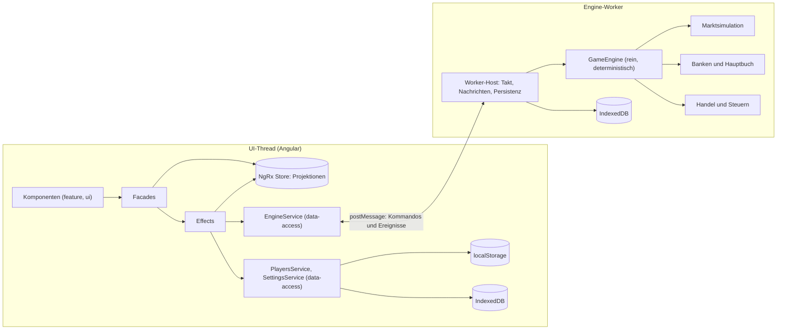
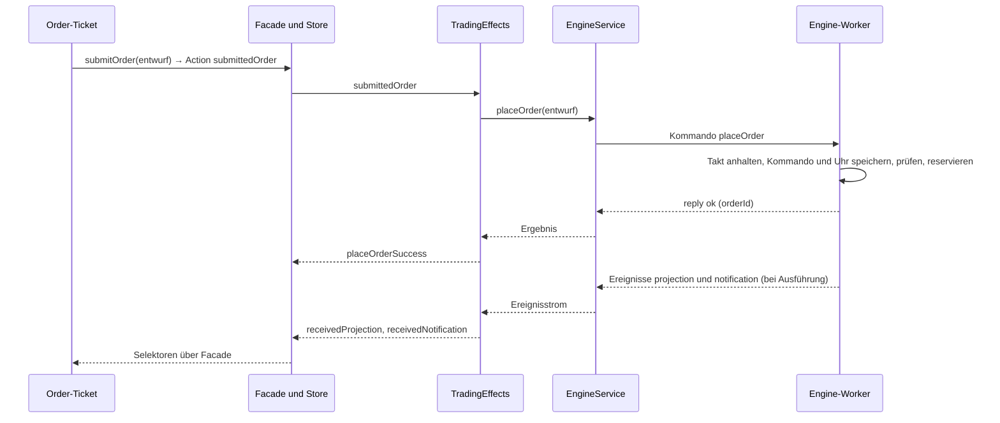
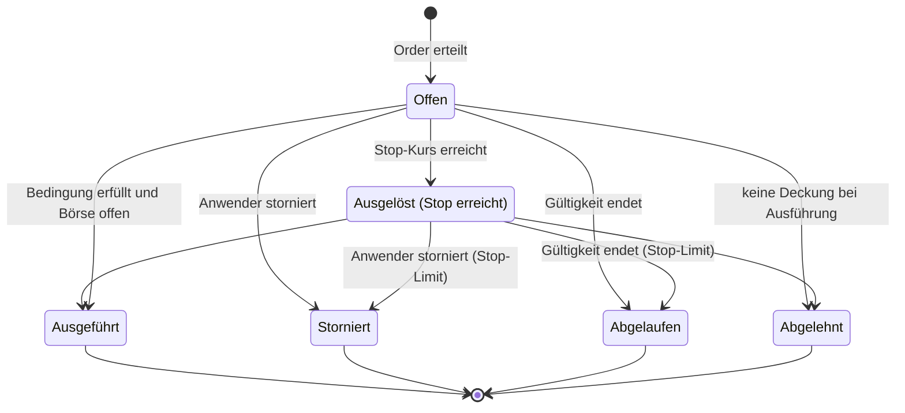

# PortfoliGo – Technische Spezifikation

> **Status:** Entwurf v0.1 · **Stand:** 09.11.2026 · **Grundlage:** [Ideensammlung](./_portfoligo.md)
> **Siehe auch:** [Produktspezifikation](./produktspezifikation.md) · [Projektplan](../projektplan.md)

Dieses Dokument beschreibt, _wie_ PortfoliGo gebaut wird. Die allgemeinen Code-Konventionen stehen in [`CLAUDE.md`](../../CLAUDE.md) und gelten unverändert; hier stehen die projektspezifischen Entscheidungen. Wo dieses Dokument Ergänzungen oder Ausnahmen zu `CLAUDE.md` vorschlägt, sind sie in [§11.2](#112-ergänzungen-für-claudemd) gesammelt. Entscheidungen und ihr Status stehen in [§16](#16-entscheidungen), Risiken in [§17](#17-risiken).

## Inhalt

1. [Rahmen und Abhängigkeiten](#1-rahmen-und-abhängigkeiten)
2. [Architektur](#2-architektur)
3. [Zeitmodell](#3-zeitmodell)
4. [Determinismus und Zufall](#4-determinismus-und-zufall)
5. [Weltgenerierung](#5-weltgenerierung)
6. [Marktmodell](#6-marktmodell)
7. [Wirtschaftsmodell](#7-wirtschaftsmodell)
8. [Engine](#8-engine)
9. [Persistenz](#9-persistenz)
10. [Export und Import](#10-export-und-import)
11. [Frontend-Architektur](#11-frontend-architektur)
12. [Benachrichtigungen](#12-benachrichtigungen)
13. [Plattform: PWA und Capacitor](#13-plattform-pwa-und-capacitor)
14. [Qualitätssicherung](#14-qualitätssicherung)
15. [Versionierung und Kompatibilität](#15-versionierung-und-kompatibilität)
16. [Entscheidungen](#16-entscheidungen)
17. [Risiken](#17-risiken)

## 1. Rahmen und Abhängigkeiten

### 1.1 Ist-Stand (09.11.2026)

- Angular 22.0.1 (standalone, zoneless), NgRx 22 (Store, Effects, Entity, Router Store, Devtools), RxJS 7.8, `idb` 8, Vitest 4 über `ng test`, ESLint 9 mit angular-eslint, Prettier 3, TypeScript 6.
- Hash-Routing, `@angular/localize` mit Quellsprache `de`, Build nach `www/`, Deployment über GitHub Actions per SFTP.
- **Baseline:** `ng build` läuft, warnt aber, weil `.browserslistrc` Browser außerhalb der Angular-22-Unterstützung enthält. `ng lint` meldet einen Fehler: `src/environments/environment.model.ts` importiert Dateien des gelöschten Prototyps. `ng test` bricht ab, weil es noch keine Tests gibt.
- **Node:** Angular CLI 22 verlangt Node ≥ 22.22.3 (steht in `.nvmrc`). Die Standard-Shell nutzt derzeit 22.12.0, daher vor jeder Session `nvm use`.
- **Reste des Ionic-Prototyps:** `ionic.config.json`, `capacitor.config.ts`, Ionic-Schematics in `angular.json`, `--ion-*`-Variablen in `src/theme/variables.scss`, Ionic-Hinweise in `src/test-setup.ts` und `.vscode/settings.json`, Ionic CLI in der CI, `author`/`homepage` in `package.json`.

### 1.2 Abhängigkeiten

| Paket                                                                | Zweck                                         | Status                           |
| -------------------------------------------------------------------- | --------------------------------------------- | -------------------------------- |
| `@angular/*`                                                         | Framework                                     | vorhanden                        |
| `@angular/cdk`                                                       | Overlay, Dialog, A11y, Scrolling, Table u. a. | neu (M0)                         |
| `@angular/service-worker`                                            | PWA                                           | neu (M6)                         |
| `@ngrx/store`, `effects`, `entity`, `router-store`, `store-devtools` | State Management                              | vorhanden                        |
| `@ngrx/operators`                                                    | `concatLatestFrom` in Effects                 | bei erstem Bedarf                |
| `rxjs`                                                               | Streams                                       | vorhanden                        |
| `idb`                                                                | Promise-Wrapper für IndexedDB                 | vorhanden                        |
| `lightweight-charts`                                                 | interaktive Kurscharts (E-04)                 | neu (Spike AP 1.7, fest ab M4)   |
| `bootstrap-icons`                                                    | Icons                                         | vorhanden                        |
| `tailwindcss`, `@tailwindcss/postcss`, `postcss` (dev)               | Styling (E-06)                                | neu (M0)                         |
| `fake-indexeddb` (dev)                                               | IndexedDB in Unit-Tests                       | neu (M0)                         |
| `prettier-plugin-tailwindcss` (dev)                                  | Sortierung der Utility-Klassen                | optional                         |
| `uuid`                                                               | –                                             | entfernen, `crypto.randomUUID()` |

**Regel:** Außer dem Angular CDK kommen keine UI-Frameworks oder Komponentenbibliotheken hinzu. NgRx ist eine State-Bibliothek und durch `CLAUDE.md` gesetzt. Jede neue Laufzeitabhängigkeit braucht einen Eintrag in §16.

### 1.3 Browser, Plattform-APIs und HTTPS

`.browserslistrc` wird auf die Mindestanforderungen von Tailwind CSS v4 angehoben, die zugleich die Build-Warnung beseitigen: Chrome und Edge ≥ 111, Firefox ≥ 128, Safari und iOS ≥ 16.4.

Genutzte Plattform-APIs: Web Worker (Modul-Worker), IndexedDB, Web Locks, Page Visibility, Web Crypto (`subtle.digest`, `randomUUID`), Storage Manager (`persist`), Notification API, Service Worker, Clipboard.

**HTTPS ist Pflicht.** Web Crypto (`subtle`, `randomUUID`), Web Locks, Service Worker, `storage.persist()` und Benachrichtigungen gibt es nur in einem sicheren Kontext (HTTPS oder `localhost`). Die Produktion läuft daher ausschließlich über HTTPS. Für Tests auf Mobilgeräten im lokalen Netz wird `ng serve --ssl` verwendet. Spielkritische Berechnungen wie der Seed-Schlüssel kommen ohne diese APIs aus (§4.1).

## 2. Architektur

### 2.1 Überblick



### 2.2 Grundsätze

1. **Die Engine ist autoritativ.** Alle Spielregeln laufen im Worker. Die UI sendet Kommandos und zeigt Projektionen; sie rechnet keine Spielregeln nach (Ausnahme: Vorschauen, die dieselben Domain-Funktionen nutzen).
2. **Die Engine ist rein.** `GameEngine` hat keine Abhängigkeit zu DOM, Angular, Uhr oder Speicher. Dadurch ist sie in Vitest ohne TestBed testbar und vollständig reproduzierbar. I/O findet nur im Worker-Host statt.
3. **Der Markt hängt nicht vom Spieler ab:** Markt = f(Seed, Simulationsversion, Spielzeit). Auch Beobachten (Abfragen, Abos) und Handeln verändern den Marktzustand nicht (§6.6).
4. **Der Spielerzustand ist reproduzierbar:** Spielerzustand = f(Startbedingungen, Markt, Kommandos). Kommandos sind die einzige nicht-deterministische Eingabe; darauf beruht die Persistenz (§9).
5. **Market-Data-Feed-Prinzip:** Die UI abonniert Kurse nur für die Instrumente, die die aktuelle Ansicht braucht, und erhält Projektionen gedrosselt (§8.4) – wie ein Client einer echten Handelsplattform.

### 2.3 Datenfluss am Beispiel einer Kauforder



## 3. Zeitmodell

### 3.1 Spielzeit und Kalender

```ts
type Tick = number; // ganze Spielminuten seit der Epoche 01.01.2020, 00:00 Uhr Spielzeit
```

- **Epoche** 01.01.2020, 00:00 Uhr. **Spielstart (Vorschlag, E-02):** Montag, 01.04.2030, 00:00 Uhr = Tick 5.389.920.
- Der Start an einem Monatsersten sorgt für einen vollständigen ersten Monat: Der Bank-Lauf um 06:00 Uhr bucht die Lebenshaltung, das erste Gehalt folgt am Monatsende.
- Die gut zehn Jahre vor dem Start sind Vorlauf: bis Ende Februar 2030 in Tagesauflösung, der März 2030 bereits im Minutentakt (§6.8).
- Der Kalender ist für alle Spieler gleich. Nur so ergibt derselbe Seed dieselbe Welt, und fiktive Zukunftsdaten werden nicht mit echten Kursverläufen verwechselt.
- Eine Spielzeitzone ohne Sommerzeit (angelehnt an MEZ). Umrechnungen nutzen ausschließlich UTC-Arithmetik (`Date.UTC`, `getUTC*`), nie die lokale Zeitzone.
- Reine Kalenderfunktionen in `clock/domain`: Tick ↔ Datum, Wochentag, Tagesindex, Monats- und Jahresgrenzen, Bankarbeitstage (Mo–Fr; Feiertage ab Stufe 2), erster und letzter Bankarbeitstag eines Monats.

### 3.2 Tick: eine Spielminute (E-02)

Ein Tick ist die kleinste Zeiteinheit für Kurse, Orders und Buchungen.

**Messung** (Mini-Benchmark, Node 22.22/V8, Entwicklungsrechner, 09.11.2026): 48 Faktoren, die wochentags rund um die Uhr laufen, und 200 Aktien mit 8,5 Stunden Handelszeit und je sechs Faktorladungen. Ergebnis: **1 Spieljahr ≈ 2,0 s** Rechenzeit, 1 Spielwoche ≈ 38 ms. Bei 1 w/s belegt die Rohsimulation also rund 4 % eines Kerns. Gemessen wurde mit `Math.exp` und `Math.log`; mit den deterministischen Varianten (§4.4) wird in AP 1.4 nachgemessen. Für Indizes, Orders, Aggregation und Persistenz wird ein Faktor 2 eingeplant.

Folgerungen:

- 1 w/s ist problemlos möglich. Eine Stufe 1 Monat/s (rund 15–35 % eines Kerns) kann nach Messung freigeschaltet werden.
- Nachberechnung: ein Monat ≈ 0,2–0,4 s, ein Jahr ≈ 2–4 s.
- Bei 1 w/s vergehen rund 70 Spieljahre pro Spielstunde. Lange Spiele sind also der Normalfall; Speicher (§9.6) sowie Export und Import (§10) sind darauf ausgelegt.
- Bei Echtzeit (1 s/s) ändern sich Kurse einmal pro Minute. Für später vorgemerkt: Sekundenwerte zwischen zwei Minuten per deterministischer Brownscher Brücke.

Verworfene Alternativen:

| Alternative                                 | Bewertung                                                                                                                                                                                                               |
| ------------------------------------------- | ----------------------------------------------------------------------------------------------------------------------------------------------------------------------------------------------------------------------- |
| 1 Tick = 1 Stunde                           | Zu grob für Intraday-Handel und Echtzeit; Kurse stünden bei 1 s/s eine Stunde still.                                                                                                                                    |
| 1 Tick = 1 Sekunde                          | 60-fache Last ohne spielerischen Mehrwert.                                                                                                                                                                              |
| Tages-Simulation mit Intraday-Interpolation | Sehr schnelle Nachberechnung, aber deutlich komplexer (Brücken, konsistente Hoch- und Tiefkurse, bedarfsweise Erzeugung). Vorgemerkt als Optimierung, falls die Wiederherstellung langer Kurshistorien zu langsam wird. |

### 3.3 Handelszeiten (E-18)

| Region          | Beispiele (Börsen fiktiv benannt)                | Handelszeit (Spielzeit)                         |
| --------------- | ------------------------------------------------ | ----------------------------------------------- |
| Asien-Pazifik   | Japan, Australien, Hongkong                      | 01:00–07:00                                     |
| Europa          | Deutschland, Frankreich, Großbritannien, Schweiz | 09:00–17:30                                     |
| Nordamerika     | USA, Kanada                                      | 15:30–22:00                                     |
| Schwellenländer | je Börse, z. B. Indien, Brasilien                | z. B. Indien 04:45–11:00, Brasilien 14:00–21:00 |

- Handelszeiten sind Teil der Börsenkonfiguration in der Welt. Am Wochenende ist geschlossen; Feiertage folgen in Stufe 2.
- Orders können jederzeit erteilt werden; ausgeführt werden sie während der Handelszeit (§7.5). So bleibt „jederzeit verkaufen" aus der Ideensammlung erhalten – unter realen Marktbedingungen.
- Banken buchen an Bankarbeitstagen in einem **Bank-Lauf um 06:00 Uhr** Spielzeit (E-19).

### 3.4 Geschwindigkeiten

| Stufe            | Spielzeit pro Sekunde | Ticks pro Sekunde |
| ---------------- | --------------------- | ----------------- |
| Pause            | –                     | 0                 |
| Echtzeit         | 1 s                   | 1/60              |
| 1 min/s          | 1 Minute              | 1                 |
| 10 min/s         | 10 Minuten            | 10                |
| 1 h/s            | 1 Stunde              | 60                |
| 2 h/s            | 2 Stunden             | 120               |
| 4 h/s            | 4 Stunden             | 240               |
| 1 d/s            | 1 Tag                 | 1.440             |
| 1 w/s            | 1 Woche               | 10.080            |
| (optional) 1 M/s | ca. 30 Tage           | ca. 43.200        |

Die Stufen sind eine `as const`-Liste in `clock/domain`.

### 3.5 Taktung

```text
targetTick(now) = anchorTick + floor((now − anchorRealTime) / 1000 × ticksPerSecond)
```

- Die Worker-Schleife läuft etwa alle 16 ms und verarbeitet Ticks bis `targetTick`, mit einem Zeitbudget von rund 8 ms pro Durchlauf. Der Rest folgt im nächsten Durchlauf.
- Der Anker (`anchorTick`, `anchorRealTime`) wird bei jedem Wechsel von Geschwindigkeit, Pause oder Sichtbarkeit und nach jedem Kommando neu gesetzt (§8.5).
- Wächst der Rückstand über zwei Sekunden Echtzeit, meldet die Engine „ausgelastet". Ticks werden nie übersprungen; die effektive Geschwindigkeit sinkt.
- Die Uhr in der UI zeigt die Spielzeit aus dem letzten `clock`-Ereignis und interpoliert bei Echtzeit die Sekunden rein optisch.
- Browser drosseln Timer in Hintergrund-Tabs. Weil sich `targetTick` aus der Wanduhr ergibt, holt die Engine Rückstände bei der nächsten Gelegenheit auf.

### 3.6 Hintergrund, Schließen und Pause

- Das Verhalten im Hintergrund ist eine **Spielereinstellung** `backgroundMode`. Sie wird per Kommando gesetzt, gehört zum Spielerzustand und wird mit exportiert:
  - `realtime` (Standard, Vorschlag E-02): Ist die App verborgen oder geschlossen, läuft die Zeit mit 1 s/s weiter; beim Öffnen wird nachberechnet (§3.7). Das entspricht der Ideensammlung.
  - `pause`: Verborgen oder geschlossen ruht die Zeit. Beim Zurückkehren läuft sie mit der gewählten Geschwindigkeit weiter, ohne Nachberechnung.
- `visibilitychange` → `hidden`: Die UI meldet dem Worker „verborgen", die Engine wechselt in den Hintergrundmodus. Bei `visible` gilt wieder die gewählte Geschwindigkeit.
- Bei `hidden` und `pagehide` wird der Uhrzustand gespeichert (§9.2) und ein Snapshot angestoßen.
- **Eine vom Anwender gesetzte Pause bleibt Pause** – auch über Schließen und erneutes Öffnen hinweg (Vorschlag, E-02).
- **Auto-Pause** (§12) greift nur im Live-Betrieb bei sichtbarer App und beim Vorspulen. Während der Nachberechnung und bei verborgener App greift sie nicht, sonst ginge die Echtzeit aus der Ideensammlung verloren; die Ereignisse erscheinen im Abwesenheitsbericht.

### 3.7 Nachberechnung und Vorspulen

- **Nachberechnung beim Laden:** Δ = jetzt − `lastSeenAt` (negative Werte werden zu 0, z. B. bei zurückgestellter Systemuhr). Ist das Spiel nicht pausiert und `backgroundMode` = `realtime`, wird bis `savedTick + Δ / 60 s` im Stapelbetrieb gerechnet. Der Fortschritt wird etwa alle 100 ms gemeldet. Kommandos sind währenddessen gesperrt. Ereignisse werden gespeichert, aber nicht als Toast gezeigt, sondern für den Abwesenheitsbericht zusammengefasst.
- **Vorspulen:** derselbe Stapelbetrieb bis zum Ziel; abbrechbar nach dem laufenden Tick; bricht ab, wenn ein Ereignis mit Auto-Pause eintritt.
- **Determinismus:** Stapelbetrieb und Live-Betrieb liefern identische Ergebnisse (Test, §4.6).

### 3.8 Ablauf eines Ticks

1. **Terminplaner:** alle Termine mit Fälligkeit ≤ Tick, in fester Reihenfolge:
   - Tageswechsel: Zinsabgrenzung, Tageswerte, tägliche Fortschreibung der ETF- und Indexzustände (§6.6).
   - Bank-Lauf: zuerst Gutschriften (Gehalt, Dividenden, Zinsen), dann Lastschriften (Lebenshaltung, Gebühren).
   - Orderablauf, Monats- und Jahresabschluss.
2. **Faktoren** fortschreiben (wochentags); zum Tagesbeginn zuerst Marktphase und Trends.
3. **Instrumente** offener Börsen fortschreiben. Bei Handelsbeginn: Overnight-Effekt, Ex-Dividenden-Abschlag, geplante Sprünge. Bei Handelsschluss: Tageskerze abschließen.
4. **Handel:** Sparpläne zur Eröffnung, danach Orders der Instrumente mit geändertem Kurs prüfen und ausführen. Indexstände, ETF-Kurse sowie Geld und Brief sind dabei reine Funktionen des Kernzustands (§6.6).
5. **Konten:** Deckung prüfen, Ereignisse erzeugen, ggf. Auto-Pause auslösen.
6. **Aggregation:** Kerzen und Tagesreihen.
7. **Ereignisse** puffern; der Worker-Host leitet sie gedrosselt an die UI weiter.

Kommandos der UI werden zwischen zwei Ticks angewendet und mit dem Tick protokolliert, nach dem sie wirksam werden (§8.5).

## 4. Determinismus und Zufall

### 4.1 Seed

- Der Seed ist frei wählbarer Text. Vorschläge sind gut teilbar, z. B. `kupfer-falke-731` (zwei Wörter und eine Zahl).
- Normalisierung: Leerraum am Rand entfernen, Kleinschreibung, Unicode-Normalform NFC.
- Ableitung: Ein 128-Bit-Hash (z. B. MurmurHash3 x86_128, in TypeScript implementiert) des normalisierten Seeds ergibt den **Seed-Schlüssel** `seedKey` (4 × uint32). Er braucht keine kryptografische Stärke, ist synchron berechenbar und funktioniert ohne sicheren Kontext.

### 4.2 Zufallsströme

```ts
const rng = createStream(seedKey, `market/instrument/${instrumentId}/${dayIndex}`);
```

- Der Startzustand jedes Stroms ist ein 128-Bit-Hash aus `seedKey` und einem stabilen Schlüssel. Generator: `sfc32` (schnell, gute statistische Qualität, 128-Bit-Zustand); die ersten Ausgaben werden verworfen. Mit 128 Bit sind Kollisionen zwischen Strömen praktisch ausgeschlossen – bei nur 32 Bit gäbe es schon in einem Spieljahrzehnt Dutzende identische Ströme.
- Beispiele für Schlüssel: `world/companies`, `world/banks`, `market/regime/<tag>`, `market/factor/<id>/<tag>`, `market/instrument/<id>/<tag>`, `life/living-costs/<monat>`.
- **Vorteile:** Ströme sind unabhängig (ein neues Instrument verschiebt keine anderen Kurse); jeder Tag eines Instruments lässt sich einzeln neu erzeugen; Spielerentscheidungen ziehen nie aus Marktströmen.

### 4.3 Verteilungen

Gleichverteilung (32 oder 53 Bit), Normalverteilung (Marsaglia-Polarmethode), Poisson (Inversion für kleine λ), Lognormal, gewichtete Auswahl, Mischen (Fisher-Yates). Alle als reine Funktionen über einem Strom.

### 4.4 Deterministische Mathematik

`Math.exp`, `Math.log`, `Math.pow`, `Math.sin` usw. sind laut ECMAScript implementierungsabhängig; V8, SpiderMonkey und JavaScriptCore können im letzten Bit abweichen. Über viele Ticks und an Schwellen (Limit erreicht? Rundung auf Cent?) würde das browserübergreifend zu anderen Ergebnissen führen.

Deshalb nutzt Simulationscode nur IEEE-754-exakte Operationen (`+ − × ÷`, `Math.sqrt`, `Math.floor`, `Math.round`, `Math.abs`, `Math.min`, `Math.max`) und eigene Implementierungen `detExp` und `detLog` (Portierung aus fdlibm oder gleichwertig, Genauigkeit ≤ 1 ulp, bitidentisch auf allen Engines). Potenzen werden über `detExp(b × detLog(a))` oder Multiplikation gebildet. Die UI darf `Math.*` frei verwenden.

### 4.5 Regeln für Simulationscode

1. Kein `Math.random`, `Date.now`, `performance.now` oder `crypto.getRandomValues` – Zeit und Zufall kommen nur aus Tick und Strömen.
2. Keine Iteration über Objekte oder Maps mit unklarer Reihenfolge, wenn die Reihenfolge das Ergebnis beeinflusst; stattdessen Arrays oder sortierte Schlüssel.
3. Summen in fester Reihenfolge bilden.
4. Geldbeträge nur über die zentralen Rundungsfunktionen (§7.1).
5. Ergebnisse dürfen nicht davon abhängen, wie viele Ticks pro Durchlauf verarbeitet werden.
6. Abfragen, Abos, Caches und Orders verändern den Marktzustand nie (§6.6).

### 4.6 Tests

- **Golden Master:** Seed `golden-1`, ein Spieljahr; die Prüfsumme über alle Tagesschlusskurse (Float64-Bytes) ist als Konstante eingecheckt. Bricht der Test, ändert sich die Welt für bestehende Seeds – dann ist `simVersion` zu erhöhen (§15).
- **Granularität:** ein Lauf am Stück gegenüber 1.000 Teilstücken – identisch.
- **Snapshot:** Snapshot, Restore und Weiterlauf gegenüber ununterbrochenem Lauf – identisch.
- **Beobachtungsunabhängigkeit:** Die Markt-Prüfsumme ist mit und ohne Abfragen, Abos und Orders identisch.
- **Stromunabhängigkeit:** Ein zusätzliches Instrument ändert die Kurse der übrigen nicht.

## 5. Weltgenerierung

### 5.1 Ablauf

Seed → Weltparameter → Regionen, Länder, Börsen → Sektoren, Branchen → Unternehmen → Indizes → ETF-Emittenten und ETFs → Banken → Vorlauf-Historie in Tagesauflösung bis einen Monat vor Spielstart → Marktzustand dieses Tages.

Die Welt und die Tageshistorie sind deterministisch. Sie werden bei jedem Laden in unter einer Sekunde neu erzeugt und nicht gespeichert (§9). Der letzte Monat vor dem Start wird beim Anlegen im Minutentakt simuliert (§6.8).

### 5.2 Umfang der Standardwelt (Vorschlag, E-13)

| Element               | Anzahl      |
| --------------------- | ----------- |
| Regionen              | 4           |
| Länder bzw. Börsen    | ca. 12      |
| Sektoren / Branchen   | 11 / ca. 30 |
| Aktien                | ca. 200     |
| Indizes               | ca. 12      |
| ETF-Emittenten / ETFs | 5 / ca. 30  |
| Banken                | 6–8         |

Alle Mengen und Verteilungen stehen zentral in einer Weltkonfiguration, damit sie im Simulations-Labor (§14.2) kalibriert werden können.

### 5.3 Klassifikation und Modellwirkung

| Dimension              | Wirkung im Modell                                                          |
| ---------------------- | -------------------------------------------------------------------------- |
| Region                 | Regionsfaktor, Handelszeiten; ab Stufe 2 Währung                           |
| Sektor, Branche        | Sektor- und Branchenfaktor mit mehrjährigen Trends                         |
| Größe                  | Größenfaktor (Small-Cap-Prämie und -Risiko), Spread, idiosynkratische Vola |
| Stil                   | Value-/Growth-Faktor; ab Stufe 2 Zinsempfindlichkeit                       |
| Konjunkturabhängigkeit | Beta zum Weltfaktor (defensiv < 1 < zyklisch)                              |
| Dividendenprofil       | Ausschüttungen und Ex-Tag-Abschläge                                        |
| Risiko                 | idiosynkratische Volatilität, Häufigkeit von Kurssprüngen                  |

### 5.4 Unternehmen

- **Stammdaten:** stabile `id` (z. B. `stk-0042`), Name, Ticker (2–5 Zeichen, eindeutig), fiktive Kennung im ISIN-Format mit Prüfziffer und einem nicht vergebenen Länderpräfix (keine Verwechslung mit echten Wertpapieren), Land, Börse, Sektor, Branche, Gründungsjahr, Mitarbeiterzahl.
- **Kurzprofil:** Die Engine erzeugt keinen Fließtext, sondern einen Vorlagen-Code mit Parametern (z. B. Branche, Schwerpunkt, Gründungsjahr). Der Text entsteht in der UI per `$localize` (§8.6).
- **Größe:** Marktkapitalisierung aus einer schiefen Verteilung (lognormal oder Pareto: wenige sehr große, viele kleine Unternehmen); daraus Aktienanzahl und Startkurs (plausibler Bereich, z. B. 5–500 €).
- **Modellparameter:** Stil, Konjunkturabhängigkeit, Faktorladungen, idiosynkratische Volatilität, Sprungintensität, Dividendenrendite und -frequenz.
- **Sparplanfähigkeit:** Attribut `savingsPlanEligible`; bei Aktien für Large Caps gesetzt.
- **Namen:** Wortbausteine je Branche und Rechtsform je Land (AG, SE, Inc., Corp., plc, S.A., N.V., K.K. …). Eine Blockliste verhindert reale Marken und Unternehmensnamen; Dubletten sind ausgeschlossen.

### 5.5 Indizes

- Weltindex (alle Aktien), je Region ein breiter Index und ein Leitindex (Top 30–50), Sektorindizes, ein Small-Cap- und ein Dividendenindex.
- Je Index ein Kurs- und ein Performanceindex (§6.6), gewichtet nach Marktkapitalisierung; optional mit Kappung je Wert.
- In Stufe 1 ist die Zusammensetzung fest; Anpassungen folgen in Stufe 2.
- Indexnamen sind fiktiv (Wortbausteine und Anzahl der Werte).

### 5.6 ETFs

Emittent, abgebildeter Index, Ertragsverwendung (ausschüttend: quartalsweise oder jährlich; thesaurierend), TER (0,05–0,65 %), Replikation (Angabe), Fondsvolumen. Alle ETFs sind sparplanfähig (`savingsPlanEligible`). Es gibt mehrere ETFs auf denselben Index mit unterschiedlicher TER, damit sich der Kostenvergleich lohnt.

### 5.7 Banken

Die Konditionen werden innerhalb typischer Spannen gezogen (Vorschlag, E-17):

| Typ                   | Girokonto                                   | Dispo   | Zinsen                    | Depot                            | Order                                         | Sparplan  | Handelsplatz                                 |
| --------------------- | ------------------------------------------- | ------- | ------------------------- | -------------------------------- | --------------------------------------------- | --------- | -------------------------------------------- |
| Filialbank (Hausbank) | 6–12 €/Monat                                | 10–14 % | Tagesgeld 0–0,5 %         | 0,10–0,25 % p. a., mind. 25–45 € | 0,25 %, mind. 10 €, max. 60 € + Börsenentgelt | 1,5–2,5 % | Börse                                        |
| Direktbank            | 0 € ab 700 € Geldeingang, sonst 4–6 €/Monat | 7–10 %  | Tagesgeld 1,5–3 %         | kostenlos                        | 4–6 € + 0,25 %, max. 60–70 €                  | 1–1,5 %   | Börse                                        |
| Onlinebroker          | –                                           | –       | –                         | kostenlos                        | 4–6 € pauschal + Börsenentgelt                | 0–1,50 €  | Börse                                        |
| Neobroker             | –                                           | –       | Verrechnungskonto 1–2,5 % | kostenlos                        | 0–1 €                                         | kostenlos | Market Maker (Spread-Aufschlag), Bruchstücke |

Die Hausbank ist immer eine Filialbank. Brokertypen führen nur Depots mit Verrechnungskonto. Jede Bank hat zusätzlich einen Sollzins für negative Verrechnungskonten (§7.4).

## 6. Marktmodell

### 6.1 Struktur

Der Markt ist ein Mehrfaktormodell auf Log-Kursen:

```text
ln P_i(t) = c_i + Σ_k β_ik · F_k(t) + U_i(t)
```

- `F_k(t)` ist der kumulierte Log-Stand von Faktor k. Faktoren laufen **wochentags jede Minute, rund um die Uhr**.
- `U_i(t)` ist der unternehmensspezifische (idiosynkratische) Anteil. Er läuft nur während der Handelszeit der Börse von Instrument i, plus Sondereffekte bei Handelsbeginn.
- `c_i` ist eine Konstante aus dem Startkurs.
- Ist die Börse geschlossen, bleibt der offizielle Kurs stehen. Bei Handelsbeginn springt er auf den Modellwert. So entsteht die Overnight-Lücke automatisch aus allem, was die Faktoren während der Schließzeit bewegt hat – „Asien schließt schwach, Europa eröffnet schwächer".

### 6.2 Faktoren

| Faktor                | Anzahl | Wirkung                      |
| --------------------- | ------ | ---------------------------- |
| Welt                  | 1      | Konjunktur und Marktphasen   |
| Region                | 4      | regionale Entwicklung        |
| Sektor                | 11     | Sektorzyklen                 |
| Branche               | ca. 30 | Branchentrends               |
| Stil (Value – Growth) | 1      | Stilrotation                 |
| Größe (Small – Large) | 1      | Small-Cap-Prämie und -Risiko |

Dynamik je Faktor, pro Minute (Δ = 1 / (261 · 1440) Jahre):

```text
F_k(t+Δ)    = F_k(t) + (m_k − ½·s_k²)·Δ + s_k·√Δ·z
ln s_k(t+Δ) = ln s_k + κ_s·(ln s̄_k − ln s_k)·Δ + ξ_k·√Δ·z'      mit corr(z, z') = ρ < 0
m_k (täglich): m_k ← m_k + κ_m·(m̄_k − m_k)·Δ_T + η_k·√Δ_T·z''   (Δ_T = ein Tag)
```

- `m_k` ist die erwartete (arithmetische) Rendite des Faktors. Die Trends folgen einem Ornstein-Uhlenbeck-Prozess mit Halbwertszeit von Monaten bis Jahren und erzeugen Booms und Flauten ganzer Sektoren und Branchen. Beispiel aus der Ideensammlung: Energie insgesamt positiv, Öl & Gas negativ, Erneuerbare stark positiv.
- **Stochastische Volatilität `s_k`** mit Leverage-Effekt (fallende Kurse, steigende Vola) erzeugt Volatilitäts-Cluster.
- Am Wochenende ruhen die Faktoren. Optional in Stufe 2: Wochenend-Nachrichten als Sprung zur Montagseröffnung.

### 6.3 Marktphasen

Eine Markov-Kette mit täglichen Übergängen steuert die Zielwerte des Weltfaktors (und abgeschwächt der Regionsfaktoren). Startwerte für die Kalibrierung:

| Phase      | typische Dauer | Trendziel m̄ (arithmetisch, p. a.) | Volaziel s̄ (p. a.) |
| ---------- | -------------- | --------------------------------- | ------------------ |
| Aufschwung | 2–5 Jahre      | +16 %                             | 12 %               |
| Normal     | 1–3 Jahre      | +10 %                             | 15 %               |
| Abschwung  | 0,5–1,5 Jahre  | +1 %                              | 20 %               |
| Krise      | 1–9 Monate     | −25 %                             | 35 %               |

Bei typischen Zeitanteilen (40 / 35 / 17 / 8 %) ergibt das für den Weltfaktor rund 8 % arithmetische bzw. rund 6,5 % geometrische Gesamtrendite bei rund 17 % Volatilität p. a. Dividenden sind darin enthalten; sie fließen als Ex-Tag-Abschläge aus dem Kurs, der Kursindex steigt also um die Dividendenrendite langsamer. In Krisen steigt die Faktorvolatilität stärker als die unternehmensspezifische, dadurch steigen die Korrelationen – wie in echten Crashs. Die Phase ist für den Anwender nicht direkt sichtbar.

### 6.4 Unternehmensspezifischer Anteil

```text
U_i(t+Δ_h) = U_i(t) + (α_i − ½·σ_i²)·Δ_h + σ_i·√Δ_h·ε + J_i      (Δ_h = eine Handelsminute)
```

- `σ_i` je nach Größe und Risiko (Large Cap etwa 15–25 %, Small Cap 30–50 % p. a.); optional mit der Marktvolatilität skaliert.
- `α_i` ist eine kleine dauerhafte Abweichung (z. B. N(0; 2 %) p. a.), damit es dauerhaft bessere und schlechtere Unternehmen gibt.
- **Overnight:** Bei Handelsbeginn kommt ein zusätzlicher Schock hinzu. Er trägt etwa 25 % der unternehmensspezifischen Tagesvarianz; die Handelszeit entsprechend weniger.
- **Sprünge `J_i`:** Poisson-Prozess mit 2–6 Sprüngen pro Jahr, Größe normalverteilt mit leicht negativem Mittel (z. B. −1 %) und 6–12 % Streuung. Anzahl und Minuten der Sprünge eines Tages werden zu Tagesbeginn aus dem Tagesstrom gezogen. Jeder Sprung ist ein strukturiertes Ereignis und damit später Stoff für den Newsticker.
- Kursuntergrenze 0,01 €. Aktiensplits (Stufe 2) halten Kurse in plausiblen Bereichen.

### 6.5 Dividenden

- Frequenz nach Region: jährlich (Europa), halbjährlich (Asien-Pazifik), quartalsweise (Nordamerika). Die Ex-Tage jedes Unternehmens liegen in einem festen Jahresrhythmus aus dem Seed.
- **Höhe:** Zielrendite × Kurs am Ankündigungstag ÷ Frequenz, auf Cent gerundet. Die Ankündigung erfolgt 20 Handelstage vor dem Ex-Tag; ab dann ist der Termin im Kalender sichtbar.
- **Ex-Tag:** Abschlag zur Eröffnung (`U_i` sinkt um `ln(P / (P − D))`). Anspruch hat, wer am Vortag zum Handelsschluss hält.
- **Zahltag:** Ex-Tag + 2 Bankarbeitstage; Gutschrift nach Steuer auf das Verrechnungskonto.
- Stufe 2: Dividende aus Gewinn und Ausschüttungsquote, Kürzungen in Krisen.

### 6.6 Indizes, ETFs und abgeleitete Werte

- **Kursindex:** `I(t) = Σ_i n_i · P_i(t) / D` mit Streubesitz-Aktienanzahl `n_i` und Divisor `D`. Der Divisor wird bei Änderungen der Zusammensetzung angepasst (Stufe 2).
- **Performanceindex:** `TR(t) = I(t) · R`. Der Reinvestitionsfaktor `R` wird an jedem Ex-Tag eines Konstituenten um dessen Dividendenanteil erhöht.
- **Indikative Werte:** Für Instrumente geschlossener Börsen gibt es einen indikativen Kurs `P_i · exp(Σ_k β_ik · (F_k(t) − F_k(t_Schluss)))`. Ein ETF auf einen nordamerikanischen Index, der vormittags an einer europäischen Börse gehandelt wird, bewegt sich so plausibel – wie bei einem Market Maker, der Terminkurse einpreist.
- **Thesaurierende ETFs:** `NAV(t) = k · TR(t)`.
- **Ausschüttende ETFs:** `NAV(t) = k · I(t) + Topf`. Die Dividenden der Konstituenten fließen am jeweiligen Ex-Tag anteilig in den Ausschüttungstopf. Am Ex-Tag des ETFs wird der Topf ausgeschüttet; der NAV sinkt um genau diesen Betrag. Vor Kosten und Steuern haben beide Varianten dieselbe Gesamtrendite (Test).
- **TER und Tracking:** wirken täglich als Faktor auf `k` (`k ← k · (1 − TER/365) · (1 + Tracking-Rauschen)`).
- **Abgeleitete Werte sind reine Funktionen:** Indexstände, indikative Werte, ETF-NAV sowie Geld und Brief werden aus dem Kernzustand (Kurse, Faktorstände, `D`, `R`, `k`, Topf) berechnet und verändern ihn nie. Sie dürfen bei Bedarf berechnet und zwischengespeichert werden; solche Caches gehören weder in den Snapshot noch in die Prüfsumme. Alle zustandsbehafteten Größen (`R`, `k`, Topf, `D`) werden ausschließlich vom Terminplaner in fester Reihenfolge fortgeschrieben. Deshalb verändern Abfragen, Abos und Orders den Markt nicht (§4.6).

### 6.7 Geld- und Briefkurs

```text
spread = base(instrument) × regimeFactor × closedUnderlyingFactor + venueMarkup
bid    = roundDown(mid × (1 − spread/2), priceStep(mid))
ask    = roundUp(mid × (1 + spread/2), priceStep(mid))     mit ask − bid ≥ priceStep(mid)
```

- Basis: Large Cap 0,05–0,10 %, Mid Cap 0,10–0,25 %, Small Cap 0,25–1,0 %, ETF 0,05–0,30 %.
- Faktor Marktphase: in der Krise × 2–3. Faktor Basiswert geschlossen: × 1,5–2. Aufschlag des Handelsplatzes: bei Neobrokern 0,05–0,20 %.
- **Preisraster** `priceStep`: ab 10 € 0,01 €; von 1 € bis 10 € 0,001 €; unter 1 € 0,0001 €. Geld wird ab-, Brief aufgerundet, und der Spread beträgt mindestens einen Rasterschritt. Ohne diese Regel fielen bei günstigen Aktien Geld- und Briefkurs zusammen (bei 8 € Mittelkurs und 0,05 % Spread ergäbe Rundung auf Cent 8,00 € / 8,00 €).

### 6.8 Kerzen und Historie

- **Live:** Minutenwerte werden je Instrument zu Kerzen 1m → 1h → 1d aggregiert (Open, High, Low, Close; Volumen ab Stufe 2).
- **Speicherung (Vorschlag, E-08):** 1d vollständig, 1h rollierend für zwei Spieljahre, 1m rollierend für fünf Handelstage. Tageskerzen, die älter als 20 Spieljahre sind, werden zu Wochenkerzen verdichtet. Kerzen liegen getrennt vom Snapshot in Blöcken je Instrument und Zeitraum als `Float32Array`.
- **Vorlauf-Historie:** von der Epoche bis Ende Februar 2030 in Tagesauflösung, mit demselben Modell in Tagesschritten (Faktoren, Phasen, Sprünge, Dividenden); Hoch- und Tiefkurse aus einer Näherung der Tagesspanne. Sie ist deterministisch und wird bei jedem Laden in unter einer Sekunde neu erzeugt statt gespeichert.
- **Letzter Monat vor dem Start:** Beim Anlegen eines Spielers simuliert die Engine den März 2030 bereits im Minutentakt (rund 0,2–0,4 s) und speichert die Kerzen wie im Spiel. So haben auch die Zeiträume 1T, 5T und 1M ab dem ersten Spieltag Daten.
- **Optimierung (später):** Intraday-Kerzen vergangener Tage aus gespeicherten Tages-Marktzuständen bei Bedarf neu erzeugen, statt sie zu speichern.
- **Chart-Auflösung je Zeitraum:** 1T → 1m bzw. 5m, 5T → 15m, 1M → 1h, 6M bis 5J → 1d, Max → 1d bzw. 1w. Zwischenstufen werden beim Abruf aggregiert.
- **Zeitachse:** Spielzeit als UTC-Zeitstempel; Charts formatieren in UTC und zeigen so die Spielzeit unverfälscht.

### 6.9 Kalibrierung

| Größe                                              | Ziel                                                                           |
| -------------------------------------------------- | ------------------------------------------------------------------------------ |
| Weltindex (Performanceindex), geometrische Rendite | 6–8 % p. a. langfristig; der Kursindex liegt um die Dividendenrendite darunter |
| Weltindex, Volatilität                             | 14–18 % p. a.                                                                  |
| Einzelaktien, Volatilität                          | Large Cap 20–30 %, Small Cap 35–60 % p. a.                                     |
| Korrelation innerhalb / zwischen Sektoren          | ca. 0,5–0,6 / ca. 0,2–0,35                                                     |
| Bärenmärkte (Weltindex > 20 % unter Hoch)          | etwa einer alle 5–8 Jahre                                                      |
| Tagesrenditen                                      | breite Ränder (Kurtosis > 5), Volatilitäts-Cluster                             |
| Dividendenrendite                                  | 0–7 %, im Weltindex 2–3 %                                                      |

Geprüft wird im Simulations-Labor (§14.2) und mit statistischen Tests auf festen Seeds (§14.1).

### 6.10 Erweiterungen ab Stufe 2 (Skizze)

- **Zinsen und Inflation:** Verbraucherpreise als eigener Prozess, gekoppelt an die Marktphase. Der Leitzins wird alle sechs Wochen entschieden und reagiert auf Inflation und Konjunktur. Die Zinskurve folgt Nelson-Siegel mit Niveau und Steigung als Ornstein-Uhlenbeck-Prozessen, Kreditaufschläge hängen vom Rating ab und steigen in Krisen. Wirkung: Anleihekurse (Barwert), Tagesgeldzinsen der Banken, Zinsfaktor für Aktien (Growth negativ, Banken positiv), Lohn- und Kostenentwicklung, Realwertanzeige.
- **Anleihen:** Kupon, Laufzeit, Rating, Stückzinsen, Rückzahlung zu 100 %, Ausfälle bei schlechtem Rating.
- **Rohstoffe:** mean-reverting Log-Preis (Schwartz-Ein-Faktor-Modell) mit Sprüngen und Saisonalität. Kopplung an Branchen: Öl wirkt positiv auf Öl & Gas, negativ auf Fluggesellschaften. Gold ist in Krisen ein sicherer Hafen (negative Ladung auf den Weltfaktor).
- **Physische Edelmetalle:** Händler mit Ankaufs- und Verkaufskurs (Spanne 2–8 %), Haltefrist ein Jahr für Steuerfreiheit.
- **Aktive Fonds:** Ausgabeaufschlag, höhere TER, Fondsmanager-Alpha mit Mittelwert leicht unter null nach Kosten.
- **Fundamentaldaten:** latente Ertragskraft je Unternehmen, Quartalsberichte mit Überraschung (Kurssprung), Rückkehr der Bewertung (KGV) zum Branchenniveau.
- **Unternehmensereignisse, Währungen:** Splits, Übernahmen, Insolvenzen, Börsengänge; Wechselkurse als Faktoren, Instrumente in Fremdwährung.
- **CFDs:** Hebel nach den ESMA-Grenzen für Privatkunden (30:1 Hauptwährungspaare, 20:1 Hauptindizes und Gold, 10:1 Rohstoffe, 5:1 Aktien), Margin, tägliche Finanzierungskosten, Zwangsglattstellung bei 50 % Margin-Level, keine Nachschusspflicht.
- **Newsticker:** Sprünge, Trendwechsel, Phasenwechsel und Zentralbankentscheidungen sind bereits strukturierte Ereignisse; der Newsticker formuliert sie mit Textvorlagen.

## 7. Wirtschaftsmodell

### 7.1 Zahlen und Rundung (E-09)

| Größe           | Typ                                   | Bemerkung                                     |
| --------------- | ------------------------------------- | --------------------------------------------- |
| Geld            | `Cents` – ganzzahlige `number`        | exakt bis ±9 · 10¹⁵ Cent                      |
| Stückzahl       | `MicroUnits` – ganzzahlig, 10⁻⁶ Stück | Bruchstücke mit bis zu sechs Nachkommastellen |
| Kurs            | `number` (Euro, Gleitkomma)           | Geld und Brief folgen dem Preisraster (§6.7)  |
| Zinssatz, Quote | `number` (0,025 = 2,5 %)              |                                               |

Gerundet wird kaufmännisch (halbe Cent vom Nullpunkt weg) und ausschließlich über zentrale Funktionen in `shared/domain`, an festen Stellen: Kurswert (Stück × Kurs), Gebühren, Steuern und Zinsgutschriften.

### 7.2 Hauptbuch

Alle Geldbewegungen folgen der doppelten Buchführung:

- Eine **Transaktion** hat eine laufende Nummer je Spieler, einen Tick, einen Typ, mindestens zwei **Buchungen** (`{ account, amount: Cents }`), optional **Stückbuchungen** (`{ depotId, instrumentId, quantity: MicroUnits }`), Referenzen (z. B. `orderId`) und Textparameter.
- **Invariante:** Die Summe aller Buchungen einer Transaktion ist 0.
- **Konten:** Spielerkonten (Girokonto, Tagesgeld, Verrechnungskonto; ab Stufe 3 CFD-Konto) und externe Gegenkonten: `external:opening-balance`, `external:employer`, `external:living-costs`, `external:bank:<id>:fees`, `external:bank:<id>:interest`, `external:tax-office`, `external:market`, `external:issuer:<id>`.
- Der **Saldo** eines Spielerkontos ist die Summe seiner Buchungen. Er wird im Snapshot zwischengespeichert; ein Test prüft ihn gegen das Journal.
- **Transaktionstypen** (`as const`): `opening-balance`, `salary`, `living-costs`, `account-fee`, `custody-fee`, `overdraft-interest`, `debit-interest`, `credit-interest`, `transfer`, `buy`, `sell`, `dividend`, `fund-distribution`, `tax`, `tax-refund`.
- Das Startkapital wird bei der Initialisierung als `opening-balance` gegen `external:opening-balance` auf das Girokonto der Hausbank gebucht.

Beispiel Kauf von 10 Stück zu 100 € mit 5,90 € Orderentgelt:

| Konto                   | Betrag      |
| ----------------------- | ----------- |
| Verrechnungskonto       | −1.005,90 € |
| `external:market`       | +1.000,00 € |
| `external:bank:b3:fees` | +5,90 €     |
| Stückbuchung Depot      | +10 Stück   |

### 7.3 Konten und Konditionen

```ts
type Cents = number;

export const BANK_TYPES = ['branch', 'direct', 'online-broker', 'neo-broker'] as const;
export type BankType = (typeof BANK_TYPES)[number];

type FeeModel =
  | { kind: 'free' }
  | { kind: 'flat'; amount: Cents }
  | { kind: 'percent'; rate: number; min?: Cents; max?: Cents }
  | { kind: 'flat-plus-percent'; amount: Cents; rate: number; min?: Cents; max?: Cents }
  | { kind: 'tiered'; tiers: { upToVolume: Cents | null; fee: FeeModel }[] };

interface CurrentAccountConditions {
  monthlyFee: Cents;
  feeWaiver?: { minMonthlyDeposits: Cents }; // z. B. kostenlos ab 700 € Geldeingang
  overdraft: { limitIncomeFactor: number; rate: number; toleratedSurcharge: number };
}

interface SavingsAccountConditions {
  rate: number;
  payout: 'monthly' | 'quarterly';
}

interface DepotConditions {
  custodyFee:
    | { kind: 'none' }
    | { kind: 'percent-pa'; rate: number; min?: Cents; max?: Cents }
    | { kind: 'flat-pa'; amount: Cents };
  orderFee: FeeModel;
  exchangeFee: Cents;
  savingsPlanFee: FeeModel;
  clearingAccountRate: number;
  clearingAccountDebitRate: number; // Sollzins bei negativem Verrechnungskonto
  venue: 'exchange' | 'market-maker';
  spreadMarkup: number;
  fractionalShares: boolean; // Bruchstücke bei Einzelorders; Sparpläne kaufen immer Bruchstücke
}
```

Gebühren werden von genau einer Funktion je Modell berechnet. Die Kostenvorschau in der UI ruft dieselbe Funktion auf wie die Ausführung in der Engine.

### 7.4 Haushalt, periodische Buchungen und Kontoabschluss

| Vorgang       | Zeitpunkt (Bank-Lauf 06:00, E-19)                       | Konto                  | Regel                                                                                  |
| ------------- | ------------------------------------------------------- | ---------------------- | -------------------------------------------------------------------------------------- |
| Gehalt        | letzter Bankarbeitstag des Monats                       | Gehaltskonto           | Nettoeinkommen                                                                         |
| Lebenshaltung | erster Bankarbeitstag des Monats                        | Gehaltskonto           | Basis × (1 + ε), ε ~ N(0; 0,05), begrenzt auf ±0,15; Strom `life/living-costs/<monat>` |
| Kontoführung  | erster Bankarbeitstag (für den Vormonat)                | jeweiliges Konto       | Konditionen inkl. Befreiung (z. B. Geldeingang im Vormonat ≥ 700 €)                    |
| Depotgebühr   | erster Bankarbeitstag des Quartals (für das Vorquartal) | Verrechnungskonto      | % p. a. auf den durchschnittlichen Depotwert (Tageswerte) oder pauschal                |
| Dispozinsen   | monatlich                                               | Girokonto              | taggenau auf negative Tagessalden (act/365)                                            |
| Sollzinsen    | monatlich                                               | Verrechnungskonto      | taggenau auf negative Tagessalden                                                      |
| Habenzinsen   | monatlich oder quartalsweise                            | Tagesgeld, Verrechnung | taggenau; Steuer wird einbehalten                                                      |
| Dividende     | Zahltag                                                 | Verrechnungskonto      | Stück am Ex-Vortag × Dividende, abzüglich Steuer                                       |
| Sparplan      | Ausführungstag, Handelsbeginn                           | Verrechnungskonto      | §7.8                                                                                   |

- **Dispo (Vorschlag, E-17):** Limit = 2 × Nettoeinkommen, Zinssatz je Bank. Darüber geduldete Überziehung mit 3–5 Prozentpunkten Aufschlag. Ereignisse: `account-uncovered` (Saldo wird negativ) und `overdraft-limit-exceeded`.
- **Verrechnungskonten:** Kauforders ohne Deckung werden abgelehnt. Von der Bank veranlasste Belastungen (Gebühren, Zinsen) werden immer gebucht; ein Verrechnungskonto kann dadurch negativ werden. Dann fällt Sollzins an, der Anwender wird gewarnt (`account-uncovered`) und neue Kauforders sind gesperrt, bis das Konto ausgeglichen ist. Steuern können kein Konto ins Minus treiben, weil ein Einbehalt nie größer ist als 25 % der auslösenden Gutschrift.
- **Überweisungen und Kontoeröffnungen (Vorschlag, E-17):** sofort und kostenlos (Echtzeitüberweisung).
- **Kontoabschluss:** Beim Schließen werden zuerst aufgelaufene Zinsen und anteilige Gebühren bis zum Schließtag gebucht. Ein Restguthaben geht per Überweisung auf ein gewähltes eigenes Konto; ein negativer Saldo muss vorher ausgeglichen werden. Depots müssen leer sein und dürfen keine offenen Orders oder Sparpläne haben.
- **Monatswerte:** Die Engine summiert je Monat Einkommen, Lebenshaltung, Gebühren, Zinsen, Steuern und Erträge (Grundlage der Monatsübersicht, US-EK-03).

### 7.5 Orders



| Orderart         | Kauf                                  | Verkauf                              |
| ---------------- | ------------------------------------- | ------------------------------------ |
| Market           | sofort zum Brief, sonst zur Eröffnung | sofort zum Geld, sonst zur Eröffnung |
| Limit L          | wenn Brief ≤ L: zum Brief             | wenn Geld ≥ L: zum Geld              |
| Stop S           | wenn Brief ≥ S: als Market            | wenn Geld ≤ S: als Market            |
| Stop-Limit S / L | wenn Brief ≥ S: als Limit L           | wenn Geld ≤ S: als Limit L           |

- Geprüft wird pro Tick, aber nur für Instrumente mit geändertem Kurs. Bei Handelsbeginn wird zuerst die Lücke angewendet, dann geprüft – ein Stop-Loss kann so realistisch unter dem Stopkurs ausgeführt werden.
- Keine Teilausführungen, keine Marktwirkung, unbegrenzte Liquidität.
- **Deckung:** Eine Kauforder reserviert den geschätzten Betrag inklusive Kosten, bei Market- und Stop-Orders mit 5 % Puffer. Fehlt bei Ausführung die Deckung, wird die Order abgelehnt. Die Reservierung endet mit Ausführung, Storno oder Ablauf.
- **Verkauf** nur bis zur freien Stückzahl (abzüglich der Stücke in offenen Verkaufsorders). Kein Leerverkauf; Short-Positionen gibt es nur über CFDs (Stufe 3).
- **Pause:** Eine Market-Order an einer offenen Börse wird sofort zum aktuellen Kurs ausgeführt.
- **Gültigkeit:** bis Tagesende, bis Datum oder bis auf Widerruf (höchstens ein Jahr).

### 7.6 Positionen und Lots

- Eine Position je Depot und Instrument besteht aus Lots: `{ buyTick, quantity: MicroUnits, cost: Cents }`. `cost` sind die gesamten Anschaffungskosten des Lots inklusive Kaufnebenkosten – als ganze Cent, nicht als Gleitkommapreis je Stück.
- Ein Verkauf verbraucht Lots nach FIFO, auch teilweise. Bei einem Teilverkauf gehen `round(cost × soldQuantity / quantity)` Cent ab; der Rest bleibt beim Lot. So summieren sich die Anschaffungskosten exakt.
- Realisierter Gewinn = Erlös − anteilige Verkaufskosten − Anschaffungskosten der verbrauchten Lots.
- Einstandskurs (Anzeige) = Summe der Anschaffungskosten / Stückzahl.

### 7.7 Steuern in Stufe 1 (E-11)

Die Steuer wird bei jedem steuerpflichtigen Ereignis (Verkauf, Dividende, Zinsgutschrift) für das laufende Jahr neu berechnet:

```text
net_y    = lossCarryForward_(y−1) + Σ realisierte Gewinne und Verluste + Σ Dividenden + Σ Zinsen   (bisher im Jahr y)
due_y    = roundCents(0.25 × max(0, net_y − 1.000 €))
delta    = due_y − withheld_y   →  delta > 0: Einbehalt (tax),  delta < 0: Erstattung (tax-refund)
year end: net_y < 0 → lossCarryForward_y = net_y; der Sparerpauschbetrag verfällt
```

- Gebucht wird auf dem Konto des auslösenden Ereignisses (z. B. dem Verrechnungskonto des Depots).
- **Vereinfachungen:** ein Verlusttopf für alle Erträge, bankübergreifend, kein Solidaritätszuschlag und keine Kirchensteuer, keine Teilfreistellung oder Vorabpauschale, keine Quellensteuer. Ausbau in Stufe 2.

### 7.8 Sparpläne

- Ausführungstag 1–28. Ist er kein Handelstag, wird am nächsten Handelstag ausgeführt, jeweils zum Handelsbeginn der Börse des Instruments, zum Briefkurs.
- Sparpläne kaufen **immer Bruchstücke** (wie bei deutschen Banken üblich): Stück = (Betrag − Kosten) / Brief, auf Millionstel abgerundet. Ob Einzelorders Bruchstücke erlauben, hängt von der Bank ab (`fractionalShares`).
- Fehlt die Deckung, fällt die Ausführung aus (`savings-plan-failed`).
- Sparplanfähig sind Instrumente mit `savingsPlanEligible` (§5.4, §5.6).

### 7.9 Bewertung und Performance

- **Positionswert** = Stück × Geldkurs (Liquidationswert). **Gesamtvermögen** = Summe der Kontosalden + Summe der Positionswerte.
- **Tagesreihen** (Tagesende): Gesamtvermögen, Bargeld, Wertpapiere, externe Zuflüsse (Einkommen − Lebenshaltung).
- **Zeitgewichtete Rendite:** `r_day = (V_end − CF_day) / V_start − 1` mit externen Flüssen am Tagesende, verkettet und annualisiert. Tage mit `V_start ≤ 0` (etwa bei hoher Überziehung) gehen nicht in die Verkettung ein; die Anzeige weist darauf hin.
- **Benchmark:** Ein Schattenportfolio kauft Einheiten des Weltindex (Performanceindex): Startkapital und jeden Netto-Zufluss zum Tagesschlusskurs, ohne Kosten und Steuern.

## 8. Engine

### 8.1 Bausteine

- **`GameEngine`** (rein, `engine/domain`): hält die statische `World` und den dynamischen `GameState` (Markt, Spieler, Terminplaner, Zähler). API: `applyCommand(command)`, `step()`, `runUntil(targetTick, shouldYield)`, `drainEvents()`, `snapshot()`, `GameEngine.restore(world, snapshot)`. `shouldYield` ist ein Callback des Hosts; die Engine selbst kennt keine Uhr.
- **Systeme:** Funktionen über dem Zustand, aufgerufen in der Reihenfolge aus §3.8.
- **Terminplaner:** Prioritätswarteschlange (Binärheap) nach Tick und fester Rangfolge für Tageswechsel, Bank-Lauf, Dividenden, Sparpläne, Orderablauf sowie Monats- und Jahresabschluss.
- **Worker-Host** (`engine/data-access/worker/engine.worker.ts`): Takt (§3.5), Sichtbarkeit (§3.6), Persistenz (§9), Abos und Drosselung (§8.4), Web Lock, Fehlerbehandlung.
- **Ereignisvorschau:** Der Host kann eine Kopie des Zustands ohne Anwender-Eingriffe einige Tage vorausrechnen. An die UI (Widget „Demnächst") gehen nur **planbare, marktunabhängige Termine**: Gehalt, Lastschriften, Gebühren, Sparpläne, angekündigte Dividenden, Orderablauf. Marktabhängige Ereignisse (ausgelöste Stops, Ausführungen) würden künftige Kurse verraten; sie dienen nur der nativen Vorausplanung von Benachrichtigungen (§13) und werden nie vorab angezeigt.

### 8.2 Kommandos (UI → Worker)

| Kommando                                                                                        | Wirkung                                                                                                                                  |
| ----------------------------------------------------------------------------------------------- | ---------------------------------------------------------------------------------------------------------------------------------------- |
| `loadPlayer`                                                                                    | Spieler laden (beim ersten Mal initialisieren), nachberechnen, Takt starten                                                              |
| `unloadPlayer`                                                                                  | speichern, Takt stoppen, Lock freigeben                                                                                                  |
| `setSpeed`, `pause`, `resume`                                                                   | Uhr steuern                                                                                                                              |
| `setVisibility`                                                                                 | Sichtbarkeit melden (Hintergrundmodus nach `backgroundMode`)                                                                             |
| `jumpTo`, `cancelJump`                                                                          | Vorspulen                                                                                                                                |
| `subscribe`, `unsubscribe`                                                                      | Kurs- und Kerzen-Abos                                                                                                                    |
| `query`                                                                                         | Abfragen: Kerzen, Instrumentdetails, Suche und Filter, Kontoauszug (seitenweise), Steuerjahr, Tagesreihen, Monatswerte, Ereignisvorschau |
| `openAccount`, `closeAccount`, `setSalaryAccount`, `transfer`                                   | Banking (`closeAccount` mit Zielkonto für das Restguthaben)                                                                              |
| `placeOrder`, `modifyOrder`, `cancelOrder`                                                      | Handel                                                                                                                                   |
| `createSavingsPlan`, `updateSavingsPlan`, `deleteSavingsPlan`                                   | Sparpläne                                                                                                                                |
| `updateWatchlist`, `setAutoPause`, `setBackgroundMode`, `renamePlayer`, `markNotificationsRead` | Spielereinstellungen und Benachrichtigungen (`setAutoPause` je Ereignis-Code)                                                            |
| `exportPlayer`, `importPlayer`                                                                  | §10                                                                                                                                      |

### 8.3 Ereignisse (Worker → UI)

| Ereignis       | Inhalt                                                                                                 |
| -------------- | ------------------------------------------------------------------------------------------------------ |
| `clock`        | Tick, Geschwindigkeit, Pause, Auslastung (höchstens 10 pro Sekunde)                                    |
| `quotes`       | Geld, Brief, Letzter, Veränderung der abonnierten Instrumente (gedrosselt)                             |
| `candle`       | geänderte oder neue Kerze eines abonnierten Charts                                                     |
| `projection`   | geänderte Teilprojektionen: Konten, Positionen, Orders, Sparpläne, Steuern, Vermögen                   |
| `notification` | neue Benachrichtigung (sofort; bei hoher Geschwindigkeit gebündelt)                                    |
| `progress`     | Fortschritt von Initialisierung, Nachberechnung, Vorspulen, Import, Wiederherstellung der Kurshistorie |
| `report`       | Abwesenheitsbericht                                                                                    |
| `reply`        | Antwort auf ein Kommando (`ok` mit Daten oder `error` mit Fehlercode)                                  |
| `fatal`        | nicht behebbarer Fehler                                                                                |

```ts
interface EngineMessage<TType extends string, TPayload> {
  protocol: 1;
  id: string; // eindeutige Nachrichten-ID
  replyTo?: string; // bei Antworten: ID des Kommandos
  type: TType;
  payload: TPayload;
}
```

Typ-Guards für eingehende Nachrichten liegen in `engine-service.utils.ts` (`CLAUDE.md` §2). Fehler sind strukturierte Codes, z. B. `insufficient-funds`, `market-closed`, `account-not-empty`, `player-locked`.

### 8.4 Abos und Drosselung

- Kurse gehen nur an abonnierte Instrumente. Abos setzen Route-Guards (beim Betreten und Verlassen einer Seite) und Effects (z. B. wenn sich die Filter im Screener oder die Watchlist ändern), siehe §11.3. Der `EngineService` zählt Abos pro Instrument, weil mehrere Ansichten dasselbe Instrument brauchen können.
- Takt der UI-Ereignisse: `clock` höchstens 10 pro Sekunde, `quotes` und `projection` höchstens 4 pro Sekunde (konfigurierbar).
- Projektionen sind Deltas je Teilbereich (nur geänderte Entitäten); der Store übernimmt sie über Entity-Adapter.

### 8.5 Kommando-Annahme, Fehler und Robustheit

- **Annahme eines Kommandos (write-ahead):**
  1. Der Worker hält den Takt an und stempelt das Kommando mit dem aktuellen Tick.
  2. Kommando und Uhrzustand (Tick, Geschwindigkeit, Pause, `lastSeenAt`) werden in **einer** IndexedDB-Transaktion mit `durability: 'strict'` geschrieben.
  3. Erst nach erfolgreichem Schreiben wird das Kommando angewendet und beantwortet.
  4. Der Takt läuft mit neuem Anker weiter.
- So ist der protokollierte Tick genau der Tick, an dem das Kommando wirkte, und die gespeicherte Uhr steht nie vor dem letzten Kommando.
- Kommandos sind über ihre `id` idempotent.
- Ein Worker-Fehler (`error`, `messageerror`) führt zu `fatal`. Der `EngineService` startet den Worker neu und lädt den letzten Snapshot inklusive Kommando-Replay (§9.2).

### 8.6 Texte

Die Engine liefert Codes und Parameter, keine Texte – auch nicht für Kurzprofile von Unternehmen (§5.4). Die UI formuliert sie mit `$localize` und IDs nach `CLAUDE.md` §5. Eigennamen aus der Welt (Unternehmen, Banken, Indizes) sind Daten und werden nicht übersetzt.

## 9. Persistenz

### 9.1 IndexedDB

Datenbank `portfoligo`, Version ≥ 3 (der Prototyp nutzte Version 2; dessen Stores werden bei der Migration entfernt).

| Store           | Schlüssel                                      | Besitzer | Inhalt                                                                         |
| --------------- | ---------------------------------------------- | -------- | ------------------------------------------------------------------------------ |
| `players`       | `id`                                           | UI       | Profil: Name, Seed, `seedKey`, Startbedingungen, `simVersion`, Erstellungszeit |
| `runtime`       | `playerId`                                     | Worker   | Uhrzustand, `lastSeenAt`, Kurzinfo für die Liste (Vermögen, Spielzeit)         |
| `snapshots`     | `[playerId, tick]`                             | Worker   | serialisierter Markt- und Spielerzustand (die letzten drei)                    |
| `commands`      | `[playerId, seq]`                              | Worker   | Kommando-Log mit Tick                                                          |
| `transactions`  | `[playerId, seq]`, Index je Konto (multiEntry) | Worker   | Hauptbuch                                                                      |
| `orders`        | `[playerId, orderId]`                          | Worker   | Orderhistorie                                                                  |
| `notifications` | `[playerId, seq]`                              | Worker   | Benachrichtigungen (begrenzt, z. B. 1.000)                                     |
| `candles`       | `[playerId, instrumentId, resolution, bucket]` | Worker   | Kerzenblöcke als `Float32Array`                                                |
| `series`        | `[playerId, name, year]`                       | Worker   | Tagesreihen (Vermögen, Zuflüsse, Monatswerte, Benchmark)                       |
| `meta`          | `key`                                          | beide    | Schema- und App-Version                                                        |

- Jeder Datensatz hat genau einen Besitzer. UI und Worker schreiben nie denselben Datensatz; so überschreibt der Worker z. B. keine Umbenennung.
- Umbenennungen ändern das Profil per Read-Modify-Write: während des Spiels über das Kommando `renamePlayer`, außerhalb über den `PlayersService`.
- Die Welt und die Tageshistorie werden nicht gespeichert, sondern beim Laden neu erzeugt (§5.1, §6.8).

### 9.2 Speicherstrategie und Wiederherstellung (E-08)

| Daten                                     | Geschrieben                                                                                        |
| ----------------------------------------- | -------------------------------------------------------------------------------------------------- |
| Kommandos                                 | vor der Anwendung, zusammen mit dem Uhrzustand in einer Transaktion (§8.5)                         |
| Uhrzustand (`runtime`)                    | mit jedem Kommando, bei Geschwindigkeits- und Pausenwechsel, alle 5 s, bei `hidden` und `pagehide` |
| Transaktionen, Orders, Benachrichtigungen | gebündelt, spätestens nach 1 s Echtzeit                                                            |
| Kerzen, Tagesreihen                       | bei Blockabschluss bzw. gebündelt                                                                  |
| Snapshot                                  | alle 30 s Echtzeit, bei `hidden` und `pagehide`, nach Nachberechnung und Import                    |

**Wiederherstellung:**

1. Welt und Tageshistorie erzeugen, letzten Snapshot laden.
2. Alle abgeleiteten Daten nach dem Snapshot-Tick verwerfen (Transaktionen, Orders, Benachrichtigungen, Kerzen, Tagesreihen).
3. Bis zum größeren Wert aus gespeichertem Uhrzustand und letztem Kommando-Tick neu simulieren und dabei die protokollierten Kommandos an ihrem Tick anwenden.
4. Normale Nachberechnung bis jetzt (§3.7).

Wegen des Determinismus geht höchstens Spielfortschritt seit der letzten Uhr-Speicherung verloren (bei 1 w/s bis zu fünf Spielwochen), nie aber eine Aktion des Anwenders.

### 9.3 localStorage

| Schlüssel          | Inhalt                                                                                                       |
| ------------------ | ------------------------------------------------------------------------------------------------------------ |
| `pgo.settings`     | Erscheinungsbild, Farben, Bewegung, Tastenkürzel an/aus, Toast und Browser-Benachrichtigung je Ereignis-Code |
| `pgo.lastPlayerId` | zuletzt genutzter Spieler                                                                                    |
| `pgo.ui.chart`     | Charttyp, Zeitraum, Indikatoren                                                                              |
| `pgo.ui.tables`    | Sortierung und Spalten je Tabelle                                                                            |
| `pgo.backup`       | letzter Export je Spieler, Erinnerungsintervall                                                              |

Alle Werte sind versioniertes JSON (`{ "v": 1, … }`) und betreffen nur die Darstellung auf diesem Gerät. Alles, was das Spiel beeinflusst – Watchlist, Auto-Pause, Verhalten im Hintergrund –, gehört zum Spielerzustand in der Engine und wird mit exportiert.

### 9.4 Mehrere Tabs

- `navigator.locks.request('pgo:player:<id>', { ifAvailable: true }, …)` stellt sicher, dass nur ein Tab einen Spieler simuliert; ein zweiter Tab zeigt einen Hinweis (US-SP-02).
- Auch das Löschen eines Spielers nimmt vorher diesen Lock. Ist er belegt, weil der Spieler in einem anderen Tab läuft, wird das Löschen mit Hinweis abgelehnt.
- Änderungen an der Spielerliste werden per `BroadcastChannel('pgo')` an andere Tabs gemeldet.

### 9.5 Schutz vor Datenverlust

- Nach dem ersten angelegten Spieler wird `navigator.storage.persist()` angefragt; das Ergebnis steht in den Einstellungen.
- Safari löscht skriptbeschreibbaren Speicher einer Website (auch IndexedDB) nach sieben Tagen Safari-Nutzung ohne Interaktion mit ihr. Zum Home-Bildschirm hinzugefügte Web-Apps sind ausgenommen. Daher: Installationshinweis (US-UI-07) und Backup-Erinnerung (US-EX-03).
- `QuotaExceededError` erzeugt eine kritische Benachrichtigung, bietet den Export an und dünnt alte Intraday-Kerzen aus.

### 9.6 Speicherbedarf (Schätzung je Spieler, ca. 250 Instrumente)

| Daten                                     | Umfang                                                                           |
| ----------------------------------------- | -------------------------------------------------------------------------------- |
| 1h-Kerzen (rollierend zwei Jahre)         | ca. 18 MB                                                                        |
| 1m-Kerzen (rollierend fünf Handelstage)   | ca. 10 MB                                                                        |
| 1d-Kerzen                                 | ca. 1 MB pro Spieljahr; nach 20 Jahren als Wochenkerzen ca. 0,2 MB pro Spieljahr |
| Transaktionen, Orders, Benachrichtigungen | < 1 MB pro Spieljahr                                                             |
| Snapshots (drei)                          | < 1 MB                                                                           |

Ein Spieler braucht damit rund 30 MB plus höchstens 1 MB je Spieljahr (NF-07). Bei 1 w/s (rund 70 Spieljahre pro Spielstunde) bleibt auch ein Spieler mit hundert Spieljahren unter 100 MB.

### 9.7 Migrationen

`onupgradeneeded` führt nummerierte Migrationsschritte aus. Snapshots tragen eine `schemaVersion`; ältere Snapshots werden migriert oder der Spieler wird als „veraltet" markiert (§15).

## 10. Export und Import

### 10.1 Format (E-10)

```text
Datei:  <spielername>-<spieldatum>.pgo   (Textdatei)
Inhalt: base64( UTF-8( JSON ) )
```

```json
{
  "format": "portfoligo/player",
  "formatVersion": 1,
  "appVersion": "1.0.0",
  "simVersion": 1,
  "exportedAt": "2026-11-09T09:41:00.000Z",
  "player": {
    "name": "Mein Depot",
    "seed": "kupfer-falke-731",
    "startConditions": { "startCapital": 1000000, "monthlyIncome": 250000, "livingCosts": 180000 }
  },
  "clock": {
    "tick": 5432160,
    "speed": "1h",
    "paused": false,
    "lastSeenAt": "2026-11-09T09:41:00.000Z"
  },
  "state": { "schemaVersion": 1 },
  "market": { "schemaVersion": 1 },
  "marketChecksum": "…",
  "transactions": [],
  "orders": [],
  "notifications": [],
  "series": {},
  "commands": [],
  "checksum": "sha256:…"
}
```

- Beträge in Cent (`1000000` = 10.000,00 €).
- `state` ist der Spielerzustand (Konten, Positionen und Lots, offene Orders, Sparpläne, Steuerstatus, Watchlist, Auto-Pause, Verhalten im Hintergrund).
- `market` ist der Marktzustand zum Export-Tick (Faktoren, Instrumente, Index- und ETF-Zustände, Phase, geplante Marktereignisse; deutlich unter 1 MB). Die Welt selbst und alle Kerzen fehlen – sie entstehen aus dem Seed neu.
- `marketChecksum` ist die Prüfsumme des Marktzustands, `checksum` die SHA-256-Summe des kanonischen JSON ohne dieses Feld.

### 10.2 Export

UI → `exportPlayer` → der Worker schreibt ausstehende Daten, baut das JSON in fester Schlüsselreihenfolge und berechnet die Prüfsumme → die UI kodiert base64 und bietet Download (Blob) und Zwischenablage (CDK Clipboard) an. Der Zeitpunkt wird in `pgo.backup` vermerkt.

### 10.3 Import

1. Datei oder Text einlesen, base64 dekodieren, JSON parsen.
2. Prüfen: `format`, `formatVersion`, `simVersion`, `checksum`, Struktur (handgeschriebene Typ-Guards, keine Schema-Bibliothek).
3. Der Worker legt einen neuen Spieler an (neue ID, Name mit Zusatz „(Import)"), erzeugt Welt und Tageshistorie und übernimmt Spieler- und Marktzustand. **Der Spieler ist sofort spielbar.**
4. Im Hintergrund wird die Kurshistorie seit Spielstart wiederhergestellt: Ein Markt-Lauf ohne Spieler vom Marktzustand am 01.03.2030 bis zum Export-Tick erzeugt die Kerzen, etwa 2–4 s je Spieljahr, mit Fortschrittsanzeige. Bis dahin zeigen Charts für diesen Zeitraum einen Hinweis.
5. Am Ende vergleicht der Worker den Marktzustand des Laufs mit `marketChecksum`. Eine Abweichung deutet auf eine Determinismus-Lücke hin; der Anwender wird informiert, das Spiel läuft mit dem exportierten Marktzustand weiter.
6. Beim Öffnen gilt die normale Nachberechnung ab `lastSeenAt` – der Import verhält sich wie ein seit dem Export geschlossenes Spiel.

### 10.4 Grenzen

- Die Exportgröße wächst mit Hauptbuch und Tagesreihen (einige MB bei sehr langen Spielen). Kompression mit `CompressionStream('gzip')` ist als Formatversion 2 vorgemerkt.
- Die Wiederherstellung der Historie läuft zeitgeteilt mit dem Spiel oder in einem zweiten Worker, damit das Spiel flüssig bleibt.

## 11. Frontend-Architektur

### 11.1 Ordnerstruktur

```text
src/
├── main.ts                 # bootstrapApplication(AppComponent, appConfig)
├── styles.css              # Tailwind-Einstieg und Design-Tokens
└── app/
    ├── app.config.ts       # Router, Store, Effects, Router Store, Devtools, Locale, EngineService, App-weite Slices
    ├── app.routes.ts
    ├── shell/              # feature: Layout, Spielbereich-Routen, provideGameState() · ui: Kopfzeile, Navigation
    ├── players/            # feature · data-access · domain: Profil, Seed, Exportformat
    ├── engine/             # domain: GameEngine, Terminplaner, Protokoll · data-access: EngineService, Worker, Worker-Persistenz · feature: Sitzung, Guards
    ├── clock/              # domain: Kalender, Handelszeiten, Geschwindigkeiten · feature: Uhr-State · ui: Uhr, Regler
    ├── simulation/         # util: Zufall, Hashes, deterministische Mathematik, Prüfsummen
    ├── world/              # domain: Weltmodell, Generatoren, Namen
    ├── market/             # domain: Marktmodell, Indizes, ETFs, Kerzen · feature · ui
    ├── banking/            # domain: Hauptbuch, Konten, Konditionen, Haushalt · feature · ui
    ├── trading/            # domain: Orders, Ausführung, Sparpläne · feature · ui
    ├── portfolio/          # domain: Positionen, Lots, Bewertung, Performance · feature · ui
    ├── taxes/              # domain · feature · ui
    ├── analysis/           # domain: Indikatoren, Statistik; später Regeln und Backtests
    ├── charts/             # ui: Kurschart, Sparkline, Donut
    ├── notifications/      # domain · feature · ui · data-access: Plattform-Port
    ├── dashboard/          # feature
    ├── settings/           # feature · data-access
    ├── persistence/        # data-access: IndexedDB-Schema und -Service, LocalStorageService
    ├── shared/             # ui: Design-System-Komponenten, Pipes, Formular-Schemas · util: Formatierung · domain: Geld, Mengen
    └── lab/                # feature: Simulations-Labor (nur Entwicklung)
```

### 11.2 Ergänzungen für CLAUDE.md

Vorgeschlagen zur Aufnahme in `CLAUDE.md` (AP 0.2, nach Freigabe). Punkte, die von `CLAUDE.md` abweichen, sind als Ausnahme markiert.

1. **Framework-freie Schichten:** `domain` und `util` importieren nichts aus `@angular/*`, `@ngrx/*` oder `rxjs`. So läuft der Code im Worker und in Tests ohne TestBed.
2. **Formular-Schemas und Pipes** (Ausnahme zu `CLAUDE.md` §3, „Reusable rule sets … in the domain or util layer"): Signal-Forms-`schema`-Funktionen und Pipes liegen im `ui`-Layer. Die reinen Prüf- und Formatierungsfunktionen, die sie aufrufen, liegen in `domain` bzw. `util`.
3. **Worker:** Der Worker importiert nur `domain`, `util` und framework-freie Persistenzmodule; er erzeugt keinen Angular-Injector. Simulationscode befolgt die Determinismus-Regeln aus §4.5.
4. **Provider** (Ausnahme zu `CLAUDE.md` §6, „The provideXState() that uses the service includes it"): `provideEngineService()` wird genau einmal in den Bootstrap-Providern registriert; nur so gibt es genau einen Worker. Die Slices des Spielbereichs werden genau einmal an der Shell-Route `/game/:playerId` registriert (`provideGameState()`), damit Effects nicht doppelt instanziiert werden. Slice-Provider enthalten den `EngineService` nicht.
5. **Laden und Abonnieren** (§11.3): Seitenbezogene Abos und Abfragen lösen Route-Guards und Effects aus; der Store hält nur das, was die aktuelle Ansicht braucht.
6. **Tailwind:** Regeln aus §11.5.
7. **Texte und Zugriffe:** Texte entstehen nur in Angular (i18n); die Engine liefert Codes. Komponenten greifen nie direkt auf IndexedDB, localStorage oder den Worker zu, sondern über Facades.

### 11.3 NgRx-Slices, Laden und Abonnieren

| Feature-Key     | Ort                     | Inhalt                                                                                        | Quelle                |
| --------------- | ----------------------- | --------------------------------------------------------------------------------------------- | --------------------- |
| `router`        | App                     | Router Store                                                                                  | Router                |
| `settings`      | `settings/feature`      | UI-Einstellungen                                                                              | localStorage          |
| `players`       | `players/feature`       | Spielerliste, Lade- und Fehlerzustand, Import-Fortschritt                                     | IndexedDB, Engine     |
| `session`       | `engine/feature`        | aktiver Spieler, Engine-Status, Fortschritt, Abwesenheitsbericht                              | Engine                |
| `clock`         | `clock/feature`         | Tick, Geschwindigkeit, Pause, Auslastung                                                      | Engine (≤ 10/s)       |
| `market`        | `market/feature`        | Instrument-Stammdaten und Quotes (Entities), Filter, Watchlist, Kerzen des angezeigten Charts | Engine (Quotes ≤ 4/s) |
| `banking`       | `banking/feature`       | Banken, Konten (Entities), aktuelle Kontoauszugsseite, Monatsübersicht                        | Engine-Projektion     |
| `trading`       | `trading/feature`       | Orders (Entities), Sparpläne, Zustand des Order-Tickets                                       | Engine-Projektion     |
| `portfolio`     | `portfolio/feature`     | Depots, Positionen (Entities), Bewertung, Performance                                         | Engine-Projektion     |
| `taxes`         | `taxes/feature`         | Steuerjahre                                                                                   | Engine-Projektion     |
| `notifications` | `notifications/feature` | Benachrichtigungen (Entities), ungelesene                                                     | Engine                |

- **Registrierung:** `settings` und `players` gehören in die Bootstrap-Provider (App-weit), alle übrigen Slices einmal an die Shell-Route `/game/:playerId` (§11.2, Punkt 4).
- **Laden und Abonnieren:** Ein Guard beim Betreten einer Seite löst Abos und Abfragen aus (`enterXPage`), der Guard beim Verlassen beendet sie (`leaveXPage`). Ändert sich auf der Seite die benötigte Menge (Filter im Screener, Watchlist, nächste Seite des Kontoauszugs, Chart-Zeitraum), reagieren Effects auf die Aktion des Anwenders. Der Store hält nur das aktuelle Fenster – eine Kontoauszugsseite, die Kerzen des angezeigten Charts –, nie das komplette Journal oder alle Kerzen.

### 11.4 Routing

| Pfad                                                | Ansicht                             | Guards                   |
| --------------------------------------------------- | ----------------------------------- | ------------------------ |
| `/players`                                          | Spielerauswahl                      | –                        |
| `/players/new`                                      | Spieler anlegen                     | –                        |
| `/game/:playerId`                                   | Spielbereich (Shell)                | `enterGame`, `leaveGame` |
| `/game/:playerId/dashboard`                         | Übersicht                           |                          |
| `/game/:playerId/markets`                           | Märkte und Screener                 |                          |
| `/game/:playerId/markets/:instrumentId`             | Instrument                          |                          |
| `/game/:playerId/portfolio`                         | Depot                               |                          |
| `/game/:playerId/accounts`, `…/accounts/:accountId` | Konten, Kontoauszug                 |                          |
| `/game/:playerId/banks`                             | Bankenvergleich                     |                          |
| `/game/:playerId/orders`                            | Orders und Sparpläne                |                          |
| `/game/:playerId/taxes`                             | Steuern                             |                          |
| `/game/:playerId/notifications`                     | Benachrichtigungen                  |                          |
| `/game/:playerId/settings`                          | Einstellungen                       |                          |
| `/lab`                                              | Simulations-Labor (nur Entwicklung) | Umgebungs-Flag           |

Hash-Routing bleibt (statisches Hosting unter einem Unterpfad). Pfade sind englisch wie der übrige Code (E-15). Die leere Route führt zur Spielerauswahl; dort ist der zuletzt genutzte Spieler vorausgewählt (US-SP-02).

### 11.5 Design-System mit Tailwind CSS v4 (E-06)

- **Setup:** `tailwindcss`, `@tailwindcss/postcss` und `postcss`; `.postcssrc.json` mit dem Plugin `@tailwindcss/postcss`; `src/styles.css` als globaler Einstieg in `angular.json` (ersetzt `global.scss` und `theme/variables.scss`).
- **Sass:** Tailwind v4 ist laut Hersteller nicht für die Kombination mit Sass gedacht. Globale Styles sind daher CSS. Komponenten-SCSS (`CLAUDE.md` §4) bleibt für `:host` und Sonderfälle, enthält aber keine Tailwind-Direktiven (`@apply`, `@reference`).
- **Tokens:** semantische CSS-Variablen `--pgo-*` in `:root` (hell) und `.dark` (dunkel), per `@theme inline` als Tailwind-Farben verfügbar. Mit `inline` erzeugt Tailwind keine eigenen `--color-*`-Variablen, sondern setzt `var(--pgo-*)` direkt in die Utilities ein. **Komponenten-SCSS nutzt deshalb `var(--pgo-*)`.** Die Standardpalette wird abgeschaltet, damit nur Tokens verwendet werden. Werte als Hex oder RGB, damit sie auch an lightweight-charts übergeben werden können.

```css
@import 'tailwindcss';
@custom-variant dark (&:where(.dark, .dark *));

@theme {
  --color-*: initial;
}

@theme inline {
  --color-bg: var(--pgo-bg);
  --color-surface: var(--pgo-surface);
  --color-surface-raised: var(--pgo-surface-raised);
  --color-border: var(--pgo-border);
  --color-fg: var(--pgo-fg);
  --color-fg-muted: var(--pgo-fg-muted);
  --color-accent: var(--pgo-accent);
  --color-up: var(--pgo-up);
  --color-down: var(--pgo-down);
  --color-warning: var(--pgo-warning);
  --font-sans: 'Inter', ui-sans-serif, system-ui, sans-serif;
}
```

- **Regeln:** Utility-Klassen im Template; keine Arbitrary Values (`p-[13px]`, `bg-[#123456]`) und keine Standardfarben; Varianten von Komponenten über Signal-Inputs und ein `computed`-Klassenmapping; optional Klassensortierung per Prettier-Plugin.
- **Schrift:** Inter (SIL OFL) selbst gehostet oder System-Schriften – keine externen CDNs (NF-04). Zahlen mit `tabular-nums`.
- **Icons:** `bootstrap-icons` (vorhanden).
- **Dark Mode:** Klasse `dark` am `<html>`-Element, gesetzt von einem Effect der Einstellungen (System, Dunkel, Hell).

### 11.6 Angular CDK

| CDK-Modul       | Einsatz                                                            |
| --------------- | ------------------------------------------------------------------ |
| Dialog          | Order-Ticket, Überweisung, Konto eröffnen, Bestätigungen           |
| Overlay, Portal | Dropdowns, Tooltips, Popover, Befehlspalette, Toasts               |
| A11y            | FocusTrap, FocusMonitor, ListKeyManager, LiveAnnouncer (sparsam)   |
| Scrolling       | virtuelles Scrollen für Kontoauszüge, Screener, Benachrichtigungen |
| Table           | Positionen, Orders, Konditionen (Sortierung mit eigener Logik)     |
| Layout          | BreakpointObserver für Desktop- und Mobilnavigation                |
| Clipboard       | Seed und Export kopieren                                           |
| Menu, Listbox   | Menüs und Auswahllisten                                            |
| Drag and Drop   | Reihenfolge der Watchlist                                          |

Seit Angular 21 gibt es mit Angular Aria (`@angular/aria`) offizielle, ungestylte Komponenten für ARIA-Muster (z. B. Listbox, Menu, Tabs, Combobox); die CDK-Varianten von Listbox, Menu, Tree und Accordion verweisen darauf. Ob es neben dem CDK eingesetzt werden darf, ist offen (E-16, Prüfung in M0).

### 11.7 Charts (E-04)

| Kriterium       | lightweight-charts (TradingView)                                                                                                 | Eigene Implementierung                                                   |
| --------------- | -------------------------------------------------------------------------------------------------------------------------------- | ------------------------------------------------------------------------ |
| Funktionsumfang | Linie, Fläche, Kerzen, Histogramm; Zeit- und Preisachse, Fadenkreuz, Zoom und Pan, Touch; mehrere Panes (ab v5); Plugins         | alles selbst: Achsen, Skalierung, Interaktion, HiDPI-Canvas, Performance |
| Aufwand         | Wrapper und Theming: 1–2 Sessions                                                                                                | mehrere Wochen für vergleichbare Qualität                                |
| Größe           | klein (Größenordnung 50 kB gzip; im Spike messen), lazy ladbar                                                                   | gering, aber eigene Pflege                                               |
| Lizenz          | Apache-2.0; Namensnennung von TradingView Pflicht (Logo im Chart als Standard, alternativ Hinweis mit Link an sichtbarer Stelle) | –                                                                        |
| Indikatoren     | nicht enthalten – werden ohnehin selbst berechnet (wiederverwendbar für Regeln und Backtests)                                    | –                                                                        |

**Empfehlung:** lightweight-charts für interaktive Kurs- und Vermögenscharts, eigene SVG-Komponenten für Sparklines und Donuts (dafür lohnt keine Bibliothek).

- `charts/ui/price-chart`: Wrapper-Komponente mit Inputs (Daten, Charttyp, Overlays, Theme) und Outputs (sichtbarer Bereich, Fadenkreuz). Lädt die Bibliothek per `@defer` bzw. dynamischem Import.
- Inkrementelle Updates (`series.update` für die letzte Kerze, sonst `setData`), Farben aus den Token-Variablen (bei Theme-Wechsel neu gesetzt), `ResizeObserver`, beim Zerstören `chart.remove()`.
- Indikatoren sind reine Funktionen in `analysis/domain` (SMA, EMA, SMMA, Bollinger), inkrementell fortschreibbar.

### 11.8 Formulare

Signal Forms nach `CLAUDE.md` §3. Eine eigene Betragseingabe (`FormValueControl<Cents>` in `shared/ui`) mit deutschem Zahlenformat ersetzt die Maskito-Lösung des Prototyps. Wiederverwendbare `schema`-Funktionen liegen im `ui`-Layer und rufen reine Prüffunktionen aus `domain` bzw. `util` auf (§11.2, Punkt 2). Die Engine prüft jedes Kommando erneut; die Formularvalidierung dient nur der Bedienung.

### 11.9 Formatierung und i18n

- `registerLocaleData(localeDe)` und `LOCALE_ID` `de`.
- Reine Formatierungsfunktionen in `shared/util` (`formatCents`, `formatPrice` nach Preisraster, `formatPercent`, `formatSignedPercent`, `formatCompact`, `formatGameTime`); dünne Pipes darüber in `shared/ui`. Die Funktionen werden getestet, die Pipes nicht (`CLAUDE.md` §10).
- i18n-IDs nach `CLAUDE.md` §5. Engine-Codes werden in der jeweiligen `feature`- bzw. `ui`-Schicht auf `$localize`-Texte abgebildet.

### 11.10 Barrierefreiheit

- CDK A11y für Fokusführung in Dialogen und Overlays, semantisches HTML, Tabellenköpfe mit `scope`, Live-Regionen nur für wichtige Ereignisse (nie für Kursticks), geprüfte Kontraste der Tokens, `prefers-reduced-motion` für Kurs-Hervorhebungen.
- **Tastenkürzel ohne Modifikator** (z. B. Leertaste, `+`, `−`) sind nach WCAG 2.1.4 nur zulässig, wenn sie abschaltbar sind. Sie lassen sich in den Einstellungen deaktivieren und greifen nicht, solange ein Eingabefeld oder Bedienelement fokussiert ist.

## 12. Benachrichtigungen

| Code                       | Kategorie | Schwere  | Toast | Browser | Auto-Pause (Standard) |
| -------------------------- | --------- | -------- | ----- | ------- | --------------------- |
| `account-uncovered`        | Konto     | Warnung  | ja    | ja      | nein                  |
| `overdraft-limit-exceeded` | Konto     | kritisch | ja    | ja      | ja                    |
| `order-executed`           | Order     | Info     | ja    | nein    | nein                  |
| `order-rejected`           | Order     | Warnung  | ja    | ja      | nein                  |
| `order-expired`            | Order     | Info     | ja    | nein    | nein                  |
| `savings-plan-executed`    | Sparplan  | Info     | nein  | nein    | nein                  |
| `savings-plan-failed`      | Sparplan  | Warnung  | ja    | ja      | nein                  |
| `dividend-received`        | Erträge   | Info     | nein  | nein    | nein                  |
| `interest-credited`        | Erträge   | Info     | nein  | nein    | nein                  |
| `tax-refund`               | Steuern   | Info     | nein  | nein    | nein                  |
| `month-closed`             | System    | Info     | nein  | nein    | nein                  |
| `year-closed`              | Steuern   | Info     | ja    | nein    | nein                  |
| `backup-reminder` (UI)     | System    | Hinweis  | ja    | nein    | –                     |

- **Einstellbar je Code:** Toast, Browser-Benachrichtigung und Auto-Pause werden je Ereignis-Code eingestellt; die Einstellungsseite gruppiert die Codes nach Kategorie. Auto-Pause ist Teil des Spielerzustands (§9.3); Toast und Browser sind Geräteeinstellungen.
- **Auto-Pause** greift nur im Live-Betrieb bei sichtbarer App und beim Vorspulen (§3.6).
- **Kanäle:** Benachrichtigungszentrum (immer; gespeichert, begrenzt), Toast, Browser-Benachrichtigung (nur mit Erlaubnis und nur bei verborgenem Tab), nativ (Option N1).
- **Browser-Benachrichtigungen** werden über `ServiceWorkerRegistration.showNotification()` angezeigt; der Konstruktor `new Notification()` ist unter Chrome für Android nicht verfügbar. Sie setzen daher den Service Worker der PWA voraus (AP 6.3).
- **Plattform-Port:** Ein `InjectionToken` `NOTIFICATION_PORT` mit `requestPermission()`, `notify(…)` und – nur nativ – `schedule(…)`. Die Web-Implementierung liegt in `notifications/data-access`; eine Capacitor-Implementierung kann später per Provider getauscht werden.
- **Bündelung:** Gleichartige Ereignisse innerhalb einer Sekunde Echtzeit werden zusammengefasst („12 Sparpläne ausgeführt").

## 13. Plattform: PWA und Capacitor

**Frage aus der Ideensammlung:** Lohnt sich ein nativer Container wie Capacitor, etwa für Benachrichtigungen auf dem Smartphone?

**Was eine PWA ohne Capacitor kann:**

- Installation auf Home-Bildschirm oder Desktop und vollständiger Offline-Betrieb über `@angular/service-worker` (Teil von Angular, kein zusätzliches Framework).
- Benachrichtigungen, solange die App läuft – auch in einem Hintergrund-Tab.
- Benachrichtigungen bei geschlossener App bräuchten Web Push und damit einen Push-Server; das widerspricht „kein Backend". Zeitgesteuerte lokale Web-Benachrichtigungen sind nicht standardisiert.
- Als Home-Screen-App ist der Speicher unter iOS vor Safaris Sieben-Tage-Löschung geschützt (§9.5).

**Was Capacitor zusätzlich bringt:**

- **Vorausgeplante lokale Benachrichtigungen** – auch bei geschlossener App. Das passt besonders gut zu PortfoliGo: Der Markt ist deterministisch und der Anwender handelt bei geschlossener App nicht. Die Engine kann deshalb beim Wechsel in den Hintergrund die nächsten Tage (in Echtzeit) vorausrechnen (§8.1, Ereignisvorschau) und Ereignisse wie „Konto überzogen", „Stop-Loss ausgelöst" oder „Dividende erhalten" auf die Minute genau einplanen. Beim nächsten Öffnen wird neu geplant. Angezeigt wird jedes Ereignis erst zu seinem Zeitpunkt; vorher verrät die App keine künftigen Kurse.
- Store-Präsenz (Play Store, App Store), nativer Teilen-Dialog für den Export, Dateisystem, Haptik, Statusleiste.
- App-Speicher, der nicht der Safari-Löschregel unterliegt.

**Kosten und Grenzen:**

- Native Toolchains: Android Studio; für iOS zwingend macOS mit Xcode oder eine macOS-CI. Signierung, Store-Prozesse und Entwicklerkonten (Apple 99 USD pro Jahr, Google 25 USD einmalig), zusätzliche Testgeräte, Plugin-Pflege bei Major-Updates.
- iOS hält höchstens 64 geplante lokale Benachrichtigungen; es werden nur die wichtigsten und nächsten eingeplant. Android verlangt für minutengenaue Zustellung ab Version 12 bzw. 14 eine Sonderberechtigung, die Nutzer entziehen können; ohne sie wird ungenau zugestellt.
- Capacitor ist kein UI-Framework und berührt die Angular-Architektur kaum. Der Rahmen „nur Angular CDK" bleibt gewahrt, wenn native Funktionen nur über austauschbare Ports (DI) angesprochen werden.

**Alternativen:** Eine Trusted Web Activity bringt die PWA in den Play Store, aber ohne native Benachrichtigungen. Tauri bietet für diese App keinen Mehrwert gegenüber Capacitor.

**Empfehlung (E-05):**

1. Das MVP ist eine PWA (M6) mit mobiltauglichem UI von Anfang an.
2. Jetzt vorbereiten: Plattform-Ports per DI (`NOTIFICATION_PORT`, später ggf. Teilen und Dateien) und die Ereignisvorschau der Engine, die auch das Widget „Demnächst" speist.
3. Capacitor als optionaler Meilenstein N1 nach dem MVP: zuerst Android (ohne Mac umsetzbar), iOS bei Bedarf. Die Entscheidung fällt nach dem MVP anhand der tatsächlichen Mobilnutzung.

## 14. Qualitätssicherung

### 14.1 Teststrategie

| Ebene         | Was                                                                                                                                   | Wie                                                                                                                            |
| ------------- | ------------------------------------------------------------------------------------------------------------------------------------- | ------------------------------------------------------------------------------------------------------------------------------ |
| Domain, Util  | Kalender, Zufall, Mathematik, Weltgenerierung, Marktmodell, Hauptbuch, Gebühren, Steuern, Orders, Performance, Indikatoren, Statistik | Vitest, reine Funktionen, tabellarische Fälle                                                                                  |
| Determinismus | Golden Master, Stapel- gegen Live-Betrieb, Snapshot und Replay, Beobachtungs- und Stromunabhängigkeit                                 | Vitest, Prüfsummen (§4.6)                                                                                                      |
| Statistik     | Kalibrierungsziele (§6.9) mit Toleranzen auf festen Seeds                                                                             | Vitest; langsamere Tests ggf. als eigene Suite                                                                                 |
| NgRx          | Reducer, Selektoren, Effects, Facades, Guards                                                                                         | nach `CLAUDE.md` §10                                                                                                           |
| Services      | `EngineService` mit Fake-Worker, IndexedDB mit `fake-indexeddb`, localStorage                                                         | Vitest                                                                                                                         |
| Komponenten   | nicht per Unit-Test (`CLAUDE.md` §10)                                                                                                 | manuelle Prüfung, axe-Prüfung (Browser-Erweiterung); E2E optional später (Playwright als Dev-Abhängigkeit, Entscheidung offen) |

### 14.2 Simulations-Labor

Eine Entwicklerseite (`/lab`, nur mit Umgebungs-Flag) erzeugt zu einem Seed die Welt und simuliert einen wählbaren Zeitraum. Sie zeigt Weltübersicht (Unternehmen, Indizes, ETFs, Banken), Charts (Indizes, Sektoren, Einzelwerte), Statistiken (Rendite, Volatilität, Korrelationsmatrix, Drawdowns, Phasen-Zeitleiste, Verteilung der Tagesrenditen) im Vergleich zu den Kalibrierungszielen sowie den Durchsatz in Ticks pro Sekunde. Die Statistikfunktionen liegen in `analysis/domain` und dienen später auch den Risikokennzahlen (US-PF-08).

### 14.3 Performance-Budgets

Gemessen wird auf dem Entwicklungsrechner; die Messung ist Teil der jeweiligen Abnahme.

| Messgröße                             | Budget                                       |
| ------------------------------------- | -------------------------------------------- |
| Engine bei 1 w/s (Standardwelt)       | < 25 % eines Kerns                           |
| Nachberechnung 30 Tage / 1 Jahr       | < 2 s / < 10 s                               |
| Spielstart (Welt, Historie, Vormonat) | < 3 s                                        |
| Import bis spielbar                   | < 5 s; Kurshistorie danach im Hintergrund    |
| Main-Thread-Arbeit je UI-Update       | < 4 ms (auch bei Quotes für 250 Instrumente) |
| Initiales Bundle (gzip)               | < 300 kB, Charts lazy                        |
| Speicher je Spieler                   | < 30 MB + 1 MB je Spieljahr                  |

### 14.4 CI und Deployment

GitHub Actions mit Node aus `.nvmrc`: `npm ci`, `ng lint`, `ng test --watch=false`, `ng build`; Deployment per SFTP nur nach Erfolg auf `main`. Optional ein Prettier-Check. Die Zieladresse muss per HTTPS erreichbar sein (§1.3).

## 15. Versionierung und Kompatibilität

| Version         | Bedeutung                              | Erhöhen bei                                                                                             |
| --------------- | -------------------------------------- | ------------------------------------------------------------------------------------------------------- |
| `appVersion`    | App-Version (SemVer, `package.json`)   | jedem Release                                                                                           |
| `simVersion`    | Welt- und Marktgenerierung (Ganzzahl)  | jeder Änderung, die bei gleichem Seed eine andere Welt oder andere Kurse erzeugt (Golden Master bricht) |
| `schemaVersion` | Struktur von Spieler- und Marktzustand | Strukturänderungen (mit Migration)                                                                      |
| `formatVersion` | Exportformat                           | Formatänderungen                                                                                        |
| DB-Version      | IndexedDB-Schema                       | Änderungen an Stores oder Indizes                                                                       |

- **Vor 1.0** gibt es keine Kompatibilitätszusage. Spieler mit abweichender `simVersion` werden als „veraltet" markiert: Export ist möglich, Weiterspielen nicht. Weil der Service Worker neue Versionen beim nächsten Start automatisch aktiviert, weist die App vor 1.0 dauerhaft darauf hin, dass Updates Spielstände ungültig machen können.
- **Ab 1.0** unterstützt die Engine alle freigegebenen `simVersion`s (versionierte Generatoren und Modelle) oder bietet eine Migration an.

## 16. Entscheidungen

Status: **Vorschlag** = von Claude vorgeschlagen, Bestätigung durch den Product Owner offen; **entschieden** = bestätigt oder durch Bestand bzw. `CLAUDE.md` gesetzt; **offen** = noch zu klären. Der Projektplan (§3) nennt für jeden Vorschlag das Arbeitspaket, vor dem er bestätigt sein muss.

| ID   | Thema           | Entscheidung bzw. Vorschlag                                                                                                                                                                                                          | Status                            |
| ---- | --------------- | ------------------------------------------------------------------------------------------------------------------------------------------------------------------------------------------------------------------------------------ | --------------------------------- |
| E-01 | Architektur     | Autoritative, deterministische Engine im Web Worker; UI mit NgRx hält nur Projektionen (§2)                                                                                                                                          | Vorschlag                         |
| E-02 | Zeitmodell      | Tick = 1 Spielminute; fester Kalender (Epoche 01.01.2020, Start Mo 01.04.2030 00:00); Stufen aus §3.4; im Hintergrund und geschlossen Echtzeit (Spielereinstellung, alternativ Pause); eine Pause des Anwenders bleibt bestehen (§3) | Vorschlag – bitte bestätigen      |
| E-03 | Zufall          | Zufallsströme aus Seed-Schlüssel und Schlüssel per 128-Bit-Hash, `sfc32`, eigene `detExp`/`detLog` (§4)                                                                                                                              | Vorschlag                         |
| E-04 | Charts          | lightweight-charts für interaktive Charts, eigene SVG-Komponenten für Sparklines und Donuts (§11.7)                                                                                                                                  | Vorschlag – Spike in AP 1.7       |
| E-05 | Plattform       | PWA im MVP; Capacitor als optionaler Meilenstein N1, Android zuerst; Ports jetzt vorbereiten (§13)                                                                                                                                   | Vorschlag – Diskussion            |
| E-06 | Styling         | Tailwind CSS v4 mit semantischen Tokens, Dark Mode als Standard, globaler Einstieg als CSS, Browserslist angehoben (§11.5, §1.3)                                                                                                     | Vorschlag                         |
| E-07 | State           | Klassischer NgRx-Store nach `CLAUDE.md`, Projektionen aus der Engine, gedrosselt (§11.3)                                                                                                                                             | entschieden (`CLAUDE.md`)         |
| E-08 | Persistenz      | Snapshots, Kommando-Log (write-ahead, mit Uhrzustand) und Journal in IndexedDB; Welt und Tageshistorie werden neu erzeugt (§9)                                                                                                       | Vorschlag                         |
| E-09 | Zahlen          | Geld in Cent, Stück in Millionstel (beides ganzzahlig), Kurse als Gleitkomma mit Preisraster (§7.1, §6.7)                                                                                                                            | Vorschlag                         |
| E-10 | Export          | base64(JSON) mit Spieler- und Marktzustand, ohne Kerzen; Import sofort spielbar, Historie im Hintergrund, Prüfsummenvergleich (§10)                                                                                                  | Vorschlag                         |
| E-11 | Steuern         | 25 % pauschal, Sparerpauschbetrag 1.000 €, ein Verlusttopf, bankübergreifend, ohne Soli und Kirchensteuer (§7.7)                                                                                                                     | Vorschlag                         |
| E-12 | Umfang Stufe 1  | Aktien und ETFs (plus Indizes); übrige Assetklassen ab Stufe 2/3; Inflation mit dem Zinsumfeld in Stufe 2                                                                                                                            | Vorschlag – bitte bestätigen      |
| E-13 | Welt            | Reale Regionen und Länder; fiktive Unternehmen, Banken, Börsen, Indizes, Emittenten und Kennungen (§5)                                                                                                                               | Vorschlag                         |
| E-14 | Spielerstart    | Lebenshaltungskosten als Parameter bei der Erstellung; Hausbank ist eine Filialbank; Start pausiert                                                                                                                                  | Vorschlag                         |
| E-15 | Routing         | Hash-Routing bleibt; Routenpfade englisch (§11.4)                                                                                                                                                                                    | entschieden (Bestand) / Vorschlag |
| E-16 | Angular Aria    | Ob `@angular/aria` neben dem CDK eingesetzt wird (§11.6)                                                                                                                                                                             | offen (Prüfung in M0)             |
| E-17 | Banking         | Kontoeröffnung und Überweisungen sofort und kostenlos; Dispo mit geduldeter Überziehung; Bankbelastungen dürfen Verrechnungskonten ins Minus bringen (§7.4)                                                                          | Vorschlag                         |
| E-18 | Handelszeiten   | Börsen mit Handelszeiten je Region; Orders jederzeit erteilbar, Ausführung in der Handelszeit (§3.3)                                                                                                                                 | Vorschlag                         |
| E-19 | Buchungstermine | Bank-Lauf 06:00 an Bankarbeitstagen; Gehalt am letzten, Lebenshaltung am ersten Bankarbeitstag des Monats; Kontoführung monatlich, Depotgebühr quartalsweise (§7.4)                                                                  | Vorschlag                         |

## 17. Risiken

| Nr. | Risiko                                                                  | Auswirkung                                          | Gegenmaßnahme                                                                                     |
| --- | ----------------------------------------------------------------------- | --------------------------------------------------- | ------------------------------------------------------------------------------------------------- |
| R1  | Marktmodell wirkt unrealistisch, Kalibrierung dauert                    | Glaubwürdigkeit, Spielspaß                          | Simulations-Labor früh (M1), Kalibrierungsziele, zentrale Parameter                               |
| R2  | Browserübergreifender Determinismus                                     | gleicher Seed, unterschiedliche Welt                | deterministische Mathematik, Regeln aus §4.5, Golden Master, Prüfsummenvergleich beim Import      |
| R3  | Spielstände brechen bei Modelländerungen                                | Frust, Datenverlust                                 | `simVersion`, Kompatibilitätszusage erst ab 1.0, Export                                           |
| R4  | Browser löscht Speicher                                                 | Fortschritt verloren                                | `persist()`, PWA-Installation, Backup-Erinnerung, Export                                          |
| R5  | Performance bei hoher Geschwindigkeit und sehr langen Spielen           | Ruckeln, lange Ladezeiten, Speicher                 | Worker, Budgets (§14.3), frühe Messungen, Verdichtung alter Kerzen, Import mit Marktzustand (§10) |
| R6  | Scope Creep durch Realismuswünsche                                      | MVP verzögert sich                                  | Stufenplan, dokumentierte Vereinfachungen, Muss/Soll-Priorisierung                                |
| R7  | Komplexität der Brücke zwischen Worker und NgRx                         | Fehler, schwer testbar                              | klares Protokoll, Fake-Worker, reine Engine, Provider-Regel aus §11.2                             |
| R8  | Ähnlichkeit zu realen Unternehmen und Marken, Lizenzpflichten           | rechtliche Probleme                                 | Blocklisten, fiktive Namen und Kennungen, TradingView-Attribution, Hinweis „keine Anlageberatung" |
| R9  | Tailwind v4 und SCSS-Konventionen vertragen sich nicht                  | Build- und Stilprobleme                             | Regeln aus §11.5, Ergänzung von `CLAUDE.md`                                                       |
| R10 | Vorausspielen: Ein zweiter Spieler mit demselben Seed kennt die Zukunft | Vergleiche zwischen Spielern verlieren Aussagekraft | bewusst akzeptiert; Vergleichbarkeit beruht auf Fairplay (PS §3)                                  |
