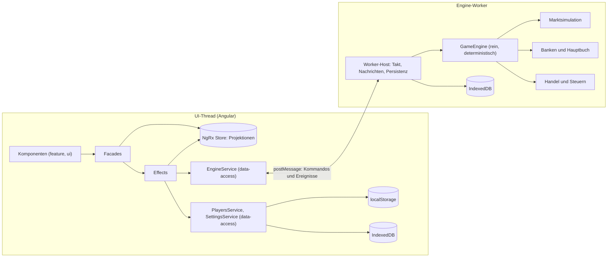
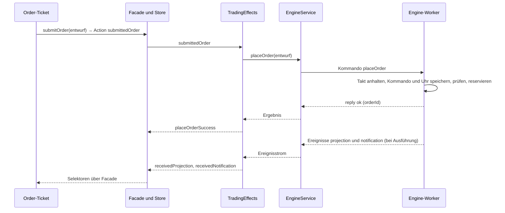
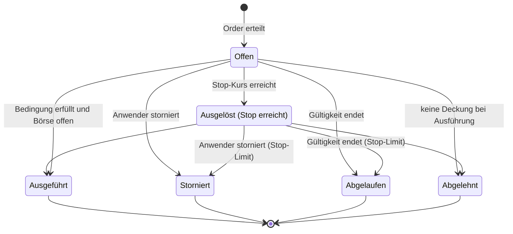

# PortfoliGo – Technische Spezifikation

> **Status:** Entwurf v0.2 · **Stand:** 10.11.2026
> **Siehe auch:** [Produktspezifikation](./produktspezifikation.md) · [Projektplan](../projektplan.md)

Dieses Dokument beschreibt, _wie_ PortfoliGo gebaut wird. Die allgemeinen Code-Konventionen stehen in [`CLAUDE.md`](../../CLAUDE.md) und gelten unverändert; hier stehen die projektspezifischen Entscheidungen. Wo dieses Dokument Ergänzungen oder Ausnahmen zu `CLAUDE.md` vorschlägt, sind sie in [§11.2](#112-ergänzungen-für-claudemd) gesammelt. Entscheidungen und ihr Status stehen in [§16](#16-entscheidungen), Risiken in [§17](#17-risiken).

## Inhalt

1. [Rahmen und Abhängigkeiten](#1-rahmen-und-abhängigkeiten)
2. [Architektur](#2-architektur)
3. [Zeitmodell](#3-zeitmodell)
4. [Determinismus und Zufall](#4-determinismus-und-zufall)
5. [Weltgenerierung](#5-weltgenerierung)
6. [Marktmodell](#6-marktmodell)
7. [Wirtschaftsmodell](#7-wirtschaftsmodell)
8. [Engine](#8-engine)
9. [Persistenz](#9-persistenz)
10. [Export und Import](#10-export-und-import)
11. [Frontend-Architektur](#11-frontend-architektur)
12. [Benachrichtigungen](#12-benachrichtigungen)
13. [Plattform: PWA und Capacitor](#13-plattform-pwa-und-capacitor)
14. [Qualitätssicherung](#14-qualitätssicherung)
15. [Versionierung und Kompatibilität](#15-versionierung-und-kompatibilität)
16. [Entscheidungen](#16-entscheidungen)
17. [Risiken](#17-risiken)

## 1. Rahmen und Abhängigkeiten

### 1.1 Ist-Stand (09.11.2026)

- Angular 22.0.1 (standalone, zoneless), NgRx 22 (Store, Effects, Entity, Router Store, Devtools), RxJS 7.8, `idb` 8, Vitest 4 über `ng test`, ESLint 9 mit angular-eslint, Prettier 3, TypeScript 6.
- Hash-Routing, `@angular/localize` mit Quellsprache `de`, Build nach `www/`, Deployment über GitHub Actions per SFTP.
- **Baseline:** `ng build` läuft, warnt aber, weil `.browserslistrc` Browser außerhalb der Angular-22-Unterstützung enthält. `ng lint` meldet einen Fehler: `src/environments/environment.model.ts` importiert Dateien des gelöschten Prototyps. `ng test` bricht ab, weil es noch keine Tests gibt.
- **Node:** Angular CLI 22 verlangt Node ≥ 22.22.3 (steht in `.nvmrc`). Die Standard-Shell nutzt derzeit 22.12.0, daher vor jeder Session `nvm use`.
- **Reste des Ionic-Prototyps:** `ionic.config.json`, `capacitor.config.ts`, Ionic-Schematics in `angular.json`, `--ion-*`-Variablen in `src/theme/variables.scss`, Ionic-Hinweise in `src/test-setup.ts` und `.vscode/settings.json`, Ionic CLI in der CI, `author`/`homepage` in `package.json`.
- **Seit AP 0.1 (10.11.2026):** Ionic-Reste und `uuid` entfernt, Browserslist nach §1.3 angehoben; `ng build` ohne Warnung, `ng lint` und `ng test` grün. Die Umgebung (`src/environments/`) enthält nur noch `production`, `storeDevtools` (`StoreDevtoolsOptions | null`) und `devPages` (Flag für Labor und Entwicklerseiten); die IndexedDB-Konfiguration kommt nicht mehr aus der Umgebung, sondern aus dem Schema in `persistence/data-access` (AP 0.3).
- **Seit AP 0.2 (10.11.2026):** Tailwind CSS v4 über `@tailwindcss/postcss` (`.postcssrc.json`), globaler Einstieg `src/styles.css` mit den Tokens `--pgo-*` (§11.5), Inter Variable selbst gehostet, `prettier-plugin-tailwindcss`. Das Theme folgt vorläufig `prefers-color-scheme` (`ColorSchemeService` in `shared/data-access`). Token-Übersicht mit Kontrastprüfung unter `#/lab/tokens`. Die Ergänzungen aus §11.2 stehen in `CLAUDE.md`.
- **Seit AP 0.3 (10.11.2026):** `app.config.ts` mit Router, Store, Effects, Router Store, Devtools (nur Entwicklung) und `LOCALE_ID` `de`; `@angular/cdk` und `fake-indexeddb` installiert. `persistence/data-access` enthält das framework-freie IndexedDB-Schema mit Migrationen (§9.1, §9.7), `IndexedDbService` und `LocalStorageService` (§9.3); `shared/domain` Geldtypen, Rundung und Preisraster (§6.7, §7.1); `shared/util` und `shared/ui` die Formatierungsfunktionen und Pipes (§11.9).
- **Seit AP 0.4 (10.11.2026):** Angular auf 22.2 angehoben (CLI und Build 22.2.6, Framework 22.2.5, CDK 22.2.6), `@angular/aria` 22.2.6 zugelassen (E-16), Browserslist entsprechend angehoben (§1.3). App-Shell unter `/game/:playerId` mit Kopfzeile, Seitennavigation (Desktop) und unterer Leiste (Smartphone); Routen-Gerüst nach §11.4 mit Platzhalterseiten in den Ziel-Domänen; Grundkomponenten in `shared/ui` (Übersicht unter `#/lab/components`).

### 1.2 Abhängigkeiten

| Paket                                                                | Zweck                                         | Status                          |
| -------------------------------------------------------------------- | --------------------------------------------- | ------------------------------- |
| `@angular/*`                                                         | Framework                                     | vorhanden                       |
| `@angular/cdk`                                                       | Overlay, Dialog, A11y, Scrolling, Table u. a. | vorhanden (AP 0.3)              |
| `@angular/aria`                                                      | ARIA-Muster: Tabs, Menüs (E-16)               | vorhanden (AP 0.4)              |
| `@angular/service-worker`                                            | PWA                                           | neu (M6)                        |
| `@ngrx/store`, `effects`, `entity`, `router-store`, `store-devtools` | State Management                              | vorhanden                       |
| `@ngrx/operators`                                                    | `concatLatestFrom` in Effects                 | vorhanden (AP 1.7)              |
| `rxjs`                                                               | Streams                                       | vorhanden                       |
| `idb`                                                                | Promise-Wrapper für IndexedDB                 | vorhanden                       |
| `lightweight-charts`                                                 | interaktive Kurscharts (E-04)                 | vorhanden (AP 1.7, 5.3.0)       |
| `bootstrap-icons`                                                    | Icons                                         | vorhanden                       |
| `tailwindcss`, `@tailwindcss/postcss`, `postcss` (dev)               | Styling (E-06)                                | vorhanden (AP 0.2)              |
| `fake-indexeddb` (dev)                                               | IndexedDB in Unit-Tests                       | vorhanden (AP 0.3)              |
| `prettier-plugin-tailwindcss` (dev)                                  | Sortierung der Utility-Klassen                | vorhanden (AP 0.2)              |
| `@fontsource-variable/inter`                                         | Schrift Inter (SIL OFL), selbst gehostet      | vorhanden (AP 0.2)              |
| `uuid`                                                               | –                                             | entfernt, `crypto.randomUUID()` |

**Regel:** Außer dem Angular CDK kommen keine UI-Frameworks oder Komponentenbibliotheken hinzu. NgRx ist eine State-Bibliothek und durch `CLAUDE.md` gesetzt. Jede neue Laufzeitabhängigkeit braucht einen Eintrag in §16.

### 1.3 Browser, Plattform-APIs und HTTPS

`.browserslistrc` folgt den Mindestanforderungen von Angular und Tailwind CSS v4, damit der Build ohne Warnung läuft: Chrome und Edge ≥ 119, Firefox ≥ 128, Safari und iOS ≥ 17.0. Tailwind v4 allein bräuchte Chrome/Edge ≥ 111 und Safari/iOS ≥ 16.4; Angular 22.2 setzt die Grenze höher (Baseline „widely available“ zum 07.05.2026, angehoben in AP 0.4).

Genutzte Plattform-APIs: Web Worker (Modul-Worker), IndexedDB, Web Locks, Page Visibility, Web Crypto (`subtle.digest`, `randomUUID`), Storage Manager (`persist`), Notification API, Service Worker, Clipboard.

**HTTPS ist Pflicht.** Web Crypto (`subtle`, `randomUUID`), Web Locks, Service Worker, `storage.persist()` und Benachrichtigungen gibt es nur in einem sicheren Kontext (HTTPS oder `localhost`). Die Produktion läuft daher ausschließlich über HTTPS (`https://algoristic.de/portfoligo/`). Für Tests auf Mobilgeräten im lokalen Netz wird `ng serve --ssl` verwendet. Spielkritische Berechnungen wie der Seed-Schlüssel kommen ohne diese APIs aus (§4.1).

## 2. Architektur

### 2.1 Überblick



### 2.2 Grundsätze

1. **Die Engine ist autoritativ.** Alle Spielregeln laufen im Worker. Die UI sendet Kommandos und zeigt Projektionen; sie rechnet keine Spielregeln nach (Ausnahme: Vorschauen, die dieselben Domain-Funktionen nutzen).
2. **Die Engine ist rein.** `GameEngine` hat keine Abhängigkeit zu DOM, Angular, Uhr oder Speicher. Dadurch ist sie in Vitest ohne TestBed testbar und vollständig reproduzierbar. I/O findet nur im Worker-Host statt.
3. **Der Markt hängt nicht vom Spieler ab:** Markt = f(Seed, Simulationsversion, Spielzeit). Jeder Kurs ist eine reine Funktion der Spielzeit (`priceAt`, §6.1); vergangene Kurse werden bei Bedarf neu berechnet statt gespeichert. Auch Beobachten (Abfragen, Abos) und Handeln verändern den Marktzustand nicht (§6.6).
4. **Der Spielerzustand ist reproduzierbar:** Spielerzustand = f(Startbedingungen, Markt, Kommandos). Kommandos sind die einzige nicht-deterministische Eingabe; darauf beruht die Persistenz (§9).
5. **Market-Data-Feed-Prinzip:** Die UI abonniert Kurse nur für die Instrumente, die die aktuelle Ansicht braucht, und erhält Projektionen gedrosselt (§8.4) – wie ein Client einer echten Handelsplattform.

### 2.3 Datenfluss am Beispiel einer Kauforder



## 3. Zeitmodell

### 3.1 Spielzeit und Kalender

```ts
type Tick = number; // ganze Spielminuten seit der Epoche 01.01.2020, 00:00 Uhr Spielzeit
```

- **Epoche** 01.01.2020, 00:00 Uhr. **Spielstart (E-02):** Montag, 01.04.2030, 00:00 Uhr = Tick 5.389.920 (`GAME_START_TICK`).
- Der Start an einem Monatsersten sorgt für einen vollständigen ersten Monat: Der Bank-Lauf um 06:00 Uhr bucht die Lebenshaltung, das erste Gehalt folgt am Monatsende.
- Die gut zehn Jahre vor dem Start sind Vorlauf. Er entsteht mit demselben Modell wie das Spiel und ist ebenso minutengenau abrufbar (§6.8).
- Der Kalender ist für alle Spieler gleich. Nur so ergibt derselbe Seed dieselbe Welt, und fiktive Zukunftsdaten werden nicht mit echten Kursverläufen verwechselt.
- Eine Spielzeitzone ohne Sommerzeit (angelehnt an MEZ). Umrechnungen nutzen ausschließlich UTC-Arithmetik (`Date.UTC`, `getUTC*`), nie die lokale Zeitzone.
- Reine Kalenderfunktionen in `clock/domain`: Tick ↔ Datum, Wochentag, Tagesindex, Monats- und Jahresgrenzen, Bankarbeitstage (Mo–Fr; Feiertage ab Stufe 2), erster und letzter Bankarbeitstag eines Monats. Sie rechnen ganzzahlig (Tage ↔ Datum nach Hinnant, proleptischer Gregorianischer Kalender) und ohne `Date`; nur `formatGameTime`/`formatGameDate` nutzen `Intl.DateTimeFormat` mit `timeZone: 'UTC'`.
- Die Tick-Länge steckt in Konstanten (`TICKS_PER_MINUTE`, `TICKS_PER_HOUR`, `TICKS_PER_DAY`, `TICKS_PER_WEEK`, `GAME_SECONDS_PER_TICK` in `clock/domain/models/time.model.ts`). Code außerhalb von `clock/domain` rechnet mit ihnen statt mit Literalen wie `60` oder `1440`, damit ein späterer Wechsel der Tick-Länge billig bleibt. Handelszeiten werden weiter in Minuten des Spieltags angegeben.

### 3.2 Tick: eine Spielminute (E-02)

Ein Tick ist die kleinste Zeiteinheit für Kurse, Orders und Buchungen. Kurse werden dabei nicht Minute für Minute fortgeschrieben, sondern mit dem **Brückenmodell** berechnet (E-20, §6.1): Ein Tagesschritt legt um 00:00 Uhr die Stützpunkte eines Handelstags fest, Minutenkurse entstehen bei Bedarf als Brownsche Brücke dazwischen. Der Aufwand hängt so an den Instrumenten, die minutengenau gebraucht werden, nicht an der Größe der Welt. Das ist ausschlaggebend, weil die Welt mit den Assetklassen späterer Stufen deutlich größer wird (PS §8).

**Messung** (Prototyp vom 09.11.2026, Node 22.22/V8, Entwicklungsrechner; Rohwerte ohne Orders, Persistenz und Ereignisse). Der Prototyp bildet das Modell aus §6 vereinfacht nach: vier Börsenregionen mit den Handelszeiten aus §3.3 und 10 Faktor-Stützpunkten je Tag; Aktien mit sechs Faktorladungen (Welt, Region, vier weitere), Volatilität 20–45 % p. a., Overnight-Anteil 25 %, vier Sprünge pro Jahr (Mittel −1 %, Streuung 9 %); `sfc32` je Faktor bzw. Instrument und Tag mit vereinfachtem Seeding; `Math.exp`/`Math.log` statt `detExp`/`detLog`.

| Vorgang                                                               | Standardwelt (200 Aktien, 48 Faktoren) | große Welt (10.000 Aktien, 120 Faktoren)                     |
| --------------------------------------------------------------------- | -------------------------------------- | ------------------------------------------------------------ |
| Tagesschritte aller Faktoren und Aktien je Spieljahr                  | 10 ms                                  | 295 ms                                                       |
| Minutenverläufe aller Faktoren je Spieljahr                           | 350 ms                                 | 763 ms                                                       |
| Minutenverlauf einer Aktie für einen Handelstag                       | 17 µs                                  | 17 µs                                                        |
| 1 Spieljahr live                                                      | 1,3 s (alle Aktien minutengenau)       | 1,3 s (50 Instrumente minutengenau, breite Indizes genähert) |
| Last bei 1 w/s                                                        | 2,4 % eines Kerns                      | 2,5 % eines Kerns                                            |
| 1 Spieljahr nachberechnen ohne offene Orders                          | 0,01 s                                 | 0,3 s                                                        |
| Minutenchart einer Aktie für einen beliebigen vergangenen Tag         | 0,2 ms                                 | 0,2 ms                                                       |
| Tageskerzen einer Aktie mit Hoch und Tief über 10 Jahre neu berechnen | 0,42 s                                 | 0,42 s                                                       |

Für `detExp`/`detLog` (§4.4) sowie Orders, Persistenz und Ereignisse wird ein Faktor 4 eingeplant; nachgemessen wird in AP 1.4 und AP 1.5. **Nachmessung AP 1.4** (Vitest, Entwicklungsrechner, mit `detExp`/`detLog` und Seeding nach §4.2): zehn Jahre Tagesschritte der Standardwelt (2.673 Handelstage, 49 Faktoren, 200 Aktien) in 0,40–0,48 s, also rund 45 ms je Spieljahr. Den größten Teil kostet das Erzeugen der rund 250 Ströme je Tag; `StreamFamily` (§4.2) hält das bei rund 0,34 µs je Strom. Nicht gemessen sind Smartphones, ein eigener Strom je Faktor-Intervall (spart bei Neuberechnungen geschätzt rund zwei Drittel der Faktorbrücken, weil nur die Intervalle der Handelszeit nötig sind) und zweistufige Brücken für breite Indizes (§6.6). **Nachmessung AP 1.5** (Vitest, isoliert, Standardwelt): ein Spieljahr mit Tagesschritten und allen Minutenverläufen (49 Faktoren rund um die Uhr, 200 Aktien) in 2,1–2,2 s (Budget ≤ 4 s), unter Last mit parallelen Test-Workern rund 6 s; Minutenchart einer Aktie für einen vergangenen Tag mit kalten Caches in 1,5–2,5 ms (Budget < 50 ms), weil höchstens ein Monat Tagesschritte ab dem letzten Monatsbeginn nachgerechnet wird (§6.8).

Folgerungen:

- 1 w/s belegt mit der Standardwelt rund 10 % eines Kerns. Eine Stufe 1 M/s ist möglich.
- Nachberechnung und Vorspulen rechnen Tagesschritte und nur die Minutenverläufe, die offene Orders brauchen (§3.7): ein Spieljahr ohne offene Orders in deutlich unter einer Sekunde, mit Orders auf ETFs (exakte Indizes, §6.6) in wenigen Sekunden.
- Bei 1 w/s vergehen rund 70 Spieljahre pro Spielstunde. Lange Spiele sind also der Normalfall; Speicher (§9.6) sowie Export und Import (§10) sind darauf ausgelegt.
- Eine größere Welt und weitere Assetklassen kosten live kaum zusätzliche Rechenzeit (§6.10).
- Bei Echtzeit (1 s/s) ändern sich Kurse einmal pro Minute. Für später vorgemerkt: Sekundenwerte zwischen zwei Minuten, ebenfalls per Brücke.

**Verworfen: Minutenmodell** – jede Aktie in jeder Handelsminute fortschreiben. Es ist einfacher, aber der Aufwand wächst mit der Größe der Welt (Messung wie oben, inklusive Kursberechnung und Kerzen-Aggregation je Minute):

| Aktien (Faktoren) | 1 Spieljahr rechnen (Rohwert) | Last bei 1 w/s (Rohwert) |
| ----------------- | ----------------------------- | ------------------------ |
| 200 (48)          | 2,4 s                         | 4,7 % eines Kerns        |
| 1.000 (60)        | 7,9 s                         | 15 %                     |
| 2.000 (80)        | 15 s                          | 29 %                     |
| 10.000 (120)      | 77 s                          | 149 %                    |

- Selbst mit großzügigen Budgets (1 w/s unter 25 % eines Kerns, ein Jahr Nachberechnung unter 10 s, jeweils mit Faktor 2 für Orders und Persistenz) wäre bei rund 600–800 Aktien Schluss.
- Bei 10.000 Aktien wäre 1 w/s nicht erreichbar – mit Orders und Persistenz bräuchte es rund drei Kerne –, und das Nachrechnen der Kurshistorie eines Spielers mit 70 Spieljahren dauerte beim Import rund 3 Stunden.
- Der Vorlauf bräuchte ein zweites Verfahren in Tagesschritten mit genäherten Hoch- und Tiefkursen, das zum Minutenmodell passend kalibriert werden müsste.
- Intraday-Kerzen müssten gespeichert werden: rund 30 MB je Spieler in der Standardwelt, rund 1,2 GB bei 10.000 Aktien.

Weitere verworfene Alternativen:

| Alternative        | Bewertung                                                                            |
| ------------------ | ------------------------------------------------------------------------------------ |
| 1 Tick = 1 Stunde  | Zu grob für Intraday-Handel und Echtzeit; Kurse stünden bei 1 s/s eine Stunde still. |
| 1 Tick = 1 Sekunde | 60-mal mehr Ticks für Uhr, Orders und Ereignisse ohne spielerischen Mehrwert.        |

### 3.3 Handelszeiten (E-18)

| Region          | Beispiele (Börsen fiktiv benannt)                | Handelszeit (Spielzeit)                         |
| --------------- | ------------------------------------------------ | ----------------------------------------------- |
| Asien-Pazifik   | Japan, Australien, Hongkong                      | 01:00–07:00                                     |
| Europa          | Deutschland, Frankreich, Großbritannien, Schweiz | 09:00–17:30                                     |
| Nordamerika     | USA, Kanada                                      | 15:30–22:00                                     |
| Schwellenländer | je Börse, z. B. Indien, Brasilien                | z. B. Indien 04:45–11:00, Brasilien 14:00–21:00 |

- Handelszeiten sind Teil der Börsenkonfiguration in der Welt. Am Wochenende ist geschlossen; Feiertage folgen in Stufe 2.
- Orders können jederzeit erteilt werden; ausgeführt werden sie während der Handelszeit (§7.5). So bleibt „jederzeit verkaufen" aus der Ideensammlung erhalten – unter realen Marktbedingungen.
- Banken buchen an Bankarbeitstagen in einem **Bank-Lauf um 06:00 Uhr** Spielzeit (E-19).

### 3.4 Geschwindigkeiten

| Stufe            | Spielzeit pro Sekunde | Ticks pro Sekunde |
| ---------------- | --------------------- | ----------------- |
| Pause            | –                     | 0                 |
| Echtzeit         | 1 s                   | 1/60              |
| 1 min/s          | 1 Minute              | 1                 |
| 10 min/s         | 10 Minuten            | 10                |
| 1 h/s            | 1 Stunde              | 60                |
| 2 h/s            | 2 Stunden             | 120               |
| 4 h/s            | 4 Stunden             | 240               |
| 1 d/s            | 1 Tag                 | 1.440             |
| 1 w/s            | 1 Woche               | 10.080            |
| (optional) 1 M/s | ca. 30 Tage           | ca. 43.200        |

Die Stufen sind die `as const`-Liste `SPEEDS` in `clock/domain` mit den IDs `realtime`, `1min`, `10min`, `1h`, `2h`, `4h`, `1d`, `1w` (so auch im Export, §10.1) und dem Feld `gameSecondsPerSecond`. Pause ist keine Stufe, sondern ein eigenes Flag. Die optionale Stufe 1 M/s ist noch nicht enthalten.

### 3.5 Taktung

```text
targetTick(now) = anchorTick + floor(max(0, now − anchorRealTime) × gameSecondsPerSecond / (1000 × GAME_SECONDS_PER_TICK))
```

- Die Formel rechnet ganzzahlig, damit Echtzeit (1/60 Tick pro Sekunde) exakt bleibt; sie ist exakt, solange das Produkt unter 2^53 liegt (bei 1 w/s rund 170 Tage Echtzeit seit dem Anker). Eine zurückgestellte Systemuhr ergibt keinen Fortschritt.
- Die Worker-Schleife läuft etwa alle 16 ms und verarbeitet Ticks bis `targetTick`, mit einem Zeitbudget von rund 8 ms pro Durchlauf. Der Rest folgt im nächsten Durchlauf.
- Der Anker (`anchorTick`, `anchorRealTime`) wird bei jedem Wechsel von Geschwindigkeit, Pause oder Sichtbarkeit und nach jedem Kommando neu gesetzt (§8.5).
- Wächst der Rückstand über zwei Sekunden Echtzeit, meldet die Engine „ausgelastet". Ticks werden nie übersprungen; die effektive Geschwindigkeit sinkt.
- Die Uhr in der UI zeigt die Spielzeit aus dem letzten `clock`-Ereignis und interpoliert bei Echtzeit die Sekunden rein optisch.
- Browser drosseln Timer in Hintergrund-Tabs. Weil sich `targetTick` aus der Wanduhr ergibt, holt die Engine Rückstände bei der nächsten Gelegenheit auf.

### 3.6 Hintergrund, Schließen und Pause

- Das Verhalten im Hintergrund ist eine **Spielereinstellung** `backgroundMode`. Sie wird per Kommando gesetzt, gehört zum Spielerzustand und wird mit exportiert:
  - `realtime` (Standard, E-02): Ist die App verborgen oder geschlossen, läuft die Zeit mit 1 s/s weiter; beim Öffnen wird nachberechnet (§3.7). Das entspricht der Ideensammlung.
  - `pause`: Verborgen oder geschlossen ruht die Zeit. Beim Zurückkehren läuft sie mit der gewählten Geschwindigkeit weiter, ohne Nachberechnung.
- `visibilitychange` → `hidden`: Die UI meldet dem Worker „verborgen", die Engine wechselt in den Hintergrundmodus. Bei `visible` gilt wieder die gewählte Geschwindigkeit.
- Bei `hidden` und `pagehide` wird der Uhrzustand gespeichert (§9.2) und ein Snapshot angestoßen.
- **Eine vom Anwender gesetzte Pause bleibt Pause** – auch über Schließen und erneutes Öffnen hinweg (E-02).
- **Auto-Pause** (§12) greift nur im Live-Betrieb bei sichtbarer App und beim Vorspulen. Während der Nachberechnung und bei verborgener App greift sie nicht, sonst ginge die Echtzeit aus der Ideensammlung verloren; die Ereignisse erscheinen im Abwesenheitsbericht.

### 3.7 Nachberechnung und Vorspulen

- **Nachberechnung beim Laden:** Δ = jetzt − `lastSeenAt` (negative Werte werden zu 0, z. B. bei zurückgestellter Systemuhr). Ist das Spiel nicht pausiert und `backgroundMode` = `realtime`, wird bis `savedTick + Δ / 60 s` im Stapelbetrieb gerechnet. Der Fortschritt wird etwa alle 100 ms gemeldet. Kommandos sind währenddessen gesperrt. Ereignisse werden gespeichert, aber nicht als Toast gezeigt, sondern für den Abwesenheitsbericht zusammengefasst.
- **Vorspulen:** derselbe Stapelbetrieb bis zum Ziel; abbrechbar nach dem laufenden Tick; bricht ab, wenn ein Ereignis mit Auto-Pause eintritt.
- **Stapelbetrieb:** Tagesschritte für den ganzen Markt (§6.1); Minutenkurse nur dort, wo offene Orders sie brauchen – für Instrumente mit offenen Orders und für Indizes hinter ETFs mit offenen Orders. Sparpläne nutzen den Eröffnungskurs, Dividenden und Bank-Lauf sind Tagesgrößen. Hoch- und Tiefkurse der übersprungenen Tage ergänzt danach ein Hintergrundauftrag (§6.8).
- **Determinismus:** Stapelbetrieb und Live-Betrieb liefern identische Ergebnisse (Test, §4.6).

### 3.8 Ablauf eines Ticks

1. **Terminplaner:** alle Termine mit Fälligkeit ≤ Tick, in fester Reihenfolge:
   - Tageswechsel: an Handelstagen zuerst der **Markt-Tagesschritt** (§6.1) – Marktphase, Trends, Volatilitäten und Stützpunkte der Faktoren, dann die Tagesstützpunkte aller Instrumente (Eröffnung mit Overnight-Effekt und Ex-Tag-Abschlag, Schluss, Sprünge, Dividendenankündigungen) und die Fortschreibung der ETF- und Indexzustände (§6.6). Der Tagesschritt legt dabei auch fest, wie sich `R` und der Ausschüttungstopf an den Eröffnungen des Tages ändern; sie hängen nur von Stützpunkten ab. Danach Zinsabgrenzung und Tageswerte.
   - Bank-Lauf: zuerst Gutschriften (Gehalt, Dividenden, Zinsen), dann Lastschriften (Lebenshaltung, Gebühren).
   - Handelsbeginn je Börse: Ereignisse der Ex-Tage von Aktien und ausschüttenden ETFs (die Wirkung auf `R` und den Ausschüttungstopf hat der Tagesschritt schon je Stützpunkt festgelegt; die Ausschüttung eines ETFs meldet `MarketDay.etfExCents`), Sparpläne zum Eröffnungskurs.
   - Handelsschluss je Börse: Tageskerzen der Instrumente und Indizes festschreiben, deren Handel endet (§6.8).
   - Orderablauf, Monats- und Jahresabschluss.
2. **Handel:** für jede offene Order eines Instruments mit offener Börse den Kurs `priceAt(instrument, tick)` bestimmen, prüfen und ggf. ausführen. Geld und Brief sind reine Funktionen des Kurses (§6.7). Faktoren und Instrumente werden pro Tick nicht fortgeschrieben.
3. **Konten:** Deckung prüfen, Ereignisse erzeugen, ggf. Auto-Pause auslösen.
4. **Tagesreihen** fortschreiben (Vermögen zum Tagesende).
5. **Ereignisse** puffern; der Worker-Host leitet sie gedrosselt an die UI weiter und berechnet dabei die Quotes der Abos per `priceAt` (§8.4).

Kommandos der UI werden zwischen zwei Ticks angewendet und mit dem Tick protokolliert, nach dem sie wirksam werden (§8.5).

## 4. Determinismus und Zufall

### 4.1 Seed

- Der Seed ist frei wählbarer Text. Vorschläge sind gut teilbar, z. B. `kupfer-falke-731`: zwei deutsche Wörter aus festen Listen (je 100, nur `a–z`, ohne Umlaute) und eine Zahl von 100 bis 999 (`generateSeed` in `simulation/util`). Die Zufallsquelle für Vorschläge übergibt der Aufrufer (`crypto.getRandomValues`); sie gehört nicht zur Simulation.
- Normalisierung: Leerraum am Rand entfernen, Kleinschreibung, Unicode-Normalform NFC.
- Ableitung: MurmurHash3 x86_128 (Hash-Seed 0, in TypeScript implementiert) über die UTF-8-Bytes des normalisierten Seeds ergibt den **Seed-Schlüssel** `seedKey` (4 × uint32, h1–h4). Er braucht keine kryptografische Stärke, ist synchron berechenbar und funktioniert ohne sicheren Kontext.

### 4.2 Zufallsströme

```ts
const rng = createStream(seedKey, `market/instrument/${instrumentId}/${dayIndex}`);
```

- Der Startzustand jedes Stroms ist MurmurHash3 x86_128 über die 16 Bytes von `seedKey` (little-endian) gefolgt von den UTF-8-Bytes eines stabilen Schlüssels; h1–h4 werden zu a, b, c und Zähler von `sfc32` (schnell, gute statistische Qualität, 128-Bit-Zustand). Die ersten 12 Ausgaben werden verworfen. Mit 128 Bit sind Kollisionen zwischen Strömen praktisch ausgeschlossen – bei nur 32 Bit gäbe es schon in einem Spieljahrzehnt Dutzende identische Ströme.
- Beispiele für Schlüssel: `world/companies`, `world/indices`, `world/etfs`, `world/banks` (je ein Strom pro Stufe der Weltgenerierung, §5.1), `world/dividends` (Ex-Tag-Rhythmus der Unternehmen, nach den Banken gezogen, damit sich die übrigen Attribute nicht verschieben), `world/etf-terms` (Startkurs der ETFs und Ex-Tag-Rhythmus der ausschüttenden, danach gezogen), `market/regime/<tag>`, `market/factor/<id>/init` (Startzustand an der Epoche, §6.2), `market/factor/<id>/<tag>` (Tagesschritt), `market/factor/<id>/<tag>/bridge/<intervall>` (Minutenwerte), `market/instrument/<id>/<tag>` (Tagesschritt), `market/instrument/<id>/<tag>/bridge` (Minutenwerte), `market/etfs/<tag>` (Tracking-Rauschen aller ETFs, eine Zahl je ETF in ETF-Reihenfolge; ein Strom je ETF kostete rund 25 ms Vorlauf, neue ETFs werden angehängt und verschieben die übrigen nicht), `life/living-costs/<monat>`.
- `<tag>` ist der Tagesindex seit der Epoche (`dayIndex`), Faktor-IDs sind `world`, `region:<id>`, `sector:<id>`, `industry:<id>`, `style` und `size`. Für Schlüssel, die sich nur im angehängten Tagesindex unterscheiden, hasht `StreamFamily` (`simulation/util`) Seed-Schlüssel und Präfix nur einmal; das Ergebnis ist bitgleich zu `createStream` mit dem vollständigen Schlüssel. Ein optionaler Suffix nach dem Tagesindex (`create(tag, utf8Encode('/bridge'))`) deckt die Brückenströme ab.
- **Vorteile:** Ströme sind unabhängig (ein neues Instrument verschiebt keine anderen Kurse); jeder Tag eines Faktors oder Instruments lässt sich einzeln neu erzeugen – die Grundlage des Brückenmodells (§6.1); Spielerentscheidungen ziehen nie aus Marktströmen.

### 4.3 Verteilungen

Gleichverteilung (32 oder 53 Bit; ganzzahlig ohne Modulo-Verzerrung), Normalverteilung (Marsaglia-Polarmethode; der zweite Wert eines Paars wird im Strom gemerkt und beim nächsten Aufruf verwendet), Poisson (Inversion für 0 ≤ λ ≤ 30), Lognormal, gewichtete Auswahl, Mischen (Fisher-Yates). Alle als reine Funktionen über einem Strom (`simulation/util/distributions.ts`).

### 4.4 Deterministische Mathematik

`Math.exp`, `Math.log`, `Math.pow`, `Math.sin` usw. sind laut ECMAScript implementierungsabhängig; V8, SpiderMonkey und JavaScriptCore können im letzten Bit abweichen. Über viele Ticks und an Schwellen (Limit erreicht? Rundung auf Cent?) würde das browserübergreifend zu anderen Ergebnissen führen.

Deshalb nutzt Simulationscode nur IEEE-754-exakte Operationen (`+ − × ÷`, `Math.sqrt`, `Math.floor`, `Math.round`, `Math.abs`, `Math.min`, `Math.max`) und eigene Implementierungen `detExp` und `detLog` (Portierung von fdlibm 5.3 `e_exp.c` und `e_log.c`, Genauigkeit ≤ 1 ulp, bitidentisch auf allen Engines). Potenzen werden über `detExp(b × detLog(a))` oder Multiplikation gebildet, nicht mit `**`. Die UI darf `Math.*` frei verwenden. Eine ESLint-Regel für `simulation`, `world`, `market` und `clock` (`domain`, `util`, ohne Specs) verbietet die nicht exakten `Math`-Funktionen, `**`, `Math.random`, `Date.now`, `new Date`, `performance.now` und `crypto`.

### 4.5 Regeln für Simulationscode

1. Kein `Math.random`, `Date.now`, `performance.now` oder `crypto.getRandomValues` – Zeit und Zufall kommen nur aus Tick und Strömen.
2. Keine Iteration über Objekte oder Maps mit unklarer Reihenfolge, wenn die Reihenfolge das Ergebnis beeinflusst; stattdessen Arrays oder sortierte Schlüssel.
3. Summen in fester Reihenfolge bilden.
4. Geldbeträge nur über die zentralen Rundungsfunktionen (§7.1).
5. Ergebnisse dürfen nicht davon abhängen, wie viele Ticks pro Durchlauf verarbeitet werden.
6. Abfragen, Abos, Caches und Orders verändern den Marktzustand nie (§6.6).
7. Abfragen und Ereignisse enthalten nie Kurse nach dem aktuellen Tick. Der Tagesschritt kennt die Schlusskurse des Tages schon um 00:00 Uhr; sie bleiben intern (§6.1, §8.2).
8. Der Endpunkt einer Brücke wird als Stützpunkt gesetzt, nie aus der Brücke errechnet (§6.1).

### 4.6 Tests

- **Golden Master:** Seed `golden-1`, ein Spieljahr; die Prüfsumme über alle Tagesschlusskurse und über die Minutenkurse einer festen Stichprobe von Instrument-Tagen ist als Konstante eingecheckt. Prüfsumme: inkrementeller MurmurHash3 x86_128 über die Float64-Bytes (little-endian), als 32 Hex-Zeichen; `-0` und `0` unterscheiden sich, NaN wird kanonisch gehasht (`Checksum` in `simulation/util`). Bricht der Test, ändert sich die Welt für bestehende Seeds – dann ist `simVersion` zu erhöhen (§15).
- **Granularität:** ein Lauf am Stück gegenüber 1.000 Teilstücken – identisch.
- **Snapshot:** Snapshot, Restore und Weiterlauf gegenüber ununterbrochenem Lauf – identisch.
- **Beobachtungsunabhängigkeit:** Die Markt-Prüfsumme ist mit und ohne Abfragen, Abos und Orders identisch.
- **Stromunabhängigkeit:** Ein zusätzliches Instrument ändert die Kurse der übrigen nicht.
- **Bedarf gegen Vorabberechnung:** Minutenkurse, Kerzen und Indexstände sind bitgleich – ob bei Bedarf, vorab oder nach dem Verwerfen aller Caches berechnet. Die neu berechnete Historie eines einzelnen Instruments entspricht der des Gesamtlaufs.
- **Stützpunkte:** Brücken treffen Eröffnung und Schluss bitgenau.
- **Statistische Gleichwertigkeit:** Minutenvolatilität, Korrelation der Minutenrenditen und Tagesspanne entsprechen innerhalb fester Toleranzen einer Referenz-Simulation Minute für Minute (Testhelfer, kein Produktivcode). Die Referenz-Simulation schreibt Faktoren und unternehmensspezifischen Anteil mit denselben Parametern (Tagesvolatilitäten aus dem Tagesschritt) Minute für Minute fort; Sprünge treten je Handelsminute mit Wahrscheinlichkeit `λ / (261 · L)` auf. Verglichen wird über mindestens 3.000 Handelstage ohne Sprünge; die Prototyp-Werte in §6.1 geben die Größenordnung der Toleranzen vor.
- **Abfragegrenze:** Keine Abfrage und kein Ereignis enthält Werte nach dem aktuellen Tick.

## 5. Weltgenerierung

### 5.1 Ablauf

Seed → Weltparameter → Regionen, Länder, Börsen → Sektoren, Branchen → Unternehmen → Indizes → ETF-Emittenten und ETFs → Banken → Tagesschritte von der Epoche bis zum Spielstart (§6.1) → Marktzustand zum Spielstart.

Die Welt ist deterministisch. Sie wird bei jedem Laden in unter einer Sekunde neu erzeugt und nicht gespeichert (§9). Die Marktzustände zu Monatsbeginn (§6.8) werden ebenfalls neu erzeugt oder klein mitgespeichert; das legt AP 2.3 fest. Den Marktzustand zum Spielstart berechnet die Engine beim Anlegen eines Spielers; der Vorlauf ist danach wie jeder Spieltag minutengenau abrufbar.

### 5.2 Umfang der Standardwelt (E-13)

| Element               | Anzahl      |
| --------------------- | ----------- |
| Regionen              | 4           |
| Länder bzw. Börsen    | ca. 12      |
| Sektoren / Branchen   | 11 / ca. 30 |
| Aktien                | ca. 200     |
| Indizes               | 22          |
| ETF-Emittenten / ETFs | 5 / ca. 30  |
| Banken                | 6–8         |

Alle Mengen und Verteilungen stehen zentral in einer Weltkonfiguration (`DEFAULT_WORLD_CONFIG` in `world/domain`), damit sie im Simulations-Labor (§14.2) kalibriert werden können. Die Aktien werden nach festen Gewichten auf Regionen und Länder verteilt (Nordamerika 40 %, Europa 30 %, Asien-Pazifik 18 %, Schwellenländer 12 %), die Branchen werden zufällig nach Gewicht gezogen. Länder, Börsen, Sektoren und Branchen sind fest vorgegeben und hängen nicht vom Seed ab. Die Größe der Welt beeinflusst die Rechenzeit im Spiel kaum (§3.2); Grenzen setzen eher Bedienung, Namensgenerator und die exakt berechneten Indizes (§6.6). Eine deutlich größere Welt ist als Meilenstein M11 geplant (§5.8).

### 5.3 Klassifikation und Modellwirkung

| Dimension              | Wirkung im Modell                                                          |
| ---------------------- | -------------------------------------------------------------------------- |
| Region                 | Regionsfaktor, Handelszeiten; ab Stufe 2 Währung                           |
| Sektor, Branche        | Sektor- und Branchenfaktor mit mehrjährigen Trends                         |
| Größe                  | Größenfaktor (Small-Cap-Prämie und -Risiko), Spread, idiosynkratische Vola |
| Stil                   | Value-/Growth-Faktor; ab Stufe 2 Zinsempfindlichkeit                       |
| Konjunkturabhängigkeit | Beta zum Weltfaktor (defensiv < 1 < zyklisch)                              |
| Dividendenprofil       | Ausschüttungen und Ex-Tag-Abschläge                                        |
| Risiko                 | idiosynkratische Volatilität, Häufigkeit von Kurssprüngen                  |

### 5.4 Unternehmen

- **Stammdaten:** stabile `id` (z. B. `stk-0042`), Name, Ticker (2–5 Zeichen, eindeutig), fiktive Kennung im ISIN-Format mit Prüfziffer und dem Präfix `QP` aus dem benutzerdefinierten ISO-3166-Bereich QM–QZ, das kein echtes Wertpapier trägt, Land, Börse, Sektor, Branche, Gründungsjahr, Mitarbeiterzahl.
- **Kurzprofil:** Die Engine erzeugt keinen Fließtext, sondern einen Vorlagen-Code mit Parametern (Vorlage `market-leader`, `challenger`, `specialist` oder `family-owned`, Schwerpunkt-Code der Branche; Branche, Land und Gründungsjahr stehen in den Stammdaten). Der Text entsteht in der UI per `$localize` (§8.6).
- **Größe:** Marktkapitalisierung aus einer schiefen Verteilung (lognormal oder Pareto: wenige sehr große, viele kleine Unternehmen); daraus Aktienanzahl und Startkurs zur Epoche (lognormal, 5–500 €) sowie Streubesitz (50–100 %). Größenklassen: Large Cap ab 10 Mrd. €, Mid Cap ab 2 Mrd. €.
- **Modellparameter:** Stil, Konjunkturabhängigkeit, Faktorladungen, idiosynkratische Volatilität, Sprungintensität, Dividendenrendite und -frequenz. Sie entstehen aus den Neigungen der Branche plus Zufall; die Risikoklasse 1–5 folgt aus der geschätzten Gesamtvolatilität. Die Startwerte stehen in der Weltkonfiguration und werden in AP 1.9 kalibriert.
- **Dividendentermin:** Jedes ausschüttende Unternehmen hat einen festen Jahresrhythmus (`dividend.schedule`): Monat des ersten Ex-Tags im Jahr (`1 … 12 / Zahlungen pro Jahr`) und Tag 1–28; der Termin wiederholt sich alle `12 / Zahlungen pro Jahr` Monate (§6.5).
- **Sparplanfähigkeit:** Attribut `savingsPlanEligible`; bei Aktien für Large Caps gesetzt.
- **Namen:** Wortbausteine je Branche und Rechtsform je Land (AG, SE, Inc., Corp., plc, S.A., N.V., K.K. …). Eine Blockliste verhindert reale Marken und Unternehmensnamen (kurze Einträge treffen ganze Wörter, längere auch Wortanfänge und zusammengeschriebene Wörter); Dubletten sind ausgeschlossen, weil jeder fiktive Namenskern (z. B. `Velora`) je Welt nur einmal vorkommt – auch über Banken, Emittenten und Indizes hinweg. Die Bausteine ergeben rund 840 Kerne; das reicht für die Standardwelt, aber nicht für die große Welt aus M11 – dort muss der Namensgenerator erweitert werden (§5.8).

### 5.5 Indizes

- Weltindex (alle Aktien), je Region ein breiter Index und ein Leitindex, je Sektor ein weltweiter Index, ein Small-Cap-Index (alle Small Caps) und ein Dividendenindex (die 30 Werte mit der höchsten Dividendenrendite), zusammen 22 Indizes.
- Leitindizes enthalten die größten Werte der Region nach Streubesitz-Marktkapitalisierung; ihre Größe steht je Region in der Weltkonfiguration (Nordamerika 40, Europa 30, Asien-Pazifik 20, Schwellenländer 12), weil die kleineren Regionen für Top 30–50 zu wenige Aktien haben.
- Je Index ein Kurs- und ein Performanceindex (§6.6), gewichtet nach Streubesitz-Marktkapitalisierung; optional mit Kappung je Wert (Standard: Leitindizes 15 %, Sektorindizes 25 %, Dividendenindex 10 %).
- In Stufe 1 ist die Zusammensetzung fest; Anpassungen folgen in Stufe 2.
- Indexnamen sind fiktiv (Wortbausteine und Anzahl der Werte).

### 5.6 ETFs

Emittent, abgebildeter Index, Ertragsverwendung (ausschüttend: quartalsweise oder jährlich; thesaurierend), TER (0,05–0,65 %), Replikation (bestimmt den Tracking-Fehler, §6.6), Fondsvolumen, Startkurs zur Epoche (15–150 €, lognormal) und bei ausschüttenden ETFs ein fester Ex-Tag-Rhythmus wie bei Aktien (§5.4); Startkurs und Rhythmus kommen aus dem eigenen Strom `world/etf-terms`. Alle ETFs sind sparplanfähig (`savingsPlanEligible`). Es gibt mehrere ETFs auf denselben Index mit unterschiedlicher TER, damit sich der Kostenvergleich lohnt; ETFs auf denselben Index stammen von verschiedenen Emittenten. Die Standardwelt hat 30 ETFs auf Welt-, Regions-, Leit-, vier Sektor-, Small-Cap- und Dividendenindizes (Dividenden-ETFs schütten immer aus). Alle ETFs werden an der deutschen Börse gehandelt.

### 5.7 Banken

Die Konditionen werden innerhalb typischer Spannen gezogen (E-17):

| Typ                   | Girokonto                                   | Dispo   | Zinsen                    | Depot                            | Order                                         | Sparplan  | Handelsplatz                                 |
| --------------------- | ------------------------------------------- | ------- | ------------------------- | -------------------------------- | --------------------------------------------- | --------- | -------------------------------------------- |
| Filialbank (Hausbank) | 6–12 €/Monat                                | 10–14 % | Tagesgeld 0–0,5 %         | 0,10–0,25 % p. a., mind. 25–45 € | 0,25 %, mind. 10 €, max. 60 € + Börsenentgelt | 1,5–2,5 % | Börse                                        |
| Direktbank            | 0 € ab 700 € Geldeingang, sonst 4–6 €/Monat | 7–10 %  | Tagesgeld 1,5–3 %         | kostenlos                        | 4–6 € + 0,25 %, max. 60–70 €                  | 1–1,5 %   | Börse                                        |
| Onlinebroker          | –                                           | –       | –                         | kostenlos                        | 4–6 € pauschal + Börsenentgelt                | 0–1,50 €  | Börse                                        |
| Neobroker             | –                                           | –       | Verrechnungskonto 1–2,5 % | kostenlos                        | 0–1 €                                         | kostenlos | Market Maker (Spread-Aufschlag), Bruchstücke |

Die Standardwelt hat je zwei Filial- und Direktbanken sowie je ein bis zwei Online- und Neobroker. Beträge werden auf 10 Cent, Sätze auf 0,05 Prozentpunkte gerundet (Depotgebühr und Spread-Aufschlag auf 0,01, Überziehungsaufschlag auf 0,5 Prozentpunkte). Die Hausbank ist immer eine Filialbank. Brokertypen führen nur Depots mit Verrechnungskonto. Jede Bank hat zusätzlich einen Sollzins für negative Verrechnungskonten (§7.4).

### 5.8 Große Welt (M11)

Meilenstein M11 vergrößert die Welt deutlich: mehr Länder, Börsen und Branchen, einige Tausend bis 10.000 Aktien, entsprechend mehr Indizes und ETFs sowie die Assetklassen aus M7 und M8. Die Zielgröße wird vor dem Start festgelegt. Das Brückenmodell ist dafür ausgelegt (§3.2: 10.000 Aktien und 120 Faktoren gemessen), einige Bausteine der Standardwelt aber nicht. Checkliste:

| Bereich                   | Stand in der Standardwelt                                                                                       | Nötig für die große Welt                                                                                                                                                                                                               |
| ------------------------- | --------------------------------------------------------------------------------------------------------------- | -------------------------------------------------------------------------------------------------------------------------------------------------------------------------------------------------------------------------------------- |
| Namensgenerator (§5.4)    | 42 Anfangs- × 20 Endsilben ≈ 840 Namenskerne je Welt, gemeinsam für Unternehmen, Banken, Emittenten und Indizes | deutlich mehr Kerne (mehr und dreisilbige Bausteine, Namensstile je Region), weil jeder Kern nur einmal vorkommt; Blockliste erweitern; Laufzeit der Prüfung messen                                                                    |
| Ticker und Kennungen      | Ticker aus dem Namen (2–5 Buchstaben) mit Zufallsersatz; ISIN-Format mit Präfix `QP` (36⁹ Kombinationen)        | Ticker ggf. mit Börsenkürzel, damit sie lesbar bleiben; Kennungen reichen                                                                                                                                                              |
| Taxonomie (§5.2, §5.3)    | 12 Länder und Börsen, 31 Branchen, fest im Code                                                                 | mehr Länder und Börsen (mit Feiertagen und Fremdwährungen aus M9), Unterbranchen; mehr Faktor-Stützpunkte je Tag (§6.2) durch zusätzliche Handelszeiten                                                                                |
| Indizes (§5.5, §6.6)      | alle exakt aus den Minutenkursen, deshalb live praktisch alle Tagesverläufe nötig                               | Näherung für breite Indizes (aggregierte Faktorladungen, Sprünge zu ihrer Minute, ggf. zweistufige Brücke) – vorher messen; Leit- und Sektorindizes bleiben exakt; Indexanpassungen mit Divisor (Stufe 2)                              |
| Live-Betrieb (§3.2, §6.1) | Minutenverläufe aller Instrumente                                                                               | Minutenverläufe nur für beobachtete, gehaltene und per Order betroffene Instrumente sowie exakte Indizes; Last bei 1 w/s neu messen (Budget §14.3)                                                                                     |
| Tageskerzen (§6.8)        | Hoch und Tief für alle Instrumente im Hintergrund (rund 5 ms je Handelstag, Vorlauf rund 13 s)                  | linear hochgerechnet bei 10.000 Aktien rund 0,25 s je Handelstag und über 10 Minuten für den Vorlauf: Hoch und Tief nur bei Bedarf und für beobachtete Instrumente, Rest erst beim Abruf                                               |
| Speicher (§9.6)           | rund 1 MB Tageskerzen je Spieljahr                                                                              | bei 10.000 Aktien rund 40 MB je Spieljahr: Kerzen nur für gehaltene und beobachtete Instrumente speichern, andere bei Abruf neu berechnen (sie sind reproduzierbar, E-08); NF-07 und §14.3 anpassen                                    |
| Spielstart und Vorlauf    | Weltgenerierung rund 10 ms, Vorlauf von zehn Jahren ≤ 0,5 s (Budget AP 1.4)                                     | Generierung rund 0,5 s, Vorlauf ein Mehrfaches: Faktorhistorie vorziehen und Instrumente spätestens bei Bedarf rechnen, ggf. Marktzustand je Seed zwischenspeichern; Budget „Spielstart < 2 s“ (NF-02) neu festlegen                   |
| Export und Import (§10)   | Marktzustand vom Tagesbeginn für rund 250 Instrumente                                                           | Größe des Marktzustands messen, ggf. komprimieren; Import-Budget (NF-02) prüfen                                                                                                                                                        |
| Worker und Snapshots      | Marktzustand in Typed Arrays                                                                                    | Speicherbedarf des Workers und der Snapshots messen; die Welt selbst wird weiterhin nicht gespeichert                                                                                                                                  |
| UI (§11.3, §11.10)        | Listen mit rund 250 Instrumenten; Quotes nur für sichtbare Zeilen                                               | virtuelles Scrollen in Screener und Marktübersicht, Suchindex im Worker, Filtern, Sortieren und Blättern in der Engine statt kompletter Listen im Store                                                                                |
| Kalibrierung (§6.9)       | Ziele für 200 Aktien und 48 Faktoren                                                                            | mit der großen Welt neu prüfen (Korrelationen, Indexvolatilität, Rechenzeit der statistischen Tests)                                                                                                                                   |
| Versionen (§15)           | `simVersion` 1                                                                                                  | Die große Welt ändert die Welt jedes Seeds: neue `simVersion`; bestehende Spieler laufen mit der alten Version weiter, die Generatoren bleiben versioniert. Offen: Weltgröße als Wahl beim Anlegen eines Spielers (Standard oder groß) |

## 6. Marktmodell

### 6.1 Struktur und Berechnung (E-20)

Der Markt ist ein Mehrfaktormodell auf Log-Kursen:

```text
ln P_i(t) = c_i + Σ_k β_ik · F_k(t) + U_i(t)
```

- `F_k(t)` ist der kumulierte Log-Stand von Faktor k. Faktoren bewegen sich **wochentags rund um die Uhr**.
- `U_i(t)` ist der unternehmensspezifische (idiosynkratische) Anteil. Er bewegt sich nur während der Handelszeit der Börse von Instrument i, plus Sondereffekte bei Handelsbeginn.
- `c_i` ist eine Konstante aus dem Startkurs.
- Ist die Börse geschlossen, bleibt der offizielle Kurs stehen. Bei Handelsbeginn springt er auf den Modellwert. So entsteht die Overnight-Lücke automatisch aus allem, was die Faktoren während der Schließzeit bewegt hat – „Asien schließt schwach, Europa eröffnet schwächer".

**Berechnung: Brückenmodell.** Kurse werden nicht Minute für Minute fortgeschrieben (Begründung und Messungen: §3.2):

1. **Tagesschritt:** An jedem Handelstag um 00:00 Uhr berechnet die Engine für alle Faktoren und Instrumente die Stützpunkte des Tages – die Faktorstände an den Grenzen der Handelszeiten (§6.2) sowie Eröffnung, Schluss und Sprünge jedes Instruments (§6.4).
2. **Brücke:** Minutenwerte zwischen zwei Stützpunkten entstehen als Brownsche Brücke – ein Zufallspfad, der beide Stützpunkte exakt trifft – aus einem eigenen Strom je Faktor bzw. Instrument und Tag (§4.2).
3. **Bedarf:** Minutenwerte werden nur berechnet, wenn sie gebraucht werden (offene Orders, Abos, Indizes, Charts), und je Faktor bzw. Instrument und Tag zwischengespeichert. In der Standardwelt braucht der Live-Betrieb wegen der exakten Indizes (§6.6) praktisch alle Tagesverläufe.

```text
Brownsche Brücke von X_a (Minute a) nach X_b (Minute b) mit Varianz v_m je Minute
und Restvarianz R_j = v_j + v_(j+1) + … + v_(b−1):

X_(j+1) = X_j + (v_j / R_j) · (X_b − X_j) + √(v_j · (R_j − v_j) / R_j) · z_j      für j = a … b − 2
X_b wird als Stützpunkt gesetzt, nicht aus der Brücke errechnet.
```

- **Reine Funktion:** Jeder Kurs ist eine Funktion `priceAt(instrumentId, tick)` von Welt, Stützpunkten und Strömen. Ob und wann sie aufgerufen wird, ändert kein Ergebnis; die Beobachtungsunabhängigkeit (§4.6) folgt aus der Konstruktion. Der Cache der Tagesverläufe ist reine Optimierung und gehört weder in den Snapshot noch in die Prüfsumme.
- **Gleichwertigkeit:** Bei gleicher Varianz je Minute hat die Brücke exakt dieselbe gemeinsame Verteilung wie eine Simulation Minute für Minute (Messung unten).
- **Stützpunkte setzen:** In Gleitkomma gilt `a + (b − a) = b` nicht immer. Ein um ein ulp abweichender Schlusskurs könnte am Preisraster (§6.7) anders gerundet werden; deshalb Regel 8 in §4.5.
- **Keine Vorschau:** Der Tagesschritt kennt um 00:00 Uhr bereits die Schlusskurse des Tages. Sie bleiben intern: Abfragen und Ereignisse enthalten nie Werte nach dem aktuellen Tick (§4.5, §8.2).
- **Tagesprofil der Volatilität:** Die Varianzen `v_m` des unternehmensspezifischen Anteils dürfen über den Handelstag variieren (höher zur Eröffnung und zum Schluss), ohne die Stützpunkte zu ändern. Parameter `intradayVolProfile` in `MarketConfig`: relative Gewichte über gleich lange Abschnitte der Handelszeit (Minute j fällt in Abschnitt `⌊j · Abschnitte / L⌋`), Standard `[1]` (gleichmäßig); kalibriert wird er in AP 1.9. Ohne ihn ist die Volatilität innerhalb eines Tages konstant; Volatilitäts-Cluster und Leverage-Effekt wirken von Tag zu Tag (§6.2).

- **Minutenverlauf eines Instruments** (`DayCurves`, `market/domain`): Werte zu den Minuten `o … c`. `P(o)` und `P(c)` sind Eröffnung und Schluss und werden direkt aus den Stützpunkten gesetzt; die inneren Werte sind `c_i + Σ_k β_ik · F_k(m) + U(m)` über `priceFromLog`. Die Faktorbrücken werden je Intervall nur bei Bedarf berechnet, Brückenkoeffizienten je Intervall- bzw. Handelszeitlänge einmal vorab.
- **`priceAt` und Abfragegrenze** (`PriceSource`, `market/domain`): Während der Handelszeit (`o ≤ m < c`) gilt der Minutenwert, ab `c` der Schluss, vor der Eröffnung und am Wochenende der Schluss des letzten Handelstags, vor dem ersten Handelstag der Startkurs. Jede Abfrage erhält den aktuellen Tick `now`: Ticks nach `now` und noch nicht gerechnete Tage werfen einen Fehler, Verläufe und Kerzen enden bei `now`. Die Engine übergibt jeden frisch gerechneten Tag (`rememberDay`); vergangene Tage werden aus der Historie nachgerechnet (§6.8). Caches halten eine feste Zahl von Tagen (Standard 8, zuletzt genutzte bleiben).

**Messung AP 1.5** (Vitest, Seed `bridge-equivalence-1`, 3.000 Handelstage, zwei Aktien derselben Börse, ohne Sprünge; Brücke / Referenz-Simulation Minute für Minute): Volatilität der Minutenrenditen 23,53 % / 23,53 % und 27,53 % / 27,54 %, Korrelation 0,097 / 0,098, mittlere Tagesspanne 2,24 % / 2,26 % und 2,60 % / 2,61 %, Volatilität Eröffnung → Schluss 22,96 % / 23,81 % und 27,09 % / 27,44 %. Der Test prüft feste Toleranzen (Volatilitäten ±3 %, Spanne ±4 %, Eröffnung → Schluss ±6 % relativ, Korrelation ±0,03).

**Gleichwertigkeit im Prototyp** (§3.2): 3.000 Handelstage, zwei Aktien derselben Region mit gemeinsamen Faktoren, verglichen mit einer Simulation Minute für Minute mit identischen Parametern (Tagesvolatilitäten der Faktoren aus demselben Lauf).

| Kennzahl                                | ohne Sprünge: Brücke / Minute | mit Sprüngen: Brücke / Minute |
| --------------------------------------- | ----------------------------- | ----------------------------- |
| Volatilität der Minutenrenditen (p. a.) | 29,39 % / 29,36 %             | 34,40 % / 34,14 %             |
| Korrelation der Minutenrenditen         | 0,175 / 0,174                 | 0,122 / 0,130                 |
| mittlere Tagesspanne (Hoch − Tief)      | 2,81 % / 2,80 %               | 2,91 % / 2,88 %               |
| Volatilität Eröffnung → Schluss (p. a.) | 29,02 % / 28,68 %             | 34,29 % / 33,96 %             |

Ohne Sprünge stimmen die Werte bis auf die Stichprobenschwankung überein. Mit Sprüngen schwanken sie stärker, weil rund 45 Sprünge je Aktie einen großen Teil der Varianz ausmachen; die Abweichungen liegen im Rahmen dieser Schwankung.

### 6.2 Faktoren

| Faktor                | Anzahl | Wirkung                      |
| --------------------- | ------ | ---------------------------- |
| Welt                  | 1      | Konjunktur und Marktphasen   |
| Region                | 4      | regionale Entwicklung        |
| Sektor                | 11     | Sektorzyklen                 |
| Branche               | ca. 30 | Branchentrends               |
| Stil (Value – Growth) | 1      | Stilrotation                 |
| Größe (Small – Large) | 1      | Small-Cap-Prämie und -Risiko |

Dynamik je Faktor im Tagesschritt (Handelstag, Δ_T = 1/261 Jahr). Reihenfolge: Marktphase (§6.3), Trend, Stützpunkte, Volatilität für den Folgetag.

```text
m_k ← m_k + κ_m·(m̄_k − m_k)·Δ_T + η_k·√Δ_T·z_m
F_k(g_j) = F_k(g_(j−1)) + (m_k − ½·s_k²)·Δ_j + s_k·√Δ_j·z_j                für die Stützpunkte g_1 … g_n des Tages
ln s_k ← ln s_k + κ_s·(ln s̄_k − ln s_k)·Δ_T + ξ_k·√Δ_T·(ρ·ẑ_k + √(1 − ρ²)·z_s)   mit ρ < 0
```

- **Stützpunkte** `g_0 = 00:00 < g_1 < … < g_n = 24:00`: alle Eröffnungs- und Schlusszeiten der Börsen (Standardwelt: rund 12). `Δ_j` ist der Abstand zweier Stützpunkte in Jahren (Minuten / (261 · 1440)).
- **Minutenwerte** zwischen zwei Stützpunkten: Brücke (§6.1) mit Varianz `s_k² · Δ` je Minute (Δ = 1 / (261 · 1440) Jahre); ein Strom je Faktor, Tag und Intervall, sodass jedes Intervall einzeln erzeugt werden kann.
- `m_k` ist die erwartete (arithmetische) Rendite des Faktors. Die Trends folgen einem Ornstein-Uhlenbeck-Prozess mit Halbwertszeit von Monaten bis Jahren und erzeugen Booms und Flauten ganzer Sektoren und Branchen. Beispiel aus der Ideensammlung: Energie insgesamt positiv, Öl & Gas negativ, Erneuerbare stark positiv.
- **Stochastische Volatilität `s_k`** gilt jeweils für einen Tag. Der Leverage-Effekt (fallende Kurse, steigende Vola) wirkt über die standardisierte Tagesrendite `ẑ_k` auf den Folgetag und erzeugt Volatilitäts-Cluster.
- Am Wochenende ruhen die Faktoren; der Stand am Freitag um 24:00 Uhr ist der Stand am Montag um 00:00 Uhr. Optional in Stufe 2: Wochenend-Nachrichten als Sprung zur Montagseröffnung.
- **Parameter je Faktorklasse** (Welt, Region, Sektor, Branche, Stil, Größe): `m̄`, `κ_m`, `η`, `s̄`, `κ_s`, `ξ`, `ρ` und eine Phasenkopplung `c` (Welt 1, Region 0,5, sonst 0). Die Zielwerte des Tages sind `m̄ + c · (m̄_Phase − m̄_Normal)` und `s̄ · (1 + c · (s̄_Phase / s̄_Normal − 1))`; für den Weltfaktor sind das genau die Werte der Tabelle in §6.3. Die Startwerte stehen in `DEFAULT_MARKET_CONFIG` (`market/domain`) und werden in AP 1.9 kalibriert.
- **Startzustand an der Epoche:** Phase „Normal“, alle Faktorstände `F_k = 0`; `m_k` und `ln s_k` werden aus ihrer stationären Verteilung um die Zielwerte gezogen (Standardabweichung `η / √(2κ_m)` bzw. `ξ / √(2κ_s)`, Strom `market/factor/<id>/init`).
- **Ziehreihenfolge** je Faktor und Tag: Trend, je Intervall zwischen zwei Stützpunkten eine Normalverteilung, Volatilität. `ẑ_k` ist die Summe der Intervall-Schocks, gewichtet mit `√Δ_j`, geteilt durch `√Δ_T`.

### 6.3 Marktphasen

Eine Markov-Kette mit täglichen Übergängen steuert die Zielwerte des Weltfaktors (und abgeschwächt der Regionsfaktoren, §6.2). An jedem Handelstag verlässt der Markt die Phase mit Wahrscheinlichkeit `1 / (mittlere Dauer · 261)`; die Folgephase wird nach festen Gewichten je Phase gezogen (Strom `market/regime/<tag>`, zuerst der Wechsel, dann die Folgephase). Startwerte für die Kalibrierung:

| Phase      | typische Dauer | Trendziel m̄ (arithmetisch, p. a.) | Volaziel s̄ (p. a.) |
| ---------- | -------------- | --------------------------------- | ------------------ |
| Aufschwung | 2–5 Jahre      | +16 %                             | 12 %               |
| Normal     | 1–3 Jahre      | +10 %                             | 15 %               |
| Abschwung  | 0,5–1,5 Jahre  | +1 %                              | 20 %               |
| Krise      | 1–9 Monate     | −25 %                             | 35 %               |

Bei typischen Zeitanteilen (40 / 35 / 17 / 8 %) ergibt das für den Weltfaktor rund 8 % arithmetische bzw. rund 6,5 % geometrische Gesamtrendite bei rund 17 % Volatilität p. a. Dividenden sind darin enthalten; sie fließen als Ex-Tag-Abschläge aus dem Kurs, der Kursindex steigt also um die Dividendenrendite langsamer. In Krisen steigt die Faktorvolatilität stärker als die unternehmensspezifische, dadurch steigen die Korrelationen – wie in echten Crashs. Die Phase ist für den Anwender nicht direkt sichtbar.

### 6.4 Unternehmensspezifischer Anteil

Tagesschritt je Instrument (Handelstag, Börse mit Handelszeit von `o` bis `c`, `L = c − o` Handelsminuten):

```text
U_open  = U_close(Vortag) + √0,25 · σ_i · √Δ_T · ε_on − Ex-Tag-Abschlag (§6.5, ohne Zufallszug)
U_close = U_open + (α_i − ½·σ_i²)·Δ_T + √0,75 · σ_i · √Δ_T · ε + Σ J
Minuten: U(o + j) = U_open + B(j) + Σ_(τ ≤ o + j) J
         mit B = Brücke (§6.1) von 0 nach U_close − U_open − Σ J über L Minuten
```

- `σ_i` je nach Größe und Risiko (Large Cap etwa 15–25 %, Small Cap 30–50 % p. a.); optional mit der Marktvolatilität des Tages skaliert.
- `α_i` ist eine kleine dauerhafte Abweichung (z. B. N(0; 2 %) p. a.), damit es dauerhaft bessere und schlechtere Unternehmen gibt.
- **Overnight:** Der Schock zur Eröffnung trägt etwa 25 % der unternehmensspezifischen Tagesvarianz, die Handelszeit den Rest.
- **Sprünge `J`:** Poisson-Prozess mit 2–6 Sprüngen pro Jahr, Größe normalverteilt mit leicht negativem Mittel (z. B. −1 %) und 6–12 % Streuung. Anzahl, Minuten `τ` und Größen der Sprünge eines Tages zieht der Tagesschritt; die Brücke addiert jeden Sprung ab seiner Minute. `τ` liegt gleichverteilt in `o + 1 … c`, damit die Eröffnung Stützpunkt bleibt; ein Sprung in der Schlussminute ist im Schlusskurs enthalten.
- **Ziehreihenfolge** je Instrument und Tag (Strom `market/instrument/<id>/<tag>`): `ε_on`, `ε`, Anzahl der Sprünge, dann je Sprung Minute und Größe. Die Brücke (AP 1.5) zieht aus einem eigenen Strom.
- **Startzustand:** `U_i = 0` an der Epoche, `c_i = ln(Startkurs)` (§5.4); Eröffnung und Schluss sind `c_i + Σ_k β_ik · F_k + U_i` zur Öffnungs- bzw. Schlusszeit der Börse. Jeder Sprung ist ein strukturiertes Ereignis, das zu seiner Minute ausgelöst wird – später Stoff für den Newsticker.
- Kursuntergrenze 0,01 € (in der Kursfunktion, für Stützpunkte und Minutenkurse gleich). Aktiensplits (Stufe 2) halten Kurse in plausiblen Bereichen.

### 6.5 Dividenden

- Frequenz nach Region: jährlich (Europa, Schwellenländer), halbjährlich (Asien-Pazifik), quartalsweise (Nordamerika). Die Ex-Tage jedes Unternehmens liegen in einem festen Jahresrhythmus aus dem Seed (§5.4): Ex-Tag ist der erste Markttag am oder nach dem Termin (`exDayOnOrAfter` in `market/domain/dividend-logic.ts`).
- **Höhe:** Zielrendite × Schlusskurs des letzten Handelstags vor der Ankündigung ÷ Frequenz, auf Cent gerundet. Kurse des Ankündigungstags selbst gehen nicht ein – der Tagesschritt kennt sie vorab, die Ankündigung würde sie sonst verraten. Die Ankündigung erfolgt 20 Handelstage vor dem Ex-Tag; ab dann ist der Termin im Kalender sichtbar. Ex-Tage, deren Ankündigung vor der Epoche läge, werden am ersten Handelstag mit dem Startkurs angekündigt. Der Marktzustand hält je Instrument den nächsten Ex-Tag und den angekündigten Betrag (`nextExDay`, `dividendCents`) sowie den letzten Log-Schlusskurs (`logClose`); der Tagesschritt meldet Ankündigungen und Ex-Tage im `MarketDay`.
- **Ex-Tag:** Abschlag zur Eröffnung im Tagesschritt nach dem Overnight-Schock (`U_i` sinkt um `ln(P / max(P − D, Untergrenze))`, `P` = Eröffnungskurs vor dem Abschlag; die Untergrenze 0,01 € greift nur nach einem Absturz zwischen Ankündigung und Ex-Tag). Der Abschlag zieht nichts aus den Strömen. Anspruch hat, wer am Vortag zum Handelsschluss hält.
- **Zahltag:** Ex-Tag + 2 Bankarbeitstage; Gutschrift nach Steuer auf das Verrechnungskonto.
- Stufe 2: Dividende aus Gewinn und Ausschüttungsquote, Kürzungen in Krisen.

### 6.6 Indizes, ETFs und abgeleitete Werte

- **Kursindex:** `I(t) = Σ_i n_i · P_i(t) / D` mit Streubesitz-Aktienanzahl `n_i` (mal Kappungsfaktor) und Divisor `D`. In Stufe 1 werden Zusammensetzung und Kappung einmal zur Epoche festgelegt (`createIndexLayout`, `market/domain/index-layout.ts`): Gewichte über der Kappungsgrenze werden auf sie gesetzt, der Überschuss geht anteilig an die übrigen Werte, bis keiner mehr darüber liegt (ist die Grenze mit der Zahl der Werte nicht erreichbar, gelten gleiche Gewichte). `D` ergibt den Startwert zur Epoche und bleibt konstant; er steht deshalb im Layout statt im Zustand. Neugewichtung und Anpassung des Divisors folgen in Stufe 2.
- **Sitzung eines Index:** von der frühesten Eröffnung bis zum spätesten Schluss seiner Werte. Davor und danach gilt der offizielle Stand (Schluss des letzten Handelstags), wie bei Aktien.
- **Exakt zu jeder Minute:** Indexstände innerhalb des Tages sind die gewichtete Summe der Minutenkurse aller Werte; Werte geschlossener Börsen gehen mit ihrem letzten Kurs ein. Summiert wird je Minute in der festen Reihenfolge der Konstituenten; der Wert ist so bitgleich zur Summe der einzelnen `priceAt`-Werte (Test). Gemessen (AP 1.6a): alle 22 Kurs- und Performanceindizes kosten rund 1,6 ms je Handelstag zusätzlich zu den Minutenverläufen der Aktien (rund 9 ms). Eine billige Näherung aus aggregierten Faktorladungen weicht für schmale Indizes zu stark ab (Messung am Ende dieses Abschnitts).
- **Große Welten (später):** Ein exakter Weltindex über 10.000 Werte kostet rund 0,17 s je Handelstag. Für sehr breite Indizes ist deshalb eine Näherung möglich (aggregierte Faktorladungen, Sprünge zu ihrer Minute, exakte Stützpunkte, ggf. zweistufig). Die Methode ist je Index Teil der Weltkonfiguration und hängt nie davon ab, ob ein Index beobachtet wird. Umsetzung in M11 (§5.8).
- **Performanceindex:** `TR(t) = I(t) · R`. Der Reinvestitionsfaktor `R` wird an jedem Ex-Tag eines Konstituenten zu dessen Handelsbeginn um dessen Dividendenanteil erhöht: `R ← R · I_ref / (I_ref − Σ n_i · D_i / D)` über alle Werte, die an dieser Börse ex gehen. `I_ref` ist der Indexstand aus den Vortagesschlüssen, vermindert um die Dividendenpunkte, die an diesem Tag schon früher abgezogen wurden – wie bei Indexanbietern, die den Vortagesschluss verwenden. Dadurch braucht `R` keine Minutenwerte: Der Tagesschritt (`stepIndices`) schreibt `R` für jeden Stützpunkt in den `MarketDay` und den Endstand in den Zustand. Gegenüber einem exakt stetigen Performanceindex weicht das nur in zweiter Ordnung ab (Tagesrendite × Dividendenanteil).
- **Serien:** Aktien, Kurs- und Performanceindizes sowie ETFs haben einen gemeinsamen Serienindex (`series.ts`: Aktien `0 … S − 1`, dann Kursindizes, dann Performanceindizes mit der ID `<Index-ID>-tr`, dann ETFs). `PriceSource` (`priceAt`, `minuteCurve`, `candles`), `dailyCandlesFromSupport` und `createHighLowFill` arbeiten mit Serien. Eröffnung und Schluss eines Index kommen direkt aus den Stützpunkten (§4.5, Regel 8).
- **Indikative Werte:** Für Instrumente geschlossener Börsen gibt es einen indikativen Kurs `P_i · exp(Σ_k β_ik · (F_k(t) − F_k(t_Schluss)))` mit den Faktorständen aus den Brücken (§6.2). Ein ETF auf einen nordamerikanischen Index, der vormittags an einer europäischen Börse gehandelt wird, bewegt sich so plausibel – wie bei einem Market Maker, der Terminkurse einpreist. Umgesetzt (AP 1.6b) als Log-Kurs `c_i + Σ_k β_ik · F_k(m) + U_i` mit eingefrorenem `U_i`: vor der Eröffnung das `U_i` des Vortagesschlusses (`MarketDay.prevIdioClose`), nach dem Schluss das des Tagesschlusses. Zur Schlussminute ist der Wert bitgleich der Schlusskurs; Ex-Tag-Abschlag, `R` und Topf wirken erst zur Eröffnung. Indikative Indexstände sind die gewichtete Summe der indikativen Werte. `DayCurves.indicativeCurve(serie)` liefert den ganzen Tag, `PriceSource.indicativeAt` den Wert zu einem Tick (in der Sitzung von Aktien und ETFs gleich `priceAt`, an Nicht-Handelstagen der letzte Schluss).
- **ETFs als Serien:** ETFs hängen hinter den Performanceindizes am Serienindex (ID = ETF-ID) und handeln in der Sitzung ihrer Börse. Ihr NAV kommt zu jeder Minute aus den indikativen Werten aller Konstituenten; Werte, die gerade handeln, gehen mit ihrem Minutenkurs ein. Eröffnung und Schluss eines ETFs berechnet `SupportValues` ohne Faktorbrücken: Faktorstände an Grenzen sind Stützpunkte, nur Werte, die zu dieser Grenze in ihrer Sitzung sind (um 17:30 etwa Nordamerika), brauchen ihre idiosynkratische Brücke. Das Ergebnis ist bitgleich zum ersten bzw. letzten Kurvenwert (Test). Gemessen (isoliert): alle 30 ETF-Kurven rund 3,3 ms je Handelstag zusätzlich zu den Minutenverläufen, Eröffnung und Schluss aller ETFs aus den Stützpunkten rund 1,6 ms.
- **Thesaurierende ETFs:** `NAV(t) = k · TR(t)` (genauer `k · I(t) · R(t)` mit dem indikativen `I`).
- **Ausschüttende ETFs:** `NAV(t) = k · I(t) + Topf`. Die Dividenden der Konstituenten fließen am jeweiligen Ex-Tag anteilig in den Ausschüttungstopf (`Topf += k · Σ n_i · D_i / D` zur Eröffnung ihrer Börse). Am Ex-Tag des ETFs wird zu seiner Eröffnung der Topf des Vortagesschlusses auf Cent abgerundet ausgeschüttet, vor den Dividenden desselben Stützpunkts; der NAV sinkt um genau diesen Betrag, der Rest bleibt als Kassenbestand im Topf. Gemeldet wird die Ausschüttung am Ex-Tag (`MarketDay.etfExCents`), gezahlt am Ex-Tag + 2 Bankarbeitstage (`paymentDay`); die Termine stehen vorab fest (§5.6). Vor Kosten und Steuern haben beide Varianten dieselbe Gesamtrendite (Test): Gemessen über zehn Jahre weicht der ausschüttende ETF mit wiederangelegten Ausschüttungen um 0,01–1,4 % ab, weil der Topf zwischen Dividenden und Ausschüttung Bargeld hält (bei jährlicher Ausschüttung rund 0,1–0,15 % p. a.).
- **TER und Tracking:** wirken täglich als Faktor auf `k` (`k ← k · (1 − TER/365)^n · (1 + σ_T · ε)`, `n` = Kalendertage seit dem letzten Handelstag, `k₀ = Startkurs / Basiswert`). `σ_T` ist der Tracking-Fehler p. a. je Replikation (`etfTrackingError`, Start: physisch voll 0,05 %, Sampling 0,20 %, synthetisch 0,03 %) mal `√Δ_T`. `k` gilt den ganzen Tag (`MarketDay.etfScale`), der Topf wie `R` je Stützpunkt (`MarketDay.etfPot`); beides schreibt `stepEtfs` (`market/domain/etf-step.ts`) nach den Indizes fort, der Zustand hält `etfScale`, `etfPot` und `etfNextExDay`.
- **Abgeleitete Werte sind reine Funktionen:** Indexstände, indikative Werte, ETF-NAV sowie Geld und Brief werden aus dem Kernzustand (Kurse aus `priceAt`, Faktorstände, `D`, `R`, `k`, Topf) berechnet und verändern ihn nie. Sie dürfen bei Bedarf berechnet und zwischengespeichert werden; solche Caches gehören weder in den Snapshot noch in die Prüfsumme. Alle zustandsbehafteten Größen (`R`, `k`, Topf, `D`) werden ausschließlich vom Terminplaner in fester Reihenfolge fortgeschrieben. Deshalb verändern Abfragen, Abos und Orders den Markt nicht (§4.6).

**Messung zur Index-Näherung** (Prototyp, §3.2): exakter Index gegen die Näherung aus aggregierten Faktorladungen, die an Eröffnung und Schluss exakt ist; 200 Handelstage, europäischer Index. Die Gewichte sind lognormal verteilt (σ = 1,5) und damit ähnlich konzentriert wie bei echten Indizes – effektiv zählt rund ein Zehntel der Werte.

| Werte im Index | größte Abweichung je Tag: Median / 99 %-Quantil | mit Sprüngen zu ihrer Minute: Median / 99 %-Quantil | Tagesspanne des Index (Median) |
| -------------- | ----------------------------------------------- | --------------------------------------------------- | ------------------------------ |
| 20             | 0,53 % / 1,96 %                                 | 0,51 % / 1,05 %                                     | 1,37 %                         |
| 200            | 0,36 % / 1,00 %                                 | 0,35 % / 0,77 %                                     | 1,23 %                         |
| 1.000          | 0,16 % / 0,44 %                                 | 0,15 % / 0,24 %                                     | 1,07 %                         |

Gemessen an der typischen Tagesspanne ist die Abweichung für Leit- und Sektorindizes zu groß; deshalb rechnet die Standardwelt alle Indizes exakt. Werden die Sprünge der Werte zu ihrer Minute eingerechnet, sinken vor allem die Ausreißer; der Rest stammt aus der Diffusion der Einzelwerte. Eine zweistufige Brücke (exakter Index auf einem 15-Minuten-Raster, Näherung dazwischen) sollte die Abweichung deutlich verringern; das ist nicht gemessen.

### 6.7 Geld- und Briefkurs

```text
spread = base(instrument) × regimeFactor × closedUnderlyingFactor + venueMarkup
bid    = roundDown(mid × (1 − spread/2), priceStep(mid))
ask    = roundUp(mid × (1 + spread/2), priceStep(mid))     mit ask − bid ≥ priceStep(mid)
```

- Basis: Large Cap 0,05–0,10 %, Mid Cap 0,10–0,25 %, Small Cap 0,25–1,0 %, ETF 0,05–0,30 %.
- Faktor Marktphase: in der Krise × 2–3. Faktor Basiswert geschlossen: × 1,5–2. Aufschlag des Handelsplatzes: bei Neobrokern 0,05–0,20 %.
- **Umsetzung (AP 1.6b, `market/domain/quote-logic.ts`):** Die Basis liegt deterministisch in der Spanne der Größenklasse: logarithmisch nach Marktkapitalisierung, der größte Wert der Klasse bekommt die Untergrenze, der kleinste die Obergrenze; ETFs ebenso nach Fondsvolumen. Faktor Marktphase (Start): Boom und normal 1, Abschwung 1,5, Krise 2,5 – die Phase des Tages steht ab 00:00 fest. Faktor Basiswert geschlossen (Start 1,75) wirkt anteilig: `1 + (f − 1) · Anteil geschlossen`; eine Aktie gilt außerhalb ihrer Sitzung als geschlossen, ein ETF nach dem Gewicht seines Index zur Epoche, dessen Börsen im Intervall geschlossen sind (`EtfLayout.closedShare`). Den Aufschlag des Handelsplatzes (`BankConditions.spreadMarkup`) übergibt der Aufrufer; der Markt kennt keine Banken. `PriceSource.quoteAt(serie, tick, now, aufschlag)` liefert `{ mid, bid, ask, spread }` mit `mid = priceAt`; Indizes sind nicht handelbar. Alle Parameter stehen in `MarketConfig.spreads` und werden in AP 1.9 kalibriert.
- **Preisraster** `priceStep`: ab 10 € 0,01 €; von 1 € bis 10 € 0,001 €; unter 1 € 0,0001 €. Geld wird ab-, Brief aufgerundet, und der Spread beträgt mindestens einen Rasterschritt. Ohne diese Regel fielen bei günstigen Aktien Geld- und Briefkurs zusammen (bei 8 € Mittelkurs und 0,05 % Spread ergäbe Rundung auf Cent 8,00 € / 8,00 €).

### 6.8 Kerzen und Historie

- **Intraday-Kerzen** (1m bis 1h) entstehen bei jeder Abfrage aus den Minutenkursen (§6.1) und werden nie gespeichert. Eine Kerze für `[t, t + r)` hat `open = P(t)`, `close = P(t + r)` (im letzten Abschnitt der Schluss `P(c)`), Hoch und Tief über `P(t … t + r)`; benachbarte Kerzen schließen so lückenlos aneinander an. Die Abschnitte richten sich nach der Minute des Tages, der erste beginnt bei der Eröffnung. Der laufende Abschnitt ist eine Teilkerze bis `now`. Wochenkerzen entstehen aus Tageskerzen (Woche ab Montag). Ein Aktien-Tag kostet rund 17 µs plus die Brücken seiner Faktoren, ein Index-Tag die Minutenkurse aller Werte (Standardwelt: rund 5 ms, Rohwert). Kerzen eines Index über längere Zeiträume rechnen deshalb je Tag alle Aktien neu (rund 2 s je Spieljahr); dafür sind die gespeicherten Tageskerzen da. Tageskerzen und der Hintergrundauftrag für Hoch und Tief umfassen auch die Indizes und ETFs; ein ETF-Tag braucht die Minutenkurse aller Werte seines Index und die Faktorbrücken seiner Sitzung.
- **Tageskerzen** (Open, High, Low, Close; Volumen ab Stufe 2): Eröffnung und Schluss sind Stützpunkte, Hoch und Tief stammen aus dem Minutenverlauf.
  - **Live** berechnet die Engine in der Standardwelt die Minutenverläufe aller Instrumente – die exakten Indizes brauchen sie ohnehin – und schreibt die Tageskerzen zum Handelsschluss (§3.8).
  - Nach **Stapelbetrieb** (Vorlauf beim Anlegen, Nachberechnung, Vorspulen, Import) liegen zunächst nur Eröffnung und Schluss vor. Ein zeitgeteilter **Hintergrundauftrag** im Worker (`createHighLowFill`, je Aufruf höchstens n Handelstage; die Zeitmessung macht der Aufrufer) ergänzt Hoch und Tief, die neuesten Tage zuerst (Standardwelt: rund 5 ms je Handelstag, für zehn Jahre Vorlauf rund 13 s, Rohwerte). Zeiträume, die ein Chart gerade anfordert, haben Vorrang; bis dahin zeigt der Chart für die fehlenden Tage einen Hinweis.
- **Speicherung (E-08):** Tageskerzen liegen je Instrument und Spieljahr als `Float32Array` im Store `candles` – in der Standardwelt rund 1 MB je Spieljahr, für den Vorlauf rund 10 MB. Sie sind reproduzierbar: Der Store darf verworfen und vom Hintergrundauftrag neu aufgebaut werden. Tageskerzen, die älter als 20 Spieljahre sind, werden zu Wochenkerzen verdichtet; einzelne Tage lassen sich bei Bedarf exakt neu berechnen.
- **Marktzustände zu Monatsbeginn:** Im Arbeitsspeicher bleibt zu jedem Monatsbeginn der vollständige Marktzustand: Faktorzustände, unternehmensspezifische Anteile `U_i`, letzte Log-Schlusskurse, nächste Ex-Tage mit angekündigten Beträgen, `R` je Index sowie `k`, Topf und nächster Ex-Tag je ETF (Standardwelt rund 7 kB je Monat). Jeder vergangene Tag entsteht daraus mit höchstens einem Monat Tagesschritten bitgleich neu (`recomputeSupportDays`). Beim Laden (AP 2.3) werden die Einträge entweder mitgespeichert (rund 80 kB je Spieljahr) oder durch volle Tagesschritte seit der Epoche aufgebaut (rund 45 ms je Spieljahr); das legt AP 2.3 fest. Faktorzustände allein ließen sich schneller nachrechnen. `U_i` müsste dann aber je Instrument seit der Epoche nachgerechnet werden, und ab AP 1.6 hängt es über die Ex-Tag-Abschläge von den Faktoren ab.
- **Historie eines Instruments:** Seine Tagesstützpunkte lassen sich aus den Marktzuständen zu Monatsbeginn und seinen eigenen Strömen neu berechnen (§4.2), ohne andere Instrumente; ab der Epoche reicht dafür die Faktorhistorie (`recomputeInstrumentHistory`). Jeder vergangene Tag ist so minutengenau abrufbar.
- **Vorlauf:** Von der Epoche (01.01.2020) bis zum Spielstart laufen dieselben Tagesschritte wie im Spiel; ein Sonderverfahren gibt es nicht. Charts aller Zeiträume haben ab dem ersten Spieltag Daten, auch Intraday-Charts.
- **Chart-Auflösung je Zeitraum:** 1T → 1m bzw. 5m, 5T → 15m, 1M → 1h, 6M bis 5J → 1d, Max → 1d bzw. 1w. Zwischenstufen werden beim Abruf aggregiert.
- **Zeitachse:** Spielzeit als UTC-Zeitstempel; Charts formatieren in UTC und zeigen so die Spielzeit unverfälscht.

### 6.9 Kalibrierung

| Größe                                              | Ziel                                                                            |
| -------------------------------------------------- | ------------------------------------------------------------------------------- |
| Weltindex (Performanceindex), geometrische Rendite | 6–8 % p. a. langfristig; der Kursindex liegt um die Dividendenrendite darunter  |
| Weltindex, Volatilität                             | 14–18 % p. a.                                                                   |
| Einzelaktien, Volatilität                          | Large Cap 20–30 %, Small Cap 35–60 % p. a.                                      |
| Korrelation innerhalb / zwischen Sektoren          | ca. 0,5–0,6 / ca. 0,2–0,35                                                      |
| Bärenmärkte (Weltindex > 20 % unter Hoch)          | etwa einer alle 5–8 Jahre                                                       |
| Tagesrenditen                                      | breite Ränder (Kurtosis > 5), Volatilitäts-Cluster                              |
| Tagesverlauf                                       | Volatilität zur Eröffnung und zum Schluss höher als mittags (Tagesprofil, §6.1) |
| Dividendenrendite                                  | 0–7 %, im Weltindex 2–3 %                                                       |

Geprüft wird im Simulations-Labor (§14.2) und mit statistischen Tests auf festen Seeds (§14.1).

### 6.10 Erweiterungen ab Stufe 2 (Skizze)

- **Gemeinsames Schema:** Neue Assetklassen folgen dem Brückenmodell (§6.1) – Tagesschritt mit Stützpunkten, Minutenwerte per Brücke nur bei Bedarf. Für Prozesse mit Rückkehr zum Mittelwert (Rohstoffe, Zinsen) gibt es die Brücke des Ornstein-Uhlenbeck-Prozesses. Aktive Fonds haben wie in der Realität nur einen Tageskurs (NAV), Anleihen bewerten sich aus der Zinskurve, CFDs sind ein Hebel auf einen Basiswert ohne eigenen Kursprozess. So wächst die Rechenzeit im Spiel kaum mit der Zahl der Instrumente (§3.2).
- **Zinsen und Inflation:** Verbraucherpreise als eigener Prozess, gekoppelt an die Marktphase. Der Leitzins wird alle sechs Wochen entschieden und reagiert auf Inflation und Konjunktur. Die Zinskurve folgt Nelson-Siegel mit Niveau und Steigung als Ornstein-Uhlenbeck-Prozessen, Kreditaufschläge hängen vom Rating ab und steigen in Krisen. Wirkung: Anleihekurse (Barwert), Tagesgeldzinsen der Banken, Zinsfaktor für Aktien (Growth negativ, Banken positiv), Lohn- und Kostenentwicklung, Realwertanzeige.
- **Anleihen:** Kupon, Laufzeit, Rating, Stückzinsen, Rückzahlung zu 100 %, Ausfälle bei schlechtem Rating.
- **Rohstoffe:** mean-reverting Log-Preis (Schwartz-Ein-Faktor-Modell) mit Sprüngen und Saisonalität. Kopplung an Branchen: Öl wirkt positiv auf Öl & Gas, negativ auf Fluggesellschaften. Gold ist in Krisen ein sicherer Hafen (negative Ladung auf den Weltfaktor).
- **Physische Edelmetalle:** Händler mit Ankaufs- und Verkaufskurs (Spanne 2–8 %), Haltefrist ein Jahr für Steuerfreiheit.
- **Aktive Fonds:** Ausgabeaufschlag, höhere TER, Fondsmanager-Alpha mit Mittelwert leicht unter null nach Kosten.
- **Fundamentaldaten:** latente Ertragskraft je Unternehmen, Quartalsberichte mit Überraschung (Kurssprung), Rückkehr der Bewertung (KGV) zum Branchenniveau.
- **Unternehmensereignisse, Währungen:** Splits, Übernahmen, Insolvenzen, Börsengänge; Wechselkurse als Faktoren, Instrumente in Fremdwährung.
- **CFDs:** Hebel nach den ESMA-Grenzen für Privatkunden (30:1 Hauptwährungspaare, 20:1 Hauptindizes und Gold, 10:1 Rohstoffe, 5:1 Aktien), Margin, tägliche Finanzierungskosten, Zwangsglattstellung bei 50 % Margin-Level, keine Nachschusspflicht.
- **Newsticker:** Sprünge, Trendwechsel, Phasenwechsel und Zentralbankentscheidungen sind bereits strukturierte Ereignisse; der Newsticker formuliert sie mit Textvorlagen.

## 7. Wirtschaftsmodell

### 7.1 Zahlen und Rundung (E-09)

| Größe           | Typ                                   | Bemerkung                                     |
| --------------- | ------------------------------------- | --------------------------------------------- |
| Geld            | `Cents` – ganzzahlige `number`        | exakt bis ±9 · 10¹⁵ Cent                      |
| Stückzahl       | `MicroUnits` – ganzzahlig, 10⁻⁶ Stück | Bruchstücke mit bis zu sechs Nachkommastellen |
| Kurs            | `number` (Euro, Gleitkomma)           | Geld und Brief folgen dem Preisraster (§6.7)  |
| Zinssatz, Quote | `number` (0,025 = 2,5 %)              |                                               |

Gerundet wird kaufmännisch (halbe Cent vom Nullpunkt weg) und ausschließlich über zentrale Funktionen in `shared/domain`, an festen Stellen: Kurswert (Stück × Kurs), Gebühren, Steuern und Zinsgutschriften.

### 7.2 Hauptbuch

Alle Geldbewegungen folgen der doppelten Buchführung:

- Eine **Transaktion** hat eine laufende Nummer je Spieler, einen Tick, einen Typ, mindestens zwei **Buchungen** (`{ account, amount: Cents }`), optional **Stückbuchungen** (`{ depotId, instrumentId, quantity: MicroUnits }`), Referenzen (z. B. `orderId`) und Textparameter.
- **Invariante:** Die Summe aller Buchungen einer Transaktion ist 0.
- **Konten:** Spielerkonten (Girokonto, Tagesgeld, Verrechnungskonto; ab Stufe 3 CFD-Konto) und externe Gegenkonten: `external:opening-balance`, `external:employer`, `external:living-costs`, `external:bank:<id>:fees`, `external:bank:<id>:interest`, `external:tax-office`, `external:market`, `external:issuer:<id>`.
- Der **Saldo** eines Spielerkontos ist die Summe seiner Buchungen. Er wird im Snapshot zwischengespeichert; ein Test prüft ihn gegen das Journal.
- **Transaktionstypen** (`as const`): `opening-balance`, `salary`, `living-costs`, `account-fee`, `custody-fee`, `overdraft-interest`, `debit-interest`, `credit-interest`, `transfer`, `buy`, `sell`, `dividend`, `fund-distribution`, `tax`, `tax-refund`.
- Das Startkapital wird bei der Initialisierung als `opening-balance` gegen `external:opening-balance` auf das Girokonto der Hausbank gebucht.

Beispiel Kauf von 10 Stück zu 100 € mit 5,90 € Orderentgelt:

| Konto                   | Betrag      |
| ----------------------- | ----------- |
| Verrechnungskonto       | −1.005,90 € |
| `external:market`       | +1.000,00 € |
| `external:bank:b3:fees` | +5,90 €     |
| Stückbuchung Depot      | +10 Stück   |

### 7.3 Konten und Konditionen

```ts
type Cents = number;

export const BANK_TYPES = ['branch', 'direct', 'online-broker', 'neo-broker'] as const;
export type BankType = (typeof BANK_TYPES)[number];

type FeeModel =
  | { kind: 'free' }
  | { kind: 'flat'; amount: Cents }
  | { kind: 'percent'; rate: number; min?: Cents; max?: Cents }
  | { kind: 'flat-plus-percent'; amount: Cents; rate: number; min?: Cents; max?: Cents }
  | { kind: 'tiered'; tiers: { upToVolume: Cents | null; fee: FeeModel }[] };

interface CurrentAccountConditions {
  monthlyFee: Cents;
  feeWaiver?: { minMonthlyDeposits: Cents }; // z. B. kostenlos ab 700 € Geldeingang
  overdraft: { limitIncomeFactor: number; rate: number; toleratedSurcharge: number };
}

interface SavingsAccountConditions {
  rate: number;
  payout: 'monthly' | 'quarterly';
}

interface DepotConditions {
  custodyFee:
    | { kind: 'none' }
    | { kind: 'percent-pa'; rate: number; min?: Cents; max?: Cents }
    | { kind: 'flat-pa'; amount: Cents };
  orderFee: FeeModel;
  exchangeFee: Cents;
  savingsPlanFee: FeeModel;
  clearingAccountRate: number;
  clearingAccountDebitRate: number; // Sollzins bei negativem Verrechnungskonto
  venue: 'exchange' | 'market-maker';
  spreadMarkup: number;
  fractionalShares: boolean; // Bruchstücke bei Einzelorders; Sparpläne kaufen immer Bruchstücke
}
```

Die Typen liegen in `banking/domain/models/bank-conditions.model.ts`; `BankConditions` fasst Girokonto und Tagesgeld (bei Brokern jeweils `null`) sowie das Depot einer Bank zusammen, die Weltgenerierung erzeugt sie (§5.7). Gebühren werden von genau einer Funktion je Modell berechnet. Die Kostenvorschau in der UI ruft dieselbe Funktion auf wie die Ausführung in der Engine.

### 7.4 Haushalt, periodische Buchungen und Kontoabschluss

| Vorgang       | Zeitpunkt (Bank-Lauf 06:00, E-19)                       | Konto                  | Regel                                                                                  |
| ------------- | ------------------------------------------------------- | ---------------------- | -------------------------------------------------------------------------------------- |
| Gehalt        | letzter Bankarbeitstag des Monats                       | Gehaltskonto           | Nettoeinkommen                                                                         |
| Lebenshaltung | erster Bankarbeitstag des Monats                        | Gehaltskonto           | Basis × (1 + ε), ε ~ N(0; 0,05), begrenzt auf ±0,15; Strom `life/living-costs/<monat>` |
| Kontoführung  | erster Bankarbeitstag (für den Vormonat)                | jeweiliges Konto       | Konditionen inkl. Befreiung (z. B. Geldeingang im Vormonat ≥ 700 €)                    |
| Depotgebühr   | erster Bankarbeitstag des Quartals (für das Vorquartal) | Verrechnungskonto      | % p. a. auf den durchschnittlichen Depotwert (Tageswerte) oder pauschal                |
| Dispozinsen   | monatlich                                               | Girokonto              | taggenau auf negative Tagessalden (act/365)                                            |
| Sollzinsen    | monatlich                                               | Verrechnungskonto      | taggenau auf negative Tagessalden                                                      |
| Habenzinsen   | monatlich oder quartalsweise                            | Tagesgeld, Verrechnung | taggenau; Steuer wird einbehalten                                                      |
| Dividende     | Zahltag                                                 | Verrechnungskonto      | Stück am Ex-Vortag × Dividende, abzüglich Steuer                                       |
| Sparplan      | Ausführungstag, Handelsbeginn                           | Verrechnungskonto      | §7.8                                                                                   |

- **Dispo (E-17):** Limit = 2 × Nettoeinkommen, Zinssatz je Bank. Darüber geduldete Überziehung mit 3–5 Prozentpunkten Aufschlag. Ereignisse: `account-uncovered` (Saldo wird negativ) und `overdraft-limit-exceeded`.
- **Verrechnungskonten:** Kauforders ohne Deckung werden abgelehnt. Von der Bank veranlasste Belastungen (Gebühren, Zinsen) werden immer gebucht; ein Verrechnungskonto kann dadurch negativ werden. Dann fällt Sollzins an, der Anwender wird gewarnt (`account-uncovered`) und neue Kauforders sind gesperrt, bis das Konto ausgeglichen ist. Steuern können kein Konto ins Minus treiben, weil ein Einbehalt nie größer ist als 25 % der auslösenden Gutschrift.
- **Überweisungen und Kontoeröffnungen (E-17):** sofort und kostenlos (Echtzeitüberweisung).
- **Kontoabschluss:** Beim Schließen werden zuerst aufgelaufene Zinsen und anteilige Gebühren bis zum Schließtag gebucht. Ein Restguthaben geht per Überweisung auf ein gewähltes eigenes Konto; ein negativer Saldo muss vorher ausgeglichen werden. Depots müssen leer sein und dürfen keine offenen Orders oder Sparpläne haben.
- **Monatswerte:** Die Engine summiert je Monat Einkommen, Lebenshaltung, Gebühren, Zinsen, Steuern und Erträge (Grundlage der Monatsübersicht, US-EK-03).

### 7.5 Orders



| Orderart         | Kauf                                  | Verkauf                              |
| ---------------- | ------------------------------------- | ------------------------------------ |
| Market           | sofort zum Brief, sonst zur Eröffnung | sofort zum Geld, sonst zur Eröffnung |
| Limit L          | wenn Brief ≤ L: zum Brief             | wenn Geld ≥ L: zum Geld              |
| Stop S           | wenn Brief ≥ S: als Market            | wenn Geld ≤ S: als Market            |
| Stop-Limit S / L | wenn Brief ≥ S: als Limit L           | wenn Geld ≤ S: als Limit L           |

- Geprüft wird pro Tick für jede offene Order eines Instruments mit offener Börse, zum Kurs `priceAt(instrument, tick)` (§6.1). Bei Handelsbeginn gilt sofort der Eröffnungskurs mit Lücke – ein Stop-Loss kann so realistisch unter dem Stopkurs ausgeführt werden.
- Keine Teilausführungen, keine Marktwirkung, unbegrenzte Liquidität.
- **Deckung:** Eine Kauforder reserviert den geschätzten Betrag inklusive Kosten, bei Market- und Stop-Orders mit 5 % Puffer. Fehlt bei Ausführung die Deckung, wird die Order abgelehnt. Die Reservierung endet mit Ausführung, Storno oder Ablauf.
- **Verkauf** nur bis zur freien Stückzahl (abzüglich der Stücke in offenen Verkaufsorders). Kein Leerverkauf; Short-Positionen gibt es nur über CFDs (Stufe 3).
- **Pause:** Eine Market-Order an einer offenen Börse wird sofort zum aktuellen Kurs ausgeführt.
- **Gültigkeit:** bis Tagesende, bis Datum oder bis auf Widerruf (höchstens ein Jahr).

### 7.6 Positionen und Lots

- Eine Position je Depot und Instrument besteht aus Lots: `{ buyTick, quantity: MicroUnits, cost: Cents }`. `cost` sind die gesamten Anschaffungskosten des Lots inklusive Kaufnebenkosten – als ganze Cent, nicht als Gleitkommapreis je Stück.
- Ein Verkauf verbraucht Lots nach FIFO, auch teilweise. Bei einem Teilverkauf gehen `round(cost × soldQuantity / quantity)` Cent ab; der Rest bleibt beim Lot. So summieren sich die Anschaffungskosten exakt.
- Realisierter Gewinn = Erlös − anteilige Verkaufskosten − Anschaffungskosten der verbrauchten Lots.
- Einstandskurs (Anzeige) = Summe der Anschaffungskosten / Stückzahl.

### 7.7 Steuern in Stufe 1 (E-11)

Die Steuer wird bei jedem steuerpflichtigen Ereignis (Verkauf, Dividende, Zinsgutschrift) für das laufende Jahr neu berechnet:

```text
net_y    = lossCarryForward_(y−1) + Σ realisierte Gewinne und Verluste + Σ Dividenden + Σ Zinsen   (bisher im Jahr y)
due_y    = roundCents(0.25 × max(0, net_y − 1.000 €))
delta    = due_y − withheld_y   →  delta > 0: Einbehalt (tax),  delta < 0: Erstattung (tax-refund)
year end: net_y < 0 → lossCarryForward_y = net_y; der Sparerpauschbetrag verfällt
```

- Gebucht wird auf dem Konto des auslösenden Ereignisses (z. B. dem Verrechnungskonto des Depots).
- **Vereinfachungen:** ein Verlusttopf für alle Erträge, bankübergreifend, kein Solidaritätszuschlag und keine Kirchensteuer, keine Teilfreistellung oder Vorabpauschale, keine Quellensteuer. Ausbau in Stufe 2.

### 7.8 Sparpläne

- Ausführungstag 1–28. Ist er kein Handelstag, wird am nächsten Handelstag ausgeführt, jeweils zum Handelsbeginn der Börse des Instruments, zum Briefkurs.
- Sparpläne kaufen **immer Bruchstücke** (wie bei deutschen Banken üblich): Stück = (Betrag − Kosten) / Brief, auf Millionstel abgerundet. Ob Einzelorders Bruchstücke erlauben, hängt von der Bank ab (`fractionalShares`).
- Fehlt die Deckung, fällt die Ausführung aus (`savings-plan-failed`).
- Sparplanfähig sind Instrumente mit `savingsPlanEligible` (§5.4, §5.6).

### 7.9 Bewertung und Performance

- **Positionswert** = Stück × Geldkurs (Liquidationswert). **Gesamtvermögen** = Summe der Kontosalden + Summe der Positionswerte.
- **Tagesreihen** (Tagesende): Gesamtvermögen, Bargeld, Wertpapiere, externe Zuflüsse (Einkommen − Lebenshaltung).
- **Zeitgewichtete Rendite:** `r_day = (V_end − CF_day) / V_start − 1` mit externen Flüssen am Tagesende, verkettet und annualisiert. Tage mit `V_start ≤ 0` (etwa bei hoher Überziehung) gehen nicht in die Verkettung ein; die Anzeige weist darauf hin.
- **Benchmark:** Ein Schattenportfolio kauft Einheiten des Weltindex (Performanceindex): Startkapital und jeden Netto-Zufluss zum Tagesschlusskurs, ohne Kosten und Steuern.

## 8. Engine

### 8.1 Bausteine

- **`GameEngine`** (rein, `engine/domain`): hält die statische `World` und den dynamischen `GameState` (Markt, Spieler, Terminplaner, Zähler). API: `applyCommand(command)`, `step()`, `runUntil(targetTick, shouldYield)`, `drainEvents()`, `snapshot()`, `GameEngine.restore(world, snapshot)`. `shouldYield` ist ein Callback des Hosts; die Engine selbst kennt keine Uhr.
- **Systeme:** Funktionen über dem Zustand, aufgerufen in der Reihenfolge aus §3.8.
- **Kursquelle:** `priceAt(instrumentId, tick)` über Tagesstützpunkten und Brücken (§6.1), mit einem Cache der Tagesverläufe. Der Cache gehört nicht zum Zustand.
- **Terminplaner:** Prioritätswarteschlange (Binärheap) nach Tick und fester Rangfolge für Tageswechsel, Bank-Lauf, Dividenden, Sparpläne, Orderablauf sowie Monats- und Jahresabschluss.
- **Worker-Host** (`engine/data-access/worker/engine.worker.ts`): Takt (§3.5), Sichtbarkeit (§3.6), Persistenz (§9), Abos und Drosselung (§8.4), Hintergrundauftrag für Tageskerzen (§6.8), Web Lock, Fehlerbehandlung.
- **Ereignisvorschau:** Der Host kann eine Kopie des Zustands ohne Anwender-Eingriffe einige Tage vorausrechnen. An die UI (Widget „Demnächst") gehen nur **planbare, marktunabhängige Termine**: Gehalt, Lastschriften, Gebühren, Sparpläne, angekündigte Dividenden, Orderablauf. Marktabhängige Ereignisse (ausgelöste Stops, Ausführungen) würden künftige Kurse verraten; sie dienen nur der nativen Vorausplanung von Benachrichtigungen (§13) und werden nie vorab angezeigt.

### 8.2 Kommandos (UI → Worker)

| Kommando                                                                                        | Wirkung                                                                                                                                  |
| ----------------------------------------------------------------------------------------------- | ---------------------------------------------------------------------------------------------------------------------------------------- |
| `loadPlayer`                                                                                    | Spieler laden (beim ersten Mal initialisieren), nachberechnen, Takt starten                                                              |
| `unloadPlayer`                                                                                  | speichern, Takt stoppen, Lock freigeben                                                                                                  |
| `setSpeed`, `pause`, `resume`                                                                   | Uhr steuern                                                                                                                              |
| `setVisibility`                                                                                 | Sichtbarkeit melden (Hintergrundmodus nach `backgroundMode`)                                                                             |
| `jumpTo`, `cancelJump`                                                                          | Vorspulen                                                                                                                                |
| `subscribe`, `unsubscribe`                                                                      | Kurs- und Kerzen-Abos                                                                                                                    |
| `query`                                                                                         | Abfragen: Kerzen, Instrumentdetails, Suche und Filter, Kontoauszug (seitenweise), Steuerjahr, Tagesreihen, Monatswerte, Ereignisvorschau |
| `openAccount`, `closeAccount`, `setSalaryAccount`, `transfer`                                   | Banking (`closeAccount` mit Zielkonto für das Restguthaben)                                                                              |
| `placeOrder`, `modifyOrder`, `cancelOrder`                                                      | Handel                                                                                                                                   |
| `createSavingsPlan`, `updateSavingsPlan`, `deleteSavingsPlan`                                   | Sparpläne                                                                                                                                |
| `updateWatchlist`, `setAutoPause`, `setBackgroundMode`, `renamePlayer`, `markNotificationsRead` | Spielereinstellungen und Benachrichtigungen (`setAutoPause` je Ereignis-Code)                                                            |
| `exportPlayer`, `importPlayer`                                                                  | §10                                                                                                                                      |

**Abfragegrenze:** Die Abfrage-API der Engine beschneidet jede Antwort zentral auf Werte bis zum aktuellen Tick (§4.5, Regel 7) – auch Kerzen aus dem Store `candles`, der nach einer Wiederherstellung Tage nach dem aktuellen Tick enthalten kann (§9.2).

### 8.3 Ereignisse (Worker → UI)

| Ereignis       | Inhalt                                                                                                    |
| -------------- | --------------------------------------------------------------------------------------------------------- |
| `clock`        | Tick, Geschwindigkeit, Pause, Auslastung (höchstens 10 pro Sekunde)                                       |
| `quotes`       | Geld, Brief, Letzter, Veränderung der abonnierten Instrumente (gedrosselt)                                |
| `candle`       | geänderte oder neue Kerze eines abonnierten Charts                                                        |
| `projection`   | geänderte Teilprojektionen: Konten, Positionen, Orders, Sparpläne, Steuern, Vermögen                      |
| `notification` | neue Benachrichtigung (sofort; bei hoher Geschwindigkeit gebündelt)                                       |
| `progress`     | Fortschritt von Initialisierung, Nachberechnung, Vorspulen, Import und Hintergrundauftrag für Tageskerzen |
| `report`       | Abwesenheitsbericht                                                                                       |
| `reply`        | Antwort auf ein Kommando (`ok` mit Daten oder `error` mit Fehlercode)                                     |
| `fatal`        | nicht behebbarer Fehler                                                                                   |

```ts
interface EngineMessage<TType extends string, TPayload> {
  protocol: 1;
  id: string; // eindeutige Nachrichten-ID
  replyTo?: string; // bei Antworten: ID des Kommandos
  type: TType;
  payload: TPayload;
}
```

Typ-Guards für eingehende Nachrichten liegen in `engine-service.utils.ts` (`CLAUDE.md` §2). Fehler sind strukturierte Codes, z. B. `insufficient-funds`, `market-closed`, `account-not-empty`, `player-locked`.

### 8.4 Abos und Drosselung

- Kurse gehen nur an abonnierte Instrumente; der Worker-Host berechnet sie beim gedrosselten Versand per `priceAt` (§6.1). Abos setzen Route-Guards (beim Betreten und Verlassen einer Seite) und Effects (z. B. wenn sich die Filter im Screener oder die Watchlist ändern), siehe §11.3. Der `EngineService` zählt Abos pro Instrument, weil mehrere Ansichten dasselbe Instrument brauchen können.
- Takt der UI-Ereignisse: `clock` höchstens 10 pro Sekunde, `quotes` und `projection` höchstens 4 pro Sekunde (konfigurierbar).
- Projektionen sind Deltas je Teilbereich (nur geänderte Entitäten); der Store übernimmt sie über Entity-Adapter.

### 8.5 Kommando-Annahme, Fehler und Robustheit

- **Annahme eines Kommandos (write-ahead):**
  1. Der Worker hält den Takt an und stempelt das Kommando mit dem aktuellen Tick.
  2. Kommando und Uhrzustand (Tick, Geschwindigkeit, Pause, `lastSeenAt`) werden in **einer** IndexedDB-Transaktion mit `durability: 'strict'` geschrieben.
  3. Erst nach erfolgreichem Schreiben wird das Kommando angewendet und beantwortet.
  4. Der Takt läuft mit neuem Anker weiter.
- So ist der protokollierte Tick genau der Tick, an dem das Kommando wirkte, und die gespeicherte Uhr steht nie vor dem letzten Kommando.
- Kommandos sind über ihre `id` idempotent.
- Ein Worker-Fehler (`error`, `messageerror`) führt zu `fatal`. Der `EngineService` startet den Worker neu und lädt den letzten Snapshot inklusive Kommando-Replay (§9.2).

### 8.6 Texte

Die Engine liefert Codes und Parameter, keine Texte – auch nicht für Kurzprofile von Unternehmen (§5.4). Die UI formuliert sie mit `$localize` und IDs nach `CLAUDE.md` §5. Eigennamen aus der Welt (Unternehmen, Banken, Indizes) sind Daten und werden nicht übersetzt.

## 9. Persistenz

### 9.1 IndexedDB

Datenbank `portfoligo`, Version ≥ 3 (der Prototyp nutzte Version 2; dessen Stores werden bei der Migration entfernt).

| Store           | Schlüssel                                      | Besitzer | Inhalt                                                                                                               |
| --------------- | ---------------------------------------------- | -------- | -------------------------------------------------------------------------------------------------------------------- |
| `players`       | `id`                                           | UI       | Profil: Name, Seed, `seedKey`, Startbedingungen, `simVersion`, Erstellungszeit                                       |
| `runtime`       | `playerId`                                     | Worker   | Uhrzustand, `lastSeenAt`, Kurzinfo für die Liste (Vermögen, Spielzeit)                                               |
| `snapshots`     | `[playerId, tick]`                             | Worker   | serialisierter Markt- und Spielerzustand (die letzten drei)                                                          |
| `commands`      | `[playerId, seq]`                              | Worker   | Kommando-Log mit Tick                                                                                                |
| `transactions`  | `[playerId, seq]`, Index je Konto (multiEntry) | Worker   | Hauptbuch                                                                                                            |
| `orders`        | `[playerId, orderId]`                          | Worker   | Orderhistorie                                                                                                        |
| `notifications` | `[playerId, seq]`                              | Worker   | Benachrichtigungen (begrenzt, z. B. 1.000)                                                                           |
| `candles`       | `[playerId, instrumentId, resolution, bucket]` | Worker   | Tageskerzen (nach 20 Spieljahren Wochenkerzen) je Instrument und Spieljahr als `Float32Array`; reproduzierbar (§6.8) |
| `series`        | `[playerId, name, year]`                       | Worker   | Tagesreihen (Vermögen, Zuflüsse, Monatswerte, Benchmark)                                                             |
| `meta`          | `key`                                          | beide    | Schema- und App-Version                                                                                              |

- Jeder Datensatz hat genau einen Besitzer. UI und Worker schreiben nie denselben Datensatz; so überschreibt der Worker z. B. keine Umbenennung.
- Umbenennungen ändern das Profil per Read-Modify-Write: während des Spiels über das Kommando `renamePlayer`, außerhalb über den `PlayersService`.
- Die Welt wird nicht gespeichert, sondern beim Laden neu erzeugt; die Marktzustände zu Monatsbeginn werden neu erzeugt oder mitgespeichert (AP 2.3, §6.8); Intraday-Kurse entstehen bei Bedarf (§5.1, §6.8).

### 9.2 Speicherstrategie und Wiederherstellung (E-08)

| Daten                                     | Geschrieben                                                                                        |
| ----------------------------------------- | -------------------------------------------------------------------------------------------------- |
| Kommandos                                 | vor der Anwendung, zusammen mit dem Uhrzustand in einer Transaktion (§8.5)                         |
| Uhrzustand (`runtime`)                    | mit jedem Kommando, bei Geschwindigkeits- und Pausenwechsel, alle 5 s, bei `hidden` und `pagehide` |
| Transaktionen, Orders, Benachrichtigungen | gebündelt, spätestens nach 1 s Echtzeit                                                            |
| Tageskerzen, Tagesreihen                  | gebündelt; Tageskerzen live zum Handelsschluss und aus dem Hintergrundauftrag (§6.8)               |
| Snapshot                                  | alle 30 s Echtzeit, bei `hidden` und `pagehide`, nach Nachberechnung und Import                    |

**Wiederherstellung:**

1. Welt erzeugen, Marktzustände zu Monatsbeginn erzeugen oder laden (§6.8), letzten Snapshot laden.
2. Spielerdaten nach dem Snapshot-Tick verwerfen (Transaktionen, Orders, Benachrichtigungen, Tagesreihen). Tageskerzen bleiben gültig, weil Kurse nicht vom Spieler abhängen; die Abfragegrenze (§8.2) verhindert, dass Tage nach dem aktuellen Tick sichtbar werden.
3. Bis zum größeren Wert aus gespeichertem Uhrzustand und letztem Kommando-Tick neu simulieren und dabei die protokollierten Kommandos an ihrem Tick anwenden.
4. Normale Nachberechnung bis jetzt (§3.7).

Wegen des Determinismus geht höchstens Spielfortschritt seit der letzten Uhr-Speicherung verloren (bei 1 w/s bis zu fünf Spielwochen), nie aber eine Aktion des Anwenders.

### 9.3 localStorage

| Schlüssel          | Inhalt                                                                                                       |
| ------------------ | ------------------------------------------------------------------------------------------------------------ |
| `pgo.settings`     | Erscheinungsbild, Farben, Bewegung, Tastenkürzel an/aus, Toast und Browser-Benachrichtigung je Ereignis-Code |
| `pgo.lastPlayerId` | zuletzt genutzter Spieler                                                                                    |
| `pgo.ui.chart`     | Charttyp, Zeitraum, Indikatoren                                                                              |
| `pgo.ui.tables`    | Sortierung und Spalten je Tabelle                                                                            |
| `pgo.backup`       | letzter Export je Spieler, Erinnerungsintervall                                                              |

Alle Werte sind versioniertes JSON (`{ "v": 1, "data": … }`; Einträge mit anderer Version gelten als nicht vorhanden) und betreffen nur die Darstellung auf diesem Gerät. Alles, was das Spiel beeinflusst – Watchlist, Auto-Pause, Verhalten im Hintergrund –, gehört zum Spielerzustand in der Engine und wird mit exportiert.

### 9.4 Mehrere Tabs

- `navigator.locks.request('pgo:player:<id>', { ifAvailable: true }, …)` stellt sicher, dass nur ein Tab einen Spieler simuliert; ein zweiter Tab zeigt einen Hinweis (US-SP-02).
- Auch das Löschen eines Spielers nimmt vorher diesen Lock. Ist er belegt, weil der Spieler in einem anderen Tab läuft, wird das Löschen mit Hinweis abgelehnt.
- Änderungen an der Spielerliste werden per `BroadcastChannel('pgo')` an andere Tabs gemeldet.

### 9.5 Schutz vor Datenverlust

- Nach dem ersten angelegten Spieler wird `navigator.storage.persist()` angefragt; das Ergebnis steht in den Einstellungen.
- Safari löscht skriptbeschreibbaren Speicher einer Website (auch IndexedDB) nach sieben Tagen Safari-Nutzung ohne Interaktion mit ihr. Zum Home-Bildschirm hinzugefügte Web-Apps sind ausgenommen. Daher: Installationshinweis (US-UI-07) und Backup-Erinnerung (US-EX-03).
- `QuotaExceededError` erzeugt eine kritische Benachrichtigung, bietet den Export an und verwirft die ältesten Tageskerzen; sie lassen sich bei Bedarf neu berechnen (§6.8).

### 9.6 Speicherbedarf (Schätzung je Spieler, ca. 250 Instrumente)

| Daten                                     | Umfang                                                                                              |
| ----------------------------------------- | --------------------------------------------------------------------------------------------------- |
| Tageskerzen                               | ca. 1 MB pro Spieljahr, Vorlauf ca. 10 MB; nach 20 Jahren als Wochenkerzen ca. 0,2 MB pro Spieljahr |
| Intraday-Kerzen                           | keine – sie entstehen bei Bedarf (§6.8)                                                             |
| Transaktionen, Orders, Benachrichtigungen | ca. 0,5 MB pro Spieljahr                                                                            |
| Snapshots (drei)                          | < 1 MB                                                                                              |

Ein Spieler braucht damit rund 15 MB plus höchstens 1,5 MB je Spieljahr (NF-07); nach 20 Spieljahren sinkt der Zuwachs durch die Verdichtung auf unter 1 MB je Spieljahr. Bei 1 w/s (rund 70 Spieljahre pro Spielstunde) bleibt auch ein Spieler mit hundert Spieljahren unter 100 MB. Die Schätzung gilt für die Standardwelt; für die große Welt (M11) müssen Kerzen selektiv gespeichert werden (§5.8).

### 9.7 Migrationen

`onupgradeneeded` führt nummerierte Migrationsschritte aus. Snapshots tragen eine `schemaVersion`; ältere Snapshots werden migriert oder der Spieler wird als „veraltet" markiert (§15).

## 10. Export und Import

### 10.1 Format (E-10)

```text
Datei:  <spielername>-<spieldatum>.pgo   (Textdatei)
Inhalt: base64( UTF-8( JSON ) )
```

```json
{
  "format": "portfoligo/player",
  "formatVersion": 1,
  "appVersion": "1.0.0",
  "simVersion": 1,
  "exportedAt": "2026-11-09T09:41:00.000Z",
  "player": {
    "name": "Mein Depot",
    "seed": "kupfer-falke-731",
    "startConditions": { "startCapital": 1000000, "monthlyIncome": 250000, "livingCosts": 180000 }
  },
  "clock": {
    "tick": 5432160,
    "speed": "1h",
    "paused": false,
    "lastSeenAt": "2026-11-09T09:41:00.000Z"
  },
  "state": { "schemaVersion": 1 },
  "market": { "schemaVersion": 1 },
  "marketChecksum": "…",
  "transactions": [],
  "orders": [],
  "notifications": [],
  "series": {},
  "commands": [],
  "checksum": "sha256:…"
}
```

- Beträge in Cent (`1000000` = 10.000,00 €).
- `state` ist der Spielerzustand (Konten, Positionen und Lots, offene Orders, Sparpläne, Steuerstatus, Watchlist, Auto-Pause, Verhalten im Hintergrund).
- `market` ist der Marktzustand zu Beginn des Export-Tags, 00:00 Uhr (Faktoren, Instrumente, Index- und ETF-Zustände, Phase; deutlich unter 1 MB). Die Stützpunkte des laufenden Tags fehlen, weil sie dessen Schlusskurse verrieten; der Import zieht sie aus denselben Strömen neu. Die Welt selbst und alle Kerzen fehlen ebenfalls – sie entstehen aus dem Seed neu.
- `marketChecksum` ist die Prüfsumme des Marktzustands, `checksum` die SHA-256-Summe des kanonischen JSON ohne dieses Feld.

### 10.2 Export

UI → `exportPlayer` → der Worker schreibt ausstehende Daten, baut das JSON in fester Schlüsselreihenfolge und berechnet die Prüfsumme → die UI kodiert base64 und bietet Download (Blob) und Zwischenablage (CDK Clipboard) an. Der Zeitpunkt wird in `pgo.backup` vermerkt.

### 10.3 Import

1. Datei oder Text einlesen, base64 dekodieren, JSON parsen.
2. Prüfen: `format`, `formatVersion`, `simVersion`, `checksum`, Struktur (handgeschriebene Typ-Guards, keine Schema-Bibliothek).
3. Der Worker legt einen neuen Spieler an (neue ID, Name mit Zusatz „(Import)"), erzeugt die Welt und die Marktzustände zu Monatsbeginn (§6.8), übernimmt den Marktzustand vom Beginn des Export-Tags, rechnet den Markt bis zum Export-Tick vor und übernimmt den Spielerzustand. **Der Spieler ist sofort spielbar.**
4. Im Hintergrund rechnet der Worker die Tagesschritte von der Epoche bis zum Export-Tag nach (Standardwelt: rund 1 s für 70 Spieljahre, Rohwert-Schätzung). Daraus entstehen Eröffnung und Schluss aller Tageskerzen sowie der Marktzustand für den Prüfsummenvergleich; Hoch und Tief ergänzt anschließend der Hintergrundauftrag aus §6.8. Bis dahin zeigen Charts für fehlende Zeiträume einen Hinweis.
5. Danach vergleicht der Worker den Marktzustand des Laufs mit `marketChecksum`. Eine Abweichung deutet auf eine Determinismus-Lücke hin; der Anwender wird informiert, das Spiel läuft mit dem exportierten Marktzustand weiter.
6. Beim Öffnen gilt die normale Nachberechnung ab `lastSeenAt` – der Import verhält sich wie ein seit dem Export geschlossenes Spiel.

### 10.4 Grenzen

- Die Exportgröße wächst mit Hauptbuch und Tagesreihen (einige MB bei sehr langen Spielen). Kompression mit `CompressionStream('gzip')` ist als Formatversion 2 vorgemerkt.
- Nachrechnen und Hintergrundauftrag laufen zeitgeteilt mit dem Spiel, damit es flüssig bleibt. Für einen Spieler mit 70 Spieljahren plus Vorlauf braucht der Hintergrundauftrag rund 100 s (Rohwert-Schätzung: 5 ms je Handelstag), die jüngsten Jahre sind nach wenigen Sekunden fertig.

## 11. Frontend-Architektur

### 11.1 Ordnerstruktur

```text
src/
├── main.ts                 # bootstrapApplication(AppComponent, appConfig)
├── styles.css              # Tailwind-Einstieg und Design-Tokens
└── app/
    ├── app.config.ts       # Router, Store, Effects, Router Store, Devtools, Locale, EngineService, App-weite Slices
    ├── app.routes.ts
    ├── shell/              # feature: Layout, Spielbereich-Routen, provideGameState() · ui: Kopfzeile, Navigation
    ├── players/            # feature · data-access · domain: Profil, Seed, Exportformat
    ├── engine/             # domain: GameEngine, Terminplaner, Protokoll · data-access: EngineService, Worker, Worker-Persistenz · feature: Sitzung, Guards
    ├── clock/              # domain: Kalender, Handelszeiten, Geschwindigkeiten · feature: Uhr-State · ui: Uhr, Regler
    ├── simulation/         # util: Zufall, Hashes, deterministische Mathematik, Prüfsummen
    ├── world/              # domain: Weltmodell, Generatoren, Namen
    ├── market/             # domain: Marktmodell, Indizes, ETFs, Kerzen · feature · ui
    ├── banking/            # domain: Hauptbuch, Konten, Konditionen, Haushalt · feature · ui
    ├── trading/            # domain: Orders, Ausführung, Sparpläne · feature · ui
    ├── portfolio/          # domain: Positionen, Lots, Bewertung, Performance · feature · ui
    ├── taxes/              # domain · feature · ui
    ├── analysis/           # domain: Indikatoren, Statistik; später Regeln und Backtests
    ├── charts/             # ui: Kurschart, Sparkline, Donut
    ├── notifications/      # domain · feature · ui · data-access: Plattform-Port
    ├── dashboard/          # feature
    ├── settings/           # feature · data-access
    ├── persistence/        # data-access: IndexedDB-Schema und -Service, LocalStorageService
    ├── shared/             # ui: Design-System-Komponenten, Pipes, Formular-Schemas · util: Formatierung · domain: Geld, Mengen
    └── lab/                # feature: Simulations-Labor (nur Entwicklung)
```

### 11.2 Ergänzungen für CLAUDE.md

Am 10.11.2026 freigegeben und in AP 0.2 in `CLAUDE.md` übernommen (§1, §3, §4, §6, §7). Punkte, die von den allgemeinen Regeln abweichen, sind dort als Ausnahme markiert.

1. **Framework-freie Schichten:** `domain` und `util` importieren nichts aus `@angular/*`, `@ngrx/*` oder `rxjs`. So läuft der Code im Worker und in Tests ohne TestBed.
2. **Formular-Schemas und Pipes** (Ausnahme zu `CLAUDE.md` §3, „Reusable rule sets … in the domain or util layer"): Signal-Forms-`schema`-Funktionen und Pipes liegen im `ui`-Layer. Die reinen Prüf- und Formatierungsfunktionen, die sie aufrufen, liegen in `domain` bzw. `util`.
3. **Worker:** Der Worker importiert nur `domain`, `util` und framework-freie Persistenzmodule; er erzeugt keinen Angular-Injector. Simulationscode befolgt die Determinismus-Regeln aus §4.5.
4. **Provider** (Ausnahme zu `CLAUDE.md` §6, „The provideXState() that uses the service includes it"): `provideEngineService()` wird genau einmal in den Bootstrap-Providern registriert; nur so gibt es genau einen Worker. Die Slices des Spielbereichs werden genau einmal an der Shell-Route `/game/:playerId` registriert (`provideGameState()`), damit Effects nicht doppelt instanziiert werden. Slice-Provider enthalten den `EngineService` nicht.
5. **Laden und Abonnieren** (§11.3): Seitenbezogene Abos und Abfragen lösen Route-Guards und Effects aus; der Store hält nur das, was die aktuelle Ansicht braucht.
6. **Tailwind:** Regeln aus §11.5.
7. **Texte und Zugriffe:** Texte entstehen nur in Angular (i18n); die Engine liefert Codes. Komponenten greifen nie direkt auf IndexedDB, localStorage oder den Worker zu, sondern über Facades.
8. **Eigene UI-Bibliothek** (Ausnahme zu „ui … no services“, ergänzt in AP 0.4): `shared/ui` übernimmt die Rolle einer Komponentenbibliothek. Der `ToastService` (`shared/ui/toast`, per `provideToastService()` in den Bootstrap-Providern) und der Helfer `openConfirmDialog` liegen deshalb dort; Effects nutzen sie für Rückmeldungen und Bestätigungen. Button und Icon-Button sind Attribut-Direktiven auf nativen `<button>`/`<a>` (`appButton`, `appIconButton`), weil eslint Komponenten nur als Element-Selektor erlaubt und native Elemente ihre Semantik behalten.

### 11.3 NgRx-Slices, Laden und Abonnieren

| Feature-Key     | Ort                     | Inhalt                                                                                        | Quelle                |
| --------------- | ----------------------- | --------------------------------------------------------------------------------------------- | --------------------- |
| `router`        | App                     | Router Store                                                                                  | Router                |
| `settings`      | `settings/feature`      | UI-Einstellungen                                                                              | localStorage          |
| `players`       | `players/feature`       | Spielerliste, Lade- und Fehlerzustand, Import-Fortschritt                                     | IndexedDB, Engine     |
| `session`       | `engine/feature`        | aktiver Spieler, Engine-Status, Fortschritt, Abwesenheitsbericht                              | Engine                |
| `clock`         | `clock/feature`         | Tick, Geschwindigkeit, Pause, Auslastung                                                      | Engine (≤ 10/s)       |
| `market`        | `market/feature`        | Instrument-Stammdaten und Quotes (Entities), Filter, Watchlist, Kerzen des angezeigten Charts | Engine (Quotes ≤ 4/s) |
| `banking`       | `banking/feature`       | Banken, Konten (Entities), aktuelle Kontoauszugsseite, Monatsübersicht                        | Engine-Projektion     |
| `trading`       | `trading/feature`       | Orders (Entities), Sparpläne, Zustand des Order-Tickets                                       | Engine-Projektion     |
| `portfolio`     | `portfolio/feature`     | Depots, Positionen (Entities), Bewertung, Performance                                         | Engine-Projektion     |
| `taxes`         | `taxes/feature`         | Steuerjahre                                                                                   | Engine-Projektion     |
| `notifications` | `notifications/feature` | Benachrichtigungen (Entities), ungelesene                                                     | Engine                |

- **Registrierung:** `settings` und `players` gehören in die Bootstrap-Provider (App-weit), alle übrigen Slices einmal an die Shell-Route `/game/:playerId` (§11.2, Punkt 4).
- **Laden und Abonnieren:** Ein Guard beim Betreten einer Seite löst Abos und Abfragen aus (`enterXPage`), der Guard beim Verlassen beendet sie (`leaveXPage`). Ändert sich auf der Seite die benötigte Menge (Filter im Screener, Watchlist, nächste Seite des Kontoauszugs, Chart-Zeitraum), reagieren Effects auf die Aktion des Anwenders. Der Store hält nur das aktuelle Fenster – eine Kontoauszugsseite, die Kerzen des angezeigten Charts –, nie das komplette Journal oder alle Kerzen.

### 11.4 Routing

| Pfad                                                | Ansicht                             | Guards                   |
| --------------------------------------------------- | ----------------------------------- | ------------------------ |
| `/players`                                          | Spielerauswahl                      | –                        |
| `/players/new`                                      | Spieler anlegen                     | –                        |
| `/game/:playerId`                                   | Spielbereich (Shell)                | `enterGame`, `leaveGame` |
| `/game/:playerId/dashboard`                         | Übersicht                           |                          |
| `/game/:playerId/markets`                           | Märkte und Screener                 |                          |
| `/game/:playerId/markets/:instrumentId`             | Instrument                          |                          |
| `/game/:playerId/portfolio`                         | Depot                               |                          |
| `/game/:playerId/accounts`, `…/accounts/:accountId` | Konten, Kontoauszug                 |                          |
| `/game/:playerId/banks`                             | Bankenvergleich                     |                          |
| `/game/:playerId/orders`                            | Orders und Sparpläne                |                          |
| `/game/:playerId/taxes`                             | Steuern                             |                          |
| `/game/:playerId/notifications`                     | Benachrichtigungen                  |                          |
| `/game/:playerId/settings`                          | Einstellungen                       |                          |
| `/lab`                                              | Simulations-Labor (nur Entwicklung) | Umgebungs-Flag           |

Hash-Routing bleibt (statisches Hosting unter einem Unterpfad). Pfade sind englisch wie der übrige Code (E-15). Die leere Route führt zur Spielerauswahl; dort ist der zuletzt genutzte Spieler vorausgewählt (US-SP-02).

- **Umsetzung (AP 0.4):** `app.routes.ts` lädt `players/feature/players.routes.ts` und `shell/feature/shell.routes.ts` lazy; unbekannte Pfade führen ebenfalls zur Spielerauswahl. Die Bereiche des Spielbereichs sind eigene Routen-Dateien ihrer Domänen (`dashboard`, `market`, `portfolio`, `banking` mit `accountsRoutes` und `banksRoutes`, `trading`, `taxes`, `notifications`, `settings`), `/game/:playerId` leitet auf `dashboard` weiter. Bis AP 2.4 bietet die Spielerauswahl einen Vorschau-Link nach `/game/preview`.
- **Seitentitel:** Routen setzen `title` per `$localize`; die `PageTitleStrategy` (`shell/feature/page-title`) ergänzt „· PortfoliGo“.
- **Navigation:** Ab 48rem (Tailwind `md`, `BreakpointObserver`) Seitennavigation, darunter eine untere Leiste mit Übersicht, Märkte, Depot, Konten und „Mehr“ (Orders, Steuern, Benachrichtigungen, Einstellungen). Benachrichtigungen und Einstellungen sind zusätzlich über die Glocke und das Spielermenü der Kopfzeile erreichbar. Der Bankenvergleich (`banks`) wird ab AP 3.5 aus den Konten verlinkt. Ein Skip-Link verschiebt den Fokus per Skript auf `<main>`, weil ein `href="#content"` die Hash-Route ändern würde. Die aktive Seite kennzeichnen Seitennavigation und untere Leiste per `routerLinkActive`; weil die Punkte im „Mehr“-Menü keine Links sind, liest die Shell den aktiven Bereich über `ShellFacade.activeNavPath$` (Selektor auf die URL im Router Store, `shell/feature/state`): Liegt er im „Mehr“-Menü, ist der „Mehr“-Button akzentuiert und der Menüpunkt mit Häkchen und `aria-current="page"` markiert. Ebenso markiert ist „Einstellungen“ im Spielermenü der Kopfzeile, wenn die Einstellungsseite offen ist.

### 11.5 Design-System mit Tailwind CSS v4 (E-06)

- **Setup:** `tailwindcss`, `@tailwindcss/postcss` und `postcss`; `.postcssrc.json` mit dem Plugin `@tailwindcss/postcss`; `src/styles.css` als globaler Einstieg in `angular.json` (ersetzt `global.scss` und `theme/variables.scss`). `source('.')` begrenzt die Klassensuche auf `src/`.
- **Sass:** Tailwind v4 ist laut Hersteller nicht für die Kombination mit Sass gedacht. Globale Styles sind daher CSS. Komponenten-SCSS (`CLAUDE.md` §4) bleibt für `:host` und Sonderfälle, enthält aber keine Tailwind-Direktiven (`@apply`, `@reference`).
- **Tokens:** semantische CSS-Variablen `--pgo-*` in `:root, .light` (hell) und `.dark` (dunkel; `.light` erlaubt helle Flächen innerhalb von `.dark`, z. B. auf der Token-Seite), per `@theme inline` als Tailwind-Farben verfügbar. Mit `inline` erzeugt Tailwind keine eigenen `--color-*`-Variablen, sondern setzt `var(--pgo-*)` direkt in die Utilities ein. **Komponenten-SCSS nutzt deshalb `var(--pgo-*)`.** Die Standardpalette wird abgeschaltet, damit nur Tokens verwendet werden. Werte als Hex oder RGB, damit sie auch an lightweight-charts übergeben werden können.

```css
@import '@fontsource-variable/inter';
@import 'tailwindcss' source('.');
@custom-variant dark (&:where(.dark, .dark *));

@theme {
  --color-*: initial;
}

@theme inline {
  --color-bg: var(--pgo-bg);
  --color-surface: var(--pgo-surface);
  --color-surface-raised: var(--pgo-surface-raised);
  --color-border: var(--pgo-border);
  --color-fg: var(--pgo-fg);
  --color-fg-muted: var(--pgo-fg-muted);
  --color-accent: var(--pgo-accent);
  --color-up: var(--pgo-up);
  --color-down: var(--pgo-down);
  --color-warning: var(--pgo-warning);
  --font-sans: 'Inter Variable', ui-sans-serif, system-ui, sans-serif;
}
```

- **Regeln:** Utility-Klassen im Template; keine Arbitrary Values (`p-[13px]`, `bg-[#123456]`) und keine Standardfarben; Varianten von Komponenten über Signal-Inputs und ein `computed`-Klassenmapping; optional Klassensortierung per Prettier-Plugin.
- **Schrift:** Inter Variable (SIL OFL), selbst gehostet über `@fontsource-variable/inter` und mitgebündelt – keine externen CDNs (NF-04). Per `unicode-range` lädt der Browser nur die benötigten Teilmengen (für Deutsch: latin). Zahlen mit `tabular-nums`.
- **Kontraste:** Alle Text-Tokens (`fg`, `fg-muted`, `accent`, `up`, `down`, `warning`) erreichen auf `bg`, `surface` und `surface-raised` in beiden Themes mindestens 4,5:1. Die Entwicklerseite `#/lab/tokens` misst die Werte mit `contrastRatio` (`shared/util/contrast.ts`).
- **Icons:** `bootstrap-icons` (vorhanden).
- **Dark Mode:** Klasse `dark` am `<html>`-Element. Bis AP 6.2 setzt sie der `ColorSchemeService` (`shared/data-access/color-scheme`, per `provideAppInitializer`) nach `prefers-color-scheme`; danach ein Effect der Einstellungen (System, Dunkel, Hell). Vor dem Bootstrap folgt die Seite über `<meta name="color-scheme">` dem System. Weicht die gewählte Einstellung davon ab, muss die Klasse früher gesetzt werden, damit nichts flackert (AP 6.2).

### 11.6 Angular CDK

| CDK-Modul       | Einsatz                                                            |
| --------------- | ------------------------------------------------------------------ |
| Dialog          | Order-Ticket, Überweisung, Konto eröffnen, Bestätigungen           |
| Overlay, Portal | Dropdowns, Tooltips, Popover, Befehlspalette, Toasts               |
| A11y            | FocusTrap, FocusMonitor, ListKeyManager, LiveAnnouncer (sparsam)   |
| Scrolling       | virtuelles Scrollen für Kontoauszüge, Screener, Benachrichtigungen |
| Table           | Positionen, Orders, Konditionen (Sortierung mit eigener Logik)     |
| Layout          | BreakpointObserver für Desktop- und Mobilnavigation                |
| Clipboard       | Seed und Export kopieren                                           |
| Menu, Listbox   | Menüs und Auswahllisten                                            |
| Drag and Drop   | Reihenfolge der Watchlist                                          |

Seit Angular 21 gibt es mit Angular Aria (`@angular/aria`) offizielle, ungestylte Direktiven für ARIA-Muster (z. B. Listbox, Menu, Tabs, Combobox); die CDK-Varianten von Listbox, Menu, Tree und Accordion verweisen darauf. Seit 22.x ist Aria stabil (keine Developer-Preview-Markierung mehr) und neben dem CDK zugelassen (E-16): **Tabs und Menüs kommen aus Aria** (`shared/ui/tabs`, Spielermenü, „Mehr“-Menü), Listbox und Combobox bei Bedarf (z. B. Befehlspalette); das CDK bleibt für Overlay, Dialog, Layout, A11y, Scrolling, Table, Clipboard und Drag and Drop. Aria verlangt exakt die gleiche CDK-Version. Geöffnete Aria-Menüs tragen `data-visible="true"`; geschlossene blendet eine globale Regel in `src/styles.css` aus. Menüpunkte melden die Auswahl über `itemSelected` (Enter löst keinen nativen Link-Klick aus), die Navigation übernimmt die Shell. Beim Öffnen fokussiert Aria den ersten Menüpunkt (WAI-ARIA-Muster für Menü-Buttons); die Fokus-Hervorhebung nutzt deshalb `focus-visible:`, damit sie nur bei Tastaturbedienung erscheint und nach Maus- oder Touch-Öffnung nicht wie eine Auswahl wirkt.

### 11.7 Charts (E-04)

| Kriterium       | lightweight-charts (TradingView)                                                                                                 | Eigene Implementierung                                                   |
| --------------- | -------------------------------------------------------------------------------------------------------------------------------- | ------------------------------------------------------------------------ |
| Funktionsumfang | Linie, Fläche, Kerzen, Histogramm; Zeit- und Preisachse, Fadenkreuz, Zoom und Pan, Touch; mehrere Panes (ab v5); Plugins         | alles selbst: Achsen, Skalierung, Interaktion, HiDPI-Canvas, Performance |
| Aufwand         | Wrapper und Theming: 1–2 Sessions                                                                                                | mehrere Wochen für vergleichbare Qualität                                |
| Größe           | 63 kB gzip (197 kB roh, gemessen in AP 1.7), eigener lazy Chunk                                                                  | gering, aber eigene Pflege                                               |
| Lizenz          | Apache-2.0; Namensnennung von TradingView Pflicht (Logo im Chart als Standard, alternativ Hinweis mit Link an sichtbarer Stelle) | –                                                                        |
| Indikatoren     | nicht enthalten – werden ohnehin selbst berechnet (wiederverwendbar für Regeln und Backtests)                                    | –                                                                        |

**Empfehlung:** lightweight-charts für interaktive Kurs- und Vermögenscharts, eigene SVG-Komponenten für Sparklines und Donuts (dafür lohnt keine Bibliothek).

- `charts/ui/price-chart`: Wrapper-Komponente mit Inputs (Daten, Charttyp, Overlays, Theme) und Outputs (sichtbarer Bereich, Fadenkreuz). Lädt die Bibliothek per `@defer` bzw. dynamischem Import.
- Inkrementelle Updates (`series.update` für die letzte Kerze, sonst `setData`), Farben aus den Token-Variablen (bei Theme-Wechsel neu gesetzt), `ResizeObserver`, beim Zerstören `chart.remove()`.
- Zeitachse in Spielzeit: Tick 0 entspricht 01.01.2020 00:00 UTC (`tickToChartTime` in `charts/ui/price-chart/price-chart.utils.ts`); weil der Spielkalender gregorianisch ist, gelten die Datumsgrenzen der Bibliothek unverändert, Nächte und Wochenenden entfallen auf der indexbasierten Zeitachse. Fadenkreuz und Achsenmarken formatiert die App (`formatGameTime`, deutsch).
- Historie beim Scrollen: Der gewählte Zeitraum legt nur den Startausschnitt fest. Erreicht der sichtbare Bereich durch Scrollen oder Zoomen des Nutzers die älteste Kerze, meldet der Wrapper das (`scrolledToStart`); der eingepasste Startausschnitt eines neuen Datensatzes lädt nichts nach, und die Seite lädt den nächsten älteren Block (Länge je Zeitraum) bis zur Epoche nach. Vorangestellte Kerzen behalten den Ausschnitt, andere neue Daten werden eingepasst. Der Store hält nur die geladenen Kerzen des sichtbaren Charts (im Labor umgesetzt, Muster für AP 4.2).
- Lange Zeiträume von Indizes und ETFs nicht aus Minutenkurven rechnen (rund 2,5 s je Spieljahr): gespeicherte Tageskerzen (E-08) oder Eröffnung und Schluss aus den Stützpunkten (`SupportValues`, wie im Labor).
- Indikatoren sind reine Funktionen in `analysis/domain` (SMA, EMA, SMMA, Bollinger), inkrementell fortschreibbar.

### 11.8 Formulare

Signal Forms nach `CLAUDE.md` §3. Eine eigene Betragseingabe (`FormValueControl<Cents>` in `shared/ui`) mit deutschem Zahlenformat ersetzt die Maskito-Lösung des Prototyps. Wiederverwendbare `schema`-Funktionen liegen im `ui`-Layer und rufen reine Prüffunktionen aus `domain` bzw. `util` auf (§11.2, Punkt 2). Die Engine prüft jedes Kommando erneut; die Formularvalidierung dient nur der Bedienung.

### 11.9 Formatierung und i18n

- `registerLocaleData(localeDe)` und `LOCALE_ID` `de`.
- Reine Formatierungsfunktionen in `shared/util` (`formatCents`, `formatPrice` nach Preisraster, `formatPercent`, `formatSignedPercent`, `formatCompact`); dünne Pipes darüber in `shared/ui`. Weil `util` nicht von `domain` abhängt, erhält `formatPrice` die Nachkommastellen als Parameter; die Pipe `formatPrice` leitet sie per `priceDecimals` aus dem Preisraster ab. `formatGameTime` braucht das Zeitmodell und entsteht in AP 1.2 im Bereich `clock`. Die Funktionen werden getestet, die Pipes nicht (`CLAUDE.md` §10).
- i18n-IDs nach `CLAUDE.md` §5. Engine-Codes werden in der jeweiligen `feature`- bzw. `ui`-Schicht auf `$localize`-Texte abgebildet.

### 11.10 Barrierefreiheit

- CDK A11y für Fokusführung in Dialogen und Overlays, semantisches HTML, Tabellenköpfe mit `scope`, Live-Regionen nur für wichtige Ereignisse (nie für Kursticks), geprüfte Kontraste der Tokens, `prefers-reduced-motion` für Kurs-Hervorhebungen.
- **Tastenkürzel ohne Modifikator** (z. B. Leertaste, `+`, `−`) sind nach WCAG 2.1.4 nur zulässig, wenn sie abschaltbar sind. Sie lassen sich in den Einstellungen deaktivieren und greifen nicht, solange ein Eingabefeld oder Bedienelement fokussiert ist.

## 12. Benachrichtigungen

| Code                       | Kategorie | Schwere  | Toast | Browser | Auto-Pause (Standard) |
| -------------------------- | --------- | -------- | ----- | ------- | --------------------- |
| `account-uncovered`        | Konto     | Warnung  | ja    | ja      | nein                  |
| `overdraft-limit-exceeded` | Konto     | kritisch | ja    | ja      | ja                    |
| `order-executed`           | Order     | Info     | ja    | nein    | nein                  |
| `order-rejected`           | Order     | Warnung  | ja    | ja      | nein                  |
| `order-expired`            | Order     | Info     | ja    | nein    | nein                  |
| `savings-plan-executed`    | Sparplan  | Info     | nein  | nein    | nein                  |
| `savings-plan-failed`      | Sparplan  | Warnung  | ja    | ja      | nein                  |
| `dividend-received`        | Erträge   | Info     | nein  | nein    | nein                  |
| `interest-credited`        | Erträge   | Info     | nein  | nein    | nein                  |
| `tax-refund`               | Steuern   | Info     | nein  | nein    | nein                  |
| `month-closed`             | System    | Info     | nein  | nein    | nein                  |
| `year-closed`              | Steuern   | Info     | ja    | nein    | nein                  |
| `backup-reminder` (UI)     | System    | Hinweis  | ja    | nein    | –                     |

- **Einstellbar je Code:** Toast, Browser-Benachrichtigung und Auto-Pause werden je Ereignis-Code eingestellt; die Einstellungsseite gruppiert die Codes nach Kategorie. Auto-Pause ist Teil des Spielerzustands (§9.3); Toast und Browser sind Geräteeinstellungen.
- **Auto-Pause** greift nur im Live-Betrieb bei sichtbarer App und beim Vorspulen (§3.6).
- **Kanäle:** Benachrichtigungszentrum (immer; gespeichert, begrenzt), Toast, Browser-Benachrichtigung (nur mit Erlaubnis und nur bei verborgenem Tab), nativ (Option N1).
- **Browser-Benachrichtigungen** werden über `ServiceWorkerRegistration.showNotification()` angezeigt; der Konstruktor `new Notification()` ist unter Chrome für Android nicht verfügbar. Sie setzen daher den Service Worker der PWA voraus (AP 6.3).
- **Plattform-Port:** Ein `InjectionToken` `NOTIFICATION_PORT` mit `requestPermission()`, `notify(…)` und – nur nativ – `schedule(…)`. Die Web-Implementierung liegt in `notifications/data-access`; eine Capacitor-Implementierung kann später per Provider getauscht werden.
- **Bündelung:** Gleichartige Ereignisse innerhalb einer Sekunde Echtzeit werden zusammengefasst („12 Sparpläne ausgeführt").

## 13. Plattform: PWA und Capacitor

**Frage aus der Ideensammlung:** Lohnt sich ein nativer Container wie Capacitor, etwa für Benachrichtigungen auf dem Smartphone?

**Was eine PWA ohne Capacitor kann:**

- Installation auf Home-Bildschirm oder Desktop und vollständiger Offline-Betrieb über `@angular/service-worker` (Teil von Angular, kein zusätzliches Framework).
- Benachrichtigungen, solange die App läuft – auch in einem Hintergrund-Tab.
- Benachrichtigungen bei geschlossener App bräuchten Web Push und damit einen Push-Server; das widerspricht „kein Backend". Zeitgesteuerte lokale Web-Benachrichtigungen sind nicht standardisiert.
- Als Home-Screen-App ist der Speicher unter iOS vor Safaris Sieben-Tage-Löschung geschützt (§9.5).

**Was Capacitor zusätzlich bringt:**

- **Vorausgeplante lokale Benachrichtigungen** – auch bei geschlossener App. Das passt besonders gut zu PortfoliGo: Der Markt ist deterministisch und der Anwender handelt bei geschlossener App nicht. Die Engine kann deshalb beim Wechsel in den Hintergrund die nächsten Tage (in Echtzeit) vorausrechnen (§8.1, Ereignisvorschau) und Ereignisse wie „Konto überzogen", „Stop-Loss ausgelöst" oder „Dividende erhalten" auf die Minute genau einplanen. Beim nächsten Öffnen wird neu geplant. Angezeigt wird jedes Ereignis erst zu seinem Zeitpunkt; vorher verrät die App keine künftigen Kurse.
- Store-Präsenz (Play Store, App Store), nativer Teilen-Dialog für den Export, Dateisystem, Haptik, Statusleiste.
- App-Speicher, der nicht der Safari-Löschregel unterliegt.

**Kosten und Grenzen:**

- Native Toolchains: Android Studio; für iOS zwingend macOS mit Xcode oder eine macOS-CI. Signierung, Store-Prozesse und Entwicklerkonten (Apple 99 USD pro Jahr, Google 25 USD einmalig), zusätzliche Testgeräte, Plugin-Pflege bei Major-Updates.
- iOS hält höchstens 64 geplante lokale Benachrichtigungen; es werden nur die wichtigsten und nächsten eingeplant. Android verlangt für minutengenaue Zustellung ab Version 12 bzw. 14 eine Sonderberechtigung, die Nutzer entziehen können; ohne sie wird ungenau zugestellt.
- Capacitor ist kein UI-Framework und berührt die Angular-Architektur kaum. Der Rahmen „nur Angular CDK" bleibt gewahrt, wenn native Funktionen nur über austauschbare Ports (DI) angesprochen werden.

**Alternativen:** Eine Trusted Web Activity bringt die PWA in den Play Store, aber ohne native Benachrichtigungen. Tauri bietet für diese App keinen Mehrwert gegenüber Capacitor.

**Empfehlung (E-05):**

1. Das MVP ist eine PWA (M6) mit mobiltauglichem UI von Anfang an.
2. Jetzt vorbereiten: Plattform-Ports per DI (`NOTIFICATION_PORT`, später ggf. Teilen und Dateien) und die Ereignisvorschau der Engine, die auch das Widget „Demnächst" speist.
3. Capacitor als optionaler Meilenstein N1 nach dem MVP: zuerst Android (ohne Mac umsetzbar), iOS bei Bedarf. Die Entscheidung fällt nach dem MVP anhand der tatsächlichen Mobilnutzung.

## 14. Qualitätssicherung

### 14.1 Teststrategie

| Ebene         | Was                                                                                                                                                             | Wie                                                                                                                            |
| ------------- | --------------------------------------------------------------------------------------------------------------------------------------------------------------- | ------------------------------------------------------------------------------------------------------------------------------ |
| Domain, Util  | Kalender, Zufall, Mathematik, Weltgenerierung, Marktmodell, Hauptbuch, Gebühren, Steuern, Orders, Performance, Indikatoren, Statistik                           | Vitest, reine Funktionen, tabellarische Fälle                                                                                  |
| Determinismus | Golden Master, Stapel- gegen Live-Betrieb, Snapshot und Replay, Beobachtungs- und Stromunabhängigkeit, Bedarf gegen Vorabberechnung, Stützpunkte, Abfragegrenze | Vitest, Prüfsummen (§4.6)                                                                                                      |
| Statistik     | Kalibrierungsziele (§6.9) mit Toleranzen auf festen Seeds; Gleichwertigkeit der Brücken mit einer Referenz-Minutensimulation                                    | Vitest; langsamere Tests ggf. als eigene Suite                                                                                 |
| NgRx          | Reducer, Selektoren, Effects, Facades, Guards                                                                                                                   | nach `CLAUDE.md` §10                                                                                                           |
| Services      | `EngineService` mit Fake-Worker, IndexedDB mit `fake-indexeddb`, localStorage                                                                                   | Vitest                                                                                                                         |
| Komponenten   | nicht per Unit-Test (`CLAUDE.md` §10)                                                                                                                           | manuelle Prüfung, axe-Prüfung (Browser-Erweiterung); E2E optional später (Playwright als Dev-Abhängigkeit, Entscheidung offen) |

### 14.2 Simulations-Labor

Eine Entwicklerseite (`/lab`, nur mit Umgebungs-Flag) erzeugt zu einem Seed die Welt und simuliert einen wählbaren Zeitraum. Sie zeigt Weltübersicht (Unternehmen, Indizes, ETFs, Banken), Charts (Indizes, Sektoren, Einzelwerte), Statistiken (Rendite, Volatilität, Korrelationsmatrix, Drawdowns, Phasen-Zeitleiste, Verteilung der Tagesrenditen) im Vergleich zu den Kalibrierungszielen, eine Intraday-Statistik (Minutenvolatilität, Tagesspanne, Tagesprofil) im Vergleich zur Referenz-Minutensimulation sowie den Durchsatz in Spieltagen pro Sekunde, getrennt nach Tagesschritten und Minutenverläufen. Die Statistikfunktionen liegen in `analysis/domain` und dienen später auch den Risikokennzahlen (US-PF-08).

### 14.3 Performance-Budgets

Gemessen wird auf dem Entwicklungsrechner; die Messung ist Teil der jeweiligen Abnahme. Die Budgets gelten für die Standardwelt; für die große Welt legt M11 eigene fest (§5.8).

| Messgröße                                           | Budget                                                  |
| --------------------------------------------------- | ------------------------------------------------------- |
| Engine bei 1 w/s (Standardwelt)                     | < 15 % eines Kerns                                      |
| Nachberechnung 30 Tage / 1 Jahr                     | < 1 s / < 5 s, auch mit offenen Orders auf ETFs         |
| Spielstart (Welt, Vorlauf)                          | < 2 s; Hoch und Tief des Vorlaufs danach im Hintergrund |
| Import bis spielbar                                 | < 3 s; Kurshistorie danach im Hintergrund               |
| Minutenchart (1T) eines beliebigen vergangenen Tags | < 50 ms                                                 |
| Main-Thread-Arbeit je UI-Update                     | < 4 ms (auch bei Quotes für 250 Instrumente)            |
| Initiales Bundle (gzip)                             | < 300 kB, Charts lazy                                   |
| Speicher je Spieler                                 | < 15 MB + 1,5 MB je Spieljahr                           |

### 14.4 CI und Deployment

GitHub Actions mit Node aus `.nvmrc`: `npm ci`, `ng lint`, `ng test --watch=false`, `ng build` (`build-latest.yml`); bei Pull Requests auf `main` ohne Deployment (`pull-request.yml`), auf `main` danach Deployment per SFTP nur nach Erfolg (`publish.yml`). Optional ein Prettier-Check. Die Zieladresse muss per HTTPS erreichbar sein (§1.3).

## 15. Versionierung und Kompatibilität

| Version         | Bedeutung                              | Erhöhen bei                                                                                             |
| --------------- | -------------------------------------- | ------------------------------------------------------------------------------------------------------- |
| `appVersion`    | App-Version (SemVer, `package.json`)   | jedem Release                                                                                           |
| `simVersion`    | Welt- und Marktgenerierung (Ganzzahl)  | jeder Änderung, die bei gleichem Seed eine andere Welt oder andere Kurse erzeugt (Golden Master bricht) |
| `schemaVersion` | Struktur von Spieler- und Marktzustand | Strukturänderungen (mit Migration)                                                                      |
| `formatVersion` | Exportformat                           | Formatänderungen                                                                                        |
| DB-Version      | IndexedDB-Schema                       | Änderungen an Stores oder Indizes                                                                       |

- **Vor 1.0** gibt es keine Kompatibilitätszusage. Spieler mit abweichender `simVersion` werden als „veraltet" markiert: Export ist möglich, Weiterspielen nicht. Weil der Service Worker neue Versionen beim nächsten Start automatisch aktiviert, weist die App vor 1.0 dauerhaft darauf hin, dass Updates Spielstände ungültig machen können.
- **Ab 1.0** unterstützt die Engine alle freigegebenen `simVersion`s (versionierte Generatoren und Modelle) oder bietet eine Migration an.

## 16. Entscheidungen

Status: **Vorschlag** = von Claude vorgeschlagen, Bestätigung durch den Product Owner offen; **entschieden** = bestätigt oder durch Bestand bzw. `CLAUDE.md` gesetzt; **offen** = noch zu klären. Der Projektplan (§3) nennt für jeden Vorschlag das Arbeitspaket, vor dem er bestätigt sein muss.

| ID   | Thema           | Entscheidung bzw. Vorschlag                                                                                                                                                                                                          | Status                                 |
| ---- | --------------- | ------------------------------------------------------------------------------------------------------------------------------------------------------------------------------------------------------------------------------------ | -------------------------------------- |
| E-01 | Architektur     | Autoritative, deterministische Engine im Web Worker; UI mit NgRx hält nur Projektionen (§2)                                                                                                                                          | Vorschlag                              |
| E-02 | Zeitmodell      | Tick = 1 Spielminute; fester Kalender (Epoche 01.01.2020, Start Mo 01.04.2030 00:00); Stufen aus §3.4; im Hintergrund und geschlossen Echtzeit (Spielereinstellung, alternativ Pause); eine Pause des Anwenders bleibt bestehen (§3) | entschieden (11.11.2026)               |
| E-03 | Zufall          | Zufallsströme aus Seed-Schlüssel und Schlüssel per 128-Bit-Hash, `sfc32`, eigene `detExp`/`detLog` (§4)                                                                                                                              | entschieden (10.11.2026)               |
| E-04 | Charts          | lightweight-charts für interaktive Charts, eigene SVG-Komponenten für Sparklines und Donuts (§11.7)                                                                                                                                  | entschieden (11.11.2026, Spike AP 1.7) |
| E-05 | Plattform       | PWA im MVP; Capacitor als optionaler Meilenstein N1, Android zuerst; Ports jetzt vorbereiten (§13)                                                                                                                                   | Vorschlag – Diskussion                 |
| E-06 | Styling         | Tailwind CSS v4 mit semantischen Tokens, Dark Mode als Standard, globaler Einstieg als CSS, Browserslist angehoben (§11.5, §1.3); Schrift Inter Variable über `@fontsource-variable/inter`                                           | entschieden (10.11.2026)               |
| E-07 | State           | Klassischer NgRx-Store nach `CLAUDE.md`, Projektionen aus der Engine, gedrosselt (§11.3)                                                                                                                                             | entschieden (`CLAUDE.md`)              |
| E-08 | Persistenz      | Snapshots, Kommando-Log (write-ahead, mit Uhrzustand) und Journal in IndexedDB; Welt und Faktorhistorie werden neu erzeugt, Intraday-Kurse bei Bedarf berechnet; Tageskerzen gespeichert, aber reproduzierbar (§6.8, §9)             | Vorschlag                              |
| E-09 | Zahlen          | Geld in Cent, Stück in Millionstel (beides ganzzahlig), Kurse als Gleitkomma mit Preisraster (§7.1, §6.7)                                                                                                                            | entschieden (10.11.2026)               |
| E-10 | Export          | base64(JSON) mit Spieler- und Marktzustand (Stand: Beginn des Export-Tags), ohne Kerzen; Import sofort spielbar, Kurshistorie im Hintergrund, Prüfsummenvergleich (§10)                                                              | Vorschlag                              |
| E-11 | Steuern         | 25 % pauschal, Sparerpauschbetrag 1.000 €, ein Verlusttopf, bankübergreifend, ohne Soli und Kirchensteuer (§7.7)                                                                                                                     | Vorschlag                              |
| E-12 | Umfang Stufe 1  | Aktien und ETFs (plus Indizes); übrige Assetklassen ab Stufe 2/3; Inflation mit dem Zinsumfeld in Stufe 2                                                                                                                            | entschieden (10.11.2026)               |
| E-13 | Welt            | Reale Regionen und Länder; fiktive Unternehmen, Banken, Börsen, Indizes, Emittenten und Kennungen (§5)                                                                                                                               | entschieden (10.11.2026)               |
| E-14 | Spielerstart    | Lebenshaltungskosten als Parameter bei der Erstellung; Hausbank ist eine Filialbank; Start pausiert                                                                                                                                  | Vorschlag                              |
| E-15 | Routing         | Hash-Routing bleibt; Routenpfade englisch (§11.4)                                                                                                                                                                                    | entschieden (10.11.2026)               |
| E-16 | Angular Aria    | `@angular/aria` neben dem CDK zugelassen, für Tabs und Menüs, später Listbox/Combobox (§11.6)                                                                                                                                        | entschieden (10.11.2026)               |
| E-17 | Banking         | Kontoeröffnung und Überweisungen sofort und kostenlos; Dispo mit geduldeter Überziehung; Bankbelastungen dürfen Verrechnungskonten ins Minus bringen (§7.4)                                                                          | entschieden (10.11.2026)               |
| E-18 | Handelszeiten   | Börsen mit Handelszeiten je Region; Orders jederzeit erteilbar, Ausführung in der Handelszeit (§3.3)                                                                                                                                 | entschieden (11.11.2026)               |
| E-19 | Buchungstermine | Bank-Lauf 06:00 an Bankarbeitstagen; Gehalt am letzten, Lebenshaltung am ersten Bankarbeitstag des Monats; Kontoführung monatlich, Depotgebühr quartalsweise (§7.4)                                                                  | Vorschlag                              |
| E-20 | Kursberechnung  | Brückenmodell: Tagesschritt mit Stützpunkten für alle Instrumente, Minutenkurse als Brownsche Brücken bei Bedarf, exakte Indizes, Abfragen nur bis zum aktuellen Tick (§3.2, §6.1, §6.6)                                             | entschieden (10.11.2026)               |

## 17. Risiken

| Nr. | Risiko                                                                                          | Auswirkung                                                     | Gegenmaßnahme                                                                                                                                                                                |
| --- | ----------------------------------------------------------------------------------------------- | -------------------------------------------------------------- | -------------------------------------------------------------------------------------------------------------------------------------------------------------------------------------------- |
| R1  | Marktmodell wirkt unrealistisch, Kalibrierung dauert                                            | Glaubwürdigkeit, Spielspaß                                     | Simulations-Labor früh (M1), Kalibrierungsziele, zentrale Parameter                                                                                                                          |
| R2  | Browserübergreifender Determinismus                                                             | gleicher Seed, unterschiedliche Welt                           | deterministische Mathematik, Regeln aus §4.5, Golden Master, Prüfsummenvergleich beim Import                                                                                                 |
| R3  | Spielstände brechen bei Modelländerungen                                                        | Frust, Datenverlust                                            | `simVersion`, Kompatibilitätszusage erst ab 1.0, Export                                                                                                                                      |
| R4  | Browser löscht Speicher                                                                         | Fortschritt verloren                                           | `persist()`, PWA-Installation, Backup-Erinnerung, Export                                                                                                                                     |
| R5  | Performance bei hoher Geschwindigkeit und sehr langen Spielen                                   | Ruckeln, lange Ladezeiten, Speicher                            | Brückenmodell (§3.2), Worker, Budgets (§14.3), frühe Messungen, Verdichtung alter Tageskerzen, Import mit Marktzustand (§10); Checkliste für die große Welt (§5.8)                           |
| R6  | Scope Creep durch Realismuswünsche                                                              | MVP verzögert sich                                             | Stufenplan, dokumentierte Vereinfachungen, Muss/Soll-Priorisierung                                                                                                                           |
| R7  | Komplexität der Brücke zwischen Worker und NgRx                                                 | Fehler, schwer testbar                                         | klares Protokoll, Fake-Worker, reine Engine, Provider-Regel aus §11.2                                                                                                                        |
| R8  | Ähnlichkeit zu realen Unternehmen und Marken, Lizenzpflichten                                   | rechtliche Probleme                                            | Blocklisten, fiktive Namen und Kennungen, TradingView-Attribution, Hinweis „keine Anlageberatung"                                                                                            |
| R9  | Tailwind v4 und SCSS-Konventionen vertragen sich nicht                                          | Build- und Stilprobleme                                        | Regeln aus §11.5, Ergänzung von `CLAUDE.md`                                                                                                                                                  |
| R10 | Vorausspielen: Ein zweiter Spieler mit demselben Seed kennt die Zukunft                         | Vergleiche zwischen Spielern verlieren Aussagekraft            | bewusst akzeptiert; Vergleichbarkeit beruht auf Fairplay (PS §3)                                                                                                                             |
| R11 | Fehler im Brückenmodell (Stützpunkte, Sitzungsgrenzen, Sprünge) oder Herausgabe künftiger Kurse | falsche oder inkonsistente Kurse; Tagesschlüsse vorab sichtbar | Regeln 7 und 8 in §4.5, Tests aus §4.6 (Stützpunkte, Bedarf gegen Vorabberechnung, statistische Gleichwertigkeit, Abfragegrenze), Labor-Vergleich mit der Referenz-Minutensimulation (§14.2) |
